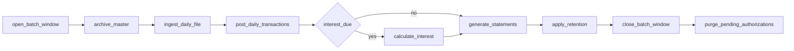

# Batch: Spring Batch jobs and Airflow DAGs

## Principles

- **Spring Batch holds the batch rules.** All jobs live in one Spring Boot application, `batch-service` (`modernization/batch/`), with its job repository in the `batch` schema.
- **Airflow only orchestrates.** DAGs in `modernization/airflow/dags/` open and close the batch window, launch jobs through `batch-service`, wait for their exit status, branch and retry. They contain no business rule; `make test-airflow` fails if a DAG file imports anything but Airflow and the shared operator package.
- **One cycle date.** Each cycle run has a `cycle_id` and a `businessDate` (Airflow's logical date, or a `conf` override). The DAG's first call, `POST /internal/cycles {businessDate, interest}`, creates the `batch.cycle` row, or returns the existing one for that date, and gives the `INT` `cycleId`. Every job takes them as identifying job parameters. INTCALC's `PARM` (`2022071800`) is derived as `yyyyMMdd` + `00` and stored as `batch.cycle.interest_parm`. Only the legacy mode of DEF-JINTC-001 differs: when DEF-INTC-010 is also legacy, it takes the ID prefix from the property `carddemo.batch.interest.legacy-parm` (default `2022071800`, the JCL literal), which `verify-batch` sets to the GnuCOBOL runner's value ([switches.md](switches.md#switches)). The timestamps the jobs write, in either mode, take their date from `businessDate` and their time from the clock, as `CARDDEMO_BUSINESS_DATE` does locally. This replaces the three date sources in use today (D1 cross-cutting finding 5).
- **Exit statuses replace return codes and abends.**

| Legacy | Spring Batch exit status | Airflow |
| :-- | :-- | :-- |
| RC 0 | `COMPLETED` | task success |
| RC 4 (POSTTRAN rejects, COBTUPDT record errors) | `COMPLETED_WITH_REJECTS` | task success; the reject count goes to XCom and the task log (a DAG run note is optional) |
| U0999, CEE3ABD, RC 12 or 16 | `FAILED` | task failure; the DAG stops; the window stays open |

## Batch window

CLOSEFIL closes five CICS files (`ACCTDAT`, `CCXREF`, `CXACAIX`, `TRANSACT`, `USRSEC`) before batch, OPENFIL reopens them, and a job that changes them must not overlap online updates (INV-002).

- DAG task `open_batch_window` calls `POST /internal/batch-window/open {cycleId}` on `batch-service`, which owns the window ([api-security.md](api-security.md#batch-service-internal)). There is one global window in mode `WRITES_BLOCKED` (D-BAT-05), with one application lock. Each online write transaction holds the shared side of the lock; opening takes the exclusive side, waits until running writes have drained, records the row in `ops.batch_window` and returns. If they do not drain in time it answers `503 WINDOW_DRAIN_TIMEOUT` and leaves the window closed, and the DAG task retries. Opening again for the same holder is a no-op; while another holder (another cycle, or a reload keyed by `<dag_id>/<run_id>`) has it open, the open answers `503 WINDOW_BUSY` with `Retry-After` and the task waits ([contract](batch-execution-contract.md#6-batch-window)). This replaces both SDSF `CEMT` and WAITSTEP's fixed 36-second sleep.
- Services check the window before using a covered table ([api-security.md](api-security.md#api-conventions)).
- `close_batch_window` clears it. It runs only when every task before it succeeded. After a failure the window stays open, as the files stay closed today (ERR-JCA7-001), until an operator closes it with `make -C modernization batch-window-close` after recovery; that close leaves the cycle `OPEN`, so the next DAG run resumes it. Only the DAG's own close marks the cycle `COMPLETED`.

| Window mode | Covered tables | Online effect | Default |
| :-- | :-- | :-- | :-- |
| `CLOSED_FILES` | account, card cross-reference, transaction, user | every read and write on them fails, including sign-on, as with closed CICS files | legacy behaviour, not built |
| `WRITES_BLOCKED` | every business table the cycle or a reload writes: `core.*` (including online adds to `core.daily_tran`), `ref.*`, user maintenance | reads work (snapshot isolation), writes return 503; sign-on, refresh and sign-off stay available | **decided (D-BAT-05)**; one global window for the daily cycle, the reference refresh and the data load |
| `NONE` | - | no window; row locks only | not recommended: posting reads running totals (BR-POST-007) |

## The transaction master and cycles

Today the transaction master holds one cycle: TRANBKP backs it up and empties it, POSTTRAN fills it, COMBTRAN reloads it from the backup plus the interest transactions, and older transactions live only in five backup generations (INV-003, INV-052, INV-053). COMBTRAN picks its inputs by relative generation, so a report run between TRANBKP and COMBTRAN loses the day's postings (INV-052, Q-JCOMB-001).

The target keeps all rows in `core.transaction` and marks the legacy master with `in_master`:

| Legacy step | Target |
| :-- | :-- |
| TRANBKP reset (backup, delete, define empty) | `archiveMasterJob`: one statement sets `in_master = 0` for every row in the master and records the count in `batch.cycle`. Nothing is copied; the rows are the backup. |
| POSTTRAN writes the master | inserts with `in_master = 1`, `origin = POSTED`, `cycle_id` |
| INTCALC writes `SYSTRAN(+1)` | inserts with `in_master = 1`, `origin = INTEREST`, `cycle_id` |
| TRANBKP backup, then COMBTRAN sort and reload | nothing to do: the master already holds postings plus interest, in key order by `ORDER BY` |
| Bill payment between cycles | insert with `in_master = 1`, `origin = BILL_PAY`, posted at once through `ledger-core` (D-28); `cycle_id` NULL until the batch slice settles the stamping rule |
| Online transaction add between cycles | a `core.daily_tran` row with `origin = ONLINE_ADD`, posted by the next cycle (D-27, [below](#online-writes-between-cycles)) |
| GDG `LIMIT(5)` retention | `in_master = 0` rows older than five cycles are deleted by the cycle's last task (legacy retention), or kept (D-BAT-04) |

Readers that saw "the master" (online list and view, statements, reports, ID allocation) filter on `in_master = 1`, so they see what they see today. The relative-generation hazard is gone, because nothing selects by "newest generation".

### Online writes between cycles

D-27 (accepted: "feed the posting input; one posting path") fixes DEF-TRNA-001. An online add does not write `core.transaction`; it queues the transaction for the next posting run, so POSTTRAN's rules (validation, over-limit, expiry, balance, cycle totals, category balance) apply to it once, in `batch-service`.

- **The add.** `transaction-service` validates as today, allocates the ID with `ledger-core` `TransactionIds.next()` (switch BR-TRNA-003), and inserts one `core.daily_tran` row: `origin = ONLINE_ADD`, `cycle_id` NULL (waiting), `created_by`, the parsed columns, and `raw_record` built in the 350-byte daily-file layout by `legacy-format`, so a reject reads like a file reject. The success message keeps its text, with the ID (BR-TRNA-005). The add is a write under the batch window: during the window it gets `503 BATCH_WINDOW`, which also keeps it from racing the claim below.
- **IDs.** In fixed mode the sequence keeps IDs unique, and the claim check stops any collision with the daily file ([below](#transaction-ids-from-the-file-and-from-the-services)). In legacy mode "highest + 1" takes the highest ID among master rows **and** waiting `ONLINE_ADD` rows, under the same app lock, so it gives the value the legacy file would; the filtered unique index `UX_daily_waiting (tran_id) WHERE cycle_id IS NULL` backs it. "Copy latest" (BR-TRNA-006) reads the same union.
- **The claim.** `ingestDailyFileJob` stages the file rows (step `stage`), then claims every waiting row (step `claimOnlineAdds`): it sets `cycle_id` and gives them `seq` numbers after the file rows, in insert order (`daily_pk`). Posting is single-threaded in `seq` order (BR-POST-007), so a cycle with no online adds posts exactly as before, and the differential checks are unchanged.
- **Posting.** Online-add rows go through the same `post` step as file rows. Accepted rows become `core.transaction` rows with `in_master = 1`, `origin = ONLINE_ADD`, the cycle's `cycle_id` and `created_by` carried over. Rejected rows go to `core.daily_reject` with reasons 100 to 103 and appear in the reject export and the operations view.
- **What users see.** An added transaction appears in the transaction list, view and reports after the cycle that posts it, not at once as BR-TRNA-007 describes; a rejected add appears only among the cycle's rejects. Both follow from the accepted D-27 fix and get ledger entries (BR-TRNA-007, PINV-c-05). Bill payments still post at once (D-28), because the user must see the new balance on the confirmation screen.

### Transaction IDs from the file and from the services

Ruled 2026-11-10; the user approved the reserved range of rule 1 the same day. This settles the open item in [billpay-slice.md](billpay-slice.md#14-left-for-later-slices) and transaction-service question 12.

**Facts.**

- Posting keeps each file record's ID unchanged (BR-POST-006). The services generate IDs: online add, bill payment and, in fixed mode, interest (DEF-INTC-010). The two sources are not coordinated (INV-001, DEF-TRNA-003).
- `archive_master` runs before `ingest_daily_file`, as TRANBKP runs before POSTTRAN. So the master is empty when the claim runs, and `UX_tran_master` only meets IDs of the cycle being posted.
- In the legacy cycle an online add never met a later file record. The add was written to the master at once, and TRANBKP moved it to the backup before POSTTRAN, unposted (DEF-TRNA-001). The only duplicate the legacy run meets is two file records with one ID. POSTTRAN abends on the second one, after its balances were applied (ERR-POST-004, DEF-POST-008, DEF-POST-009).
- D-27 sends the add through posting, so an add's ID can now meet a file record's ID. Neither record is wrong, and the user has already been shown the add's ID (BR-TRNA-005).
- The sample file holds 300 distinct IDs from `0000000000683580` to `0000000996722787`.

**Rules.**

1. **Separate ranges in fixed mode (BR-TRNA-003 fixed, D-59). Approved by the user on 2026-11-10.** Legacy accepts any 16 characters as a file ID: posting copies positions 1 to 16 unchanged, with no format or range check (BR-POST-006, DEF-POST-009). The approval reserves one part of that input for generated IDs and changes nothing else. It is not a numeric check on file IDs.
   - **Reserved ID.** A `tran_id` is reserved when all 16 characters are the ASCII digits `0` to `9` and its value is `9000000000000000` or more. That is the same as "16 digits, the first one `9`". The test compares characters and never parses the ID as a number. In SQL with the BIN2 column: `tran_id LIKE '9%' AND tran_id NOT LIKE '%[^0-9]%'`. An ID with a letter, a space or any other non-digit is not reserved, and the file may use it as in legacy. A numeric ID below `9000000000000000` is also accepted as in legacy. Any other limit on file IDs needs its own decision.
   - **Generated IDs.** Every ID the services generate (online add, bill payment, interest in fixed mode) comes from `core.tran_id_seq`, with `MINVALUE 9000000000000000`, `MAXVALUE 9999999999999999` and `NO CYCLE`, which leaves 10^15 IDs. Formatted `%016d`, every generated ID is reserved. So an online add cannot meet a file record. The migration runs `ALTER SEQUENCE core.tran_id_seq MINVALUE 9000000000000000 RESTART WITH 9000000000000000`.
   - **`make load`.** The sequence restarts with `9000000000000000` when no loaded `tran_id` is reserved, and otherwise with the highest reserved loaded ID plus 1. Non-reserved IDs never move it. The first generated ID on the sample is exactly `9000000000000000`. Exhaustion follows rule 6.
   - **Feed rule.** A daily file must not use reserved IDs. The claim check below enforces this, and no ID is remapped or dropped.
   - "One sequence shared by all writers" (D-59) means all writers that generate IDs. Posting copies the file's ID and does not draw from the sequence.2. **Check at the claim, in both modes.** `claimOnlineAdds` runs the check and the claim in one transaction, inside the window, so no add can be inserted between them. It fails `ingestDailyFileJob` when any of these holds:
   - two staged file rows of the cycle have one `tran_id`;
   - a staged file row has the `tran_id` of a waiting add about to be claimed;
   - a staged file row has the `tran_id` of a master row (`in_master = 1`), which is empty after the archive, as a defence;
   - fixed mode only: a staged file row's `tran_id` is reserved (rule 1). An ID that is not all digits is never reserved.

   The exit description is `DUPLICATE_TRAN_ID` or `TRAN_ID_RESERVED`. It names each `tran_id`, the file record numbers and the other row's `origin`, and never a card number. The claim rolls back, so nothing is lost:
   - the adds stay waiting (`cycle_id` and `seq` NULL);
   - the staged file rows stay staged and unposted;
   - `core.transaction`, `core.account`, `core.tcat_bal` and `core.daily_reject` are unchanged.

   The cycle stays `OPEN` and the window open, with an alert (D-BAT-06). A restart runs the check again and fails again. The way out is to correct the inbound file and run `cycle-rerun`, which deletes the staged rows. The adds then post with their original IDs.
3. **No remap, no drop, no new reject reason.** Neither record's ID is changed. A reject reason `0104` is not added, because legacy never rejected for this.
4. **Backstop.** `UX_tran_master` still fails the `post` chunk on any duplicate the check cannot see. The chunk rolls back, the step fails with `DUPLICATE_TRAN_ID`, and a restart fails again at the same `seq`. Nothing is half applied.
5. **The sequence is not raised to the highest posted ID.** A feed that numbers upwards would then land on IDs already given to waiting adds. Rule 1 makes raising it unnecessary.
6. **Exhaustion.** No ID wraps, in either mode. In fixed mode `NO CYCLE` makes `NEXT VALUE FOR` past `9999999999999999` fail (SQL Server error 11728). In legacy mode "highest + 1" past `9999999999999999` is refused before the insert (DEF-TRNA-013, NUM-BILL-005). `TransactionIds.next()` turns both into `TranIdExhaustedException`. Online add answers `500 ADD_FAILED`, `Unable to Add Transaction...`, its legacy write-failure text ([transaction-service.md](transaction-service.md#12-contract-v6-2026-11-10)); bill payment answers `500 TRAN_ID_EXHAUSTED` with Bill Pay's write-failure text. Nothing is written, and each logs the cause. `calculateInterestJob` fails with that exit description, and its chunk rolls back. Tests, in both modes: the sequence restarted at `9999999999999999` (fixed), or a master row with that ID (legacy). One add then succeeds or is refused as the mode says, and the next is refused with nothing written.
**Governing rule and its effect.** The user's targeted switch policy makes failure-path fixes fixed-only, even in batch ([switches.md](switches.md#policy)). Rule 2 is such a fix: a normal run never takes it. So it applies in both modes with no switch. That the stress data has no duplicate IDs is a fact about the tests, not the reason. What changes for a file with a duplicate ID at record N:

- **Legacy:** records 1 to N-1 are posted, and record N's account and category balance are updated without its transaction record. POSTTRAN abends with U0999 and prints no end-of-run counts. The runbook then restores `ACCTDATA` and `TCATBALF` from backup.
- **Target:** nothing is posted and no balance changes. `ingestDailyFileJob` fails with `DUPLICATE_TRAN_ID`, naming both record numbers, and the window stays open.
- After the file is corrected and rerun, both end in the same state. The target skips the restore and never shows the half-applied state.

Legacy mode is kept only for parity runs (D-DATA-05). Its online IDs are above the master's highest ID, so there an add meets a file record only with a contrived file, and the check then fails the run in the same way. Ledger entries, all architecture-dependent with DEF-POST-008 (DEV-ARCH-05):

- ERR-POST-004: the run stops before posting, not at the duplicate record;
- DEF-POST-009: duplicates are found before posting;
- INV-001: separate ranges plus the claim check.

The BR-TRNA-003, DEF-TRNA-003 and DEF-BILL-003 notes name the reserved range and the user approval of 2026-11-10.
## Batch-cycle option

Area G's decision table (G `jobs/README.md`) lists seven cycle orders found in the repository and options A to F. This proposal takes **option F**, the order derived from the data dependencies, which area G also recommends:

| Option | Order | Why not / why |
| :-- | :-- | :-- |
| A README table | close, 10 reloads (incl. TRANBKP reset), POSTTRAN, INTCALC, TRANBKP, COMBTRAN, CREASTMT, TRANIDX, open | demo reset; destroys data in production |
| B runbook | close, POSTTRAN, INTCALC, TRANBKP, COMBTRAN, CREASTMT, TRANIDX, open | fails on the second run: the master is not empty |
| C split scripts | separate posting and interest cycles | no statements; COMBTRAN reloads only the last posting day |
| D CA-7, E Control-M | as defined | not runnable as written; only the ordering rules and the daily, weekly, monthly split carry over |
| **F data-dependency order** | close, TRANBKP reset, POSTTRAN, INTCALC at the chosen frequency, TRANBKP, COMBTRAN, CREASTMT (+ TRANIDX), open; everything else on demand | consistent with every source; repeatable |

In the target, F becomes:

TRANBKP's second run and COMBTRAN disappear (previous section), TRANIDX is dropped (SQL index), WAITSTEP's fixed 36-second pause is dropped. Because there is no COMBTRAN step, a cycle without interest needs no special handling: the branch skips `calculate_interest` and the master already holds the day's postings (area G notes that legacy F must skip COMBTRAN or feed it an empty interest file on such a day).

Two orders in the legacy schedules are not carried over:

- **Statements in parallel with posting.** CA-7 starts CREASTMT from CLOSEFIL at the same time as the purge-then-POSTTRAN chain, so statements can read the master before or while the day is posted (DEF-JSTMT-006). The target runs statements only after posting and interest.
- **The purge gating posting.** CA-7 runs CBPAUP0J between CLOSEFIL and POSTTRAN; the batch-cycle runbook runs it after OPENFIL (Q-JCA7-003, DEF-JCA7-007). The purge reads and writes only `pauth`, which posting does not use, so there is no data hand-off between them. The target runs it after `close_batch_window`, as its own task that never gates posting, and skips it when the authorization module is not installed. A purge failure fails the DAG run and alerts; the legacy CBPAUP0C return code 16 that the schedulers may count as normal completion (DEF-JAUPG-003) always maps to `FAILED`. DAG parameter `purge_position=before_posting` reproduces the CA-7 order if operations want it.

Decisions that go with F, with the defaults this proposal uses:

| Decision | Default | Recommended |
| :-- | :-- | :-- |
| Interest frequency (Q-JINTC-002, Q-JCTLM-002) | DAG parameter `interest`: `always` (as the runbook order) | `month_end`: the rate is monthly (`/1200`) and Control-M files interest in a monthly folder, which nothing orders (DEF-JCTLM-002) |
| Statement timing (Q-JSTMT-001, DEF-JSTMT-006) | every cycle, after interest (the README and runbook position) | once per statement period, on the interest day |
| Purge position (Q-JCA7-003, DEF-JCA7-007) | after the cycle, never gating posting | same |
| History retention (INV-053, Q-JGDGB-001) | master holds one cycle; archived rows kept 5 cycles | keep all history visible online, with a retention period set by compliance |
| Reference reloads and TRANEXTR (DEF-JCTLM-005) | disclosure groups weekly on Saturday; batch type maintenance only if a producer of its input is named (D-BAT-07); no TRANEXTR | same |
| Reports and listings (TRANREPT, PRTCATBL) | on demand (CA-7 schedules PRTCATBL only under SCHID 031) | same |
| Failure policy | stop the chain, keep the window open, alert | same |

## Jobs per JCL job and step

| JCL job (spec) | Steps today | Spring Batch job and steps | DAG and task |
| :-- | :-- | :-- | :-- |
| CLOSEFIL (JCLOSE) | SDSF `CEMT SET FIL CLO` | none (REST call) | `carddemo_daily_cycle.open_batch_window` |
| CBPAUP0J (JAUPG) | STEP01 CBPAUP0C (IMS BMP) | `purgePendingAuthorizationsJob`: `purge` chunk step over `pauth.auth_summary` | `purge_pending_authorizations` |
| TRANBKP (JTBKP) | REPRO backup, IDCAMS delete, define | `archiveMasterJob`: `archive` tasklet | `archive_master` |
| POSTTRAN (JPOST) | STEP15 CBTRN02C | `ingestDailyFileJob`: `stage` (the configured inbound file to `core.daily_tran`, chunked), `claimOnlineAdds` (one statement: waiting `ONLINE_ADD` rows get the `cycleId` and `seq` after the file rows, [above](#online-writes-between-cycles)); `postDailyTransactionsJob`: `post` (chunk, single thread, `seq` order), `stageAuthorizationMatches` and `applyAuthorizationMatches` (D-33 matching, [rule](d33-matching-brief.md)), `exportRejects` (430-byte file) | `ingest_daily_file`, `post_daily_transactions` |
| INTCALC (JINTC) | STEP15 CBACT04C with PARM | `calculateInterestJob`: `interest` (item = account with its category balances) | `calculate_interest` |
| COMBTRAN (JCOMB) | SORT, REPRO | none | none |
| CREASTMT (JSTMT) | delete/define work file, SORT, REPRO, IEFBR14, STEP040 CBSTM03A | `statementJob`: `render` (legacy mode: text and HTML; fixed mode: one PDF per account, [Statements](#statements-statementjob-ruled-2026-11-11)) | `generate_statements` |
| TXT2PDF1 (JPDF) | TXT2PDF exec | the fixed-mode PDF renderer of `statementJob` (D-45); no flag | part of `generate_statements` |
| TRANIDX (JTIDX) | define AIX, path, BLDINDEX | none | none |
| OPENFIL (JOPEN) | SDSF `CEMT SET FIL OPE` | none (REST call) | `close_batch_window` |
| TRANREPT (JTRPT), TRANREPT-PROC (JTRPTP) | backup REPRO, SORT with date filter, CBTRN03C | `transactionReportJob`: `start` (the run row to `RUNNING`, in its own fenced transaction), `print` (one query streamed through the report writer, then the publication; [Report content](#report-content)) | `carddemo_transaction_report.run_report` |
| PRTCATBL (JPCAT) | delete, backup REPRO, SORT and format | `categoryBalanceListingJob`: `list` | `carddemo_category_balance_listing.run_listing` |
| MNTTRDB2 (JMNTT) | COBTUPDT under DSN | `transactionTypeMaintenanceJob`: `maintain` | `carddemo_reference_refresh.maintain_transaction_types` |
| DISCGRP (JDISC) | delete, define, REPRO | `disclosureGroupReloadJob`: `reload`, `checkDefaultGroup` | `carddemo_reference_refresh.reload_disclosure_groups` |
| ACCTFILE, CARDFILE, XREFFILE, CUSTFILE, TCATBALF, TRANTYPE, TRANCATG, and the first load of DISCGRP | delete, define, REPRO, AIX | `dataLoadJob` steps ([data-model.md](data-model.md#sample-data-migration)) | `carddemo_data_load` (manual) |
| DUSRSECJ (JUSEC) | IEBGENER, delete, define, REPRO | none: `identity-service` seeds the demo users into an empty `iam.app_user` in the `demo` profile (D-06) | none |
| CBEXPORT-JOB (JEXPT), CBIMPORT-JOB (JIMPT) | delete/define, CBEXPORT; CBIMPORT | `exportMastersJob`, `importMigrationJob` ([Export and import](#export-and-import-ruled-2026-11-11)) | `carddemo_export_masters`, `carddemo_import_migration` (manual) |

Every other job in [mapping.md](mapping.md) is dropped.

## DAGs

| DAG | Schedule | Tasks |
| :-- | :-- | :-- |
| `carddemo_daily_cycle` | daily, `catchup=False`, `max_active_runs=1`; params `interest` (`always`, `month_end`, `never`), `statements` (`every_cycle`, `with_interest`), `purge_position` (`after_cycle`, `before_posting`) | as in the diagram above |
| `carddemo_transaction_report` | none; triggered by `transaction-service` through the Airflow REST API with `conf {runId, startDate, endDate, requestedBy}` | `run_report` |
| `carddemo_category_balance_listing` | manual | `run_listing` |
| `carddemo_reference_refresh` | weekly, Saturday | `open_batch_window` (the same global window), `maintain_transaction_types` (skipped without input file), `reload_disclosure_groups`, `close_batch_window` |
| `carddemo_data_load` | manual | `open_batch_window`, `load`, `verify`, `close_batch_window` |
| `carddemo_export_masters`, `carddemo_import_migration` | manual | one job each |

The one global window keeps the cycle, the reference refresh, the data load and the import apart; the Airflow pool `carddemo_batch` (one slot) only limits concurrent job tasks. `carddemo_import_migration` opens and closes the window around its job. Tasks use one shared operator, `SpringBatchJobOperator` (launch, then a deferrable trigger that polls the execution, so a waiting task holds no worker slot). Airflow runs from the host venv with its metadata in the compose Postgres on 25432.

## Restart and idempotency

| Job | Restart after a failure | Second run of a completed cycle |
| :-- | :-- | :-- |
| `ingestDailyFileJob` | `stage` reads only the attempt's archive copy, checked against the stored checksum, and resumes after the last committed chunk; `claimOnlineAdds` claims only rows still waiting, so a rerun claims nothing twice. A failed ID check rolls the claim back and fails again on restart until the file is corrected and `cycle-rerun` runs ([IDs](#transaction-ids-from-the-file-and-from-the-services)). | Refused (`409 JOB_INSTANCE_COMPLETE`). |
| `postDailyTransactionsJob` | Resumes after the last committed chunk. Each chunk commits the account, category balance, transaction and reject rows together with the reader position, so no record is half applied (fixes DEF-POST-008 by construction). | Refused: same `cycleId` and `attempt` is a completed job instance. A deliberate rerun goes through `make -C modernization cycle-rerun CYCLE=<id>` (below), which replaces the runbook restore. |
| `calculateInterestJob` | Resumes at the next account; interest rows and the account update of one account commit together (DEF-INTC-009). | Refused; legacy reruns charge interest twice (DEF-INTC-005), an architecture-dependent item. |
| `archiveMasterJob` | One statement; rerun is a no-op. | No-op. |
| `statementJob` | Keeps its capture and renders again into a new working folder, or finishes a committed publication ([Statements](#statements-statementjob-ruled-2026-11-11)). Nothing is published before the commit, as z/OS deletes outputs on abend (ERR-STMT-008). | Same identity: refused (`409 JOB_INSTANCE_COMPLETE`). |
| `transactionReportJob`, `categoryBalanceListingJob` | Rerun from the start into a working path of the new execution, unless an earlier execution committed its publication intent; then the restart publishes or verifies those bytes and builds nothing ([contract section 4.8](batch-execution-contract.md#48-output-publication); ERR-STMT-008, as above). | Same identity: refused (`409 JOB_INSTANCE_COMPLETE`). A new report run or DAG run: allowed, with a new run folder. |
| `purgePendingAuthorizationsJob` | Resumes after the last chunk; deleted rows stay deleted. | Allowed; nothing left to purge. |
| `dataLoadJob` steps | Each step truncates and loads in one transaction. | Allowed only inside a batch window. |

**Operator retry contract.** The approved contract is [batch-execution-contract.md](batch-execution-contract.md); this summary does not override it.

- **Job identity.** Cycle jobs are identified by `cycleId`, `businessDate` and `attempt` (`batch.cycle.attempt`, 1 unless a deliberate rerun raised it); `statementJob` writes to the folder `cycleId`-`attempt`. `transactionReportJob` is identified by its `batch.report_run` ID. `categoryBalanceListingJob`, `dataLoadJob`, the reference jobs, the export and the import are identified by `runKey` = `<dag_id>/<run_id>/<task_id>`. A task retry therefore finds the same instance, and a new DAG run or report request makes a new one. No caller-supplied key is used in a file name; output folders are named by IDs batch-service generates.
- **Responses.** A launch answers `202 {executionId}`. Every job `409` carries `executionId`, `executionStatus`, `exitStatus` and `rejectCount`:
  - `JOB_EXECUTION_RUNNING`: the operator attaches to that execution and polls it.
  - `JOB_INSTANCE_COMPLETE`: the task succeeds only if `exitStatus` is `COMPLETED` or `COMPLETED_WITH_REJECTS`; nothing is posted twice (DEF-JPOST-003). Clearing a completed task never reruns the job.
  - `JOB_INSTANCE_NOT_RESTARTABLE` and `BATCH_WINDOW_REQUIRED`: terminal; the task fails and an operator decides.
- **Restart and retry.** A `FAILED` or `STOPPED` instance is restarted by the same launch (`202`) and resumes as the table above says. `503` and connection errors are retried within the task's `execution_timeout`; `503 WINDOW_BUSY` waits do not use task retries. `400` and `404` are not retried.
- **Ownership and crash recovery.** Each execution has a lease in `batch.execution_lease`, renewed every 10 s on the database clock. Every job transaction ends with a fence that fails when the lease has been revoked or not renewed for TTL + grace (120 s by default), so an owner that lost its lease commits nothing. Only a launch recovers an execution: it revokes the lease and marks the execution `FAILED` (`OWNER_LOST`) in one transaction, then restarts it. A poll only reports the lease (`recoverable: true`), and the operator then fails the attempt as retryable so the retry re-launches. Nothing is recovered at startup, and several batch-service processes may share one database.
- **Cycles.** `POST /internal/cycles` is idempotent per `businessDate` and answers the stored `{cycleId, businessDate, attempt, interest, interestParm, status, ...}`. A different resolved `interest` gets `409 CYCLE_PARAMETERS_DIFFER`. An `OPEN` cycle is returned as is and the DAG resumes it. A `COMPLETED` cycle gets `409 CYCLE_COMPLETED`, terminal, before `open_batch_window`, so a re-triggered run for a finished date never blocks online writes.
- **Deliberate rerun.** `make -C modernization cycle-rerun CYCLE=<id>` refuses while an execution of the cycle is live. Otherwise it runs inside the cycle's window, restores `batch.snapshot_account` and `batch.snapshot_tcat_bal`, deletes the cycle's `POSTED` and `INTEREST` transactions, its rejects and its staged file rows, and returns its `ONLINE_ADD` rows to waiting (`cycle_id`, `seq` NULL). Before deleting the transactions it reverts the cycle's authorization matches ([d33-matching-brief.md](d33-matching-brief.md#batch-steps)). In the same transaction it supersedes the cycle's completed statement run and invalidates every unfinished statement run of this and later cycles ([Statements](#runs-restart-and-rerun)). It then raises `attempt`, clears the daily file identity and sets the cycle back to `OPEN`, so the next DAG run creates fresh job instances and the replacement attempt copies and hashes the inbound file afresh, under its own identity and checksum (`archive/<businessDate>.<attempt>.<sha256>.txt`, [contract](batch-execution-contract.md#49-inbound-daily-file) section 4.9). The rerun never moves or rewrites the inbound daily file. A file in the inbound folder for the date (a corrected one, if the operator replaced it) is kept and staged by the next attempt. Only when the inbound file is missing does the rerun put back a copy: the one that the replaced attempt's stored identity names, not the newest archive file, checked against that identity's hash and linked with no replace, so an inbound file that appeared meanwhile is kept. When the replaced attempt has no stored identity, nothing is put back. The cycle's window stays open for the next DAG run. The rerun refuses when a later cycle has started (`LATER_CYCLE_STARTED`) or when a transaction outside the cycle was written after its snapshot (`WRITTEN_SINCE_SNAPSHOT`, V416 `batch.cycle.snapshot_tran_pk`), because restoring the balances would drop that write's balance change while its transaction stays. It also refuses when a later cycle has a `COMPLETED` statement run (`LATER_STATEMENT_COMPLETED`, [Statements](#runs-restart-and-rerun)), and a cycle from before an import or a data load (`MASTERS_REPLACED_SINCE_SNAPSHOT`, [Cycles before a master replacement](#cycles-before-a-master-replacement-ruled-2026-11-11)). On every refusal it tries to close the window again if it opened it; a window it found held stays open, and a close that fails leaves the window open. What a refused rerun may still have changed, the full order of its refusals and how it returns the daily file are in [Data load admission and the rerun's refusals](#data-load-admission-and-the-reruns-refusals-ruled-2026-11-11). batch-service runs it as a one-shot command: `--carddemo.batch.command=cycle-rerun --carddemo.batch.rerun.cycle-id=<id>`, exit code 0 only when the cycle was restored and 1 on every refusal or failure. A missing or invalid cycle ID, or a `carddemo.batch.command` other than `load`, `cycle-rerun` or (in server mode) `none`, fails the start before any connection is opened, with a non-zero exit code.

**Crash-recovery checks** (`make verify-cycle`, against a real Airflow and `batch-service`):

1. Kill `batch-service` during `post` at a chunk boundary and inside a chunk, then start it again. Polls report the lease expiring and then recoverable; the task retry's launch recovers and restarts it, and the exported results equal an uninterrupted run.
2. Start a second `batch-service` while the first runs a job: the running execution continues unchanged. Pause the owner (`SIGSTOP`) past TTL + grace and launch: one recovery, the resumed owner's next commit fails, and the results equal an uninterrupted run.
3. A task retry after `COMPLETED_WITH_REJECTS` gets `JOB_INSTANCE_COMPLETE` with the same reject count and posts nothing again.
4. Registering a `COMPLETED` cycle gets `409 CYCLE_COMPLETED`, and `ops.batch_window` is unchanged.
5. `cycle-rerun` followed by the DAG gives the same results as the first clean run, including online adds that were waiting.
6. An `ABANDONED` instance gets `JOB_INSTANCE_NOT_RESTARTABLE`, and the task fails without retrying.
7. The reference refresh triggered while the cycle holds the window waits on `503 WINDOW_BUSY` and runs after the cycle closes it.
Posting stays single-threaded in input order, because each record's over-limit check uses the cycle totals that earlier records changed (BR-POST-007). The processor keeps the accounts and category balances touched in the current chunk in a unit-of-work cache that the writer flushes, so later records in the chunk see earlier changes.

## Files and tables

| Data | Target | Why |
| :-- | :-- | :-- |
| Daily transactions (`DALYTRAN.PS`) | Inbound file `var/inbound/dailytran/<businessDate>.txt`, staged into `core.daily_tran`. Its transaction IDs must be unique and must not be reserved (16 digits starting with `9`). Any other 16 characters are accepted as in legacy ([IDs](#transaction-ids-from-the-file-and-from-the-services)). No job moves, rewrites or deletes it. Each attempt stages from its own immutable archive copy, `<instance root>/dailytran/archive/<businessDate>.<attempt>.<sha256>.txt` ([contract](batch-execution-contract.md#49-inbound-daily-file) section 4.9). | It is an external feed. |
| Daily rejects (`DALYREJS`) | `core.daily_reject`, plus the 430-byte file `<instance root>/rejects/<cycleId>-<attempt>/DALYREJS.txt` for operations and the differential tests | The runbook reads it. |
| Interest transactions (`SYSTRAN`), backups, combined and daily extracts, statement work file | rows in `core.transaction` | Intermediate files of the GDG design. |
| Transaction report | `<instance root>/reports/tranrept/<runId>/TRANREPT.txt` (133-byte lines) | A deliverable; downloaded through `transaction-service`. |
| Category balance listing | `<instance root>/reports/prtcatbl/<jobInstanceId>/PRTCATBL.txt` (40-byte lines), named by the Spring Batch job instance ID, because the listing has no run row ([contract](batch-execution-contract.md#23-outputs) section 2.3) | A deliverable. |
| Statements | `<instance root>/statements/<cycleId>-<attempt>/`: `STATEMNT.txt` and `.html` in legacy mode; `<acct_id>.pdf` per account and `index.csv` in fixed mode, no HTML; `MANIFEST.sha256` in both; owner-only modes (D-45, [Statements](#statements-statementjob-ruled-2026-11-11)) | Deliverables, once their run is `COMPLETED`. |
| Type maintenance input | `var/inbound/trantype/<date>.txt` (53-byte records) | An external input. |
| Export file | `<instance root>/exports/<exportId>/EXPORT.DATA.enc` and `MANIFEST.json`, with `exportId` from `batch.export_run` ([contract](batch-execution-contract.md#23-outputs) section 2.3) | The masters export, encrypted, with its completeness manifest ([Export and import](#export-and-import-ruled-2026-11-11)). The import reads a copy under `<CARDDEMO_VAR_DIR>/inbound/migration/<migrationName>/`. |

`var/` (`CARDDEMO_VAR_DIR`, absolute) is under `modernization/` and git-ignored; a deployment maps it to object storage (D-NFR-09). The instance root is `<CARDDEMO_VAR_DIR>/out/<sha256 of the database name>/<instance_id>/`, one per database instance; the inbound files stay under `<CARDDEMO_VAR_DIR>/inbound/` ([contract](batch-execution-contract.md#410-output-root-ruled-2026-11-11) section 4.10).

## Report content

| Output | How the content is reproduced | Checked by |
| :-- | :-- | :-- |
| TRANREPT (CBTRN03C) | Rows with `in_master = 1` and `proc_date` between the two dates (inclusive, INV-010), `ORDER BY card_num, tran_id` in legacy mode (the legacy sort input is the master in key order) and `ORDER BY acct_id, card_num, tran_id` with DEF-TRPT-004 fixed, so the cards of an account keep the legacy order inside it. One query, left-joined to cross-reference, type and category, reads the master and the reference rows as one version (`READ_COMMITTED_SNAPSHOT`) and is streamed, never held in memory; this is why `print` is one step. A missing code fails the job with `REPORT_REFERENCE_MISSING` and publishes nothing, as the program abends (INV-016). A custom writer reproduces the headers, the page break counter that also counts total lines (BR-TRPT-005), the "Account Total" blocks (per card in legacy mode, per account with DEF-TRPT-004 fixed, D-47), page and grand totals and the edit masks (NUM-TRPT-002). With DEF-TRPT-001 fixed an out-of-range row is skipped and the end-of-report lines always print (D-46). The query's range is the row's own dates, so in the job the two modes differ only for an empty selection: legacy writes a 0-byte report (FLOW-TRPT-001), fixed writes the end of report of BR-TRPT-006 with no detail, that is the page total block and the grand total line, with no header and no account total block. One date pair feeds both selection and heading (DEF-TRPT-002 cannot occur). | `verify-batch` against the GnuCOBOL TRANREPT on sample and stress data |
| PRTCATBL | `ORDER BY acct_id, type_cd, cat_cd`; 40-byte lines; balance edited `TTTTTTTTT.TT`. Legacy prints no sign; fixed adds a trailing `-` at position 33 for a negative balance (switch DEF-JPCAT-001, D-75; [format](#prtcatbl-categorybalancelistingjob)). | `verify-batch-spec`, written from the PRTCATBL spec (the job is a SORT, with no program to run) |
| CREASTMT (CBSTM03A) | One statement per cross-reference card in card order, with its customer and account and every master transaction of the card in ID order. The legacy renderer writes the 80-byte text and 100-byte HTML lines (NUM-STMT-001 to 003); the 51-card, 10-transaction table limit (DEF-STMT-001), the truncations (DEF-STMT-002, 003, 004) and the unescaped HTML (DEF-STMT-007) are the legacy mode of DEF-STMT-005, which covers them ([Modes](#modes)). | `verify-batch` against `checks/cbstm03a_harness` (CBSTM03A does not run off z/OS) |
| POSTTRAN rejects, account and category balance after the run | 430-byte rejects file; exported 300- and 50-byte records with zoned signs and `legacy_filler` | `verify-batch` against the GnuCOBOL POSTTRAN |
| INTCALC transactions and account after the run | exported 350- and 300-byte records | `verify-batch` against the GnuCOBOL INTCALC |

## Statements (`statementJob`), ruled 2026-11-11

Ruling on data's design draft v1 and its five open questions. The sources settle these: one statement per account per period, with a date, the period, the credit limit, a minimum payment and a reconciled total, and no size limits (D-43); full names, addresses and descriptions (D-44); one escaped PDF per statement from a template, archived per cycle, with HTML only if a consumer exists (D-45); no FICO score, and card numbers masked to the last 4 (D-10, deviation DEF-STMT-008); statements once per statement period, after posting and interest (D-38, D-BAT-02); failures stop the chain and rejects give a warning status with a count (D-57). **No source defines the minimum payment formula or the exact period boundaries** (CBSTM03A DEF-STMT-005 and Q-STMT-002 only ask for them). The defaults below are chosen here, as stated. Amended 2026-11-11 on the build's questions: [Build rulings](#build-rulings-statement-and-transaction-report-2026-11-11).

### Modes

- **Legacy (DEF-STMT-005 legacy):** as in the draft. It reads `in_master = 1` in `ORDER BY card_num, tran_id` and writes byte-identical `STATEMNT.txt` (80-byte records) and `STATEMNT.html` (100-byte records), checked against `checks/cbstm03a_harness`. The renderer has only the legacy behaviour of DEF-STMT-001 (below), 002, 003, 004 and 007. These five are covered by DEF-STMT-005 ([switches.md](switches.md), amended 2026-11-11): they have no switch of their own, and no mixed setting exists. It writes a `batch.statement_run` row with mode `LEGACY` and no `batch.account_statement` rows. Its capture (`W` and the capture rows) makes a `COMPLETED` legacy run the previous run of the next statement in either mode, as a fixed run is ([Period set](#which-accounts-and-transactions-fixed), amended 2026-11-11). Master rows whose card has no cross-reference row are left out of both files, as BR-STMT-009 does. The run stores their number as `unassigned` and ends `COMPLETED_WITH_REJECTS` when it is above 0 (D-57), and logs the count only. The parity comparison is of the two files; the exit status is not a legacy output.
- **Legacy overflow (DEF-STMT-001 legacy): the job fails before any output.** A pre-check counts what the program's table would hold: the distinct card numbers of the master rows the renderer reads (`in_master = 1`), including cards with no cross-reference row, which take a slot too (DEF-STMT-001, BR-STMT-009), and the rows of each of these cards. Above 51 cards, or above 10 rows on one card, the job ends `FAILED` with exit description `STATEMENT_TABLE_LIMIT` and the two counts, writes no file and leaves no `COMPLETED` row. The legacy overlay is never imitated (CBSTM03A §15, Q-STMT-005).
- **Fixed (DEF-STMT-005 fixed):** one PDF per account, as below. It has the decided behaviour of the five covered items: no table limit, full names, addresses, descriptions and balances (D-44, D-75), and no HTML, so nothing is written unescaped. No HTML is written, because no consumer is named (D-45, Q-STMT-007).

### Which accounts and transactions (fixed)

- **Accounts:** every `core.account` with at least one `core.card_xref` row at the capture (below), in `acct_id` order. An account with no transactions in the period still gets its statement (DEF-STMT-010, fixed only). The name and address come from the customer on the account's cross-reference row with the lowest `card_num`, read at render time. Every execution of the job runs inside its cycle's window (`409 BATCH_WINDOW_REQUIRED` otherwise, [contract](batch-execution-contract.md#6-batch-window) section 6), so no online write changes them between executions.
- **Capture (amended 2026-11-11 after the independent reviews of `c4d6d6f` and `dc4dc8e`).** At its first start the run takes the watermark and every account's figures in one fenced transaction, the *capture*. The transaction sets `SET LOCK_TIMEOUT` to the batch-service lock wait, the one existing setting `carddemo.batch.internal.launch-lock-timeout` (default 30 s, contract section 9; there is no statement setting of its own), and `SET DEADLOCK_PRIORITY LOW`. Both are session settings that outlive the transaction on a pooled connection, so the capture restores them (`SET LOCK_TIMEOUT -1`, `SET DEADLOCK_PRIORITY NORMAL`) on the same bound connection, before it goes back to the pool, whether it commits or fails, and aborts the connection if the restore fails ([contract](batch-execution-contract.md#44-recovery-revoke-then-fail-in-one-transaction) section 4.4). It takes its locks in this order:
  1. `sp_getapplock 'carddemo.batch_window', 'Exclusive', 'Transaction'`. Every guarded online writer (`BatchWindowGuard`, the V417 online-write procedures) holds the shared side for its whole transaction. So this waits until none is in flight, and none can start until the capture commits. `sp_getapplock` reports a timeout, a cancel, a deadlock or a parameter error as a negative return code (`-1`, `-2`, `-3`, `-999`), not as an SQL error, and a deadlock on an application lock does not roll the transaction back. So the capture takes the lock through batch-service's `org.carddemo.batch.execution.TransactionLocks.acquire(JdbcClient, resource, mode, timeoutMillis)` (public since `a05dbdc`, which closes the transaction level that `commit()` would leave open). It checks the return code and handles the driver's implicit transaction. The package-private `platform/ledger-core` `AppLocks` is not used from batch-service: any negative code fails the start with `STATEMENT_CAPTURE_BUSY` and rolls the transaction back.
  2. The cycle's window row must be open (`ops.batch_window`, `closed_at IS NULL`, this `cycleId`). Otherwise the start fails with `BATCH_WINDOW_REQUIRED`.
  3. `core.account WITH (TABLOCK, HOLDLOCK)`, then `core.transaction WITH (TABLOCK, HOLDLOCK)`. No other hint is added: SQL Server refuses conflicting locking hints on one table (error 1047). `HOLDLOCK` is the serializable hint, so each read takes a shared table lock and holds it to the commit. A shared table lock waits for every open transaction that has inserted or changed a row of that table, whoever the writer is, and blocks new ones until the capture commits. Serializable reads always lock: `READ_COMMITTED_SNAPSHOT ON` ([billpay-slice.md](billpay-slice.md) `db-migrate`) changes only the read-committed level, so an uncommitted row is waited for, never skipped. This order (window lock, account, transaction) is the order the writers use (Bill Pay: guard, `UPDLOCK` on the account, then the insert). A writer that locks in another order can only make the capture the deadlock victim.
  4. In the same transaction: `W = MAX(tran_pk)` (0 when the table is empty); one `batch.statement_capture` row per account with at least one cross-reference row, holding its `curr_bal` and `credit_limit`; and the `batch.statement_run` row (`RUNNING`, `W`, and on a fixed run `previous_run_id`). The fence is the last statement.

  In steps 3 and 4, a lock timeout or a deadlock (errors 1222 and 1205) fails the start with `STATEMENT_CAPTURE_BUSY` and commits nothing, as a negative return code does in step 1. The task retry starts again. Because the table lock waits for every uncommitted insert, no row with `tran_pk ≤ W` can commit after the capture, whether or not its writer uses the window guard. The known writers of `core.transaction` are posting, interest, archive and retention (cycle jobs, inside the window), Bill Pay (guarded), and the data load and the import (inside their own window). transaction-service and authorization-service have no write grant on it (D-27). The lock makes this list a check, not a dependency. A restart of the same run reuses the stored `W` and captured figures, and never captures again. Legacy mode takes the same capture, `batch.statement_capture` rows included, without `batch.account_statement` rows, and its renderer reads the master inside the window (legacy capture, [below](#build-rulings-statement-and-transaction-report-2026-11-11)).
- **Period set.** The statement covers the account's rows with `tran_pk` in `(W_prev, W]`, where `W_prev` is the watermark of the previous statement run (0 for the first one). The previous run is the latest `COMPLETED` run of an earlier cycle, in either mode (amended 2026-11-11, on the retention floor: before, only a fixed run counted, so the first fixed statement after legacy runs read the whole history and retention could never remove a transaction in a deployment that had run only legacy statements). A legacy run takes the same capture as a fixed one, so its `W` bounds what it covered. Rows belong to the account through `core.card_xref` as it is at run time. `in_master` is not used: the period is history, not the legacy master.
- **Late entries.** A row is on the statement of the period in which it was committed, whatever its `orig_ts` or `proc_ts`: a transaction committed after `W` with an earlier date goes on the next statement, listed with its own dates. Each row appears on exactly one statement that is not superseded, and is never listed twice or lost. Across a change from legacy to fixed mode, the rows at or below the legacy previous run's `W` are not listed on the fixed statement: which of them the legacy files showed is the legacy master rule (DEF-STMT-005 legacy), and the fixed statement starts after them.
- **Unassigned rows.** A row in the period whose card has no cross-reference row cannot be put on a statement (legacy BR-STMT-009 drops it silently). It is counted as `unassigned` and makes the run `COMPLETED_WITH_REJECTS`. Logs carry counts only (D-10).
- **Order on the statement:** `proc_ts`, then `tran_id`, then `tran_pk`. Each line shows the processing date, the full description, the card's last 4 digits and the amount.

### Dates, balances and the reconciled total

- **Statement date:** the cycle's `businessDate`. **Period:** from the day after the previous statement's date, or for a first statement the earliest `proc_date` in its set (or the statement date when the set is empty), to the statement date, inclusive.
- **First statement, per account.** An account has a first statement when the previous run holds no figures for it: no `batch.account_statement` row when the previous run is fixed, no `batch.statement_capture` row when it is legacy. That is, there is no previous run, or the account is new since it.
- **Closing balance C:** the captured `curr_bal`. At the capture no row above `W` exists and none below it can still commit, so `C` is exactly the balance after the rows up to `W`. Every execution of the run uses the stored value. A later write reaches the next statement, through its row (`tran_pk > W`), or, for a balance edited without a row, through that statement's adjustment line.
- **Opening balance O:** the closing balance stored for that account in the previous run: `account_statement.closing_balance` of a fixed run, or the captured `curr_bal` of a legacy run. Both are the same quantity, the balance after the rows up to that run's `W`, and the legacy one is the `Current Balance` its files printed. For a first statement, `O = C − N`, so `A = 0` and the account is not counted as adjusted.
- **N:** the net of the period's amounts (positive = owed, as `curr_bal`). The statement shows four totals, and each row of the period is in exactly one of the first three: payments and credits (the sum of the negative amounts of the rows whose `origin` is not `INTEREST`), purchases and other debits (the sum of the positive amounts of those rows), interest (the signed sum of the rows with `origin` `INTEREST`; a negative interest row, which DEF-INTC-012 legacy can write, lowers it and is not counted as a credit), and the closing balance. So `N` = payments and credits + purchases and other debits + interest. `account_statement.interest_amount` stores the signed interest; the minimum payment uses `I = max(0, interest)`.
- **Reconciliation:** `A = C − (O + N)`. When `A ≠ 0` (for example an administrator changed the balance on the account update screen, or a data reload), the statement still prints, with an extra line, `Other balance adjustments`, of `A`. So the printed total always adds up to the true closing balance. The account row stores `adjustment_amount = A`, and the run counts `adjusted` accounts and ends `COMPLETED_WITH_REJECTS` (D-57). A difference never fails the run: a `FAILED` statement task would hold the batch window open for every user over one account.
- **Credit limit:** the captured `credit_limit`. There is no due date, because D-43 does not ask for one.

### Minimum payment (chosen here, sandbox default)

With `C` the closing balance, `I = max(0, interest in the period)`, floor `F = 25.00` and percentage `P = 1.00`:

- `C ≤ 0.00`: minimum `0.00`.
- otherwise: minimum = `min(C, max(F, round(C × P / 100) + I))`, where `round` is half-up to cents and the arithmetic is decimal (`BigDecimal`).

Why this formula: it is the common card-issuer shape (a percentage of the balance plus the period's interest, with a fixed floor, never more than the balance). Including the interest means a customer who pays the minimum never pays down less than the interest charged (the `/1200` monthly rate of BR-INTC-001 can exceed 1% of the balance). The values are settings, `carddemo.batch.statement.minimum-payment-floor` (default `25.00`, at least 0) and `carddemo.batch.statement.minimum-payment-percent` (default `1.00`, more than 0 and at most 100). They are checked at start: a bad value fails the start with the property name, and is never clamped. Vectors:

| C | I | minimum |
| :-- | :-- | :-- |
| −10.00 | 0 | 0.00 |
| 0.00 | 0 | 0.00 |
| 20.00 | 0 | 20.00 |
| 194.00 | 0 | 25.00 |
| 3,000.00 | 0 | 30.00 |
| 3,000.00 | 37.50 | 67.50 |
| 1,234.56 | 0 | 25.00 |
| 9,876.55 | 0 | 98.77 (half-up) |
| 40.00 | 30.00 | 30.40 (0.40 + 30.00 is above the floor and below the balance) |
| 40.00 | 50.00 | 40.00 (capped at the balance) |

### Runs, restart and rerun

- **Tables (data, migration V419 in data's range; V418 is the DEF-ACUP-002 provenance columns):**
  - `batch.statement_run`: `statement_run_id BIGINT IDENTITY` PK; `cycle_id`, `attempt` unique; `mode` (`FIXED`, `LEGACY`); `status` (`RUNNING`, `FAILED`, `PUBLISHING`, `COMPLETED`, `SUPERSEDED`, `INVALIDATED`); `watermark_tran_pk BIGINT`; `previous_run_id` NULL, set only on a `FIXED` run (`CK_statement_run_previous`: NULL unless the mode is `FIXED`; a legacy run reads the master, not a period, and stores none). On a fixed run it names the latest `COMPLETED` run of an earlier cycle at the capture, and that referenced run may be of either mode ([Period set](#which-accounts-and-transactions-fixed), amended 2026-11-11; V419's SQL comment on this column, "never a legacy run", predates that ruling and is superseded by it; the applied migration is not edited, because Flyway checks its checksum); `folder` (the final name, `<cycleId>-<attempt>`); `work_folder` NULL (set with `PUBLISHING`); `manifest_sha256 CHAR(64)` NULL; `failure_code` NULL; counts (`statements`, `transactions`, `unassigned`, `adjusted`); `job_execution_id BIGINT NOT NULL`, FK to `BATCH_JOB_EXECUTION`, the execution that owns the row ([owner binding](#runs-restart-and-rerun) below); timestamps. Every status change is a compare-and-set on the expected status and on `job_execution_id`, inside a fenced transaction, except the status-only changes of `cycle-rerun`, the data load and the import (owner binding below).
  - `batch.statement_capture`: PK `(statement_run_id, acct_id)`; `curr_bal DECIMAL(12,2)`, `credit_limit DECIMAL(12,2)` (the account columns' types). Written once, by the capture; never updated, and `UPDATE` is denied (grants below).
  - `batch.account_statement`: PK `(statement_run_id, acct_id)`; `period_start`, `period_end`, `opening_balance`, `closing_balance`, `net_amount`, `interest_amount`, `adjustment_amount`, `minimum_payment`, `credit_limit`, `tran_count`, `file_name`, `file_sha256`. Money columns are `DECIMAL(13,2)`, because a balance near the `DECIMAL(12,2)` maximum plus a period's activity must not overflow.
  - Grants to `batch_svc` in `R__grants_batch.sql`: its grant on `SCHEMA::batch` (`SELECT, INSERT, UPDATE, DELETE`) already covers the three tables, and no table grant is added. `DENY UPDATE ON batch.statement_capture TO batch_svc` keeps the capture write-once (an object `DENY` overrides the schema grant). `DELETE` is not denied on any statement table: removing a whole run's rows is for the retention design, which is not in force and has to decide its own grants, and no statement code deletes a capture row (a source scan test checks it). The only delete the job makes is of its own run's `batch.account_statement` rows on a restart (below). `SELECT` on `core.transaction`, `core.card_xref`, `core.customer`, `core.account` and `ops.batch_window` is already granted for other jobs. The table hints of the capture need no other permission.
- **Folders.** The final folder is `<instance root>/statements/<cycleId>-<attempt>/`, as [batch-execution-contract.md](batch-execution-contract.md) (`cycleId`-`attempt`) governs. Only the publication creates it (contract section 4.8: `createDirectory`, one hard link per file, `.claim` first, the manifest last), and no job writes, replaces or deletes a published file afterwards. Each execution renders into its own working folder, `statements/.work/<cycleId>-<attempt>.<jobExecutionId>/`, so an owner that lost its lease and its successor never share a path. Fixed mode writes `<acct_id>.pdf` per account and `index.csv` (`acct_id`, `period_start`, `period_end`, `closing_balance`, `minimum_payment`, `tran_count`, `sha256`; no names, addresses or card numbers). Legacy mode writes `STATEMNT.txt` and `STATEMNT.html`. Both modes write `MANIFEST.sha256` last, in the format of contract section 4.8: one line `<sha256>  <file name>` for every other file, sorted by name in byte order. A final folder without its manifest is incomplete and never read; a complete one is read only through its `COMPLETED` run (below). The final name is unique only within one database instance, and the folder is under that instance's root, so a recreated database never meets an old folder; nothing clears or moves them ([contract](batch-execution-contract.md#410-output-root-ruled-2026-11-11) section 4.10).
- **Permissions (PII at rest).** batch-service creates `<instance root>/statements/`, `.work/` and every folder under them with mode `0700`, and every file with `0600`, owned by the service user (contract section 4.10). The mode is given at creation only, never set afterwards. At each start it checks `statements/` and `.work/` as contract section 4.8 says: a path that is not a directory, is a symbolic link, is not owned by the service user or has any group or other permission bit fails the start with `OUTPUT_PERMISSIONS`, and nothing is repaired (contract section 4.10, the one permission rule). Statement files are found only through a `COMPLETED` run that is not superseded and its `batch.account_statement.file_name`, never by listing a directory or from a caller's path. Any future download path does the same, and checks the file's sha256 against the row before it serves it.
- **Render.** Each chunk writes its PDFs into the execution's working folder. Then, in its fenced transaction, it inserts the chunk's account rows with `file_name` and the `file_sha256` of the bytes written. After the last chunk the step writes `index.csv` and `MANIFEST.sha256`. Any rendering or I/O failure fails the job.
- **Publication**, in three steps (contract [section 4.8](batch-execution-contract.md#48-output-publication)):
  1. *Verify, then commit the intent.* Read every file of the working folder back from disk and hash it. The file set must be exactly the account rows' `file_name` values plus `index.csv` (fixed), or the two legacy files, plus the manifest. Every hash must equal its account row and its manifest line. Then one fenced transaction sets `status = 'PUBLISHING'`, `work_folder`, `manifest_sha256` and the counts, `WHERE statement_run_id = @id AND status = 'RUNNING'`. Anything other than one updated row fails the step. A lost lease rolls the transaction back, so a stale owner's folder is never named.
  2. *Publish* the folder that `work_folder` names as the final folder, by the folder publication of contract section 4.8: create the final folder with `createDirectory` (an existing one is joined after the path checks), claim it by linking the working manifest onto `.claim`, then link each listed file and then the manifest, with `createLink`, and verify. Nothing is renamed and nothing is replaced. An existing file with other bytes fails with `PUBLICATION_MISMATCH`. A final folder whose `.claim` has other bytes fails with `PUBLICATION_MISMATCH` before any file is linked; one whose `.claim` has the same bytes is completed and verified. When the working folder is gone (another execution of the same intent published it), the final folder's `.claim` decides. Unless the publication fails, the step goes on to step 3.
  3. *Verify the target, then complete.* Hash the final folder against `manifest_sha256` and the account rows again. A missing final folder, or one whose file set (the listed files, the manifest and `.claim`) or hashes differ, fails the job with `PUBLICATION_MISMATCH` and leaves the run `PUBLISHING`. Otherwise one fenced transaction sets `status = 'COMPLETED' WHERE status = 'PUBLISHING'`. Spring Batch completes the job execution after it.
- **Only a `COMPLETED` run that is not superseded makes a folder a deliverable.** A final folder whose run is not `COMPLETED` (for example, one that a stale owner published after its run was invalidated) is debris. It is never served. An operator may remove it only once its run is `INVALIDATED` and any investigation is closed; until then it is evidence (runbook below).
- **Owner binding.** `job_execution_id` names the one execution that may write the run. The capture inserts the row with its own execution. A restart claims the row in one fenced transaction, a compare-and-set on the status and on the `job_execution_id` it read: `RUNNING` or `FAILED` becomes `RUNNING` with the new execution; `PUBLISHING` keeps its status and gets the new execution. A `COMPLETED`, `SUPERSEDED` or `INVALIDATED` row is never claimed. After the claim every write of the execution names it: each status change has `AND job_execution_id = @this_execution`, and each render chunk's transaction first reads the run row `WITH (UPDLOCK)` and requires `RUNNING` with this execution. Anything else (0 rows) fails the step with `STATEMENT_RUN_NOT_OWNED` and writes nothing. Nothing finds a run by `cycleId` and `attempt` to change it, except the capture's insert (unique) and `cycle-rerun`, the data load and the import below, which act on runs whose executions are all terminal. The data load and the import change runs by status only, in their fenced load transaction.
- **Restart** (a new execution of a `FAILED` or `STOPPED` instance). It reads the run row first, and refuses a `SUPERSEDED` or `INVALIDATED` run with `STATEMENT_RUN_INVALIDATED` (below). Only then does it refuse a stored `W` above the current `MAX(tran_pk)` with `STATEMENT_WATERMARK_INVALID`, as a second guard against a reseed that did not go through the data load or the import. Both refusals come before the claim, so a refused restart claims and changes nothing. Ruled 2026-11-11 on the statement build's second checkpoint: the run's status is the more specific cause, and a data load both invalidates every unfinished run and empties `core.transaction`, so with the watermark first the invalidation would never be reported. Then, by the run row's status:
  - `RUNNING` or `FAILED`: claims it (`RUNNING`, owner binding above), deletes the run's account rows in a fenced transaction, and renders again into its own working folder. `W` and the captured figures are kept. Before rendering it deletes this run's working folders whose execution is terminal and that no `PUBLISHING` row names. It deletes nothing else. A folder that a recovered owner recreates or writes into later is debris: no committed intent can name it, so it is never published, and the next start of the instance removes it.
  - `PUBLISHING`: claims it (status unchanged) and finishes the publication from step 2, without rendering. A hash mismatch fails the job with `PUBLICATION_MISMATCH`, leaves the run `PUBLISHING` and publishes nothing. A mismatch means a file changed on disk; the operator follows the runbook below.
  - `COMPLETED` (a crash after that commit and before the job's own completion): verifies the target and completes.
  - `SUPERSEDED` or `INVALIDATED`: fails with `STATEMENT_RUN_INVALIDATED`. The way forward is `cycle-rerun`.
- **Recovery** ([contract](batch-execution-contract.md#44-recovery-revoke-then-fail-in-one-transaction) section 4.4) sets the run whose `job_execution_id` is the recovered execution, if it is `RUNNING`, to `FAILED` with `OWNER_LOST`, in the revoke transaction. It finds the run by `job_execution_id` only. It leaves a `PUBLISHING` run as it is, because the intent is committed and the restart claims and finishes it.
- **A stale owner** (lease lost, then resumed) cannot publish or destroy anything. It writes only into its own working folder. Its fenced transactions roll back, so it can never set `PUBLISHING` or `COMPLETED`. It deletes nothing outside its own working paths, and its links can never replace a file. If it committed `PUBLISHING` before it lost the lease, its folder is the run's committed folder. Whichever execution then links it publishes the same verified bytes, and two that link it at once end with the same final folder.
- **Second run** of a completed instance: refused (`409 JOB_INSTANCE_COMPLETE`).
- **`cycle-rerun`:** in its transaction, it sets the cycle's `COMPLETED` statement run to `SUPERSEDED` (its folder is kept as archive). It sets every other statement run of this cycle and of every later cycle that is `RUNNING`, `FAILED` or `PUBLISHING` to `INVALIDATED`, so none of them can be restarted with a watermark from before the restore. The new attempt finds its previous run among the `COMPLETED` runs. `cycle-rerun` is refused with `LATER_STATEMENT_COMPLETED` when a later cycle (later `business_date`) has a `COMPLETED` statement run, because replacing an earlier period would break a statement that has already been issued. `LATER_CYCLE_STARTED` covers most of these cases; this check also covers a later cycle that is registered but not started. It runs in the restore transaction after the existing checks, which keep their order and codes (`EXECUTIONS_RUNNING` and the other start refusals, then `LATER_CYCLE_STARTED`, then `WRITTEN_SINCE_SNAPSHOT`), and before the restore changes anything. `MASTERS_REPLACED_SINCE_SNAPSHOT` follows it ([Cycles before a master replacement](#cycles-before-a-master-replacement-ruled-2026-11-11)). It reads the later cycles' runs `WITH (UPDLOCK, HOLDLOCK)`, so none can become `COMPLETED` before the restore commits. Like the other refusals it exits 1 and changes nothing the restore would change; the command's flags and exit codes are unchanged.
- **Data load:** `dataLoadJob` truncates `core.transaction`, which reseeds `tran_pk`. So in the transaction of its `clearCoreTables` step it sets every `COMPLETED` statement run to `SUPERSEDED`, and every `RUNNING`, `FAILED` or `PUBLISHING` run to `INVALIDATED`. The next statement is a first statement for every account. Each of its six master-deleting steps sets the masters-replaced marker in its own transaction, on the cycles that have started or are `COMPLETED` ([Cycles before a master replacement](#cycles-before-a-master-replacement-ruled-2026-11-11)).
- **Import:** `importMigrationJob` applies the same rule in its load transaction ([Export and import](#importmigrationjob)), and sets the same marker.
- **Runbook: `PUBLICATION_MISMATCH`.** The run stays `PUBLISHING`, the statement task fails, the chain stops and the cycle window stays open for every user. The operator:
  1. investigates: compares the working folder that `work_folder` names and the final folder, if any, with `manifest_sha256` and the account rows, and finds what changed the files (a disk fault, a manual edit, a process outside batch-service);
  2. fixes that cause;
  3. runs `make -C modernization cycle-rerun CYCLE=<id>`. It invalidates the `PUBLISHING` run, and the next DAG run renders and publishes the cycle's statements under the new attempt's folder name.

  The operator never edits the run row, and never deletes, renames or edits the final folder or the working folder by hand. Both stay as evidence; the final folder of an invalidated run is debris that is never served. `cycle-rerun` is refused when a later cycle has a `COMPLETED` statement run; then the cycle needs an architecture decision, not a manual fix.

### PDF

- **Library:** Apache PDFBox **3.0.8** (any 3.0.x at or above 3.0.7, which fixes CVE-2026-23907), pinned in the parent pom. At pin time the builder checks the PDFBox security page and OSV, and records the result in the dependency note. Only the PDF creation API is used, and no input PDF is ever parsed. The tests use `PDFTextStripper` to read back what the job wrote.
- **Font:** an embedded subset of Noto Sans (SIL OFL 1.1), bundled with its licence, so that full values (D-44) print in any script the font covers. A character the font lacks prints as U+FFFD, and control characters are shown as a visible placeholder ([data-model.md](data-model.md) display rule 8).
- **Layout:** US Letter. Every page repeats the header (statement date, period, account ID, page `n of m`). The first page has the name and address, the credit limit, opening balance, the four totals, the adjustment line if any, the closing balance and the minimum payment. The transaction lines follow. There is no FICO score and no full card number. Each run writes the same bytes from the same data: the document's creation date is the statement date, the producer string is fixed, and the document ID is derived from the run and account IDs.

### Tests (statement job)

- **Legacy:** byte parity with the harness on the sample (50 statements, 262 transactions, 1,212 and 6,082 records), plus the 52-card and 11-transaction overflow cases: `FAILED`, no file, no `COMPLETED` row. Also: 51 cross-reference cards with master rows plus one card that has master rows and no cross-reference row is 52 slots and fails with `STATEMENT_TABLE_LIMIT`; a master row on a card with no cross-reference row is on neither file, is counted as `unassigned`, and the run ends `COMPLETED_WITH_REJECTS` with files still byte-identical to the harness. **Covered items, both modes.** For each of DEF-STMT-001, 002, 003, 004 and 007 there is at least one passing legacy-mode case and one passing fixed-mode case, each citing DEF-STMT-005 and the item (and BR-STMT-005, 006, 008 or DEF-JSTMT-005 where the case shows it). Legacy expectations come from the harness's goldens or the item's own legacy case: the overflow refusal (001); first-word names and cities and 49-character descriptions (002); an HTML line cut at a double space and at a `*` (003); a 10-digit balance losing its highest digit (004); an unescaped `<`, `>` and `&` in the HTML (007). Fixed expectations come from the PDF text of the same data: more than 51 accounts and more than 10 rows on one account all present (001); full names, cities, ZIPs and 100-character descriptions (002, 003); the full 10-digit balance (004); no HTML file, and the same characters shown as text (007).
- **Fixed:**
  - the minimum payment vectors (all ten rows);
  - the totals of a period with a purchase, a payment, a positive and a negative interest row: interest is the signed sum of the two interest rows, payments and credits holds the payment only, and the three totals add up to `N`;
  - two consecutive periods where `O₂ = C₁`, and every row is on exactly one statement;
  - a late entry with an earlier date lands on the next statement;
  - a balance edited outside a transaction gives the adjustment line and `COMPLETED_WITH_REJECTS`;
  - an unassigned row is counted;
  - an empty period still prints;
  - a restart after a crash before, during and after the publication gives the same files and rows;
  - `cycle-rerun` supersedes the old run, and is refused when a later cycle has a completed statement;
  - two renders give the same bytes;
  - the PDF text has no FICO score, and card numbers only as `****1234`;
  - the minimum payment settings refuse bad values at start;
  - an account that is new since the previous run gets a first statement, with `O = C − N`, no adjustment line, and is not counted as adjusted;
  - **after legacy runs:** two legacy cycles, then a fixed one. The fixed run's `previous_run_id` is the second legacy run, its period set is `(W_legacy, W]`, each account's `O` is the legacy run's captured `curr_bal`, and with no balance edit no account is adjusted. An account with no legacy capture row gets a first statement. A `SUPERSEDED` or `INVALIDATED` legacy run is never the previous run.
- **Capture and watermark:**
  - a test session holds an uncommitted insert into `core.transaction` through a login that bypasses the window guard. The capture waits. When the insert commits within the lock wait, the row is at or below `W` and on this statement. When it is held past the lock wait, the start fails with `STATEMENT_CAPTURE_BUSY` and no run row or capture row exists;
  - an in-flight Bill Pay transaction (holding the guard) delays the capture the same way;
  - a test session holds the window application lock past the lock wait: `sp_getapplock` returns `-1`, the start fails with `STATEMENT_CAPTURE_BUSY`, and no run row or capture row exists;
  - after a capture that commits and after one that fails, the next borrow of the same physical connection (a pool of one, or the same `@@SPID`) has `@@LOCK_TIMEOUT = -1` and `deadlock_priority = 0` in `sys.dm_exec_sessions`; a restore that fails aborts the connection;
  - after a crash that follows the capture, a write through a login outside the guard inserts a row and changes `curr_bal`. The restart keeps `C` and `W`. The row is on the next statement, which balances; a balance edit without a row gives the next statement's adjustment line.
- **Publication and lease loss** (with the lease settings of contract section 4.7):
  - crash after the render and before `PUBLISHING`; crash after `PUBLISHING` and before the first link; crash after some of the files are linked; crash after the manifest is linked and before `COMPLETED`. Each restart gives the same final folder bytes and rows, and exactly one final folder;
  - **lease lost before the intent:** owner A is paused after its render, recovered, and owner B restarts, renders and publishes. A resumes: its `PUBLISHING` commit fails with `LEASE_LOST`, it links nothing, and B's final folder keeps its hashes. A's working folder is never published;
  - **lease lost after the intent:** A is paused after committing `PUBLISHING` and before the first link. B finishes the publication. A resumes: it finds the manifest in the final folder, only verifies, and its `COMPLETED` commit fails its fence. The same with A paused after some of its links: B joins the final folder and completes it, and no file A linked is replaced. The final folder is unchanged;
  - a file changed in the working folder before step 1, or in the final folder before step 3, gives `PUBLICATION_MISMATCH` and no `COMPLETED` run;
  - a final folder created in advance with other bytes, and a final folder whose file is removed after the publication: step 3 fails with `PUBLICATION_MISMATCH` and the run stays `PUBLISHING`;
  - every folder is `0700` and every file `0600`, also with a umask of `0000`; a `statements/` created in advance with mode `0755` fails the start with `OUTPUT_PERMISSIONS` and keeps its mode, and so does one that is a symbolic link.
- **Invalidation:**
  - a failed statement run, then a data load, then a restart: refused with `STATEMENT_RUN_INVALIDATED`, although the run's `W` is now above `MAX(tran_pk)`, and the run row's `job_execution_id` is unchanged. The same after `cycle-rerun`, for a failed run of that cycle and of a later cycle;
  - a `FAILED` run row forced to a `W` above `MAX(tran_pk)`: the restart fails with `STATEMENT_WATERMARK_INVALID` and the row is not claimed;
  - `cycle-rerun` of a cycle while a later cycle is registered but not started and has a `COMPLETED` statement run: exit 1 with `LATER_STATEMENT_COMPLETED`, and nothing the restore changes has changed. When `LATER_CYCLE_STARTED` also applies, that code is the one reported.
- **Owner binding:**
  - recovery of execution A sets only the run whose `job_execution_id` is A to `FAILED`; another cycle's `RUNNING` run is unchanged;
  - a claim whose row was forced to another `job_execution_id` between its read and its compare-and-set updates 0 rows and fails with `STATEMENT_RUN_NOT_OWNED`;
  - a render chunk of an execution that does not own the run (the row forced to another execution) fails with `STATEMENT_RUN_NOT_OWNED` and inserts no account row;
  - `batch_svc` cannot `UPDATE` `batch.statement_capture` (the probe is refused); `SELECT` and `INSERT` work.

### Build rulings (statement and transaction report), 2026-11-11

Answers to the open questions of the statement plan v1 and of the transaction report plan v1. The sections above are amended to match.

- **Q1, DEF-STMT-001, 002, 003, 004 and 007 when DEF-STMT-005 is legacy: decided 2026-11-11, proposal A** (by the orchestrator under the user's standing delegation, after the hold for review). The five are covered by DEF-STMT-005: [switches.md](switches.md) is amended from 23 code switches to 18, and the ledger entries follow in the same candidate. No mixed setting is offered, and no refusal code exists for one. The analysis that led to it:
  - **The conflict.** These four requirements cannot all hold. (1) Each of the five is an independent selector with a defined behaviour for both of its values in both modes of DEF-STMT-005. (2) Legacy mode writes the legacy fixed-length records: 80-byte text and 100-byte HTML (NUM-STMT-001, 005 to 007). (3) A fixed value is the decided behaviour: full values (D-44, D-75) and escaped text (D-45). (4) No combination is refused. For DEF-STMT-002, the text record holds 49 of a description's 100 characters (DEF-STMT-002, NUM-STMT-001), so a full description cannot fit. For DEF-STMT-007, escaping can make a field five times longer (`&` becomes `&amp;`), and an HTML name line is 26 + n + 6 bytes of a 100-byte record. So the record format, the decided value or the no-refusal rule has to give.
  - **Each item:**

    | ID | Decision | Legacy (DEF-STMT-005 legacy) | Fixed (DEF-STMT-005 fixed, PDF) | Its fixed value inside the legacy records |
    | :-- | :-- | :-- | :-- | :-- |
    | DEF-STMT-001 | D-75: no limit | fails before output above 51 cards or 10 rows on a card (`STATEMENT_TABLE_LIMIT`) | no limit | possible (every card and row in the same records), but no reference exists beyond the limit (the as-is output is undefined, CBSTM03A §15) and nothing reads it |
    | DEF-STMT-002 | D-44: full values | first words, 49-character descriptions (24 of the 50 sample cities cut) | full values | not possible in general (100-character descriptions; full names in the 100-byte HTML name line) |
    | DEF-STMT-003 | D-44: full values | HTML lines cut at a double space or `*` | no HTML; values in full | possible within the present field widths (no cut, same 50, 16 and 49 characters), but the HTML has no named consumer (D-45, Q-STMT-007) |
    | DEF-STMT-004 | D-75: full value | 9 of 10 integer digits | full value | possible: a 14-character balance at text positions 21-34 (34 is a space today) and a 42-byte HTML line |
    | DEF-STMT-005 | D-43 | per card, legacy content | per account and period | (the mode itself) |
    | DEF-STMT-007 | D-45: escaped | unescaped | no HTML written; the PDF shows the text as text | not possible in general (escaped fields can exceed the 100-byte record); no named consumer |

  - **Proposal A (chosen): the five are covered by DEF-STMT-005**, 23 code switches become 18. Why it is consistent with the targeted policy ([switches.md](switches.md)): a switch exists "only where the architecture needs a real alternative". The parity comparison needs the legacy values of all five together with DEF-STMT-005 legacy, and the decided behaviour of all five is the fixed renderer's. No document asks for a mixed combination, and no consumer or reference could check one. Nothing documented is lost: each legacy behaviour stays in legacy mode and each decided behaviour in fixed mode. No selector exists yet: on `b59e4d04` no code declares or reads any of the five (only the ledger, the trace tool's tests and the renderer's comments name them), so no configuration key changes. The gate is as strict: a covered item still needs passing tests in both modes that cite it, in the same unit (`statementJob`): legacy against the harness or the item's own legacy case (the overflow refusal, the cut cities, a `*` in a description, a 10-digit balance, an unescaped `<`), fixed against the PDF (the same data, all present in full, no HTML). The ledger change is the five entries (`code_switch = false`, the note naming DEF-STMT-005), the four covering notes (BR-STMT-005, 006, 008, DEF-JSTMT-005, now naming DEF-STMT-005) and the ledger test's expected sets, in one candidate with [switches.md](switches.md). The tests per item are under [Tests (statement job)](#tests-statement-job).
  - **Proposal B (not chosen, all selectors kept):** the count stays 23. With DEF-STMT-005 legacy, DEF-STMT-001, 003 and 004 fixed get the in-format variants of the table, each with its own tests, which no reference checks. DEF-STMT-002 and DEF-STMT-007 fixed are refused at start, before the capture, with a code that names the switch: only these two, because (1) to (4) above cannot all hold for them.
- **Q2, legacy overflow count: the renderer's count.** The program's table is filled from the work file, so a card with master rows and no cross-reference row takes a slot ([Modes](#modes)).
- **Q3, legacy rows outside the cross-reference:** counted as `unassigned`, `COMPLETED_WITH_REJECTS` when above 0, in both modes (D-57). The files are unchanged.
- **Q4, minimum payment:** the formula stands as the promise states it. The vector `C = 40.00`, `I = 30.00` is `30.40`, not `40.00`; `C = 40.00`, `I = 50.00` is the cap case.
- **Q5, totals:** mutually exclusive, interest signed ([Dates, balances](#dates-balances-and-the-reconciled-total)).
- **Capture grant:** `DENY UPDATE` only. No `DENY DELETE` on any statement table until a retention design is approved.
- **Owner binding:** `batch.statement_run.job_execution_id` in V419, as for `batch.report_run`. Recovery, every status change and every chunk name the execution ([Runs](#runs-restart-and-rerun)); the plan's lookup by `cycleId` and `attempt` is not used.
- **Hooks in other classes.** Recovery (contract section 4.4), `cycle-rerun` (contract section 7 and [Runs](#runs-restart-and-rerun)) and the data load ([Runs](#runs-restart-and-rerun)) already have their statement-run rules in the approved texts; the build adds no behaviour of its own there. Their code is in build-data's `ExecutionRecovery`, `CycleRestore`/`CycleReruns` and `DataLoadJobConfiguration`. The orchestrator assigns who writes each change; each comes with its test in that class's test suite and is reviewed by build-data. `InternalApiTest`'s unknown-job case moves off `statementJob` in the same change as the job's registration.
- **TRANREPT I1, fixed empty selection:** the page total block and the grand total line, no header and no account total block (BR-TRPT-006 with no detail, D-46). Approved.
- **TRANREPT I2, fixed order:** `acct_id`, then `card_num`, then `tran_id`. Approved.
- **TRANREPT I3, steps:** `start` and `print`, as the table above now says. Approved: one query is the snapshot, and a chunked reader would split it over transactions.
- **TRANREPT I4, a failure after the `COMPLETED` commit:** the failure listener writes `FAILED` only `WHERE job_execution_id = @this_execution AND status = 'RUNNING'`, so a `COMPLETED` row is never set back. The restart of that instance does not get `REPORT_RUN_NOT_RUNNABLE`: a `COMPLETED` row whose `job_execution_id` is an earlier execution of the same instance, with that execution's finished publication in the carried context, makes `start` write nothing, and `print` checks the published file against the committed sha256 and completes, building nothing. It compares the file with the intent's sha256 in the carried context and, when the row has one, with `batch.report_run.output_sha256`; a difference between any of them is `PUBLICATION_MISMATCH` ([contract](batch-execution-contract.md#48-output-publication) section 4.8, [Restart](#restart-and-idempotency); [data-model.md](data-model.md#report-runs-batchreport_run)). Any other `COMPLETED` row still gets `REPORT_RUN_NOT_RUNNABLE`. The test: a crash after the `COMPLETED` commit and before the job's completion, then recovery and the restart, ends `COMPLETED` with the same file and the row unchanged.
- **Runbook: `PUBLICATION_MISMATCH` on a finished report (ruled 2026-11-11).** A restart of an instance whose row an earlier execution of it already set `COMPLETED` only verifies. When the published `TRANREPT.txt` no longer has the committed sha256, that restart fails with `PUBLICATION_MISMATCH`. The failed Airflow task is the alert. The batch-service log line names the code and the run ID, and no value. The row stays `COMPLETED`, and the file stays as it was found. Nothing republishes, repairs or reruns it, because the failure listener and recovery change only `RUNNING` rows. The operator:
  1. does not clear or retry the task. Every retry fails the same way and changes nothing;
  2. inspects, reading only. They hash `<instance root>/reports/tranrept/<runId>/TRANREPT.txt` (`shasum -a 256`) and compare it with the row's `output_sha256` (V424) and the intent's sha256 in the earlier execution's job execution context (`BATCH_JOB_EXECUTION_CONTEXT`), both read with the admin login. A row completed before V424 has no `output_sha256`; then only the context's value is compared. They check the file's owner, its mode (`0600`) and its modification time, and find what changed it: a disk fault, a manual edit, or a process outside batch-service. A changed report is handled as an integrity incident;
  3. fixes that cause;
  4. recovers with a new request, never by repair. The requester asks for the same date range again on `/reports/transactions`, which makes a new run with a new ID and folder.

  The operator never edits the run row, never deletes, renames or rewrites the file or its folder, and never links a working file onto it; they stay as evidence. The download refuses that run's file, because it no longer has the row's `output_sha256` (below), so the requester sees `The report file is not available...` and asks for a new run.
- **The report download checks the hash (ruled 2026-11-11, a required contract repair, not a waiver).** Contract section 4.3 says every later reader checks the published output against the committed sha256. The download could not: the sha256 was only in the job execution context, and `transaction_svc` reads only `batch.report_run`. So the completing transaction also writes the sha256 into the row, as `batch.report_run.output_sha256` (V424, [data-model.md](data-model.md#report-runs-batchreport_run)), and the download serves only bytes that hash to it ([transaction-service.md](transaction-service.md#16-report-download-checks-the-committed-sha256-2026-11-11), contract section 4.10). `transaction_svc` gets no access to the job execution context.
- **Statement build questions, second set (ruled 2026-11-11).**
  - **`STATEMENT_RUN_CHANGED`.** An internal failure code of `statementJob`, never shown to a user. When a status compare-and-set updates 0 rows, or a render chunk's `UPDLOCK` read does not find `RUNNING` with this execution, the step reads the run row again in the same transaction and fails with the first code that applies: the row is missing, `STATEMENT_RUN_CHANGED`; `SUPERSEDED` or `INVALIDATED`, `STATEMENT_RUN_INVALIDATED`; another `job_execution_id`, `STATEMENT_RUN_NOT_OWNED`; this execution with a status that the step did not expect, `STATEMENT_RUN_CHANGED`. So the known cases keep their more specific codes, and `STATEMENT_RUN_CHANGED` covers only a missing row and a state no rule names. The transaction rolls back and nothing is written. It is an ordinary step failure: the job execution ends `FAILED` with the exit description `STATEMENT_RUN_CHANGED`, the run ID and the status found (or `MISSING`), and no figure, file name or other value. It is never mapped to a success, and a restart classifies the row again.
  - **Poll output.** The poll returns `"outputs": {"statementRunId": 17}` for `statementJob`, read from the job execution context key `carddemo.output.statementRunId`, which the transaction that inserts or claims the run writes. It is the `BIGINT` `statement_run_id`, a JSON number like `exportId`; no ID type changes ([contract](batch-execution-contract.md#23-outputs) section 2.3).
  - **`STATEMENT_FIXED_MODE_UNAVAILABLE`** is an interim guard of checkpoint 1 only, on its own unmerged branch: fixed mode fails closed at start until the PDF renderer exists. It is not the accepted fixed behaviour, which is the PDF of [Modes](#modes). Checkpoint 2 removes it with the PDF, before the job is adopted. No waiver is needed, because nothing is accepted with it.
  - **Compare-and-set exception.** Every status change of a run is a compare-and-set on its expected status and on `job_execution_id`, except the status-only changes of `cycle-rerun` (in its restore transaction) and of the data load and the import (in their fenced load transactions) ([owner binding](#runs-restart-and-rerun)). They need no owner check: they only move a run to `SUPERSEDED` or `INVALIDATED`, and any later compare-and-set of the old owner then updates 0 rows and fails with `STATEMENT_RUN_INVALIDATED`, so the old owner can commit nothing more for that run. Approved as written.
- **Statement checkpoint review: folder adoption (ruled 2026-11-11).**
  - **Lock wait.** The capture binds the one existing lock wait, `carddemo.batch.internal.launch-lock-timeout` ([Capture](#statements-statementjob-ruled-2026-11-11)). No `statement.lock-wait` or other new setting is approved.
  - **Working folder name.** `work_folder` is `<cycleId>-<attempt>.<jobExecutionId>`, each part a decimal number with no sign and no leading zero, and `0` is a valid part. A job execution ID can be 0 (Spring Batch's SQL Server schema starts its sequences at 0), so V419's check accepts `.0`.
  - **Why the intent commit needs no `beginPublish` (A2).** The statement job's intent commit (`PUBLISHING`, publication step 1 below) is an ordinary fenced transaction of [contract](batch-execution-contract.md#43-fence) section 4.3. It does its work (the compare-and-set of the row) and then, once, as its last statement before COMMIT, runs the renewal UPDATE. With 0 rows it rolls back with `LEASE_LOST` and names nothing. With 1 row it holds the lease row's exclusive lock until the commit. It does no file operation inside the transaction, so it does not need the publish transaction's renewal as the first statement. That is enough for the clean-up's condition A2. An execution that ended by itself runs no transaction after its end. A recovered execution is terminal only after the recovery's revoke has committed. The revoke needs the same lease row, so it waits for an intent commit that holds the lock, and an intent commit that comes after the revoke updates 0 rows. So every intent that a terminal execution ever commits is committed before it became terminal, and a later start's clean-up, which runs after its launch's recovery, sees it with a committed read. The statement job also keeps the other A2 conditions: an execution names only its own working folder, and a restart that claims a `PUBLISHING` run takes over the `work_folder` already committed in the row and never writes a new name for another execution's folder.
  - **The clean-up's named set (A1).** At start, after the lease is taken and before the clean-up call, the start reads `work_folder` of this instance's run row when it is `PUBLISHING`, in its own transaction, with a committed read (READ COMMITTED or snapshot, never `NOLOCK` or READ UNCOMMITTED), and passes it as named. The clean-up runs before the execution creates its own working folder (A3).
  - **Logs.** The clean-up and the publication log counts only, as [contract](batch-execution-contract.md#48-output-publication) section 4.8 (Logs) states: never an entry name, a file name or a path, because fixed-mode files are `<acct_id>.pdf` and an extra entry can have any name.
  - **Linux (A4).** The adoption needs a run of `FolderPublicationTest` and `FolderCleanUpTest` on Linux, the platform of CI and the containers, before acceptance. The macOS APFS runs do not count for Linux.
  - **Legacy capture (ruled 2026-11-11, review of `2c6b2816`).** Legacy mode persists `batch.statement_capture`. "The same capture without account rows" means the capture of [Capture](#which-accounts-and-transactions-fixed) step 4 in full: `W`, one capture row per account with at least one `core.card_xref` row, and the run row. Only the `batch.account_statement` rows are left out ("account rows" means those rows everywhere in this document). The reason is the restart rule: a restart reuses the stored `W` and captured figures and never captures again. The legacy files print `Current Balance`, which is `ACCT-CURR-BAL` as read at that point of the cycle (BR-STMT-007, NUM-STMT-002). So the legacy renderer takes that balance from the run's capture row, not from `core.account`, and reads the master rows with `in_master = 1` and `tran_pk <= W`. At the first execution that is every master row and every live balance, because nothing writes between the capture and the render, so the bytes stay identical to the harness. A restart then renders the same bytes from the same frozen input. The expected count of capture rows is the number of accounts with at least one cross-reference row at the capture (Q2, Q3), computed by the test from `core.account` joined to `core.card_xref`, not `COUNT(*)` of `core.account` and not 0. Card numbers without a cross-reference row take a slot in the overflow count and count as `unassigned`, but they add no capture row.
  - **Required statement tests, not preferences.** The checkpoint is not accepted without these job-level cases, in legacy mode: 51 cross-reference cards with master rows plus one card with master rows and no cross-reference row is 52 slots and ends `FAILED` with `STATEMENT_TABLE_LIMIT`, with no published file and no `COMPLETED` row (the 11-row case likewise); and the crash and restart cases of [Tests](#tests-statement-job), including a restart after a balance change outside the guard that renders the captured balance in both modes.
  - **Legacy crash cases (ruled 2026-11-11, review `a714f75e` P1-2).** Hook-driven crash cases are required in legacy mode at each point where the code branches on the mode, and are not duplicated where the path is the same. Required in legacy mode, each with a restart that gives the same final folder bytes and rows as an uninterrupted legacy run, and exactly one final folder: a crash after the render and before `PUBLISHING` (the restart renders again with the legacy renderer, from the capture and the master rows up to `W`, and step 1 verifies the legacy file set: the two files and the manifest); a crash after `PUBLISHING` and before the first link (the restart claims the `PUBLISHING` run, publishes the legacy file set from step 2, and step 3 checks it against `manifest_sha256` with no account rows); and a crash after the manifest is linked and before `COMPLETED` (the restart joins a final folder that already holds the legacy file set and `.claim`, verifies it the same way, and completes). The crash after some files are linked, and the lease-loss cases, run once, in fixed mode: once the expected file set is fixed, the link loop and the fences are the same publication code in both modes. A unit or source test shows that both modes call the same publication method and differ only in the expected file set they pass. If the publication code ever branches on the mode at another point, that point gets a legacy case too.

## Batch scope and validators (2026-11-11)

The approved business-batch catalogue is every job of [Jobs per JCL job and step](#jobs-per-jcl-job-and-step) that is built. Each built job has one real validator, named here. `make verify-batch` compares the jobs that have a runnable COBOL reference. Its required set is exactly POSTTRAN, INTCALC, TRANREPT, CREASTMT, CBEXPORT and CBIMPORT. The other jobs have no program that runs off z/OS, or no program at all, and their validators are written from the spec. A run that covers fewer jobs than this table is partial and never counts as a full pass.

| Catalogue job (spec) | Target job | Validator | In `verify-batch` |
| :-- | :-- | :-- | :-- |
| POSTTRAN (JPOST, CBTRN02C) | `ingestDailyFileJob`, `postDailyTransactionsJob` | `verify-batch` against the GnuCOBOL POSTTRAN, legacy and each switch | required |
| INTCALC (JINTC, CBACT04C) | `calculateInterestJob` | `verify-batch` against the GnuCOBOL INTCALC | required |
| TRANREPT, TRANREPT-PROC (JTRPT, JTRPTP, CBTRN03C) | `transactionReportJob` | `verify-batch` against the GnuCOBOL TRANREPT (the runner runs POSTTRAN first) | required |
| CREASTMT (JSTMT, CBSTM03A) | `statementJob`, legacy renderer | `verify-batch` against `checks/cbstm03a_harness` | required |
| CREASTMT and TXT2PDF1 (JSTMT, JPDF), fixed mode | `statementJob`, PDF renderer | the statement tests of [Statements](#tests-statement-job), written from D-43 to D-45 | no: the PDF has no legacy reference |
| CBEXPORT (JEXPT) | `exportMastersJob` | `verify-batch` against the GnuCOBOL CBEXPORT, with the differences of [Export and import](#export-and-import-ruled-2026-11-11) | required |
| CBIMPORT (JIMPT) | `importMigrationJob` | `verify-batch`: GnuCOBOL CBEXPORT then CBIMPORT against the target export, import and exporter, with the same differences | required |
| PRTCATBL (JPCAT) | `categoryBalanceListingJob` | `verify-batch-spec`, [PRTCATBL](#prtcatbl-categorybalancelistingjob) (a SORT, with no program) | no |
| TRANBKP (JTBKP) | `archiveMasterJob` | `verify-batch-spec`, [TRANBKP](#tranbkp-archivemasterjob) | no: REPRO and IDCAMS only |
| CBPAUP0J (JAUPG, CBPAUP0C) | `purgePendingAuthorizationsJob` | `verify-batch-spec`, [Authorization purge](#authorization-purge-purgependingauthorizationsjob) (CBPAUP0C needs IMS) | no |
| ACCTFILE, CARDFILE, XREFFILE, CUSTFILE, TCATBALF (and DISCGRP's load) | `dataLoadJob` | `verify-batch-spec`, the independent oracle of [Data load](#data-load-dataloadjob); `verify-data` reconciles the demo database ([data-model.md](data-model.md#reconciliation)) | no: REPRO only |
| DISCGRP (JDISC) | `disclosureGroupReloadJob` | `verify-batch-spec`, [DISCGRP](#discgrp-disclosuregroupreloadjob) | no: REPRO only |
| MNTTRDB2 (JMNTT, COBTUPDT) | `transactionTypeMaintenanceJob` | not in the catalogue while no producer of its input is named (D-BAT-07) | no |

The runner jobs that are not compared (TRANVALD, the READ* diagnostics, WAITSTEP) are dropped in [mapping.md](mapping.md), with the reason.

## Spec-only validators (2026-11-11)

These are the validators of the five catalogue rows above that `verify-batch` does not compare: PRTCATBL, TRANBKP, the authorization purge, the data load and DISCGRP. None of them has a program that runs off z/OS, so each derives its expected result from the spec items and decisions it names, from its input files and from the database state before the run. None uses the output of a target job, or a target library, to compute what it expects.

### Common rules

- **Independence.** Each validator is Python 3.11, standard library only. The four job validators are in `modernization/verify/spec_jobs/`, the data-load oracle in `modernization/verify/data/oracle/`. They read fixed layouts with `tests/oracle.py`, which parses the record layouts itself, and the database with `sqlcmd` in the SQL Server container, as `verify-batch` does. They never import or run `legacy-format`, `batch-service` classes, the `verify-differential` exporter or the `verify-data` jar. When a validator cannot derive an expected value this way, its owner reports the gap to the architect. The value is never copied from what the job wrote.
- **Runs.** Each job is launched through batch-service's internal API, in the live session of `verify-batch`: its private database, var dir and lock. The launch is the one the DAG makes. When the job needs a window, the validator opens it for the job's `windowRunKey` and closes it afterwards ([contract](batch-execution-contract.md#6-batch-window)). Fixture rows are written before the launch, never by a service login and never in a shared database.
- **Fixture login.** The driver creates one fixture login per private verify database, with `db_datareader` and `db_datawriter` only: no DDL and no `UNMASK`. It is created and dropped through the existing admin path, from fixed statement templates that take only the generated database and login names, the generated password and the session's random SID. The validator writes fixture rows and takes its before-and-after snapshots on this login, and drops it when the session ends, including after a failure. A second connection on the same login holds the lock of the TRANBKP `atomic` case. The login carries a random 16-byte SID per session. Before `CREATE LOGIN ... SID`, the driver puts an ownership record (`0600`) in the verify-batch state folder under `$CARDDEMO_VAR_DIR/run/verify-batch/`, next to the database lock and outside the run directory. It is written whole and durably: a fresh temporary file in the same folder (`O_EXCL`, `O_NOFOLLOW`) is flushed to disk, hard-linked into place without replacing an existing record, and the folder is flushed, all before `CREATE LOGIN`. A failed drop rewrites the record the same way with `os.replace`. So a kill or power loss leaves no record, the old one or the new one, never an empty or partial record without the SID. The record names the login, the database, the SID and the guarded drop. An existing record refuses the run (`FIXTURE_RECORD_LEFT`) before any login is touched, and a create whose outcome is unclear refuses the next case (`FIXTURE_UNCLEAR`). The drop is guarded by name and SID: it drops the login only when the SID read by name equals the record's. A login with another SID is foreign: it is kept and reported (`FIXTURE_LOGIN_FOREIGN`). The record is removed only when the login is absent or dropped. Otherwise every run refuses until the operator runs the record's drop as `sa` (`modernization/README.md`). Every SQL text sent to `sqlcmd` is plain printable ASCII, with tab and line feed allowed. A printable Latin-1 value (`0x20` to `0x7E` and `0xA0` to `0xFF`; C0 and C1 controls are refused with `LATIN1_VALUE`) goes in as `CAST(0x<its UTF-16LE bytes> AS NVARCHAR(n))`, never as raw text.
- **State before and after.** "Unchanged" means that every row's digest, taken before the launch, is the same afterwards, and that no row was added or removed. There are two ways to take it:
  - **Plain snapshot**, on the fixture login: a per-row `HASHBYTES('SHA2_256', ...)` over every column, in key order. The fixture login reads masked columns masked, and a hash of masked values would hide a change. The plain snapshot therefore refuses a table with a masked column (from `sys.masked_columns`) unless the case names that column as excluded, and the report lists every excluded column.
  - **`snapshot_digest(table, keys, exclude)`**, on the existing admin path. It is a fixed template, with every identifier taken from `INFORMATION_SCHEMA` and `QUOTENAME`d, and it accepts only the tables on its allowlist. It returns only key → SHA2_256 over all framed columns except `exclude`, masked columns included (`cvv_cd` too). Keys must not be personal data, so a masked key column is refused. The digests stay in the validator's memory and are never logged, written to a file or uploaded.
  - A case that needs "unchanged" to include masked columns uses the digest. Those cases are TRANBKP's `core.transaction` rows and waiting `core.daily_tran` adds, the purge's kept detail, fraud, outbox and message rows, and the data-load failure cases. Every other case may use the plain snapshot.
  - **`row_version`** is excluded only on the rows that a correct run is expected to rewrite: the purge's updated summaries and the rows of a DISCGRP reload. There "unchanged" means the business content. Everywhere else it is included, so the check also shows that the row was not written.
  - **Masked columns compared with a source.** A check that compares a masked column with a value from a source file reads that column on an existing login that has column-level `UNMASK` on it: `account_svc` for `ssn`, `govt_issued_id`, `dob` and `eft_account_id` of `core.customer`, and `authorization_svc` for `pauth.auth_detail.card_num`. The values stay in the validator's memory, as the digests do. A table-level `UNMASK` (such as `batch_svc`'s) does not qualify, and no validator adds an `UNMASK` grant. A masked column with no such login is compared through the aggregate form of `snapshot_digest`, which the validator recomputes in Python from its expected rows. The bytes it hashes, the column order and the row order are fixed by the `snapshot_digest` framing v1, which the adapter's SQL in `modernization/verify/adapter/sqltext.py` implements and `modernization/verify/data/oracle/digest.py` mirrors in Python, and are not restated here. The columns left out are those with no source value, such as `row_version`, as ruled for the purge below. `cvv_cd` stays excluded from source comparisons (see [Data load](#data-load-dataloadjob)).
- **Modes.** Every case runs in legacy and in fixed mode, and each run is checked against the expected result of its own mode. Only PRTCATBL has a switch (DEF-JPCAT-001), and the data load reads DEF-ACUP-002; their two expected results differ exactly as the switch says. For the other jobs the two expected results are the same, and both runs must meet it.
- **Pass.** A case passes only when every one of its checks passes. A case that cannot run fails: a job that is not built, a refused launch, a missing input. A run of a subset prints `PARTIAL` and exits 3, as `verify-batch ONLY=...` does.
- **PII (D-10).** Reports name the case, the check, the source file and line number, and the column, and never a value. They never print an account ID, a card number or a customer field. Fixture rows carry sentinel values in the account ID, card number, customer name, SSN, government ID, date of birth and EFT account. After every case, a scan of the validator's report, the job's exit description and the batch-service log finds no sentinel in clear text. The PRTCATBL listing is a deliverable that prints account IDs as the legacy one does, so the scan leaves it out.
- **Targets and owner.** `make -C modernization verify-batch-spec` (proposed in [make-targets.md](make-targets.md#proposed-additions)) has two entry points, run in the same private verify session: the job validators (PRTCATBL, TRANBKP, the purge and DISCGRP), then the data-load oracle. The target fails when either fails. The oracle loads and resets the session's private database for each of its cases, so it never runs against the demo database. `make verify-data` stays data's reconciliation of the demo database after `load`, unchanged, and does not run the oracle. The dedicated spec-validator owner writes and owns the five validators: the four job validators and the data-load oracle. That owner is neither an author of the jobs nor infra. Infra owns the `verify-batch-spec` command line, the make target, the session adapter (`snapshot_digest` included) and the CI step. Data keeps the Java checks of `verify-data`.

A full pass of the batch catalogue is `verify-batch`, `verify-batch-spec` (both entry points) and `verify-data` all `OK`.

### PRTCATBL (`categoryBalanceListingJob`)

**Listing format** (BR-JPCAT-001, NUM-JPCAT-001, DEF-JPCAT-002). There is one line per `core.tcat_bal` row, ordered by `acct_id`, `type_cd`, `cat_cd` (codes compared as stored, the key's BIN2 order), with no header or trailer. Each line is 40 bytes followed by LF:

| Positions | Content |
| :-- | :-- |
| 1-11 | `acct_id`, 11 digits |
| 12, 15, 20 | blank |
| 13-14 | `type_cd` |
| 16-19 | `cat_cd`, 4 digits with leading zeros |
| 21-32 | the balance's absolute value: 9 digits, `.`, 2 digits, leading zeros kept (`000001234.56`) |
| 33 | legacy: blank. Fixed: `-` when the balance is below zero, otherwise blank |
| 34-40 | blanks |

The legacy line has 41 bytes and loses only its last blank (DEF-JPCAT-002), so both modes write 40 bytes.

**Fixed format (D-75, DEF-JPCAT-001, Q-JPCAT-001).** It is a trailing minus in the first blank after the balance. No source defines the signed format, so it is chosen here: a leading sign would move the value or drop a digit. A trailing minus keeps every column and the 40 bytes. The fixed listing therefore differs from the legacy one only in position 33 of negative balances, as the PRTCATBL equivalence contract allows.

**Restore point (SE-JPCAT-002).** The legacy backup generation becomes a snapshot row set ([mapping.md](mapping.md)). In the target that is `batch.snapshot_tcat_bal`, which the cycle takes before posting ([Restart and idempotency](#restart-and-idempotency)). The listing job writes no table.

**Cases.**

1. `sample`: after `load`, 50 rows.
2. `signs`: the sample, with balances set before the run to `-0.01`, `-12.34`, `0.00`, `999999999.99` and `-999999999.99`, plus extra rows for existing accounts whose insert order differs from key order.
3. `empty`: no row. The file is empty (0 bytes) and the execution is `COMPLETED`.

**Expected result.** The validator builds the lines with the table above, from a `SELECT` of `core.tcat_bal` taken before the launch.

**Pass condition.**

- The execution is `COMPLETED`, launched with no window open (the listing needs none).
- The file `reports/prtcatbl/<jobInstanceId>/PRTCATBL.txt` under the instance root, with the job instance ID from the execution, equals the expected bytes.
- `core.tcat_bal` is unchanged.
- In `signs`, the fixed and legacy files differ exactly at position 33 of the negative lines and nowhere else. In `sample` and `empty` they are identical when no balance is negative.

### TRANBKP (`archiveMasterJob`)

The target keeps the rows, so the backup is the archived rows ([The transaction master and cycles](#the-transaction-master-and-cycles)). The spec's equivalence contract maps to these checks:

| TRANBKP equivalence (SE-JTBKP-001, DEF-JTBKP-001) | Check |
| :-- | :-- |
| The backup holds exactly the records the store held before the run, byte for byte | Every row with `in_master = 1` before the run has `in_master = 0` after it. Every other column of every `core.transaction` row is unchanged (`snapshot_digest` with `exclude = in_master`). No row with `in_master = 0` before the run changes. |
| The store exists and is empty | No row has `in_master = 1`. `UX_tran_master` still exists on `tran_id` (catalog check). |
| No transaction index remains | Nothing to check: the alternate index is an SQL index that stays. |
| A store is never emptied when the backup did not complete (Q-JTBKP-001, D-57) | A run that does not complete changes no row. |

**Cases.**

1. `fixture`: rows set before the run: 300 rows with `in_master = 1` of cycle N with origins `POSTED`, `INTEREST`, `ONLINE_ADD` and `BILL_PAY`; 50 rows with `in_master = 0` of cycle N-1; and two waiting `ONLINE_ADD` rows in `core.daily_tran`. The run archives exactly the 300 rows, leaves the rest unchanged, and records 300 in `batch.cycle`.
2. `empty`: a fresh `load` (empty master). The run is `COMPLETED` and records 0. DEF-JTBKP-005 does not carry over.
3. `rerun`: a second launch for the same cycle changes no row and keeps the recorded count.
4. `no_window`: a launch without the cycle's window gets `BATCH_WINDOW_REQUIRED` and changes nothing.
5. `atomic`: a second connection on the fixture login holds `UPDLOCK` on one master row while the job runs. During the hold, a snapshot reader sees all 300 rows still in the master. Once the lock is released, either all 300 are archived and the job is `COMPLETED`, or none is archived and the job is `FAILED`. A partial state is never seen.

**Modes.** DEF-JTBKP-001 is fixed-only, so the expectations are the same in both modes. **PII.** Rows are named by `tran_id` and counts only, never by card number.

### Authorization purge (`purgePendingAuthorizationsJob`)

**Expected result.** The validator computes it from the rows before the run, with the rules of [authorization-service.md](authorization-service.md#3-purge-and-fraud-question-11-data-and-batch) and [data-model.md](data-model.md#pending-authorizations-pauth) (D-33, D-34):

- `cutoff = businessDate − expiryDays`, where `businessDate` is the business date of the run's `batch.cycle` and `expiryDays` defaults to 5.
- A detail is deleted when `CAST(processed_at AS DATE) <= cutoff` and it is not flagged `F` (BR-AUPG-002, DEF-AUPG-004, DEF-AUPG-009).
- Each deleted detail updates its summary (BR-AUPG-003 fixed, DEF-AUPG-003):
  - with `auth_resp_code = '00'` (approved): approved count −1 and approved amount − `approved_amt`, plus `credit_balance` − `approved_amt` only when `match_status = 'P'`;
  - with `auth_resp_code = '05'` (declined): declined count −1 and declined amount − `transaction_amt`.
- **No other response code (ruled 2026-11-11).** BR-AUPG-003 counts any code other than `00`, blanks included, as a decline. In the target no such detail can exist: the authorization program writes only `00` and `05` (BR-AUTH-006), `CK_auth_detail_resp` refuses any other value, and the data load fails on one ([data-load-mapping.md](data-load-mapping.md#pauthauth_detail-pautdtl1-ent-auth-detail)). The purge therefore has no blank-code case. That case is a data-load failure case ([Data load](#data-load-dataloadjob)).
- A summary is deleted when none of its details is left, whatever its totals (DEF-AUPG-002). When any of its four totals, its `credit_balance` or its `cash_balance` is not zero after the subtraction, it counts as one of the "summaries deleted with non-zero totals".
- Kept summaries change only in the four totals and `credit_balance`. Kept details, `pauth.auth_fraud`, and the kept `outbox` and `processed_message` rows are unchanged, checked with `snapshot_digest`.
- `row_version` is excluded from the digest only for the kept summaries whose totals or `credit_balance` the run is expected to change. For every other kept row it is included, so the digest also shows that the run did not write the row.
- The run totals (BR-AUPG-006):
  - summaries read: the summaries present at the start;
  - details read: their details at the start;
  - summaries deleted and details deleted: as derived above;
  - the count of summaries deleted with non-zero totals.
- Message rows: `processed_message` by `received_at` and sent `outbox` rows by `created_at` are deleted when their date is on or before the earlier of `cutoff` and the database's UTC date − `expiryDays`. Unsent `outbox` rows are never deleted.

**Cases.**

1. `sample`: after `load` (21 summaries, 202 details). The validator runs one business date for which some but not all details expire, chosen from the loaded dates before the run, and one for which every detail that is not flagged `F` expires.
2. `edges`: fixture rows:
   - a detail exactly at `cutoff` (deleted), one a day later (kept), and one dated after the business date (kept);
   - a year end: business date 2023-01-02, a detail of 2022-12-28 and expiry 5 (deleted);
   - an old `F` detail (kept, and its summary kept);
   - approvals with `P` (credit released) and with `M` (credit unchanged);
   - declined details with code `05` (there is no blank code, by the ruling above);
   - a summary with no details and non-zero totals (deleted, and counted);
   - a summary whose details all expire (deleted);
   - message and outbox rows on each side of the cutoff.
3. `params`:
   - `expiryDays` left out gives 5, and 1 is accepted;
   - `expiryDays = 0` and an `expiryDays` for which `businessDate − expiryDays` is not a valid date each end `FAILED` with an invalid-parameter exit description and change nothing (DEF-AUPG-001, DEF-JAUPG-003: never `COMPLETED`).
4. `interval`: `carddemo.batch.pauth.commit-interval` 1 and 10 give the same end state and totals.
5. `rerun`: a second job instance for the same date deletes nothing more, and its totals are zero apart from the reads.

The purge runs with no window open, after the cycle is `COMPLETED`. Concurrency and lock order are covered by the job's own tests in `test-backend` and are not repeated here.

**Modes.** BR-AUPG-* and DEF-AUPG-* are fixed-only ([switches.md](switches.md)), so the expectations are the same in both modes. **PII.** The fixture's account IDs and card numbers are sentinels. No total, exit description or log line names one (DEF-AUPG-008).

### Data load (`dataLoadJob`)

`verify-data`'s checks 1 to 6 ([data-model.md](data-model.md#reconciliation)) are kept. Their re-export (check 4) uses the same `legacy-format` codec as the loader and the differential exporter, so a symmetric bug in that codec would not show. The oracle therefore repeats the checks on its own. It is the second entry point of `verify-batch-spec` and runs each case on the private verify database, which it loads and resets itself ([Common rules](#common-rules)):

- **Inputs:**
  - the files of [Sample-data migration](data-model.md#sample-data-migration);
  - the built-in account layout manifest;
  - the state, ZIP-prefix and area-code lists, from the account update spec source the loader cites, read by the oracle's own reader;
  - the authorization HD unload, parsed from the record structure of ENT-AUTH-HD-UNLOAD (4-byte record descriptors, the 88-byte header and trailer skipped, `PAUTSUM0` and `PAUTDTL1` segments) with the oracle's own EBCDIC and packed-decimal decoding.
- **Expected rows.** Each source record is parsed with `tests/oracle.py`. Its expected columns follow the data model's mapping and quirks ([FILLER and layout quirks](data-model.md#filler-and-layout-quirks)):
  - `legacy_filler` as read;
  - customer 333-500 not stored;
  - account ZIP and group by DEF-ACUP-002 in the run's mode (legacy: as read in `CVACT01Y`; fixed: the manifest's declared layouts);
  - `pauth.auth_detail.processed_at` from the 9-complement parts with years `20YY`;
  - the all-spaces root skipped.
- **Checks, per table and per step:**
  1. the count, 50, 7, 18, 51, 56, 240, 410, 21 and 202;
  2. the key set;
  3. the sum of every amount column;
  4. every column of every row against its expected value. In addition, the row re-encoded by the oracle's own encoder (`tests/oracle.py` `to_zoned` and `build_record`) must equal the source line byte for byte. That comparison is made after line-ending normalisation and the 36-to-50 cross-reference padding, with customer 333-500 as spaces and account 103-122 by the state-based export rule;
  5. the cross-table checks of `verify-data`: every detail under its summary, `core.transaction` empty, and the next value of `core.tran_id_seq` `9000000000000000` on the sample;
  6. the step counts and context keys of [data-load-mapping.md](data-load-mapping.md#counters-and-context-keys): `READ_COUNT` and `WRITE_COUNT` of every `dataLoadJob` file step (224 and 223 for `loadPendingAuthorizations`, 706 written for `loadLookups`), and the `loadAccounts` and `loadCustomers` context keys. Each is compared with the value the oracle derives from the source files, the manifest and the run's mode, never with another value the job wrote. The hashes are the oracle's own SHA-256 of the bytes.
- **Masked columns.** The four masked `core.customer` columns and `pauth.auth_detail.card_num` are compared with the source on the column-level `UNMASK` logins of [Common rules](#common-rules). **CVV (D-DATA-04).** No validator login can unmask `core.card.cvv_cd`: no login has a column-level `UNMASK` on it, and `batch_svc`'s table-level one does not qualify. The oracle therefore leaves its values out: it checks that the column is masked for every service login and for the fixture login, and it compares every other column. A value of another masked column that it reads masked fails the check, and never counts as a match. In the re-encoded card record, the CVV positions are left out of the byte comparison. Whether the CVV was stored correctly rests on `verify-data`'s admin-read check alone. This is a stated limit of the oracle's independence. The exception covers only this comparison with the source: "unchanged" checks include `cvv_cd` through `snapshot_digest`.
- **Failure cases.** Each is a copy of the sample with one change. Unless stated otherwise, it fails its step and that step's tables are unchanged (`snapshot_digest`):
  - an out-of-order key, and a duplicate key (VAL-JACCT-001 and its siblings);
  - a cross-reference to a missing account;
  - a supplied manifest (the supplied-manifest case of [DEF-ACUP-002](data-model.md#filler-and-layout-quirks)): a manifest given through `carddemo.data-load.account-layout-manifest` whose SHA-256 names the unedited `acctdata.txt`, with an edited file. In fixed mode the account step fails on the hash before it writes an account row. In legacy mode every manifest is ignored, and the run is `COMPLETED` with the legacy expectations. Under the built-in manifest alone an edited file has no entry and loads as read, so that is not a failure case;
  - a detail whose `PA-AUTH-RESP-CODE` is blank (`X'4040'`): `loadPendingAuthorizations` fails, and `pauth.auth_summary` and `pauth.auth_detail` are unchanged.
- **Modes.** The run is `load`, then the oracle, once in legacy and once in fixed mode, each against its own expected result. Only the account ZIP and group expectations, the `loadAccounts` context keys and the supplied-manifest case differ between them.
- **Mapping.** The field-by-field mapping the oracle follows, the step counters and context keys it reads, and the known differences of the build are in [data-load-mapping.md](data-load-mapping.md).
- **PII.** The report follows [Reconciliation](data-model.md#reconciliation): mismatching keys only, card numbers masked to the last four, and account and customer problems by file line number. It never shows a value.

### DISCGRP (`disclosureGroupReloadJob`)

The job is not built yet. Its input and its failure rules were not defined, so they are defined here. The validator needs them.

- **Input:** `<CARDDEMO_VAR_DIR>/inbound/discgrp/<businessDate>.txt`, with `businessDate` the DAG's "date of the inbound files". It holds 50-byte records in the layout of `discgrp.txt`, with LF or CRLF line ends. The job only reads it; no job moves, rewrites or deletes it.
- **Missing file.** `reload_disclosure_groups` is skipped when the file for the date is missing, as `maintain_transaction_types` is. When the job itself is launched without the file, it fails with `INBOUND_FILE_MISSING` and changes nothing.
- **`reload`:**
  - It reads the file once and checks all of it before any write: the record length and the rate field, the FILLER by the loader's rule, ascending and unique keys (VAL-JDISC-001), and a `DEFAULT` group (D-67, Q-JDISC-001).
  - A failed check fails the job with nothing written. The exit description names the file line and the rule, and never a value.
  - When every check passes, one transaction deletes every row of `ref.disclosure_group` and inserts the file's records. A partial or mixed table therefore never exists (DEF-JDISC-001 and ERR-JDISC-001 do not carry over).
- **`checkDefaultGroup`** then reads the committed table and fails when `DEFAULT` is missing. It is a defence that a correct `reload` never triggers.
- **Window.** The job needs the window held by its `windowRunKey`. Under `WRITES_BLOCKED`, readers see the table before or after the reload, never during it (ERR-JDISC-002).

**Cases.**

1. `sample`: the inbound file is `app/data/ASCII/discgrp.txt`. Afterwards the table has exactly 51 rows. Each row's group, type, category and rate equal the record the oracle parsed, and its re-encoded record equals the line. No other row exists (SE-JDISC-003).
2. `changed`: the sample with one rate changed, one key removed and one key added. The table equals the new file, and the removed key is gone.
3. `rejects`:
   - a key out of order;
   - a duplicate key;
   - no `DEFAULT` group;
   - a short record;
   - a missing file.
   Each ends `FAILED`, and the table is unchanged.
4. `no_window`: a launch without the window gets `BATCH_WINDOW_REQUIRED` and changes nothing.
5. `snapshot`: a reload of a 5,000-row file (the sample's groups repeated under distinct keys, with `DEFAULT` kept). A reader session polls the count and the table hash every 50 ms during the reload, and sees only the old set or the new one.
6. `rerun`: the same file under a new run key ends `COMPLETED`, and the table's business content is unchanged: the same key set, and the same group, type, category and rate in every row. `row_version` is excluded, because a correct reload deletes and inserts every row ([Common rules](#common-rules)). The `rejects` and `no_window` cases write nothing, so their check includes it.

**Modes.** No DISCGRP item is a switch, so the expectations are the same in both modes. **PII.** Disclosure groups hold no personal data. Problems are reported by file line number.
## Export and import, ruled 2026-11-11

CBEXPORT and CBIMPORT are required jobs. D-62 decided "replace with a database export/load, with counts and validation, unless an external receiver of the file is named". No receiver is named, so the target builds that replacement. It does not leave the jobs out, and it does not keep the legacy file as it is. D-10 (no CVV, encrypted export files), D-DATA-04 (the CVV is in no export) and D-60 (no undefined timestamp bytes) apply. No switch exists ([switches.md](switches.md)): both jobs are fixed-only, and every difference from the COBOL is listed below.

### `exportMastersJob`

- **Snapshot.** One `SNAPSHOT` transaction reads `core.customer`, `core.account`, `core.card_xref`, `core.transaction` (`in_master = 1`) and `core.card`, each `ORDER BY` its key under `BIN2` (byte order, as NUM-EXPT-008 locally). Online writers keep running and the export is consistent (Q-EXPT-005, DEF-EXPT-011). The job needs no batch window. It never selects `cvv_cd`.
- **Records.** One 500-byte record per row, in CBEXPORT's order and encodings (BR-EXPT-001 to BR-EXPT-009, NUM-EXPT-002 to NUM-EXPT-005), from `platform/legacy-format`'s codecs. The transaction timestamps are written in each origin's legacy layout, as the exporter does (D-60). Three bytes differ from CBEXPORT:
  - **Header timestamp, bytes 2-27:** `YYYY-MM-DD HH:MM:SS.000000`, 26 characters, the snapshot time (DEF-EXPT-003, D-60). It never contains undefined bytes.
  - **CVV, bytes 65-66 of a `D` record:** `X'0000'` (DEF-EXPT-010, D-DATA-04).
  - Branch `0001` and region `NORTH` stay as constants with no meaning, and the import ignores them (Q-EXPT-004).
- **Files.** The job writes `<instance root>/exports/<exportId>/` with section 4.8's publication:
  - `EXPORT.DATA.enc`: the records, encrypted.
  - `MANIFEST.json`. It holds no PII: format `carddemo-export 1`, `exportId`, the source database name and instance ID, the snapshot time, `businessDate`, the count per type and the total, the ciphertext's sha256 and the key ID. The job takes the snapshot time once and cuts it to whole seconds, so the manifest's `snapshotTime` (`YYYY-MM-DDTHH:MM:SS.000000`, the fraction always zero) and every record's header timestamp are the same instant.
  - `MANIFEST.sha256`, written last: section 4.8's publication manifest, listing `EXPORT.DATA.enc` and `MANIFEST.json`. The final folder also holds section 4.8's `.claim`.
  - **Two manifests, two roles (ruled 2026-11-11).** `MANIFEST.json` is the migration format's own metadata: what the import needs to authenticate and count (format, IDs, counts, the ciphertext's sha256, the key ID, and the values the segments' associated data is built from). `MANIFEST.sha256` and `.claim` are the publication's inventory: they prove the folder is complete and unchanged as a set of files, and know nothing of the format. Neither is folded into the other: the publication code stays the same for every job, and the import's cryptographic checks never depend on the publication files.
- **Encryption (D-10).** AES-256-GCM in segments of 65,536 plaintext bytes.
  - Each segment's nonce is an 8-byte random prefix for the file, then the 4-byte big-endian segment number.
  - Its associated data (amended 2026-11-11) is, in this order: the manifest's `format`, `database`, `instanceId`, `snapshotTime` and `businessDate`, each as a 2-byte big-endian byte length and its UTF-8 bytes, exactly the strings `MANIFEST.json` holds; `exportId` as 8 bytes and the segment number as 4 bytes, both big-endian; then one byte, `1` for the final segment and `0` for any other. So a reordered, cut or swapped segment fails, and so does a manifest whose identity, snapshot time or business date was changed.
  - **Finishing the file (ruled 2026-11-11).** Only an explicit finish seals the final segment. The job calls it once, after the last record and after it has checked its counts. Closing or abandoning the stream without it (an exception, an interrupt, a stop) writes no final segment, so the file never decrypts, and the job publishes nothing (section 4.8). A write or a second finish after the finish is refused.
  - The key is `CARDDEMO_EXPORT_SECRET`: 32 random bytes in base64, written to `.env` by `make setup` (add-only). The secret rule covers it, so it is never printed or logged. The key ID is the first 16 hex digits of the SHA-256 of the key.
  - A receiving environment gets the same secret from the operator. The plaintext is never written to disk ([binding conditions](#binding-conditions-approved-2026-11-11)).
- **Manifest integrity (ruled 2026-11-11).** Every manifest field is authenticated before the import relies on it: `format`, `exportId`, `database`, `instanceId`, `snapshotTime` and `businessDate` by the associated data; the counts and the total by recounting the authenticated records; `keyId` by deriving it from the key; `ciphertextSha256` by hashing the file during the first pass and comparing after it, which is not what makes the file trusted (nothing is used before its tag verifies). A changed value of any of them fails the import with `IMPORT_INVALID`. Before the first pass has passed, the import uses no manifest value except to pick the key, build the associated data and compare (the counts, the total, the sha256 and the key ID), and it records none as verified.
- **Format version (ruled 2026-11-11).** The format stays `carddemo-export 1`, defined by this section as amended. No job has produced an export file yet and no file exists outside test fixtures, so there is no earlier version to read. The library's earlier associated data (without `snapshotTime` and `businessDate`) gets no reader: a file made with it fails with `SEGMENT_NOT_AUTHENTIC`. Fixtures and goldens made through the cipher are regenerated. A later change to the associated data or the manifest's fields raises the format number and names the versions its import reads.
- **PII in the export (D-10, approved 2026-11-11).** D-10 says "never output CVV, SSN or government ID" and also "encrypt export files". The export is the one output whose purpose is to move complete customers. So the SSN, government ID, date of birth, EFT account and full card numbers travel inside `EXPORT.DATA.enc` only, and the CVV not at all. They never appear in the manifest, a log or a reject. Without them an imported customer would be incomplete.
- **Grants.** `batch_svc` gets `UNMASK` on the four masked customer columns and on `core.transaction.card_num` only, never on `cvv_cd`. Backend owns this, in `R__grants_batch.sql`, with the probes of the binding conditions.
- **Counts.** The step context and the manifest hold the five counts and the total (BR-EXPT-010), and the total equals the last sequence number. More than 999,999,999 records fails the job with `EXPORT_TOO_LARGE` before it publishes (DEF-EXPT-014).

### `importMigrationJob`

- **Input.** An export folder that the operator copies from the source's `exports/<exportId>/` to `<CARDDEMO_VAR_DIR>/inbound/migration/<migrationName>/`, as with the daily file (section 4.9 of the [contract](batch-execution-contract.md)). The job parameter is `migrationName` (`[A-Za-z0-9_-]{1,64}`), never a path. The folder `inbound/migration/<migrationName>` must be a real directory, not a symbolic link, and every path from `<CARDDEMO_VAR_DIR>` down to it passes the path checks of contract section 4.8. Every file is opened without following links (`NOFOLLOW_LINKS`). The operator copies the folder with `cp -R` or `rsync` and adds nothing. An import into the database that made the export is refused by the empty-target rule below.
- **Folder allowlist (ruled 2026-11-11).** The copied folder must hold exactly `EXPORT.DATA.enc`, `MANIFEST.json` and `MANIFEST.sha256`, and may hold `.claim`, because an operator's copy of a published folder may or may not include it. Each must be a regular file, not a symbolic link. `MANIFEST.sha256` must list exactly the first two with their hashes, and a `.claim` that is present must have the same bytes as `MANIFEST.sha256`. Any other entry (a plaintext file, a folder, a temporary copy, an operating-system file such as `.DS_Store`), a missing file or a different hash fails the job with `IMPORT_INVALID` before anything is decrypted. The reject line gives a reason code, never the entry's name: `FOLDER_UNEXPECTED_ENTRY`, `FOLDER_MISSING_FILE`, `FOLDER_NOT_REGULAR` (a symbolic link or another non-regular entry, the folder itself included) or `FOLDER_HASH_MISMATCH`.
- **Target (D-62 "load", DEF-JIMPT-004, Q-JIMPT-001, Q-IMPT-004).** The import loads the five master tables of the current database directly. It writes no flat files. The five tables must be empty, or the job fails with `IMPORT_TARGET_NOT_EMPTY` and writes nothing. It runs in the batch window (contract section 6).
  - **Empty** (amended 2026-11-11) means no row at all in `core.customer`, `core.account`, `core.card_xref`, `core.card`, `core.transaction` and `core.tcat_bal`, whatever `in_master` says, and no waiting row (`cycle_id IS NULL`) in `core.daily_tran`. `core.tcat_bal` has no foreign key to `core.account`, so leftover category balances would become the balances of imported accounts with the same IDs. A waiting online add would be posted by the next cycle against an imported card with the same number. `pauth.auth_summary` and `pauth.auth_detail` need no check: their foreign keys to `core.account` leave no row when the accounts are empty. Nor does `billpay.payment`: its foreign key to `core.transaction` leaves no row when the transactions are empty. A later migration that drops one of these foreign keys has to add the table to this check. Posted `core.daily_tran` rows, `core.daily_reject`, `pauth.auth_fraud` and `batch.*` are history and stay. The second pass's transaction checks it again before its first insert, reading each of the six tables and `core.daily_tran` `WITH (TABLOCKX, HOLDLOCK)`, so they stay as checked until it commits. A row found there fails with `IMPORT_TARGET_NOT_EMPTY` and the transaction rolls back.
  - **No open cycle.** A cycle that is not `COMPLETED` has staged rows and balances that belong to the masters it started with. So the import is refused with `IMPORT_CYCLE_OPEN` while any `batch.cycle` row is `OPEN`. It checks this in the first pass and again in the second pass's transaction, with the emptiness check, reading `batch.cycle` `WITH (UPDLOCK, HOLDLOCK)`.
  - **Statement runs (ruled 2026-11-11).** Empty master tables do not mean the database has no batch history: `batch.statement_run` rows and their watermarks can remain, and imported transactions get new `tran_pk` values that an old watermark does not describe. So in the same transaction, after the emptiness check and before the first insert, the import applies the data load's rule ([Runs](#runs-restart-and-rerun)): every `COMPLETED` statement run becomes `SUPERSEDED`, and every `RUNNING`, `FAILED` or `PUBLISHING` run becomes `INVALIDATED`. The next statement is a first statement for every account, and no folder of an old run is served again. A failed import rolls this back with the rows. Apart from this and the cycle marker below, nothing else of the batch history changes.
- **Validation (DEF-IMPT-001, VAL-IMPT-001, DEF-IMPT-009).** The import checks everything before it writes a row:
  - **File:** the manifest's format and the key ID; the ciphertext sha256; every segment's tag, with the final flag only on the last segment; every record's header bytes 2-27 equal the manifest's `snapshotTime` string with its `T` replaced by a space, byte for byte, so `.000000` is enforced too (`SNAPSHOT_TIME_MISMATCH`, field `EXPORT-TIMESTAMP`, otherwise).
  - **Records:** the record count equals the manifest's counts; sequence numbers run 1 to N with no gap; types come in the order `C A X T D`, with unknown types refused; keys ascend strictly within each type. Every field decodes: valid packed nibbles and sign, zoned digits, binary values within their picture.
  - **Rows:** every row passes the loader's own rules (the `dataLoadJob` checks) and the database's keys and foreign keys.
- **The second pass reads what the first pass checked (ruled 2026-11-11).** The second pass does not read `MANIFEST.json`, `MANIFEST.sha256` or `.claim` again. It uses the manifest that the first pass parsed and authenticated in the same execution, and the ciphertext sha256 that the first pass computed, which equals the manifest's. It hashes `EXPORT.DATA.enc` again while it decrypts it, and before COMMIT it compares that hash with the first pass's. A different hash fails with `IMPORT_INVALID` (`FILE_CHANGED`), and the transaction rolls back. A restart runs the first pass again. So a folder that changes between the passes, even to another valid export under the same key, loads nothing.
- **Failure.** Any failure fails the job with `IMPORT_INVALID` and writes nothing: one transaction, all or nothing (DEF-IMPT-012, BR-IMPT-011 fixed by D-57). `<instance root>/imports/<jobInstanceId>/IMPORT_REJECTS.txt` lists the first 1,000 problems: sequence number, type, field name and reason code, never a value. The import's counts replace the legacy "Errors Written" count (DEF-IMPT-002).
- **CVV.** An imported card gets `cvv_cd = '000'`. The column is `NOT NULL` until it is dropped at cut-over, and no function reads it (D-DATA-04).
- **Customer 333-500.** These positions are spaces both ways (BR-IMPT-004, [data-model.md](data-model.md#filler-and-layout-quirks)).

### Cycles before a master replacement (ruled 2026-11-11)

The import and the data load replace the masters, but they keep `batch.cycle`, `batch.snapshot_account` and `batch.snapshot_tcat_bal`. `cycle-rerun` of a cycle from before the replacement would restore that cycle's old balances onto new accounts with the same IDs, and delete rows by its `cycle_id`. `WRITTEN_SINCE_SNAPSHOT` does not reliably stop it: an export with no `T` records adds no transaction, and the data load reseeds `tran_pk`. So the rule is explicit, and it is the same for both jobs.

- **Marker.** `batch.cycle.masters_replaced_by BIGINT NULL`, with a foreign key to `BATCH_JOB_EXECUTION`. Data adds it in a migration at the next version the orchestrator reserves after `V422`. In its load transaction, after its emptiness or truncation step and before its first insert, the import, and likewise every `dataLoadJob` step that truncates or deletes a master table, sets it to its own job execution ID on every cycle where it is NULL and that has started or is `COMPLETED` (amended 2026-11-11). "Started" means `snapshot_at`, `archived_count` or `daily_file_sha256` is not NULL, as `LATER_CYCLE_STARTED` defines it. An unstarted `OPEN` cycle, registered before or during the load, is never marked: it has no snapshot that the replacement could make stale, and marking it would refuse its legitimate rerun for good. A failed step rolls the marker back with its rows. A cycle registered later has NULL.
- **Refusal.** `cycle-rerun` refuses a cycle whose marker is set, with `MASTERS_REPLACED_SINCE_SNAPSHOT`, exit code 1, and changes nothing. It checks this in its restore transaction, after its existing checks, which keep their order and codes: a live execution, `LATER_CYCLE_STARTED`, `WRITTEN_SINCE_SNAPSHOT`, `LATER_STATEMENT_COMPLETED`. The cycle row is read `WITH (UPDLOCK)`. The two cannot interleave because of the fence and the locks, not because of the window, which is not a mutex against a recoverable owner (contract section 6). A load or import that has lost its lease commits nothing, since the fence and "recoverable" use the same predicate (contract 4.1, 4.3). One that is paused between its fence and its commit still holds the exclusive locks on the cycle rows it marked, so the rerun's `UPDLOCK` read waits, then sees the marker and refuses.
- **Data load: no exception.** The data load has the same gap, and it gets the same rule, not an exclusion. Data's audit found six steps that delete those master tables: `clearCoreTables` and the five core loaders. None removes the cycles or their snapshots. Each of the six sets the marker, and each runs the admission guard of [Data load admission](#data-load-admission-and-the-reruns-refusals-ruled-2026-11-11). `billpay.payment` needs no check of its own: its foreign key to `core.transaction` leaves no payment when the transactions are empty, as the pauth tables follow the accounts.

### Data load admission and the rerun's refusals (ruled 2026-11-11)

Ruled on data's proposal v2, its independent review (the v2 addendum, conditions V1 to V3) and the orchestrator's choices. The daily-file return and the `TRAN_ID_EXHAUSTED` test setup have source GO. The guard and the marker are implemented only after a source review of this text. The V423 migration needs its own source review and then a separate DDL GO. Cycle statuses are only `OPEN` and `COMPLETED` (V405).

- **Window binding, in every step.** The window is the load's admission, but it is not a mutex across executions: the `load` command closes it in its `finally`, an operator can close it once the owner is recoverable, and cycles and online writes can then run before a restart. So each `dataLoadJob` step checks that the window it runs under is the one the instance started under.
  - **Binding.** The job's first step begins with its own fenced transaction, which changes nothing else. It takes `carddemo.batch_window` exclusively (step 1 below), reads the open `ops.batch_window` row held by the execution's `windowRunKey` `WITH (UPDLOCK, HOLDLOCK)`, and writes that row's `window_id` into the job execution context under `carddemo.load.windowId`, with an explicit `JobRepository.updateExecutionContext` inside the fenced transaction, as contract section 4.8 does for an intent. It commits before the job's first `DELETE`, `TRUNCATE` or `INSERT`. No window held by the `windowRunKey` gives `BATCH_WINDOW_REQUIRED`, and so does more than one open row for it. It binds only once (amended 2026-11-11, review of `1065a63d`, B1): it writes `carddemo.load.windowId` only when the job execution context has none. When the context already holds one, which is a restart of a failed first step, the first step runs the check below instead, so a restart after a gap refuses at the first step as at any other.
  - **Check.** Every step's first transaction, before the step's first change, runs: (1) `carddemo.batch_window` exclusive through `TransactionLocks.acquire` with the lock wait (`carddemo.batch.internal.launch-lock-timeout`); a negative return code gives `DATA_LOAD_BUSY`; (2) the bound `window_id`'s row `WITH (UPDLOCK, HOLDLOCK)` must be open and held by this `windowRunKey`, otherwise `BATCH_WINDOW_REQUIRED`. This covers every step: `clearCoreTables`, the five core loaders, the reference loaders, `loadLookups`, `restartTranIdSequence`, `loadPendingAuthorizations`, and any step added later. A transaction other than the binding one that finds no `carddemo.load.windowId` refuses with `BATCH_WINDOW_REQUIRED`: a crash after a step's commit and before Spring Batch saved the context fails closed. The row lock makes a close's `UPDATE` and an open's `INSERT` wait until the step commits. Within one live execution the window cannot close between steps, because a close refuses while the holder has a live execution, and an owner that lost its lease fails every later fence.
- **Restart: under the same window only (a stated restriction, not `preventRestart()`).** The job stays restartable, and a restart passes only under the bound window, which means the window was never closed. That is the case of a crash or a lost owner whose recovery and restart, a launch with the same `runKey` through the internal API as a task retry makes, happen while the window is still open. Once the window has closed (the `load` command's `finally` after a failed run, a DAG close, an operator close), the next step of that instance refuses with `BATCH_WINDOW_REQUIRED`, and no restart of the instance can pass. Recovery is then a new load with a new `runKey`, which starts at the first step with every check. The `load` command uses a fresh `runKey` for every run, so it never restarts an instance: for the command, an ordinary failure has no restart path, and only the same-window crash case is one. After a crash of the command its window is still open and held by the crashed run's key, so the operator closes it (allowed once the owner is recoverable) before the next load. No claim is made beyond this.
- **Master steps: cycles and waiting adds.** Only the six master-deleting steps add, after (1) and (2):
  3. `batch.cycle WITH (UPDLOCK, HOLDLOCK)`, the whole table. An `OPEN` cycle that has started, or that owns a `core.daily_tran` row, gives `CYCLE_IN_PROGRESS`. The range lock makes `Cycles.register`, which takes no batch lock, wait to insert until the step commits. An unstarted `OPEN` cycle, registered before or during the load, is allowed: it can start only through a launch, which needs the window that the load holds.
  4. `core.daily_tran WITH (UPDLOCK, HOLDLOCK)`. A waiting row (`cycle_id IS NULL`) gives `PENDING_ONLINE_ADDS`, as the import refuses it: the row stores only the card number, posting resolves the account through `core.card_xref` when it posts, and a reload can give that card another account. Rows of `COMPLETED` cycles are posted history and are allowed, so a reload after completed cycles is not blocked.
  5. Then, in the same transaction, the marker on the started or `COMPLETED` cycles ([Marker](#cycles-before-a-master-replacement-ruled-2026-11-11)), the statement-run rule (`clearCoreTables` only), and the step's `DELETE`. With (3), every cycle that the data load marks is `COMPLETED`.

  The lock order is the same in every step: the application lock, the window, the cycles, `core.daily_tran`, the masters. `cycle-rerun` takes the launch lock and then the cycle row, and it takes the window lock only in its own earlier open, so the orders do not cross.
- **Every refusal before the first delete.** Each refusal of a step comes before its first `DELETE` or `TRUNCATE`: the guard's codes, a missing or unreadable source file, the supplied account layout manifest's hash in fixed mode, and every setting or mode check. A refused step has deleted nothing, even before its rollback.
- **Partial loads, as today.** Each step commits by itself, so a step that is refused or fails at step k leaves the earlier steps committed. The markers they set stay, so no cycle that started on the old masters can be rerun. Nothing repairs a partial load; the next load replaces it.
- **The rerun's refusals, in order.** `CYCLE_NOT_FOUND` and a live `EXECUTIONS_RUNNING`; then `WINDOW_BUSY` or `WINDOW_DRAIN_TIMEOUT` when it opens the window; then recovery of the cycle's recoverable executions; then, in the one restore transaction, `LAUNCH_IN_PROGRESS`, `CYCLE_CHANGED`, `DAILY_FILE_CHANGED`, `EXECUTIONS_RUNNING` (any execution), `LATER_CYCLE_STARTED`, `WRITTEN_SINCE_SNAPSHOT`, `LATER_STATEMENT_COMPLETED` and `MASTERS_REPLACED_SINCE_SNAPSHOT`. `DAILY_FILE_CHANGED` comes after `CYCLE_CHANGED` because it is checked under the cycle row's lock; every other relative order is kept.
- **The daily-file return.** It happens inside the restore transaction, so a refusal returns no file. After `CYCLE_CHANGED`, `prepareDailyFile` copies the stored archive file to a temporary file in the inbound folder and hashes the copy. When the copy fails or the hash differs, it deletes its own temporary file before it fails, because its caller never receives the handle; the hash case is `DAILY_FILE_CHANGED`. Otherwise it returns a handle, opened in a try-with-resources block that holds the remaining checks, the restore and the link, whose `close()` deletes the temporary file on every path the process survives. A crash can leave a `<name>.rerun.<uuid>.tmp` in the inbound folder, which no step reads: the next attempt stages only `<businessDate>.txt`, and every rerun uses a new name. The link onto the inbound name, with no replace, is the last action before COMMIT. This is not atomic across the file system and SQL Server, and is not claimed to be. When the commit fails after the link, the file is inbound and the cycle is not restored, which is the state a refused rerun leaves today: the next rerun keeps the inbound file, whose hash is the stored one.
- **What a refused rerun may have changed.** The refusals before the window step (`CYCLE_NOT_FOUND`, a live `EXECUTIONS_RUNNING`, `WINDOW_BUSY`, `WINDOW_DRAIN_TIMEOUT`) change nothing. A later refusal changes no master, balance, transaction, reject, staged row, inbound or archive file, and leaves no temporary file on any path the process survives (a crash can leave one, as above). It may have changed only this batch metadata, which stays after the refusal:
  - **Recovery.** For each recoverable execution of the cycle's cycle jobs, in its own committed transaction (as any launch does): the lease revoked, or a revoked lease row inserted when there was none; the running `BATCH_STEP_EXECUTION` and `BATCH_JOB_EXECUTION` rows `FAILED` with `OWNER_LOST`; and the execution's statement run moved from `RUNNING` to `FAILED` with `OWNER_LOST`, while a `PUBLISHING` run is kept. Cycle jobs own no report or export run.
  - **The window.** Only when the rerun opened the window (one new `ops.batch_window` row) does it try to close it again on refusal. A window it found held stays open. A close that fails leaves the window open, and the rerun logs a warning that the window stays open, with the close's error code, or its exception class and SQL error number, and no message (amended 2026-11-11 on the source review of data's rerun Part 1, D1: `InternalApiException` is built with suppression disabled, so a suppressed close error would be lost). The warning also carries the cycle ID and nothing else: no path and no value, as the log rule of contract section 4.8 (Logs) requires.
  - **Runbook: a refused rerun that left its window open.** When the rerun's output or log shows that the window stays open, the operator first lets the launch in progress end (after `LAUNCH_IN_PROGRESS`), or fixes the close's cause, and then closes the window with `make -C modernization batch-window-close`, which leaves the cycle as the refusal left it. Online writes stay blocked until then.
- **Tests.**
  - **Data load.** A same-window crash restart: the process dies between two steps, the window stays open, a launch with the same `runKey` recovers and restarts the instance, and it completes. A gap: a step fails, the window is closed and reopened for the same `runKey`, and the restart's first step refuses with `BATCH_WINDOW_REQUIRED` and changes nothing; once where that step is a master step, once where it is `loadPendingAuthorizations`, and once where the failed step is the job's first step, `clearCoreTables`, so the restart does not bind again. A missing `carddemo.load.windowId` (removed through a seam after a step's commit) refuses. `CYCLE_IN_PROGRESS` for a started `OPEN` cycle and for an `OPEN` cycle restored by a rerun (its `snapshot_at` kept). `PENDING_ONLINE_ADDS`. For each refusal the masters, statement runs and markers are unchanged. A reload with only `COMPLETED` cycles and their posted rows completes. A cycle registered between two load steps (a second session, gated by a latch) is allowed, stays unmarked and reruns normally after the load. A supplied manifest with a wrong hash in fixed mode refuses before any account row is deleted. A load whose `loadCards` (or any later master step) fails after `loadAccounts` committed: `cycle-rerun` of an earlier `COMPLETED` cycle is refused with `MASTERS_REPLACED_SINCE_SNAPSHOT`. A load whose first master step fails sets no marker, and that rerun is not refused for this reason. The `TRAN_ID_EXHAUSTED` test keeps its three assertions and changes only its setup to a claimed row of a `COMPLETED` cycle (`closed_at` set), which the fixture clean-up removes.
  - **Rerun.** One fixture where every in-transaction refusal holds, removed one by one, asserts each code in the order above. After each, and in the tests of the earlier refusals: no inbound file, no temporary file, attempt and identity unchanged, snapshot, transaction and reject counts unchanged, and the window closed again when the rerun opened it and still open when it was already held. The exception is `LAUNCH_IN_PROGRESS`: the close waits for the launch lock that the other session holds and fails, so the window stays open and the warning is logged with its code and no message (D2). `DAILY_FILE_CHANGED` leaves no temporary file. A rerun refused with a recoverable execution present leaves that execution `FAILED` with `OWNER_LOST` and its statement run likewise. The success path leaves the inbound file and no temporary file.

### Binding conditions (approved 2026-11-11)

The orchestrator approved this ruling with these conditions. They bind both jobs, the harness and their tests.

1. **Authenticate before any write, fail closed.** The import reads the ciphertext twice. The first pass decrypts and authenticates every segment, in order, and runs the file and record checks above, holding one segment at a time in memory. The row checks against keys and foreign keys run in the second pass. It writes nothing. Only when every segment and record has passed does the second pass decrypt again and load the rows, in the one transaction of "Failure". It checks each tag again, and any failure rolls the whole transaction back. A wrong key, a changed byte, a cut file, a missing final segment and reordered or swapped segments each fail with `IMPORT_INVALID` before any row is written.
2. **No plaintext on disk.** Neither job writes decrypted records or a plaintext copy anywhere, temporary files included. Only the `verify-batch` harness may write plaintext, so that it can compare. It writes it only into its private `mkdtemp()` folder (`0700`, files `0600`, the one permission rule of contract section 4.10) and removes it when the comparison ends, also on failure and also with `KEEP_VAR=1`. Plaintext is never uploaded as a CI artifact, and a comparison failure names record numbers and byte offsets, never values.
3. **The key.** `CARDDEMO_EXPORT_SECRET` comes only from `.env`, which `make setup` fills add-only and never changes once set. It is never printed or logged, never in an error message, and never in the export folder: the manifest holds only the key ID.
4. **`UNMASK` only where needed, with probes.** `batch_svc` has `UNMASK` on `core.customer`'s SSN, government ID, date of birth and EFT account and on `core.transaction.card_num`, and on no other column. The role probes of `make db-reset` show that `batch_svc` reads those five columns unmasked, that `cvv_cd` comes back masked for it, and that it holds no other `UNMASK` permission.
5. **Tests**, listed under [Tests (export and import)](#tests-export-and-import): a wrong key, tampering, a non-empty target, an all-or-nothing import and value-free rejects.

### Contract changes

In the [contract](batch-execution-contract.md) section 2.1, `importMigrationJob` takes `migrationName` instead of `exportId`, and section 2.3 says so. `imports/` joins the folders under the instance root.

### Validation in `verify-batch`

- **CBEXPORT.** The harness decrypts the target export with its private secret and compares every record byte for byte with the GnuCOBOL export, on the sample and the stress data. Only these bytes are excluded:
  - bytes 2-27, both wall-clock values. Each is checked for its own format: legacy `YYYY-MM-DD HH:MM:SS.00` plus `X'00000000'`, target `YYYY-MM-DD HH:MM:SS.000000`;
  - bytes 65-66 of `D` records, where the target is `X'0000'`.
  The manifest's counts must equal the counts in CBEXPORT's SYSOUT, and `COMPLETED` matches return code 0.
- **CBIMPORT.** The GnuCOBOL CBEXPORT then CBIMPORT produce five files. The target exports, imports into an empty private database, and runs the exporter. The two sets must be byte-identical, except `CARD-CVV-CD`, which is `000` in the target. The GnuCOBOL error file is empty, and the target has no rejects.
- Both comparisons are the same in every mode, because no switch changes them.

### Tests (export and import)

- A round trip from the demo data into an empty second database gives byte-identical exporter output apart from the CVV.
- The copied folder with `.claim` and without it imports. With an extra plaintext file, an extra folder, a symbolic link in place of a listed file, a missing `MANIFEST.sha256`, a `.claim` with other bytes or a listed file with another hash, the job fails with `IMPORT_INVALID`, decrypts nothing and writes no row.
- An import into empty master tables of a database that has a `COMPLETED` and a `FAILED` statement run sets them `SUPERSEDED` and `INVALIDATED` in its transaction; an import that fails in its second pass leaves both unchanged. A master row inserted by another session between the first pass and the second pass's check fails the import with `IMPORT_TARGET_NOT_EMPTY`.
- An import into a non-empty database fails with `IMPORT_TARGET_NOT_EMPTY`, and the five tables' row counts and checksums are unchanged.
- Each of these fails with `IMPORT_INVALID`, writes no row, and its reject lines contain no value:
  - a wrong key;
  - a changed byte in a segment, a cut file, a missing final segment, and reordered or swapped segments;
  - a manifest count that differs from the records, a changed `keyId` (`KEY_ID_MISMATCH`) and a changed `ciphertextSha256` (`CIPHERTEXT_SHA256_MISMATCH`);
  - a record with an unknown type, a bad packed nibble, a gap in the sequence or a duplicate key, each in a file encrypted with the test key and imported through `importMigrationJob`;
  - a manifest with a changed `snapshotTime`, `businessDate`, `exportId`, `database` or `instanceId` (`SEGMENT_NOT_AUTHENTIC` on the first segment), and a file whose record header timestamps differ from an authenticated `snapshotTime` (`SNAPSHOT_TIME_MISMATCH`).
- **Second pass.** A segment changed after the first pass has passed (the test replaces the file between the passes) fails the second pass's tag check: `IMPORT_INVALID`, the transaction rolls back, the five tables stay empty and the statement runs are unchanged. A ciphertext replaced between the passes by another authentic file with the same associated data (the same `exportId`, database, instance, `snapshotTime` and `businessDate`, under the same key) passes every tag, and fails with `FILE_CHANGED` before COMMIT, with the same result.
- **Folder paths.** A `<migrationName>` that is a symbolic link to a valid folder, and a valid folder holding `.DS_Store`, fail with `FOLDER_NOT_REGULAR` and `FOLDER_UNEXPECTED_ENTRY`, decrypt nothing and write no row.
- **Leftover state.** An import into a database whose five master tables are empty fails with `IMPORT_TARGET_NOT_EMPTY` and writes nothing when `core.tcat_bal` has one row, and again when `core.daily_tran` has one waiting `ONLINE_ADD` row. A posted `core.daily_tran` row and a `core.daily_reject` row do not stop it. With an `OPEN` cycle it fails with `IMPORT_CYCLE_OPEN`. A `core.tcat_bal` row inserted by another session between the passes fails the second pass with `IMPORT_TARGET_NOT_EMPTY`.
- **Cycles before the import.** After an import into a database with a `COMPLETED` cycle, `cycle-rerun` of that cycle is refused with `MASTERS_REPLACED_SINCE_SNAPSHOT` and changes nothing. This holds for an export with no `T` records, so `WRITTEN_SINCE_SNAPSHOT` cannot be what stops it. A cycle registered after the import reruns normally. The same two cases after a data load.
- **Statement runs on import.** The import case of the statement runs also has a `RUNNING` and a `PUBLISHING` run; both become `INVALIDATED`. A restart of one of them after the import is refused with `STATEMENT_RUN_INVALIDATED`.
- **Finish.** An export whose writer fails after some records, with the stream closed by try-with-resources, leaves a file that does not decrypt (no final segment); the job ends `FAILED` and publishes no folder. A write after the finish and a second finish are refused.
- **Known answer for the wire format.** One fixed vector: a fixed test key, the 8-byte prefix from a stubbed random source, a fixed manifest, and 66,536 bytes of plaintext, so two segments with the second final. The expected header, associated data and ciphertext come from an implementation that shares no code with the export library (the `verify-batch` harness's decryptor, or a script on another AES-GCM library committed with the vector). The library's output must equal it byte for byte, and the independent implementation must decrypt the library's output. A round trip through the same class is not this test.
- **All or nothing.** A file whose last account breaks a foreign key, and a database failure injected in the second pass after rows were inserted, each leave all five tables empty.
- **Value-free output.** The test data carries sentinel values in the SSN, government ID, date of birth, EFT account, card number and CVV. After every case above, a scan of the rejects, the manifest, the logs, SYSOUT, the export and import folders and the temporary folders finds no sentinel in clear text and never the key.
- `EXPORT.DATA.enc` is `0600` in a `0700` folder. After a `verify-batch` run, including a failed one, its private folder is gone.
- The library alone proves none of this list except the known answer. Each job is ready only when its cases pass through its own job entry point: the export's through `exportMastersJob`, everything else through `importMigrationJob`, including the second pass, the rollback and the sentinel scan.

## Differential verification

`make verify-batch` reuses the spec's checks (`docs/modernization/spec/checks/`): for each job it runs the GnuCOBOL build through `tools/carddemo.py` on the sample and the stress data, loads the same inputs into a Testcontainers SQL Server, runs the Spring Batch job with `businessDate=2022-07-06`, exports the tables and files to the legacy layouts with `platform/legacy-format`, and compares them with the same `compare.py`, masking only wall-clock timestamps as the checks do. Both fidelity modes run: legacy must match byte for byte; fixed must differ only in the records the item describes.
