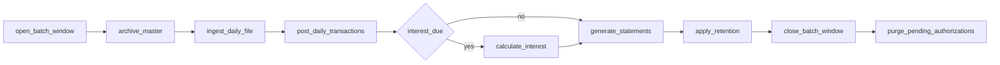

# Batch: Spring Batch jobs and Airflow DAGs

## Principles

- **Spring Batch holds the batch rules.** All jobs live in one Spring Boot application, `batch-service` (`modernization/batch/`), with its job repository in the `batch` schema.
- **Airflow only orchestrates.** DAGs in `modernization/airflow/dags/` open and close the batch window, launch jobs through `batch-service`, wait for their exit status, branch and retry. They contain no business rule; `make test-airflow` fails if a DAG file imports anything but Airflow and the shared operator package.
- **One cycle date.** Each cycle run has a `cycle_id` and a `businessDate` (Airflow's logical date, or a `conf` override). Every job takes them as identifying job parameters. INTCALC's `PARM` (`2022071800`) is derived as `yyyyMMdd` + `00`, and the timestamps the jobs write take their date from `businessDate` and their time from the clock, as `CARDDEMO_BUSINESS_DATE` does locally. This replaces the three date sources in use today (D1 cross-cutting finding 5).
- **Exit statuses replace return codes and abends.**

| Legacy | Spring Batch exit status | Airflow |
| :-- | :-- | :-- |
| RC 0 | `COMPLETED` | task success |
| RC 4 (POSTTRAN rejects, COBTUPDT record errors) | `COMPLETED_WITH_REJECTS` | task success; the reject count goes to XCom and the DAG run note |
| U0999, CEE3ABD, RC 12 or 16 | `FAILED` | task failure; the DAG stops; the window stays open |

## Batch window

CLOSEFIL closes five CICS files (`ACCTDAT`, `CCXREF`, `CXACAIX`, `TRANSACT`, `USRSEC`) before batch, OPENFIL reopens them, and a job that changes them must not overlap online updates (INV-002).

- DAG task `open_batch_window` calls `POST /internal/batch-window/open {cycleId, mode}`. It records a row in `ops.batch_window` and then waits until no online transaction on the covered tables is still running (services hold a short shared lock on the window row for each write transaction; opening takes it exclusively). This replaces both SDSF `CEMT` and WAITSTEP's fixed 36-second sleep.
- Services check the window before using a covered table ([api-security.md](api-security.md#api-conventions)).
- `close_batch_window` clears it. It runs only when every task before it succeeded. After a failure the window stays open, as the files stay closed today (ERR-JCA7-001), until an operator closes it with `make -C modernization batch-window-close` after recovery.

| Window mode | Covered tables | Online effect | Default |
| :-- | :-- | :-- | :-- |
| `CLOSED_FILES` | account, card cross-reference, transaction, user | every read and write on them fails, including sign-on, as with closed CICS files | **default (legacy)** |
| `WRITES_BLOCKED` | same | reads work (snapshot isolation), writes return 503 | recommended (D-BAT-05) |
| `NONE` | - | no window; row locks only | not recommended: posting reads running totals (BR-POST-007) |

## The transaction master and cycles

Today the transaction master holds one cycle: TRANBKP backs it up and empties it, POSTTRAN fills it, COMBTRAN reloads it from the backup plus the interest transactions, and older transactions live only in five backup generations (INV-003, INV-052, INV-053). COMBTRAN picks its inputs by relative generation, so a report run between TRANBKP and COMBTRAN loses the day's postings (INV-052, Q-JCOMB-001).

The target keeps all rows in `core.transaction` and marks the legacy master with `in_master`:

| Legacy step | Target |
| :-- | :-- |
| TRANBKP reset (backup, delete, define empty) | `archiveMasterJob`: one statement sets `in_master = 0` for every row in the master and records the count in `batch.cycle`. Nothing is copied; the rows are the backup. |
| POSTTRAN writes the master | inserts with `in_master = 1`, `origin = POSTED`, `cycle_id` |
| INTCALC writes `SYSTRAN(+1)` | inserts with `in_master = 1`, `origin = INTEREST`, `cycle_id` |
| TRANBKP backup, then COMBTRAN sort and reload | nothing to do: the master already holds postings plus interest, in key order by `ORDER BY` |
| Online add and bill payment between cycles | insert with `in_master = 1` and the open cycle |
| GDG `LIMIT(5)` retention | `in_master = 0` rows older than five cycles are deleted by the cycle's last task (legacy retention), or kept (D-BAT-04) |

Readers that saw "the master" (online list and view, statements, reports, ID allocation) filter on `in_master = 1`, so they see what they see today. The relative-generation hazard is gone, because nothing selects by "newest generation".

## Batch-cycle option

Area G's decision table (G `jobs/README.md`) lists seven cycle orders found in the repository and options A to F. This proposal takes **option F**, the order derived from the data dependencies, which area G also recommends:

| Option | Order | Why not / why |
| :-- | :-- | :-- |
| A README table | close, 10 reloads (incl. TRANBKP reset), POSTTRAN, INTCALC, TRANBKP, COMBTRAN, CREASTMT, TRANIDX, open | demo reset; destroys data in production |
| B runbook | close, POSTTRAN, INTCALC, TRANBKP, COMBTRAN, CREASTMT, TRANIDX, open | fails on the second run: the master is not empty |
| C split scripts | separate posting and interest cycles | no statements; COMBTRAN reloads only the last posting day |
| D CA-7, E Control-M | as defined | not runnable as written; only the ordering rules and the daily, weekly, monthly split carry over |
| **F data-dependency order** | close, TRANBKP reset, POSTTRAN, INTCALC at the chosen frequency, TRANBKP, COMBTRAN, CREASTMT (+ TRANIDX), open; everything else on demand | consistent with every source; repeatable |

In the target, F becomes:

TRANBKP's second run and COMBTRAN disappear (previous section), TRANIDX is dropped (SQL index), WAITSTEP's fixed 36-second pause is dropped. Because there is no COMBTRAN step, a cycle without interest needs no special handling: the branch skips `calculate_interest` and the master already holds the day's postings (area G notes that legacy F must skip COMBTRAN or feed it an empty interest file on such a day).

Two orders in the legacy schedules are not carried over:

- **Statements in parallel with posting.** CA-7 starts CREASTMT from CLOSEFIL at the same time as the purge-then-POSTTRAN chain, so statements can read the master before or while the day is posted (DEF-JSTMT-006). The target runs statements only after posting and interest.
- **The purge gating posting.** CA-7 runs CBPAUP0J between CLOSEFIL and POSTTRAN; the batch-cycle runbook runs it after OPENFIL (Q-JCA7-003, DEF-JCA7-007). The purge reads and writes only `pauth`, which posting does not use, so there is no data hand-off between them. The target runs it after `close_batch_window`, as its own task that never gates posting, and skips it when the authorization module is not installed. A purge failure fails the DAG run and alerts; the legacy CBPAUP0C return code 16 that the schedulers may count as normal completion (DEF-JAUPG-003) always maps to `FAILED`. DAG parameter `purge_position=before_posting` reproduces the CA-7 order if operations want it.

Decisions that go with F, with the defaults this proposal uses:

| Decision | Default | Recommended |
| :-- | :-- | :-- |
| Interest frequency (Q-JINTC-002, Q-JCTLM-002) | DAG parameter `interest`: `always` (as the runbook order) | `month_end`: the rate is monthly (`/1200`) and Control-M files interest in a monthly folder, which nothing orders (DEF-JCTLM-002) |
| Statement timing (Q-JSTMT-001, DEF-JSTMT-006) | every cycle, after interest (the README and runbook position) | once per statement period, on the interest day |
| Purge position (Q-JCA7-003, DEF-JCA7-007) | after the cycle, never gating posting | same |
| History retention (INV-053, Q-JGDGB-001) | master holds one cycle; archived rows kept 5 cycles | keep all history visible online, with a retention period set by compliance |
| Reference reloads and TRANEXTR (DEF-JCTLM-005) | disclosure groups weekly on Saturday; batch type maintenance only if a producer of its input is named (D-BAT-07); no TRANEXTR | same |
| Reports and listings (TRANREPT, PRTCATBL) | on demand (CA-7 schedules PRTCATBL only under SCHID 031) | same |
| Failure policy | stop the chain, keep the window open, alert | same |

## Jobs per JCL job and step

| JCL job (spec) | Steps today | Spring Batch job and steps | DAG and task |
| :-- | :-- | :-- | :-- |
| CLOSEFIL (JCLOSE) | SDSF `CEMT SET FIL CLO` | none (REST call) | `carddemo_daily_cycle.open_batch_window` |
| CBPAUP0J (JAUPG) | STEP01 CBPAUP0C (IMS BMP) | `purgePendingAuthorizationsJob`: `purge` chunk step over `pauth.auth_summary` | `purge_pending_authorizations` |
| TRANBKP (JTBKP) | REPRO backup, IDCAMS delete, define | `archiveMasterJob`: `archive` tasklet | `archive_master` |
| POSTTRAN (JPOST) | STEP15 CBTRN02C | `postDailyTransactionsJob`: `ingestDailyFile` (file to `core.daily_tran`), `post` (chunk, single thread, input order), `exportRejects` (430-byte file) | `ingest_daily_file`, `post_daily_transactions` |
| INTCALC (JINTC) | STEP15 CBACT04C with PARM | `calculateInterestJob`: `interest` (item = account with its category balances) | `calculate_interest` |
| COMBTRAN (JCOMB) | SORT, REPRO | none | none |
| CREASTMT (JSTMT) | delete/define work file, SORT, REPRO, IEFBR14, STEP040 CBSTM03A | `statementJob`: `render` (text, HTML, optional PDF writers) | `generate_statements` |
| TXT2PDF1 (JPDF) | TXT2PDF exec | PDF writer of `statementJob` (flag `pdf=true`) | part of `generate_statements` |
| TRANIDX (JTIDX) | define AIX, path, BLDINDEX | none | none |
| OPENFIL (JOPEN) | SDSF `CEMT SET FIL OPE` | none (REST call) | `close_batch_window` |
| TRANREPT (JTRPT), TRANREPT-PROC (JTRPTP) | backup REPRO, SORT with date filter, CBTRN03C | `transactionReportJob`: `select` (SQL reader), `print` (report writer) | `carddemo_transaction_report.run_report` |
| PRTCATBL (JPCAT) | delete, backup REPRO, SORT and format | `categoryBalanceListingJob`: `list` | `carddemo_category_balance_listing.run_listing` |
| MNTTRDB2 (JMNTT) | COBTUPDT under DSN | `transactionTypeMaintenanceJob`: `maintain` | `carddemo_reference_refresh.maintain_transaction_types` |
| DISCGRP (JDISC) | delete, define, REPRO | `disclosureGroupReloadJob`: `reload`, `checkDefaultGroup` | `carddemo_reference_refresh.reload_disclosure_groups` |
| ACCTFILE, CARDFILE, XREFFILE, CUSTFILE, TCATBALF, TRANTYPE, TRANCATG, DUSRSECJ | delete, define, REPRO, AIX | `dataLoadJob` steps ([data-model.md](data-model.md#sample-data-migration)) | `carddemo_data_load` (manual) |
| CBEXPORT-JOB (JEXPT), CBIMPORT-JOB (JIMPT) | delete/define, CBEXPORT; CBIMPORT | `exportMastersJob`, `importMigrationJob` (optional) | `carddemo_export_masters`, `carddemo_import_migration` (manual) |

Every other job in [mapping.md](mapping.md) is dropped.

## DAGs

| DAG | Schedule | Tasks |
| :-- | :-- | :-- |
| `carddemo_daily_cycle` | daily, `catchup=False`, `max_active_runs=1`; params `interest` (`always`, `month_end`, `never`), `statements` (`every_cycle`, `with_interest`), `purge_position` (`after_cycle`, `before_posting`) | as in the diagram above |
| `carddemo_transaction_report` | none; triggered by `transaction-service` through the Airflow REST API with `conf {runId, startDate, endDate, requestedBy}` | `run_report` |
| `carddemo_category_balance_listing` | manual | `run_listing` |
| `carddemo_reference_refresh` | weekly, Saturday | `open_batch_window` (mode for `ref` tables), `maintain_transaction_types` (skipped without input file), `reload_disclosure_groups`, `close_batch_window` |
| `carddemo_data_load` | manual | `open_batch_window`, `load`, `verify`, `close_batch_window` |
| `carddemo_export_masters`, `carddemo_import_migration` | manual | one job each |

All DAGs that change data share the Airflow pool `carddemo_batch` with one slot, so a reload never overlaps the cycle. Tasks use one shared operator, `SpringBatchJobOperator` (launch, then a deferrable trigger that polls the execution, so a waiting task holds no worker slot). Airflow runs from the host venv with its metadata in the compose Postgres on 25432.

## Restart and idempotency

| Job | Restart after a failure | Second run of a completed cycle |
| :-- | :-- | :-- |
| `postDailyTransactionsJob` | Resumes after the last committed chunk. Each chunk commits the account, category balance, transaction and reject rows together with the reader position, so no record is half applied (fixes DEF-POST-008 by construction). | Refused: same `cycleId` is a completed job instance. A deliberate rerun restores the snapshot taken before the step (`batch.snapshot_account`, `batch.snapshot_tcat_bal`) through `make -C modernization cycle-rerun CYCLE=<id>`, which replaces the runbook restore. |
| `calculateInterestJob` | Resumes at the next account; interest rows and the account update of one account commit together (DEF-INTC-009). | Refused; legacy reruns charge interest twice (DEF-INTC-005), an architecture-dependent item. |
| `archiveMasterJob` | One statement; rerun is a no-op. | No-op. |
| `statementJob`, `transactionReportJob`, `categoryBalanceListingJob` | Rerun from the start; outputs go to a temporary folder renamed on success, as z/OS deletes outputs on abend (ERR-STMT-008). | Allowed; a new run folder. |
| `purgePendingAuthorizationsJob` | Resumes after the last chunk; deleted rows stay deleted. | Allowed; nothing left to purge. |
| `dataLoadJob` steps | Each step truncates and loads in one transaction. | Allowed only inside a batch window. |

Posting stays single-threaded in input order, because each record's over-limit check uses the cycle totals that earlier records changed (BR-POST-007). The processor keeps the accounts and category balances touched in the current chunk in a unit-of-work cache that the writer flushes, so later records in the chunk see earlier changes.

## Files and tables

| Data | Target | Why |
| :-- | :-- | :-- |
| Daily transactions (`DALYTRAN.PS`) | Inbound file `var/inbound/dailytran/<businessDate>.txt`, staged into `core.daily_tran` | It is an external feed. |
| Daily rejects (`DALYREJS`) | `core.daily_reject`, plus the 430-byte file for operations and the differential tests | The runbook reads it. |
| Interest transactions (`SYSTRAN`), backups, combined and daily extracts, statement work file | rows in `core.transaction` | Intermediate files of the GDG design. |
| Transaction report | `var/reports/tranrept/<runId>/TRANREPT.txt` (133-byte lines) | A deliverable; downloaded through `transaction-service`. |
| Category balance listing | `var/reports/prtcatbl/<runId>/PRTCATBL.txt` (40-byte lines) | A deliverable. |
| Statements | `var/statements/<cycleId>/STATEMNT.txt` and `.html`; per-statement HTML and PDF in fixed mode (DEF-STMT-006) | Deliverables. |
| Type maintenance input | `var/inbound/trantype/<date>.txt` (53-byte records) | An external input. |
| Export file | `var/export/<runId>/EXPORT.DATA` | A file contract, if kept. |

`var/` is under `modernization/` and git-ignored; a deployment maps it to object storage (D-NFR-09).

## Report content

| Output | How the content is reproduced | Checked by |
| :-- | :-- | :-- |
| TRANREPT (CBTRN03C) | Rows with `in_master = 1` and `proc_date_text` between the two dates (inclusive, text compare, INV-010), `ORDER BY card_num, tran_id` (the legacy sort input is the master in key order). Left joins to cross-reference, type and category; a missing code fails the job, as the program abends (INV-016). A custom writer reproduces the headers, the page break counter that also counts total lines (BR-TRPT-005), the card-break "account" totals (DEF-TRPT-004, legacy mode), page and grand totals and the edit masks (NUM-TRPT-002). One date pair feeds both selection and heading (DEF-TRPT-002 cannot occur). | `verify-batch` against the GnuCOBOL TRANREPT on sample and stress data |
| PRTCATBL | `ORDER BY acct_id, type_cd, cat_cd`; 40-byte lines; balance edited `TTTTTTTTT.TT` without sign (Q-JPCAT-001, legacy). | An oracle test written from the PRTCATBL spec (the job is a SORT, with no program to run) |
| CREASTMT (CBSTM03A) | One statement per cross-reference card in card order, with its customer and account and every master transaction of the card in ID order. The legacy renderer writes the 80-byte text and 100-byte HTML lines (NUM-STMT-001 to 003); the 51-card, 10-transaction table limit (DEF-STMT-001) and the unescaped HTML (DEF-STMT-007) are switches. | `verify-batch` against `checks/cbstm03a_harness` (CBSTM03A does not run off z/OS) |
| POSTTRAN rejects, account and category balance after the run | 430-byte rejects file; exported 300- and 50-byte records with zoned signs and `legacy_filler` | `verify-batch` against the GnuCOBOL POSTTRAN |
| INTCALC transactions and account after the run | exported 350- and 300-byte records | `verify-batch` against the GnuCOBOL INTCALC |

## Differential verification

`make verify-batch` reuses the spec's checks (`docs/modernization/spec/checks/`): for each job it runs the GnuCOBOL build through `tools/carddemo.py` on the sample and the stress data, loads the same inputs into a Testcontainers SQL Server, runs the Spring Batch job with `businessDate=2022-07-06`, exports the tables and files to the legacy layouts with `platform/legacy-format`, and compares them with the same `compare.py`, masking only wall-clock timestamps as the checks do. Both fidelity modes run: legacy must match byte for byte; fixed must differ only in the records the item describes.
