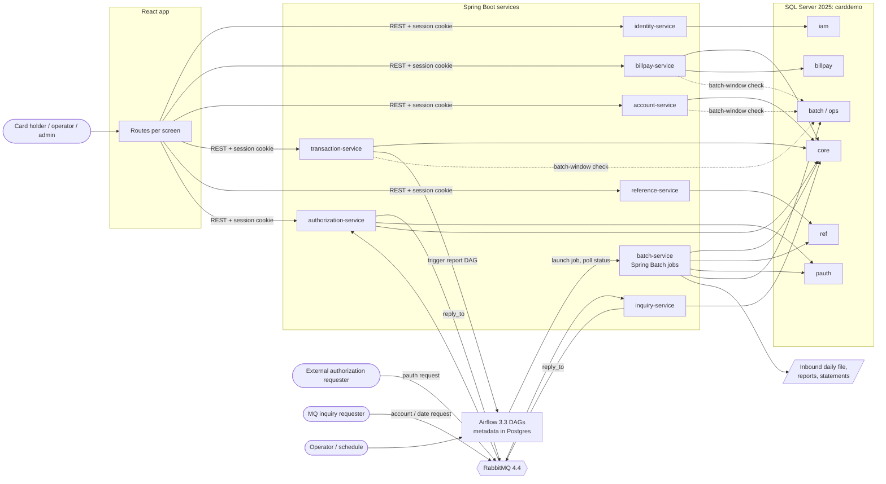

# Overview

## Goals

1. **Selective conversion.** Convert one bounded context at a time, starting with Bill Pay. Each converted context runs on the new stack end to end; options that are not converted yet stay visible in the menus with the legacy "coming soon" message.
2. **Fidelity.** The target reproduces the observable COBOL behaviour that the spec describes: data changes, message texts, field order of validation, report content. Defects the spec marks *defect-decide* keep their COBOL behaviour by default and can be switched to the fix.
3. **Traceability.** Every test names the spec item IDs it proves (`BR-`, `VAL-`, `FLOW-`, `SE-`, `ERR-`, `NUM-`, `DEF-`, `INV-`, `PINV-`). A traceability matrix is generated and checked in CI.
4. **No mainframe plumbing.** IDCAMS, CICS file open and close, GDGs, FTP, TXT2PDF, internal readers and fixed waits are not rebuilt. Each one is either replaced by a named mechanism or dropped with a reason ([mapping.md](mapping.md), [batch.md](batch.md)).

## Principles

- **Business logic lives in Java.** Spring Boot services hold the online rules; Spring Batch jobs hold the batch rules. Airflow DAGs only order, schedule and retry jobs. React holds presentation and client-side pre-checks that the server repeats.
- **One SQL Server database, one schema per bounded context.** The core tables (account, card, cross-reference, customer, transaction, category balance) are shared, because several contexts must change them in one local transaction (INV-001, INV-004, INV-030, INV-043). Ownership and write rights per service are explicit ([data-model.md](data-model.md#ownership-and-grants)) and enforced by SQL logins.
- **One code path per shared rule.** Rules that several services and jobs apply (transaction ID allocation, the batch-window guard, legacy number and date formats, field validators) live in shared libraries under `modernization/platform/`, not copied per service.
- **Stateless services.** The 3270 pseudo-conversation and the commarea become client state plus REST calls. Locks never span user think time; optimistic version checks replace the "record changed" re-read comparisons (INV-037, INV-042).
- **Local first.** Everything runs on one laptop: Docker Compose project `carddemo-modern` on 127.0.0.1 (SQL Server 21433, AMQP 25672, RabbitMQ management 35672, Airflow Postgres 25432), JVM services and the Airflow venv on the host. Peak memory stays under about 15 GiB of the 24 GiB machine, about 10 GiB with the stack up and no test running ([repo-build-ci.md](repo-build-ci.md#memory-budget)).

## Fidelity

Each defect-decide item that has a known fix gets one switch:

```yaml
carddemo:
  fidelity:
    DEF-BILL-010: legacy   # legacy | fixed
    DEF-ACUP-002: legacy
```

- The switch is read through one class, `FidelitySwitches`, in `platform/fidelity`. Code branches on the item ID, so a search for the ID finds every place that depends on the decision.
- Defaults are `legacy`. The decision ledger (`modernization/ledger/fidelity.toml`) records the chosen value, who approved it and when. `make verify-ledger` fails when a switch in code has no ledger entry, or a ledger entry names an ID the spec does not have.
- Tests for a switched item run in both modes and carry the item ID.
- Some defects cannot be kept on the new platform, because the mechanism that causes them is gone (no CICS task that carries state between messages, no non-recoverable files). These are listed as *architecture-dependent* in [decisions.md](decisions.md#architecture-dependent-fidelity-items). They need an explicit "accept the fix" from the business, because no legacy mode exists for them.
- Security is the one place where the default departs from the COBOL behaviour: INV-006 says authorization "must be added, not preserved". The choices are in [api-security.md](api-security.md#the-no-sign-on-defect-inv-006-under-each-choice).

## Bounded contexts

| Context | Spec units (unit codes) | Owns | Deployable |
| :-- | :-- | :-- | :-- |
| Identity and access | COSGN00C (SGN), COUSR00C-03C (USRL, USRA, USRU, USRD), menus COMEN01C (MENU) and COADM01C (ADMN) for the role rules | `iam` schema: users, sessions, audit | `identity-service` |
| Payments (first slice) | COBIL00C (BILL) | `billpay` schema: payment audit and idempotency | `billpay-service` |
| Accounts and cards | COACTVWC (ACVW), COACTUPC (ACUP), COCRDLIC (CRDL), COCRDSLC (CRDV), COCRDUPC (CRDU) | account, customer and card profile columns in `core` | `account-service` |
| Transactions | COTRN00C (TRNL), COTRN01C (TRNV), COTRN02C (TRNA), CORPT00C (RPTS), CSUTLDTC (DTCK) | online inserts into `core.transaction`; report requests | `transaction-service` |
| Posting and cycle (batch) | CBTRN02C (POST), CBACT04C (INTC), CBTRN03C (TRPT), CBSTM03A/B (STMT, STIO), the cycle jobs | balances, category balances, posted and interest transactions, rejects, reports, statements | `batch-service` (Spring Batch) and the Airflow DAGs |
| Reference data | COTRTLIC (TTLS), COTRTUPC (TTUP), COBTUPDT (TTBU); transaction type, category and disclosure group files; the state, ZIP-prefix and area-code lists | `ref` schema | `reference-service` |
| Authorizations (optional module) | COPAUA0C (AUTH), COPAUS0C (AUSM), COPAUS1C (AUDT), COPAUS2C (AUFR), CBPAUP0C (AUPG) | `pauth` schema | `authorization-service` |
| Account and date inquiry (optional module) | COACCT01 (MQAC), CODATE01 (MQDT) | nothing (read-only) | `inquiry-service` |
| Branch migration | CBEXPORT (EXPT), CBIMPORT (IMPT) | migration file format | optional jobs in `batch-service` |

The candidate seams in `components.md` (payments first, posting, accounts and cards, identity, reference data, branch migration, authorizations, MQ inquiries) map one to one onto these contexts.

## Context diagram



## Deployables

| Deployable | Port (127.0.0.1) | Heap cap | First needed in |
| :-- | --: | --: | :-- |
| `identity-service` | 28081 | 256 MiB | Bill Pay slice |
| `billpay-service` | 28082 | 256 MiB | Bill Pay slice |
| `account-service` | 28083 | 384 MiB | Accounts and cards |
| `transaction-service` | 28084 | 384 MiB | Transactions |
| `reference-service` | 28085 | 256 MiB | Reference data |
| `authorization-service` | 28086 | 384 MiB | Authorizations |
| `inquiry-service` | 28087 | 256 MiB | Inquiries |
| `batch-service` | 28090 | 1 GiB | Batch |
| React dev server (Vite) | 25173 | - | Bill Pay slice |
| Airflow API server | 28080 | - | Batch |

The ports are new; none collides with the compose ports. In the deployed form an nginx container serves the built web app and routes `/api/<context>/...` to the services; locally the Vite dev server proxies the same paths.

## What every context shares

| Shared piece | Where | What it carries |
| :-- | :-- | :-- |
| Core tables | `core` schema | account, customer, card, card cross-reference, transaction, category balance |
| `platform/ledger-core` | Java library | transaction ID allocation, insert of a transaction row in the legacy layout, balance adjustment primitives, the batch-window guard |
| `platform/fidelity` | Java library | fidelity switches, the `@SpecItem("BR-BILL-004")` test annotation |
| `platform/legacy-format` | Java and TypeScript | legacy number edits (`+9999999999.99`, `-zzzzzzzzz9.99`), legacy timestamp layouts, zoned and packed codecs |
| `platform/validation` | Java, mirrored in TypeScript | the field validators the account, card, transaction and user screens share (dates, amounts, names, SSN, phone, state and ZIP) and the CSUTLDTC date check |
| `platform/web-support` | Java library | resource-server security, problem-detail error model, the message catalogue with the exact legacy texts |
| Session token | identity-service | user ID and role for every API call |
| Web shell | `web/` | sign-on, menus, layout, message area, navigation keys |

## The Bill Pay first slice

Bill Pay goes first because it is small (one screen, three stores), touches the shared ledger (so the shared pieces are proven early) and has a complete equivalence scenario list (S1 to S12).

**Data.** Bill Pay reads `core.account` (balance), reads `core.card_xref` by account (the card to charge, BR-BILL-005), inserts one row into `core.transaction` (BR-BILL-003) and updates `core.account.curr_bal` only (BR-BILL-006). It owns one new table, `billpay.payment` (transaction ID, account, paying user, idempotency key, time), which gives the audit trail the legacy record lacks (DEF-BILL-009) without changing the transaction layout. All of it runs in one SQL Server transaction with an update lock on the account row.

**API.**

| Call | Legacy step |
| :-- | :-- |
| `GET /api/billpay/accounts/{acctId}` returns the balance and its legacy display (`+0000000194.00`) | Enter with confirmation blank (VAL-BILL-005) |
| `POST /api/billpay/accounts/{acctId}/payments` with `{"confirm":"Y"}` and an `Idempotency-Key` header returns `201 {tranId, message}` | Enter with `Y` (BR-BILL-001 to 006; BR-BILL-007 one-step payment is allowed) |

The server re-reads the balance inside the transaction; it never trusts the balance the screen showed (BR-BILL-001). Errors return the exact legacy text and the field to focus, for example `404 {"code":"ACCOUNT_NOT_FOUND","message":"Account ID NOT found...","field":"acctId"}`.

**Navigation fit.** Main menu option 10 opens `/bill-pay`. Back (PF3) returns to the menu, Clear (PF4) clears the form, and the confirmation is a Y/N field, so the legacy decision table (VAL-BILL-002) holds unchanged. Options 1 to 9 and 11 show `This option <name> is coming soon ...` until their context is converted, which reuses the menu's own message (BR-MENU-005).

**What it shares and what it proves.** The core tables and their Flyway migrations, `ledger-core` (ID allocation shared with transaction add and the batch), the batch-window guard (Bill Pay is unavailable while posting runs, INV-002), identity and roles, the message catalogue, the fidelity switches, the traceability check and the CI pipeline. `make billpay` brings up only SQL Server, `identity-service`, `billpay-service` and the web app.

**Bill Pay fidelity switches** (all default `legacy`):

| Item | Legacy | Fixed |
| :-- | :-- | :-- |
| DEF-BILL-010 / Q-BILL-002 | positive amount; no change to cycle credit or debit or to the category balance | also posts to the cycle totals and category balance with the chosen sign |
| NUM-BILL-002 | amount is the balance cut to 9 integer digits | reject balances above 999,999,999.99 |
| DEF-BILL-014 / Q-BILL-001 | account ID stays editable on the confirmation step | account ID locked once the balance is shown |
| DEF-BILL-002 | first card by card number; the payment completes | refuse multi-card accounts or let the user choose |
| Q-BILL-006 | both timestamps `YYYY-MM-DD HH:MM:SS.000000` | one normalised timestamp layout for all writers |
| DEF-BILL-009 / Q-BILL-004 | any signed-on user can pay any account | ownership check (security choice C2) |

DEF-BILL-001 (balance zeroed without a payment record) and DEF-BILL-003 (two payments get the same ID) cannot happen in one database transaction with a locked ID allocation. They are architecture-dependent items: the business confirms the fix (Q-BILL-003, expected yes).

## How the mainframe plumbing is replaced

| Mainframe mechanism | Target |
| :-- | :-- |
| CICS file close and open around batch (CLOSEFIL, OPENFIL, SDSF `CEMT`) | A batch-window row in `ops.batch_window`, opened and closed by DAG tasks through `batch-service`. Online services check it before using the affected tables ([batch.md](batch.md#batch-window)). |
| IDCAMS DELETE, DEFINE, REPRO, BLDINDEX, AIX and PATH | Flyway migrations for tables and indexes; the `load` jobs for data; SQL Server maintains the indexes. |
| GDGs and relative generations | Rows tagged with `cycle_id` and run IDs; report and statement files under a per-run folder with a retention setting. |
| VSAM `RECOVERY(NONE)` and missing rollbacks | One SQL Server transaction per online action and per batch chunk. |
| IMS HIDAM pending-authorization database | Two tables in `pauth` with a cascade delete. |
| IBM MQ queues and CKTI triggers | RabbitMQ quorum queues and Spring AMQP listeners. |
| TDQ `JOBS` and the JES internal reader (report submit) | `transaction-service` triggers the report DAG through the Airflow REST API. |
| Fixed waits (WAITSTEP, COBSWAIT, MVSWAIT) | Dropped; Airflow task dependencies. |
| FTP (FTPJCL), INTRDR chaining (INTRDRJ1/2) | Dropped; demo jobs with no business content. |
| TXT2PDF | A PDF writer in the statement job, if the business wants PDFs (Q-JPDF-001). |
| CA-7 and Control-M | Airflow DAG dependencies and schedules. |
| Diagnostic readers that print every record (READACCT, READCARD, READCUST, READXREF) | Dropped; `make verify-data` checks counts and checksums without printing PII. |
| CEE3ABD abends and return codes | Spring Batch exit statuses; Airflow task success, success with warnings, or failure. |
| Plain-text passwords in USRSEC | Password hashes. |

## Phasing

| Step | Delivers | Make targets that start to pass |
| :-- | :-- | :-- |
| 3a Bill Pay slice | core schema, identity, Bill Pay service and screen, web shell, fidelity and trace framework, CI | `db-reset`, `load` (core tables), `up`, `smoke`, `billpay`, `test-billpay`, `web-build`, `trace` |
| 3b Data migration | every table, all loaders, reconciliation | `load`, `verify-data` |
| 3c Batch and cycle | posting, interest, report, category listing, statements, batch window, DAGs, differential harness | `verify-harness`, `verify-batch`, `test-airflow`, `verify-cycle` |
| 3d Online core | accounts and cards, transactions, user admin | `test-backend`, `test-e2e` |
| 3e Optional modules | reference data, authorizations, inquiries | `test-backend` (more suites) |
| 4 Validation | decision ledger complete, traceability complete | `verify-ledger`, `trace` with every converted unit in scope |
