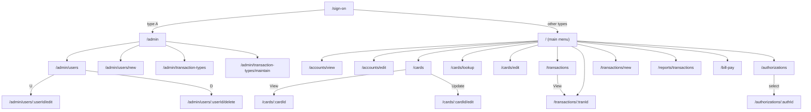

# React web app

## Stack

Vite, React and TypeScript in `modernization/web/`, built with Node 24 (pinned by `scripts/toolchain.sh`). React Router for routes, TanStack Query for server state, a client generated from each service's OpenAPI document, and forms whose validators come from `platform/validation` (the TypeScript mirror of the Java validators, generated from one rule table so the two cannot drift). The component library is decision D-WEB-01 (recommended: an accessible, themeable library such as Mantine, with the app's own tokens).

The screens are designed as modern web pages, not 24x80 copies: labelled fields, tables with real headers, inline field errors and dialogs. What carries over from the 3270 screens is behaviour: which fields exist, their order, validation order, message text, message colour, which fields are cleared and where the focus goes.

## Routes

| Route | Screen (spec) | Role (choice C1) | Notes |
| :-- | :-- | :-- | :-- |
| `/sign-on` | COSGN00C | public | Redirects to `/` or `/admin` by user type. |
| `/` | COMEN01C main menu | USER | 11 options. |
| `/admin` | COADM01C admin menu | ADMIN | 6 options. |
| `/accounts/view` | COACTVWC | USER | Account ID field, then the account, customer and card panel. |
| `/accounts/edit` | COACTUPC | USER | Fetch, edit, validate (Enter), save (F5), with a confirm step. |
| `/cards` | COCRDLIC | USER | 7 rows, account and card filters, row actions View and Update (the `S` and `U` selection codes). |
| `/cards/lookup`, `/cards/:cardId` | COCRDSLC | USER | Typed keys from the menu, or `cardId` from the list. |
| `/cards/:cardId/edit`, `/cards/edit` | COCRDUPC | USER | Keys protected when opened from the list. |
| `/transactions` | COTRN00C | USER | 10 rows, start ID filter, row action View. |
| `/transactions/:tranId` | COTRN01C | USER | |
| `/transactions/new` | COTRN02C | USER | Validate, confirm `Y`/`N`, "copy last" (PF5). |
| `/reports/transactions` | CORPT00C | USER | Monthly, yearly or custom range; shows the run and a download link when done. |
| `/bill-pay` | COBIL00C | USER | First slice. |
| `/authorizations`, `/authorizations/:authId` | COPAUS0C, COPAUS1C | USER | Shown when the authorization module is installed. |
| `/admin/users`, `/admin/users/new`, `/admin/users/:userId/edit`, `/admin/users/:userId/delete` | COUSR00C to COUSR03C | ADMIN | |
| `/admin/transaction-types`, `/admin/transaction-types/maintain` | COTRTLIC, COTRTUPC | ADMIN | Shown when the reference module is installed. |

## Menu mapping

| Main menu option (ENT-MAIN-MENU-OPTIONS) | Route | Admin menu option (ENT-ADMIN-MENU-OPTIONS) | Route |
| :-- | :-- | :-- | :-- |
| 1 Account View | `/accounts/view` | 1 User List (Security) | `/admin/users` |
| 2 Account Update | `/accounts/edit` | 2 User Add (Security) | `/admin/users/new` |
| 3 Credit Card List | `/cards` | 3 User Update (Security) | `/admin/users` then edit, or by ID |
| 4 Credit Card View | `/cards/lookup` | 4 User Delete (Security) | `/admin/users` then delete, or by ID |
| 5 Credit Card Update | `/cards/edit` | 5 Transaction Type List/Update (Db2) | `/admin/transaction-types` |
| 6 Transaction List | `/transactions` | 6 Transaction Type Maintenance (Db2) | `/admin/transaction-types/maintain` |
| 7 Transaction View | `/transactions/:tranId` via an ID prompt | | |
| 8 Transaction Add | `/transactions/new` | | |
| 9 Transaction Reports | `/reports/transactions` | | |
| 10 Bill Payment | `/bill-pay` | | |
| 11 Pending Authorization View | `/authorizations` | | |

The menu keeps the option numbers and texts, and the numeric option field: typing `10` and Enter still works (VAL-MENU-001, NUM-MENU-001), next to clickable entries. An option whose context is not converted yet shows `This option <name> is coming soon ...`; option 11 without the module shows `This option Pending Authorization View is not installed...` (BR-MENU-004).

## Navigation

Back (PF3) returns to the screen that opened the current one, else to the menu; on a menu it signs off. That is the legacy "from program" rule (FLOW-BILL-004 and its siblings) expressed as router history. Returning to the card list starts at page 1 with no filter (Q-CRDL-003, legacy mode).

## Keys, messages and focus

| 3270 | Web |
| :-- | :-- |
| Enter | Primary button (Continue, Search, Validate); the Enter key in a form submits it |
| PF3 | Back button; Escape key |
| PF4 | Clear button |
| PF5 | Save, or Copy last on transaction add |
| PF7 / PF8 | Previous / Next page buttons; Page Up / Page Down in tables |
| PF10, PF12 | Confirm and Cancel in a confirmation dialog |
| Other keys | Do nothing. The legacy "Invalid key pressed" message has no web cause and is not shown. |

Optional keyboard shortcuts for F3, F4, F5, F7 and F8 can be switched on per user for operators used to the 3270 (D-WEB-03).

The message area under each form shows the server's `message`: red for errors, green for success, neutral for information, as on the 3270. Focus moves to the server's `field`. The texts come from one message catalogue shared with the services, so a test can compare the exact legacy text.

## Session state

The commarea becomes three things:

| Commarea content (ENT-COMMAREA) | Web |
| :-- | :-- |
| User ID and type | The session token; `GET /api/auth/me` |
| From and to program, context flag | Router history and route state |
| Selected account, customer and card (`CDEMO-ACCT-ID`, `CDEMO-CUST-ID`, `CDEMO-CARD-NUM`) | A "current account" store in session storage, holding IDs only, never a PAN in clear (the card is held by `cardId`) |
| Paging state (first and last keys, page number) | Query parameters of the list route |

The legacy carry-over of a previous customer after a failed lookup (DEF-ACVW-018) is a switch on the account view page.

## Availability

During a batch window the API returns `503 BATCH_WINDOW`; the page shows the legacy message for the affected screen and a "try again after the batch" hint. Read-only pages keep working when the window mode allows reads ([batch.md](batch.md#batch-window)).

## Non-functional defaults

- **Browsers**: the current and previous major versions of Chrome, Edge, Firefox and Safari (D-NFR-07).
- **Accessibility**: WCAG 2.2 AA: labels on every field, keyboard operation for every action, focus management on errors, colour never the only signal (the message text says error or success) (D-NFR-08).
- **Tests**: Vitest for components and validators (with spec item IDs in test names), Playwright for the equivalence scenarios S1 to Sn of each screen.
