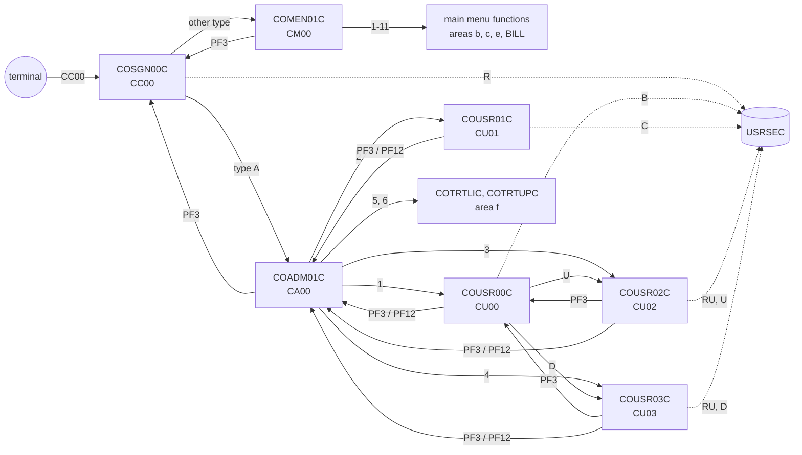

# Area a-signon-admin: interaction proposals

Proposals from area `a-signon-admin` (COSGN00C, COMEN01C, COADM01C, COUSR00C-03C) for `../interactions.md` and `../components.md`. Source revision `b5e0139`.

## Edges

| From | To | Mechanism | Data passed | Source (file:line) | Spec item |
| :-- | :-- | :-- | :-- | :-- | :-- |
| terminal | COSGN00C | RETURN TRANSID | transaction `CC00` typed on a blank screen; afterwards `CC00` with the 160-byte commarea | `app/csd/CARDDEMO.CSD:378-387`; `app/cbl/COSGN00C.cbl:98-102` | FLOW-SGN-001, FLOW-SGN-005 |
| COSGN00C | COADM01C | XCTL | ENT-COMMAREA: from `CC00`/`COSGN00C`, user ID, type `A`, context 0 | `app/cbl/COSGN00C.cbl:230-234` | BR-SGN-004, BR-SGN-005 |
| COSGN00C | COMEN01C | XCTL | ENT-COMMAREA: as above, type other than `A` | `app/cbl/COSGN00C.cbl:235-239` | BR-SGN-004 |
| COMEN01C | option programs 1-10 (COACTVWC, COACTUPC, COCRDLIC, COCRDSLC, COCRDUPC, COTRN00C, COTRN01C, COTRN02C, CORPT00C, COBIL00C) | XCTL | ENT-COMMAREA, from `CM00`/`COMEN01C`, context 0 | `app/cbl/COMEN01C.cbl:177-187` | BR-MENU-002 |
| COMEN01C | COPAUS0C | XCTL after INQUIRE PROGRAM | as above, only if the program is installed | `app/cbl/COMEN01C.cbl:147-168` | BR-MENU-004 |
| COMEN01C | COSGN00C | XCTL | none (no commarea) | `app/cbl/COMEN01C.cbl:96-98, 196-203` | FLOW-MENU-004 |
| COMEN01C | COMEN01C | RETURN TRANSID | `CM00`, 160 bytes | `app/cbl/COMEN01C.cbl:107-110` | FLOW-MENU-006 |
| COADM01C | COUSR00C, COUSR01C, COUSR02C, COUSR03C | XCTL | ENT-COMMAREA (160), from `CA00`/`COADM01C`, context 0 | `app/cbl/COADM01C.cbl:140-148` | BR-ADMN-002 |
| COADM01C | COTRTLIC, COTRTUPC | XCTL (PGMIDERR handled) | as above; "not installed" message when the module is absent | `app/cbl/COADM01C.cbl:77-79, 140-148, 270-283` | BR-ADMN-002, BR-ADMN-003 |
| COADM01C | COSGN00C | XCTL | none | `app/cbl/COADM01C.cbl:100-102, 163-170` | FLOW-ADMN-004 |
| COADM01C | COADM01C | RETURN TRANSID | `CA00`, 160 bytes | `app/cbl/COADM01C.cbl:111-114` | FLOW-ADMN-006 |
| COUSR00C | COUSR02C | XCTL | 194 bytes, `CDEMO-CU00-USR-SELECTED`, from `CU00`/`COUSR00C` | `app/cbl/COUSR00C.cbl:190-199` | BR-USRL-003 |
| COUSR00C | COUSR03C | XCTL | as above | `app/cbl/COUSR00C.cbl:200-209` | BR-USRL-004 |
| COUSR00C | COADM01C | XCTL | 194 bytes (truncated to 160 by the menu) | `app/cbl/COUSR00C.cbl:125-127, 506-517` | FLOW-USRL-006 |
| COUSR00C | COUSR00C | RETURN TRANSID | `CU00`, 194 bytes with the paging state | `app/cbl/COUSR00C.cbl:141-144` | FLOW-USRL-007 |
| COUSR01C | COADM01C | XCTL | 160 bytes | `app/cbl/COUSR01C.cbl:93-95, 165-178` | FLOW-USRA-005 |
| COUSR01C | COUSR01C | RETURN TRANSID | `CU01`, 160 bytes | `app/cbl/COUSR01C.cbl:107-110` | FLOW-USRA-006 |
| COUSR02C | caller (COUSR00C or COADM01C) | XCTL | 194 bytes, after saving | `app/cbl/COUSR02C.cbl:111-119` | BR-USRU-005 |
| COUSR02C | COADM01C | XCTL | 194 bytes | `app/cbl/COUSR02C.cbl:124-126` | FLOW-USRU-006 |
| COUSR02C | COUSR02C | RETURN TRANSID | `CU02`, 194 bytes | `app/cbl/COUSR02C.cbl:135-138` | FLOW-USRU-007 |
| COUSR03C | caller (COUSR00C or COADM01C) | XCTL | 194 bytes | `app/cbl/COUSR03C.cbl:111-118` | FLOW-USRD-006 |
| COUSR03C | COADM01C | XCTL | 194 bytes | `app/cbl/COUSR03C.cbl:123-125` | FLOW-USRD-007 |
| COUSR03C | COUSR03C | RETURN TRANSID | `CU03`, 194 bytes | `app/cbl/COUSR03C.cbl:134-137` | FLOW-USRD-008 |
| COUSR00C, COUSR01C, COUSR02C, COUSR03C | COSGN00C | XCTL | the program's own (uninitialised) commarea, when started without one | `app/cbl/COUSR00C.cbl:110-112`; `app/cbl/COUSR01C.cbl:78-80`; `app/cbl/COUSR02C.cbl:90-92`; `app/cbl/COUSR03C.cbl:90-92` | FLOW-USRL-002, FLOW-USRA-002, FLOW-USRU-002, FLOW-USRD-002, FLOW-SGN-008 |
| COMEN01C, COADM01C | COSGN00C | XCTL | none, when started without a commarea | `app/cbl/COMEN01C.cbl:82-84`; `app/cbl/COADM01C.cbl:86-88` | FLOW-MENU-001, FLOW-ADMN-001 |
| CLOSEFIL / OPENFIL jobs | USRSEC | file (CEMT close/open) | none; sign-on and user administration fail while closed | `app/jcl/CLOSEFIL.jcl:30`; `app/jcl/OPENFIL.jcl:30` | ERR-SGN-001 |

Inbound edges owned by other areas (the PF3 returns of the main menu functions to `COMEN01C`, and of `COTRTLIC`/`COTRTUPC` to `COADM01C`) are described in those programs' specs.

## CRUD rows

| Program | Store | Access (R, RU, C, U, D, B) | Spec item |
| :-- | :-- | :-- | :-- |
| COSGN00C | USRSEC | R | SE-SGN-001 |
| COUSR00C | USRSEC | B | SE-USRL-001, SE-USRL-002 |
| COUSR01C | USRSEC | C | SE-USRA-001 |
| COUSR02C | USRSEC | RU, U | SE-USRU-001, SE-USRU-002 |
| COUSR03C | USRSEC | RU, D | SE-USRD-001, SE-USRD-002 |
| COMEN01C | (none) | - | §9 of COMEN01C |
| COADM01C | (none) | - | §9 of COADM01C |

## Invariant proposals

| ID | Invariant | Components | Evidence |
| :-- | :-- | :-- | :-- |
| PINV-a-signon-admin-01 | The online session identity is `CDEMO-USER-ID` and `CDEMO-USER-TYPE` in the commarea; they are meant to be set only by sign-on, but the account and card programs (type `U`) and the Db2 transaction-type programs (type `A`) also create or overwrite them when started without a commarea, which opens both menus without a sign-on; no program verifies them (no CICS sign-on, all transactions `RESSEC(NO)`). | COSGN00C, every online program | `app/cbl/COSGN00C.cbl:224-240`; `app/csd/CARDDEMO.CSD:385`; `app/cbl/COCRDLIC.cbl:315-325`; `app/app-transaction-type-db2/cbl/COTRTLIC.cbl:515-525`; DEF-SGN-006, DEF-SGN-012, DEF-ADMN-001 |
| PINV-a-signon-admin-02 | A user can sign on only if the stored `SEC-USR-ID` and `SEC-USR-PWD` contain no lower-case letters, because sign-on upper-cases the typed values; user add and update do not enforce it. | COSGN00C, COUSR01C, COUSR02C | `app/cbl/COSGN00C.cbl:132-136`; `app/cbl/COUSR01C.cbl:154-158`; `app/cbl/COUSR02C.cbl:227-230`; DEF-SGN-011 |
| PINV-a-signon-admin-03 | `USRSEC` is closed during the batch cycle, so sign-on and user administration are unavailable then. | COSGN00C, COUSR00C-03C, CLOSEFIL, OPENFIL | `app/jcl/CLOSEFIL.jcl:30`; `app/jcl/OPENFIL.jcl:30`; ERR-SGN-001 |
| PINV-a-signon-admin-04 | The user list hands the selected user to update and delete in commarea bytes 187-194 (`CDEMO-CUnn-USR-SELECTED`); the three programs must keep the same 34-byte extension layout. | COUSR00C, COUSR02C, COUSR03C | `app/cbl/COUSR00C.cbl:67-75`; `app/cbl/COUSR02C.cbl:50-58`; `app/cbl/COUSR03C.cbl:50-58` |
| PINV-a-signon-admin-05 | At least one user of type `A` must exist for the admin menu to be reachable; nothing enforces it, and only a batch reload of `USRSEC` restores access. | COSGN00C, COUSR02C, COUSR03C | `app/cbl/COSGN00C.cbl:230-240`; DEF-USRU-006, DEF-USRD-004 |

## Mermaid fragment (online navigation of the area)

