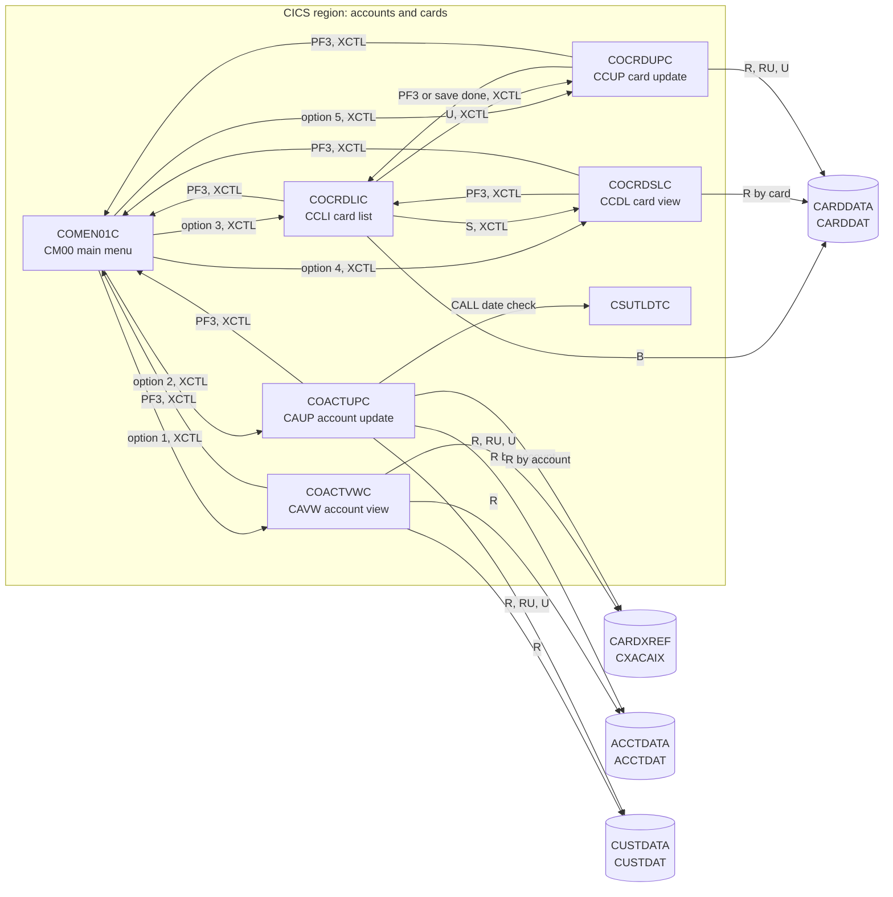

# Area b-accounts-cards: interaction proposals

Proposals from area `b-accounts-cards` (programs COACTVWC, COACTUPC, COCRDLIC, COCRDSLC, COCRDUPC) for [../interactions.md](../interactions.md) and [../components.md](../components.md), at source commit b5e0139. The menu side of each menu edge (COMEN01C) belongs to area `a-signon-admin`; it is stated here from the menu table only.

## Edges

"Terminal" means the transaction code typed at a terminal with no commarea; none of these programs checks for a signed-on user in that case.

| From | To | Mechanism | Data passed | Source (file:line) | Spec item |
| :-- | :-- | :-- | :-- | :-- | :-- |
| COMEN01C | COACTVWC | XCTL | 160-byte commarea, from `CM00`/`COMEN01C`, context 0 (menu option 1) | `app/cbl/COMEN01C.cbl:177-187`, `app/cpy/COMEN02Y.cpy:25-29` | FLOW-ACVW-006 |
| terminal | COACTVWC | START | transaction `CAVW`, no commarea | `app/csd/CARDDEMO.CSD:317-326`, `app/cbl/COACTVWC.cbl:282-286` | FLOW-ACVW-002, DEF-ACVW-009 |
| COACTVWC | COACTVWC | RETURN TRANSID | `CAVW`, 2000-byte area (base, 12-byte extension, spaces), context 1 | `app/cbl/COACTVWC.cbl:394-407` | FLOW-ACVW-008 |
| COACTVWC | `CDEMO-FROM-PROGRAM` (normally COMEN01C; COMEN01C when blank) | XCTL | 160-byte commarea, from `CAVW`/`COACTVWC`, context 0, user type `U`, account, customer and card of the last lookup | `app/cbl/COACTVWC.cbl:324-352` | FLOW-ACVW-005, BR-ACVW-005 |
| COACTVWC | CXACAIX | file | READ by account number (11) | `app/cbl/COACTVWC.cbl:727-735` | SE-ACVW-001 |
| COACTVWC | ACCTDAT | file | READ by account number (11) | `app/cbl/COACTVWC.cbl:776-784` | SE-ACVW-002 |
| COACTVWC | CUSTDAT | file | READ by customer number (9) from the cross-reference record | `app/cbl/COACTVWC.cbl:826-834` | SE-ACVW-003 |
| COMEN01C | COCRDLIC | XCTL | 160-byte commarea, from `CM00`/`COMEN01C`, context 0 (menu option 3) | `app/cbl/COMEN01C.cbl:177-187`, `app/cpy/COMEN02Y.cpy:37-41` | FLOW-CRDL-003 |
| terminal | COCRDLIC | START | transaction `CCLI`, no commarea | `app/csd/CARDDEMO.CSD:357-366`, `app/cbl/COCRDLIC.cbl:315-325` | FLOW-CRDL-001, DEF-CRDL-003 |
| COCRDLIC | COCRDLIC | RETURN TRANSID | `CCLI`, 2000-byte area (base, 254-byte list extension, spaces) | `app/cbl/COCRDLIC.cbl:604-619` | FLOW-CRDL-012 |
| COCRDLIC | COMEN01C | XCTL | PF3: 160-byte commarea, from `CCLI`/`COCRDLIC`, user type `U`, context 0, last filter values in `CDEMO-ACCT-ID`/`CDEMO-CARD-NUM` | `app/cbl/COCRDLIC.cbl:384-405` | FLOW-CRDL-007 |
| COCRDLIC | COCRDSLC | XCTL | `S` and Enter: 160-byte commarea with account and card of the selected row, from `CCLI`/`COCRDLIC`, last map `CCRDLIA`/`COCRDLI`, user type `U`, context 0 | `app/cbl/COCRDLIC.cbl:517-541` | FLOW-CRDL-009, FLOW-CRDV-005, BR-CRDV-003 |
| COCRDLIC | COCRDUPC | XCTL | `U` and Enter: the same data as for COCRDSLC | `app/cbl/COCRDLIC.cbl:545-569` | FLOW-CRDL-010, FLOW-CRDU-005 |
| COCRDLIC | CARDDAT | file | STARTBR GTEQ, READNEXT and READPREV by card number (16) | `app/cbl/COCRDLIC.cbl:1129-1136` | SE-CRDL-001, SE-CRDL-002 |
| COMEN01C | COCRDSLC | XCTL | 160-byte commarea, from `CM00`/`COMEN01C`, context 0 (menu option 4) | `app/cbl/COMEN01C.cbl:177-187`, `app/cpy/COMEN02Y.cpy:43-47` | FLOW-CRDV-001, FLOW-CRDV-006 |
| terminal | COCRDSLC | START | transaction `CCDL`, no commarea | `app/csd/CARDDEMO.CSD:347-356`, `app/cbl/COCRDSLC.cbl:268-272` | FLOW-CRDV-006, DEF-CRDV-002 |
| COCRDSLC | COCRDSLC | RETURN TRANSID | `CCDL`, 2000-byte area (base, 12-byte extension, spaces) | `app/cbl/COCRDSLC.cbl:394-406` | FLOW-CRDV-008 |
| COCRDSLC | `CDEMO-FROM-PROGRAM` (COCRDLIC or COMEN01C; COMEN01C when blank) | XCTL | PF3: 160-byte commarea, from `CCDL`/`COCRDSLC`, context 0, user type `U`, last map `CCRDSLA`/`COCRDSL`; the card list, seeing PF3, clears the whole commarea | `app/cbl/COCRDSLC.cbl:305-334`, `app/cbl/COCRDLIC.cbl:458-482` | FLOW-CRDV-004, FLOW-CRDL-008 |
| COCRDSLC | CARDDAT | file | READ by card number (16) | `app/cbl/COCRDSLC.cbl:740-750` | SE-CRDV-001 |
| COMEN01C | COCRDUPC | XCTL | 160-byte commarea, from `CM00`/`COMEN01C`, context 0 (menu option 5) | `app/cbl/COMEN01C.cbl:177-187`, `app/cpy/COMEN02Y.cpy:49-53` | FLOW-CRDU-001, FLOW-CRDU-006 |
| terminal | COCRDUPC | START | transaction `CCUP`, no commarea | `app/csd/CARDDEMO.CSD:367-376` | FLOW-CRDU-001, DEF-CRDU-006 |
| COCRDUPC | COCRDUPC | RETURN TRANSID | `CCUP`, 2000-byte area (base, 329-byte extension, spaces) | `app/cbl/COCRDUPC.cbl:546-558` | FLOW-CRDU-019 |
| COCRDUPC | `CDEMO-FROM-PROGRAM` (COCRDLIC or COMEN01C; COMEN01C when blank) | XCTL | after SYNCPOINT, on PF3 or at the end of a list-path save: 160-byte commarea, from `CCUP`/`COCRDUPC`, user type `U`, context 0, account and card zeroed when returning to the list | `app/cbl/COCRDUPC.cbl:435-476` | FLOW-CRDU-004, SE-CRDU-004, FLOW-CRDL-008, FLOW-CRDL-011 |
| COCRDUPC | CARDDAT | file | READ by card number (16); READ UPDATE by card number; REWRITE of the whole 150-byte record | `app/cbl/COCRDUPC.cbl:1380-1390`, `app/cbl/COCRDUPC.cbl:1425-1436`, `app/cbl/COCRDUPC.cbl:1477-1480` | SE-CRDU-001, SE-CRDU-002, SE-CRDU-003 |
| COACTUPC | CSUTLDTC | CALL | static call by reference (through `CSUTLDPY`): date `CCYYMMDD` and format `YYYYMMDD` (8-byte fields that CSUTLDTC declares as 10), 80-byte result of which COACTUPC uses the severity (bytes 1-4) and message number (bytes 16-19) | `app/cpy/CSUTLDPY.cpy:290-316`, `app/cpy/CSUTLDWY.cpy:4-85`, `app/cbl/CSUTLDTC.cbl:83-124` | VAL-ACUP-009, DEF-ACUP-105 |
| COMEN01C | COACTUPC | XCTL | 160-byte commarea, from `CM00`/`COMEN01C`, context 0 (menu option 2) | `app/cbl/COMEN01C.cbl:177-187`, `app/cpy/COMEN02Y.cpy:31-35` | FLOW-ACUP-002, FLOW-ACUP-004 |
| terminal | COACTUPC | START | transaction `CAUP`, no commarea | `app/csd/CARDDEMO.CSD:306-316`, `app/cbl/COACTUPC.cbl:880-886` | FLOW-ACUP-006, DEF-ACUP-001 |
| COACTUPC | COACTUPC | RETURN TRANSID | `CAUP`, 2000-byte area (base, 873-byte extension, spaces) | `app/cbl/COACTUPC.cbl:1007-1020` | FLOW-ACUP-011 |
| COACTUPC | `CDEMO-FROM-PROGRAM` (COMEN01C; COMEN01C when blank) | XCTL | PF3, after SYNCPOINT: 160-byte commarea, from `CAUP`/`COACTUPC`, user type `U`, context 0 | `app/cbl/COACTUPC.cbl:927-959` | FLOW-ACUP-005, SE-ACUP-008, DEF-ACUP-009 |
| COACTUPC | CXACAIX | file | READ by account number (11) | `app/cbl/COACTUPC.cbl:3654-3662` | SE-ACUP-001 |
| COACTUPC | ACCTDAT | file | READ by account number; READ UPDATE by account number; REWRITE of the 300-byte record from `ACCT-UPDATE-RECORD` | `app/cbl/COACTUPC.cbl:3703-3711`, `app/cbl/COACTUPC.cbl:3894-3903`, `app/cbl/COACTUPC.cbl:4065-4071` | SE-ACUP-002, SE-ACUP-004, SE-ACUP-006 |
| COACTUPC | CUSTDAT | file | READ by customer number (9) from the cross-reference record; READ UPDATE by `CDEMO-CUST-ID`; REWRITE of the 500-byte record from `CUST-UPDATE-RECORD` | `app/cbl/COACTUPC.cbl:3753-3761`, `app/cbl/COACTUPC.cbl:3921-3930`, `app/cbl/COACTUPC.cbl:4085-4091` | SE-ACUP-003, SE-ACUP-005, SE-ACUP-007 |

## CRUD rows

R = read, RU = read for update, U = update, B = browse.

| Program | Store | Access (R, RU, C, U, D, B) | Spec item |
| :-- | :-- | :-- | :-- |
| COACTVWC | CXACAIX (ENT-CARD-XREF by account) | R | SE-ACVW-001 |
| COACTVWC | ACCTDAT (ENT-ACCOUNT) | R | SE-ACVW-002 |
| COACTVWC | CUSTDAT (ENT-CUSTOMER) | R | SE-ACVW-003 |
| COCRDLIC | CARDDAT (ENT-CARD) | B | SE-CRDL-001, SE-CRDL-002 |
| COCRDSLC | CARDDAT (ENT-CARD) | R | SE-CRDV-001 |
| COCRDUPC | CARDDAT (ENT-CARD) | R | SE-CRDU-001 |
| COCRDUPC | CARDDAT (ENT-CARD) | RU | SE-CRDU-002 |
| COCRDUPC | CARDDAT (ENT-CARD) | U | SE-CRDU-003 |
| COACTUPC | CXACAIX (ENT-CARD-XREF by account) | R | SE-ACUP-001 |
| COACTUPC | ACCTDAT (ENT-ACCOUNT) | R | SE-ACUP-002 |
| COACTUPC | ACCTDAT (ENT-ACCOUNT) | RU | SE-ACUP-004 |
| COACTUPC | ACCTDAT (ENT-ACCOUNT) | U | SE-ACUP-006 |
| COACTUPC | CUSTDAT (ENT-CUSTOMER) | R | SE-ACUP-003 |
| COACTUPC | CUSTDAT (ENT-CUSTOMER) | RU | SE-ACUP-005 |
| COACTUPC | CUSTDAT (ENT-CUSTOMER) | U | SE-ACUP-007 |

No area-B program accesses `CARDAIX` or `CCXREF` at run time. Card view has a read of `CARDAIX` only in a paragraph that is never performed (SE-CRDV-002). The edits of account update read no store (BR-ACUP-104).

New column for the CRUD matrix: Cards (`CARDDAT`, `CARDAIX`) and Customers (`CUSTDAT`); new data store rows:

| Store | Entity | Physical | Online name | Batch DD | Key |
| :-- | :-- | :-- | :-- | :-- | :-- |
| Cards | ENT-CARD | `CARDDATA.VSAM.KSDS` + AIX on account | `CARDDAT`, `CARDAIX` | `CARDFILE` | `CARD-NUM`; AIX `CARD-ACCT-ID` (non-unique) |
| Customers | ENT-CUSTOMER | `CUSTDATA.VSAM.KSDS` | `CUSTDAT` | `CUSTFILE` | `CUST-ID` |

## Invariant proposals

| ID | Invariant | Components | Evidence |
| :-- | :-- | :-- | :-- |
| PINV-b-accounts-cards-01 | No area-B program checks `CDEMO-USER-TYPE` or the signed-on user before it shows or changes data; all five overwrite the user type with `U` when they transfer control, and each can be started from a terminal without sign-on. Any authorisation in the target must be added, not preserved. | COACTVWC, COACTUPC, COCRDLIC, COCRDSLC, COCRDUPC | `app/cbl/COCRDLIC.cbl:320, 388, 466, 522, 550`, `app/cbl/COCRDSLC.cbl:326`, `app/cbl/COACTVWC.cbl:344`, `app/cbl/COACTUPC.cbl:947`, `app/cbl/COCRDUPC.cbl:464`; DEF-CRDL-001, DEF-CRDV-002, DEF-ACVW-008, DEF-CRDU-006 |
| PINV-b-accounts-cards-02 | Between programs only the 160-byte base commarea travels; a program's extension (paging state, old and new card values) lives only in the area it returns to itself, so every return to the card list starts on page 1 and a call into card update starts a new update. | COACTVWC, COCRDLIC, COCRDSLC, COCRDUPC | `app/cbl/COCRDLIC.cbl:402-405`, `app/cbl/COCRDLIC.cbl:538-541`, `app/cbl/COCRDLIC.cbl:566-569`, `app/cbl/COCRDUPC.cbl:473-476` |
| PINV-b-accounts-cards-03 | A program that sends the user to card view or card update for a selected card sets `CDEMO-FROM-PROGRAM` = `COCRDLIC`, `CDEMO-LAST-MAPSET` = `COCRDLI`, context 0 and the selected `CDEMO-ACCT-ID` and `CDEMO-CARD-NUM`. Card view needs all of them; card update needs `CDEMO-FROM-PROGRAM` and the two keys. Otherwise the target shows an empty search screen. | COCRDLIC, COCRDSLC, COCRDUPC | `app/cbl/COCRDLIC.cbl:517-534`, `app/cbl/COCRDSLC.cbl:339-348`, `app/cbl/COCRDSLC.cbl:505-512`, `app/cbl/COCRDUPC.cbl:482-491` |
| PINV-b-accounts-cards-04 | Callers pass `CDEMO-PGM-CONTEXT` = 0 on XCTL; card view, account view and card update set 1 before their own RETURN TRANSID, and card view ends the conversation on any other value. The card list keeps 0 throughout and recognises its re-entry by `CDEMO-FROM-PROGRAM`. | COMEN01C, COACTVWC, COCRDLIC, COCRDSLC, COCRDUPC | `app/cbl/COMEN01C.cbl:183`, `app/cbl/COCRDLIC.cbl:523`, `app/cbl/COCRDSLC.cbl:373-380`, `app/cbl/COCRDLIC.cbl:604-608` |
| PINV-b-accounts-cards-05 | The card master (`CARD-NUM`) and the cross-reference (`XREF-CARD-NUM`) hold the same set of card numbers, so a card the list shows (from the card master) is also known to the programs that look cards up through the cross-reference. | CARDDAT, CCXREF, COCRDLIC, COCRDSLC, COCRDUPC, COACTVWC | `app/data/ASCII/carddata.txt:1-50`, `app/data/ASCII/cardxref.txt:1-50` |
| PINV-b-accounts-cards-06 | For every card, `CARD-ACCT-ID` equals `XREF-ACCT-ID` of the cross-reference record with the same card number. Card update violates it on the menu path (DEF-CRDU-001, Q-CRDU-001); the target must keep the account read-only in card update or change both stores together. | COCRDUPC, COCRDLIC, COACTVWC, CBACT02C, CBEXPORT, CBIMPORT | `app/cbl/COCRDUPC.cbl:1463`, `app/cpy/CVACT03Y.cpy:4-8` |
| PINV-b-accounts-cards-07 | An account can be shown or updated online only if it has exactly one cross-reference record; the customer shown and updated is that record's customer. A load or card maintenance that gives an account zero or several cards makes it unviewable in account view and not updatable in account update (DEF-ACVW-003, DEF-ACVW-004, DEF-ACUP-012). | COACTVWC, COACTUPC, CXACAIX, data loads | `app/cbl/COACTVWC.cbl:691-699`, `app/cbl/COACTVWC.cbl:727-768`, `app/cbl/COACTUPC.cbl:3654-3696` |
| PINV-b-accounts-cards-08 | Every `XREF-CUST-ID` exists in `CUSTDAT` and every `XREF-ACCT-ID` in `ACCTDAT`; otherwise account view shows a partial screen with an error (DEF-ACVW-002). | COACTVWC, CXACAIX, ACCTDAT, CUSTDAT | `app/cbl/COACTVWC.cbl:704-715`, `app/cbl/COACTVWC.cbl:789-807`, `app/cbl/COACTVWC.cbl:839-857` |
| PINV-b-accounts-cards-09 | `CDEMO-ACCT-ID` holds the last account accepted by account view or the last card-list filter or selection (0 after invalid input); the card list takes it as its default filter, and card view and card update take it only when entered from the list. `CDEMO-CUST-ID` and `CDEMO-CARD-NUM` can belong to an earlier account after a failed lookup in account view (DEF-ACVW-018); after a successful fetch in account update the commarea names one consistent account, customer and card (the card of the cross-reference record that linked them). A replacement of any of these screens must keep these meanings or replace them together. | COACTVWC, COACTUPC, COMEN01C, COCRDLIC, COCRDSLC, COCRDUPC | `app/cbl/COACTUPC.cbl:3805-3811`, `app/cbl/COACTVWC.cbl:660, 675, 678, 739-740`, `app/cbl/COCRDLIC.cbl:849-853`, `app/cbl/COCRDSLC.cbl:339-342`, `app/cbl/COCRDUPC.cbl:482-490` |
| PINV-b-accounts-cards-10 | `CARD-NUM` is the unique primary key of the card master, and the card list's paging (start at or after a key, read ahead one card for "next page", read backwards for the previous page) depends on it being unique and ordered. | CARDDAT, COCRDLIC | `app/jcl/CARDFILE.jcl:50-58`, `app/cbl/COCRDLIC.cbl:1129-1136`, `app/cbl/COCRDLIC.cbl:1191-1214` |
| PINV-b-accounts-cards-11 | While the CARDFILE job reloads the card master, `CARDDAT` and `CARDAIX` are closed in CICS, and card view, the card list and card update report a file error in that window. `CARDDAT` is not among the files the batch cycle closes (INV-002). | CARDFILE job, COCRDLIC, COCRDSLC, COCRDUPC | `app/jcl/CARDFILE.jcl:26-27`, `app/jcl/CARDFILE.jcl:122-123`, `app/cbl/COCRDSLC.cbl:762-771` |
| PINV-b-accounts-cards-12 | A card update changes only the fields the user can edit (name, expiry year and month, status); `CARD-CVV-CD` and the record FILLER keep their stored values. Card update violates it today (DEF-CRDU-002, DEF-CRDU-003, Q-CRDU-002). | COCRDUPC | `app/cbl/COCRDUPC.cbl:1461-1465`, `app/cbl/COCRDUPC.cbl:314-321` |
| PINV-b-accounts-cards-13 | A card is rewritten only if CVV, upper-cased name, expiry year, month and day, and status read again with a lock still equal the values read when the details were shown (optimistic concurrency, BR-CRDU-005). | COCRDUPC | `app/cbl/COCRDUPC.cbl:1499-1517` |
| PINV-b-accounts-cards-14 | Customer and account data loaded by batch satisfies the edits of the online account update (state list, state and ZIP prefix, area-code list, FICO 300-850, SSN part 1 rule, letters-only names and city); otherwise the account cannot be updated online at all. The sample data violates it for all 50 customers (DEF-ACUP-112). | CUSTFILE load, CBIMPORT, COACTUPC | `app/cbl/COACTUPC.cbl:1470-1675`, `app/data/ASCII/custdata.txt:1-50` |
| PINV-b-accounts-cards-15 | Every program that writes the account record uses the 300-byte `CVACT01Y` layout, so `ACCT-ADDR-ZIP` (103) and `ACCT-GROUP-ID` (113) keep their positions. Account update does not: it writes the group ID at 103 and FILLER content it does not set from 113, which the CVACT01Y readers (account view, account update itself, INTCALC, which falls back to the `DEFAULT` group when the group is not found) then take as the group ID (DEF-ACUP-002, Q-ENT-001, Q-ACUP-001). | COACTUPC, CBACT04C, CBTRN02C, COBIL00C, COACTVWC, ACCTDAT | `app/cbl/COACTUPC.cbl:418-433`, `app/cbl/COACTUPC.cbl:4002`, `app/cbl/COACTUPC.cbl:4066-4068`, `app/cpy/CVACT01Y.cpy:4-17`, `app/cbl/CBACT04C.cbl:210`, `app/cbl/CBACT04C.cbl:438` |
| PINV-b-accounts-cards-16 | Callers of CSUTLDTC pass date and format fields of the length CSUTLDTC declares (10 bytes each, result 80), or tell it the real length; the callers that use `CSUTLDWY` and `CSUTLDPY` pass 8-character fields (DEF-ACUP-105). | COACTUPC (through `CSUTLDPY` and `CSUTLDWY`), CSUTLDTC, other callers of CSUTLDTC | `app/cpy/CSUTLDPY.cpy:293-296`, `app/cpy/CSUTLDWY.cpy:4-36`, `app/cbl/CSUTLDTC.cbl:84-88` |
| PINV-b-accounts-cards-17 | The state code list and the state and ZIP prefix list in `CSLKPCDY` agree: every state in the prefix list is in the state list. Today `AA`, `AE`, `AP`, `FM`, `MH` and `PW` are only in the prefix list. | COACTUPC (users of `CSLKPCDY`) | `app/cpy/CSLKPCDY.cpy:1013-1069`, `app/cpy/CSLKPCDY.cpy:1073-1313` |
| PINV-b-accounts-cards-18 | An online account update does not overwrite a balance, limit, cycle total, status or date changed by POSTTRAN, INTCALC or a bill payment after the fetch. Account update enforces it by comparing those account fields under lock before the rewrite (BR-ACUP-005); a target must keep an equivalent check (version or field comparison). | COACTUPC, COBIL00C, CBTRN02C, CBACT04C | `app/cbl/COACTUPC.cbl:4115-4145`, `app/cbl/COBIL00C.cbl:379`, `app/cbl/CBTRN02C.cbl:555`, `app/cbl/CBACT04C.cbl:357` |
| PINV-b-accounts-cards-19 | The account rewrite and the customer rewrite of one save happen together or not at all. Today they do not: the account is rewritten first and both files are `RECOVERY(NONE)`, so a failed customer rewrite leaves the account changed (SE-ACUP-007, DEF-ACUP-005). | COACTUPC, ACCTDAT, CUSTDAT, CSD file definitions | `app/cbl/COACTUPC.cbl:4065-4103`, `app/csd/CARDDEMO.CSD:9`, `app/csd/CARDDEMO.CSD:59` |
| PINV-b-accounts-cards-20 | Writers of `CUST-ADDR-ZIP` keep all 10 characters. Account update keeps only the first 5 (DEF-ACUP-003). | COACTUPC, CBIMPORT, ENT-CUSTOMER | `app/cbl/COACTUPC.cbl:4025`, `app/cpy-bms/COACTUP.CPY:246` |
| PINV-b-accounts-cards-21 | Dates in `ACCTDAT` and `CUSTDAT` are stored as `YYYY-MM-DD`; account update rebuilds them in that form from year, month and day. | COACTUPC, ENT-ACCOUNT, ENT-CUSTOMER | `app/cbl/COACTUPC.cbl:3976-4000`, `app/cbl/COACTUPC.cbl:4047-4052` |
| PINV-b-accounts-cards-22 | The main menu is reached only after sign-on. Today it is not: the five area-B programs treat `EIBCALEN` = 0 (transaction code typed at a terminal) as a first run and initialise the commarea (blank user ID). Only COCRDLIC also sets user type `U` at that start (`app/cbl/COCRDLIC.cbl:320`); the other four leave it blank and set `U` on PF3. On PF3 each transfers to COMEN01C because the commarea names no caller, and the menu accepts that commarea. So `CCLI` followed by PF3 opens the main menu without a password. The same path is recorded from the sign-on and menu side by area A as DEF-SGN-012, DEF-MENU-003 and INV-006 (folded from PINV-a-signon-admin-01); in area B it is DEF-ACVW-009, DEF-ACUP-001, DEF-CRDL-003, DEF-CRDV-002 and DEF-CRDU-006. The two proposals describe one invariant and should be merged together. | COSGN00C, COMEN01C, COACTVWC, COACTUPC, COCRDLIC, COCRDSLC, COCRDUPC | `app/cbl/COACTUPC.cbl:880-886`, `app/cbl/COACTUPC.cbl:927-959`, `app/cbl/COACTVWC.cbl:282-286`, `app/cbl/COACTVWC.cbl:324-352`, `app/cbl/COCRDLIC.cbl:315-325`, `app/cbl/COCRDLIC.cbl:384-405`, `app/cbl/COCRDSLC.cbl:268-272`, `app/cbl/COCRDSLC.cbl:305-334`, `app/cbl/COCRDUPC.cbl:388`, `app/cbl/COCRDUPC.cbl:435-476`, `app/cbl/COMEN01C.cbl:82-91` |

## Mermaid fragment

