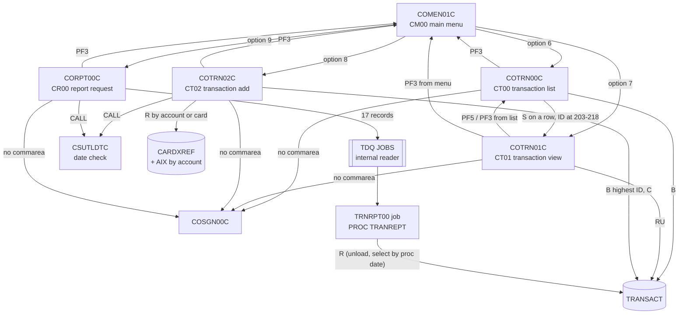

# Area c-transactions: interaction proposals

Merged in eb23aae into `../interactions.md` (edges) and `../components.md` (CRUD rows; invariants as INV-002, INV-004 and INV-006..INV-021, see the "Proposed as" column).

Proposals from area `c-transactions` (COTRN00C, COTRN01C, COTRN02C, CORPT00C, CSUTLDTC) for `../interactions.md` and `../components.md`, written against commit b5e0139. Layout as in `README.md` of this folder.

## Edges

| From | To | Mechanism | Data passed | Source (file:line) | Spec item |
| :-- | :-- | :-- | :-- | :-- | :-- |
| COMEN01C | COTRN00C | XCTL | 160-byte commarea, context 0 (menu option 6) | `app/cbl/COMEN01C.cbl:177-187`; `app/cpy/COMEN02Y.cpy:55-59` | FLOW-TRNL-002 |
| COMEN01C | COTRN01C | XCTL | 160-byte commarea, context 0 (option 7) | `app/cbl/COMEN01C.cbl:177-187`; `app/cpy/COMEN02Y.cpy:61-65` | FLOW-TRNV-002 |
| COMEN01C | COTRN02C | XCTL | 160-byte commarea, context 0 (option 8) | `app/cbl/COMEN01C.cbl:177-187`; `app/cpy/COMEN02Y.cpy:67-72` | FLOW-TRNA-002 |
| COMEN01C | CORPT00C | XCTL | 160-byte commarea, context 0 (option 9) | `app/cbl/COMEN01C.cbl:177-187`; `app/cpy/COMEN02Y.cpy:74-78` | FLOW-RPTS-002 |
| COTRN00C | COTRN01C | XCTL | 218-byte commarea, selected transaction ID at 203-218, context 0 | `app/cbl/COTRN00C.cbl:186-195` | FLOW-TRNL-010, BR-TRNV-003 |
| COTRN00C | COMEN01C | XCTL | commarea, context 0 (PF3) | `app/cbl/COTRN00C.cbl:122-124, 510-521` | FLOW-TRNL-004 |
| COTRN00C | COSGN00C | XCTL | commarea area with routing fields and context set, rest not received | `app/cbl/COTRN00C.cbl:107-109` | FLOW-TRNL-001 |
| COTRN00C | COTRN00C | RETURN TRANSID | `CT00`, 218-byte commarea with paging state | `app/cbl/COTRN00C.cbl:138-141` | FLOW-TRNL-008 |
| COTRN01C | COTRN00C | XCTL | 218-byte commarea, context 0 (PF5; also PF3 when opened from the list) | `app/cbl/COTRN01C.cbl:115-127` | FLOW-TRNV-004, FLOW-TRNV-006 |
| COTRN01C | COMEN01C | XCTL | commarea, context 0 (PF3 when opened from the menu) | `app/cbl/COTRN01C.cbl:115-122` | FLOW-TRNV-004 |
| COTRN01C | COSGN00C | XCTL | commarea area with routing fields and context set, rest not received | `app/cbl/COTRN01C.cbl:94-96` | FLOW-TRNV-001 |
| COTRN01C | COTRN01C | RETURN TRANSID | `CT01`, 218-byte commarea | `app/cbl/COTRN01C.cbl:136-139` | FLOW-TRNV-008 |
| COTRN02C | COMEN01C | XCTL | commarea, context 0 (PF3; `CDEMO-FROM-PROGRAM` or `COMEN01C`) | `app/cbl/COTRN02C.cbl:136-143, 500-511` | FLOW-TRNA-004 |
| COTRN02C | COSGN00C | XCTL | commarea area with routing fields and context set, rest not received | `app/cbl/COTRN02C.cbl:115-117` | FLOW-TRNA-001 |
| COTRN02C | COTRN02C | RETURN TRANSID | `CT02`, 218-byte commarea | `app/cbl/COTRN02C.cbl:530-534` | FLOW-TRNA-008 |
| COTRN02C | CSUTLDTC | CALL | date (10), picture `YYYY-MM-DD` (10), result (80) | `app/cbl/COTRN02C.cbl:389-427` | VAL-TRNA-010 |
| CORPT00C | COMEN01C | XCTL | commarea, context 0 (PF3) | `app/cbl/CORPT00C.cbl:187-189, 540-551` | FLOW-RPTS-004 |
| CORPT00C | COSGN00C | XCTL | commarea area with routing fields and context set, rest not received | `app/cbl/CORPT00C.cbl:172-174` | FLOW-RPTS-001 |
| CORPT00C | CORPT00C | RETURN TRANSID | `CR00`, 160-byte commarea | `app/cbl/CORPT00C.cbl:585-591` | FLOW-RPTS-006 |
| CORPT00C | CSUTLDTC | CALL | date (10), picture `YYYY-MM-DD` (10), result (80) | `app/cbl/CORPT00C.cbl:388-426` | VAL-RPTS-004 |
| CORPT00C | JES internal reader | TDQ | 17 records of 80 bytes (ENT-REPORT-JOB) to queue `JOBS` | `app/cbl/CORPT00C.cbl:496-523`; `app/csd/CARDDEMO.CSD:499-505` | SE-RPTS-001 |
| JES (job `TRNRPT00`) | procedure TRANREPT | JCL step | `STEP10 EXEC PROC=TRANREPT` with `SYMNAMES` and `DATEPARM` overrides holding the date range | `app/cbl/CORPT00C.cbl:93-125`; `app/proc/TRANREPT.prc:35-72` | BR-RPTS-006 |
| COACTUPC | CSUTLDTC | CALL | date (8), picture `YYYYMMDD` (8), result (80) | `app/cpy/CSUTLDPY.cpy:284-321` | FLOW-DTCK-002, DEF-DTCK-003 |
| CSUTLDTC | CEEDAYS (LE) | CALL | varying date, varying picture, Lilian day, feedback code | `app/cbl/CSUTLDTC.cbl:116-120` | BR-DTCK-002 |

## CRUD rows

| Program | Store | Access (R, RU, C, U, D, B) | Spec item |
| :-- | :-- | :-- | :-- |
| COTRN00C | TRANSACT | B | SE-TRNL-001, SE-TRNL-002 |
| COTRN01C | TRANSACT | RU (read with update lock, never rewritten) | SE-TRNV-001 |
| COTRN02C | CXACAIX (card xref by account) | R | SE-TRNA-003 |
| COTRN02C | CCXREF (card xref by card) | R | SE-TRNA-003 |
| COTRN02C | TRANSACT | B (highest ID), C | SE-TRNA-001, SE-TRNA-002 |
| CORPT00C | TDQ JOBS | C (write only) | SE-RPTS-001 |
| CORPT00C (through job `TRNRPT00`) | TRANSACT | R (batch, while CICS has it open) | BR-RPTS-006 |
| CSUTLDTC | none | - | FLOW-DTCK-001 |

## Invariant proposals

| ID | Invariant | Components | Evidence |
| :-- | :-- | :-- | :-- |
| PINV-c-01 | Commarea positions 161-218 have one layout in the transaction list, view and add (and bill payment): first ID, last ID, page number, next-page flag, selection flag, selected ID. The list writes the selected transaction ID at 203-218 and the view reads it there. Changing one program's extension breaks the hand-over. | COTRN00C, COTRN01C, COTRN02C, COBIL00C | `app/cbl/COTRN00C.cbl:62-70, 186-195`; `app/cbl/COTRN01C.cbl:53-61, 99-109`; `app/cbl/COTRN02C.cbl:72-80` |
| PINV-c-02 | The first 10 characters of `TRAN-PROC-TS` are a `YYYY-MM-DD` date for every writer (POSTTRAN, INTCALC, bill payment, transaction add); the report job selects on them as text and the list and view show them. A writer that stores another format drops out of reports. | CBTRN02C, CBACT04C, COBIL00C, COTRN02C, CORPT00C, CBTRN03C | `app/cbl/COTRN02C.cbl:369-381, 465`; `app/cbl/CBACT04C.cbl:499-500`; `app/proc/TRANREPT.prc:40-46`; `app/cbl/CBTRN03C.cbl:173-174`; ENT-TRANSACTION timestamp layouts |
| PINV-c-03 | The job stream written by the report request matches the procedure TRANREPT: step names `STEP05R` and `STEP10R`, DD names `SYMNAMES` and `DATEPARM`, symbol names and positions `TRAN-CARD-NUM,263,16,ZD` and `TRAN-PROC-DT,305,10,CH`, and the date pair `start end` read by `CBTRN03C`. Nothing checks this at run time. | CORPT00C, TRANREPT (CBTRN03C) | `app/cbl/CORPT00C.cbl:93-125`; `app/proc/TRANREPT.prc:35-72`; `app/cbl/CBTRN03C.cbl:122-125` |
| PINV-c-04 | Callers of the date check rely on severity `0000` meaning "valid" and on message number `2513` (date before 1582-10-15) being distinguishable; two of them treat 2513 as valid. | CSUTLDTC, COTRN02C, CORPT00C, COACTUPC | `app/cbl/COTRN02C.cbl:397-427`; `app/cbl/CORPT00C.cbl:396-426`; `app/cpy/CSUTLDPY.cpy:298-316` |
| PINV-c-05 | A transaction added online changes only `TRANSACT`; it is never reflected in `ACCTDATA` or `TCATBALF`, unlike posted transactions (a counter-example to the "three stores in step" of INV-004 for this writer). | COTRN02C, CBTRN02C | COTRN02C BR-TRNA-007, DEF-TRNA-001 |

Note on INV-001: transaction add is already listed there; its spec confirms the "highest + 1" method (COTRN02C BR-TRNA-003, DEF-TRNA-003) and adds that two concurrent adds collide with `Tran ID already exist...`.

## Mermaid fragment

