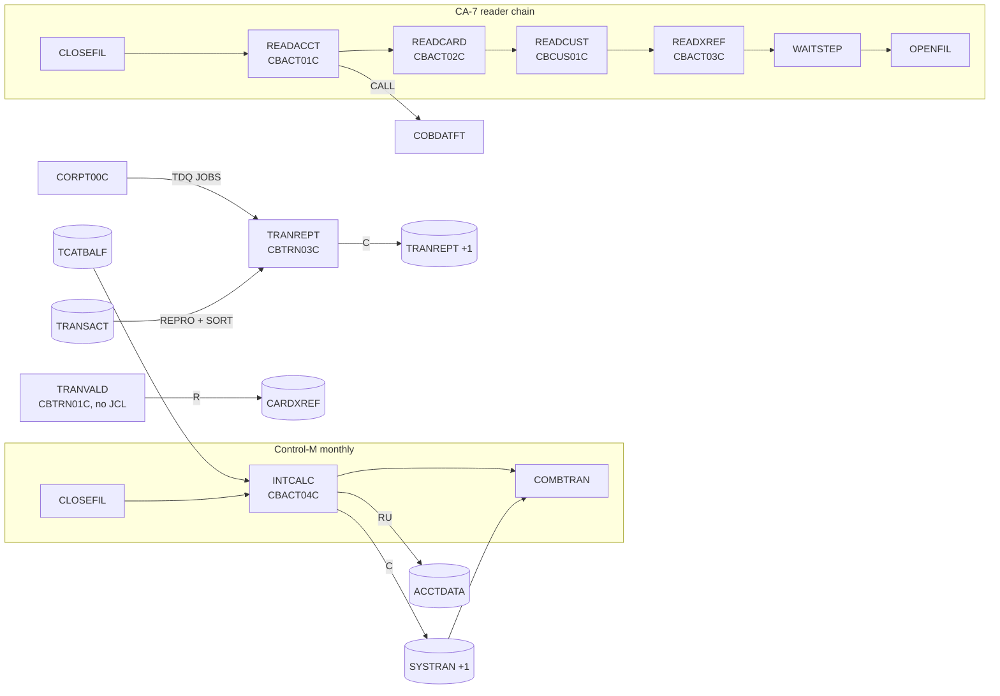

# Area d1-core-batch: interaction proposals

Merged in eb23aae into `../interactions.md` (edges) and `../components.md` (CRUD rows; invariants as INV-002, INV-004 and INV-006..INV-021, see the "Proposed as" column).

Proposals from the core batch area (CBACT01C-04C, CBCUS01C, CBTRN01C, CBTRN03C) for `../interactions.md` and `../components.md`, written at commit 8a8a80a.

## Edges

| From | To | Mechanism | Data passed | Source (file:line) | Spec item |
| :-- | :-- | :-- | :-- | :-- | :-- |
| Control-M folder `MONTHLY-InterestCalculation` | INTCALC | scheduler | monthly, after CLOSEFIL, before COMBTRAN (conditions `...-INTCALC`) | `app/scheduler/CardDemo.controlm:64-80` | CBACT04C BR-INTC-008 (§3) |
| INTCALC (CBACT04C) | COMBTRAN | file | interest transactions in `AWS.M2.CARDDEMO.SYSTRAN(+1)` (FB 350, ENT-TRANSACTION layout); COMBTRAN reads `SYSTRAN(0)` and merges it into the transaction master | `app/jcl/INTCALC.jcl:37-41`, `app/jcl/COMBTRAN.jcl:26` | CBACT04C SE-INTC-001 |
| INTCALC (CBACT04C) | ACCTDATA | file | current balance += interest, cycle credit and debit := 0 | `app/cbl/CBACT04C.cbl:351-370` | CBACT04C BR-INTC-006, SE-INTC-002 |
| CBACT04C | CEE3ABD | CALL | abend code 999, timing 0 | `app/cbl/CBACT04C.cbl:630-634` | CBACT04C ERR-INTC-009 |
| CORPT00C | TRANREPT (proc) | TDQ | job stream for queue `JOBS` with the report dates in the SORT symbols and the DATEPARM record | `app/cbl/CORPT00C.cbl:515-531` | CBTRN03C BR-TRPT-001 (§3); CORPT00C specified by c-transactions |
| TRANREPT STEP05R | TRANREPT STEP10R | JCL step | REPRO of the transaction master to `TRANSACT.BKUP(+1)`, SORT by card with the date INCLUDE to `TRANSACT.DALY(+1)`, read as TRANFILE | `app/jcl/TRANREPT.jcl:23-55, 59-80` | CBTRN03C BR-TRPT-002, DEF-TRPT-002 |
| CBTRN03C | CEE3ABD | CALL | abend code 999, timing 0 | `app/cbl/CBTRN03C.cbl:627-631` | CBTRN03C ERR-TRPT-006 |
| CA-7 `CLOSEFIL` | READACCT | scheduler | trigger (SCHID 030) | `app/scheduler/CardDemo.ca7:335-340` | CBACT01C BR-ACRD-001 (§3) |
| READACCT | READCARD | scheduler | trigger (SCHID 030) | `app/scheduler/CardDemo.ca7:342-367` | CBACT02C BR-CDRD-001 (§3) |
| READCARD | READCUST | scheduler | trigger (SCHID 030) | `app/scheduler/CardDemo.ca7:369-394` | CBCUS01C BR-CURD-001 (§3) |
| READCUST | READXREF | scheduler | trigger (SCHID 030) | `app/scheduler/CardDemo.ca7:396-421` | CBACT03C BR-XRRD-001 (§3) |
| READXREF | WAITSTEP | scheduler | trigger (SCHID 030), then OPENFIL | `app/scheduler/CardDemo.ca7:423-455` | CBACT03C BR-XRRD-001 (§3) |
| READACCT PREDEL | READACCT STEP05 | JCL step | `IEFBR14` deletes the three extract datasets before CBACT01C creates them | `app/jcl/READACCT.jcl:22-50` | CBACT01C SE-ACRD-001 |
| CBACT01C | COBDATFT | CALL | `CODATECN-REC`: type `2`, input `ACCT-REISSUE-DATE` (`YYYY-MM-DD`), output type `2`; returns `YYYYMMDD` in the first 8 output bytes | `app/cbl/CBACT01C.cbl:223-234` | CBACT01C BR-ACRD-004; COBDATFT specified by d2-batch-utilities |
| CBACT01C, CBACT02C, CBACT03C, CBCUS01C, CBTRN01C | CEE3ABD | CALL | abend code 999, timing 0 | `app/cbl/CBACT01C.cbl:409-413`, `app/cbl/CBACT02C.cbl:154-158`, `app/cbl/CBACT03C.cbl:154-158`, `app/cbl/CBCUS01C.cbl:154-158`, `app/cbl/CBTRN01C.cbl:469-473` | ERR-ACRD-006, ERR-CDRD-005, ERR-XRRD-005, ERR-CURD-005, ERR-TVAL-005 |

TRANVALD (CBTRN01C) has no JCL and no schedule entry; it has no edge to another job (CBTRN01C DEF-TVAL-007).

## CRUD rows

B is a sequential read (browse) of a whole file, R a keyed read, RU a read for update followed by a rewrite, C a write of new records.

| Program | Store | Access (R, RU, C, U, D, B) | Spec item |
| :-- | :-- | :-- | :-- |
| CBACT01C | ACCTDATA | B | BR-ACRD-001 |
| CBACT01C | ACCTDATA.PSCOMP (OUTFILE) | C | BR-ACRD-003 |
| CBACT01C | ACCTDATA.ARRYPS (ARRYFILE) | C | BR-ACRD-006 |
| CBACT01C | ACCTDATA.VBPS (VBRCFILE) | C | BR-ACRD-007 |
| CBACT02C | CARDDATA | B | BR-CDRD-001 |
| CBACT03C | CARDXREF | B | BR-XRRD-001 |
| CBCUS01C | CUSTDATA | B | BR-CURD-001 |
| CBACT04C | TCATBALF | B | BR-INTC-008 |
| CBACT04C | CARDXREF (AIX by account) | R | BR-INTC-007 |
| CBACT04C | ACCTDATA | RU | BR-INTC-006 |
| CBACT04C | DISCGRP | R | BR-INTC-002 |
| CBACT04C | SYSTRAN | C | BR-INTC-004 |
| CBTRN01C | DALYTRAN | B | BR-TVAL-001 |
| CBTRN01C | CARDXREF | R | BR-TVAL-002 |
| CBTRN01C | ACCTDATA | R | BR-TVAL-003 |
| CBTRN01C | CUSTDATA, CARDDATA, TRANSACT | opened and closed only | DEF-TVAL-003 |
| CBTRN03C | TRANSACT.DALY (sorted copy of TRANSACT) | B | BR-TRPT-002 |
| CBTRN03C | CARDXREF | R | BR-TRPT-007 |
| CBTRN03C | TRANTYPE | R | BR-TRPT-007 |
| CBTRN03C | TRANCATG | R | BR-TRPT-007 |
| CBTRN03C | DATEPARM | B (first record) | BR-TRPT-001 |
| CBTRN03C | TRANREPT | C | SE-TRPT-001 |

## Invariant proposals

| ID | Invariant | Components | Evidence |
| :-- | :-- | :-- | :-- |
| PINV-d1-01 | Every account that has a category balance in TCATBALF has an account record and at least one card in CARDXREF; otherwise INTCALC abends. | INTCALC, POSTTRAN | CBACT04C ERR-INTC-003, ERR-INTC-004 |
| PINV-d1-02 | DISCGRP holds a `DEFAULT` record for every transaction type and category that occurs in TCATBALF; otherwise INTCALC abends on the first account without a specific rate. | INTCALC, DISCGRP load | CBACT04C ERR-INTC-005 |
| PINV-d1-03 | Every card, transaction type and category in the transaction master exists in CARDXREF, TRANTYPE and TRANCATG; otherwise TRANREPT abends. | TRANREPT, POSTTRAN, online transaction add, transaction type maintenance | CBTRN03C BR-TRPT-007, ERR-TRPT-004 |
| PINV-d1-04 | The SORT date range of TRANREPT equals its DATEPARM range; a wider SORT range truncates the report silently. | TRANREPT JCL, CORPT00C | CBTRN03C DEF-TRPT-001, DEF-TRPT-002 |

## Mermaid fragment

