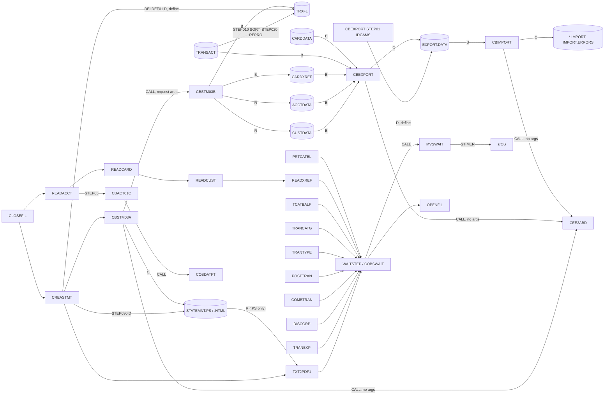

# Area d2-batch-utilities: interaction proposals

Merged in f9ea11a into `../interactions.md` (diagram and edges) and `../components.md` (component rows, data stores, CRUD rows; invariants as INV-022..INV-025, see the "Proposed as" column).

Proposed additions to `../interactions.md` and `../components.md` from the d2 specs (CBSTM03A, CBSTM03B, CBEXPORT, CBIMPORT, COBSWAIT, COBDATFT, MVSWAIT), written against commit b5e0139. Entities are in `../entities.md` and `d2-batch-utilities-entities.md`. An independent review of this document is recorded in `../evidence/d2-batch-utilities-review.md`.

## Component rows for `../components.md`

| Component | Kind | Entry point | Module | Role | Spec |
| :-- | :-- | :-- | :-- | :-- | :-- |
| `CBSTM03A` | batch | job `CREASTMT` step `STEP040` | core | Account statements (text and HTML) for every card in the cross-reference | [programs/CBSTM03A.md](../programs/CBSTM03A.md) |
| `CBSTM03B` | batch subprogram | CALL from CBSTM03A | core | File access for the statement program (four DDs, one request area) | [programs/CBSTM03B.md](../programs/CBSTM03B.md) |
| `CBEXPORT` | batch | job `CBEXPORT` step `STEP02` | core | Branch migration export: five master files into one multi-record file | [programs/CBEXPORT.md](../programs/CBEXPORT.md) |
| `CBIMPORT` | batch | job `CBIMPORT` step `STEP01` | core | Branch migration import: the export file back into five sequential files and an error file | [programs/CBIMPORT.md](../programs/CBIMPORT.md) |
| `COBSWAIT` | batch | job `WAITSTEP` step `WAIT` | core | Waits for the interval on its SYSIN card | [programs/COBSWAIT.md](../programs/COBSWAIT.md) |
| `MVSWAIT` | assembler subroutine (shim locally) | CALL from COBSWAIT | core | `STIMER WAIT` for a binary interval in hundredths of a second | [programs/MVSWAIT.md](../programs/MVSWAIT.md) |
| `COBDATFT` | assembler subroutine (shim locally) | CALL from CBACT01C (job `READACCT`) | core | Date format conversion in the caller's parameter block | [programs/COBDATFT.md](../programs/COBDATFT.md) |
| CREASTMT | JCL (IDCAMS, SORT, IEFBR14, program) | CA-7, after CLOSEFIL | core | Rebuilds the TRXFL work file, deletes the previous statements, runs CBSTM03A | - |
| CBEXPORT, CBIMPORT | JCL (IDCAMS, program) | not scheduled | core | Run the export and import programs | - |
| WAITSTEP | JCL (program) | CA-7 and Control-M, between jobs | core | Runs COBSWAIT | - |
| TXT2PDF1 | JCL (TSO REXX) | CA-7, after CREASTMT | core | Converts `STATEMNT.PS` to PDF | - |

## Data store rows for `../components.md`

| Store | Entity | Physical | Online name | Batch DD | Key |
| :-- | :-- | :-- | :-- | :-- | :-- |
| Customers | ENT-CUSTOMER | `CUSTDATA.VSAM.KSDS` | `CUSTDAT` | `CUSTFILE` | `CUST-ID` |
| Cards | ENT-CARD | `CARDDATA.VSAM.KSDS` + AIX on account | `CARDDAT`, `CARDAIX` | `CARDFILE` | `CARD-NUM`; AIX account ID (11 bytes at offset 16, non-unique) |
| Statement work file | ENT-STMT-TRAN | `TRXFL.SEQ`, then `TRXFL.VSAM.KSDS` | - | `TRNXFILE` | card + transaction ID (32 bytes) |
| Text statements | - (80-byte print lines) | `STATEMNT.PS` | - | `STMTFILE` | - |
| HTML statements | - (100-byte HTML lines) | `STATEMNT.HTML` | - | `HTMLFILE` | - |
| Export file | ENT-EXPORT-RECORD | `EXPORT.DATA` (KSDS) | - | `EXPFILE` | sequence number (offset 27 in the programs, `KEYS(4 28)` in IDCAMS) |
| Import outputs | ENT-CUSTOMER, ENT-ACCOUNT, ENT-CARD-XREF, ENT-TRANSACTION, ENT-CARD | `CUSTDATA.IMPORT`, `ACCTDATA.IMPORT`, `CARDXREF.IMPORT`, `TRANSACT.IMPORT`, `CARDDATA.IMPORT` | - | `CUSTOUT`, `ACCTOUT`, `XREFOUT`, `TRNXOUT`, `CARDOUT` | - |
| Import errors | ENT-IMPORT-ERROR | `IMPORT.ERRORS` | - | `ERROUT` | - |

CBEXPORT reads the transaction master through DD `TRANSACT` (`app/jcl/CBEXPORT.jcl:55-56`); POSTTRAN uses `TRANFILE` for the same dataset.

## Edges

| From | To | Mechanism | Data passed | Source (file:line) | Spec item |
| :-- | :-- | :-- | :-- | :-- | :-- |
| CA-7 `CLOSEFIL` | `CREASTMT` | scheduler | trigger | `app/scheduler/CardDemo.ca7:465-468` | CBSTM03A §3 (Trigger) |
| CA-7 `CREASTMT` | `TXT2PDF1` | scheduler | trigger; TXT2PDF1 reads `STATEMNT.PS` (INDD) and writes `STATEMNT.PS.PDF`; `STATEMNT.HTML` is not read | `app/scheduler/CardDemo.ca7:494-495`, `app/jcl/TXT2PDF1.JCL:24-39` | SE-STMT-001, CBSTM03A §4 (Downstream) |
| CA-7 `TXT2PDF1` | `WAITSTEP`, then `OPENFIL` | scheduler | trigger | `app/scheduler/CardDemo.ca7:521-527` | COBSWAIT §3 (Trigger) |
| `CREASTMT` DELDEF01 (IDCAMS) | TRXFL.SEQ, TRXFL.VSAM.KSDS | JCL step | delete both, define the KSDS again with `KEYS(32 0)` | `app/jcl/CREASTMT.JCL:22-40` | CBSTM03A §3 (Earlier steps of the same job) |
| `CREASTMT` STEP010 (SORT) | TRXFL.SEQ | JCL step | ENT-TRANSACTION from TRANSACT (`SORTIN`) sorted by card + ID, card moved in front (ENT-STMT-TRAN) | `app/jcl/CREASTMT.JCL:44-55` | CBSTM03A §3 (Earlier steps of the same job), ENT-STMT-TRAN |
| `CREASTMT` STEP020 (IDCAMS REPRO) | TRXFL.VSAM.KSDS | JCL step | ENT-STMT-TRAN | `app/jcl/CREASTMT.JCL:56-62` | CBSTM03A §3 (Earlier steps of the same job), ENT-STMT-TRAN |
| `CREASTMT` STEP030 (IEFBR14) | STATEMNT.HTML, STATEMNT.PS | JCL step | delete the previous statements | `app/jcl/CREASTMT.JCL:66-75` | CBSTM03A §3 (Earlier steps of the same job) |
| `CREASTMT` STEP040 | CBSTM03A | JCL step | DDs TRNXFILE, XREFFILE, ACCTFILE, CUSTFILE, STMTFILE, HTMLFILE | `app/jcl/CREASTMT.JCL:79-96` | CBSTM03A §3 (Trigger) |
| CBSTM03A | CBSTM03B | CALL | ENT-STMT-REQUEST (DD name, operation, key, key length in; return code, 1000-byte record out) | `app/cbl/CBSTM03A.CBL:351, 377, 401, 734, 746, 769, 787, 805, 835, 860, 877, 893, 909` | FLOW-STIO-001, BR-STIO-001 |
| CBSTM03A | CEE3ABD | CALL | none (no arguments) | `app/cbl/CBSTM03A.CBL:923` | ERR-STMT-006 |
| `CBEXPORT` job STEP01 (IDCAMS) | EXPORT.DATA | JCL step | delete and define the export KSDS | `app/jcl/CBEXPORT.jcl:24-38` | DEF-EXPT-002 |
| `CBEXPORT` job STEP02 | CBEXPORT | JCL step | DDs CUSTFILE, ACCTFILE, XREFFILE, TRANSACT, CARDFILE, EXPFILE | `app/jcl/CBEXPORT.jcl:43-63` | FLOW-EXPT-001 |
| CBEXPORT | CEE3ABD | CALL | none (no arguments) | `app/cbl/CBEXPORT.cbl:584` | ERR-EXPT-004 |
| CBEXPORT | CBIMPORT | file | ENT-EXPORT-RECORD (`AWS.M2.CARDDEMO.EXPORT.DATA`) | `app/jcl/CBEXPORT.jcl:62-63`, `app/jcl/CBIMPORT.jcl:28-29` | SE-EXPT-001, FLOW-IMPT-003 |
| `CBIMPORT` job STEP01 | CBIMPORT | JCL step | DDs EXPFILE, CUSTOUT, ACCTOUT, XREFOUT, TRNXOUT, CARDOUT, ERROUT | `app/jcl/CBIMPORT.jcl:22-65` | FLOW-IMPT-001 |
| CBIMPORT | CEE3ABD | CALL | none (no arguments) | `app/cbl/CBIMPORT.cbl:494` | DEF-IMPT-003 |
| `WAITSTEP` job | COBSWAIT | JCL step | SYSIN `00003600` (hundredths of a second) | `app/jcl/WAITSTEP.jcl:22-27` | BR-WAIT-001 |
| CA-7 POSTTRAN | `WAITSTEP`, then `OPENFIL` | scheduler | trigger | `app/scheduler/CardDemo.ca7:96-97, 123-124` | COBSWAIT §3 (Trigger) |
| CA-7 TRANTYPE | `WAITSTEP`, then `CLOSEFIL1` and `CLOSEFIL2` | scheduler | trigger | `app/scheduler/CardDemo.ca7:188-189, 215-217` | COBSWAIT §3 (Trigger) |
| CA-7 TRANCATG | `WAITSTEP`, then `CLOSEFIL` | scheduler | trigger | `app/scheduler/CardDemo.ca7:297-298, 302-303` | COBSWAIT §3 (Trigger) |
| CA-7 TCATBALF | `WAITSTEP`, then `CLOSEFIL` | scheduler | trigger | `app/scheduler/CardDemo.ca7:329-330, 334-335` | COBSWAIT §3 (Trigger) |
| CA-7 READXREF | `WAITSTEP`, then `OPENFIL` | scheduler | trigger | `app/scheduler/CardDemo.ca7:447-448, 452-453` | COBSWAIT §3 (Trigger) |
| CA-7 PRTCATBL | `WAITSTEP`, then `OPENFIL` | scheduler | trigger | `app/scheduler/CardDemo.ca7:563-564, 568-569` | COBSWAIT §3 (Trigger) |
| Control-M TRANBKP | `WAITSTEP` | scheduler | condition `DAILY-TransactionBackup-TRANBKP`; WAITSTEP then releases OPENFIL | `app/scheduler/CardDemo.controlm:14-24` | COBSWAIT §3 (Trigger) |
| Control-M DISCGRP, COMBTRAN | `WAITSTEP` | scheduler | weekly and monthly folders, same pattern | `app/scheduler/CardDemo.controlm:44-54, 81-91` | COBSWAIT §3 (Trigger) |
| COBSWAIT | MVSWAIT | CALL | fullword binary interval, hundredths of a second | `app/cbl/COBSWAIT.cbl:38` | BR-WAIT-001, BR-MWAT-001 |
| MVSWAIT | z/OS `STIMER` | SVC (macro `ASMWAIT`) | `WAIT,BINTVL=` the interval | `app/asm/MVSWAIT.asm:23`, `app/maclib/ASMWAIT.mac:17-20` | BR-MWAT-001 |
| CA-7 CLOSEFIL | `READACCT`, then `READCARD`, `READCUST`, `READXREF` | scheduler | trigger | `app/scheduler/CardDemo.ca7:337-340, 366-367, 393-394, 420-421` | - (jobs area) |
| `READACCT` job STEP05 | CBACT01C (area d1) | JCL step | DDs ACCTFILE, OUTFILE, ARRYFILE, VBRCFILE | `app/jcl/READACCT.jcl:32-50` | - (area d1) |
| CBACT01C (area d1) | COBDATFT | CALL | ENT-DATE-CONV-PARM (type, date in; date or error message out) | `app/cbl/CBACT01C.cbl:232` | BR-DTFT-001 |

Nothing in the repository runs `CBEXPORT` or `CBIMPORT` from a schedule, and nothing reads the `*.IMPORT` or `IMPORT.ERRORS` datasets (CBIMPORT Q-IMPT-004).

**Schedule conflict for the lead:** CA-7 orders CREASTMT after CLOSEFIL and before TXT2PDF1 (`app/scheduler/CardDemo.ca7:465-468, 494-495`). `../interactions.md` places it between COMBTRAN and TRANIDX, following the runbook (`docs/runbooks/batch-cycle-restart.md:18-20`). The two orders disagree, and the merged view has to choose one or show both.

**Local stand-ins:** the local runner chains POSTTRAN, CBEXPORT and CBIMPORT and runs WAITSTEP with SYSIN `00000050` (`tools/carddemo.py:672-690`). The shims in `tools/shims/` replace CEE3ABD, COBDATFT and MVSWAIT.

## CRUD rows for `../components.md`

R = read, RU = read for update, C = create, U = update, B = browse (sequential read), D = delete (job step). The rows are in long form; the lead pivots them into the matrix.

| Program or step | Store | Access | Spec item |
| :-- | :-- | :-- | :-- |
| CBSTM03A (through CBSTM03B) | TRXFL (ENT-STMT-TRAN) | B (sequential, whole file into a table) | FLOW-STMT-003, SE-STIO-001 |
| CBSTM03A (through CBSTM03B) | CARDXREF (ENT-CARD-XREF) | B (sequential) | FLOW-STMT-004, SE-STIO-002 |
| CBSTM03A (through CBSTM03B) | CUSTDATA (ENT-CUSTOMER) | R (by `CUST-ID`) | BR-STMT-004, SE-STIO-003 |
| CBSTM03A (through CBSTM03B) | ACCTDATA (ENT-ACCOUNT) | R (by `ACCT-ID`) | BR-STMT-004, SE-STIO-004 |
| CBSTM03A | STATEMNT.PS (text statements) | C | SE-STMT-001 |
| CBSTM03A | STATEMNT.HTML | C | SE-STMT-002 |
| CREASTMT DELDEF01, STEP010, STEP020 | TRANSACT; TRXFL.SEQ; TRXFL.VSAM.KSDS | TRANSACT B (sort input); TRXFL.SEQ D, C, then R; TRXFL KSDS D, C | CBSTM03A §3 (Earlier steps of the same job) |
| CREASTMT STEP030 | STATEMNT.PS, STATEMNT.HTML | D | CBSTM03A §3 (Earlier steps of the same job) |
| TXT2PDF1 | STATEMNT.PS; STATEMNT.PS.PDF | R; C | CBSTM03A §4 (Downstream) |
| CBEXPORT | CUSTDATA, ACCTDATA, CARDXREF, TRANSACT, CARDDATA | B (sequential, key order) | SE-EXPT-002 |
| CBEXPORT job STEP01 | EXPORT.DATA | D, then define | DEF-EXPT-002 |
| CBEXPORT | EXPORT.DATA (ENT-EXPORT-RECORD) | C | SE-EXPT-001 |
| CBIMPORT | EXPORT.DATA (ENT-EXPORT-RECORD) | B (sequential, key order) | FLOW-IMPT-003 |
| CBIMPORT | CUSTDATA.IMPORT, ACCTDATA.IMPORT, CARDXREF.IMPORT, TRANSACT.IMPORT, CARDDATA.IMPORT | C | SE-IMPT-002..006 |
| CBIMPORT | IMPORT.ERRORS (ENT-IMPORT-ERROR) | C | SE-IMPT-007 |
| COBSWAIT | SYSIN control card (`WAITSTEP.jcl` in-stream) | R | BR-WAIT-001 |

COBDATFT and MVSWAIT have no data store (`data_stores: []`). COBDATFT changes only the caller's ENT-DATE-CONV-PARM (SE-DTFT-001).

## Invariant proposals

| ID | Invariant | Components | Evidence |
| :-- | :-- | :-- | :-- |
| PINV-d2-01 | The request area is declared twice, in CBSTM03A working storage and CBSTM03B linkage, and the two declarations must stay byte-identical (1040 bytes). | CBSTM03A, CBSTM03B | `app/cbl/CBSTM03A.CBL:71-83`, `app/cbl/CBSTM03B.CBL:100-112` |
| PINV-d2-02 | Export and import must agree on the 500-byte layout (CVEXPORT, copied into working storage by both) and on the key: each program declares its own FD overlay with a 4-byte key at offset 27, the bytes of `EXPORT-SEQUENCE-NUM`. The IDCAMS definition `KEYS(4 28)` does not match (DEF-EXPT-002, DEF-IMPT-004). | CBEXPORT, CBIMPORT, CBEXPORT job | `app/cpy/CVEXPORT.cpy:9-16`, `app/cbl/CBEXPORT.cbl:65-69, 89-101`, `app/cbl/CBIMPORT.cbl:37-41, 76-84, 118`, `app/jcl/CBEXPORT.jcl:32` |
| PINV-d2-03 | A CBEXPORT run followed by CBIMPORT reproduces the five input files byte for byte (observed on the sample day after POSTTRAN), provided no field holds a value its export encoding cannot carry. | CBEXPORT, CBIMPORT | CBEXPORT BR-EXPT-004..008, CBIMPORT BR-IMPT-005..009, `tests/integration/test_export_import.py:11-36` |
| PINV-d2-04 | TRXFL must be rebuilt from TRANSACT (CREASTMT DELDEF01, STEP010-020) before CBSTM03A runs; a stale TRXFL gives statements that do not match the transaction master. | CREASTMT, CBSTM03A | `app/jcl/CREASTMT.JCL:22-62` |

The three no-argument `CEE3ABD` calls (ERR-STMT-006, ERR-EXPT-004, DEF-IMPT-003) are one cross-component pattern: the abend code these jobs end with on z/OS is undefined.

## Mermaid fragment

WAITSTEP's successor depends on the scheduler entry (OPENFIL, CLOSEFIL, or CLOSEFIL1 and CLOSEFIL2); the diagram shows OPENFIL only, and the Edges table has every pair.
