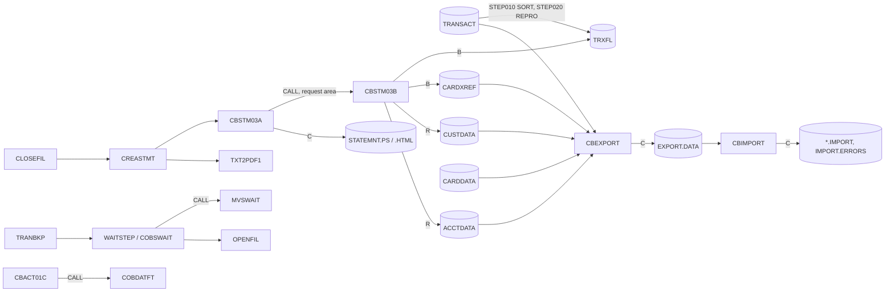

# Area d2-batch-utilities: interaction proposals

Proposed additions to `../interactions.md` and `../components.md` from the d2 specs (CBSTM03A, CBSTM03B, CBEXPORT, CBIMPORT, COBSWAIT, COBDATFT, MVSWAIT), written against commit b5e0139. Entities are in `../entities.md` and `d2-batch-utilities-entities.md`.

## Edges

| From | To | Mechanism | Data passed | Source (file:line) | Spec item |
| :-- | :-- | :-- | :-- | :-- | :-- |
| CA-7 `CLOSEFIL` | `CREASTMT` | scheduler | trigger | `app/scheduler/CardDemo.ca7:465-468` | FLOW-STMT-004 |
| CA-7 `CREASTMT` | `TXT2PDF1` | scheduler | trigger (consumes the statement files) | `app/scheduler/CardDemo.ca7:494-495` | SE-STMT-001 |
| `CREASTMT` STEP010 (SORT) | TRXFL.SEQ | JCL step | ENT-TRANSACTION sorted by card + ID, card moved in front (ENT-STMT-TRAN) | `app/jcl/CREASTMT.JCL:44-55` | FLOW-STMT-003 |
| `CREASTMT` STEP020 (IDCAMS REPRO) | TRXFL.VSAM.KSDS | JCL step | ENT-STMT-TRAN | `app/jcl/CREASTMT.JCL:56-62` | FLOW-STMT-003 |
| `CREASTMT` STEP040 | CBSTM03A | JCL step | DDs TRNXFILE, XREFFILE, ACCTFILE, CUSTFILE, STMTFILE, HTMLFILE | `app/jcl/CREASTMT.JCL:79-96` | FLOW-STMT-004 |
| CBSTM03A | CBSTM03B | CALL | ENT-STMT-REQUEST (DD name, operation, key, key length in; return code, 1000-byte record out) | `app/cbl/CBSTM03A.CBL:351, 377, 401, 734, 746, 769, 787, 805, 835, 860, 877, 893, 909` | FLOW-STIO-001, BR-STIO-001 |
| CBSTM03A | CEE3ABD | CALL | none (no arguments) | `app/cbl/CBSTM03A.CBL:923` | ERR-STMT-006 |
| `CBEXPORT` job STEP01 (IDCAMS) | EXPORT.DATA | JCL step | delete and define the export KSDS | `app/jcl/CBEXPORT.jcl:24-38` | DEF-EXPT-002 |
| `CBEXPORT` job STEP02 | CBEXPORT | JCL step | DDs CUSTFILE, ACCTFILE, XREFFILE, TRANSACT, CARDFILE, EXPFILE | `app/jcl/CBEXPORT.jcl:43-63` | FLOW-EXPT-001 |
| CBEXPORT | CEE3ABD | CALL | none (no arguments) | `app/cbl/CBEXPORT.cbl:584` | ERR-EXPT-004 |
| CBEXPORT | CBIMPORT | file | ENT-EXPORT-RECORD (`AWS.M2.CARDDEMO.EXPORT.DATA`) | `app/jcl/CBEXPORT.jcl:62-63`, `app/jcl/CBIMPORT.jcl:28-29` | SE-EXPT-001, FLOW-IMPT-003 |
| `CBIMPORT` job STEP01 | CBIMPORT | JCL step | DDs EXPFILE, CUSTOUT, ACCTOUT, XREFOUT, TRNXOUT, CARDOUT, ERROUT | `app/jcl/CBIMPORT.jcl:22-62` | FLOW-IMPT-001 |
| CBIMPORT | CEE3ABD | CALL | none (no arguments) | `app/cbl/CBIMPORT.cbl:494` | DEF-IMPT-003 |
| `WAITSTEP` job | COBSWAIT | JCL step | SYSIN `00003600` (hundredths of a second) | `app/jcl/WAITSTEP.jcl:22-27` | BR-WAIT-001 |
| Control-M TRANBKP | `WAITSTEP` | scheduler | condition `DAILY-TransactionBackup-TRANBKP`; WAITSTEP then releases OPENFIL | `app/scheduler/CardDemo.controlm:14-25` | FLOW-WAIT-001 |
| Control-M DISCGRP, COMBTRAN | `WAITSTEP` | scheduler | weekly and monthly folders, same pattern | `app/scheduler/CardDemo.controlm:44-55, 81-92` | FLOW-WAIT-001 |
| COBSWAIT | MVSWAIT | CALL | fullword binary interval, hundredths of a second | `app/cbl/COBSWAIT.cbl:38` | BR-WAIT-001, BR-MWAT-001 |
| CBACT01C (area d1) | COBDATFT | CALL | ENT-DATE-CONV-PARM (type, date in; date or error message out) | `app/cbl/CBACT01C.cbl:232` | BR-DTFT-001 |

Nothing in the repository runs `CBEXPORT` or `CBIMPORT` from a schedule, and nothing reads the `*.IMPORT` or `IMPORT.ERRORS` datasets (CBIMPORT Q-IMPT-004).

## CRUD rows for `../components.md`

| Program | Store | Access (R, RU, C, U, D, B) | Spec item |
| :-- | :-- | :-- | :-- |
| CBSTM03A (through CBSTM03B) | TRXFL (ENT-STMT-TRAN) | B (sequential, whole file into a table) | FLOW-STMT-003, SE-STIO-001 |
| CBSTM03A (through CBSTM03B) | CARDXREF (ENT-CARD-XREF) | B (sequential) | FLOW-STMT-004, SE-STIO-002 |
| CBSTM03A (through CBSTM03B) | CUSTDATA (ENT-CUSTOMER) | R (by `CUST-ID`) | BR-STMT-004, SE-STIO-003 |
| CBSTM03A (through CBSTM03B) | ACCTDATA (ENT-ACCOUNT) | R (by `ACCT-ID`) | BR-STMT-004, SE-STIO-004 |
| CBSTM03A | STATEMNT.PS (text statements) | C | SE-STMT-001 |
| CBSTM03A | STATEMNT.HTML | C | SE-STMT-002 |
| CBEXPORT | CUSTDATA, ACCTDATA, CARDXREF, TRANSACT, CARDDATA | B (sequential, key order) | SE-EXPT-002 |
| CBEXPORT | EXPORT.DATA (ENT-EXPORT-RECORD) | C | SE-EXPT-001 |
| CBIMPORT | EXPORT.DATA (ENT-EXPORT-RECORD) | B (sequential, key order) | FLOW-IMPT-003 |
| CBIMPORT | CUSTDATA.IMPORT, ACCTDATA.IMPORT, CARDXREF.IMPORT, TRANSACT.IMPORT, CARDDATA.IMPORT | C | SE-IMPT-002..006 |
| CBIMPORT | IMPORT.ERRORS (ENT-IMPORT-ERROR) | C | SE-IMPT-007 |
| COBDATFT | caller's ENT-DATE-CONV-PARM | U (in storage) | SE-DTFT-001 |

## Invariant proposals

| ID | Invariant | Components | Evidence |
| :-- | :-- | :-- | :-- |
| PINV-d2-01 | The request area is declared twice, in CBSTM03A working storage and CBSTM03B linkage, and the two declarations must stay byte-identical (1040 bytes). | CBSTM03A, CBSTM03B | `app/cbl/CBSTM03A.CBL:71-83`, `app/cbl/CBSTM03B.CBL:100-112` |
| PINV-d2-02 | Export and import must agree on the export record layout and key: both copy CVEXPORT and key the file on the 4-byte sequence number at offset 27, which the IDCAMS definition (`KEYS(4 28)`) does not match. | CBEXPORT, CBIMPORT, CBEXPORT job | `app/cbl/CBEXPORT.cbl:65-69`, `app/cbl/CBIMPORT.cbl:79-83`, `app/jcl/CBEXPORT.jcl:32` |
| PINV-d2-03 | A CBEXPORT run followed by CBIMPORT reproduces the five input files byte for byte (observed on the sample day after POSTTRAN), provided no field holds a value its export encoding cannot carry. | CBEXPORT, CBIMPORT | CBEXPORT BR-EXPT-004..008, CBIMPORT BR-IMPT-005..009 |
| PINV-d2-04 | TRXFL must be rebuilt from TRANSACT (CREASTMT STEP010-020) before CBSTM03A runs; a stale TRXFL gives statements that do not match the transaction master. | CREASTMT, CBSTM03A | `app/jcl/CREASTMT.JCL:22-62` |

## Mermaid fragment

