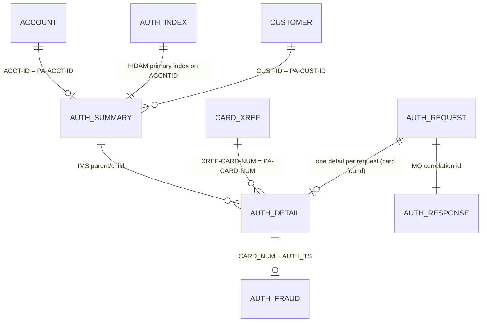

# Area e-authorization: entity proposals

Proposed additions to `../entities.md` for the optional authorization module (`app/app-authorization-ims-db2-mq/`), written at commit b5e0139. Conventions follow `../entities.md`; in addition:

- `packed(p,s)` is packed decimal (`COMP-3`): `p` digits of which `s` are decimals, two digits per byte, sign in the last half-byte (`C` or `F` positive, `D` negative); its length is `(p+1)/2` rounded up.
- `binary(2)` is a signed big-endian halfword (`COMP`, `S9(4)`).
- `edited(n)` is a numeric-edited text field of `n` characters.

The segments, the Db2 table and the MQ messages are module-local: no base-application program reads them. The module reads three base files: ENT-ACCOUNT, ENT-CARD-XREF and ENT-CUSTOMER (see "Base records read by the module").

## ER view

## ENT-AUTH-SUMMARY · Pending authorization summary (IMS root segment PAUTSUM0)

- **Copybook:** `app/app-authorization-ims-db2-mq/cpy/CIPAUSMY.cpy:19-31` (included under `01 PENDING-AUTH-SUMMARY`), 100 bytes.
- **Database:** IMS HIDAM `DBPAUTP0`, VSAM data set group DD `DDPAUTP0`, root segment `PAUTSUM0`, `BYTES=100`, `POINTER=(TWINBWD)`, `RULES=(,HERE)` (`DBPAUTP0.dbd:18-32`). The DBD names a data-capture exit `EXIT=(*,KEY,DATA,NOPATH,(NOCASCADE),LOG)` (`DBPAUTP0.dbd:19`).
- **Key:** `ACCNTID`, unique sequence field, bytes 1-6, packed (`DBPAUTP0.dbd:30`) = `PA-ACCT-ID`. Primary index `PAUTINDX` in `DBPAUTX0` (ENT-AUTH-INDEX).
- **PSBs:** `PSBPAUTB` (`PROCOPT=AP`, used by the CICS programs, CBPAUP0C and PAUDBLOD), `PAUTBUNL` and `DLIGSAMP` (`PROCOPT=GOTP`, unloads), `PSBPAUTL` (`PROCOPT=L`, load, not used by any program here). All use `KEYLEN=14` = 6 (root key) + 8 (detail key).
- **One summary per account.** It is created by the first authorization request for a card of the account (COPAUA0C BR-AUTH-009) and is never deleted online; CBPAUP0C deletes it (with every detail under it) when its approved count, held in memory and reduced by the details purged in the same run, is zero or less; the reduced count is never written back (BR-AUPG-004, `app/app-authorization-ims-db2-mq/cbl/CBPAUP0C.cbl:156, 286-293`).

| Field | Pos | Len | PIC | Type | Meaning |
| :-- | --: | --: | :-- | :-- | :-- |
| `PA-ACCT-ID` | 1 | 6 | `S9(11) COMP-3` | packed(11,0) | Account number (IMS key `ACCNTID`) |
| `PA-CUST-ID` | 7 | 9 | `9(09)` | digits(9) | Customer number, from the card cross-reference |
| `PA-AUTH-STATUS` | 16 | 1 | `X(01)` | text(1) | Not set or read by any program (in the sample: space in 18 roots, X'00' in 3, X'F0' in the all-spaces root) |
| `PA-ACCOUNT-STATUS` (5 occurrences) | 17 | 10 | `X(02) OCCURS 5` | text(2) x 5 | Not set or read by any program |
| `PA-CREDIT-LIMIT` | 27 | 6 | `S9(09)V99 COMP-3` | packed(11,2) | Copy of `ENT-ACCOUNT.ACCT-CREDIT-LIMIT`, refreshed on every authorization |
| `PA-CASH-LIMIT` | 33 | 6 | `S9(09)V99 COMP-3` | packed(11,2) | Copy of `ENT-ACCOUNT.ACCT-CASH-CREDIT-LIMIT` |
| `PA-CREDIT-BALANCE` | 39 | 6 | `S9(09)V99 COMP-3` | packed(11,2) | Sum of approved amounts held against the credit limit |
| `PA-CASH-BALANCE` | 45 | 6 | `S9(09)V99 COMP-3` | packed(11,2) | Set to zero on every approval; never increased |
| `PA-APPROVED-AUTH-CNT` | 51 | 2 | `S9(04) COMP` | binary(2) | Number of approved authorizations |
| `PA-DECLINED-AUTH-CNT` | 53 | 2 | `S9(04) COMP` | binary(2) | Number of declined authorizations |
| `PA-APPROVED-AUTH-AMT` | 55 | 6 | `S9(09)V99 COMP-3` | packed(11,2) | Sum of approved amounts |
| `PA-DECLINED-AUTH-AMT` | 61 | 6 | `S9(09)V99 COMP-3` | packed(11,2) | Sum of declined amounts (see COPAUA0C DEF-AUTH-004) |
| FILLER | 67 | 34 | `X(34)` | text | Unused |

Sample data (`app/app-authorization-ims-db2-mq/data/EBCDIC/AWS.M2.CARDDEMO.IMSDATA.DBPAUTP0.dat`, an IMS HD unload of 51,736 bytes, decoded for this proposal): 22 root segments and 202 detail segments, plus two utility header records. In 21 roots `PA-CREDIT-BALANCE` equals `PA-APPROVED-AUTH-AMT`, the declined count and amount are zero, and the approved count equals the number of details under the root; account 1's summary holds limits 2,022.00 / 1,020.00 while ENT-ACCOUNT account 1 holds 2,020.00 / 1,020.00 (`app/data/ASCII/acctdata.txt` record 1): the summary's copy of the limits is refreshed only by the next authorization request (COPAUA0C BR-AUTH-009). One root has `X'40'` (spaces) in every byte of the key and of the counts, which is not valid packed decimal; the unload programs skip such a root (PAUDBUNL BR-PDUL-002).

## ENT-AUTH-DETAIL · Pending authorization detail (IMS child segment PAUTDTL1)

- **Copybook:** `app/app-authorization-ims-db2-mq/cpy/CIPAUDTY.cpy:19-54` (included under `01 PENDING-AUTH-DETAILS`), 200 bytes.
- **Database:** `DBPAUTP0`, segment `PAUTDTL1`, parent `PAUTSUM0`, `BYTES=200` (`DBPAUTP0.dbd:36-37`).
- **Key:** `PAUT9CTS`, unique sequence field, bytes 1-8, `TYPE=C` (`DBPAUTP0.dbd:37`) = `PA-AUTHORIZATION-KEY` (`PA-AUTH-DATE-9C` + `PA-AUTH-TIME-9C`). Both parts are stored as 9-complements of the creation date and time, so that ascending key order is newest first.
- **One detail per authorization request** whose card was found in the cross-reference (COPAUA0C BR-AUTH-010).

| Field | Pos | Len | PIC | Type | Meaning |
| :-- | --: | --: | :-- | :-- | :-- |
| `PA-AUTH-DATE-9C` | 1 | 3 | `S9(05) COMP-3` | packed(5,0) | 99999 - creation date as `YYDDD` (CICS clock) |
| `PA-AUTH-TIME-9C` | 4 | 5 | `S9(09) COMP-3` | packed(9,0) | 999999999 - creation time as `HHMMSSmmm` |
| `PA-AUTH-ORIG-DATE` | 9 | 6 | `X(06)` | text(6) | Request date as sent (`YYMMDD` in the sample) |
| `PA-AUTH-ORIG-TIME` | 15 | 6 | `X(06)` | text(6) | Request time as sent (`HHMMSS`) |
| `PA-CARD-NUM` | 21 | 16 | `X(16)` | text(16) | Card number (PAN); sensitive |
| `PA-AUTH-TYPE` | 37 | 4 | `X(04)` | text(4) | Authorization type from the request |
| `PA-CARD-EXPIRY-DATE` | 41 | 4 | `X(04)` | text(4) | Card expiry from the request; not validated |
| `PA-MESSAGE-TYPE` | 45 | 6 | `X(06)` | text(6) | From the request |
| `PA-MESSAGE-SOURCE` | 51 | 6 | `X(06)` | text(6) | From the request |
| `PA-AUTH-ID-CODE` | 57 | 6 | `X(06)` | text(6) | Authorization ID code returned to the requester (= request time) |
| `PA-AUTH-RESP-CODE` | 63 | 2 | `X(02)` | text(2) | `00` approved (88 `PA-AUTH-APPROVED`), `05` declined |
| `PA-AUTH-RESP-REASON` | 65 | 4 | `X(04)` | text(4) | Decline reason code (`0000` approved; table in COPAUS1C BR-AUDT-003) |
| `PA-PROCESSING-CODE` | 69 | 6 | `9(06)` | digits(6) | From the request |
| `PA-TRANSACTION-AMT` | 75 | 7 | `S9(10)V99 COMP-3` | packed(12,2) | Requested amount |
| `PA-APPROVED-AMT` | 82 | 7 | `S9(10)V99 COMP-3` | packed(12,2) | Approved amount (= requested when approved, 0 when declined) |
| `PA-MERCHANT-CATAGORY-CODE` | 89 | 4 | `X(04)` | text(4) | Merchant category (source spelling) |
| `PA-ACQR-COUNTRY-CODE` | 93 | 3 | `X(03)` | text(3) | Acquirer country |
| `PA-POS-ENTRY-MODE` | 96 | 2 | `9(02)` | digits(2) | Point-of-sale entry mode |
| `PA-MERCHANT-ID` | 98 | 15 | `X(15)` | text(15) | |
| `PA-MERCHANT-NAME` | 113 | 22 | `X(22)` | text(22) | |
| `PA-MERCHANT-CITY` | 135 | 13 | `X(13)` | text(13) | |
| `PA-MERCHANT-STATE` | 148 | 2 | `X(02)` | text(2) | |
| `PA-MERCHANT-ZIP` | 150 | 9 | `X(09)` | text(9) | |
| `PA-TRANSACTION-ID` | 159 | 15 | `X(15)` | text(15) | Requester's transaction ID |
| `PA-MATCH-STATUS` | 174 | 1 | `X(01)` | text(1) | `P` pending, `D` declined, `E` pending expired, `M` matched with a posted transaction; only `P` and `D` are ever set |
| `PA-AUTH-FRAUD` | 175 | 1 | `X(01)` | text(1) | `F` fraud confirmed, `R` fraud removed, space never reported |
| `PA-FRAUD-RPT-DATE` | 176 | 8 | `X(08)` | text(8) | Date the fraud flag was last changed, `mm/dd/yy` |
| FILLER | 184 | 17 | `X(17)` | text | Unused |

Sample data: 202 details, all approved (`00`, reason `0000`), match status `P`, fraud flag blank; request dates 231019 to 240405; `PA-AUTH-ID-CODE` equals `PA-AUTH-ORIG-TIME` in every detail.

## ENT-AUTH-INDEX · HIDAM primary index (PAUTINDX)

- **DBD:** `DBPAUTX0`, `ACCESS=(INDEX,VSAM,PROT)`, DD `DDPAUTX0`, segment `PAUTINDX`, 6 bytes, sequence field `INDXSEQ` packed, `LCHILD` pointing at `PAUTSUM0` with `INDEX=ACCNTID` (`DBPAUTX0.dbd:18-31`).
- Maintained by IMS; no program reads it directly. It gives keyed access to a summary by account number (`GU ... WHERE ACCNTID =`).

## ENT-AUTH-FRAUD · Reported authorization fraud (Db2 table AUTHFRDS)

- **DDL:** `app/app-authorization-ims-db2-mq/ddl/AUTHFRDS.ddl:1-28`, table `CARDDEMO.AUTHFRDS`, 26 columns, primary key (`CARD_NUM`, `AUTH_TS`). Unique index `CARDDEMO.XAUTHFRD` on (`CARD_NUM` ASC, `AUTH_TS` DESC) (`XAUTHFRD.ddl:1-4`). The README version of the DDL adds `IN <<db2-database>>.AWSTSFRD` and uses a placeholder schema (`app/app-authorization-ims-db2-mq/README.md:113-147`).
- **Host structure:** `DCLAUTHFRDS` (`AUTHFRDS.dcl:55-86`). The DCLGEN comment names table `AWSTSSC.AUTHFRDS` (`AUTHFRDS.dcl:2, 53`) while the declaration and the DDL use `CARDDEMO.AUTHFRDS` (`AUTHFRDS.dcl:24`).
- **Writer:** COPAUS2C only (insert, or update on duplicate key). No program in the repository reads it.

| Column | Type | Null | Host variable | Filled from |
| :-- | :-- | :-- | :-- | :-- |
| `CARD_NUM` | CHAR(16) | NOT NULL | `CARD-NUM X(16)` | `PA-CARD-NUM` |
| `AUTH_TS` | TIMESTAMP | NOT NULL | `AUTH-TS X(26)` | built from `PA-AUTH-ORIG-DATE` and `PA-AUTH-TIME-9C` (COPAUS2C NUM-AUFR-002) |
| `AUTH_TYPE` | CHAR(4) | | `X(4)` | `PA-AUTH-TYPE` |
| `CARD_EXPIRY_DATE` | CHAR(4) | | `X(4)` | `PA-CARD-EXPIRY-DATE` |
| `MESSAGE_TYPE` | CHAR(6) | | `X(6)` | `PA-MESSAGE-TYPE` |
| `MESSAGE_SOURCE` | CHAR(6) | | `X(6)` | `PA-MESSAGE-SOURCE` |
| `AUTH_ID_CODE` | CHAR(6) | | `X(6)` | `PA-AUTH-ID-CODE` |
| `AUTH_RESP_CODE` | CHAR(2) | | `X(2)` | `PA-AUTH-RESP-CODE` |
| `AUTH_RESP_REASON` | CHAR(4) | | `X(4)` | `PA-AUTH-RESP-REASON` |
| `PROCESSING_CODE` | CHAR(6) | | `X(6)` | `PA-PROCESSING-CODE` (digits as text) |
| `TRANSACTION_AMT` | DECIMAL(12,2) | | `S9(10)V9(2) COMP-3` | `PA-TRANSACTION-AMT` |
| `APPROVED_AMT` | DECIMAL(12,2) | | `S9(10)V9(2) COMP-3` | `PA-APPROVED-AMT` |
| `MERCHANT_CATAGORY_CODE` | CHAR(4) | | `X(4)` | `PA-MERCHANT-CATAGORY-CODE` |
| `ACQR_COUNTRY_CODE` | CHAR(3) | | `X(3)` | `PA-ACQR-COUNTRY-CODE` |
| `POS_ENTRY_MODE` | SMALLINT | | `S9(4) COMP` | `PA-POS-ENTRY-MODE` (2 digits) |
| `MERCHANT_ID` | CHAR(15) | | `X(15)` | `PA-MERCHANT-ID` |
| `MERCHANT_NAME` | VARCHAR(22) | | length + `X(22)` | `PA-MERCHANT-NAME`, length always 22 |
| `MERCHANT_CITY` | CHAR(13) | | `X(13)` | `PA-MERCHANT-CITY` |
| `MERCHANT_STATE` | CHAR(2) | | `X(2)` | `PA-MERCHANT-STATE` |
| `MERCHANT_ZIP` | CHAR(9) | | `X(9)` | `PA-MERCHANT-ZIP` |
| `TRANSACTION_ID` | CHAR(15) | | `X(15)` | `PA-TRANSACTION-ID` |
| `MATCH_STATUS` | CHAR(1) | | `X(1)` | `PA-MATCH-STATUS` |
| `AUTH_FRAUD` | CHAR(1) | | `X(1)` | `F` or `R` (the action requested) |
| `FRAUD_RPT_DATE` | DATE | | `X(10)` | `CURRENT DATE` on insert and update |
| `ACCT_ID` | DECIMAL(11) | | `S9(11)V COMP-3` | account from COPAUS1C's commarea (`CDEMO-ACCT-ID`, `app/app-authorization-ims-db2-mq/cbl/COPAUS1C.cbl:245`) |
| `CUST_ID` | DECIMAL(9) | | `S9(9)V COMP-3` | customer from COPAUS1C's commarea (`CDEMO-CUST-ID`, set by COPAUS0C from the cross-reference, `app/app-authorization-ims-db2-mq/cbl/COPAUS0C.cbl:830`), not `PA-CUST-ID` (`app/app-authorization-ims-db2-mq/cbl/COPAUS1C.cbl:246`, `app/app-authorization-ims-db2-mq/cbl/COPAUS2C.cbl:138-139`) |

## ENT-AUTH-REQUEST · Authorization request message (MQ)

- **Copybook:** `app/app-authorization-ims-db2-mq/cpy/CCPAURQY.cpy:19-36` (parsed form, 153 bytes); wire format described in `app/app-authorization-ims-db2-mq/README.md:284-306`.
- **Queue:** the queue whose name arrives in the CICS trigger message (`MQTM-QNAME`); the README calls it `AWS.M2.CARDDEMO.PAUTH.REQUEST` (`app/app-authorization-ims-db2-mq/README.md:278`). Read by COPAUA0C with a 500-byte buffer.
- **Wire format:** one text message of up to 500 bytes, 18 values separated by commas, in the order of the table. COPAUA0C splits it on `,` into the fields below; each value is truncated or padded with spaces to the field length, except the amount, which is split into the 13-character `WS-TRANSACTION-AMT-AN` and converted with `NUMVAL` by `COMPUTE` (`app/app-authorization-ims-db2-mq/cbl/COPAUA0C.cbl:63, 364, 376-377`, COPAUA0C BR-AUTH-002).

| Field | Pos | Len | PIC | Type | Meaning |
| :-- | --: | --: | :-- | :-- | :-- |
| `PA-RQ-AUTH-DATE` | 1 | 6 | `X(06)` | text(6) | Request date (`YYMMDD` expected; copied, never validated) |
| `PA-RQ-AUTH-TIME` | 7 | 6 | `X(06)` | text(6) | Request time (`HHMMSS`); becomes the authorization ID code |
| `PA-RQ-CARD-NUM` | 13 | 16 | `X(16)` | text(16) | Card number; key into ENT-CARD-XREF |
| `PA-RQ-AUTH-TYPE` | 29 | 4 | `X(04)` | text(4) | |
| `PA-RQ-CARD-EXPIRY-DATE` | 33 | 4 | `X(04)` | text(4) | |
| `PA-RQ-MESSAGE-TYPE` | 37 | 6 | `X(06)` | text(6) | |
| `PA-RQ-MESSAGE-SOURCE` | 43 | 6 | `X(06)` | text(6) | |
| `PA-RQ-PROCESSING-CODE` | 49 | 6 | `9(06)` | digits(6) | |
| `PA-RQ-TRANSACTION-AMT` | 55 | 14 | `+9(10).99` | edited(14) | Amount; the parsed value is kept separately as `S9(10)V99` |
| `PA-RQ-MERCHANT-CATAGORY-CODE` | 69 | 4 | `X(04)` | text(4) | |
| `PA-RQ-ACQR-COUNTRY-CODE` | 73 | 3 | `X(03)` | text(3) | |
| `PA-RQ-POS-ENTRY-MODE` | 76 | 2 | `9(02)` | digits(2) | |
| `PA-RQ-MERCHANT-ID` | 78 | 15 | `X(15)` | text(15) | |
| `PA-RQ-MERCHANT-NAME` | 93 | 22 | `X(22)` | text(22) | A comma inside the name shifts every later field |
| `PA-RQ-MERCHANT-CITY` | 115 | 13 | `X(13)` | text(13) | |
| `PA-RQ-MERCHANT-STATE` | 128 | 2 | `X(02)` | text(2) | |
| `PA-RQ-MERCHANT-ZIP` | 130 | 9 | `X(09)` | text(9) | |
| `PA-RQ-TRANSACTION-ID` | 139 | 15 | `X(15)` | text(15) | Requester's transaction ID, echoed in the reply |

## ENT-AUTH-RESPONSE · Authorization reply message (MQ)

- **Copybook:** `app/app-authorization-ims-db2-mq/cpy/CCPAURLY.cpy:19-24` (57 bytes before formatting).
- **Queue:** the reply-to queue named in the request's message descriptor (README: `AWS.M2.CARDDEMO.PAUTH.REPLY`, `app/app-authorization-ims-db2-mq/README.md:279`); correlation ID = the request's correlation ID.
- **Wire format:** text, the six values below joined by commas in this order with a trailing comma after the amount (COPAUA0C NUM-AUTH-003). Text values are sent at full field length (trailing spaces kept).

| Field | Pos | Len | PIC | Type | Meaning |
| :-- | --: | --: | :-- | :-- | :-- |
| `PA-RL-CARD-NUM` | 1 | 16 | `X(16)` | text(16) | Card number from the request |
| `PA-RL-TRANSACTION-ID` | 17 | 15 | `X(15)` | text(15) | Transaction ID from the request |
| `PA-RL-AUTH-ID-CODE` | 32 | 6 | `X(06)` | text(6) | = request time |
| `PA-RL-AUTH-RESP-CODE` | 38 | 2 | `X(02)` | text(2) | `00` approved, `05` declined |
| `PA-RL-AUTH-RESP-REASON` | 40 | 4 | `X(04)` | text(4) | Reason code |
| `PA-RL-APPROVED-AMT` | 44 | 14 | `+9(10).99` | edited(14) | Approved amount (in the message it is re-edited, NUM-AUTH-003) |

## ENT-AUTH-ERROR-LOG · Authorization error log record (CICS TD queue CSSL)

- **Copybook:** `app/app-authorization-ims-db2-mq/cpy/CCPAUERY.cpy:19-40` (`ERROR-LOG-RECORD`, 122 bytes). Written by COPAUA0C to the transient data queue `CSSL` (COPAUA0C SE-AUTH-006). Nothing in the repository reads it.

| Field | Pos | Len | PIC | Type | Meaning |
| :-- | --: | --: | :-- | :-- | :-- |
| `ERR-DATE` | 1 | 6 | `X(06)` | text(6) | `YYMMDD` |
| `ERR-TIME` | 7 | 6 | `X(06)` | text(6) | `HHMMSS` |
| `ERR-APPLICATION` | 13 | 8 | `X(08)` | text(8) | Transaction ID `CP00` (`app/app-authorization-ims-db2-mq/cbl/COPAUA0C.cbl:34, 996`) |
| `ERR-PROGRAM` | 21 | 8 | `X(08)` | text(8) | Program name |
| `ERR-LOCATION` | 29 | 4 | `X(04)` | text(4) | Error code such as `M001`, `A001`, `I002` |
| `ERR-LEVEL` | 33 | 1 | `X(01)` | text(1) | `L` log, `I` info, `W` warning, `C` critical |
| `ERR-SUBSYSTEM` | 34 | 1 | `X(01)` | text(1) | `A` application, `C` CICS, `I` IMS, `D` Db2, `M` MQ, `F` file |
| `ERR-CODE-1` | 35 | 9 | `X(09)` | text(9) | First response or status code |
| `ERR-CODE-2` | 44 | 9 | `X(09)` | text(9) | Second code (reason) |
| `ERR-MESSAGE` | 53 | 50 | `X(50)` | text(50) | Message text |
| `ERR-EVENT-KEY` | 103 | 20 | `X(20)` | text(20) | Key of the record involved: card number for most errors, account ID for A002, customer ID for A003, stale for M001, I001 and M005 (COPAUA0C DEF-AUTH-010); sensitive |

## ENT-AUTH-ROOT-FILE · Unloaded summary segments (sequential or GSAM, 100 bytes)

- **Layout:** one ENT-AUTH-SUMMARY segment image per record, 100 bytes, fixed.
- **Sequential form:** DD `OUTFIL1` of PAUDBUNL (`PAUDBUNL.CBL:26-29, 43-44`), DSN `AWS.M2.CARDDEMO.PAUTDB.ROOT.FILEO` in UNLDPADB; read back as DD `INFILE1` by PAUDBLOD (`PAUDBLOD.CBL:26-29, 43-44`) in LOADPADB.
- **GSAM form:** DBD `PASFLDBD`, `ACCESS=(GSAM,BSAM)`, `RECORD=(100)`, `RECFM=F`, input DD `PASFILIP`, output DD `PASFILOP` (`PASFLDBD.DBD:22-27`); written by DBUNLDGS.

## ENT-AUTH-CHILD-FILE · Unloaded detail segments with parent key (sequential, 206 bytes)

- **Layout:** `ROOT-SEG-KEY` `S9(11) COMP-3` (bytes 1-6, the parent's `PA-ACCT-ID`) + `CHILD-SEG-REC` `X(200)` (bytes 7-206, one ENT-AUTH-DETAIL image) (`PAUDBUNL.CBL:45-48`, `PAUDBLOD.CBL:45-48`).
- DD `OUTFIL2` of PAUDBUNL, DSN `AWS.M2.CARDDEMO.PAUTDB.CHILD.FILEO`; DD `INFILE2` of PAUDBLOD.

## ENT-AUTH-CHILD-GSAM · Unloaded detail segments without parent key (GSAM, 200 bytes)

- **Layout:** one ENT-AUTH-DETAIL image per record, 200 bytes, **no parent key**; the parent is only implied by the record order relative to ENT-AUTH-ROOT-FILE (DBUNLDGS DEF-DBUL-001).
- DBD `PADFLDBD`, `ACCESS=(GSAM,BSAM)`, `RECORD=(200)`, `RECFM=F`, DDs `PADFILIP` / `PADFILOP` (`PADFLDBD.DBD:22-27`); written by DBUNLDGS.

## ENT-AUTH-HD-UNLOAD · HD unload of the pending authorization database (IMS utility format)

- **Data set:** `AWS.M2.CARDDEMO.IMSDATA.DBPAUTP0`, DD `DFSURGU1` of job DBPAUTP0, `RECFM=VB`, `LRECL=27990` (`DBPAUTP0.jcl:25-29`); written by the IMS HD Reorganization Unload utility `DFSURGU0` (DBPAUTP0 SE-JDBPA-002). The record format belongs to IMS: a header record, one record per segment (IMS prefix followed by the segment data), and a trailer record. Only the IMS HD reload utility reads it; no CardDemo program does.
- **Sample data:** `app/app-authorization-ims-db2-mq/data/EBCDIC/AWS.M2.CARDDEMO.IMSDATA.DBPAUTP0.dat`, 51,736 bytes, 226 variable-length records with 4-byte record descriptors: an 88-byte first and last record naming `PAUTSUM0` at offset 8, 22 records of 140 bytes (`PAUTSUM0`, 100 data bytes) and 202 records of 240 bytes (`PAUTDTL1`, 200 data bytes), each summary followed by its details. This is the source of the 22 summaries and 202 details used as sample data in the program specs.
## Base records read by the module

The module reads base records only; their IDs are owned by `entities.md`: ENT-ACCOUNT (`ACCTDAT`), ENT-CARD-XREF (`CCXREF` by card, `CXACAIX` by account) and ENT-CUSTOMER (`CUSTDAT`, copybook `app/cpy/CVCUS01Y.cpy:4-23`, 500 bytes). Fields this module uses from ENT-CUSTOMER: COPAUS0C displays `CUST-FIRST-NAME`, `CUST-MIDDLE-NAME`, `CUST-LAST-NAME`, `CUST-ADDR-LINE-1` to `-3`, `CUST-ADDR-STATE-CD`, `CUST-ADDR-ZIP` and `CUST-PHONE-NUM-1`; COPAUA0C reads the record only to check that it exists. The module does not read ENT-CARD.

## Corrections to existing entities

| Entity | Field or statement | Current text | Proposed text | Evidence (file:line) |
| :-- | :-- | :-- | :-- | :-- |
| ENT-ACCOUNT | `ACCT-CASH-CREDIT-LIMIT` meaning | "Cash advance limit (not used by the pilot programs)" | "Cash advance limit; copied to `PA-CASH-LIMIT` by COPAUA0C" | `COPAUA0C.cbl:811` |
| ENT-CARD-XREF | CICS files | "`CCXREF` (by card), `CXACAIX` (path, by account ...)" | add: used by COPAUA0C (`CCXREF`, by card) and COPAUS0C (`CXACAIX`, by account) | `COPAUA0C.cbl:477-485`, `COPAUS0C.cbl:817-826` |

## Relationships

| From | To | Join fields | Cardinality | Evidence |
| :-- | :-- | :-- | :-- | :-- |
| ENT-AUTH-SUMMARY | ENT-AUTH-DETAIL | IMS physical parent/child | 1 : 0..n | `DBPAUTP0.dbd:28-37` |
| ENT-ACCOUNT | ENT-AUTH-SUMMARY | `ACCT-ID` = `PA-ACCT-ID` (via `XREF-ACCT-ID`) | 1 : 0..1 | `COPAUA0C.cbl:619-624, 801-806` |
| ENT-CUSTOMER | ENT-AUTH-SUMMARY | `CUST-ID` = `PA-CUST-ID` (via `XREF-CUST-ID`) | 1 : 0..n | `COPAUA0C.cbl:806` |
| ENT-CARD-XREF | ENT-AUTH-DETAIL | `XREF-CARD-NUM` = `PA-CARD-NUM` | 1 : 0..n | `COPAUA0C.cbl:475, 879` |
| ENT-AUTH-DETAIL | ENT-AUTH-FRAUD | `PA-CARD-NUM` = `CARD_NUM`, timestamp from `PA-AUTH-ORIG-DATE` + `PA-AUTH-TIME-9C` = `AUTH_TS` | 1 : 0..1 | `COPAUS2C.cbl:103-113, 141-145, 226-227` |
| ENT-AUTH-REQUEST | ENT-AUTH-RESPONSE | MQ correlation ID | 1 : 1 intended, 1 : 0..1 as-is (a reply can be lost, COPAUA0C DEF-AUTH-008) | `COPAUA0C.cbl:411-412, 745` |
