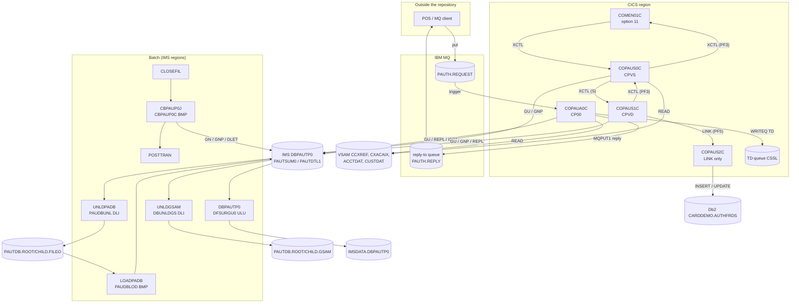

# Area e-authorization: interaction proposals

Proposals of area `e-authorization` for `../interactions.md` and `../components.md`: who calls whom in the optional authorization module `app/app-authorization-ims-db2-mq/` (CICS, IMS, Db2, MQ), which data stores each unit touches, and the invariants the units share. Program and job items are in `programs/` (COPAUA0C, COPAUS0C, COPAUS1C, COPAUS2C, CBPAUP0C, DBUNLDGS, PAUDBLOD, PAUDBUNL) and `jobs/` (CBPAUP0J, DBPAUTP0, LOADPADB, UNLDGSAM, UNLDPADB, CRDDEMO2-CSD); entity proposals are in `e-authorization-entities.md`. Short citations name files of the module; the module's programs are under `cbl/`, its jobs under `jcl/`.

## Diagram

## Edges

| From | To | Mechanism | Data passed | Source (file:line) | Spec item |
| :-- | :-- | :-- | :-- | :-- | :-- |
| MQ client (outside) | request queue `AWS.M2.CARDDEMO.PAUTH.REQUEST` | MQ | ENT-AUTH-REQUEST: comma-separated request, reply-to queue and correlation ID in the message descriptor | `app/app-authorization-ims-db2-mq/README.md:276-306` | COPAUA0C BR-AUTH-001 |
| request queue (trigger monitor) | COPAUA0C (`CP00`) | START | trigger message `MQTM` with the queue name | `COPAUA0C.cbl:233-240`, `CRDDEMO2.csd:59-68` | FLOW-AUTH-001, FLOW-JCSD2-001 |
| COPAUA0C | request queue | MQ | `MQGET` of up to 501 requests per task, 500-byte buffer | `COPAUA0C.cbl:262, 400-414` | FLOW-AUTH-002, SE-AUTH-001 |
| COPAUA0C | reply-to queue (README: `AWS.M2.CARDDEMO.PAUTH.REPLY`) | MQ | ENT-AUTH-RESPONSE via `MQPUT1`, correlation ID of the request, not persistent, expiry 50 | `COPAUA0C.cbl:741-760` | SE-AUTH-002, NUM-AUTH-003, DEF-AUTH-001, DEF-AUTH-015 |
| COPAUA0C | `CCXREF`, `ACCTDAT`, `CUSTDAT` | file | READ by card number, account ID, customer ID | `COPAUA0C.cbl:477-485, 525-533, 573-581` | BR-AUTH-003, ERR-AUTH-005, ERR-AUTH-006 |
| COPAUA0C | `DBPAUTP0` | IMS | `SCHD PSBPAUTB`; `GU` summary by account; `REPL` or `ISRT` summary; `ISRT` detail; `TERM` | `COPAUA0C.cbl:293-303, 620, 825-830, 913, 943-944` | BR-AUTH-009, BR-AUTH-010, SE-AUTH-003, SE-AUTH-004 |
| COPAUA0C | TD queue `CSSL` | TDQ | ENT-AUTH-ERROR-LOG record | `COPAUA0C.cbl:1001-1002` | SE-AUTH-006 |
| COMEN01C (option 11) | COPAUS0C | XCTL | ENT-COMMAREA (`CDEMO-ACCT-ID` when set) | `app/cpy/COMEN02Y.cpy:86-90`, `COPAUS0C.cbl:200-219` | FLOW-AUSM-002 |
| COPAUS0C | COPAUS0C (`CPVS`) | RETURN TRANSID | ENT-COMMAREA with the `CDEMO-CPVS-*` paging keys | `COPAUS0C.cbl:254-257` | SE-AUSM-002 |
| COPAUS0C | COPAUS1C | XCTL | ENT-COMMAREA: account ID and selected authorization key (`CDEMO-CPVS-PAU-SELECTED`) | `COPAUS0C.cbl:313-325` | BR-AUSM-007 |
| COPAUS0C | COMEN01C (or COSGN00C when no target is set) | XCTL | ENT-COMMAREA | `COPAUS0C.cbl:235-237, 665-677` | BR-AUSM-008 |
| COPAUS0C | `CXACAIX`, `ACCTDAT`, `CUSTDAT` | file | READ by account ID (AIX), account ID, customer ID | `COPAUS0C.cbl:817-826, 869-877, 920-928` | BR-AUSM-001, ERR-AUSM-001..003 |
| COPAUS0C | `DBPAUTP0` | IMS | `SCHD PSBPAUTB`; `GU` summary by account; `GNP` details | `COPAUS0C.cbl:461, 493, 973, 1002-1012` | BR-AUSM-002..006 |
| COPAUS1C | COPAUS1C (`CPVD`) | RETURN TRANSID | ENT-COMMAREA | `COPAUS1C.cbl:202-205` | SE-AUDT-003 |
| COPAUS1C | COPAUS0C | XCTL | ENT-COMMAREA (PF3, or no commarea) | `COPAUS1C.cbl:165-169, 184-186, 360-370` | FLOW-AUDT-001, BR-AUDT-005 |
| COPAUS1C | COPAUS2C | LINK | `WS-FRAUD-DATA`: account ID, customer ID, ENT-AUTH-DETAIL image, action; back: status `S`/`F`, a 50-byte message and the detail image with `PA-FRAUD-RPT-DATE` set, which COPAUS1C writes back with `REPL` | `COPAUS1C.cbl:93-104, 244-252, 522-528` | BR-AUDT-007, SE-AUDT-002 |
| COPAUS1C | `DBPAUTP0` | IMS | `SCHD PSBPAUTB`; `GU` summary; `GNP` details; `REPL` detail (fraud flag) | `COPAUS1C.cbl:439, 465, 495, 525, 575-585` | BR-AUDT-001, BR-AUDT-006, SE-AUDT-001 |
| COPAUS2C | `CARDDEMO.AUTHFRDS` | DB2 | `INSERT`; on duplicate key `UPDATE` of the fraud flag and report date | `COPAUS2C.cbl:141-145, 222-227` | SE-AUFR-001, SE-AUFR-002 |
| CLOSEFIL | CBPAUP0J | scheduler | CA-7 trigger | `app/scheduler/CardDemo.ca7:42-43` | FLOW-JAUPG-002 |
| CBPAUP0J | POSTTRAN | scheduler | CA-7 trigger (also after return code 16) | `app/scheduler/CardDemo.ca7:69-70` | FLOW-JAUPG-002, DEF-JAUPG-003 |
| CBPAUP0J | CBPAUP0C | JCL step | `PARM='BMP,CBPAUP0C,PSBPAUTB'`, SYSIN card `00,00001,00001,Y` | `CBPAUP0J.jcl:24-25, 36-37` | FLOW-JAUPG-001, BR-JAUPG-001 |
| CBPAUP0C | `DBPAUTP0` | IMS | `GN` summaries, `GNP` details, `DLET` details and summaries, `CHKP` | `CBPAUP0C.cbl:223, 255, 310, 335, 355` | FLOW-AUPG-002, SE-AUPG-001..003 |
| UNLDPADB | PAUDBUNL | JCL step | `PARM='DLI,PAUDBUNL,PAUTBUNL,,,,,,,,,,,N'` | `UNLDPADB.JCL:38-39` | FLOW-JULPA-001 |
| PAUDBUNL | `DBPAUTP0` | IMS | `GN` summaries, `GNP` details | `PAUDBUNL.CBL:213, 257` | FLOW-PDUL-001 |
| PAUDBUNL | `PAUTDB.ROOT.FILEO`, `PAUTDB.CHILD.FILEO` | file | 100-byte summary images; 206-byte key + detail images | `PAUDBUNL.CBL:233, 271` | SE-PDUL-001, SE-PDUL-002 |
| `PAUTDB.ROOT.FILEO`, `PAUTDB.CHILD.FILEO` | PAUDBLOD (LOADPADB) | file | the same records | `LOADPADB.JCL:36-38`, `PAUDBLOD.CBL:226, 272` | BR-PDLD-001, BR-PDLD-002 |
| LOADPADB | PAUDBLOD | JCL step | `PARM='BMP,PAUDBLOD,PSBPAUTB'` | `LOADPADB.JCL:26-27` | FLOW-JLDPA-001 |
| PAUDBLOD | `DBPAUTP0` | IMS | `ISRT` summaries; `GU` summary by key and `ISRT` detail | `PAUDBLOD.CBL:244, 296, 321` | SE-PDLD-001, SE-PDLD-002 |
| UNLDGSAM | DBUNLDGS | JCL step | `PARM='DLI,DBUNLDGS,DLIGSAMP,,,,,,,,,,,N'` | `UNLDGSAM.JCL:26-27` | FLOW-JULGS-001 |
| DBUNLDGS | `DBPAUTP0` | IMS | `GN` summaries, `GNP` details | `DBUNLDGS.CBL:222, 267` | FLOW-DBUL-001 |
| DBUNLDGS | `PAUTDB.ROOT.GSAM`, `PAUTDB.CHILD.GSAM` | IMS | GSAM `ISRT` of 100-byte summaries and 200-byte details | `DBUNLDGS.CBL:302, 321` | SE-DBUL-001, SE-DBUL-002 |
| DBPAUTP0 (job) | `DBPAUTP0` (database) | JCL step | HD unload utility `DFSURGU0` in a `ULU` region; output `IMSDATA.DBPAUTP0` | `DBPAUTP0.jcl:15-32` | SE-JDBPA-002 |

No edge leaves the module towards the base application except the menu return (COMEN01C), the fallback XCTL to the sign-on program COSGN00C when no return program is set (`COPAUS0C.cbl:668-669`), and the reads of the base VSAM files. Nothing in the base application calls into the module except menu option 11 of COMEN01C and the CA-7 chain CLOSEFIL → CBPAUP0J → POSTTRAN (CBPAUP0J §3).

## CRUD rows

R = read, RU = read for update, C = create, U = update, D = delete, B = browse.

| Program | Store | Access (R, RU, C, U, D, B) | Spec item |
| :-- | :-- | :-- | :-- |
| COPAUA0C | MQ request queue (ENT-AUTH-REQUEST) | R (destructive get) | SE-AUTH-001 |
| COPAUA0C | MQ reply-to queue (ENT-AUTH-RESPONSE) | C | SE-AUTH-002 |
| COPAUA0C | `CCXREF` (ENT-CARD-XREF) | R | BR-AUTH-003 |
| COPAUA0C | `ACCTDAT` (ENT-ACCOUNT) | R | BR-AUTH-004 |
| COPAUA0C | `CUSTDAT` (ENT-CUSTOMER) | R | ERR-AUTH-006 |
| COPAUA0C | `DBPAUTP0` `PAUTSUM0` (ENT-AUTH-SUMMARY) | RU, C, U | BR-AUTH-009, SE-AUTH-003 |
| COPAUA0C | `DBPAUTP0` `PAUTDTL1` (ENT-AUTH-DETAIL) | C | BR-AUTH-010, SE-AUTH-004 |
| COPAUA0C | TD queue `CSSL` (ENT-AUTH-ERROR-LOG) | C | SE-AUTH-006 |
| COPAUS0C | `CXACAIX` (ENT-CARD-XREF) | R | BR-AUSM-001 |
| COPAUS0C | `ACCTDAT` (ENT-ACCOUNT) | R | BR-AUSM-001 |
| COPAUS0C | `CUSTDAT` (ENT-CUSTOMER) | R | BR-AUSM-001 |
| COPAUS0C | `DBPAUTP0` `PAUTSUM0` | R | BR-AUSM-002 |
| COPAUS0C | `DBPAUTP0` `PAUTDTL1` | B | BR-AUSM-003..006 |
| COPAUS1C | `DBPAUTP0` `PAUTSUM0` | R | BR-AUDT-001 |
| COPAUS1C | `DBPAUTP0` `PAUTDTL1` | R, B, U (`PA-AUTH-FRAUD`, `PA-FRAUD-RPT-DATE`) | BR-AUDT-001, BR-AUDT-006, SE-AUDT-001 |
| COPAUS2C | Db2 `CARDDEMO.AUTHFRDS` (ENT-AUTH-FRAUD) | C, U | SE-AUFR-001, SE-AUFR-002 |
| CBPAUP0C | `DBPAUTP0` `PAUTSUM0` | B, D | FLOW-AUPG-002, SE-AUPG-002 |
| CBPAUP0C | `DBPAUTP0` `PAUTDTL1` | B, D | FLOW-AUPG-002, SE-AUPG-001 |
| PAUDBUNL | `DBPAUTP0` `PAUTSUM0`, `PAUTDTL1` | B | FLOW-PDUL-001 |
| PAUDBUNL | `PAUTDB.ROOT.FILEO` (ENT-AUTH-ROOT-FILE) | C | SE-PDUL-001 |
| PAUDBUNL | `PAUTDB.CHILD.FILEO` (ENT-AUTH-CHILD-FILE) | C | SE-PDUL-002 |
| PAUDBLOD | `PAUTDB.ROOT.FILEO`, `PAUTDB.CHILD.FILEO` | R | FLOW-PDLD-001 |
| PAUDBLOD | `DBPAUTP0` `PAUTSUM0` | C, R | SE-PDLD-001, BR-PDLD-002 |
| PAUDBLOD | `DBPAUTP0` `PAUTDTL1` | C | SE-PDLD-002 |
| DBUNLDGS | `DBPAUTP0` `PAUTSUM0`, `PAUTDTL1` | B | FLOW-DBUL-001 |
| DBUNLDGS | `PAUTDB.ROOT.GSAM` (ENT-AUTH-ROOT-FILE) | C | SE-DBUL-001 |
| DBUNLDGS | `PAUTDB.CHILD.GSAM` (ENT-AUTH-CHILD-GSAM) | C | SE-DBUL-002 |
| DFSURGU0 (job DBPAUTP0) | `DBPAUTP0` `PAUTSUM0`, `PAUTDTL1` | B | SE-JDBPA-002 |
| DFSURGU0 (job DBPAUTP0) | `IMSDATA.DBPAUTP0` (ENT-AUTH-HD-UNLOAD) | D (previous, by IEFBR14), C | SE-JDBPA-001, SE-JDBPA-002 |
| IEFBR14 (job UNLDPADB, step `STEP0`) | `PAUTDB.ROOT.FILEO`, `PAUTDB.CHILD.FILEO` | D (previous) | SE-JULPA-001 |

Data stores to add to the component map:

| Store | Entity | Physical | Online name | Batch DD | Key |
| :-- | :-- | :-- | :-- | :-- | :-- |
| Pending authorizations | ENT-AUTH-SUMMARY, ENT-AUTH-DETAIL | IMS HIDAM `DBPAUTP0` (`OEM.IMS.IMSP.PAUTHDB`) + index `DBPAUTX0` (`PAUTHDBX`) | PSB `PSBPAUTB` | `DDPAUTP0`, `DDPAUTX0` (DL/I batch); none (BMP) | summary `ACCNTID` (packed account ID); detail `PAUT9CTS` (8 bytes) under its summary |
| Fraud reports | ENT-AUTH-FRAUD | Db2 table `CARDDEMO.AUTHFRDS`, index `XAUTHFRD` | plan `AWS01PLN` | - | `CARD_NUM`, `AUTH_TS` |
| Authorization requests and replies | ENT-AUTH-REQUEST, ENT-AUTH-RESPONSE | MQ queues `AWS.M2.CARDDEMO.PAUTH.REQUEST`, `.REPLY` | - | - | correlation ID |
| Authorization error log | ENT-AUTH-ERROR-LOG | CICS TD queue `CSSL` | `CSSL` | - | - |
| Database unloads | ENT-AUTH-ROOT-FILE, ENT-AUTH-CHILD-FILE, ENT-AUTH-CHILD-GSAM, ENT-AUTH-HD-UNLOAD | `PAUTDB.ROOT/CHILD.FILEO`, `PAUTDB.ROOT/CHILD.GSAM`, `IMSDATA.DBPAUTP0` | - | `OUTFIL1/2`, `INFILE1/2`, `PASFILOP`, `PADFILOP`, `DFSURGU1` | - |

## Invariant proposals

| ID | Invariant | Components | Evidence |
| :-- | :-- | :-- | :-- |
| PINV-e-authorization-01 | A pending authorization detail sits under the summary of the account that owns its card (card → `CCXREF` → account ID → summary). Held as-is for placement: an unknown card writes nothing to IMS (`COPAUA0C.cbl:463-465`), and for a missing account the detail still goes under the card's own `XREF-ACCT-ID` (`COPAUA0C.cbl:619-623, 911-919`). The exceptions are in the decision and the totals: a stale summary flag or account record from an earlier request (DEF-AUTH-002, DEF-AUTH-003). | COPAUA0C, COPAUS0C, COPAUS1C | COPAUA0C BR-AUTH-003, DEF-AUTH-002, DEF-AUTH-003 |
| PINV-e-authorization-02 | A summary's approved and declined counts and amounts equal the totals of the details under it, and available credit is derived from them. Only COPAUA0C maintains the totals; the purge deletes details and keeps the stored totals, the reload merges instead of restoring (existing summaries keep their current totals, purged details come back), and the screens show the stored totals. Not held as-is. | COPAUA0C, CBPAUP0C, PAUDBLOD, COPAUS0C | COPAUA0C BR-AUTH-009, DEF-AUTH-005; CBPAUP0C DEF-AUPG-003; LOADPADB DEF-JLDPA-002; COPAUS0C BR-AUSM-002 |
| PINV-e-authorization-03 | The fraud flag on a detail and its `AUTHFRDS` row change in one CICS unit of work: COPAUS1C replaces the detail only after COPAUS2C reports success, then syncpoints, and rolls back otherwise. A purge later deletes the detail but never the fraud row. | COPAUS1C, COPAUS2C, CBPAUP0C | COPAUS1C SE-AUDT-001, SE-AUDT-002; CBPAUP0C DEF-AUPG-009 |
| PINV-e-authorization-04 | There is no batch window for `DBPAUTP0`: the online programs, the purge (BMP) and the reload (BMP) run concurrently through the IMS control region, which serializes their calls; the unloads (DL/I batch, DBRC off) read the data sets directly and are not protected. The base window INV-002 covers the VSAM files only, and CLOSEFIL closes `CCXREF`, `ACCTDAT` and `CXACAIX` but not `CUSTDAT`, so COPAUA0C requests fail with a critical file error and COPAUS0C cannot read the cross-reference during the base batch window. | COPAUA0C, COPAUS0C, COPAUS1C, CBPAUP0C, PAUDBLOD, PAUDBUNL, DBUNLDGS | CBPAUP0J §3; UNLDGSAM DEF-JULGS-002; `app/jcl/CLOSEFIL.jcl:26-30`; COPAUA0C ERR-AUTH-005 |
| PINV-e-authorization-05 | The sequential unload and the reload are a matched pair: PAUDBUNL writes 100-byte summaries and 206-byte details with the packed parent key, which is exactly what PAUDBLOD reads, provided the parent key survives in the record area after each `WRITE` (DEF-PDUL-005). The GSAM unload (DBUNLDGS) drops the parent key and the HD unload (DFSURGU0) uses the IMS format; neither can be loaded by PAUDBLOD. | PAUDBUNL, PAUDBLOD, DBUNLDGS, DFSURGU0 | PAUDBUNL BR-PDUL-003, NUM-PDUL-001, DEF-PDUL-005; PAUDBLOD BR-PDLD-002; DBUNLDGS DEF-DBUL-001; DBPAUTP0 SE-JDBPA-002 |
| PINV-e-authorization-06 | Every authorization request gets exactly one reply carrying the request's correlation ID. As-is the reply buffer is never reset, so later replies of a task carry earlier ones (DEF-AUTH-001), and a request whose reply put fails is lost after the get (DEF-AUTH-008). | COPAUA0C, the external requester | COPAUA0C SE-AUTH-001, SE-AUTH-002, DEF-AUTH-001, DEF-AUTH-008 |

## Candidate seams (observations, not decisions)

- **Authorization decision service:** COPAUA0C is a message-driven function with one input (request), one output (reply) and four data dependencies (card xref, account, customer, pending authorizations). It is the module's natural service boundary; its coupling to the base application is read-only (accounts, customers, cross-reference) and the base window PINV-e-authorization-04.
- **Pending authorization store:** IMS `DBPAUTP0` is owned by the module; all writers are in the module. A relational target (summary table keyed by account, detail table keyed by account and timestamp) would carry PINV-e-authorization-02 as a decision.
- **Fraud reporting:** COPAUS1C and COPAUS2C with the `AUTHFRDS` table form a small slice whose only shared state is the fraud flag on the detail (PINV-e-authorization-03).
- **Operations:** the purge (CBPAUP0J) is the only scheduled job of the module; the unload and load jobs are on-demand utilities.
