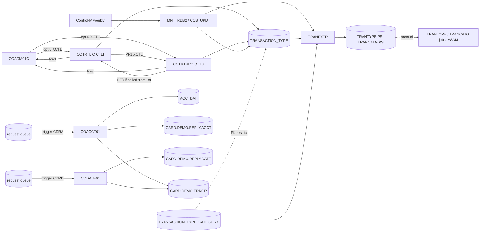

# Area f-trantype-vsam-mq: interaction proposals

Merged in eb23aae into `../interactions.md` (edges) and `../components.md` (CRUD rows; invariants as INV-002, INV-004 and INV-006..INV-021, see the "Proposed as" column).

Edges, CRUD rows and invariant proposals from the transaction type (Db2) module and the VSAM-MQ module, for `../interactions.md` and `../components.md`. Line citations are on commit 8a8a80a.

## Edges

| From | To | Mechanism | Data passed | Source (file:line) | Spec item |
| :-- | :-- | :-- | :-- | :-- | :-- |
| COADM01C | COTRTLIC | XCTL | ENT-COMMAREA (160 bytes), from-program `COADM01C`, context 0; admin option 5 | `app/cbl/COADM01C.cbl:142-149`, `app/cpy/COADM02Y.cpy:46-49` | FLOW-TTLS-002 |
| COADM01C | COTRTUPC | XCTL | ENT-COMMAREA, context 0; admin option 6 | `app/cbl/COADM01C.cbl:142-149`, `app/cpy/COADM02Y.cpy:50-53` | FLOW-TTUP-001 |
| COTRTLIC | COTRTUPC | XCTL | ENT-COMMAREA (160 bytes), from-program `COTRTLIC`, user type set to `U`, context 0; PF2 | `app/app-transaction-type-db2/cbl/COTRTLIC.cbl:630-652` | FLOW-TTLS-006, DEF-TTLS-012 |
| COTRTLIC | COADM01C | XCTL | ENT-COMMAREA after SYNCPOINT, user type set to `A`; PF3 (target from-program, in practice always `COADM01C`); after a direct start without sign-on this opens the admin menu | `app/app-transaction-type-db2/cbl/COTRTLIC.cbl:591-623` | FLOW-TTLS-005, SE-TTLS-007, DEF-TTLS-017 |
| COTRTUPC | COADM01C or COTRTLIC | XCTL | ENT-COMMAREA after SYNCPOINT, user type set to `A`; PF3 to the caller (`COTRTLIC` from the list, `COADM01C` from the menu or after a direct start without sign-on) | `app/app-transaction-type-db2/cbl/COTRTUPC.cbl:429-460` | FLOW-TTUP-003, SE-TTUP-005, DEF-TTUP-017 |
| COTRTLIC | COTRTLIC (`CTLI`) | RETURN TRANSID | 2000-byte area: ENT-COMMAREA + 427-byte list state | `app/app-transaction-type-db2/cbl/COTRTLIC.cbl:910-914` | FLOW-TTLS-013 |
| COTRTUPC | COTRTUPC (`CTTU`) | RETURN TRANSID | ENT-COMMAREA + program state (screen state, old and new type) | `app/app-transaction-type-db2/cbl/COTRTUPC.cbl:567-571` | FLOW-TTUP-010 |
| COTRTLIC | DSNTIAC | CALL | EIB, commarea, SQLCA, 10 x 72 message area | `app/app-transaction-type-db2/cpy/CSDB2RPY.cpy:55-62` (included at `app/app-transaction-type-db2/cbl/COTRTLIC.cbl:2055`) | DEF-TTLS-010 |
| COTRTLIC | CARDDEMO.TRANSACTION_TYPE | DB2 | count, forward and backward cursors, UPDATE, DELETE | `app/app-transaction-type-db2/cbl/COTRTLIC.cbl:338-366, 1626-2034` | SE-TTLS-001 .. SE-TTLS-006 |
| COTRTUPC | CARDDEMO.TRANSACTION_TYPE | DB2 | SELECT by code, UPDATE then INSERT, DELETE | `app/app-transaction-type-db2/cbl/COTRTUPC.cbl:1475-1637` | SE-TTUP-001 .. SE-TTUP-004 |
| CARDDEMO.TRANSACTION_TYPE_CATEGORY | COTRTLIC, COTRTUPC, COBTUPDT | DB2 | foreign key `ON DELETE RESTRICT` refuses a type delete (-532) | `app/app-transaction-type-db2/ctl/DB2CREAT.ctl:96-99` | BR-TTLS-009, BR-TTUP-004, BR-TTBU-004 |
| Control-M | MNTTRDB2 | scheduler | folder `WEEKLY-TransactionTypesDBRefresh` | `app/scheduler/CardDemo.controlm:26-31` | FLOW-JMNTT-001 |
| MNTTRDB2 | COBTUPDT | JCL step | `IKJEFT01` / `DSN RUN PROGRAM(COBTUPDT) PLAN(CARDDEMO)`, DD `INPFILE` | `app/app-transaction-type-db2/jcl/MNTTRDB2.jcl:21-30` | BR-JMNTT-001 |
| INPFILE | COBTUPDT | file | ENT-TTYP-MAINT-INPUT, 53-byte records | `app/app-transaction-type-db2/cbl/COBTUPDT.cbl:31-46, 100-107` | FLOW-TTBU-002 |
| COBTUPDT | CARDDEMO.TRANSACTION_TYPE | DB2 | INSERT, UPDATE, DELETE per record | `app/app-transaction-type-db2/cbl/COBTUPDT.cbl:137-148, 171-175, 201-204` | SE-TTBU-001 .. SE-TTBU-004 |
| MNTTRDB2 | TRANEXTR | scheduler | condition `WEEKLY-TransactionTypesDBRefresh-MNTTRDB2` | `app/scheduler/CardDemo.controlm:28, 58-61` | FLOW-JMNTT-001 |
| MNTTRDB2 | CLOSEFIL (disclosure group refresh) | scheduler | same condition | `app/scheduler/CardDemo.controlm:33-37` | DEF-JMNTT-003 |
| CARDDEMO.TRANSACTION_TYPE | TRANEXTR | DB2 | DSNTIAUL unload, 60-byte records | `app/app-transaction-type-db2/jcl/TRANEXTR.jcl:65-91` | BR-JTREX-001 |
| CARDDEMO.TRANSACTION_TYPE_CATEGORY | TRANEXTR | DB2 | DSNTIAUL unload, 60-byte records | `app/app-transaction-type-db2/jcl/TRANEXTR.jcl:95-122` | BR-JTREX-002 |
| TRANEXTR | TRANTYPE job (base) | file | `AWS.M2.CARDDEMO.TRANTYPE.PS` (ENT-TRAN-TYPE layout); not chained by a scheduler | `app/app-transaction-type-db2/jcl/TRANEXTR.jcl:72-74`, `app/jcl/TRANTYPE.jcl:54-61` | DEF-JTREX-001 |
| TRANEXTR | TRANCATG job (base) | file | `AWS.M2.CARDDEMO.TRANCATG.PS` (ENT-TRAN-CATEGORY layout); not chained | `app/app-transaction-type-db2/jcl/TRANEXTR.jcl:102-104`, `app/jcl/TRANCATG.jcl:54-61` | DEF-JTREX-001 |
| CREADB21 | CARDDEMO.TRANSACTION_TYPE, CARDDEMO.TRANSACTION_TYPE_CATEGORY | DB2 | create, grant, seed insert | `app/app-transaction-type-db2/jcl/CREADB21.jcl:52-84` | SE-JCRDB-002 .. SE-JCRDB-004 |
| CTLI, CTTU | DB2ENTRY CARDDEMO | DB2 | plan `CARDDEMO`, `AUTHTYPE(USERID)`, one thread | `app/app-transaction-type-db2/csd/CRDDEMOD.csd:45-60` | FLOW-JCSDD-003 |
| MQ trigger monitor | COACCT01 (`CDRA`) | START | trigger message (MQTM) as start data | `app/app-vsam-mq/cbl/COACCT01.cbl:178-198`, `app/app-vsam-mq/csd/CRDDEMOM.csd:17-26` | FLOW-MQAC-001, FLOW-JCSDM-001 |
| MQ trigger monitor | CODATE01 (`CDRD`) | START | trigger message (MQTM) as start data | `app/app-vsam-mq/cbl/CODATE01.cbl:127-147`, `app/app-vsam-mq/csd/CRDDEMOM.csd:27-36` | FLOW-MQDT-001, FLOW-JCSDM-002 |
| requester | COACCT01 | MQ | ENT-MQ-ACCT-REQUEST on the triggered input queue | `app/app-vsam-mq/cbl/COACCT01.cbl:337-373` | SE-MQAC-001 |
| COACCT01 | ACCTDAT | file | CICS READ by 11-digit account ID (ENT-ACCOUNT) | `app/app-vsam-mq/cbl/COACCT01.cbl:394-404` | SE-MQAC-002 |
| COACCT01 | requester | MQ | ENT-MQ-ACCT-REPLY on `CARD.DEMO.REPLY.ACCT` (fixed queue, ReplyToQ ignored) | `app/app-vsam-mq/cbl/COACCT01.cbl:462-499` | SE-MQAC-003, DEF-MQAC-002 |
| requester | CODATE01 | MQ | any message on the triggered input queue | `app/app-vsam-mq/cbl/CODATE01.cbl:286-322` | SE-MQDT-001 |
| CODATE01 | requester | MQ | ENT-MQ-DATE-REPLY on `CARD.DEMO.REPLY.DATE` | `app/app-vsam-mq/cbl/CODATE01.cbl:366-403` | SE-MQDT-002 |
| COACCT01, CODATE01 | operations | MQ | ENT-MQ-ERROR-MSG on `CARD.DEMO.ERROR` | `app/app-vsam-mq/cbl/COACCT01.cbl:501-523`, `app/app-vsam-mq/cbl/CODATE01.cbl:405-427` | SE-MQAC-004, SE-MQDT-003 |

## CRUD rows

| Program | Store | Access (R, RU, C, U, D, B) | Spec item |
| :-- | :-- | :-- | :-- |
| COTRTLIC | CARDDEMO.TRANSACTION_TYPE (ENT-DB2-TRAN-TYPE) | B, R, U, D | SE-TTLS-002 .. SE-TTLS-006 |
| COTRTUPC | CARDDEMO.TRANSACTION_TYPE (ENT-DB2-TRAN-TYPE) | R, U, C, D | SE-TTUP-001 .. SE-TTUP-004 |
| COBTUPDT | CARDDEMO.TRANSACTION_TYPE (ENT-DB2-TRAN-TYPE) | C, U, D | SE-TTBU-001 .. SE-TTBU-003 |
| COBTUPDT | INPFILE (ENT-TTYP-MAINT-INPUT) | B | FLOW-TTBU-002 |
| TRANEXTR (DSNTIAUL) | CARDDEMO.TRANSACTION_TYPE, CARDDEMO.TRANSACTION_TYPE_CATEGORY | B | SE-JTREX-004, SE-JTREX-005 |
| TRANEXTR | `TRANTYPE.PS`, `TRANCATG.PS` (ENT-TRAN-TYPE, ENT-TRAN-CATEGORY) | B, D, C | SE-JTREX-001 .. SE-JTREX-005 |
| CREADB21 (DSNTIAD, DSNTEP4) | both tables (ENT-DB2-TRAN-TYPE, ENT-DB2-TRAN-TYPE-CAT) | C (schema and seed rows) | SE-JCRDB-002 .. SE-JCRDB-004 |
| COACCT01 | ACCTDAT (ENT-ACCOUNT) | R | SE-MQAC-002 |
| COACCT01 | input queue (ENT-MQ-ACCT-REQUEST) | D (destructive get) | SE-MQAC-001 |
| COACCT01 | `CARD.DEMO.REPLY.ACCT` (ENT-MQ-ACCT-REPLY), `CARD.DEMO.ERROR` (ENT-MQ-ERROR-MSG) | C | SE-MQAC-003, SE-MQAC-004 |
| CODATE01 | input queue | D (destructive get) | SE-MQDT-001 |
| CODATE01 | `CARD.DEMO.REPLY.DATE` (ENT-MQ-DATE-REPLY), `CARD.DEMO.ERROR` (ENT-MQ-ERROR-MSG) | C | SE-MQDT-002, SE-MQDT-003 |

No program of these modules accesses CARDDEMO.TRANSACTION_TYPE_CATEGORY at run time; it only constrains deletes.

## Invariant proposals

| ID | Invariant | Components | Evidence |
| :-- | :-- | :-- | :-- |
| PINV-f-01 | A transaction type that has categories cannot be deleted by any path (online list, online update, batch). | COTRTLIC, COTRTUPC, COBTUPDT, Db2 | `app/app-transaction-type-db2/ctl/DB2CREAT.ctl:96-99`; BR-TTLS-009, BR-TTUP-004, BR-TTBU-004 |
| PINV-f-02 | Every online type change is committed at once (SYNCPOINT after each successful statement); a batch run is one unit of work (except that a -911 rolls back the changes made so far and processing continues in a new one). | COTRTLIC, COTRTUPC, COBTUPDT | SE-TTLS-005, SE-TTUP-002, SE-TTBU-004 |
| PINV-f-03 | The Db2 tables and the VSAM files ENT-TRAN-TYPE / ENT-TRAN-CATEGORY hold the same codes only after TRANEXTR and then the base TRANTYPE and TRANCATG jobs have run; nothing enforces it. Today it does **not** hold for the descriptions (seed text differs). | TRANEXTR, TRANTYPE, TRANCATG, all readers of the VSAM files | DEF-JTREX-001, DEF-JCRDB-005 |
| PINV-f-04 | Online-written type codes are two digits from `01` to `99`; batch-written codes may be any two characters, so the invariant holds only if MNTTRDB2 input is clean. | COTRTUPC, COTRTLIC, COBTUPDT | BR-TTUP-001, DEF-TTBU-003 |
| PINV-f-06 | The transaction type programs must not open the admin menu for a user who has not signed on. Today it does **not** hold: a direct start of `CTLI` or `CTTU` followed by PF3 reaches `COADM01C` with user type `A` (area A: DEF-ADMN-001, PINV-a-signon-admin-01). | COTRTLIC, COTRTUPC, COADM01C | DEF-TTLS-017, DEF-TTUP-017 |
| PINV-f-05 | Each MQ request produces at most one reply, on a fixed reply queue, with the request's MsgId and CorrelId; a request whose processing fails produces an error record and no reply. | COACCT01, CODATE01 | BR-MQAC-005, DEF-MQAC-007 |

## Mermaid

