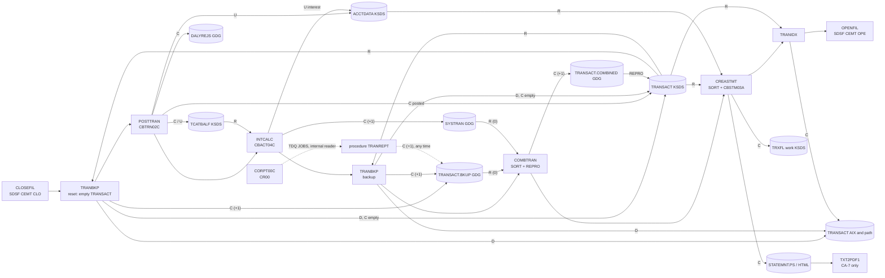

# Area g-jobs-ops: interaction proposals

Proposals from area `g-jobs-ops` for `../interactions.md` and `../components.md`: how jobs start each other (schedulers, internal reader, the online report request), which program each job step runs, which datasets pass data from one job to the next, what each job does to the data stores, and the cross-job invariants the batch window depends on. Job behaviour is in the job specs under `../jobs/`; `../jobs/README.md` compares the five batch cycle orders found in the repository.

Conventions: in the scheduler rows, "From" is the job whose successful end starts "To". CA-7 rows cite the `LJOB` entry whose "TRIGGERED JOBS" list names the successor. Control-M rows cite the predecessor's `OUTCOND` and the successor's `INCOND`.

## Edges

### Scheduler: CA-7 (`app/scheduler/CardDemo.ca7`)

No job has a calendar; every chain starts when CLOSEFIL is demanded (DEF-JCA7-001). CA-7 keeps triggers per job name, so the separate `LJOB` entries for one job add up to one trigger list (DEF-JCA7-002), and every trigger carries a schedule ID (SCHID). Read with CA-7's trigger rules (platform-inferred, medium), a trigger fires only for a run of the triggering job under that SCHID, and because no trigger names a `TRGID`, the triggered job runs under the triggering job's SCHID (FLOW-JCA7-005). A CLOSEFIL run under SCHID 030 therefore starts the four 030 successors together: CBPAUP0J (then POSTTRAN), TRANTYPE, READACCT and CREASTMT (`app/scheduler/CardDemo.ca7:43, 162, 340, 468`, DEF-JCA7-006). The 031 and 032 triggers (WAITSTEP to CLOSEFIL1 and CLOSEFIL2, OPENFIL to CLOSEFIL, CLOSEFIL to PRTCATBL, and the TRANCATG, TCATBALF and PRTCATBL chains behind them) fire only in runs under 031 or 032, which no 030 run reaches; only a demand under 031 or 032 starts them (`app/scheduler/CardDemo.ca7:216-217, 532, 537`). The "Data passed" column gives the SCHID of each trigger.

| From | To | Mechanism | Data passed | Source (file:line) | Spec item |
| :-- | :-- | :-- | :-- | :-- | :-- |
| CLOSEFIL | CBPAUP0J (IMS module) | scheduler | completion trigger, SCHID 030 | `app/scheduler/CardDemo.ca7:18-43` | FLOW-JCA7-001 |
| CBPAUP0J | POSTTRAN | scheduler | completion trigger, SCHID 030 | `app/scheduler/CardDemo.ca7:45-70` | FLOW-JCA7-001, DEF-JCA7-007 |
| POSTTRAN | WAITSTEP | scheduler | completion trigger, SCHID 030 | `app/scheduler/CardDemo.ca7:72-97` | FLOW-JCA7-001 |
| WAITSTEP | OPENFIL | scheduler | completion trigger, SCHID 030 | `app/scheduler/CardDemo.ca7:99-124` | FLOW-JCA7-001 |
| CLOSEFIL | TRANTYPE | scheduler | completion trigger, SCHID 030 | `app/scheduler/CardDemo.ca7:159-162` | FLOW-JCA7-002 |
| TRANTYPE | WAITSTEP | scheduler | completion trigger, SCHID 030 | `app/scheduler/CardDemo.ca7:164-189` | FLOW-JCA7-002 |
| WAITSTEP | CLOSEFIL1, CLOSEFIL2 | scheduler | completion triggers, SCHID 031 and 032: CLOSEFIL1 only for a WAITSTEP run under 031, CLOSEFIL2 only under 032, so neither fires after TRANTYPE's 030 trigger | `app/scheduler/CardDemo.ca7:191-217` | FLOW-JCA7-002, DEF-JCA7-003 |
| CLOSEFIL1 | TRANCATG | scheduler | completion trigger, SCHID 031 | `app/scheduler/CardDemo.ca7:219-244` | FLOW-JCA7-002 |
| CLOSEFIL2 | TCATBALF | scheduler | completion trigger, SCHID 032 | `app/scheduler/CardDemo.ca7:246-271` | FLOW-JCA7-002, DEF-JCA7-006 |
| TRANCATG, TCATBALF | WAITSTEP | scheduler | completion triggers, SCHID 031 and 032 | `app/scheduler/CardDemo.ca7:273-298, 305-330` | FLOW-JCA7-002 |
| WAITSTEP | CLOSEFIL | scheduler | completion trigger, SCHID 030: fires for every WAITSTEP run under 030 (after POSTTRAN, TRANTYPE, READXREF or TXT2PDF1), which closes a loop; after TRANCATG or TCATBALF, WAITSTEP runs under 031 or 032 and this trigger does not fire | `app/scheduler/CardDemo.ca7:300-303, 332-335` | DEF-JCA7-002 |
| CLOSEFIL | READACCT | scheduler | completion trigger, SCHID 030 | `app/scheduler/CardDemo.ca7:337-340` | FLOW-JCA7-002 |
| READACCT, READCARD, READCUST | READCARD, READCUST, READXREF | scheduler | completion triggers, SCHID 030, one after the other | `app/scheduler/CardDemo.ca7:342-421` | FLOW-JCA7-002 |
| READXREF | WAITSTEP, then OPENFIL | scheduler | completion triggers, SCHID 030 | `app/scheduler/CardDemo.ca7:423-453` | FLOW-JCA7-002 |
| CLOSEFIL | CREASTMT | scheduler | completion trigger, SCHID 030 | `app/scheduler/CardDemo.ca7:465-468` | FLOW-JCA7-003, DEF-JCA7-006 |
| CREASTMT | TXT2PDF1 | scheduler | completion trigger, SCHID 030 | `app/scheduler/CardDemo.ca7:470-495` | FLOW-JCA7-003 |
| TXT2PDF1 | WAITSTEP, then OPENFIL | scheduler | completion triggers, SCHID 030 | `app/scheduler/CardDemo.ca7:497-527` | FLOW-JCA7-003 |
| OPENFIL | CLOSEFIL | scheduler | completion trigger, SCHID 031: fires only for an OPENFIL run under 031 (the end of the PRTCATBL chain), never after a 030 chain. OPENFIL's own entry says it triggers no jobs (`N -- COMP TRIGGERS OTHER JOBS`), which contradicts this trigger list | `app/scheduler/CardDemo.ca7:529-532, 138` | FLOW-JCA7-004, DEF-JCA7-002 |
| CLOSEFIL | PRTCATBL | scheduler | completion trigger, SCHID 031: only for a CLOSEFIL run under 031 | `app/scheduler/CardDemo.ca7:534-537` | FLOW-JCA7-004 |
| PRTCATBL | WAITSTEP, then OPENFIL | scheduler | completion triggers, SCHID 031 | `app/scheduler/CardDemo.ca7:539-569` | FLOW-JCA7-004 |

### Scheduler: Control-M (`app/scheduler/CardDemo.controlm`)

| From | To | Mechanism | Data passed | Source (file:line) | Spec item |
| :-- | :-- | :-- | :-- | :-- | :-- |
| CLOSEFIL (daily) | TRANBKP | scheduler | condition `DAILY-TransactionBackup-CLOSEFIL` | `app/scheduler/CardDemo.controlm:5, 9` | FLOW-JCTLM-001, DEF-JCTLM-001 |
| TRANBKP | WAITSTEP (daily) | scheduler | condition `DAILY-TransactionBackup-TRANBKP` | `app/scheduler/CardDemo.controlm:11, 15` | FLOW-JCTLM-001 |
| WAITSTEP (daily) | OPENFIL (daily) | scheduler | condition `DAILY-TransactionBackup-WAITSTEP` | `app/scheduler/CardDemo.controlm:17, 21` | FLOW-JCTLM-001 |
| MNTTRDB2 (Db2 module) | CLOSEFIL (weekly) | scheduler | condition `WEEKLY-TransactionTypesDBRefresh-MNTTRDB2`, deleted when the smart folder ends | `app/scheduler/CardDemo.controlm:28, 34, 55` | FLOW-JCTLM-003, DEF-JCTLM-004 |
| MNTTRDB2 (Db2 module) | TRANEXTR (Db2 module) | scheduler | the same condition, also deleted by this smart folder | `app/scheduler/CardDemo.controlm:28, 59, 62` | FLOW-JCTLM-004, DEF-JCTLM-004 |
| CLOSEFIL (weekly) | DISCGRP | scheduler | condition `WEEKLY-DisclosureGroupsRefresh-CLOSEFIL` | `app/scheduler/CardDemo.controlm:35, 39` | FLOW-JCTLM-003 |
| DISCGRP | WAITSTEP, then OPENFIL (weekly) | scheduler | conditions `...-DISCGRP`, `...-WAITSTEP` | `app/scheduler/CardDemo.controlm:41, 45, 47, 51` | FLOW-JCTLM-003 |
| CLOSEFIL (monthly) | INTCALC | scheduler | condition `MONTHLY-InterestCalculation-CLOSEFIL` | `app/scheduler/CardDemo.controlm:66, 70` | FLOW-JCTLM-005, DEF-JCTLM-002 |
| INTCALC | COMBTRAN | scheduler | condition `MONTHLY-InterestCalculation-INTCALC` | `app/scheduler/CardDemo.controlm:72, 76` | FLOW-JCTLM-005, DEF-JCTLM-006 |
| COMBTRAN | WAITSTEP, then OPENFIL (monthly) | scheduler | conditions `...-COMBTRAN`, `...-WAITSTEP` | `app/scheduler/CardDemo.controlm:78, 82, 84, 88` | FLOW-JCTLM-005 |

### Job submission outside the schedulers

| From | To | Mechanism | Data passed | Source (file:line) | Spec item |
| :-- | :-- | :-- | :-- | :-- | :-- |
| CORPT00C | TDQ `JOBS` | TDQ | 80-byte JCL card images, one `WRITEQ TD` per line, up to and including the first `/*EOF`, all-spaces or all-low-values line: job card `TRNRPT00`, `JCLLIB` `AWS.M2.CARDDEMO.PROC`, `EXEC PROC=TRANREPT`, a `STEP05R.SYMNAMES` override and an in-stream `STEP10R.DATEPARM` card, both with the user's start and end dates | `app/cbl/CORPT00C.cbl:81-127`, `app/cbl/CORPT00C.cbl:498-523` | FLOW-JTRPTP-001, SE-JCSD-002 |
| TDQ `JOBS` | JES internal reader | TDQ | extrapartition queue on DD `INREADER`, `RECORDSIZE(80)`, `ERROROPTION(IGNORE)`. That DD `INREADER` of the CICS region is a JES internal reader (`SYSOUT=(A,INTRDR)`) is inferred from the description `SUBMIT JOBS FROM CICS`; the region JCL is not in the repository (platform-inferred, high) | `app/csd/CARDDEMO.CSD:499-505` | SE-JCSD-002, ERR-JCSD-002 |
| internal reader | procedure TRANREPT (job `TRNRPT00`) | JCL step | the submitted job runs the procedure with the overridden date symbols and the in-stream `DATEPARM` | `app/proc/TRANREPT.prc:1-79` | FLOW-JTRPTP-001 |
| INTRDRJ1 | INTRDRJ2 | JCL step | member `AWS.M2.CARDDEMO.JCL(INTRDRJ2)` copied by IEBGENER to `SYSOUT=(A,INTRDR)` | `app/jcl/INTRDRJ1.JCL:14-18` | SE-JIRD1-002, FLOW-JIRD1-001 |

### JCL step: job to program or procedure

| From | To | Mechanism | Data passed | Source (file:line) | Spec item |
| :-- | :-- | :-- | :-- | :-- | :-- |
| POSTTRAN | CBTRN02C | JCL step | DDs `TRANFILE`, `DALYTRAN`, `XREFFILE`, `DALYREJS(+1)`, `ACCTFILE`, `TCATBALF` | `app/jcl/POSTTRAN.jcl:23-42` | FLOW-JPOST-001 |
| INTCALC | CBACT04C | JCL step | `PARM='2022071800'`; DDs `TCATBALF`, `XREFFILE`, `XREFFIL1` (AIX path), `ACCTFILE`, `DISCGRP`, `TRANSACT` = `SYSTRAN(+1)` | `app/jcl/INTCALC.jcl:22-41` | FLOW-JINTC-001, DEF-JINTC-001 |
| CREASTMT | CBSTM03A | JCL step | DDs `TRNXFILE` (work KSDS), `XREFFILE`, `ACCTFILE`, `CUSTFILE`, `STMTFILE`, `HTMLFILE` | `app/jcl/CREASTMT.JCL:79-96` | SE-JSTMT-006 |
| TRANREPT | CBTRN03C | JCL step | DDs `TRANFILE` = `TRANSACT.DALY(+1)`, `CARDXREF`, `TRANTYPE`, `TRANCATG`, `DATEPARM`, `TRANREPT(+1)` | `app/jcl/TRANREPT.jcl:59-80` | FLOW-JTRPT-001 |
| procedure TRANREPT | CBTRN03C | JCL step | the same DDs as the batch member; in a job submitted by CORPT00C, `DATEPARM` is the in-stream card with the user's dates instead of the `DATEPARM` dataset (`app/cbl/CORPT00C.cbl:115-121`) | `app/proc/TRANREPT.prc:57-78` | FLOW-JTRPTP-002 |
| TRANBKP, TRANREPT, procedure TRANREPT, PRTCATBL | REPROC | JCL step | `CNTLLIB=AWS.M2.CARDDEMO.CNTL`; overrides `PRC001.FILEIN` and `PRC001.FILEOUT` | `app/jcl/TRANBKP.jcl:23-33`, `app/jcl/TRANREPT.jcl:23-33`, `app/proc/TRANREPT.prc:21-31`, `app/jcl/PRTCATBL.jcl:29-39` | SE-JTBKP-001, SE-JTRPT-001, SE-JTRPTP-001, SE-JPCAT-002 |
| REPROC | IDCAMS | JCL step | control card member `REPROCT`: `REPRO INFILE(FILEIN) OUTFILE(FILEOUT)` | `app/proc/REPROC.prc:21-28`, `app/ctl/REPROCT.ctl:15` | SE-JRPROC-001, VAL-JRPROC-001 |
| READACCT | CBACT01C | JCL step | DD `ACCTFILE`; outputs `ACCTDATA.PSCOMP`, `ARRYPS`, `VBPS` | `app/jcl/READACCT.jcl:32-50` | FLOW-JRACCT-001 |
| READCARD | CBACT02C | JCL step | DD `CARDFILE` | `app/jcl/READCARD.jcl:22-28` | FLOW-JRCARD-001 |
| READCUST | CBCUS01C | JCL step | DD `CUSTFILE` | `app/jcl/READCUST.jcl:21-27` | FLOW-JRCUST-001 |
| READXREF | CBACT03C | JCL step | DD `XREFFILE` | `app/jcl/READXREF.jcl:22-28` | FLOW-JRXREF-001 |
| WAITSTEP | COBSWAIT | JCL step | `SYSIN` card `00003600` (centiseconds) | `app/jcl/WAITSTEP.jcl:22-27` | FLOW-JWAIT-001 |
| CBEXPORT job | CBEXPORT | JCL step | DDs `CUSTFILE`, `ACCTFILE`, `XREFFILE`, `TRANSACT`, `CARDFILE`, `EXPFILE` | `app/jcl/CBEXPORT.jcl:43-68` | FLOW-JEXPT-001 |
| CBIMPORT job | CBIMPORT | JCL step | DD `EXPFILE`; five `*.IMPORT` outputs and `IMPORT.ERRORS` | `app/jcl/CBIMPORT.jcl:22-70` | FLOW-JIMPT-001 |
| TXT2PDF1 | TXT2PDF exec (not in the repository) | JCL step | `IKJEFT1B`; `INDD` = `STATEMNT.PS`; output `STATEMNT.PS.PDF` | `app/jcl/TXT2PDF1.JCL:24-40` | FLOW-JPDF-001, DEF-JPDF-001 |
| CLOSEFIL | CICS region `CICSAWSA` | JCL step | SDSF `MODIFY` with `CEMT SET FIL(...) CLO` for `TRANSACT`, `CCXREF`, `ACCTDAT`, `CXACAIX`, `USRSEC` | `app/jcl/CLOSEFIL.jcl:22-31` | FLOW-JCLOSE-001, SE-JCLOSE-001 |
| OPENFIL | CICS region `CICSAWSA` | JCL step | the same five files, `OPE` | `app/jcl/OPENFIL.jcl:22-31` | FLOW-JOPEN-001, SE-JOPEN-001 |
| CARDFILE, CUSTFILE, TRANFILE | CICS region `CICSAWSA` | JCL step | in-job close and reopen: `CARDDAT` and `CARDAIX`; `CUSTDAT`; `TRANSACT` and `CXACAIX` | `app/jcl/CARDFILE.jcl:22-28, 118-124`, `app/jcl/CUSTFILE.jcl:22-27, 76-81`, `app/jcl/TRANFILE.jcl:22-28, 116-122` | SE-JCARD-001, SE-JCARD-008, SE-JCUST-001, SE-JCUST-005, SE-JTRAN-001, SE-JTRAN-008, DEF-JTRAN-004 |

### File: data handed from one job to another

| From | To | Mechanism | Data passed | Source (file:line) | Spec item |
| :-- | :-- | :-- | :-- | :-- | :-- |
| TRANBKP | POSTTRAN | file | empty `TRANSACT.VSAM.KSDS` (POSTTRAN opens it for output) | `app/jcl/TRANBKP.jcl:51-67`, `app/cbl/CBTRN02C.cbl:256` | SE-JTBKP-004, DEF-JPOST-002 |
| POSTTRAN | TRANBKP | file | posted transactions in `TRANSACT.VSAM.KSDS` | `app/jcl/POSTTRAN.jcl:28-29`, `app/jcl/TRANBKP.jcl:26-27` | SE-JPOST-002, SE-JTBKP-001 |
| TRANBKP | COMBTRAN | file | ENT-TRAN-BACKUP written as `(+1)`, read as `(0)` | `app/jcl/TRANBKP.jcl:29-33`, `app/jcl/COMBTRAN.jcl:23-24` | SE-JTBKP-001, SE-JCOMB-001, DEF-JCOMB-001 |
| INTCALC | COMBTRAN | file | ENT-SYSTRAN written as `(+1)`, read as `(0)` | `app/jcl/INTCALC.jcl:37-41`, `app/jcl/COMBTRAN.jcl:25-26` | SE-JINTC-001, SE-JCOMB-001 |
| COMBTRAN | CREASTMT, TRANIDX, online programs | file | reloaded `TRANSACT.VSAM.KSDS` | `app/jcl/COMBTRAN.jcl:41-48`, `app/jcl/CREASTMT.JCL:45`, `app/jcl/TRANIDX.jcl:22-55` | SE-JCOMB-002, SE-JSTMT-003, SE-JTIDX-001 |
| TRANBKP | TRANIDX | file | the alternate index TRANBKP deletes, TRANIDX defines and builds again | `app/jcl/TRANBKP.jcl:43-44`, `app/jcl/TRANIDX.jcl:22-55` | SE-JTBKP-003, SE-JTIDX-001..003 |
| TRANREPT, procedure TRANREPT | COMBTRAN | file | an extra ENT-TRAN-BACKUP generation that becomes `BKUP(0)` if the report runs between TRANBKP and COMBTRAN | `app/jcl/TRANREPT.jcl:29-33`, `app/proc/TRANREPT.prc:27-31`, `app/jcl/COMBTRAN.jcl:23-24` | DEF-JTRPT-002, DEF-JTRPTP-003, DEF-JCOMB-001 |
| POSTTRAN | INTCALC | file | category balances `TCATBALF.VSAM.KSDS`, written and rewritten by CBTRN02C and read in key order by CBACT04C as the input that drives the interest calculation; accounts `ACCTDATA.VSAM.KSDS`, rewritten by both (INTCALC adds the interest to `ACCT-CURR-BAL` and sets the cycle credit and debit to zero) | `app/jcl/POSTTRAN.jcl:39-42`, `app/cbl/CBTRN02C.cbl:511, 529, 555`, `app/jcl/INTCALC.jcl:27-28, 33-34`, `app/cbl/CBACT04C.cbl:327, 351-357` | FLOW-JPOST-001, FLOW-JINTC-001 |
| POSTTRAN | TRANREPT, procedure TRANREPT | file | the posted transactions in `TRANSACT.VSAM.KSDS`, which the report's first step unloads | `app/jcl/POSTTRAN.jcl:28-29`, `app/jcl/TRANREPT.jcl:26-27`, `app/proc/TRANREPT.prc:24-25` | SE-JPOST-002, SE-JTRPT-001, SE-JTRPTP-001 |
| INTCALC | CREASTMT | file | `ACCTDATA.VSAM.KSDS` with the interest added, which CBSTM03A reads for the statement balances | `app/cbl/CBACT04C.cbl:351-357`, `app/jcl/CREASTMT.JCL:85` | FLOW-JINTC-001, SE-JSTMT-006 |
| ACCTFILE, XREFFILE, TCATBALF | POSTTRAN, INTCALC | file | reloaded `ACCTDATA`, `CARDXREF` (with its AIX path, which INTCALC reads as `XREFFIL1`) and `TCATBALF` KSDS | `app/jcl/ACCTFILE.jcl:57`, `app/jcl/XREFFILE.jcl:60`, `app/jcl/TCATBALF.jcl:57`, `app/jcl/POSTTRAN.jcl:32-33, 39-42`, `app/jcl/INTCALC.jcl:27-34` | SE-JACCT-001..003, SE-JXREF-001..006, SE-JTCAT-001..003 |
| DISCGRP | INTCALC | file | reloaded `DISCGRP.VSAM.KSDS` (interest rates by disclosure group) | `app/jcl/DISCGRP.jcl:54-62`, `app/jcl/INTCALC.jcl:35-36` | SE-JDISC-001..003, FLOW-JINTC-001 |
| TRANTYPE, TRANCATG | TRANREPT, procedure TRANREPT | file | reloaded `TRANTYPE.VSAM.KSDS` and `TRANCATG.VSAM.KSDS` for the report descriptions | `app/jcl/TRANTYPE.jcl:56-61`, `app/jcl/TRANCATG.jcl:56-61`, `app/jcl/TRANREPT.jcl:69-72`, `app/proc/TRANREPT.prc:67-70` | SE-JTTYP-001..003, SE-JTCATG-001..003, FLOW-JTRPT-001, FLOW-JTRPTP-002 |
| ACCTFILE, CUSTFILE, XREFFILE | CREASTMT | file | reloaded `ACCTDATA`, `CUSTDATA` and `CARDXREF` KSDS | `app/jcl/ACCTFILE.jcl:57`, `app/jcl/CUSTFILE.jcl:67`, `app/jcl/XREFFILE.jcl:60`, `app/jcl/CREASTMT.JCL:84-86` | SE-JACCT-001..003, SE-JCUST-002..004, SE-JXREF-001..006, SE-JSTMT-006 |
| CREASTMT | TXT2PDF1 | file | `STATEMNT.PS` (80-byte statement lines) | `app/jcl/CREASTMT.JCL:87-91`, `app/jcl/TXT2PDF1.JCL:33` | SE-JSTMT-006, FLOW-JPDF-001 |
| CBEXPORT job | CBIMPORT job | file | `EXPORT.DATA` KSDS | `app/jcl/CBEXPORT.jcl:62-63`, `app/jcl/CBIMPORT.jcl:28-29` | SE-JEXPT-003, FLOW-JIMPT-001 |
| TRANEXTR (Db2 module) | TRANTYPE, TRANCATG | file | `TRANTYPE.PS`, `TRANCATG.PS` flat files | `app/app-transaction-type-db2/jcl/TRANEXTR.jcl:31-122`, `app/jcl/TRANTYPE.jcl:56-57`, `app/jcl/TRANCATG.jcl:56-57` | SE-JTTYP-003, SE-JTCATG-003, DEF-JCTLM-005 |
| DEFGDGB | TRANBKP, TRANREPT, INTCALC, COMBTRAN, PRTCATBL | file | the six GDG bases they allocate `(+1)` in | `app/jcl/DEFGDGB.jcl:24-59` | SE-JGDGB-001..006 |
| DALYREJS | POSTTRAN | file | the `DALYREJS` GDG base | `app/jcl/DALYREJS.jcl:24-28`, `app/jcl/POSTTRAN.jcl:34-38` | SE-JREJS-001, DEF-JPOST-001 |
| DEFGDGD | TRANEXTR (Db2 module) | file | GDG bases `TRANTYPE.BKUP`, `TRANCATG.PS.BKUP` and their first generations | `app/jcl/DEFGDGD.jcl:24-66` | SE-JGDGD-001..004, DEF-JGDGD-003 |

## CRUD rows for `components.md`

Access codes: R read, RU read for update, C create (records, or a new dataset or generation), U update, D delete, B browse. Rows are per job; the programs a job runs have their own CRUD rows in the program specs. CLOSEFIL, OPENFIL and WAITSTEP access no data; CLOSEFIL and OPENFIL change only the CICS open state of five files.

| Program | Store | Access (R, RU, C, U, D, B) | Spec item |
| :-- | :-- | :-- | :-- |
| ACCTFILE | Accounts `ACCTDATA.VSAM.KSDS`; `ACCTDATA.PS` | D, C; R | SE-JACCT-001..003 |
| CARDFILE | Cards `CARDDATA.VSAM.KSDS`, its AIX and path; `CARDDATA.PS` | D, C; R | SE-JCARD-002..007 |
| XREFFILE | Card cross-reference `CARDXREF.VSAM.KSDS`, its AIX and path; `CARDXREF.PS` | D, C; R | SE-JXREF-001..006 |
| CUSTFILE | Customers `CUSTDATA.VSAM.KSDS`; `CUSTDATA.PS` | D, C; R | SE-JCUST-002..004 |
| TRANFILE | Transactions `TRANSACT.VSAM.KSDS`, its AIX and path; `DALYTRAN.PS.INIT` | D, C; R | SE-JTRAN-002..007 |
| TRANTYPE | Transaction types `TRANTYPE.VSAM.KSDS`; `TRANTYPE.PS` | D, C; R | SE-JTTYP-001..003 |
| TRANCATG | Transaction categories `TRANCATG.VSAM.KSDS`; `TRANCATG.PS` | D, C; R | SE-JTCATG-001..003 |
| DISCGRP | Disclosure groups `DISCGRP.VSAM.KSDS`; `DISCGRP.PS` | D, C; R | SE-JDISC-001..003 |
| TCATBALF | Category balances `TCATBALF.VSAM.KSDS`; `TCATBALF.PS` | D, C; R | SE-JTCAT-001..003 |
| DUSRSECJ | User security `USRSEC.VSAM.KSDS`; `USRSEC.PS` | D, C | SE-JUSEC-001..005 |
| TRANBKP | Transactions `TRANSACT.VSAM.KSDS` and its AIX | R, D, C (empty cluster) | SE-JTBKP-001..004 |
| TRANBKP | `TRANSACT.BKUP` (ENT-TRAN-BACKUP) | C | SE-JTBKP-001 |
| COMBTRAN | `TRANSACT.BKUP(0)`, `SYSTRAN(0)` | R | SE-JCOMB-001 |
| COMBTRAN | `TRANSACT.COMBINED` (ENT-TRAN-COMBINED) | C, R | SE-JCOMB-001, SE-JCOMB-002 |
| COMBTRAN | Transactions `TRANSACT.VSAM.KSDS` | C | SE-JCOMB-002 |
| TRANIDX | Transactions `TRANSACT.VSAM.KSDS`; its AIX and path | R; C | SE-JTIDX-001..003 |
| POSTTRAN | `DALYREJS` (ENT-DAILY-REJECT) | C | SE-JPOST-001 |
| INTCALC | `SYSTRAN` (ENT-SYSTRAN) | C | SE-JINTC-001 |
| TRANREPT, procedure TRANREPT | Transactions `TRANSACT.VSAM.KSDS` | R | SE-JTRPT-001, SE-JTRPTP-001 |
| TRANREPT, procedure TRANREPT | `TRANSACT.BKUP` (ENT-TRAN-BACKUP) | C, R | SE-JTRPT-001, SE-JTRPT-002, SE-JTRPTP-001, SE-JTRPTP-002 |
| TRANREPT, procedure TRANREPT | `TRANSACT.DALY` (ENT-TRAN-REPORT-EXTRACT) | C, R | SE-JTRPT-002, SE-JTRPTP-002 |
| TRANREPT, procedure TRANREPT | `TRANREPT` report GDG | C | SE-JTRPT-003, SE-JTRPTP-003 |
| PRTCATBL | Category balances `TCATBALF.VSAM.KSDS` | R | SE-JPCAT-002 |
| PRTCATBL | `TCATBALF.BKUP` (ENT-TCATBAL-BACKUP) | C, R | SE-JPCAT-002, BR-JPCAT-001 |
| PRTCATBL | `TCATBALF.REPT` (ENT-TCATBAL-LISTING) | D, C | SE-JPCAT-001, BR-JPCAT-001 |
| CREASTMT | Transactions `TRANSACT.VSAM.KSDS` | R | SE-JSTMT-003 |
| CREASTMT | `TRXFL.SEQ`, `TRXFL.VSAM.KSDS` (ENT-STMT-TRAN) | D, C, R | SE-JSTMT-001..004 |
| CREASTMT | `STATEMNT.PS`, `STATEMNT.HTML` | D, C | SE-JSTMT-005, SE-JSTMT-006 |
| TXT2PDF1 | `STATEMNT.PS`; `STATEMNT.PS.PDF` | R; C | SE-JPDF-001 |
| CBEXPORT job | `EXPORT.DATA` | D, C | SE-JEXPT-001..003 |
| CBIMPORT job | `EXPORT.DATA`; five `*.IMPORT` files and `IMPORT.ERRORS` | R; C | SE-JIMPT-001, SE-JIMPT-002 |
| READACCT | `ACCTDATA.PSCOMP`, `ACCTDATA.ARRYPS`, `ACCTDATA.VBPS` | D, C | SE-JRACCT-001, SE-JRACCT-002 |
| DEFGDGB | six GDG bases | C | SE-JGDGB-001..006 |
| DEFGDGD | three GDG bases and their first generations; `TRANTYPE.PS`, `TRANCATG.PS`, `DISCGRP.PS` | C; R | SE-JGDGD-001..006 |
| DALYREJS | `DALYREJS` GDG base | C | SE-JREJS-001 |
| REPTFILE | `TRANREPT` GDG base | C | SE-JREPT-001 |
| DEFCUST | `AWS.CCDA.CUSTDATA.CLUSTER` (delete attempt), `AWS.CUSTDATA.CLUSTER` | D, C | SE-JDCUST-001, SE-JDCUST-002 |
| ESDSRRDS | `ESDSRRDS.PS` (the ten in-stream users); the sample ESDS `USRSEC.VSAM.ESDS` and RRDS `USRSEC.VSAM.RRDS` | D, C; D, C | SE-JESRR-001..006 |
| INTRDRJ1 | `AWS.M2.CARDEMO.FTP.TEST`; `...FTP.TEST.BKUP`; member `AWS.M2.CARDDEMO.JCL(INTRDRJ2)` | R; U; R | SE-JIRD1-001, SE-JIRD1-002 |
| INTRDRJ2 | `...FTP.TEST.BKUP`; its copy `...FTP.TEST.BKUP.INTRDR` | R; U | SE-JIRD2-001 |
| FTPJCL | `AWS.M2.CARDEMO.FTP.TEST` (sent to a remote server) | R | SE-JFTP-001 |

## Invariant proposals

| ID | Invariant | Components | Evidence |
| :-- | :-- | :-- | :-- |
| PINV-g-jobs-ops-01 | A batch job that deletes, reloads or updates a VSAM file that CICS defines runs only while CICS has that file closed; the files are reopened after the job. AS-IS this holds only partly. CLOSEFIL closes 5 of the 8 CICS files; the other three (`CARDDAT`, `CARDAIX`, `CUSTDAT`) are closed and reopened by the only jobs that reload them, CARDFILE and CUSTFILE, so the gap matters only for jobs that read them while CICS may update them (READCARD, READCUST, CBEXPORT, CREASTMT). The jobs that change the CLOSEFIL files close nothing themselves and depend entirely on CLOSEFIL having run first: ACCTFILE, XREFFILE, DUSRSECJ, TRANIDX, POSTTRAN, INTCALC, TRANBKP and COMBTRAN. No job checks that the close took effect, and the Control-M folders that run on the same day close and reopen the files independently. A target that keeps a batch window needs an explicit, verified hand-over; one that removes it needs the batch updates to be safe alongside online updates. Refines INV-002. | CLOSEFIL, OPENFIL, WAITSTEP, the reload jobs, POSTTRAN, INTCALC, TRANBKP, COMBTRAN, TRANIDX, CICS programs | `app/jcl/CLOSEFIL.jcl:26-30`, `app/csd/CARDDEMO.CSD:1-99`, `app/jcl/CARDFILE.jcl:22-28, 118-124`, `app/jcl/CUSTFILE.jcl:22-27, 76-81`; DEF-JCLOSE-003, ERR-JCLOSE-001, DEF-JACCT-002, DEF-JXREF-002, DEF-JUSEC-004, DEF-JTIDX-003, DEF-JCTLM-008, DEF-JWAIT-003 |
| PINV-g-jobs-ops-02 | In a repeating cycle TRANBKP (or another job that empties `TRANSACT`) must run after the previous COMBTRAN and before POSTTRAN, because POSTTRAN opens the non-`REUSE` cluster for output and fails on a non-empty file (VSAM rule for a non-`REUSE` cluster, platform-inferred, high). TRANFILE does not satisfy this: it loads a seed record. The runbook marks the reload block, which holds the first TRANBKP, as demo only, and neither schedule runs TRANBKP before POSTTRAN. Refines INV-003. | TRANBKP, POSTTRAN, TRANFILE, CA-7, Control-M | `app/cbl/CBTRN02C.cbl:256`, `app/jcl/TRANBKP.jcl:37-67`, `docs/runbooks/batch-cycle-restart.md:14, 34-36`; DEF-JPOST-002, DEF-JCA7-005, DEF-JTRAN-005 |
| PINV-g-jobs-ops-03 | COMBTRAN combines the backup and the interest generations of the same cycle: no other job may add a `TRANSACT.BKUP` or `SYSTRAN` generation between TRANBKP or INTCALC and COMBTRAN, because COMBTRAN selects its inputs by relative generation `(0)`. TRANREPT and the online report request (procedure TRANREPT) each add a `TRANSACT.BKUP` generation, and the online request does not depend on the CICS files being open, so a report requested during the batch window can make COMBTRAN reload only the interest transactions. At that point TRANBKP has redefined the cluster empty, so the report's `REPRO` copies nothing or, on the never-loaded cluster, ends with condition code 12; either way the step ends normally and the empty generation is cataloged as `(+1)` (platform-inferred, medium-high). | TRANBKP, INTCALC, COMBTRAN, TRANREPT, procedure TRANREPT, CORPT00C | `app/jcl/COMBTRAN.jcl:23-26`, `app/jcl/TRANREPT.jcl:29-33`, `app/proc/TRANREPT.prc:27-31`, `app/cbl/CORPT00C.cbl:498-523`; DEF-JCOMB-001, DEF-JTRPT-002, DEF-JTRPTP-003 |
| PINV-g-jobs-ops-04 | The transaction master holds only the latest cycle: TRANBKP empties it, POSTTRAN adds the day's postings, COMBTRAN reloads it from the latest backup plus the interest transactions. Older transactions exist only in the `TRANSACT.BKUP` generations (`LIMIT(5)`, but `NOSCRATCH` in the catalog) and, for the cycles that ran COMBTRAN, in the `TRANSACT.COMBINED` generations, with the interest transactions also in `SYSTRAN` (both `LIMIT(5) SCRATCH`, so only the last five cycles). Online list and view screens and statements therefore show one cycle. A target with a persistent transaction table changes this behaviour and needs a decision on retention (Q-JGDGB-001). | TRANBKP, POSTTRAN, COMBTRAN, CREASTMT, online transaction programs | `app/jcl/TRANBKP.jcl:37-67`, `app/jcl/COMBTRAN.jcl:22-48`, `app/jcl/DEFGDGB.jcl:24-28, 48-58`, `app/catlg/LISTCAT.txt:1106, 1637, 2925`; DEF-JCTLM-001 |
| PINV-g-jobs-ops-05 | Statements are built from the transaction master as it is when CREASTMT runs, so they are complete only after POSTTRAN, INTCALC and COMBTRAN of the cycle. The README order guarantees this; CA-7 starts CREASTMT right after CLOSEFIL, in parallel with posting, and Control-M never runs it. | CREASTMT, POSTTRAN, COMBTRAN, CA-7 | `app/jcl/CREASTMT.JCL:44-45`, `app/scheduler/CardDemo.ca7:465-468`, `./README.md:227-231`; DEF-JSTMT-006, DEF-JCA7-006 |
| PINV-g-jobs-ops-06 | TRANBKP is run only against a transaction master that has been loaded since it was last emptied: after TRANBKP defines the empty cluster, a program (POSTTRAN, COMBTRAN, TRANFILE, or an online add or bill payment) must write at least one record before the next TRANBKP. A defined but never-loaded cluster cannot be opened for input, so `REPRO` most likely ends with condition code 12 (platform-inferred, medium-low); the empty `TRANSACT.BKUP(+1)` is cataloged anyway and becomes `BKUP(0)`, `STEP05` deletes the cluster and `COND=(4,LT)` skips the define, so the job ends with no transaction master and the next POSTTRAN, COMBTRAN load or OPENFIL fails at allocation or open. The Control-M daily folder reaches this state: it runs CLOSEFIL, TRANBKP, WAITSTEP, OPENFIL every day and never POSTTRAN, so OPENFIL gives CICS an empty, never-loaded `TRANSACT`, and if no online add or bill payment writes to it before the next day, that day's TRANBKP removes the master. A target backup must treat an empty master as a valid, empty backup and never delete the store when the backup did not complete. | TRANBKP, POSTTRAN, COMBTRAN, OPENFIL, Control-M daily folder, CICS transaction programs | `app/jcl/TRANBKP.jcl:23-33, 37-45, 51`, `app/scheduler/CardDemo.controlm:3-25`; DEF-JTBKP-005, ERR-JTBKP-001, ERR-JTBKP-002, DEF-JCTLM-001 |

## Mermaid: data hand-offs of the README batch cycle

The README and runbook order (CLOSEFIL, data refresh, POSTTRAN, INTCALC, TRANBKP, COMBTRAN, CREASTMT, TRANIDX, OPENFIL). Of the data refresh only the TRANBKP reset is drawn; the reload jobs' hand-offs are in the file edge table. The schedulers' orders differ (`../jobs/README.md`).

