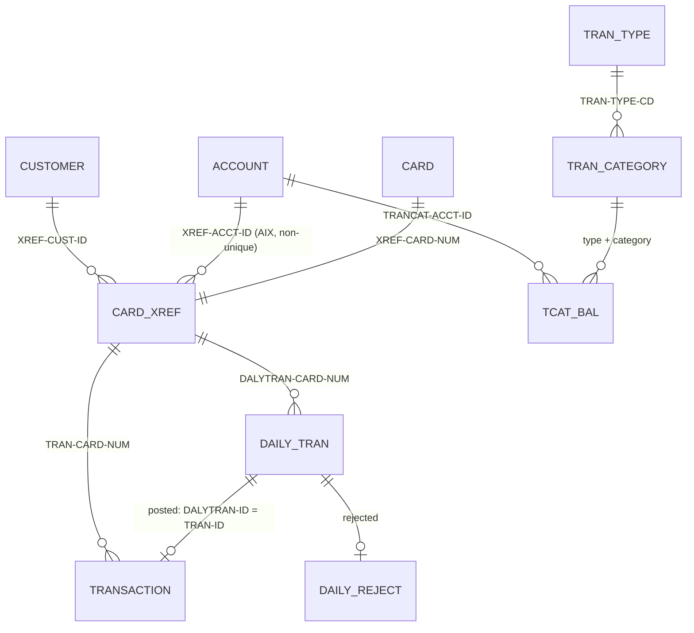

# CardDemo entity catalog

Built from the copybooks, the IDCAMS definitions in `app/jcl/` and the CICS file definitions in `app/csd/CARDDEMO.CSD`, at commit b5e0139. It starts with the entities that the pilot programs `COBIL00C` and `CBTRN02C` touch; the rest are merged from the area proposals in `areas/` (customer, card, user security, disclosure group, export, authorisation segments, DB2 tables) as programs are decomposed.

Conventions:

- **Pos** is the 1-based byte position in the record; **Len** is the length in bytes.
- **Type**: `text(n)` fixed-length characters, padded with spaces on the right; `digits(n)` unsigned numeric characters with leading zeros; `decimal(p,s)` signed zoned decimal with `p` digits of which `s` are decimals, sign folded into the last byte (see format.md glossary); `date-text` 10 characters `YYYY-MM-DD`; `ts-text` 26-character timestamp (layouts in ENT-TRANSACTION).
- Field names are the COBOL names, used verbatim in the specs (including the source's own spelling, `ACCT-EXPIRAION-DATE`).
- The files enforce no referential integrity; "relationships" below are what the programs look up.

## ER view

`CUSTOMER` and `CARD` are shown for context; their layouts (`CVCUS01Y`, `CVACT02Y`) are not used by the two pilot programs and will be added later.

## ENT-ACCOUNT · Credit card account

- **Copybook:** `app/cpy/CVACT01Y.cpy:4-17` (`ACCOUNT-RECORD`, 300 bytes)
- **Dataset:** `AWS.M2.CARDDEMO.ACCTDATA.VSAM.KSDS`, KSDS, `KEYS(11 0)`, `RECORDSIZE(300 300)` (`app/jcl/ACCTFILE.jcl:36-48`)
- **CICS file:** `ACCTDAT`, `RECOVERY(NONE)` (`app/csd/CARDDEMO.CSD:1-12`). **Batch DD:** `ACCTFILE`.
- **Primary key:** `ACCT-ID`.

| Field | Pos | Len | PIC | Type | Meaning |
| :-- | --: | --: | :-- | :-- | :-- |
| `ACCT-ID` | 1 | 11 | `9(11)` | digits(11) | Account number |
| `ACCT-ACTIVE-STATUS` | 12 | 1 | `X(01)` | text(1) | `Y` active (all sample accounts are `Y`); not checked by the pilot programs |
| `ACCT-CURR-BAL` | 13 | 12 | `S9(10)V99` | decimal(12,2) | Current balance owed; positive = the cardholder owes money |
| `ACCT-CREDIT-LIMIT` | 25 | 12 | `S9(10)V99` | decimal(12,2) | Credit limit |
| `ACCT-CASH-CREDIT-LIMIT` | 37 | 12 | `S9(10)V99` | decimal(12,2) | Cash advance limit (not used by the pilot programs) |
| `ACCT-OPEN-DATE` | 49 | 10 | `X(10)` | date-text | Date opened |
| `ACCT-EXPIRAION-DATE` | 59 | 10 | `X(10)` | date-text | Expiration date; transactions dated after it are rejected (POSTTRAN 103) |
| `ACCT-REISSUE-DATE` | 69 | 10 | `X(10)` | date-text | Reissue date |
| `ACCT-CURR-CYC-CREDIT` | 79 | 12 | `S9(10)V99` | decimal(12,2) | Sum of non-negative amounts posted this cycle |
| `ACCT-CURR-CYC-DEBIT` | 91 | 12 | `S9(10)V99` | decimal(12,2) | Sum of negative amounts posted this cycle (stored negative) |
| `ACCT-ADDR-ZIP` | 103 | 10 | `X(10)` | text(10) | Billing ZIP code |
| `ACCT-GROUP-ID` | 113 | 10 | `X(10)` | text(10) | Disclosure (interest) group |
| FILLER | 123 | 178 | `X(178)` | text | Unused |

Sample: account `00000000001`, balance 194.00, limit 2,020.00, cash limit 1,020.00, opened 2014-11-20, expires 2025-05-20, cycle credit and debit 0.00.

Data observation: in all 50 sample accounts `ACCT-ADDR-ZIP` holds `A000000000` (the format of a disclosure group ID) and `ACCT-GROUP-ID` is blank (Q-ENT-001).

Used by (copybook, `docs/inventory.md:301`): CBACT01C, CBACT04C, CBEXPORT, CBIMPORT, CBSTM03A, CBTRN01C, CBTRN02C, COACCT01, COACTUPC, COACTVWC, COBIL00C, COPAUA0C, COPAUS0C, COTRN02C.

## ENT-CARD-XREF · Card to customer and account cross-reference

- **Copybook:** `app/cpy/CVACT03Y.cpy:4-8` (`CARD-XREF-RECORD`, 50 bytes)
- **Dataset:** `AWS.M2.CARDDEMO.CARDXREF.VSAM.KSDS`, `KEYS(16 0)`, `RECORDSIZE(50 50)` (`app/jcl/XREFFILE.jcl:39-51`)
- **Alternate index:** `AWS.M2.CARDDEMO.CARDXREF.VSAM.AIX`, `KEYS(11,25)` = `XREF-ACCT-ID`, **NONUNIQUEKEY**, path `...AIX.PATH` (`app/jcl/XREFFILE.jcl:72-92`)
- **CICS files:** `CCXREF` (by card), `CXACAIX` (path, by account; `app/csd/CARDDEMO.CSD:63-75`). **Batch DD:** `XREFFILE`.
- **Primary key:** `XREF-CARD-NUM`. **Alternate key:** `XREF-ACCT-ID` (several cards per account allowed).

| Field | Pos | Len | PIC | Type | Meaning |
| :-- | --: | --: | :-- | :-- | :-- |
| `XREF-CARD-NUM` | 1 | 16 | `X(16)` | text(16) | Card number (PAN); sensitive |
| `XREF-CUST-ID` | 17 | 9 | `9(09)` | digits(9) | Customer number |
| `XREF-ACCT-ID` | 26 | 11 | `9(11)` | digits(11) | Account number |
| FILLER | 37 | 14 | `X(14)` | text | Unused |

*Sample data note:* `app/data/ASCII/cardxref.txt` has 36-byte lines (no FILLER); the loader pads them to 50 bytes. Only bytes 1-36 are used by any program. `app/data/ASCII/tcatbal.txt` mixes line endings (49 CRLF lines, 1 LF line); a target data loader must strip both.

Sample: 50 records, one card per account.

## ENT-TRANSACTION · Posted transaction (transaction master)

- **Copybook:** `app/cpy/CVTRA05Y.cpy:4-18` (`TRAN-RECORD`, 350 bytes)
- **Dataset:** `AWS.M2.CARDDEMO.TRANSACT.VSAM.KSDS`, `KEYS(16 0)`, `RECORDSIZE(350 350)`, no `REUSE` (`app/jcl/TRANFILE.jcl:49-61`)
- **Alternate index:** `KEYS(26 304)` = `TRAN-PROC-TS`, non-unique (`app/jcl/TRANFILE.jcl:82-85`, rebuilt by TRANIDX)
- **CICS file:** `TRANSACT` (`app/csd/CARDDEMO.CSD:76-87`). **Batch DD:** `TRANFILE` (POSTTRAN).
- **Primary key:** `TRAN-ID`.

| Field | Pos | Len | PIC | Type | Meaning |
| :-- | --: | --: | :-- | :-- | :-- |
| `TRAN-ID` | 1 | 16 | `X(16)` | text(16) | Transaction ID; numeric in practice (16 digits) |
| `TRAN-TYPE-CD` | 17 | 2 | `X(02)` | text(2) | Type code, ENT-TRAN-TYPE |
| `TRAN-CAT-CD` | 19 | 4 | `9(04)` | digits(4) | Category code within the type, ENT-TRAN-CATEGORY |
| `TRAN-SOURCE` | 23 | 10 | `X(10)` | text(10) | Channel (`POS TERM`, `OPERATOR`, ...) |
| `TRAN-DESC` | 33 | 100 | `X(100)` | text(100) | Description |
| `TRAN-AMT` | 133 | 11 | `S9(09)V99` | decimal(11,2) | Amount; positive increases the balance in POSTTRAN, but online bill payments store the payment as positive (COBIL00C DEF-BILL-010) |
| `TRAN-MERCHANT-ID` | 144 | 9 | `9(09)` | digits(9) | Merchant number |
| `TRAN-MERCHANT-NAME` | 153 | 50 | `X(50)` | text(50) | Merchant name |
| `TRAN-MERCHANT-CITY` | 203 | 50 | `X(50)` | text(50) | Merchant city |
| `TRAN-MERCHANT-ZIP` | 253 | 10 | `X(10)` | text(10) | Merchant ZIP |
| `TRAN-CARD-NUM` | 263 | 16 | `X(16)` | text(16) | Card number; sensitive |
| `TRAN-ORIG-TS` | 279 | 26 | `X(26)` | ts-text | When the transaction happened |
| `TRAN-PROC-TS` | 305 | 26 | `X(26)` | ts-text | When it was posted |
| FILLER | 331 | 20 | `X(20)` | text | Unused. Spaces in POSTTRAN records; bill payments inherit it from the record read before (DEF-BILL-006) |

Timestamp layouts found in this field pair:

| Writer | Layout | Example |
| :-- | :-- | :-- |
| Daily input (`DALYTRAN-ORIG-TS`, copied by POSTTRAN) | `YYYY-MM-DD HH:MM:SS.ffffff` | `2022-06-10 19:27:53.000000` |
| POSTTRAN `TRAN-PROC-TS` | `YYYY-MM-DD-HH.MM.SS.hh0000` | `2022-07-06-12.00.00.770000` |
| Bill payment, both fields | `YYYY-MM-DD HH:MM:SS.000000` | `2026-11-05 14:03:12.000000` |

## ENT-DAILY-TRAN · Daily transaction (POSTTRAN input)

- **Copybook:** `app/cpy/CVTRA06Y.cpy:4-18` (`DALYTRAN-RECORD`, 350 bytes). Same layout as ENT-TRANSACTION with the prefix `DALYTRAN-`.
- **Dataset:** `AWS.M2.CARDDEMO.DALYTRAN.PS`, sequential, fixed 350. Sample `app/data/ASCII/dailytran.txt`: 300 records, types `01` (250, source `POS TERM`) and `03` (50, source `OPERATOR`), all category `0001`, all dated 2022-06-10, `DALYTRAN-PROC-TS` blank.

| Field | Pos | Len | Same as |
| :-- | --: | --: | :-- |
| `DALYTRAN-ID` | 1 | 16 | `TRAN-ID` |
| `DALYTRAN-TYPE-CD` | 17 | 2 | `TRAN-TYPE-CD` |
| `DALYTRAN-CAT-CD` | 19 | 4 | `TRAN-CAT-CD` |
| `DALYTRAN-SOURCE` | 23 | 10 | `TRAN-SOURCE` |
| `DALYTRAN-DESC` | 33 | 100 | `TRAN-DESC` |
| `DALYTRAN-AMT` | 133 | 11 | `TRAN-AMT` (decimal(11,2)) |
| `DALYTRAN-MERCHANT-ID` | 144 | 9 | `TRAN-MERCHANT-ID` |
| `DALYTRAN-MERCHANT-NAME` | 153 | 50 | `TRAN-MERCHANT-NAME` |
| `DALYTRAN-MERCHANT-CITY` | 203 | 50 | `TRAN-MERCHANT-CITY` |
| `DALYTRAN-MERCHANT-ZIP` | 253 | 10 | `TRAN-MERCHANT-ZIP` |
| `DALYTRAN-CARD-NUM` | 263 | 16 | `TRAN-CARD-NUM` |
| `DALYTRAN-ORIG-TS` | 279 | 26 | `TRAN-ORIG-TS` |
| `DALYTRAN-PROC-TS` | 305 | 26 | `TRAN-PROC-TS` (not used for posting by POSTTRAN; copied into reject records) |
| FILLER | 331 | 20 | FILLER |

## ENT-DAILY-REJECT · Rejected daily transaction

- **Defined in:** `app/cbl/CBTRN02C.cbl:176-182` (no copybook). **Dataset:** `AWS.M2.CARDDEMO.DALYREJS(+1)`, GDG `LIMIT(5) SCRATCH` (`app/jcl/DALYREJS.jcl:24-28`), fixed 430, allocated `DISP=(NEW,CATLG,DELETE)` (`app/jcl/POSTTRAN.jcl:34-38`).

| Field | Pos | Len | Type | Meaning |
| :-- | --: | --: | :-- | :-- |
| `REJECT-TRAN-DATA` | 1 | 350 | ENT-DAILY-TRAN | The input record as read |
| `WS-VALIDATION-FAIL-REASON` | 351 | 4 | digits(4) | 100, 101, 102 or 103 |
| `WS-VALIDATION-FAIL-REASON-DESC` | 355 | 76 | text(76) | Reason text |

Reason codes: 100 `INVALID CARD NUMBER FOUND`, 101 `ACCOUNT RECORD NOT FOUND`, 102 `OVERLIMIT TRANSACTION`, 103 `TRANSACTION RECEIVED AFTER ACCT EXPIRATION`. (109 exists in the code but never reaches the file.)

## ENT-TCAT-BAL · Balance per account, transaction type and category

- **Copybook:** `app/cpy/CVTRA01Y.cpy:4-10` (`TRAN-CAT-BAL-RECORD`, 50 bytes)
- **Dataset:** `AWS.M2.CARDDEMO.TCATBALF.VSAM.KSDS`, `KEYS(17 0)`, `RECORDSIZE(50 50)` (`app/jcl/TCATBALF.jcl:36-48`). **Batch DD:** `TCATBALF`. Not defined in CICS.
- **Primary key:** `TRAN-CAT-KEY` = `TRANCAT-ACCT-ID` + `TRANCAT-TYPE-CD` + `TRANCAT-CD`.

| Field | Pos | Len | PIC | Type | Meaning |
| :-- | --: | --: | :-- | :-- | :-- |
| `TRANCAT-ACCT-ID` | 1 | 11 | `9(11)` | digits(11) | Account |
| `TRANCAT-TYPE-CD` | 12 | 2 | `X(02)` | text(2) | Transaction type |
| `TRANCAT-CD` | 14 | 4 | `9(04)` | digits(4) | Category |
| `TRAN-CAT-BAL` | 18 | 11 | `S9(09)V99` | decimal(11,2) | Balance for this category (interest base for INTCALC) |
| FILLER | 29 | 22 | `X(22)` | text | Unused; 22 zeros in the sample data |

Sample: 50 records, one per account, type `01` category `0001`. POSTTRAN on the sample day adds 50 records for type `03` category `0001`.

## ENT-TRAN-TYPE and ENT-TRAN-CATEGORY · Reference codes

Copybooks `app/cpy/CVTRA03Y.cpy` (`TRAN-TYPE` X(2), `TRAN-TYPE-DESC` X(50)) and `app/cpy/CVTRA04Y.cpy` (key `TRAN-TYPE-CD` X(2) + `TRAN-CAT-CD` 9(4), `TRAN-CAT-TYPE-DESC` X(50)). Sample data `app/data/ASCII/trantype.txt`, `trancatg.txt`. Neither pilot program reads them; the codes they write are:

| Type | Description | Categories (code: description) |
| :-- | :-- | :-- |
| `01` | Purchase | 0001 Regular Sales Draft, 0002 Regular Cash Advance, 0003 Convenience Check Debit, 0004 ATM Cash Advance, 0005 Interest Amount |
| `02` | Payment | 0001 Cash payment, **0002 Electronic payment** (written by bill payment), 0003 Check payment |
| `03` | Credit | 0001 Credit to Account, 0002 Credit to Purchase balance, 0003 Credit to Cash balance |
| `04` | Authorization | 0001-0003 |
| `05` | Refund | 0001 Refund credit |
| `06` | Reversal | 0001 Fraud reversal, 0002 Non-fraud reversal |
| `07` | Adjustment | 0001 Sales draft credit adjustment |

## ENT-COMMAREA · Online session state

- **Copybook:** `app/cpy/COCOM01Y.cpy:19-44` (`CARDDEMO-COMMAREA`, 160 bytes); programs may append their own extension.

| Field | Pos | Len | Type | Meaning |
| :-- | --: | --: | :-- | :-- |
| `CDEMO-FROM-TRANID` | 1 | 4 | text | Transaction that transferred here |
| `CDEMO-FROM-PROGRAM` | 5 | 8 | text | Program that transferred here (PF3 target) |
| `CDEMO-TO-TRANID` | 13 | 4 | text | Target transaction |
| `CDEMO-TO-PROGRAM` | 17 | 8 | text | Target program for XCTL |
| `CDEMO-USER-ID` | 25 | 8 | text | Signed-on user |
| `CDEMO-USER-TYPE` | 33 | 1 | text | `A` admin, `U` regular user |
| `CDEMO-PGM-CONTEXT` | 34 | 1 | digits(1) | 0 first entry, 1 re-entry |
| `CDEMO-CUST-ID` | 35 | 9 | digits | Selected customer |
| `CDEMO-CUST-FNAME`, `-MNAME`, `-LNAME` | 44, 69, 94 | 25 each | text | Customer name |
| `CDEMO-ACCT-ID` | 119 | 11 | digits | Selected account |
| `CDEMO-ACCT-STATUS` | 130 | 1 | text | Its status |
| `CDEMO-CARD-NUM` | 131 | 16 | digits | Selected card |
| `CDEMO-LAST-MAP`, `-LAST-MAPSET` | 147, 154 | 7 each | text | Last screen shown |

Bill payment extension `CDEMO-CB00-INFO` (`app/cbl/COBIL00C.cbl:64-72`), positions 161-218: `CDEMO-CB00-TRNID-FIRST` (161, 16), `-TRNID-LAST` (177, 16), `-PAGE-NUM` (193, 8), `-NEXT-PAGE-FLG` (201, 1), `-TRN-SEL-FLG` (202, 1), `-TRN-SELECTED` (203, 16).

## Relational mapping hints (input to the architecture step, not decisions)

| Entity | Candidate table | Primary key | Notes |
| :-- | :-- | :-- | :-- |
| ENT-ACCOUNT | `account` | `acct_id` CHAR(11) or BIGINT | amounts `DECIMAL(12,2)`; dates parse as `DATE` |
| ENT-CARD-XREF | `card_account` | `card_num` | index on `acct_id` (non-unique); FK to account and customer |
| ENT-TRANSACTION | `transaction` | `tran_id` CHAR(16) | `DECIMAL(11,2)`; two timestamp layouts to normalise to `DATETIME2` (COBIL00C Q-BILL-006) |
| ENT-TCAT-BAL | `account_category_balance` | (`acct_id`, `type_cd`, `cat_cd`) | `DECIMAL(11,2)` |
| ENT-DAILY-TRAN | staging table or file | `tran_id` | batch input |
| ENT-DAILY-REJECT | `daily_reject` | (`run_date`, input sequence) | keep reason code and text |

## Open questions

| ID | Question |
| :-- | :-- |
| Q-ENT-001 | In the sample accounts the ZIP field holds `A000000000` and the group ID is blank. Is the sample data shifted, or is this intended? It matters for interest (INTCALC looks up the disclosure group by `ACCT-GROUP-ID`). |
| Q-ENT-002 | Should the target keep the 16-character text transaction ID, or move to a numeric surrogate key with the old ID as an attribute? |
