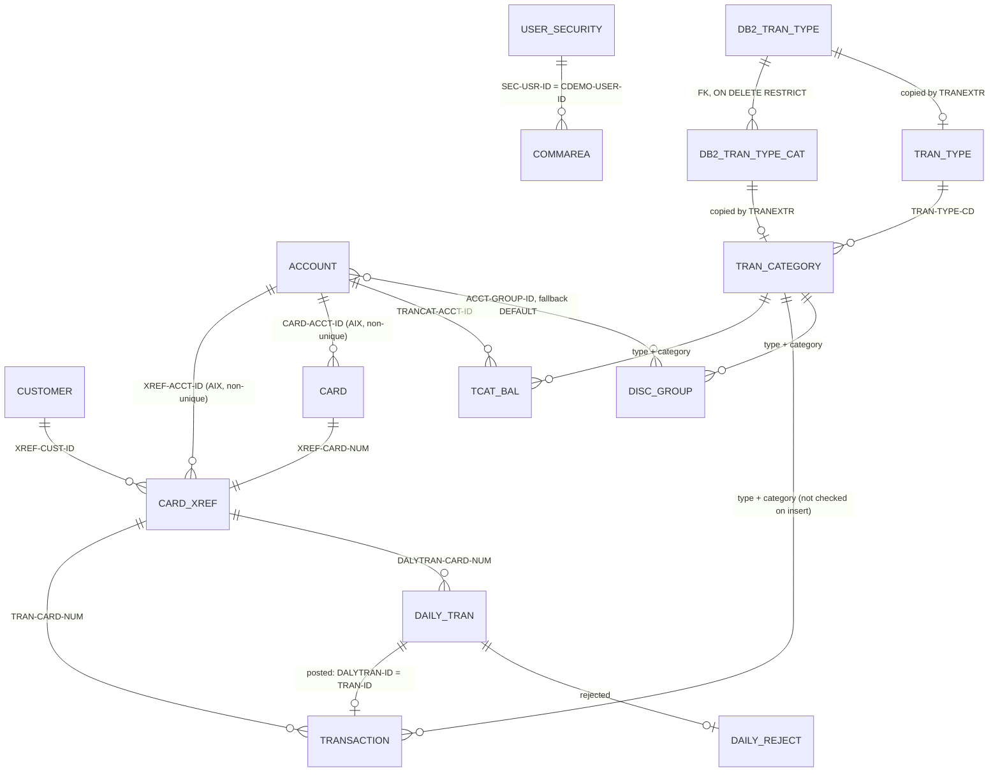

# CardDemo entity catalog

Built from the copybooks, the IDCAMS definitions in `app/jcl/` and the CICS file definitions in `app/csd/CARDDEMO.CSD`, at commit b5e0139. It holds the entities of the pilot programs `COBIL00C` and `CBTRN02C`, ENT-CUSTOMER and ENT-CARD, and the proposals merged from areas a (sign-on and administration), c (transactions), d1 (core batch) and f (transaction type Db2 module and VSAM-MQ module). Each `areas/<area>-entities.md` file records the commit that merged it. The entities of the other areas are added as they merge.

Conventions:

- **Pos** is the 1-based byte position in the record; **Len** is the length in bytes.
- **Type**: `text(n)` fixed-length characters, padded with spaces on the right; `digits(n)` unsigned numeric characters with leading zeros; `decimal(p,s)` signed zoned decimal with `p` digits of which `s` are decimals, sign folded into the last byte (see format.md glossary); `date-text` 10 characters `YYYY-MM-DD`; `ts-text` 26-character timestamp (layouts in ENT-TRANSACTION); `code(n)` text with a fixed set of values; `flag` one character, `Y` or `N`; `packed(p,s)` IBM packed decimal (`COMP-3`): two digits per byte, the last half-byte is the sign (`C` positive, `D` negative, `F` unsigned), a leading `0` half-byte pads an even `p`, length `floor(p/2)+1` bytes. Db2 columns give the SQL type, with the DCLGEN host variable in the PIC column. Message layouts say `zoned` for numeric characters with the sign folded into the last byte.
- Where a table gives **Pos** as a range (`1-2`), it is the first and last byte.
- Field names are the COBOL names, used verbatim in the specs (including the source's own spelling, `ACCT-EXPIRAION-DATE`).
- The files enforce no referential integrity; "relationships" below are what the programs look up.
- **Batch DD** names are the program's DD names. Where programs use different DD names for the same entity, or the same DD name for different datasets, the entry lists them by program.

## ER view

Each box is the entity of the same name with the prefix `ENT-` (`DB2_TRAN_TYPE_CAT` is ENT-DB2-TRAN-TYPE-CAT). The Db2 foreign key is the only relationship the data stores enforce.

### Relationships merged from the areas

| From | To | Join fields | Cardinality | Evidence |
| :-- | :-- | :-- | :-- | :-- |
| ENT-COMMAREA | ENT-USER-SECURITY | `CDEMO-USER-ID` = `SEC-USR-ID` (upper case) | many sessions to 1 user; not enforced after sign-on | `app/cbl/COSGN00C.cbl:132-133, 215, 226` |
| ENT-COMMAREA-USER-ADMIN-EXT | ENT-USER-SECURITY | `CDEMO-CUnn-USR-SELECTED` = `SEC-USR-ID` | 0..1 to 1 | `app/cbl/COUSR00C.cbl:154`; `app/cbl/COUSR02C.cbl:99-103` |
| ENT-ADMIN-MENU-OPTIONS | programs | `CDEMO-ADMIN-OPT-PGMNAME` | 1 to 1 | `app/cpy/COADM02Y.cpy:26-53` |
| ENT-MAIN-MENU-OPTIONS | programs | `CDEMO-MENU-OPT-PGMNAME` | 1 to 1 | `app/cpy/COMEN02Y.cpy:25-90` |
| ENT-TRANSACTION | ENT-CARD-XREF | `TRAN-CARD-NUM` = `XREF-CARD-NUM` | many to one; enforced only at insert by transaction add (card looked up in the cross-reference) | `app/cbl/COTRN02C.cbl:193-230, 459` |
| ENT-TRANSACTION | ENT-TRAN-CATEGORY | (`TRAN-TYPE-CD`, `TRAN-CAT-CD`) = category key | many to one; not enforced by transaction add | `app/cbl/COTRN02C.cbl:322-337` |
| ENT-REPORT-JOB | ENT-TRANSACTION | start and end date against `TRAN-PROC-TS`(1:10) | one request selects many transactions | `app/cbl/CORPT00C.cbl:101-121`; `app/proc/TRANREPT.prc:40-46` |
| ENT-DATE-CHECK-RESULT | (caller) | returned in the third CALL parameter | one per call | `app/cbl/COTRN02C.cbl:389-427`; `app/cbl/CORPT00C.cbl:388-426` |
| ENT-ACCOUNT | ENT-DISC-GROUP | `ACCT-GROUP-ID` = `DIS-ACCT-GROUP-ID` (plus type and category from ENT-TCAT-BAL); fallback `DEFAULT` | many to many (group shared by accounts; one rate per type and category) | `app/cbl/CBACT04C.cbl:210-213, 416-461` |
| ENT-TCAT-BAL | ENT-DISC-GROUP | `TRANCAT-TYPE-CD`, `TRANCAT-CD` = `DIS-TRAN-TYPE-CD`, `DIS-TRAN-CAT-CD` | many to one per group | `app/cbl/CBACT04C.cbl:211-212` |
| ENT-TRANSACTION | ENT-TRAN-CATEGORY | `TRAN-TYPE-CD` + `TRAN-CAT-CD` | many to one | `app/cbl/CBTRN03C.cbl:191-195` |
| ENT-TRANSACTION | ENT-TRAN-TYPE | `TRAN-TYPE-CD` | many to one | `app/cbl/CBTRN03C.cbl:189-190` |
| ENT-DB2-TRAN-TYPE-CAT | ENT-DB2-TRAN-TYPE | `TRC_TYPE_CODE` = `TR_TYPE` (foreign key, ON DELETE RESTRICT) | many to one | `app/app-transaction-type-db2/ctl/DB2CREAT.ctl:96-99` |
| ENT-TTYP-MAINT-INPUT | ENT-DB2-TRAN-TYPE | `INPUT-REC-NUMBER` = `TR_TYPE` | each record names at most one row | `app/app-transaction-type-db2/cbl/COBTUPDT.cbl:145, 174, 203` |
| ENT-DB2-TRAN-TYPE | ENT-TRAN-TYPE | `TR_TYPE` = `TRAN-TYPE` (copy made by TRANEXTR, then REPRO) | one to one after a refresh | `app/app-transaction-type-db2/jcl/TRANEXTR.jcl:76-84` |
| ENT-DB2-TRAN-TYPE-CAT | ENT-TRAN-CATEGORY | (`TRC_TYPE_CODE`, `TRC_TYPE_CATEGORY`) = (`TRAN-TYPE-CD`, `TRAN-CAT-CD`) | one to one after a refresh | `app/app-transaction-type-db2/jcl/TRANEXTR.jcl:106-115` |
| ENT-MQ-ACCT-REQUEST | ENT-ACCOUNT | `WS-KEY` = `ACCT-ID` | zero or one | `app/app-vsam-mq/cbl/COACCT01.cbl:393-404` |
| ENT-MQ-ACCT-REPLY | ENT-ACCOUNT | fields copied from the account read | copy of one record | `app/app-vsam-mq/cbl/COACCT01.cbl:408-425` |

## ENT-ACCOUNT · Credit card account

- **Copybook:** `app/cpy/CVACT01Y.cpy:4-17` (`ACCOUNT-RECORD`, 300 bytes)
- **Dataset:** `AWS.M2.CARDDEMO.ACCTDATA.VSAM.KSDS`, KSDS, `KEYS(11 0)`, `RECORDSIZE(300 300)` (`app/jcl/ACCTFILE.jcl:36-48`)
- **CICS file:** `ACCTDAT`, `RECOVERY(NONE)` (`app/csd/CARDDEMO.CSD:1-12`). **Batch DD:** `ACCTFILE`.
- **Primary key:** `ACCT-ID`.

| Field | Pos | Len | PIC | Type | Meaning |
| :-- | --: | --: | :-- | :-- | :-- |
| `ACCT-ID` | 1 | 11 | `9(11)` | digits(11) | Account number |
| `ACCT-ACTIVE-STATUS` | 12 | 1 | `X(01)` | text(1) | `Y` active (all sample accounts are `Y`); not checked by the pilot programs |
| `ACCT-CURR-BAL` | 13 | 12 | `S9(10)V99` | decimal(12,2) | Current balance owed; positive = the cardholder owes money |
| `ACCT-CREDIT-LIMIT` | 25 | 12 | `S9(10)V99` | decimal(12,2) | Credit limit |
| `ACCT-CASH-CREDIT-LIMIT` | 37 | 12 | `S9(10)V99` | decimal(12,2) | Cash advance limit (not used by the pilot programs) |
| `ACCT-OPEN-DATE` | 49 | 10 | `X(10)` | date-text | Date opened |
| `ACCT-EXPIRAION-DATE` | 59 | 10 | `X(10)` | date-text | Expiration date; transactions dated after it are rejected (POSTTRAN 103) |
| `ACCT-REISSUE-DATE` | 69 | 10 | `X(10)` | date-text | Reissue date |
| `ACCT-CURR-CYC-CREDIT` | 79 | 12 | `S9(10)V99` | decimal(12,2) | Sum of non-negative amounts posted this cycle; reset to zero by INTCALC for every account that has a category balance |
| `ACCT-CURR-CYC-DEBIT` | 91 | 12 | `S9(10)V99` | decimal(12,2) | Sum of negative amounts posted this cycle (stored negative); reset to zero by INTCALC like the cycle credit (`app/cbl/CBACT04C.cbl:351-356`) |
| `ACCT-ADDR-ZIP` | 103 | 10 | `X(10)` | text(10) | Billing ZIP code |
| `ACCT-GROUP-ID` | 113 | 10 | `X(10)` | text(10) | Disclosure (interest) group, the key into ENT-DISC-GROUP; blank in the sample, so INTCALC uses `DEFAULT` (`app/cbl/CBACT04C.cbl:210, 437-440`) |
| FILLER | 123 | 178 | `X(178)` | text | Unused |

Sample: account `00000000001`, balance 194.00, limit 2,020.00, cash limit 1,020.00, opened 2014-11-20, expires 2025-05-20, cycle credit and debit 0.00.

Data observation: in all 50 sample accounts `ACCT-ADDR-ZIP` holds `A000000000` (the format of a disclosure group ID) and `ACCT-GROUP-ID` is blank (Q-ENT-001).

Used by (copybook, `docs/inventory.md:301`): CBACT01C, CBACT04C, CBEXPORT, CBIMPORT, CBSTM03A, CBTRN01C, CBTRN02C, COACCT01, COACTUPC, COACTVWC, COBIL00C, COPAUA0C, COPAUS0C, COTRN02C. READACCT (CBACT01C) copies every field to the ENT-ACCT-EXTRACT files.

## ENT-CARD-XREF · Card to customer and account cross-reference

- **Copybook:** `app/cpy/CVACT03Y.cpy:4-8` (`CARD-XREF-RECORD`, 50 bytes)
- **Dataset:** `AWS.M2.CARDDEMO.CARDXREF.VSAM.KSDS`, `KEYS(16 0)`, `RECORDSIZE(50 50)` (`app/jcl/XREFFILE.jcl:39-51`)
- **Alternate index:** `AWS.M2.CARDDEMO.CARDXREF.VSAM.AIX`, `KEYS(11,25)` = `XREF-ACCT-ID`, **NONUNIQUEKEY**, path `...AIX.PATH` (`app/jcl/XREFFILE.jcl:72-92`)
- **CICS files:** `CCXREF` (by card), `CXACAIX` (path, by account; `app/csd/CARDDEMO.CSD:63-75`).
- **Batch DD names by program:** `XREFFILE` in CBACT03C, CBACT04C, CBEXPORT, CBTRN01C and CBTRN02C; `CARDXREF` in CBTRN03C (`app/cbl/CBTRN03C.cbl:33`). CBACT04C reads by account through the path under DD `XREFFIL1` (`app/jcl/INTCALC.jcl:31-32`).
- **Primary key:** `XREF-CARD-NUM`. **Alternate key:** `XREF-ACCT-ID` (several cards per account allowed). CBACT04C reads by `XREF-ACCT-ID` although its `SELECT` does not say `WITH DUPLICATES`; on z/OS a second card for an account is expected to make INTCALC abend (CBACT04C DEF-INTC-007, `app/cbl/CBACT04C.cbl:34-39, 394-414`).

| Field | Pos | Len | PIC | Type | Meaning |
| :-- | --: | --: | :-- | :-- | :-- |
| `XREF-CARD-NUM` | 1 | 16 | `X(16)` | text(16) | Card number (PAN); sensitive |
| `XREF-CUST-ID` | 17 | 9 | `9(09)` | digits(9) | Customer number |
| `XREF-ACCT-ID` | 26 | 11 | `9(11)` | digits(11) | Account number |
| FILLER | 37 | 14 | `X(14)` | text | Unused |

*Sample data note:* `app/data/ASCII/cardxref.txt` has 36-byte lines (no FILLER); the loader pads them to 50 bytes. Only bytes 1-36 are used by any program. `app/data/ASCII/tcatbal.txt` mixes line endings (49 CRLF lines, 1 LF line); a target data loader must strip both.

Sample: 50 records, one card per account.

## ENT-CUSTOMER · Customer

- **Copybooks:** `app/cpy/CVCUS01Y.cpy:4-23` and `app/cpy/CUSTREC.cpy:4-23` (`CUSTOMER-RECORD`, 500 bytes). The two layouts are identical except for the name of the date-of-birth field: `CUST-DOB-YYYY-MM-DD` in CVCUS01Y, `CUST-DOB-YYYYMMDD` in CUSTREC. Both are `X(10)` at position 309, and the sample data holds `YYYY-MM-DD` with dashes, so the CUSTREC name describes the content wrongly. Specs use the name from the copybook their program copies. CUSTREC is also indented with tab characters, which does not change the layout.
- **Dataset:** `AWS.M2.CARDDEMO.CUSTDATA.VSAM.KSDS`, KSDS, `KEYS(9 0)`, `RECORDSIZE(500 500)` (`app/jcl/CUSTFILE.jcl:46-59`). No alternate index.
- **CICS file:** `CUSTDAT`, `RECOVERY(NONE)` (`app/csd/CARDDEMO.CSD:50-62`). **Batch DD:** `CUSTFILE` (`app/jcl/READCUST.jcl:24`, `app/jcl/CBEXPORT.jcl:49`; also CBTRN01C and CBSTM03A).
- **Primary key:** `CUST-ID`.

| Field | Pos | Len | PIC | Type | Meaning |
| :-- | --: | --: | :-- | :-- | :-- |
| `CUST-ID` | 1 | 9 | `9(09)` | digits(9) | Customer number |
| `CUST-FIRST-NAME` | 10 | 25 | `X(25)` | text(25) | First name |
| `CUST-MIDDLE-NAME` | 35 | 25 | `X(25)` | text(25) | Middle name |
| `CUST-LAST-NAME` | 60 | 25 | `X(25)` | text(25) | Last name |
| `CUST-ADDR-LINE-1` | 85 | 50 | `X(50)` | text(50) | Address line 1 |
| `CUST-ADDR-LINE-2` | 135 | 50 | `X(50)` | text(50) | Address line 2 |
| `CUST-ADDR-LINE-3` | 185 | 50 | `X(50)` | text(50) | Address line 3 (holds the city in the sample data) |
| `CUST-ADDR-STATE-CD` | 235 | 2 | `X(02)` | text(2) | State code |
| `CUST-ADDR-COUNTRY-CD` | 237 | 3 | `X(03)` | text(3) | Country code |
| `CUST-ADDR-ZIP` | 240 | 10 | `X(10)` | text(10) | ZIP code |
| `CUST-PHONE-NUM-1` | 250 | 15 | `X(15)` | text(15) | Phone 1, `(nnn)nnn-nnnn` in the sample data |
| `CUST-PHONE-NUM-2` | 265 | 15 | `X(15)` | text(15) | Phone 2 |
| `CUST-SSN` | 280 | 9 | `9(09)` | digits(9) | Social security number; sensitive |
| `CUST-GOVT-ISSUED-ID` | 289 | 20 | `X(20)` | text(20) | Government ID; sensitive |
| `CUST-DOB-YYYY-MM-DD` (CUSTREC: `CUST-DOB-YYYYMMDD`) | 309 | 10 | `X(10)` | date-text | Date of birth; sensitive |
| `CUST-EFT-ACCOUNT-ID` | 319 | 10 | `X(10)` | text(10) | Bank account for electronic payments; sensitive |
| `CUST-PRI-CARD-HOLDER-IND` | 329 | 1 | `X(01)` | text(1) | `Y` primary card holder |
| `CUST-FICO-CREDIT-SCORE` | 330 | 3 | `9(03)` | digits(3) | FICO score |
| FILLER | 333 | 168 | `X(168)` | text | Unused |

Sample (`app/data/ASCII/custdata.txt`): 50 records, IDs `000000001`-`000000050` in key order, all with country `USA`, primary holder `Y`, all fields filled. ZIP is 5 characters in 20 records and 10 in 30. FICO scores range from 001 to 793. Every customer appears in exactly one ENT-CARD-XREF record.

Used by: CVCUS01Y (`docs/inventory.md:305`): CBCUS01C, CBEXPORT, CBIMPORT, CBTRN01C, COACTUPC, COACTVWC, COCRDSLC, COCRDUPC, COPAUA0C, COPAUS0C. CUSTREC (`docs/inventory.md:300`): CBSTM03A.

Exposure: READCUST prints `CUST-SSN`, `CUST-GOVT-ISSUED-ID` and `CUST-DOB-YYYY-MM-DD` in full (CBCUS01C DEF-CURD-001, `app/cbl/CBCUS01C.cbl:78`).

## ENT-CARD · Credit card

- **Copybook:** `app/cpy/CVACT02Y.cpy:4-11` (`CARD-RECORD`, 150 bytes)
- **Dataset:** `AWS.M2.CARDDEMO.CARDDATA.VSAM.KSDS`, KSDS, `KEYS(16 0)`, `RECORDSIZE(150 150)` (`app/jcl/CARDFILE.jcl:50-63`)
- **Alternate index:** `AWS.M2.CARDDEMO.CARDDATA.VSAM.AIX`, `KEYS(11 16)` = `CARD-ACCT-ID`, **NONUNIQUEKEY**, `UPGRADE` (`app/jcl/CARDFILE.jcl:83-92`), path `...AIX.PATH` (`app/jcl/CARDFILE.jcl:100-102`)
- **CICS files:** `CARDDAT` (by card, `app/csd/CARDDEMO.CSD:25-36`), `CARDAIX` (path, by account, `app/csd/CARDDEMO.CSD:13-24`), both `RECOVERY(NONE)`. **Batch DD:** `CARDFILE` (`app/jcl/READCARD.jcl:25`, `app/jcl/CBEXPORT.jcl:57`; also CBTRN01C).
- **Primary key:** `CARD-NUM`. **Alternate key:** `CARD-ACCT-ID` (several cards per account allowed).

| Field | Pos | Len | PIC | Type | Meaning |
| :-- | --: | --: | :-- | :-- | :-- |
| `CARD-NUM` | 1 | 16 | `X(16)` | text(16) | Card number (PAN); sensitive |
| `CARD-ACCT-ID` | 17 | 11 | `9(11)` | digits(11) | Account the card belongs to, ENT-ACCOUNT |
| `CARD-CVV-CD` | 28 | 3 | `9(03)` | digits(3) | Card verification value; sensitive |
| `CARD-EMBOSSED-NAME` | 31 | 50 | `X(50)` | text(50) | Name printed on the card |
| `CARD-EXPIRAION-DATE` | 81 | 10 | `X(10)` | date-text | Expiration date (the source's spelling) |
| `CARD-ACTIVE-STATUS` | 91 | 1 | `X(01)` | text(1) | `Y` active |
| FILLER | 92 | 59 | `X(59)` | text | Unused |

Sample (`app/data/ASCII/carddata.txt`): 50 records in card-number order, one card per account, all active (`Y`), expiring between 2023-01-06 and 2025-12-28. Each card is in ENT-CARD-XREF with the same account number.

`CARD-ACCT-ID` duplicates `XREF-ACCT-ID` in ENT-CARD-XREF, and nothing keeps the two in step. Which one each program uses is stated in its spec.

Used by (`docs/inventory.md:302`): CBACT02C, CBEXPORT, CBIMPORT, CBTRN01C, COACTVWC, COCRDLIC, COCRDSLC, COCRDUPC, COPAUS0C, COTRTLIC.

Exposure: READCARD prints `CARD-CVV-CD` and the embossed name in full (CBACT02C DEF-CDRD-001, `app/cbl/CBACT02C.cbl:78`).

## ENT-TRANSACTION · Posted transaction (transaction master)

- **Copybook:** `app/cpy/CVTRA05Y.cpy:4-18` (`TRAN-RECORD`, 350 bytes)
- **Dataset:** `AWS.M2.CARDDEMO.TRANSACT.VSAM.KSDS`, `KEYS(16 0)`, `RECORDSIZE(350 350)`, no `REUSE` (`app/jcl/TRANFILE.jcl:49-61`)
- **Alternate index:** `KEYS(26 304)` = `TRAN-PROC-TS`, non-unique (`app/jcl/TRANFILE.jcl:82-85`, rebuilt by TRANIDX)
- **CICS file:** `TRANSACT` (`app/csd/CARDDEMO.CSD:76-87`). Online writers: bill payment (`COBIL00C`) and transaction add (`COTRN02C`), both with ID = highest existing ID + 1 (INV-001). Online readers: list (`COTRN00C`, browse) and view (`COTRN01C`, read with update lock, never rewritten) (`app/cbl/COTRN02C.cbl:444-449, 711-721`; `app/cbl/COTRN00C.cbl:593-696`; `app/cbl/COTRN01C.cbl:267-278`).
- **Batch writers:** POSTTRAN (`CBTRN02C`) writes the KSDS; INTCALC (`CBACT04C`) writes the same layout to the sequential GDG `SYSTRAN(+1)` (FB 350), which COMBTRAN merges into the KSDS.
- **Batch DD names by program** (each program's `SELECT ... ASSIGN TO`; the job decides which dataset is behind it): `TRANFILE` in CBTRN02C (POSTTRAN, the KSDS, `app/jcl/POSTTRAN.jcl:28-29`) and CBTRN01C (no JCL); `TRANSACT` in CBEXPORT (the KSDS, `app/jcl/CBEXPORT.jcl:55-56`). The same DD names also point at other datasets with this layout: `TRANFILE` in CBTRN03C reads the sorted daily extract `TRANSACT.DALY(+1)` (`app/jcl/TRANREPT.jcl:65-66`), and `TRANSACT` in CBACT04C writes a new sequential file of interest transactions `SYSTRAN(+1)` (`app/jcl/INTCALC.jcl:37-41`). Utility steps reach the KSDS under their own DD names: IDCAMS `TRANVSAM` in COMBTRAN (`app/jcl/COMBTRAN.jcl:45-46`), SORT `SORTIN` in CREASTMT (`app/jcl/CREASTMT.JCL:45`), and REPROC `PRC001.FILEIN` in TRANBKP (`app/jcl/TRANBKP.jcl:26-27`) and the TRANREPT procedure (`app/proc/TRANREPT.prc:24-25`). Job specs name the dataset for each DD.
- **Primary key:** `TRAN-ID`.

| Field | Pos | Len | PIC | Type | Meaning |
| :-- | --: | --: | :-- | :-- | :-- |
| `TRAN-ID` | 1 | 16 | `X(16)` | text(16) | Transaction ID; numeric in practice (16 digits) |
| `TRAN-TYPE-CD` | 17 | 2 | `X(02)` | text(2) | Type code, ENT-TRAN-TYPE |
| `TRAN-CAT-CD` | 19 | 4 | `9(04)` | digits(4) | Category code within the type, ENT-TRAN-CATEGORY |
| `TRAN-SOURCE` | 23 | 10 | `X(10)` | text(10) | Channel (`POS TERM`, `OPERATOR`, ...) |
| `TRAN-DESC` | 33 | 100 | `X(100)` | text(100) | Description |
| `TRAN-AMT` | 133 | 11 | `S9(09)V99` | decimal(11,2) | Amount; positive increases the balance in POSTTRAN, but online bill payments store the payment as positive (COBIL00C DEF-BILL-010) |
| `TRAN-MERCHANT-ID` | 144 | 9 | `9(09)` | digits(9) | Merchant number |
| `TRAN-MERCHANT-NAME` | 153 | 50 | `X(50)` | text(50) | Merchant name |
| `TRAN-MERCHANT-CITY` | 203 | 50 | `X(50)` | text(50) | Merchant city |
| `TRAN-MERCHANT-ZIP` | 253 | 10 | `X(10)` | text(10) | Merchant ZIP |
| `TRAN-CARD-NUM` | 263 | 16 | `X(16)` | text(16) | Card number; sensitive |
| `TRAN-ORIG-TS` | 279 | 26 | `X(26)` | ts-text | When the transaction happened |
| `TRAN-PROC-TS` | 305 | 26 | `X(26)` | ts-text | When it was posted (POSTTRAN, INTCALC, bill payment); for transaction add, a date typed by the user, not a posting time. The report job selects on its first 10 characters (INV-010, `app/proc/TRANREPT.prc:40-46`) |
| FILLER | 331 | 20 | `X(20)` | text | Unused. Spaces in POSTTRAN records; bill payments and transaction add inherit it from the highest-ID record read just before, because `INITIALIZE` does not change FILLER (DEF-BILL-006, COTRN02C BR-TRNA-004) |

Timestamp layouts found in this field pair:

| Writer | Layout | Example |
| :-- | :-- | :-- |
| Daily input (`DALYTRAN-ORIG-TS`, copied by POSTTRAN) | `YYYY-MM-DD HH:MM:SS.ffffff` | `2022-06-10 19:27:53.000000` |
| POSTTRAN `TRAN-PROC-TS` | `YYYY-MM-DD-HH.MM.SS.hh0000` | `2022-07-06-12.00.00.770000` |
| Bill payment, both fields | `YYYY-MM-DD HH:MM:SS.000000` | `2026-11-05 14:03:12.000000` |
| INTCALC interest transactions, both fields (`app/cbl/CBACT04C.cbl:498-500, 615-628`) | `YYYY-MM-DD-HH.MM.SS.hh0000` | `2022-07-06-12.00.00.130000` |
| Transaction add (`COTRN02C`), both fields (`app/cbl/COTRN02C.cbl:354-381, 464-465`) | `YYYY-MM-DD` as typed and checked, then 16 spaces | `2022-07-06` + 16 spaces |

## ENT-DAILY-TRAN · Daily transaction (POSTTRAN input)

- **Copybook:** `app/cpy/CVTRA06Y.cpy:4-18` (`DALYTRAN-RECORD`, 350 bytes). Same layout as ENT-TRANSACTION with the prefix `DALYTRAN-`.
- **Dataset:** `AWS.M2.CARDDEMO.DALYTRAN.PS`, sequential, fixed 350. Sample `app/data/ASCII/dailytran.txt`: 300 records, types `01` (250, source `POS TERM`) and `03` (50, source `OPERATOR`), all category `0001`, all dated 2022-06-10, `DALYTRAN-PROC-TS` blank.

| Field | Pos | Len | Same as |
| :-- | --: | --: | :-- |
| `DALYTRAN-ID` | 1 | 16 | `TRAN-ID` |
| `DALYTRAN-TYPE-CD` | 17 | 2 | `TRAN-TYPE-CD` |
| `DALYTRAN-CAT-CD` | 19 | 4 | `TRAN-CAT-CD` |
| `DALYTRAN-SOURCE` | 23 | 10 | `TRAN-SOURCE` |
| `DALYTRAN-DESC` | 33 | 100 | `TRAN-DESC` |
| `DALYTRAN-AMT` | 133 | 11 | `TRAN-AMT` (decimal(11,2)) |
| `DALYTRAN-MERCHANT-ID` | 144 | 9 | `TRAN-MERCHANT-ID` |
| `DALYTRAN-MERCHANT-NAME` | 153 | 50 | `TRAN-MERCHANT-NAME` |
| `DALYTRAN-MERCHANT-CITY` | 203 | 50 | `TRAN-MERCHANT-CITY` |
| `DALYTRAN-MERCHANT-ZIP` | 253 | 10 | `TRAN-MERCHANT-ZIP` |
| `DALYTRAN-CARD-NUM` | 263 | 16 | `TRAN-CARD-NUM` |
| `DALYTRAN-ORIG-TS` | 279 | 26 | `TRAN-ORIG-TS` |
| `DALYTRAN-PROC-TS` | 305 | 26 | `TRAN-PROC-TS` (not used for posting by POSTTRAN; copied into reject records) |
| FILLER | 331 | 20 | FILLER |

## ENT-DAILY-REJECT · Rejected daily transaction

- **Defined in:** `app/cbl/CBTRN02C.cbl:176-182` (no copybook). **Dataset:** `AWS.M2.CARDDEMO.DALYREJS(+1)`, GDG `LIMIT(5) SCRATCH` (`app/jcl/DALYREJS.jcl:24-28`), fixed 430, allocated `DISP=(NEW,CATLG,DELETE)` (`app/jcl/POSTTRAN.jcl:34-38`).

| Field | Pos | Len | Type | Meaning |
| :-- | --: | --: | :-- | :-- |
| `REJECT-TRAN-DATA` | 1 | 350 | ENT-DAILY-TRAN | The input record as read |
| `WS-VALIDATION-FAIL-REASON` | 351 | 4 | digits(4) | 100, 101, 102 or 103 |
| `WS-VALIDATION-FAIL-REASON-DESC` | 355 | 76 | text(76) | Reason text |

Reason codes: 100 `INVALID CARD NUMBER FOUND`, 101 `ACCOUNT RECORD NOT FOUND`, 102 `OVERLIMIT TRANSACTION`, 103 `TRANSACTION RECEIVED AFTER ACCT EXPIRATION`. (109 exists in the code but never reaches the file.)

## ENT-TCAT-BAL · Balance per account, transaction type and category

- **Copybook:** `app/cpy/CVTRA01Y.cpy:4-10` (`TRAN-CAT-BAL-RECORD`, 50 bytes)
- **Dataset:** `AWS.M2.CARDDEMO.TCATBALF.VSAM.KSDS`, `KEYS(17 0)`, `RECORDSIZE(50 50)` (`app/jcl/TCATBALF.jcl:36-48`). **Batch DD:** `TCATBALF`. Not defined in CICS.
- **Primary key:** `TRAN-CAT-KEY` = `TRANCAT-ACCT-ID` + `TRANCAT-TYPE-CD` + `TRANCAT-CD`.

| Field | Pos | Len | PIC | Type | Meaning |
| :-- | --: | --: | :-- | :-- | :-- |
| `TRANCAT-ACCT-ID` | 1 | 11 | `9(11)` | digits(11) | Account |
| `TRANCAT-TYPE-CD` | 12 | 2 | `X(02)` | text(2) | Transaction type |
| `TRANCAT-CD` | 14 | 4 | `9(04)` | digits(4) | Category |
| `TRAN-CAT-BAL` | 18 | 11 | `S9(09)V99` | decimal(11,2) | Balance for this category (interest base for INTCALC). INTCALC reads it but never resets it, so it keeps growing across cycles (`app/cbl/CBACT04C.cbl:28-32, 463-469`) |
| FILLER | 29 | 22 | `X(22)` | text | Unused; 22 zeros in the sample data |

Sample: 50 records, one per account, type `01` category `0001`. POSTTRAN on the sample day adds 50 records for type `03` category `0001`.

## ENT-TRAN-TYPE and ENT-TRAN-CATEGORY · Reference codes

- **Copybooks:** `app/cpy/CVTRA03Y.cpy:4-7` (`TRAN-TYPE-RECORD`, 60 bytes) and `app/cpy/CVTRA04Y.cpy:4-9` (`TRAN-CAT-RECORD`, 60 bytes).
- **Datasets:** `AWS.M2.CARDDEMO.TRANTYPE.VSAM.KSDS`, `KEYS(2 0)`, and `AWS.M2.CARDDEMO.TRANCATG.VSAM.KSDS`, `KEYS(6 0)`, both `RECORDSIZE(60 60)`, loaded by REPRO from `TRANTYPE.PS` and `TRANCATG.PS` by the TRANTYPE and TRANCATG jobs (`app/jcl/TRANTYPE.jcl:36-61`, `app/jcl/TRANCATG.jcl:36-61`). Not defined in CICS. **Batch DD:** `TRANTYPE`, `TRANCATG` (CBTRN03C).
- **Where the data comes from:** the sample files `app/data/ASCII/trantype.txt` and `trancatg.txt`. In the transaction type (Db2) module, TRANEXTR unloads ENT-DB2-TRAN-TYPE and ENT-DB2-TRAN-TYPE-CAT into the same `.PS` datasets; no scheduler runs the TRANTYPE and TRANCATG jobs after it (INV-019, `app/app-transaction-type-db2/jcl/TRANEXTR.jcl:76-84, 106-115`).
- **Readers:** TRANREPT (`CBTRN03C`) reads both by key for the report descriptions; a missing code abends it (INV-016, `app/cbl/CBTRN03C.cbl:495-513`). Neither pilot program nor transaction add (`COTRN02C`) reads them; transaction add accepts any 2-digit type and 4-digit category without a lookup (`app/cbl/COTRN02C.cbl:322-337, 452-453`).

| Field | Pos | Len | PIC | Type | Meaning |
| :-- | --: | --: | :-- | :-- | :-- |
| `TRAN-TYPE` | 1 | 2 | `X(02)` | text(2) | Type code, the key |
| `TRAN-TYPE-DESC` | 3 | 50 | `X(50)` | text(50) | Description |
| FILLER | 53 | 8 | `X(08)` | text | `00000000` in the sample and in TRANEXTR output |

| Field | Pos | Len | PIC | Type | Meaning |
| :-- | --: | --: | :-- | :-- | :-- |
| `TRAN-TYPE-CD` | 1 | 2 | `X(02)` | text(2) | Type code, first part of the key `TRAN-CAT-KEY` |
| `TRAN-CAT-CD` | 3 | 4 | `9(04)` | digits(4) | Category within the type, second part of the key |
| `TRAN-CAT-TYPE-DESC` | 7 | 50 | `X(50)` | text(50) | Description |
| FILLER | 57 | 4 | `X(04)` | text | `0000` in the sample and in TRANEXTR output |

The codes in the sample data (the pilots write `01`, `02`/`0002` and `03`):

| Type | Description | Categories (code: description) |
| :-- | :-- | :-- |
| `01` | Purchase | 0001 Regular Sales Draft, 0002 Regular Cash Advance, 0003 Convenience Check Debit, 0004 ATM Cash Advance, 0005 Interest Amount |
| `02` | Payment | 0001 Cash payment, **0002 Electronic payment** (written by bill payment), 0003 Check payment |
| `03` | Credit | 0001 Credit to Account, 0002 Credit to Purchase balance, 0003 Credit to Cash balance |
| `04` | Authorization | 0001-0003 |
| `05` | Refund | 0001 Refund credit |
| `06` | Reversal | 0001 Fraud reversal, 0002 Non-fraud reversal |
| `07` | Adjustment | 0001 Sales draft credit adjustment |

The Db2 seed has the same codes with upper-case descriptions and `06` = `REVERAL` (sic) (`app/app-transaction-type-db2/ctl/DB2LTTYP.ctl:17-23`); after TRANEXTR and a reload, the VSAM descriptions change accordingly.

## ENT-DISC-GROUP · Disclosure group (interest rate per group, type and category)

- **Copybook:** `app/cpy/CVTRA02Y.cpy:4-10` (`DIS-GROUP-RECORD`, 50 bytes)
- **Dataset:** `AWS.M2.CARDDEMO.DISCGRP.VSAM.KSDS`, KSDS, `KEYS(16 0)`, `RECORDSIZE(50 50)` (`app/jcl/DISCGRP.jcl:36-49`), loaded by REPRO from `AWS.M2.CARDDEMO.DISCGRP.PS` (`app/jcl/DISCGRP.jcl:54-62`). **Batch DD:** `DISCGRP` (INTCALC). Not defined in CICS.
- **Primary key:** `DIS-GROUP-KEY` = `DIS-ACCT-GROUP-ID` + `DIS-TRAN-TYPE-CD` + `DIS-TRAN-CAT-CD`.

| Field | Pos | Len | PIC | Type | Meaning |
| :-- | --: | --: | :-- | :-- | :-- |
| `DIS-ACCT-GROUP-ID` | 1 | 10 | `X(10)` | text(10) | Disclosure group; matched against `ENT-ACCOUNT.ACCT-GROUP-ID`; `DEFAULT` is the fallback group |
| `DIS-TRAN-TYPE-CD` | 11 | 2 | `X(02)` | text(2) | Transaction type (ENT-TRAN-TYPE) |
| `DIS-TRAN-CAT-CD` | 13 | 4 | `9(04)` | digits(4) | Category within the type (ENT-TRAN-CATEGORY) |
| `DIS-INT-RATE` | 17 | 6 | `S9(04)V99` | decimal(6,2) | Annual interest rate in percent (`00150{` = 15.00); INTCALC charges balance × rate / 1200 per month |
| FILLER | 23 | 28 | `X(28)` | text | Unused; 28 zeros in the sample data |

Sample `app/data/ASCII/discgrp.txt`: 51 records, three groups with the same 17 type and category keys each (`01`/0001-0004, `02`/0001-0003, `03`/0001-0003, `04`/0001-0003, `05`/0001, `06`/0001-0002, `07`/0001).

| Group | Rates |
| :-- | :-- |
| `A000000000` | 15.00 for 01/0001, 04/*, 05/0001, 06/*, 07/0001; 25.00 for 01/0002-0004; 0.00 for types 02 and 03 |
| `DEFAULT` | the same as `A000000000` except 07/0001 = 0.00 |
| `ZEROAPR` | 0.00 for every key |

Data observation: no sample account has a group in `ACCT-GROUP-ID` (Q-ENT-001), so INTCALC always uses `DEFAULT`; filling in `A000000000` changes nothing on the sample cycle (CBACT04C DEF-INTC-006).

## ENT-COMMAREA · Online session state

- **Copybook:** `app/cpy/COCOM01Y.cpy:19-44` (`CARDDEMO-COMMAREA`, 160 bytes). Programs append their own extension after position 160 (table below). A shorter commarea copied into a longer one leaves the extension filled with spaces, and the menus truncate longer ones to 160 bytes (`app/cbl/COUSR00C.cbl:114`, `app/cbl/COADM01C.cbl:90`).
- **Initialisation:** sign-on sets only the from-fields, the user ID, the user type and the context; the other fields are passed on uninitialised (COSGN00C DEF-SGN-007, `app/cbl/COSGN00C.cbl:224-228`).

| Field | Pos | Len | Type | Meaning |
| :-- | --: | --: | :-- | :-- |
| `CDEMO-FROM-TRANID` | 1 | 4 | text | Transaction that transferred here |
| `CDEMO-FROM-PROGRAM` | 5 | 8 | text | Program that transferred here (PF3 target) |
| `CDEMO-TO-TRANID` | 13 | 4 | text | Target transaction |
| `CDEMO-TO-PROGRAM` | 17 | 8 | text | Target program for XCTL |
| `CDEMO-USER-ID` | 25 | 8 | text | Signed-on user, upper-cased by sign-on; the only identity in the online application (no CICS sign-on, `app/cbl/COSGN00C.cbl:132-133, 226`) |
| `CDEMO-USER-TYPE` | 33 | 1 | text | `A` admin, `U` regular user. Set by sign-on from `SEC-USR-TYPE`; also forced to `U` by the account and card programs and to `A` by the Db2 transaction type programs when they start without a commarea (DEF-SGN-012, INV-006). Any value other than `A` is routed as a regular user |
| `CDEMO-PGM-CONTEXT` | 34 | 1 | digits(1) | 0 first entry, 1 re-entry |
| `CDEMO-CUST-ID` | 35 | 9 | digits | Selected customer |
| `CDEMO-CUST-FNAME`, `-MNAME`, `-LNAME` | 44, 69, 94 | 25 each | text | Customer name |
| `CDEMO-ACCT-ID` | 119 | 11 | digits | Selected account |
| `CDEMO-ACCT-STATUS` | 130 | 1 | text | Its status |
| `CDEMO-CARD-NUM` | 131 | 16 | digits | Selected card |
| `CDEMO-LAST-MAP`, `-LAST-MAPSET` | 147, 154 | 7 each | text | Last screen shown |

Extensions by program:

| Programs | Extension | Positions | Layout |
| :-- | :-- | :-- | :-- |
| `COBIL00C` | `CDEMO-CB00-INFO` (`app/cbl/COBIL00C.cbl:64-72`) | 161-218 | `-TRNID-FIRST` (161, 16), `-TRNID-LAST` (177, 16), `-PAGE-NUM` (193, 8), `-NEXT-PAGE-FLG` (201, 1), `-TRN-SEL-FLG` (202, 1), `-TRN-SELECTED` (203, 16) |
| `COTRN00C`, `COTRN01C`, `COTRN02C` | `CDEMO-CT00-INFO` (`app/cbl/COTRN00C.cbl:62-70`), `CDEMO-CT01-INFO` (`app/cbl/COTRN01C.cbl:53-61`), `CDEMO-CT02-INFO` (`app/cbl/COTRN02C.cbl:72-80`) | 161-218 | The same layout as `CDEMO-CB00-INFO`, under each program's prefix |
| `COUSR00C`, `COUSR02C`, `COUSR03C` | `CDEMO-CU00-INFO`, `CDEMO-CU02-INFO`, `CDEMO-CU03-INFO` | 161-194 | ENT-COMMAREA-USER-ADMIN-EXT |
| `COTRTLIC` | list state in a 2000-byte area (`app/app-transaction-type-db2/cbl/COTRTLIC.cbl:420`) | after 160 | Described in the COTRTLIC spec |
| `COTRTUPC` | screen state, old and new type | after 160 | Described in the COTRTUPC spec |
| `COSGN00C`, `COMEN01C`, `COADM01C`, `COUSR01C`, `CORPT00C` | none | - | 160 bytes |

Hand-overs through an extension (INV-008): the transaction list writes the selected transaction ID at 203-218 and the view reads it there under its own name (`app/cbl/COTRN00C.cbl:186-195`, `app/cbl/COTRN01C.cbl:99-109`); the user list writes the selected user at 187-194 for update and delete. The menus pass only 160 bytes, so a program started from a menu finds its extension filled with spaces. Transaction add would, on first entry, move a non-blank 203-218 into its card number field (`app/cbl/COTRN02C.cbl:124-129`); with only the menu calling it, this never happens.

## ENT-COMMAREA-USER-ADMIN-EXT · User administration commarea extension

- **Defined in:** `app/cbl/COUSR00C.cbl:67-75` (`CDEMO-CU00-INFO`), `app/cbl/COUSR02C.cbl:50-58` (`CDEMO-CU02-INFO`), `app/cbl/COUSR03C.cbl:50-58` (`CDEMO-CU03-INFO`): three in-program copies with the same layout, appended to ENT-COMMAREA, so the user programs pass 194 bytes. `COUSR01C` has no extension (160 bytes).
- When a 160-byte commarea (from the admin menu) is copied into the 194-byte area, the extension is filled with spaces (group move; GnuCOBOL test). `COADM01C` truncates a 194-byte commarea to 160 bytes.

| Field | Pos | Len | PIC | Type | Meaning |
| :-- | --: | --: | :-- | :-- | :-- |
| `CDEMO-CUnn-USRID-FIRST` | 161 | 8 | `X(08)` | text(8) | User ID in row 1 of the list page shown (PF7 start key) |
| `CDEMO-CUnn-USRID-LAST` | 169 | 8 | `X(08)` | text(8) | User ID in row 10 of the list page shown (PF8 start key) |
| `CDEMO-CUnn-PAGE-NUM` | 177 | 8 | `9(08)` | digits(8) | List page number |
| `CDEMO-CUnn-NEXT-PAGE-FLG` | 185 | 1 | `X(01)` | flag | `Y` a next page exists, `N` not |
| `CDEMO-CUnn-USR-SEL-FLG` | 186 | 1 | `X(01)` | code(1) | Selection code typed in the list (`U`, `u`, `D`, `d`) |
| `CDEMO-CUnn-USR-SELECTED` | 187 | 8 | `X(08)` | text(8) | User ID selected in the list; read by update and delete on first entry |

## ENT-USER-SECURITY · User security record (sign-on credentials and user type)

- **Copybook:** `app/cpy/CSUSR01Y.cpy:17-23` (`SEC-USER-DATA`, 80 bytes).
- **Dataset:** `AWS.M2.CARDDEMO.USRSEC.VSAM.KSDS`, `KEYS(8,0)`, `RECORDSIZE(80,80)`, `REUSE`, `INDEXED`, `CISZ(8192)` (`app/jcl/DUSRSECJ.jcl:64-73`).
- **CICS file:** `USRSEC` (`app/csd/CARDDEMO.CSD:88-99`): `READ(YES) BROWSE(YES) ADD(YES) UPDATE(YES) DELETE(YES)`, `RECOVERY(NONE)` (no backout of online changes), `STRINGS(1)` (one concurrent request), `RECORDFORMAT(V)` although the cluster has fixed 80-byte records. Opened and closed around the batch cycle by `app/jcl/OPENFIL.jcl:30` and `app/jcl/CLOSEFIL.jcl:30`.
- **Primary key:** `SEC-USR-ID`, 8 bytes, unique. Key order is the EBCDIC byte order (lower case < upper case < digits).
- **Loaded by:** `app/jcl/DUSRSECJ.jcl`: IEBGENER copies 10 in-stream records to `AWS.M2.CARDDEMO.USRSEC.PS` (`app/jcl/DUSRSECJ.jcl:32-49`), IDCAMS deletes and defines the cluster (`app/jcl/DUSRSECJ.jcl:58-73`) and REPRO loads it (`app/jcl/DUSRSECJ.jcl:80-88`). Copies as ESDS and RRDS are made by `app/jcl/ESDSRRDS.jcl:63-116` (not used by any program in this area). No batch program reads the file.
- **Used by:** `COSGN00C` (read), `COUSR00C` (browse), `COUSR01C` (write), `COUSR02C` (read for update, rewrite), `COUSR03C` (read for update, delete). `COMEN01C` and `COADM01C` copy the layout but never use it.

| Field | Pos | Len | PIC | Type | Meaning |
| :-- | --: | --: | :-- | :-- | :-- |
| `SEC-USR-ID` | 1 | 8 | `X(08)` | text(8) | User ID, the key. Sign-on upper-cases the typed ID before the lookup; add, update and delete use it as typed |
| `SEC-USR-FNAME` | 9 | 20 | `X(20)` | text(20) | First name |
| `SEC-USR-LNAME` | 29 | 20 | `X(20)` | text(20) | Last name |
| `SEC-USR-PWD` | 49 | 8 | `X(08)` | text(8) | Password in **plain text**; compared with the upper-cased typed password at sign-on |
| `SEC-USR-TYPE` | 57 | 1 | `X(01)` | code(1) | `A` administrator (admin menu), anything else regular user (main menu); `U` by convention. Not validated on add or update |
| `SEC-USR-FILLER` | 58 | 23 | `X(23)` | text | Unused; written uninitialised by user add (DEF-USRA-004) |

Sample data (`app/jcl/DUSRSECJ.jcl:35-44`, public demo data): 10 users, `ADMIN001`-`ADMIN005` with type `A` and `USER0001`-`USER0005` with type `U`, all with password `PASSWORD`; names upper case (for example `ADMIN001` `MARGARET` `GOLD`, `USER0001` `LAWRENCE` `THOMAS`). The filler is spaces in the seed records.

Observations for the target:

- Credentials are case-insensitive in effect only when stored in upper case (BR-SGN-001, DEF-SGN-011); the maintenance programs do not enforce it (DEF-USRA-001, DEF-USRU-004).
- There is no audit data (created, changed, last sign-on), no status (locked, disabled), no password history and no attempt counter (DEF-SGN-002, Q-USRA-002, Q-USRD-003).
- User IDs are not referenced by any other file: transactions, accounts and cards carry no user ID.

## ENT-MAIN-MENU-OPTIONS · Main menu option table (compiled in)

- **Copybook:** `app/cpy/COMEN02Y.cpy:19-98` (`CARDDEMO-MAIN-MENU-OPTIONS`), working storage of `COMEN01C`; not a file.
- `CDEMO-MENU-OPT-COUNT` `9(02)` = 11 (`app/cpy/COMEN02Y.cpy:21`); the data area has 11 entries of 46 bytes, redefined by a table of **12** occurrences (`app/cpy/COMEN02Y.cpy:93-98`), so entry 12 overlays the storage after the table.

| Field | Pos (in entry) | Len | PIC | Type | Meaning |
| :-- | --: | --: | :-- | :-- | :-- |
| `CDEMO-MENU-OPT-NUM` | 1 | 2 | `9(02)` | digits(2) | Option number shown (`01`-`11`) |
| `CDEMO-MENU-OPT-NAME` | 3 | 35 | `X(35)` | text(35) | Option text |
| `CDEMO-MENU-OPT-PGMNAME` | 38 | 8 | `X(08)` | text(8) | Program reached by XCTL |
| `CDEMO-MENU-OPT-USRTYPE` | 46 | 1 | `X(01)` | code(1) | `A` = admin only, `U` = everyone; all 11 are `U` |

Content: 1 `Account View` `COACTVWC`, 2 `Account Update` `COACTUPC`, 3 `Credit Card List` `COCRDLIC`, 4 `Credit Card View` `COCRDSLC`, 5 `Credit Card Update` `COCRDUPC`, 6 `Transaction List` `COTRN00C`, 7 `Transaction View` `COTRN01C`, 8 `Transaction Add` `COTRN02C` (formerly `(Admin Only)`, commented out at `app/cpy/COMEN02Y.cpy:69`), 9 `Transaction Reports` `CORPT00C`, 10 `Bill Payment` `COBIL00C`, 11 `Pending Authorization View` `COPAUS0C` (optional authorisation module). See COMEN01C BR-MENU-001.

## ENT-ADMIN-MENU-OPTIONS · Admin menu option table (compiled in)

- **Copybook:** `app/cpy/COADM02Y.cpy:19-59` (`CARDDEMO-ADMIN-MENU-OPTIONS`), working storage of `COADM01C`; not a file.
- `CDEMO-ADMIN-OPT-COUNT` `9(02)` = 6 (`app/cpy/COADM02Y.cpy:22`; the earlier value 4 is commented out at `app/cpy/COADM02Y.cpy:21`); 6 entries of 45 bytes redefined by a table of **9** occurrences (`app/cpy/COADM02Y.cpy:55-59`). There is no user-type column.

| Field | Pos (in entry) | Len | PIC | Type | Meaning |
| :-- | --: | --: | :-- | :-- | :-- |
| `CDEMO-ADMIN-OPT-NUM` | 1 | 2 | `9(02)` | digits(2) | Option number shown (`01`-`06`) |
| `CDEMO-ADMIN-OPT-NAME` | 3 | 35 | `X(35)` | text(35) | Option text |
| `CDEMO-ADMIN-OPT-PGMNAME` | 38 | 8 | `X(08)` | text(8) | Program reached by XCTL |

Content: 1 `User List (Security)` `COUSR00C`, 2 `User Add (Security)` `COUSR01C`, 3 `User Update (Security)` `COUSR02C`, 4 `User Delete (Security)` `COUSR03C`, 5 `Transaction Type List/Update (Db2)` `COTRTLIC`, 6 `Transaction Type Maintenance (Db2)` `COTRTUPC` (5 and 6: optional transaction-type module). See COADM01C BR-ADMN-001.

## ENT-DATE-CHECK-RESULT · Result line of the date check CSUTLDTC

- **Defined in:** `app/cbl/CSUTLDTC.cbl:42-57` (`WS-MESSAGE`, 80 bytes), returned in the third parameter `LS-RESULT` (`app/cbl/CSUTLDTC.cbl:86, 97`). Caller copies: `app/cbl/COTRN02C.cbl:65-69`, `app/cbl/CORPT00C.cbl:132-136` (`CSUTLDTC-RESULT`), `app/cpy/CSUTLDWY.cpy:60-85` (`WS-DATE-VALIDATION-RESULT`, used by COACTUPC).
- **Storage:** none; a parameter area only.

| Field | Pos | Len | PIC | Type | Meaning |
| :-- | --: | --: | :-- | :-- | :-- |
| `WS-SEVERITY` (`-N`) | 1 | 4 | `X(04)` / `9(4)` | digits(4) | LE condition severity; `0000` = valid date, `0003` for every CEEDAYS error |
| FILLER | 5 | 11 | `X(11)` | text(11) | `Mesg Code: ` |
| `WS-MSG-NO` (`-N`) | 16 | 4 | `X(04)` / `9(4)` | digits(4) | LE message number (`2507`, `2508`, `2509`, `2513`, `2517`, `2518`, `2520`, `2521`, or `0000`) |
| FILLER | 20 | 1 | `X(01)` | text(1) | space |
| `WS-RESULT` | 21 | 15 | `X(15)` | text(15) | verdict, for example `Date is valid`, `Datevalue error` (CSUTLDTC BR-DTCK-002) |
| FILLER | 36 | 1 | `X(01)` | text(1) | space |
| FILLER | 37 | 9 | `X(09)` | text(9) | `TstDate: ` |
| `WS-DATE` | 46 | 10 | `X(10)` | text(10) | date as given by the caller |
| FILLER | 56 | 1 | `X(01)` | text(1) | space |
| FILLER | 57 | 10 | `X(10)` | text(10) | `Mask used:` |
| `WS-DATE-FMT` | 67 | 10 | `X(10)` | text(10) | picture as given by the caller |
| FILLER | 77 | 4 | `X(01)`, `X(03)` | text(4) | spaces |

The callers name positions 1-4 `CSUTLDTC-RESULT-SEV-CD` and 16-19 `CSUTLDTC-RESULT-MSG-NUM` (`app/cbl/COTRN02C.cbl:66-68`), and positions 20-80 `CSUTLDTC-RESULT-MSG` (61 bytes, never read).

## ENT-REPORT-JOB · Job stream for the transaction report, written to TDQ JOBS

- **Defined in:** `app/cbl/CORPT00C.cbl:81-127` (`JOB-DATA`, 17 records of 80 bytes; redefined as `JOB-LINES OCCURS 1000` at `app/cbl/CORPT00C.cbl:126-127`). No copybook.
- **Storage:** extrapartition transient data queue `JOBS`, output, `DDNAME(INREADER)`, `RECORDSIZE(80)`, fixed, unblocked (`app/csd/CARDDEMO.CSD:499-505`), read by the JES internal reader. Not stored anywhere CardDemo can read back.
- **Writer:** CORPT00C (BR-RPTS-006, BR-RPTS-007). **Consumer:** JES, which runs job `TRNRPT00` with procedure `TRANREPT` (`app/proc/TRANREPT.prc`, specified by area `g-jobs-ops`).
- **Key:** none; order matters.

Record sequence (each record is text(80), padded with spaces):

| # | Content | Variable part |
| --: | :-- | :-- |
| 1 | `//TRNRPT00 JOB 'TRAN REPORT',CLASS=A,MSGCLASS=0,` | |
| 2 | `// NOTIFY=&SYSUID` | |
| 3 | `//*` | |
| 4 | `//JOBLIB JCLLIB ORDER=('AWS.M2.CARDDEMO.PROC')` | |
| 5 | `//*` | |
| 6 | `//STEP10 EXEC PROC=TRANREPT` | |
| 7 | `//*` | |
| 8 | `//STEP05R.SYMNAMES DD *` | |
| 9 | `TRAN-CARD-NUM,263,16,ZD` | |
| 10 | `TRAN-PROC-DT,305,10,CH` | |
| 11 | `PARM-START-DATE,C'<start>'` | start date |
| 12 | `PARM-END-DATE,C'<end>'` | end date |
| 13 | `/*` | |
| 14 | `//STEP10R.DATEPARM DD *` | |
| 15 | `<start> <end>` | both dates |
| 16 | `/*` | |
| 17 | `/*EOF` | |

Fields inside the variable records:

| Field | Record | Pos | Len | PIC | Type | Meaning |
| :-- | --: | --: | --: | :-- | :-- | :-- |
| literal `PARM-START-DATE,C'` | 11 | 1 | 18 | `X(18)` | text(18) | sort symbol name and opening quote |
| `PARM-START-DATE-1` | 11 | 19 | 10 | `X(10)` | date-text | start date `YYYY-MM-DD` |
| literal `'` + spaces | 11 | 29 | 52 | `X(52)` | text(52) | closing quote |
| literal `PARM-END-DATE,C'` | 12 | 1 | 16 | `X(16)` | text(16) | sort symbol name and opening quote |
| `PARM-END-DATE-1` | 12 | 17 | 10 | `X(10)` | date-text | end date |
| literal `'` + spaces | 12 | 27 | 54 | `X(54)` | text(54) | closing quote |
| `PARM-START-DATE-2` | 15 | 1 | 10 | `X(10)` | date-text | start date, read by `CBTRN03C` as `WS-START-DATE` (`app/cbl/CBTRN03C.cbl:122-125`) |
| FILLER | 15 | 11 | 1 | `X` | text(1) | space |
| `PARM-END-DATE-2` | 15 | 12 | 10 | `X(10)` | date-text | end date, read as `WS-END-DATE` |
| FILLER | 15 | 22 | 59 | `X(59)` | text(59) | spaces |

The start and end dates are inclusive and are compared as text with positions 305-314 of ENT-TRANSACTION (`TRAN-PROC-TS` date part) by the sort step (`app/proc/TRANREPT.prc:40-46`). `CBTRN03C` repeats the test, but an out-of-range record would end its report loop (`NEXT SENTENCE`, `app/cbl/CBTRN03C.cbl:173-177`); the sort has already filtered the input, so this never fires in the submitted job. Records 8-13 and 14-16 are JCL overrides of the procedure's `SYMNAMES` and `DATEPARM` DDs; their step and DD names are a contract with the procedure (CORPT00C section 11).

## ENT-DATE-PARM · Report date range parameter (TRANREPT)

- **Defined in:** `app/cbl/CBTRN03C.cbl:87-88, 122-125` (no copybook). **Dataset:** `AWS.M2.CARDDEMO.DATEPARM` (`app/jcl/TRANREPT.jcl:73-74`), or an in-stream record written by CORPT00C (`app/cbl/CORPT00C.cbl:116-121`). Sequential, 80 bytes; only the first record is read. When the report is requested online, this is record 15 of ENT-REPORT-JOB.

| Field | Pos | Len | Type | Meaning |
| :-- | --: | --: | :-- | :-- |
| `WS-START-DATE` | 1 | 10 | date-text | First processing date reported |
| FILLER | 11 | 1 | text | Separator (a space) |
| `WS-END-DATE` | 12 | 10 | date-text | Last processing date reported |
| (unused) | 22 | 59 | text | |

Local run: `2022-01-01 2022-07-06` (`tools/carddemo.py:617-629`).

## ENT-TRAN-REPORT · Transaction detail report (TRANREPT output)

- **Copybook:** `app/cpy/CVTRA07Y.cpy:4-66` (header, detail and total line layouts). **Dataset:** `AWS.M2.CARDDEMO.TRANREPT(+1)`, `RECFM=FB,LRECL=133`, `DISP=(NEW,CATLG,DELETE)` (`app/jcl/TRANREPT.jcl:76-80`).
- Line layouts with column positions are in CBTRN03C §4.2: name header, blank line, column header, rule of 133 hyphens, detail (transaction ID, account ID, type and description, category and description, source, amount `-ZZZ,ZZZ,ZZZ.ZZ`), account, page and grand total lines (amount `+ZZZ,ZZZ,ZZZ.ZZ` in columns 98-112).

## ENT-ACCT-EXTRACT · Account extract files (READACCT output)

Three sequential files written by CBACT01C from each account record (`app/cbl/CBACT01C.cbl:56-85`, `app/jcl/READACCT.jcl:37-48`). No copybook; the layouts are in the program's FD entries. Nothing in the repository reads them.

**OUTFILE** `AWS.M2.CARDDEMO.ACCTDATA.PSCOMP`, `RECFM=FB,LRECL=107`, record `OUT-ACCT-REC`:

| Field | Pos | Len | PIC | Type | Content |
| :-- | --: | --: | :-- | :-- | :-- |
| `OUT-ACCT-ID` | 1 | 11 | `9(11)` | digits(11) | `ACCT-ID` |
| `OUT-ACCT-ACTIVE-STATUS` | 12 | 1 | `X` | text(1) | `ACCT-ACTIVE-STATUS` |
| `OUT-ACCT-CURR-BAL` | 13 | 12 | `S9(10)V99` | decimal(12,2) | `ACCT-CURR-BAL` |
| `OUT-ACCT-CREDIT-LIMIT` | 25 | 12 | `S9(10)V99` | decimal(12,2) | `ACCT-CREDIT-LIMIT` |
| `OUT-ACCT-CASH-CREDIT-LIMIT` | 37 | 12 | `S9(10)V99` | decimal(12,2) | `ACCT-CASH-CREDIT-LIMIT` |
| `OUT-ACCT-OPEN-DATE` | 49 | 10 | `X(10)` | date-text | `ACCT-OPEN-DATE` |
| `OUT-ACCT-EXPIRAION-DATE` | 59 | 10 | `X(10)` | date-text | `ACCT-EXPIRAION-DATE` |
| `OUT-ACCT-REISSUE-DATE` | 69 | 10 | `X(10)` | text(10) | `ACCT-REISSUE-DATE` as `YYYYMMDD` + 2 spaces |
| `OUT-ACCT-CURR-CYC-CREDIT` | 79 | 12 | `S9(10)V99` | decimal(12,2) | `ACCT-CURR-CYC-CREDIT` |
| `OUT-ACCT-CURR-CYC-DEBIT` | 91 | 7 | `S9(10)V99 COMP-3` | packed(12,2) | `ACCT-CURR-CYC-DEBIT`, or 2525.00 when it is zero |
| `OUT-ACCT-GROUP-ID` | 98 | 10 | `X(10)` | text(10) | `ACCT-GROUP-ID` |

**ARRYFILE** `AWS.M2.CARDDEMO.ACCTDATA.ARRYPS`, `RECFM=FB,LRECL=110`, record `ARR-ARRAY-REC`: `ARR-ACCT-ID` (1, 11, `9(11)`), then 5 occurrences of { `ARR-ACCT-CURR-BAL` (12, `S9(10)V99` zoned) + `ARR-ACCT-CURR-CYC-DEBIT` (7, `S9(10)V99 COMP-3`) } at positions 12, 31, 50, 69, 88, then `ARR-FILLER` (107, 4, `X(4)`).

**VBRCFILE** `AWS.M2.CARDDEMO.ACCTDATA.VBPS`, `RECFM=VB,LRECL=84`, records of 10 to 80 bytes; the program writes two per account:

| Record | Len | Content |
| :-- | --: | :-- |
| `VBRC-REC1` | 12 | `ACCT-ID` (11) + `ACCT-ACTIVE-STATUS` (1) |
| `VBRC-REC2` | 39 | `ACCT-ID` (11) + `ACCT-CURR-BAL` (12, zoned) + `ACCT-CREDIT-LIMIT` (12, zoned) + reissue year (4, the first 4 characters of `ACCT-REISSUE-DATE`) |

## ENT-DB2-TRAN-TYPE · Db2 table CARDDEMO.TRANSACTION_TYPE

- **Source:** `app/app-transaction-type-db2/ctl/DB2CREAT.ctl:35-50` (the DDL that CREADB21 runs), `app/app-transaction-type-db2/ddl/TRNTYPE.ddl:1-4`, `app/app-transaction-type-db2/ddl/XTRNTYPE.ddl`, DCLGEN `app/app-transaction-type-db2/dcl/DCLTRTYP.dcl:28-46`.
- **Store:** table `CARDDEMO.TRANSACTION_TYPE` in table space `CARDDEMO.CARDSPC1` (`SEGSIZE 4`, `LOCKSIZE TABLE`, `CCSID EBCDIC`, `DB2CREAT.ctl:24-31`).
- **Key:** primary key `TR_TYPE`, unique index `CARDDEMO.XTRAN_TYPE` (`TR_TYPE ASC`, `DB2CREAT.ctl:44-50`).
- **Access:** `GRANT DELETE, INSERT, SELECT, UPDATE ... TO PUBLIC` (`DB2CREAT.ctl:57-59`).
- **Used by:** COTRTLIC (select, update, delete), COTRTUPC (select, insert, update, delete), COBTUPDT (insert, update, delete), TRANEXTR STEP40 (unload with DSNTIAUL), CREADB21 RUNTEP2 (seed insert).

| Field | Pos | Len | PIC | Type | Meaning |
| :-- | :-- | --: | :-- | :-- | :-- |
| TR_TYPE (`DCL-TR-TYPE`) | 1-2 | 2 | X(2) | CHAR(2) NOT NULL | Transaction type code. The online programs store two digits with a leading zero; the batch maintenance program stores whatever two characters it gets. |
| TR_DESCRIPTION (`DCL-TR-DESCRIPTION-LEN`) | 3-4 | 2 | S9(4) COMP | VARCHAR length | Length of the description in host-variable form |
| TR_DESCRIPTION (`DCL-TR-DESCRIPTION-TEXT`) | 5-54 | 50 | X(50) | VARCHAR(50) NOT NULL | Description. COBTUPDT, COTRTLIC and COTRTUPC pass length 50 (the online programs left-trim the text, `app/app-transaction-type-db2/cbl/COTRTLIC.cbl:1845-1848`, `app/app-transaction-type-db2/cbl/COTRTUPC.cbl:1538-1542`), so rows they write are 50 long; CREADB21 seed rows keep the literal length. |

Sample observations: the seed `app/app-transaction-type-db2/ctl/DB2LTTYP.ctl:17-23` inserts 7 rows `01`-`07` in upper case (`PURCHASE`, `PAYMENT`, `CREDIT`, `AUTHORIZATION`, `REFUND`, `REVERAL` [sic], `ADJUSTMENT`), the same codes as the VSAM file ENT-TRAN-TYPE.

## ENT-DB2-TRAN-TYPE-CAT · Db2 table CARDDEMO.TRANSACTION_TYPE_CATEGORY

- **Source:** `app/app-transaction-type-db2/ctl/DB2CREAT.ctl:61-105`, `app/app-transaction-type-db2/ddl/TRNTYCAT.ddl:1-7`, `app/app-transaction-type-db2/ddl/XTRNTYCAT.ddl`, DCLGEN `app/app-transaction-type-db2/dcl/DCLTRCAT.dcl:28-51`.
- **Store:** table `CARDDEMO.TRANSACTION_TYPE_CATEGORY` in table space `CARDDEMO.CARDSTTC` (`LOCKSIZE TABLE`, `CCSID EBCDIC`).
- **Key:** primary key (`TRC_TYPE_CODE`, `TRC_TYPE_CATEGORY`), unique index `CARDDEMO.X_TRAN_TYPE_CATG` (`DB2CREAT.ctl:85-92`).
- **Foreign key:** `TRC_TYPE_CODE` references ENT-DB2-TRAN-TYPE `TR_TYPE`, `ON DELETE RESTRICT` (`DB2CREAT.ctl:96-99`): a type that still has categories cannot be deleted (SQLCODE -532).
- **Used by:** no program reads or writes it directly. COTRTLIC, COTRTUPC and COBTUPDT meet it through the foreign key on delete; TRANEXTR STEP50 unloads it; CREADB21 LDTCCAT seeds it.

| Field | Pos | Len | PIC | Type | Meaning |
| :-- | :-- | --: | :-- | :-- | :-- |
| TRC_TYPE_CODE (`DCL-TRC-TYPE-CODE`) | 1-2 | 2 | X(2) | CHAR(2) NOT NULL | Transaction type code (foreign key) |
| TRC_TYPE_CATEGORY (`DCL-TRC-TYPE-CATEGORY`) | 3-6 | 4 | X(4) | CHAR(4) NOT NULL | Category code, 4 digits in the seed data |
| TRC_CAT_DATA (`DCL-TRC-CAT-DATA-LEN`) | 7-8 | 2 | S9(4) COMP | VARCHAR length | Length of the category description |
| TRC_CAT_DATA (`DCL-TRC-CAT-DATA-TEXT`) | 9-58 | 50 | X(50) | VARCHAR(50) NOT NULL | Category description |

Sample observations: the seed `app/app-transaction-type-db2/ctl/DB2LTCAT.ctl:20-37` inserts 18 categories in upper case, for the same (type, category) pairs as the VSAM file ENT-TRAN-CATEGORY.

## ENT-TTYP-MAINT-INPUT · Transaction type maintenance input record (MNTTRDB2 INPFILE)

- **Source:** `app/app-transaction-type-db2/cbl/COBTUPDT.cbl:31-46, 71-77`; layout comment `app/app-transaction-type-db2/jcl/MNTTRDB2.jcl:8-18`.
- **Store:** sequential file, DD `INPFILE`, `RECORDING MODE F`, 53-byte records (the JCL allocates `DSN=INPFILE,DISP=SHR`, a placeholder name).
- **Key:** none; processed in file order.

| Field | Pos | Len | PIC | Type | Meaning |
| :-- | :-- | --: | :-- | :-- | :-- |
| INPUT-REC-TYPE | 1 | 1 | X(1) | alphanumeric | Action: `A` add, `U` update, `D` delete, `*` comment; anything else is an error. Upper case only. |
| INPUT-REC-NUMBER | 2-3 | 2 | X(2) | alphanumeric | Transaction type code, used as is (the JCL comment says "numeric", the program does not check it) |
| INPUT-REC-DESC | 4-53 | 50 | X(50) | alphanumeric | Description for add and update, stored as is with trailing spaces; ignored for delete and comment |

## ENT-MQ-ACCT-REQUEST · Account inquiry request message (CDRA)

- **Source:** COACCT01 `REQUEST-MSG-COPY`, `app/app-vsam-mq/cbl/COACCT01.cbl:109-112`; received through `MQ-BUFFER` (`app/app-vsam-mq/cbl/COACCT01.cbl:50, 369, 373`).
- **Store:** the MQ queue whose trigger starts transaction CDRA (name not in the repository, Q-MQAC-001). Message up to 1000 bytes; the data length is not used (DEF-MQAC-006).

| Field | Pos | Len | PIC | Type | Meaning |
| :-- | :-- | --: | :-- | :-- | :-- |
| WS-FUNC | 1-4 | 4 | X(4) | alphanumeric | Function code; only `INQA` (upper case) is accepted (`COACCT01.cbl:393`) |
| WS-KEY | 5-15 | 11 | 9(11) | unsigned zoned decimal | Account ID with leading zeros; must be greater than zero (`COACCT01.cbl:393-394`); not checked for numeric content |
| WS-FILLER | 16-1000 | 985 | X(985) | alphanumeric | Ignored |

## ENT-MQ-ACCT-REPLY · Account inquiry reply message (CARD.DEMO.REPLY.ACCT)

- **Source:** COACCT01 `WS-ACCT-RESPONSE` (`app/app-vsam-mq/cbl/COACCT01.cbl:130-169`), moved into the 1000-byte `REPLY-MESSAGE` (`app/app-vsam-mq/cbl/COACCT01.cbl:426`), put at `app/app-vsam-mq/cbl/COACCT01.cbl:467-468`.
- **Store:** queue `CARD.DEMO.REPLY.ACCT`, 1000 bytes, format `MQFMT_STRING`. MsgId and CorrelId are the request's values (`app/app-vsam-mq/cbl/COACCT01.cbl:469-470`, DEF-MQAC-003).

Found-account body:

| Field | Pos | Len | PIC | Type | Meaning |
| :-- | :-- | --: | :-- | :-- | :-- |
| WS-ACCT-LBL | 1-13 | 13 | X(13) | literal | `ACCOUNT ID : ` |
| WS-ACCT-ID | 14-24 | 11 | 9(11) | zoned | ENT-ACCOUNT `ACCT-ID` |
| WS-STATUS-LBL | 25-41 | 17 | X(17) | literal | `ACCOUNT STATUS : ` |
| WS-ACCT-ACTIVE-STATUS | 42 | 1 | X(1) | alphanumeric | `ACCT-ACTIVE-STATUS` |
| WS-CURR-BAL-LBL | 43-52 | 10 | X(10) | literal | `BALANCE : ` |
| WS-ACCT-CURR-BAL | 53-64 | 12 | S9(10)V99 | zoned, trailing overpunch sign, 2 implied decimals | `ACCT-CURR-BAL` |
| WS-CRDT-LMT-LBL | 65-79 | 15 | X(15) | literal | `CREDIT LIMIT : ` |
| WS-ACCT-CREDIT-LIMIT | 80-91 | 12 | S9(10)V99 | zoned overpunch | `ACCT-CREDIT-LIMIT` |
| WS-CASH-LIMIT-LBL | 92-104 | 13 | X(13) | literal | `CASH LIMIT : ` |
| WS-ACCT-CASH-CREDIT-LIMIT | 105-116 | 12 | S9(10)V99 | zoned overpunch | `ACCT-CASH-CREDIT-LIMIT` |
| WS-OPEN-DATE-LBL | 117-128 | 12 | X(12) | literal | `OPEN DATE : ` |
| WS-ACCT-OPEN-DATE | 129-138 | 10 | X(10) | alphanumeric | `ACCT-OPEN-DATE` |
| WS-EXPR-DATE-LBL | 139-150 | 12 | X(12) | literal | `EXPR DATE : ` |
| WS-ACCT-EXPIRAION-DATE | 151-160 | 10 | X(10) | alphanumeric | `ACCT-EXPIRAION-DATE` |
| WS-REISSUE-DT-LBL | 161-172 | 12 | X(12) | literal | `REIS DATE : ` |
| WS-ACCT-REISSUE-DATE | 173-182 | 10 | X(10) | alphanumeric | `ACCT-REISSUE-DATE` |
| WS-CURR-CYC-CREDIT-LBL | 183-195 | 13 | X(13) | literal | `CREDIT BAL : ` |
| WS-ACCT-CURR-CYC-CREDIT | 196-207 | 12 | S9(10)V99 | zoned overpunch | `ACCT-CURR-CYC-CREDIT` |
| WS-CURR-CYC-DEBIT-LBL | 208-219 | 12 | X(12) | literal | `DEBIT BAL : ` |
| WS-ACCT-CURR-CYC-DEBIT | 220-231 | 12 | S9(10)V99 | zoned overpunch | `ACCT-CURR-CYC-DEBIT` |
| WS-ACCT-GRP-LBL | 232-242 | 11 | X(11) | literal | `GROUP ID : ` |
| WS-ACCT-GROUP-ID | 243-252 | 10 | X(10) | alphanumeric | `ACCT-GROUP-ID` |
| (padding) | 253-1000 | 748 | - | spaces | |

Other bodies: not found (`COACCT01.cbl:429-434`) is `INVALID REQUEST PARAMETERS ` + `ACCT ID : ` + the 11-digit key, 48 bytes, then spaces; invalid request (`app/app-vsam-mq/cbl/COACCT01.cbl:449-455`) is the same 48 bytes + `FUNCTION : ` + the 4-byte function, 63 bytes, then spaces. There is no status field (DEF-MQAC-014).

## ENT-MQ-DATE-REPLY · System date reply message (CARD.DEMO.REPLY.DATE)

- **Source:** CODATE01 `REPLY-MESSAGE` (`app/app-vsam-mq/cbl/CODATE01.cbl:340, 355-360`), fields at `app/app-vsam-mq/cbl/CODATE01.cbl:37-38`, put at `app/app-vsam-mq/cbl/CODATE01.cbl:371-372`.
- **Store:** queue `CARD.DEMO.REPLY.DATE`, 1000 bytes, `MQFMT_STRING`. MsgId and CorrelId are the request's values (`app/app-vsam-mq/cbl/CODATE01.cbl:373-374`).

| Field | Pos | Len | PIC | Type | Meaning |
| :-- | :-- | --: | :-- | :-- | :-- |
| (literal) | 1-14 | 14 | - | literal | `SYSTEM DATE : ` |
| WS-MMDDYYYY | 15-24 | 10 | X(10) | alphanumeric | CICS FORMATTIME `MMDDYYYY` with `-`: `MM-DD-YYYY` |
| (literal) | 25-38 | 14 | - | literal | `SYSTEM TIME : ` |
| WS-TIME | 39-46 | 8 | X(8) | alphanumeric | CICS FORMATTIME `TIME` with `:`: `HH:MM:SS`, 24-hour, region local time |
| (padding) | 47-1000 | 954 | - | spaces | |

## ENT-MQ-ERROR-MSG · Error message (CARD.DEMO.ERROR)

- **Source:** `MQ-ERR-DISPLAY`, `app/app-vsam-mq/cbl/COACCT01.cbl:58-67` and `app/app-vsam-mq/cbl/CODATE01.cbl:58-67`; moved into the 1000-byte `ERROR-MESSAGE` and put at `app/app-vsam-mq/cbl/COACCT01.cbl:505-507` and `app/app-vsam-mq/cbl/CODATE01.cbl:409-411`.
- **Store:** queue `CARD.DEMO.ERROR`, 1000 bytes, `MQFMT_STRING`. MsgId and CorrelId are not set; they are whatever the shared message descriptor holds.

| Field | Pos | Len | PIC | Type | Meaning |
| :-- | :-- | --: | :-- | :-- | :-- |
| MQ-ERROR-PARA | 1-25 | 25 | X(25) | alphanumeric | `CICS RETREIVE` (COACCT01) or `CICS RETRIEVE` (CODATE01) on the RETRIEVE path; otherwise spaces |
| FILLER | 26-27 | 2 | X(2) | spaces | |
| MQ-APPL-RETURN-MESSAGE | 28-52 | 25 | X(25) | alphanumeric | `RESP: nnnnnnnn00000000END`, `INP MQOPEN ERR`, `OUT MQOPEN ERR`, `INP MQGET ERR:`, `ERROR WHILE READING ACCTF` (COACCT01 only), `MQPUT ERR`, `MQCLOSE ERR` |
| FILLER | 53-54 | 2 | X(2) | spaces | |
| MQ-APPL-CONDITION-CODE | 55-56 | 2 | 9(2) | unsigned zoned | MQ completion code; for the COACCT01 file error, the CICS RESP truncated to 2 digits (RESP mod 100) |
| FILLER | 57-58 | 2 | X(2) | spaces | |
| MQ-APPL-REASON-CODE | 59-63 | 5 | 9(5) | unsigned zoned | MQ reason code; for the COACCT01 file error, RESP2 mod 100000 |
| FILLER | 64-65 | 2 | X(2) | spaces | |
| MQ-APPL-QUEUE-NAME | 66-113 | 48 | X(48) | alphanumeric | Queue concerned (input queue, `CARD.DEMO.REPLY.*`, `CARD.DEMO.ERROR`), or spaces on the RETRIEVE path |
| (padding) | 114-1000 | 887 | - | spaces | |

## Relational mapping hints (input to the architecture step, not decisions)

| Entity | Candidate table | Primary key | Notes |
| :-- | :-- | :-- | :-- |
| ENT-ACCOUNT | `account` | `acct_id` CHAR(11) or BIGINT | amounts `DECIMAL(12,2)`; dates parse as `DATE` |
| ENT-CUSTOMER | `customer` | `cust_id` CHAR(9) or INT | DOB parses as `DATE`; SSN, government ID, DOB and EFT account need column protection |
| ENT-CARD | `card` | `card_num` | index on `acct_id` (non-unique); FK to account; CVV should not be stored in clear |
| ENT-CARD-XREF | `card_account` | `card_num` | index on `acct_id` (non-unique); FK to account and customer |
| ENT-TRANSACTION | `transaction` | `tran_id` CHAR(16) | `DECIMAL(11,2)`; four timestamp layouts, one of them a typed date, to normalise to `DATETIME2` (COBIL00C Q-BILL-006) |
| ENT-TCAT-BAL | `account_category_balance` | (`acct_id`, `type_cd`, `cat_cd`) | `DECIMAL(11,2)` |
| ENT-DAILY-TRAN | staging table or file | `tran_id` | batch input |
| ENT-DAILY-REJECT | `daily_reject` | (`run_date`, input sequence) | keep reason code and text |
| ENT-TRAN-TYPE, ENT-TRAN-CATEGORY | `transaction_type`, `transaction_type_category` | `type_cd`; (`type_cd`, `cat_cd`) | the Db2 module already holds them as tables with a foreign key (ENT-DB2-TRAN-TYPE, ENT-DB2-TRAN-TYPE-CAT); one table pair replaces the TRANEXTR copy (INV-019) |
| ENT-DISC-GROUP | `disclosure_group_rate` | (`group_id`, `type_cd`, `cat_cd`) | rate `DECIMAL(6,2)`; `DEFAULT` is the fallback group |
| ENT-USER-SECURITY | `app_user` | `user_id` CHAR(8) | hash the password (Q-SGN-001); constrain `user_type` to `A`/`U` (Q-USRA-001); a case-insensitive unique index if sign-on stays case-insensitive (Q-SGN-002); a binary collation if the EBCDIC list order must be kept (Q-USRL-002) |
| ENT-MQ-ACCT-REQUEST, ENT-MQ-ACCT-REPLY, ENT-MQ-DATE-REPLY, ENT-MQ-ERROR-MSG | message contracts, not tables | - | fixed 1000-byte text bodies; the reply carries the request's MsgId and CorrelId |

## Open questions

| ID | Question |
| :-- | :-- |
| Q-ENT-001 | In the sample accounts the ZIP field holds `A000000000` and the group ID is blank. Is the sample data shifted, or is this intended? It matters for interest (INTCALC looks up the disclosure group by `ACCT-GROUP-ID`). |
| Q-ENT-002 | Should the target keep the 16-character text transaction ID, or move to a numeric surrogate key with the old ID as an attribute? |
