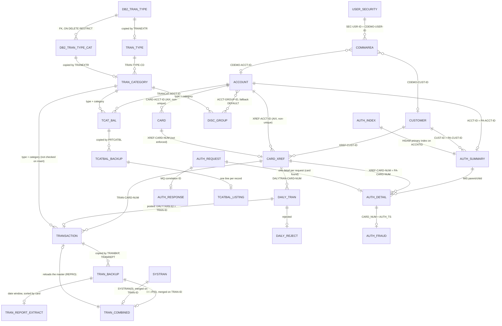

# CardDemo entity catalog

Built from the copybooks, the IDCAMS definitions in `app/jcl/` and the CICS file definitions in `app/csd/CARDDEMO.CSD`, at commit b5e0139. It holds the entities of the pilot programs `COBIL00C` and `CBTRN02C`, ENT-CUSTOMER and ENT-CARD, and the proposals merged from areas a (sign-on and administration), b (accounts and cards), c (transactions), d1 (core batch), d2 (batch utilities), e (authorization module, IMS, Db2 and MQ), f (transaction type Db2 module and VSAM-MQ module) and g (jobs, procedures, CSD and schedules). Each `areas/<area>-entities.md` file records the commit that merged it. The entities of the other areas are added as they merge.

Conventions:

- **Pos** is the 1-based byte position in the record; **Len** is the length in bytes.
- **Type**: `text(n)` fixed-length characters, padded with spaces on the right; `digits(n)` unsigned numeric characters with leading zeros; `decimal(p,s)` signed zoned decimal with `p` digits of which `s` are decimals, sign folded into the last byte (see format.md glossary); `date-text` 10 characters `YYYY-MM-DD`; `ts-text` 26-character timestamp (layouts in ENT-TRANSACTION); `code(n)` text with a fixed set of values; `flag` one character, `Y` or `N`; `packed(p,s)` IBM packed decimal (`COMP-3`): two digits per byte, the last half-byte is the sign (`C` positive, `D` negative, `F` unsigned), a leading `0` half-byte pads an even `p`, length `floor(p/2)+1` bytes. Db2 columns give the SQL type, with the DCLGEN host variable in the PIC column. Message layouts say `zoned` for numeric characters with the sign folded into the last byte, and the export layouts write it `zoned(p,s)`, the same as `decimal(p,s)`. `bin-u(n)` is an unsigned binary integer of `n` bytes, big-endian (`PIC 9(1-4) COMP` is 2 bytes, `9(5-9)` 4 bytes, `9(10-18)` 8 bytes); `bin-s(n),s` a signed big-endian two's-complement integer of `n` bytes holding the value times 10^s (for `S9(10)V99 COMP`, the amount in cents; `S9(4) COMP` is `bin-s(2),0`). `edited(n)` is a numeric-edited text field of `n` characters (for example `+9(10).99`).
- Where a table gives **Pos** as a range (`1-2`), it is the first and last byte.
- Field names are the COBOL names, used verbatim in the specs (including the source's own spelling, `ACCT-EXPIRAION-DATE`).
- The files enforce no referential integrity; "relationships" below are what the programs look up.
- **Batch DD** names are the program's DD names. Where programs use different DD names for the same entity, or the same DD name for different datasets, the entry lists them by program.

## ER view

Each box is the entity of the same name with the prefix `ENT-` (`DB2_TRAN_TYPE_CAT` is ENT-DB2-TRAN-TYPE-CAT). The data stores enforce two relationships: the Db2 foreign key of ENT-DB2-TRAN-TYPE-CAT and the IMS parent/child link from ENT-AUTH-SUMMARY to ENT-AUTH-DETAIL (`app/app-authorization-ims-db2-mq/ims/DBPAUTP0.dbd:28-37`). The authorization segments, the fraud table and the authorization messages are local to the module: no base-application program reads them.

### Relationships merged from the areas

| From | To | Join fields | Cardinality | Evidence |
| :-- | :-- | :-- | :-- | :-- |
| ENT-COMMAREA | ENT-USER-SECURITY | `CDEMO-USER-ID` = `SEC-USR-ID` (upper case) | many sessions to 1 user; not enforced after sign-on | `app/cbl/COSGN00C.cbl:132-133, 215, 226` |
| ENT-COMMAREA-USER-ADMIN-EXT | ENT-USER-SECURITY | `CDEMO-CUnn-USR-SELECTED` = `SEC-USR-ID` | 0..1 to 1 | `app/cbl/COUSR00C.cbl:154`; `app/cbl/COUSR02C.cbl:99-103` |
| ENT-ADMIN-MENU-OPTIONS | programs | `CDEMO-ADMIN-OPT-PGMNAME` | 1 to 1 | `app/cpy/COADM02Y.cpy:26-53` |
| ENT-MAIN-MENU-OPTIONS | programs | `CDEMO-MENU-OPT-PGMNAME` | 1 to 1 | `app/cpy/COMEN02Y.cpy:25-90` |
| ENT-TRANSACTION | ENT-CARD-XREF | `TRAN-CARD-NUM` = `XREF-CARD-NUM` | many to one; enforced only at insert by transaction add (card looked up in the cross-reference) | `app/cbl/COTRN02C.cbl:193-230, 459` |
| ENT-TRANSACTION | ENT-TRAN-CATEGORY | (`TRAN-TYPE-CD`, `TRAN-CAT-CD`) = category key | many to one; not enforced by transaction add | `app/cbl/COTRN02C.cbl:322-337` |
| ENT-REPORT-JOB | ENT-TRANSACTION | start and end date against `TRAN-PROC-TS`(1:10) | one request selects many transactions | `app/cbl/CORPT00C.cbl:101-121`; `app/proc/TRANREPT.prc:40-46` |
| ENT-DATE-CHECK-RESULT | (caller) | returned in the third CALL parameter | one per call | `app/cbl/COTRN02C.cbl:389-427`; `app/cbl/CORPT00C.cbl:388-426` |
| ENT-ACCOUNT | ENT-DISC-GROUP | `ACCT-GROUP-ID` = `DIS-ACCT-GROUP-ID` (plus type and category from ENT-TCAT-BAL); fallback `DEFAULT` | many to many (group shared by accounts; one rate per type and category) | `app/cbl/CBACT04C.cbl:210-213, 416-461` |
| ENT-TCAT-BAL | ENT-DISC-GROUP | `TRANCAT-TYPE-CD`, `TRANCAT-CD` = `DIS-TRAN-TYPE-CD`, `DIS-TRAN-CAT-CD` | many to one per group | `app/cbl/CBACT04C.cbl:211-212` |
| ENT-TRANSACTION | ENT-TRAN-CATEGORY | `TRAN-TYPE-CD` + `TRAN-CAT-CD` | many to one | `app/cbl/CBTRN03C.cbl:191-195` |
| ENT-TRANSACTION | ENT-TRAN-TYPE | `TRAN-TYPE-CD` | many to one | `app/cbl/CBTRN03C.cbl:189-190` |
| ENT-DB2-TRAN-TYPE-CAT | ENT-DB2-TRAN-TYPE | `TRC_TYPE_CODE` = `TR_TYPE` (foreign key, ON DELETE RESTRICT) | many to one | `app/app-transaction-type-db2/ctl/DB2CREAT.ctl:96-99` |
| ENT-TTYP-MAINT-INPUT | ENT-DB2-TRAN-TYPE | `INPUT-REC-NUMBER` = `TR_TYPE` | each record names at most one row | `app/app-transaction-type-db2/cbl/COBTUPDT.cbl:145, 174, 203` |
| ENT-DB2-TRAN-TYPE | ENT-TRAN-TYPE | `TR_TYPE` = `TRAN-TYPE` (copy made by TRANEXTR, then REPRO) | one to one after a refresh | `app/app-transaction-type-db2/jcl/TRANEXTR.jcl:76-84` |
| ENT-DB2-TRAN-TYPE-CAT | ENT-TRAN-CATEGORY | (`TRC_TYPE_CODE`, `TRC_TYPE_CATEGORY`) = (`TRAN-TYPE-CD`, `TRAN-CAT-CD`) | one to one after a refresh | `app/app-transaction-type-db2/jcl/TRANEXTR.jcl:106-115` |
| ENT-MQ-ACCT-REQUEST | ENT-ACCOUNT | `WS-KEY` = `ACCT-ID` | zero or one | `app/app-vsam-mq/cbl/COACCT01.cbl:393-404` |
| ENT-MQ-ACCT-REPLY | ENT-ACCOUNT | fields copied from the account read | copy of one record | `app/app-vsam-mq/cbl/COACCT01.cbl:408-425` |
| ENT-STMT-TRAN | ENT-TRANSACTION | `TRNX-CARD-NUM` + `TRNX-ID` = `TRAN-CARD-NUM` + `TRAN-ID` (copy rebuilt by CREASTMT) | one to one after each rebuild | `app/jcl/CREASTMT.JCL:44-62` |
| ENT-EXPORT-RECORD | ENT-CUSTOMER, ENT-ACCOUNT, ENT-CARD-XREF, ENT-TRANSACTION, ENT-CARD | one export record per source record, type byte `C`, `A`, `X`, `T`, `D` | one to one | `app/cpy/CVEXPORT.cpy:9-100`; CBEXPORT SE-EXPT-001 |
| ENT-CARD | ENT-ACCOUNT | `CARD-ACCT-ID` = `ACCT-ID` | many cards to one account (alternate index `CARDAIX`, non-unique); no online account or card program follows it at run time (the card list compares the field while browsing) | `app/cpy/CVACT02Y.cpy:6`, `app/jcl/CARDFILE.jcl:83-92` |
| ENT-CARD | ENT-CARD-XREF | `CARD-NUM` = `XREF-CARD-NUM` | one to zero or one; not enforced (both are 16-byte primary keys; the sample holds the same 50 numbers in both) | `app/cpy/CVACT02Y.cpy:5`, `app/cpy/CVACT03Y.cpy:5` |
| ENT-CARD | ENT-CARD-XREF | `CARD-ACCT-ID` should equal `XREF-ACCT-ID` of the same card | redundant copy of the card-to-account link; card update can break it (DEF-CRDU-001, INV-030) | `app/cbl/COCRDUPC.cbl:1463`, `app/cpy/CVACT03Y.cpy:4-8` |
| ENT-ACCOUNT | ENT-CARD-XREF | `ACCT-ID` = `XREF-ACCT-ID` (path `CXACAIX`) | one to zero or more; account view and account update work only for accounts with exactly one cross-reference record (DEF-ACVW-003, DEF-ACVW-004, DEF-ACUP-012, INV-031) | `app/cbl/COACTVWC.cbl:727-768`, `app/cbl/COACTUPC.cbl:3654-3696`, `app/jcl/XREFFILE.jcl:72-75` |
| ENT-CARD-XREF | ENT-CUSTOMER | `XREF-CUST-ID` = `CUST-ID` | many to one; account view and account update read the customer of the cross-reference record found | `app/cbl/COACTVWC.cbl:739`, `app/cbl/COACTVWC.cbl:826-834`, `app/cbl/COACTUPC.cbl:3753-3761` |
| ENT-COMMAREA | ENT-ACCOUNT | `CDEMO-ACCT-ID` = `ACCT-ID` | session to zero or one current account | `app/cbl/COACTUPC.cbl:3805` |
| ENT-COMMAREA | ENT-CUSTOMER | `CDEMO-CUST-ID` = `CUST-ID` (account update also uses it as the key of the customer lock, SE-ACUP-005) | session to zero or one current customer | `app/cbl/COACTUPC.cbl:3806` |
| ENT-CUSTOMER | US state code list in `CSLKPCDY` (not an entity) | `CUST-ADDR-STATE-CD` | many to one; enforced only by account update (VAL-ACUP-024) | `app/cpy/CSLKPCDY.cpy:1013-1069` |
| ENT-CUSTOMER | State and ZIP prefix list in `CSLKPCDY` (not an entity) | `CUST-ADDR-STATE-CD` + first 2 characters of `CUST-ADDR-ZIP` | many to one; enforced only by account update (VAL-ACUP-034); the two lists disagree (INV-041) | `app/cpy/CSLKPCDY.cpy:1073-1313` |
| ENT-AUTH-SUMMARY | ENT-AUTH-DETAIL | IMS physical parent/child | 1 : 0..n | `app/app-authorization-ims-db2-mq/ims/DBPAUTP0.dbd:28-37` |
| ENT-ACCOUNT | ENT-AUTH-SUMMARY | `ACCT-ID` = `PA-ACCT-ID` (via `XREF-ACCT-ID`) | 1 : 0..1 | `app/app-authorization-ims-db2-mq/cbl/COPAUA0C.cbl:619-624, 801-806` |
| ENT-CUSTOMER | ENT-AUTH-SUMMARY | `CUST-ID` = `PA-CUST-ID` (via `XREF-CUST-ID`) | 1 : 0..n | `app/app-authorization-ims-db2-mq/cbl/COPAUA0C.cbl:806` |
| ENT-CARD-XREF | ENT-AUTH-DETAIL | `XREF-CARD-NUM` = `PA-CARD-NUM` | 1 : 0..n | `app/app-authorization-ims-db2-mq/cbl/COPAUA0C.cbl:475, 879` |
| ENT-AUTH-DETAIL | ENT-AUTH-FRAUD | `PA-CARD-NUM` = `CARD_NUM`, timestamp from `PA-AUTH-ORIG-DATE` + `PA-AUTH-TIME-9C` = `AUTH_TS` | 1 : 0..1 | `app/app-authorization-ims-db2-mq/cbl/COPAUS2C.cbl:103-113, 141-145, 226-227` |
| ENT-AUTH-REQUEST | ENT-AUTH-RESPONSE | MQ correlation ID | 1 : 1 intended, 1 : 0..1 as-is (a reply can be lost, COPAUA0C DEF-AUTH-008) | `app/app-authorization-ims-db2-mq/cbl/COPAUA0C.cbl:411-412, 745` |
| ENT-TRANSACTION | ENT-TRAN-BACKUP | whole record copied | one master state to one generation per TRANBKP, TRANREPT or report run | `app/jcl/TRANBKP.jcl:23-33`, `app/jcl/TRANREPT.jcl:23-33`, `app/proc/TRANREPT.prc:21-31` |
| ENT-TRAN-BACKUP (generation 0) + ENT-SYSTRAN (generation 0) | ENT-TRAN-COMBINED | merged on `TRAN-ID` | 1 + 1 inputs to 1 generation | `app/jcl/COMBTRAN.jcl:22-37` |
| ENT-TRAN-COMBINED | ENT-TRANSACTION | `TRAN-ID` (VSAM key) | one generation reloads the master | `app/jcl/COMBTRAN.jcl:41-48` |
| ENT-TRAN-BACKUP (new generation) | ENT-TRAN-REPORT-EXTRACT | `TRAN-PROC-TS` date window; sorted by `TRAN-CARD-NUM` | 1 to 1 per report run, subset | `app/jcl/TRANREPT.jcl:37-55` |
| ENT-TRANSACTION | ENT-STMT-TRAN | re-keyed: `TRAN-CARD-NUM` + `TRAN-ID` | 1 to 1 record, all records | `app/jcl/CREASTMT.JCL:44-61` |
| ENT-TCAT-BAL | ENT-TCATBAL-BACKUP | whole record copied | one file state to one generation per PRTCATBL run | `app/jcl/PRTCATBL.jcl:29-39` |
| ENT-TCATBAL-BACKUP | ENT-TCATBAL-LISTING | account + type + category order | 1 to 1 record | `app/jcl/PRTCATBL.jcl:43-63` |

## ENT-ACCOUNT · Credit card account

- **Copybook:** `app/cpy/CVACT01Y.cpy:4-17` (`ACCOUNT-RECORD`, 300 bytes)
- **Dataset:** `AWS.M2.CARDDEMO.ACCTDATA.VSAM.KSDS`, KSDS, `KEYS(11 0)`, `RECORDSIZE(300 300)` (`app/jcl/ACCTFILE.jcl:36-48`)
- **CICS file:** `ACCTDAT`, `RECOVERY(NONE)` (`app/csd/CARDDEMO.CSD:1-12`). **Batch DD:** `ACCTFILE`.
- **Primary key:** `ACCT-ID`.

| Field | Pos | Len | PIC | Type | Meaning |
| :-- | --: | --: | :-- | :-- | :-- |
| `ACCT-ID` | 1 | 11 | `9(11)` | digits(11) | Account number |
| `ACCT-ACTIVE-STATUS` | 12 | 1 | `X(01)` | text(1) | `Y` active, `N` inactive (all sample accounts are `Y`); not checked by the pilot programs. Account view shows it as stored; account update accepts only upper-case `Y` or `N` (VAL-ACUP-003, VAL-ACUP-004) |
| `ACCT-CURR-BAL` | 13 | 12 | `S9(10)V99` | decimal(12,2) | Current balance owed; positive = the cardholder owes money |
| `ACCT-CREDIT-LIMIT` | 25 | 12 | `S9(10)V99` | decimal(12,2) | Credit limit |
| `ACCT-CASH-CREDIT-LIMIT` | 37 | 12 | `S9(10)V99` | decimal(12,2) | Cash advance limit; copied to `PA-CASH-LIMIT` of ENT-AUTH-SUMMARY by COPAUA0C (`app/app-authorization-ims-db2-mq/cbl/COPAUA0C.cbl:811`) |
| `ACCT-OPEN-DATE` | 49 | 10 | `X(10)` | date-text | Date opened |
| `ACCT-EXPIRAION-DATE` | 59 | 10 | `X(10)` | date-text | Expiration date; transactions dated after it are rejected (POSTTRAN 103) |
| `ACCT-REISSUE-DATE` | 69 | 10 | `X(10)` | date-text | Reissue date |
| `ACCT-CURR-CYC-CREDIT` | 79 | 12 | `S9(10)V99` | decimal(12,2) | Sum of non-negative amounts posted this cycle; reset to zero by INTCALC for every account that has a category balance |
| `ACCT-CURR-CYC-DEBIT` | 91 | 12 | `S9(10)V99` | decimal(12,2) | Sum of negative amounts posted this cycle (stored negative); reset to zero by INTCALC like the cycle credit (`app/cbl/CBACT04C.cbl:351-356`) |
| `ACCT-ADDR-ZIP` | 103 | 10 | `X(10)` | text(10) | Billing ZIP code. Never shown online; every online account update overwrites it with the group ID (layout note below, DEF-ACUP-002) |
| `ACCT-GROUP-ID` | 113 | 10 | `X(10)` | text(10) | Disclosure (interest) group, the key into ENT-DISC-GROUP; blank in the sample, so INTCALC uses `DEFAULT` (`app/cbl/CBACT04C.cbl:210, 437-440`). Shown as `Account Group` by account view and account update, which read it here; account update rewrites it at position 103, so after an online save these bytes hold FILLER content the program does not set (DEF-ACUP-002, DEF-ACUP-020). Not validated by account update (BR-ACUP-108) |
| FILLER | 123 | 178 | `X(178)` | text | Unused |

Sample: account `00000000001`, balance 194.00, limit 2,020.00, cash limit 1,020.00, opened 2014-11-20, expires 2025-05-20, cycle credit and debit 0.00.

Online account view and update (COACTVWC, COACTUPC):

- **Writers' layout.** Account update does not rewrite the account through `CVACT01Y`: it rewrites from its own 300-byte layout `ACCT-UPDATE-RECORD`, which has no `ACCT-ADDR-ZIP`. Its `ACCT-UPDATE-GROUP-ID` is at positions 103-112 (the ZIP position of `CVACT01Y`) and its FILLER `X(188)` at 113-300, so a save overwrites the ZIP with the group ID and the `CVACT01Y` group ID position with FILLER content that the program does not set (`INITIALIZE` skips FILLER). Positions 1-102 match `CVACT01Y` (SE-ACUP-006, NUM-ACUP-010, DEF-ACUP-002, DEF-ACUP-020, Q-ACUP-001, Q-ACUP-010, INV-039; `app/cbl/COACTUPC.cbl:418-433, 3956, 4002, 4066-4068`, `app/cpy/CVACT01Y.cpy:4-17`).
- **Amounts.** Account view edits the five amount fields with `+ZZZ,ZZZ,ZZZ.99` (9 integer digits), so a tenth integer digit is not shown (DEF-ACVW-005, `app/cpy-bms/COACTVW.CPY:302, 314, 326, 332, 344`). Account update accepts any value `NUMVAL-C` can read, including negative values; more than 2 decimals are truncated and more than 10 integer digits lose their high-order digits. No relation between balance and limits is enforced, and the balance and cycle totals can be typed directly (VAL-ACUP-011, VAL-ACUP-012, DEF-ACUP-113, DEF-ACUP-114; `app/cbl/COACTUPC.cbl:1072-1140, 2180-2219`).
- **Dates.** When changed online, `ACCT-OPEN-DATE`, `ACCT-EXPIRAION-DATE` and `ACCT-REISSUE-DATE` must each be a real calendar date with year 1900-2099 (VAL-ACUP-005 to VAL-ACUP-009); no order between them is enforced. Account update rebuilds them as `YYYY-MM-DD` (INV-045; `app/cpy/CSUTLDPY.cpy:25-279`, `app/cbl/COACTUPC.cbl:1478-1507`).

Data observation: in all 50 sample accounts `ACCT-ADDR-ZIP` holds `A000000000` (the format of a disclosure group ID) and `ACCT-GROUP-ID` is blank (Q-ENT-001). The records match the account update layout `ACCT-UPDATE-RECORD` (group ID `A000000000` at position 103, spaces from 113), not `CVACT01Y`. Every reader that uses `CVACT01Y` (account view, INTCALC) sees a blank group ID, and account update's change detection counts every sample account as changed, because the blank group ID it read differs from what the screen returns (DEF-ACUP-122; `app/data/ASCII/acctdata.txt:1`).

Used by (copybook, `docs/inventory.md:301`): CBACT01C, CBACT04C, CBEXPORT, CBIMPORT, CBSTM03A, CBTRN01C, CBTRN02C, COACCT01, COACTUPC, COACTVWC, COBIL00C, COPAUA0C, COPAUS0C, COTRN02C. READACCT (CBACT01C) copies every field to the ENT-ACCT-EXTRACT files.

## ENT-CARD-XREF · Card to customer and account cross-reference

- **Copybook:** `app/cpy/CVACT03Y.cpy:4-8` (`CARD-XREF-RECORD`, 50 bytes)
- **Dataset:** `AWS.M2.CARDDEMO.CARDXREF.VSAM.KSDS`, `KEYS(16 0)`, `RECORDSIZE(50 50)` (`app/jcl/XREFFILE.jcl:39-51`)
- **Alternate index:** `AWS.M2.CARDDEMO.CARDXREF.VSAM.AIX`, `KEYS(11,25)` = `XREF-ACCT-ID`, **NONUNIQUEKEY**, path `...AIX.PATH` (`app/jcl/XREFFILE.jcl:72-92`)
- **CICS files:** `CCXREF` (by card), `CXACAIX` (path, by account; `app/csd/CARDDEMO.CSD:63-75`). In the authorization module, COPAUA0C reads `CCXREF` by card (`app/app-authorization-ims-db2-mq/cbl/COPAUA0C.cbl:477-485`) and COPAUS0C reads `CXACAIX` by account (`app/app-authorization-ims-db2-mq/cbl/COPAUS0C.cbl:817-826`).
- **Batch DD names by program:** `XREFFILE` in CBACT03C, CBACT04C, CBEXPORT, CBTRN01C and CBTRN02C; `CARDXREF` in CBTRN03C (`app/cbl/CBTRN03C.cbl:33`). CBACT04C reads by account through the path under DD `XREFFIL1` (`app/jcl/INTCALC.jcl:31-32`). CBIMPORT writes a new sequential copy under `XREFOUT`.
- **Primary key:** `XREF-CARD-NUM`. **Alternate key:** `XREF-ACCT-ID`, non-unique, but the AIX `RECORDSIZE(50,50)` leaves room for (50 - 5 - 11) / 16 = 2 card numbers per account; a third card for one account cannot be indexed, and what `BLDINDEX` in XREFFILE `STEP30` then does is not verified (XREFFILE DEF-JXREF-003, `app/jcl/XREFFILE.jcl:74-77, 97-102`). No program in the repository adds records to the cross-reference KSDS (CBIMPORT writes a sequential copy under `XREFOUT`, `app/cbl/CBIMPORT.cbl:369`), so the `UPGRADE` path is not exercised today; a target that adds cards online has to keep this limit or lift it. The sample has one card per account. CBACT04C reads by `XREF-ACCT-ID` although its `SELECT` does not say `WITH DUPLICATES`; on z/OS a second card for an account is expected to make INTCALC abend (CBACT04C DEF-INTC-007, `app/cbl/CBACT04C.cbl:34-39, 394-414`).

| Field | Pos | Len | PIC | Type | Meaning |
| :-- | --: | --: | :-- | :-- | :-- |
| `XREF-CARD-NUM` | 1 | 16 | `X(16)` | text(16) | Card number (PAN); sensitive |
| `XREF-CUST-ID` | 17 | 9 | `9(09)` | digits(9) | Customer number |
| `XREF-ACCT-ID` | 26 | 11 | `9(11)` | digits(11) | Account number |
| FILLER | 37 | 14 | `X(14)` | text | Unused |

*Sample data note:* `app/data/ASCII/cardxref.txt` has 36-byte lines (no FILLER); the loader pads them to 50 bytes. Only bytes 1-36 are used by any program. `app/data/ASCII/tcatbal.txt` mixes line endings (49 CRLF lines, 1 LF line); a target data loader must strip both.

Sample: 50 records, one card per account. `XREF-CUST-ID` equals `XREF-ACCT-ID` numerically in every record (customer n owns account n; `app/data/ASCII/cardxref.txt:1-50`).

Online reads by account: account view reads `CXACAIX` with a keyed READ by account and takes that record's card and customer. For an account with several cards the READ through the non-unique path returns DUPKEY, which account view treats as an error (DEF-ACVW-003); an account with no card gives "not found" (DEF-ACVW-004). Account update reads it the same way and fails the same way, so such accounts cannot be updated online (SE-ACUP-001, DEF-ACUP-012, INV-031). The pending authorization summary reads it the same way, so their authorizations cannot be listed online (COPAUS0C DEF-AUSM-010; DUPKEY behaviour platform-inferred, the sample has one card per account; `app/cbl/COACTVWC.cbl:727-768`, `app/cbl/COACTUPC.cbl:3654-3696`).

## ENT-CUSTOMER · Customer

- **Copybooks:** `app/cpy/CVCUS01Y.cpy:4-23` and `app/cpy/CUSTREC.cpy:4-23` (`CUSTOMER-RECORD`, 500 bytes). The two layouts are identical except for the name of the date-of-birth field: `CUST-DOB-YYYY-MM-DD` in CVCUS01Y, `CUST-DOB-YYYYMMDD` in CUSTREC. Both are `X(10)` at position 309, and the sample data holds `YYYY-MM-DD` with dashes, so the CUSTREC name describes the content wrongly. Specs use the name from the copybook their program copies. CUSTREC is also indented with tab characters, which does not change the layout.
- **Dataset:** `AWS.M2.CARDDEMO.CUSTDATA.VSAM.KSDS`, KSDS, `KEYS(9 0)`, `RECORDSIZE(500 500)` (`app/jcl/CUSTFILE.jcl:46-59`). No alternate index. Job DEFCUST defines an unrelated cluster `AWS.CUSTDATA.CLUSTER` with a 10-byte key; it is not this file and nothing uses it (DEFCUST DEF-JDCUST-002, `app/jcl/DEFCUST.jcl:32-47`).
- **CICS file:** `CUSTDAT`, `RECOVERY(NONE)` (`app/csd/CARDDEMO.CSD:50-62`). **Batch DD:** `CUSTFILE` (`app/jcl/READCUST.jcl:24`, `app/jcl/CBEXPORT.jcl:49`; also CBTRN01C and CBSTM03A).
- **Primary key:** `CUST-ID`.

| Field | Pos | Len | PIC | Type | Meaning |
| :-- | --: | --: | :-- | :-- | :-- |
| `CUST-ID` | 1 | 9 | `9(09)` | digits(9) | Customer number |
| `CUST-FIRST-NAME` | 10 | 25 | `X(25)` | text(25) | First name |
| `CUST-MIDDLE-NAME` | 35 | 25 | `X(25)` | text(25) | Middle name |
| `CUST-LAST-NAME` | 60 | 25 | `X(25)` | text(25) | Last name |
| `CUST-ADDR-LINE-1` | 85 | 50 | `X(50)` | text(50) | Address line 1 |
| `CUST-ADDR-LINE-2` | 135 | 50 | `X(50)` | text(50) | Address line 2 |
| `CUST-ADDR-LINE-3` | 185 | 50 | `X(50)` | text(50) | Address line 3 (holds the city in the sample data); labelled `City` online |
| `CUST-ADDR-STATE-CD` | 235 | 2 | `X(02)` | text(2) | State code; online, one of 56 codes in `CSLKPCDY` |
| `CUST-ADDR-COUNTRY-CD` | 237 | 3 | `X(03)` | text(3) | Country code |
| `CUST-ADDR-ZIP` | 240 | 10 | `X(10)` | text(10) | ZIP code, 5 characters or ZIP+4 with a dash; online only the first 5 are shown and saved (DEF-ACUP-003, INV-044) |
| `CUST-PHONE-NUM-1` | 250 | 15 | `X(15)` | text(15) | Phone 1, `(nnn)nnn-nnnn` in the sample data |
| `CUST-PHONE-NUM-2` | 265 | 15 | `X(15)` | text(15) | Phone 2, same format and online rules as phone 1 |
| `CUST-SSN` | 280 | 9 | `9(09)` | digits(9) | Social security number; sensitive. Account view shows it in full as `nnn-nn-nnnn` (DEF-ACVW-010) |
| `CUST-GOVT-ISSUED-ID` | 289 | 20 | `X(20)` | text(20) | Government ID; sensitive |
| `CUST-DOB-YYYY-MM-DD` (CUSTREC: `CUST-DOB-YYYYMMDD`) | 309 | 10 | `X(10)` | date-text | Date of birth; sensitive |
| `CUST-EFT-ACCOUNT-ID` | 319 | 10 | `X(10)` | text(10) | Bank account for electronic payments; sensitive |
| `CUST-PRI-CARD-HOLDER-IND` | 329 | 1 | `X(01)` | text(1) | `Y` primary card holder |
| `CUST-FICO-CREDIT-SCORE` | 330 | 3 | `9(03)` | digits(3) | FICO score |
| FILLER | 333 | 168 | `X(168)` | text | Unused |

Sample (`app/data/ASCII/custdata.txt`): 50 records, IDs `000000001`-`000000050` in key order, all with country `USA`, primary holder `Y`, all fields filled. ZIP is 5 characters in 20 records and 10 in 30. FICO scores range from 001 to 793. Every customer appears in exactly one ENT-CARD-XREF record.

Online account view and update (COACTVWC, COACTUPC):

- **Display.** Account view shows the first 5 of the 10 ZIP characters, so ZIP+4 values such as `19852-6716` (customer 3) are cut, and the first 13 of the 15 characters of each phone number (`app/cpy-bms/COACTVW.CPY:410, 428, 440`, `app/data/ASCII/custdata.txt:3`).
- **Edits.** Account update rules: first and last name required, letters and spaces only; middle name optional, same characters (VAL-ACUP-019 to VAL-ACUP-021); address line 1 required (VAL-ACUP-022); city (line 3) required, letters and spaces only (VAL-ACUP-026); state one of 56 upper-case US state and territory codes (VAL-ACUP-023, VAL-ACUP-024); ZIP 5 digits, not zero, whose first two digits are allowed for the state (VAL-ACUP-025, VAL-ACUP-034); country required, letters only, no list (VAL-ACUP-027); phones optional when all parts are empty, otherwise area code (positions 2-4) in the general-purpose list and prefix (6-8) and line number (10-13) numeric and not zero (VAL-ACUP-028 to VAL-ACUP-031); SSN in parts 3-2-4, each numeric and not zero, part 1 not 666 and not 900-999 (VAL-ACUP-013 to VAL-ACUP-016); date of birth a real date, year 1900-2099, before today (VAL-ACUP-010); EFT account 10 digits, not zero (VAL-ACUP-032); primary card holder `Y` or `N` (VAL-ACUP-033); FICO score 300-850 (VAL-ACUP-017, VAL-ACUP-018). Customer ID, address line 2 and government ID are not validated (BR-ACUP-108). (`app/cbl/COACTUPC.cbl:1533-1662, 2225-2557`, `app/cpy/CSLKPCDY.cpy:1013-1069`.)
- **Writers' layout.** Account update rewrites the customer from its own 500-byte layout `CUST-UPDATE-RECORD` (field positions as `CVCUS01Y`), built from scratch from the screen values, including the protected customer ID and the unedited government ID and address line 2 (SE-ACUP-007, DEF-ACUP-013). Its FILLER content is not set by the program (DEF-ACUP-020). It writes each phone as `(aaa)bbb-cccc` followed by 2 spaces, only 5 ZIP characters (DEF-ACUP-003) and the date of birth as `YYYY-MM-DD` (`app/cbl/COACTUPC.cbl:434-456, 4007-4059`).
- **Sample against the edits.** None of the 50 sample customers passes every account update edit (state and ZIP prefix mismatch 44, phone 1 area code 26, phone 2 area code 25, FICO below 300 for 21, state code 5 (`FM`, `MH`, `PW`, `AP`), SSN 4 (one starting `666`, three starting `9`), last name `O'Connell` 1), so no sample account can be saved online (DEF-ACUP-112, INV-038; `app/data/ASCII/custdata.txt:1-50`, `app/cpy/CSLKPCDY.cpy:1073-1313`).

Used by: CVCUS01Y (`docs/inventory.md:305`): CBCUS01C, CBEXPORT, CBIMPORT, CBTRN01C, COACTUPC, COACTVWC, COCRDSLC, COCRDUPC, COPAUA0C, COPAUS0C. CUSTREC (`docs/inventory.md:300`): CBSTM03A.

Authorization module: COPAUS0C displays `CUST-FIRST-NAME`, `CUST-MIDDLE-NAME`, `CUST-LAST-NAME`, `CUST-ADDR-LINE-1` to `-3`, `CUST-ADDR-STATE-CD`, `CUST-ADDR-ZIP` and `CUST-PHONE-NUM-1`; COPAUA0C reads the record only to check that it exists. The module does not read ENT-CARD.

Exposure: READCUST prints `CUST-SSN`, `CUST-GOVT-ISSUED-ID` and `CUST-DOB-YYYY-MM-DD` in full (CBCUS01C DEF-CURD-001, `app/cbl/CBCUS01C.cbl:78`). CBEXPORT copies every field in clear into ENT-EXPORT-RECORD, and CBSTM03A passes whole records through ENT-STMT-REQUEST.

## ENT-CARD · Credit card

- **Copybook:** `app/cpy/CVACT02Y.cpy:4-11` (`CARD-RECORD`, 150 bytes)
- **Dataset:** `AWS.M2.CARDDEMO.CARDDATA.VSAM.KSDS`, KSDS, `KEYS(16 0)`, `RECORDSIZE(150 150)` (`app/jcl/CARDFILE.jcl:50-63`)
- **Alternate index:** `AWS.M2.CARDDEMO.CARDDATA.VSAM.AIX`, `KEYS(11 16)` = `CARD-ACCT-ID`, **NONUNIQUEKEY**, `UPGRADE` (`app/jcl/CARDFILE.jcl:83-92`), path `...AIX.PATH` (`app/jcl/CARDFILE.jcl:100-102`)
- **CICS files:** `CARDDAT` (by card, `app/csd/CARDDEMO.CSD:25-36`), `CARDAIX` (path, by account, `app/csd/CARDDEMO.CSD:13-24`), both `RECOVERY(NONE)`, `UPDATEMODEL(LOCKING)` and `READINTEG(UNCOMMITTED)`. No online program reads `CARDAIX` at run time: card view reads by account only in a paragraph that is never performed (SE-CRDV-002, `app/cbl/COCRDSLC.cbl:779-791`). **Batch DD:** `CARDFILE` (`app/jcl/READCARD.jcl:25`, `app/jcl/CBEXPORT.jcl:57`; also CBTRN01C).
- **Primary key:** `CARD-NUM`. **Alternate key:** `CARD-ACCT-ID`, non-unique; the AIX `RECORDSIZE(150,150)` leaves room for (150 - 5 - 11) / 16 = 8 card numbers per account, and what happens to a ninth card is not verified (CARDFILE DEF-JCARD-004, `app/jcl/CARDFILE.jcl:85-88`).

| Field | Pos | Len | PIC | Type | Meaning |
| :-- | --: | --: | :-- | :-- | :-- |
| `CARD-NUM` | 1 | 16 | `X(16)` | text(16) | Card number (PAN); sensitive |
| `CARD-ACCT-ID` | 17 | 11 | `9(11)` | digits(11) | Account the card belongs to, ENT-ACCOUNT; card update can change it (below) |
| `CARD-CVV-CD` | 28 | 3 | `9(03)` | digits(3) | Card verification value; sensitive. Never shown online; card update writes `000` on every save (DEF-CRDU-002) |
| `CARD-EMBOSSED-NAME` | 31 | 50 | `X(50)` | text(50) | Name printed on the card; card update upper-cases it (a-z only) after every read and saves what is on the screen (BR-CRDU-008, DEF-CRDU-008) |
| `CARD-EXPIRAION-DATE` | 81 | 10 | `X(10)` | date-text | Expiration date (the source's spelling), read by position. Card view shows month and year only; card update changes year and month, keeps the day it read and writes `YYYY-MM-DD` (DEF-CRDU-009) |
| `CARD-ACTIVE-STATUS` | 91 | 1 | `X(01)` | text(1) | `Y` active, `N` inactive; card update accepts only `Y` or `N`, card view and the card list show the stored value |
| FILLER | 92 | 59 | `X(59)` | text | Unused; spaces in the sample. Card update does not keep it on rewrite (below) |

Sample (`app/data/ASCII/carddata.txt`): 50 records in card-number order, one card per account, all active (`Y`), expiring between 2023-01-06 and 2025-12-28. Each card is in ENT-CARD-XREF with the same account number.

`CARD-ACCT-ID` duplicates `XREF-ACCT-ID` in ENT-CARD-XREF, and nothing keeps the two in step (INV-030). Which one each program uses is stated in its spec: account view uses `XREF-ACCT-ID` (through `CXACAIX`), the card list uses `CARD-ACCT-ID`, and card update is the only online program that writes either; it changes `CARD-ACCT-ID` only (`app/cbl/COACTVWC.cbl:727-735`, `app/cbl/COCRDLIC.cbl:1386`).

Online card list, view and update (COCRDLIC, COCRDSLC, COCRDUPC):

- The card list shows `CARD-ACCT-ID` and filters on it by exact comparison while browsing (BR-CRDL-003). Card view reads it but neither shows it nor checks it against the account typed (BR-CRDV-001, DEF-CRDV-001). Card update writes it from the account number on its screen, which on the menu path is any 11-digit account the user typed, so a save can move the card to another account, existing or not, without changing ENT-CARD-XREF (BR-CRDU-007, DEF-CRDU-001; `app/cbl/COCRDLIC.cbl:1385-1394`, `app/cbl/COCRDSLC.cbl:740-750`, `app/cbl/COCRDUPC.cbl:1463`).
- Card update overwrites `CARD-CVV-CD` from a work field that is never filled, through a `9(03)` redefinition, so it writes `000` (DEF-CRDU-002; `app/cbl/COCRDUPC.cbl:107-108, 306, 1464-1465`).
- `INITIALIZE` skips FILLER, so card update's rewrite stores in the record FILLER the 59 bytes at commarea positions 431-489, the FILLER of the card image in its extension (DEF-CRDU-003, INV-036; `app/cbl/COCRDUPC.cbl:314-321, 1461`).
- Card update reads the expiry by position (year 1-4, month 6-7, day 9-10) and writes year, `-`, month, `-`, day (`app/cbl/COCRDUPC.cbl:1361-1366, 1467-1474`); card view shows month and year (`app/cbl/COCRDSLC.cbl:477-482`).

Used by (`docs/inventory.md:302`): CBACT02C, CBEXPORT, CBIMPORT, CBTRN01C, COACTVWC, COCRDLIC, COCRDSLC, COCRDUPC, COPAUS0C, COTRTLIC.

Exposure: READCARD prints `CARD-CVV-CD` and the embossed name in full (CBACT02C DEF-CDRD-001, `app/cbl/CBACT02C.cbl:78`). CBEXPORT writes the CVV as plain binary into ENT-EXPORT-RECORD (type `D`).

## ENT-TRANSACTION · Posted transaction (transaction master)

- **Copybook:** `app/cpy/CVTRA05Y.cpy:4-18` (`TRAN-RECORD`, 350 bytes)
- **Dataset:** `AWS.M2.CARDDEMO.TRANSACT.VSAM.KSDS`, `KEYS(16 0)`, `RECORDSIZE(350 350)`, no `REUSE` (`app/jcl/TRANFILE.jcl:49-61`). Also defined, empty and without the alternate index, by TRANBKP `STEP10` with the same key and record size, `SHAREOPTIONS(2 3)` and `ERASE` (TRANBKP SE-JTBKP-004, `app/jcl/TRANBKP.jcl:54-67`). In the cycle the file holds only the latest cycle's transactions: TRANBKP empties it and COMBTRAN reloads it from the latest backup and the interest transactions (`app/jcl/COMBTRAN.jcl:22-48`, INV-053).
- **Alternate index:** `KEYS(26 304)` = `TRAN-PROC-TS`, non-unique, room for at most 19 transaction IDs per timestamp (`RECORDSIZE(350,350)`, TRANFILE DEF-JTRAN-006; `app/jcl/TRANFILE.jcl:82-87`). TRANBKP deletes it and does not redefine it, COMBTRAN does not rebuild it, and only TRANIDX and TRANFILE define it; no CICS file and no program uses it (DEF-JCSD-006, DEF-JTRAN-007, DEF-JTIDX-004; `app/jcl/TRANBKP.jcl:43-44`, `app/jcl/TRANIDX.jcl:22-55`).
- **CICS file:** `TRANSACT` (`app/csd/CARDDEMO.CSD:76-87`). Online writers: bill payment (`COBIL00C`) and transaction add (`COTRN02C`), both with ID = highest existing ID + 1 (INV-001). Online readers: list (`COTRN00C`, browse) and view (`COTRN01C`, read with update lock, never rewritten) (`app/cbl/COTRN02C.cbl:444-449, 711-721`; `app/cbl/COTRN00C.cbl:593-696`; `app/cbl/COTRN01C.cbl:267-278`).
- **Batch writers:** POSTTRAN (`CBTRN02C`) writes the KSDS; INTCALC (`CBACT04C`) writes the same layout to the sequential GDG `SYSTRAN(+1)` (ENT-SYSTRAN, `RECFM=F`, 350, `app/jcl/INTCALC.jcl:39`), which COMBTRAN merges into the KSDS.
- **Batch DD names by program** (each program's `SELECT ... ASSIGN TO`; the job decides which dataset is behind it): `TRANFILE` in CBTRN02C (POSTTRAN, the KSDS, `app/jcl/POSTTRAN.jcl:28-29`) and CBTRN01C (no JCL); `TRANSACT` in CBEXPORT (the KSDS, `app/jcl/CBEXPORT.jcl:55-56`). The same DD names also point at other datasets with this layout: `TRANFILE` in CBTRN03C reads the sorted daily extract `TRANSACT.DALY(+1)` (`app/jcl/TRANREPT.jcl:65-66`), and `TRANSACT` in CBACT04C writes a new sequential file of interest transactions `SYSTRAN(+1)` (`app/jcl/INTCALC.jcl:37-41`). Utility steps reach the KSDS under their own DD names: IDCAMS `TRANVSAM` in COMBTRAN (`app/jcl/COMBTRAN.jcl:45-46`), SORT `SORTIN` in CREASTMT (`app/jcl/CREASTMT.JCL:45`), and REPROC `PRC001.FILEIN` in TRANBKP (`app/jcl/TRANBKP.jcl:26-27`) and the TRANREPT procedure (`app/proc/TRANREPT.prc:24-25`); also IDCAMS `TRANVSAM` in TRANFILE (the seed load, `app/jcl/TRANFILE.jcl:71-74`) and REPROC `PRC001.FILEIN` in the TRANREPT batch member (`app/jcl/TRANREPT.jcl:26-27`); TRANIDX names the cluster in `BLDINDEX INDATASET`, without a DD (`app/jcl/TRANIDX.jcl:52-54`). Job specs name the dataset for each DD.
- **Primary key:** `TRAN-ID`.

| Field | Pos | Len | PIC | Type | Meaning |
| :-- | --: | --: | :-- | :-- | :-- |
| `TRAN-ID` | 1 | 16 | `X(16)` | text(16) | Transaction ID; numeric in practice (16 digits) |
| `TRAN-TYPE-CD` | 17 | 2 | `X(02)` | text(2) | Type code, ENT-TRAN-TYPE |
| `TRAN-CAT-CD` | 19 | 4 | `9(04)` | digits(4) | Category code within the type, ENT-TRAN-CATEGORY |
| `TRAN-SOURCE` | 23 | 10 | `X(10)` | text(10) | Channel (`POS TERM`, `OPERATOR`, ...) |
| `TRAN-DESC` | 33 | 100 | `X(100)` | text(100) | Description |
| `TRAN-AMT` | 133 | 11 | `S9(09)V99` | decimal(11,2) | Amount; positive increases the balance in POSTTRAN, but online bill payments store the payment as positive (COBIL00C DEF-BILL-010) |
| `TRAN-MERCHANT-ID` | 144 | 9 | `9(09)` | digits(9) | Merchant number |
| `TRAN-MERCHANT-NAME` | 153 | 50 | `X(50)` | text(50) | Merchant name |
| `TRAN-MERCHANT-CITY` | 203 | 50 | `X(50)` | text(50) | Merchant city |
| `TRAN-MERCHANT-ZIP` | 253 | 10 | `X(10)` | text(10) | Merchant ZIP |
| `TRAN-CARD-NUM` | 263 | 16 | `X(16)` | text(16) | Card number; sensitive |
| `TRAN-ORIG-TS` | 279 | 26 | `X(26)` | ts-text | When the transaction happened |
| `TRAN-PROC-TS` | 305 | 26 | `X(26)` | ts-text | When it was posted (POSTTRAN, INTCALC, bill payment); for transaction add, a date typed by the user, not a posting time. The report job selects on its first 10 characters (INV-010, `app/proc/TRANREPT.prc:40-46`) |
| FILLER | 331 | 20 | `X(20)` | text | Unused. Spaces in POSTTRAN records; bill payments and transaction add inherit it from the highest-ID record read just before, because `INITIALIZE` does not change FILLER (DEF-BILL-006, COTRN02C BR-TRNA-004) |

Timestamp layouts found in this field pair:

| Writer | Layout | Example |
| :-- | :-- | :-- |
| Daily input (`DALYTRAN-ORIG-TS`, copied by POSTTRAN) | `YYYY-MM-DD HH:MM:SS.ffffff` | `2022-06-10 19:27:53.000000` |
| POSTTRAN `TRAN-PROC-TS` | `YYYY-MM-DD-HH.MM.SS.hh0000` | `2022-07-06-12.00.00.770000` |
| Bill payment, both fields | `YYYY-MM-DD HH:MM:SS.000000` | `2026-11-05 14:03:12.000000` |
| INTCALC interest transactions, both fields (`app/cbl/CBACT04C.cbl:498-500, 615-628`) | `YYYY-MM-DD-HH.MM.SS.hh0000` | `2022-07-06-12.00.00.130000` |
| Transaction add (`COTRN02C`), both fields (`app/cbl/COTRN02C.cbl:354-381, 464-465`) | `YYYY-MM-DD` as typed and checked, then 16 spaces | `2022-07-06` + 16 spaces |

## ENT-DAILY-TRAN · Daily transaction (POSTTRAN input)

- **Copybook:** `app/cpy/CVTRA06Y.cpy:4-18` (`DALYTRAN-RECORD`, 350 bytes). Same layout as ENT-TRANSACTION with the prefix `DALYTRAN-`.
- **Dataset:** `AWS.M2.CARDDEMO.DALYTRAN.PS`, sequential, fixed 350. Sample `app/data/ASCII/dailytran.txt`: 300 records, types `01` (250, source `POS TERM`) and `03` (50, source `OPERATOR`), all category `0001`, all dated 2022-06-10, `DALYTRAN-PROC-TS` blank.

| Field | Pos | Len | Same as |
| :-- | --: | --: | :-- |
| `DALYTRAN-ID` | 1 | 16 | `TRAN-ID` |
| `DALYTRAN-TYPE-CD` | 17 | 2 | `TRAN-TYPE-CD` |
| `DALYTRAN-CAT-CD` | 19 | 4 | `TRAN-CAT-CD` |
| `DALYTRAN-SOURCE` | 23 | 10 | `TRAN-SOURCE` |
| `DALYTRAN-DESC` | 33 | 100 | `TRAN-DESC` |
| `DALYTRAN-AMT` | 133 | 11 | `TRAN-AMT` (decimal(11,2)) |
| `DALYTRAN-MERCHANT-ID` | 144 | 9 | `TRAN-MERCHANT-ID` |
| `DALYTRAN-MERCHANT-NAME` | 153 | 50 | `TRAN-MERCHANT-NAME` |
| `DALYTRAN-MERCHANT-CITY` | 203 | 50 | `TRAN-MERCHANT-CITY` |
| `DALYTRAN-MERCHANT-ZIP` | 253 | 10 | `TRAN-MERCHANT-ZIP` |
| `DALYTRAN-CARD-NUM` | 263 | 16 | `TRAN-CARD-NUM` |
| `DALYTRAN-ORIG-TS` | 279 | 26 | `TRAN-ORIG-TS` |
| `DALYTRAN-PROC-TS` | 305 | 26 | `TRAN-PROC-TS` (not used for posting by POSTTRAN; copied into reject records) |
| FILLER | 331 | 20 | FILLER |

## ENT-DAILY-REJECT · Rejected daily transaction

- **Defined in:** `app/cbl/CBTRN02C.cbl:176-182` (no copybook). **Dataset:** `AWS.M2.CARDDEMO.DALYREJS(+1)`, GDG `LIMIT(5) SCRATCH` (`app/jcl/DALYREJS.jcl:24-28`; the catalog confirms `SCRATCH`, `app/catlg/LISTCAT.txt:684-690`; the base is defined only by job DALYREJS, not by DEFGDGB, and the README initialisation tables do not list that job, DEF-JGDGB-004, DEF-JREJS-001), fixed 430, allocated `DISP=(NEW,CATLG,DELETE)` (`app/jcl/POSTTRAN.jcl:34-38`).

| Field | Pos | Len | Type | Meaning |
| :-- | --: | --: | :-- | :-- |
| `REJECT-TRAN-DATA` | 1 | 350 | ENT-DAILY-TRAN | The input record as read |
| `WS-VALIDATION-FAIL-REASON` | 351 | 4 | digits(4) | 100, 101, 102 or 103 |
| `WS-VALIDATION-FAIL-REASON-DESC` | 355 | 76 | text(76) | Reason text |

Reason codes: 100 `INVALID CARD NUMBER FOUND`, 101 `ACCOUNT RECORD NOT FOUND`, 102 `OVERLIMIT TRANSACTION`, 103 `TRANSACTION RECEIVED AFTER ACCT EXPIRATION`. (109 exists in the code but never reaches the file.)

## ENT-TCAT-BAL · Balance per account, transaction type and category

- **Copybook:** `app/cpy/CVTRA01Y.cpy:4-10` (`TRAN-CAT-BAL-RECORD`, 50 bytes)
- **Dataset:** `AWS.M2.CARDDEMO.TCATBALF.VSAM.KSDS`, `KEYS(17 0)`, `RECORDSIZE(50 50)` (`app/jcl/TCATBALF.jcl:36-48`). **Batch DD:** `TCATBALF`. Not defined in CICS. Unloaded to ENT-TCATBAL-BACKUP by PRTCATBL (`app/jcl/PRTCATBL.jcl:29-39`). The TCATBALF job replaces the whole file with `TCATBALF.PS`, which discards every balance accumulated by POSTTRAN since that file was written (TCATBALF DEF-JTCAT-002, `app/jcl/TCATBALF.jcl:54-62`).
- **Primary key:** `TRAN-CAT-KEY` = `TRANCAT-ACCT-ID` + `TRANCAT-TYPE-CD` + `TRANCAT-CD`.

| Field | Pos | Len | PIC | Type | Meaning |
| :-- | --: | --: | :-- | :-- | :-- |
| `TRANCAT-ACCT-ID` | 1 | 11 | `9(11)` | digits(11) | Account |
| `TRANCAT-TYPE-CD` | 12 | 2 | `X(02)` | text(2) | Transaction type |
| `TRANCAT-CD` | 14 | 4 | `9(04)` | digits(4) | Category |
| `TRAN-CAT-BAL` | 18 | 11 | `S9(09)V99` | decimal(11,2) | Balance for this category (interest base for INTCALC). INTCALC reads it but never resets it, so it keeps growing across cycles (`app/cbl/CBACT04C.cbl:28-32, 463-469`) |
| FILLER | 29 | 22 | `X(22)` | text | Unused; 22 zeros in the sample data |

Sample: 50 records, one per account, type `01` category `0001`. POSTTRAN on the sample day adds 50 records for type `03` category `0001`.

## ENT-TRAN-TYPE and ENT-TRAN-CATEGORY · Reference codes

- **Copybooks:** `app/cpy/CVTRA03Y.cpy:4-7` (`TRAN-TYPE-RECORD`, 60 bytes) and `app/cpy/CVTRA04Y.cpy:4-9` (`TRAN-CAT-RECORD`, 60 bytes).
- **Datasets:** `AWS.M2.CARDDEMO.TRANTYPE.VSAM.KSDS`, `KEYS(2 0)`, and `AWS.M2.CARDDEMO.TRANCATG.VSAM.KSDS`, `KEYS(6 0)`, both `RECORDSIZE(60 60)`, loaded by REPRO from `TRANTYPE.PS` and `TRANCATG.PS` by the TRANTYPE and TRANCATG jobs (`app/jcl/TRANTYPE.jcl:36-61`, `app/jcl/TRANCATG.jcl:36-61`). The type file is defined with `SHAREOPTIONS(1 4)`, the category file with `SHAREOPTIONS(2 3)` like the other masters (TRANTYPE DEF-JTTYP-002); the weekly Db2 refresh rewrites the flat files but never reloads the KSDS (SCHED-CONTROLM DEF-JCTLM-005). Not defined in CICS. **Batch DD:** `TRANTYPE`, `TRANCATG` (CBTRN03C).
- **Where the data comes from:** the sample files `app/data/ASCII/trantype.txt` and `trancatg.txt`. In the transaction type (Db2) module, TRANEXTR unloads ENT-DB2-TRAN-TYPE and ENT-DB2-TRAN-TYPE-CAT into the same `.PS` datasets; no scheduler runs the TRANTYPE and TRANCATG jobs after it (INV-019, `app/app-transaction-type-db2/jcl/TRANEXTR.jcl:76-84, 106-115`).
- **Readers:** TRANREPT (`CBTRN03C`) reads both by key for the report descriptions; a missing code abends it (INV-016, `app/cbl/CBTRN03C.cbl:495-513`). Neither pilot program nor transaction add (`COTRN02C`) reads them; transaction add accepts any 2-digit type and 4-digit category without a lookup (`app/cbl/COTRN02C.cbl:322-337, 452-453`).

| Field | Pos | Len | PIC | Type | Meaning |
| :-- | --: | --: | :-- | :-- | :-- |
| `TRAN-TYPE` | 1 | 2 | `X(02)` | text(2) | Type code, the key |
| `TRAN-TYPE-DESC` | 3 | 50 | `X(50)` | text(50) | Description |
| FILLER | 53 | 8 | `X(08)` | text | `00000000` in the sample and in TRANEXTR output |

| Field | Pos | Len | PIC | Type | Meaning |
| :-- | --: | --: | :-- | :-- | :-- |
| `TRAN-TYPE-CD` | 1 | 2 | `X(02)` | text(2) | Type code, first part of the key `TRAN-CAT-KEY` |
| `TRAN-CAT-CD` | 3 | 4 | `9(04)` | digits(4) | Category within the type, second part of the key |
| `TRAN-CAT-TYPE-DESC` | 7 | 50 | `X(50)` | text(50) | Description |
| FILLER | 57 | 4 | `X(04)` | text | `0000` in the sample and in TRANEXTR output |

The codes in the sample data (the pilots write `01`, `02`/`0002` and `03`):

| Type | Description | Categories (code: description) |
| :-- | :-- | :-- |
| `01` | Purchase | 0001 Regular Sales Draft, 0002 Regular Cash Advance, 0003 Convenience Check Debit, 0004 ATM Cash Advance, 0005 Interest Amount |
| `02` | Payment | 0001 Cash payment, **0002 Electronic payment** (written by bill payment), 0003 Check payment |
| `03` | Credit | 0001 Credit to Account, 0002 Credit to Purchase balance, 0003 Credit to Cash balance |
| `04` | Authorization | 0001-0003 |
| `05` | Refund | 0001 Refund credit |
| `06` | Reversal | 0001 Fraud reversal, 0002 Non-fraud reversal |
| `07` | Adjustment | 0001 Sales draft credit adjustment |

The Db2 seed has the same codes with upper-case descriptions and `06` = `REVERAL` (sic) (`app/app-transaction-type-db2/ctl/DB2LTTYP.ctl:17-23`); after TRANEXTR and a reload, the VSAM descriptions change accordingly.

## ENT-DISC-GROUP · Disclosure group (interest rate per group, type and category)

- **Copybook:** `app/cpy/CVTRA02Y.cpy:4-10` (`DIS-GROUP-RECORD`, 50 bytes)
- **Dataset:** `AWS.M2.CARDDEMO.DISCGRP.VSAM.KSDS`, KSDS, `KEYS(16 0)`, `RECORDSIZE(50 50)` (`app/jcl/DISCGRP.jcl:36-49`), loaded by REPRO from `AWS.M2.CARDDEMO.DISCGRP.PS` (`app/jcl/DISCGRP.jcl:54-62`). **Batch DD:** `DISCGRP` (INTCALC). Not defined in CICS.
- **Primary key:** `DIS-GROUP-KEY` = `DIS-ACCT-GROUP-ID` + `DIS-TRAN-TYPE-CD` + `DIS-TRAN-CAT-CD`.

| Field | Pos | Len | PIC | Type | Meaning |
| :-- | --: | --: | :-- | :-- | :-- |
| `DIS-ACCT-GROUP-ID` | 1 | 10 | `X(10)` | text(10) | Disclosure group; matched against `ENT-ACCOUNT.ACCT-GROUP-ID`; `DEFAULT` is the fallback group |
| `DIS-TRAN-TYPE-CD` | 11 | 2 | `X(02)` | text(2) | Transaction type (ENT-TRAN-TYPE) |
| `DIS-TRAN-CAT-CD` | 13 | 4 | `9(04)` | digits(4) | Category within the type (ENT-TRAN-CATEGORY) |
| `DIS-INT-RATE` | 17 | 6 | `S9(04)V99` | decimal(6,2) | Annual interest rate in percent (`00150{` = 15.00); INTCALC charges balance × rate / 1200 per month |
| FILLER | 23 | 28 | `X(28)` | text | Unused; 28 zeros in the sample data |

Sample `app/data/ASCII/discgrp.txt`: 51 records, three groups with the same 17 type and category keys each (`01`/0001-0004, `02`/0001-0003, `03`/0001-0003, `04`/0001-0003, `05`/0001, `06`/0001-0002, `07`/0001).

| Group | Rates |
| :-- | :-- |
| `A000000000` | 15.00 for 01/0001, 04/*, 05/0001, 06/*, 07/0001; 25.00 for 01/0002-0004; 0.00 for types 02 and 03 |
| `DEFAULT` | the same as `A000000000` except 07/0001 = 0.00 |
| `ZEROAPR` | 0.00 for every key |

Data observation: no sample account has a group in `ACCT-GROUP-ID` (Q-ENT-001), so INTCALC always uses `DEFAULT`; filling in `A000000000` changes nothing on the sample cycle (CBACT04C DEF-INTC-006).

## ENT-COMMAREA · Online session state

- **Copybook:** `app/cpy/COCOM01Y.cpy:19-44` (`CARDDEMO-COMMAREA`, 160 bytes). Programs append their own extension after position 160 (table below). A shorter commarea copied into a longer one leaves the extension filled with spaces, and the menus truncate longer ones to 160 bytes (`app/cbl/COUSR00C.cbl:114`, `app/cbl/COADM01C.cbl:90`).
- **Initialisation:** sign-on sets only the from-fields, the user ID, the user type and the context; the other fields are passed on uninitialised (COSGN00C DEF-SGN-007, `app/cbl/COSGN00C.cbl:224-228`).

| Field | Pos | Len | Type | Meaning |
| :-- | --: | --: | :-- | :-- |
| `CDEMO-FROM-TRANID` | 1 | 4 | text | Transaction that transferred here |
| `CDEMO-FROM-PROGRAM` | 5 | 8 | text | Program that transferred here (PF3 target) |
| `CDEMO-TO-TRANID` | 13 | 4 | text | Target transaction |
| `CDEMO-TO-PROGRAM` | 17 | 8 | text | Target program for XCTL |
| `CDEMO-USER-ID` | 25 | 8 | text | Signed-on user, upper-cased by sign-on; the only identity in the online application (no CICS sign-on, `app/cbl/COSGN00C.cbl:132-133, 226`). Blank when the card list starts without a commarea, and cleared with the whole base commarea when the card list is re-entered with PF3 from card view or card update (DEF-CRDL-005, `app/cbl/COCRDLIC.cbl:315-325, 458-469`) |
| `CDEMO-USER-TYPE` | 33 | 1 | text | `A` admin, `U` regular user. Set by sign-on from `SEC-USR-TYPE`. The five account and card programs overwrite it with `U` on every transfer of control, whatever the signed-on user's type, and the card list also when it starts without a commarea; none of them tests it (DEF-CRDV-004, DEF-ACVW-011, DEF-ACUP-009, DEF-CRDL-004, DEF-CRDU-007). The Db2 transaction type programs force `A` when they start without a commarea (DEF-SGN-012, INV-006). Any value other than `A` is routed as a regular user (`app/cbl/COCRDLIC.cbl:320, 388, 466, 522, 550`, `app/cbl/COCRDSLC.cbl:326`, `app/cbl/COACTVWC.cbl:344`, `app/cbl/COACTUPC.cbl:947`, `app/cbl/COCRDUPC.cbl:464`) |
| `CDEMO-PGM-CONTEXT` | 34 | 1 | digits(1) | 0 first entry, 1 re-entry. Card view ends the conversation with the plain text `UNEXPECTED DATA SCENARIO` for any other value (FLOW-CRDV-014); the card list never sets 1 and recognises its own re-entry by `CDEMO-FROM-PROGRAM` = `COCRDLIC` (INV-028, `app/cbl/COCRDSLC.cbl:373-380`, `app/cbl/COCRDLIC.cbl:336-343, 604-608`) |
| `CDEMO-CUST-ID` | 35 | 9 | digits | Selected customer |
| `CDEMO-CUST-FNAME`, `-MNAME`, `-LNAME` | 44, 69, 94 | 25 each | text | Customer name |
| `CDEMO-ACCT-ID` | 119 | 11 | digits | Selected account |
| `CDEMO-ACCT-STATUS` | 130 | 1 | text | Its status |
| `CDEMO-CARD-NUM` | 131 | 16 | digits | Selected card (full card number, sensitive) |
| `CDEMO-LAST-MAP`, `-LAST-MAPSET` | 147, 154 | 7 each | text | Last screen shown: the map and mapset of the program that last transferred control, set just before XCTL (the card list sets `CCRDLIA`/`COCRDLI`, card view `CCRDSLA`/`COCRDSL` on PF3). Card view treats `COCRDLI` together with from-program `COCRDLIC` as "called from the card list" and protects its search fields (BR-CRDV-003); card update tests only `CDEMO-FROM-PROGRAM` (`app/cbl/COCRDLIC.cbl:524-525`, `app/cbl/COCRDSLC.cbl:328-329, 505-512`, `app/cbl/COCRDUPC.cbl:482-485`) |

Selected account, customer and card (`CDEMO-ACCT-ID`, `CDEMO-CUST-ID`, `CDEMO-CARD-NUM`) in the account and card programs (INV-033): account view sets the account from the number typed (0 when invalid) and customer and card from the cross-reference record found; after a failed lookup the customer and card keep the previous values (BR-ACVW-005, DEF-ACVW-018). The card list sets account and card from its filter fields on each re-entry (0 when blank or invalid) and from the selected row before it transfers to card view or card update. Card view and card update read them only when entered from the card list; card view looks the card up by `CDEMO-CARD-NUM` only. Card update zeroes account and card when it returns to the list. Account update sets account, customer, the three customer names, account status and card (the card of the cross-reference record found by account) after every successful fetch, and clears `CDEMO-ACCT-ID` when the user continues after a save attempt (FLOW-ACUP-007). (`app/cbl/COACTUPC.cbl:979-983, 3805-3811`, `app/cbl/COACTVWC.cbl:660, 675, 678, 739-740`, `app/cbl/COCRDLIC.cbl:531-534, 1024-1027`, `app/cbl/COCRDSLC.cbl:339-343`, `app/cbl/COCRDUPC.cbl:482-491`.)

Extensions by program:

| Programs | Extension | Positions | Layout |
| :-- | :-- | :-- | :-- |
| `COBIL00C` | `CDEMO-CB00-INFO` (`app/cbl/COBIL00C.cbl:64-72`) | 161-218 | `-TRNID-FIRST` (161, 16), `-TRNID-LAST` (177, 16), `-PAGE-NUM` (193, 8), `-NEXT-PAGE-FLG` (201, 1), `-TRN-SEL-FLG` (202, 1), `-TRN-SELECTED` (203, 16) |
| `COTRN00C`, `COTRN01C`, `COTRN02C` | `CDEMO-CT00-INFO` (`app/cbl/COTRN00C.cbl:62-70`), `CDEMO-CT01-INFO` (`app/cbl/COTRN01C.cbl:53-61`), `CDEMO-CT02-INFO` (`app/cbl/COTRN02C.cbl:72-80`) | 161-218 | The same layout as `CDEMO-CB00-INFO`, under each program's prefix |
| `COUSR00C`, `COUSR02C`, `COUSR03C` | `CDEMO-CU00-INFO`, `CDEMO-CU02-INFO`, `CDEMO-CU03-INFO` | 161-194 | ENT-COMMAREA-USER-ADMIN-EXT |
| `COTRTLIC` | list state in a 2000-byte area (`app/app-transaction-type-db2/cbl/COTRTLIC.cbl:420`) | after 160 | Described in the COTRTLIC spec |
| `COTRTUPC` | screen state, old and new type | after 160 | Described in the COTRTUPC spec |
| `COACTVWC` | `WS-THIS-PROGCOMMAREA` (`app/cbl/COACTVWC.cbl:213-218`) | 161-172 | `CA-FROM-PROGRAM` (161, 8), `CA-FROM-TRANID` (169, 4); never set or tested |
| `COACTUPC` | `WS-THIS-PROGCOMMAREA` (`app/cbl/COACTUPC.cbl:652-669`) | 161-1033 | 873 bytes: the change state `ACUP-CHANGE-ACTION`, then `ACUP-OLD-DETAILS` (account and customer values as fetched, compared at save time) and `ACUP-NEW-DETAILS` (values received from the screen). Holds SSN, date of birth, government ID and EFT account in clear (FLOW-ACUP-002, DEF-ACUP-016) |
| `COCRDSLC` | own extension (`app/cbl/COCRDSLC.cbl:200-205`) | 161-172 | `CA-FROM-PROGRAM` (161, 8), `CA-FROM-TRANID` (169, 4); never set or tested |
| `COCRDLIC` | own extension (`app/cbl/COCRDLIC.cbl:229-262`) | 161-414 | Last card key of the page (card 161-176, account 177-187), first card key (card 188-203, account 204-214), page number 215 (one digit, wraps after 9, DEF-CRDL-010), "end of list reported" flag 216 (0 reported, 9 not), next-page indicator 217 (`Y` or low-values), unused flag 218, and the 7 displayed rows of 28 bytes (account 11, card 16, status 1) at 219-414 |
| `COCRDUPC` | `WS-THIS-PROGCOMMAREA` (`app/cbl/COCRDUPC.cbl:274-321`) | 161-489 | `CCUP-CHANGE-ACTION` (161, 1; space or low-values not fetched, `S` details shown, `E` changes not valid, `N` valid not confirmed, `C` done, `L` lock error, `F` failed), `CCUP-OLD-ACCTID` (162, 11), `CCUP-OLD-CARDID` (173, 16), `CCUP-OLD-CVV-CD` (189, 3, sensitive), `CCUP-OLD-CRDNAME` (192, 50), `CCUP-OLD-EXPYEAR` (242, 4), `-EXPMON` (246, 2), `-EXPDAY` (248, 2), `CCUP-OLD-CRDSTCD` (250, 1), `CCUP-NEW-DETAILS` (251-339, same layout with prefix `CCUP-NEW-`), `CARD-UPDATE-RECORD` (340-489, layout of ENT-CARD; its FILLER at 431-489 is what the rewrite stores in the card FILLER). Card number and CVV travel through the terminal in this area (DEF-CRDU-019) |
| `COSGN00C`, `COMEN01C`, `COADM01C`, `COUSR01C`, `CORPT00C` | none | - | 160 bytes |

Hand-overs through an extension (INV-008): the transaction list writes the selected transaction ID at 203-218 and the view reads it there under its own name (`app/cbl/COTRN00C.cbl:186-195`, `app/cbl/COTRN01C.cbl:99-109`); the user list writes the selected user at 187-194 for update and delete. The menus pass only 160 bytes, so a program started from a menu finds its extension filled with spaces. Transaction add would, on first entry, move a non-blank 203-218 into its card number field (`app/cbl/COTRN02C.cbl:124-129`); with only the menu calling it, this never happens.

The account and card programs hand over nothing through an extension (INV-026): COACTVWC, COACTUPC, COCRDLIC, COCRDSLC and COCRDUPC each return a 2000-byte area to themselves on RETURN TRANSID (base, own extension, spaces to 2000) and pass only the 160-byte base on XCTL. Each also reads its extension positions when entered with only 160 bytes (DEF-ACVW-015, DEF-ACUP-008, DEF-CRDL-012, DEF-CRDV-006, DEF-CRDU-004; `app/cbl/COACTVWC.cbl:397-406`, `app/cbl/COACTUPC.cbl:1007-1020`, `app/cbl/COCRDLIC.cbl:604-619`, `app/cbl/COCRDSLC.cbl:394-406`, `app/cbl/COCRDUPC.cbl:546-558`).

## ENT-COMMAREA-USER-ADMIN-EXT · User administration commarea extension

- **Defined in:** `app/cbl/COUSR00C.cbl:67-75` (`CDEMO-CU00-INFO`), `app/cbl/COUSR02C.cbl:50-58` (`CDEMO-CU02-INFO`), `app/cbl/COUSR03C.cbl:50-58` (`CDEMO-CU03-INFO`): three in-program copies with the same layout, appended to ENT-COMMAREA, so the user programs pass 194 bytes. `COUSR01C` has no extension (160 bytes).
- When a 160-byte commarea (from the admin menu) is copied into the 194-byte area, the extension is filled with spaces (group move; GnuCOBOL test). `COADM01C` truncates a 194-byte commarea to 160 bytes.

| Field | Pos | Len | PIC | Type | Meaning |
| :-- | --: | --: | :-- | :-- | :-- |
| `CDEMO-CUnn-USRID-FIRST` | 161 | 8 | `X(08)` | text(8) | User ID in row 1 of the list page shown (PF7 start key) |
| `CDEMO-CUnn-USRID-LAST` | 169 | 8 | `X(08)` | text(8) | User ID in row 10 of the list page shown (PF8 start key) |
| `CDEMO-CUnn-PAGE-NUM` | 177 | 8 | `9(08)` | digits(8) | List page number |
| `CDEMO-CUnn-NEXT-PAGE-FLG` | 185 | 1 | `X(01)` | flag | `Y` a next page exists, `N` not |
| `CDEMO-CUnn-USR-SEL-FLG` | 186 | 1 | `X(01)` | code(1) | Selection code typed in the list (`U`, `u`, `D`, `d`) |
| `CDEMO-CUnn-USR-SELECTED` | 187 | 8 | `X(08)` | text(8) | User ID selected in the list; read by update and delete on first entry |

## ENT-USER-SECURITY · User security record (sign-on credentials and user type)

- **Copybook:** `app/cpy/CSUSR01Y.cpy:17-23` (`SEC-USER-DATA`, 80 bytes).
- **Dataset:** `AWS.M2.CARDDEMO.USRSEC.VSAM.KSDS`, `KEYS(8,0)`, `RECORDSIZE(80,80)`, `REUSE`, `INDEXED`, `CISZ(8192)` (`app/jcl/DUSRSECJ.jcl:64-73`).
- **CICS file:** `USRSEC` (`app/csd/CARDDEMO.CSD:88-99`): `READ(YES) BROWSE(YES) ADD(YES) UPDATE(YES) DELETE(YES)`, `RECOVERY(NONE)` (no backout of online changes), `STRINGS(1)` (one concurrent request), `RECORDFORMAT(V)` although the cluster has fixed 80-byte records. Opened and closed around the batch cycle by `app/jcl/OPENFIL.jcl:30` and `app/jcl/CLOSEFIL.jcl:30`.
- **Primary key:** `SEC-USR-ID`, 8 bytes, unique. Key order is the EBCDIC byte order (lower case < upper case < digits).
- **Loaded by:** `app/jcl/DUSRSECJ.jcl`: IEBGENER copies 10 in-stream records to `AWS.M2.CARDDEMO.USRSEC.PS` (`app/jcl/DUSRSECJ.jcl:32-49`), IDCAMS deletes and defines the cluster (`app/jcl/DUSRSECJ.jcl:58-73`) and REPRO loads it (`app/jcl/DUSRSECJ.jcl:80-88`). Copies as ESDS and RRDS are made by `app/jcl/ESDSRRDS.jcl:63-116` (not used by any program in this area). No batch program reads the file.
- **Used by:** `COSGN00C` (read), `COUSR00C` (browse), `COUSR01C` (write), `COUSR02C` (read for update, rewrite), `COUSR03C` (read for update, delete). `COMEN01C` and `COADM01C` copy the layout but never use it.

| Field | Pos | Len | PIC | Type | Meaning |
| :-- | --: | --: | :-- | :-- | :-- |
| `SEC-USR-ID` | 1 | 8 | `X(08)` | text(8) | User ID, the key. Sign-on upper-cases the typed ID before the lookup; add, update and delete use it as typed |
| `SEC-USR-FNAME` | 9 | 20 | `X(20)` | text(20) | First name |
| `SEC-USR-LNAME` | 29 | 20 | `X(20)` | text(20) | Last name |
| `SEC-USR-PWD` | 49 | 8 | `X(08)` | text(8) | Password in **plain text**; compared with the upper-cased typed password at sign-on |
| `SEC-USR-TYPE` | 57 | 1 | `X(01)` | code(1) | `A` administrator (admin menu), anything else regular user (main menu); `U` by convention. Not validated on add or update |
| `SEC-USR-FILLER` | 58 | 23 | `X(23)` | text | Unused; written uninitialised by user add (DEF-USRA-004) |

Sample data (`app/jcl/DUSRSECJ.jcl:35-44`, public demo data): 10 users, `ADMIN001`-`ADMIN005` with type `A` and `USER0001`-`USER0005` with type `U`, all with password `PASSWORD`; names upper case (for example `ADMIN001` `MARGARET` `GOLD`, `USER0001` `LAWRENCE` `THOMAS`). The filler is spaces in the seed records.

Observations for the target:

- Credentials are case-insensitive in effect only when stored in upper case (BR-SGN-001, DEF-SGN-011); the maintenance programs do not enforce it (DEF-USRA-001, DEF-USRU-004).
- There is no audit data (created, changed, last sign-on), no status (locked, disabled), no password history and no attempt counter (DEF-SGN-002, Q-USRA-002, Q-USRD-003).
- User IDs are not referenced by any other file: transactions, accounts and cards carry no user ID.

## ENT-MAIN-MENU-OPTIONS · Main menu option table (compiled in)

- **Copybook:** `app/cpy/COMEN02Y.cpy:19-98` (`CARDDEMO-MAIN-MENU-OPTIONS`), working storage of `COMEN01C`; not a file.
- `CDEMO-MENU-OPT-COUNT` `9(02)` = 11 (`app/cpy/COMEN02Y.cpy:21`); the data area has 11 entries of 46 bytes, redefined by a table of **12** occurrences (`app/cpy/COMEN02Y.cpy:93-98`), so entry 12 overlays the storage after the table.

| Field | Pos (in entry) | Len | PIC | Type | Meaning |
| :-- | --: | --: | :-- | :-- | :-- |
| `CDEMO-MENU-OPT-NUM` | 1 | 2 | `9(02)` | digits(2) | Option number shown (`01`-`11`) |
| `CDEMO-MENU-OPT-NAME` | 3 | 35 | `X(35)` | text(35) | Option text |
| `CDEMO-MENU-OPT-PGMNAME` | 38 | 8 | `X(08)` | text(8) | Program reached by XCTL |
| `CDEMO-MENU-OPT-USRTYPE` | 46 | 1 | `X(01)` | code(1) | `A` = admin only, `U` = everyone; all 11 are `U` |

Content: 1 `Account View` `COACTVWC`, 2 `Account Update` `COACTUPC`, 3 `Credit Card List` `COCRDLIC`, 4 `Credit Card View` `COCRDSLC`, 5 `Credit Card Update` `COCRDUPC`, 6 `Transaction List` `COTRN00C`, 7 `Transaction View` `COTRN01C`, 8 `Transaction Add` `COTRN02C` (formerly `(Admin Only)`, commented out at `app/cpy/COMEN02Y.cpy:69`), 9 `Transaction Reports` `CORPT00C`, 10 `Bill Payment` `COBIL00C`, 11 `Pending Authorization View` `COPAUS0C` (optional authorisation module). See COMEN01C BR-MENU-001.

## ENT-ADMIN-MENU-OPTIONS · Admin menu option table (compiled in)

- **Copybook:** `app/cpy/COADM02Y.cpy:19-59` (`CARDDEMO-ADMIN-MENU-OPTIONS`), working storage of `COADM01C`; not a file.
- `CDEMO-ADMIN-OPT-COUNT` `9(02)` = 6 (`app/cpy/COADM02Y.cpy:22`; the earlier value 4 is commented out at `app/cpy/COADM02Y.cpy:21`); 6 entries of 45 bytes redefined by a table of **9** occurrences (`app/cpy/COADM02Y.cpy:55-59`). There is no user-type column.

| Field | Pos (in entry) | Len | PIC | Type | Meaning |
| :-- | --: | --: | :-- | :-- | :-- |
| `CDEMO-ADMIN-OPT-NUM` | 1 | 2 | `9(02)` | digits(2) | Option number shown (`01`-`06`) |
| `CDEMO-ADMIN-OPT-NAME` | 3 | 35 | `X(35)` | text(35) | Option text |
| `CDEMO-ADMIN-OPT-PGMNAME` | 38 | 8 | `X(08)` | text(8) | Program reached by XCTL |

Content: 1 `User List (Security)` `COUSR00C`, 2 `User Add (Security)` `COUSR01C`, 3 `User Update (Security)` `COUSR02C`, 4 `User Delete (Security)` `COUSR03C`, 5 `Transaction Type List/Update (Db2)` `COTRTLIC`, 6 `Transaction Type Maintenance (Db2)` `COTRTUPC` (5 and 6: optional transaction-type module). See COADM01C BR-ADMN-001.

## ENT-DATE-CHECK-RESULT · Result line of the date check CSUTLDTC

- **Defined in:** `app/cbl/CSUTLDTC.cbl:42-57` (`WS-MESSAGE`, 80 bytes), returned in the third parameter `LS-RESULT` (`app/cbl/CSUTLDTC.cbl:86, 97`). Caller copies: `app/cbl/COTRN02C.cbl:65-69`, `app/cbl/CORPT00C.cbl:132-136` (`CSUTLDTC-RESULT`), `app/cpy/CSUTLDWY.cpy:60-85` (`WS-DATE-VALIDATION-RESULT`, used by COACTUPC).
- **Storage:** none; a parameter area only.

| Field | Pos | Len | PIC | Type | Meaning |
| :-- | --: | --: | :-- | :-- | :-- |
| `WS-SEVERITY` (`-N`) | 1 | 4 | `X(04)` / `9(4)` | digits(4) | LE condition severity; `0000` = valid date, `0003` for every CEEDAYS error |
| FILLER | 5 | 11 | `X(11)` | text(11) | `Mesg Code: ` |
| `WS-MSG-NO` (`-N`) | 16 | 4 | `X(04)` / `9(4)` | digits(4) | LE message number (`2507`, `2508`, `2509`, `2513`, `2517`, `2518`, `2520`, `2521`, or `0000`) |
| FILLER | 20 | 1 | `X(01)` | text(1) | space |
| `WS-RESULT` | 21 | 15 | `X(15)` | text(15) | verdict, for example `Date is valid`, `Datevalue error` (CSUTLDTC BR-DTCK-002) |
| FILLER | 36 | 1 | `X(01)` | text(1) | space |
| FILLER | 37 | 9 | `X(09)` | text(9) | `TstDate: ` |
| `WS-DATE` | 46 | 10 | `X(10)` | text(10) | date as given by the caller |
| FILLER | 56 | 1 | `X(01)` | text(1) | space |
| FILLER | 57 | 10 | `X(10)` | text(10) | `Mask used:` |
| `WS-DATE-FMT` | 67 | 10 | `X(10)` | text(10) | picture as given by the caller |
| FILLER | 77 | 4 | `X(01)`, `X(03)` | text(4) | spaces |

The callers name positions 1-4 `CSUTLDTC-RESULT-SEV-CD` and 16-19 `CSUTLDTC-RESULT-MSG-NUM` (`app/cbl/COTRN02C.cbl:66-68`), and positions 20-80 `CSUTLDTC-RESULT-MSG` (61 bytes, never read).

## ENT-REPORT-JOB · Job stream for the transaction report, written to TDQ JOBS

- **Defined in:** `app/cbl/CORPT00C.cbl:81-127` (`JOB-DATA`, 17 records of 80 bytes; redefined as `JOB-LINES OCCURS 1000` at `app/cbl/CORPT00C.cbl:126-127`). No copybook.
- **Storage:** extrapartition transient data queue `JOBS`, output, `DDNAME(INREADER)`, `RECORDSIZE(80)`, fixed, unblocked (`app/csd/CARDDEMO.CSD:499-505`), read by the JES internal reader. Not stored anywhere CardDemo can read back.
- **Writer:** CORPT00C (BR-RPTS-006, BR-RPTS-007). **Consumer:** JES, which runs job `TRNRPT00` with procedure `TRANREPT` (`app/proc/TRANREPT.prc`, specified by area `g-jobs-ops`).
- **Key:** none; order matters.

Record sequence (each record is text(80), padded with spaces):

| # | Content | Variable part |
| --: | :-- | :-- |
| 1 | `//TRNRPT00 JOB 'TRAN REPORT',CLASS=A,MSGCLASS=0,` | |
| 2 | `// NOTIFY=&SYSUID` | |
| 3 | `//*` | |
| 4 | `//JOBLIB JCLLIB ORDER=('AWS.M2.CARDDEMO.PROC')` | |
| 5 | `//*` | |
| 6 | `//STEP10 EXEC PROC=TRANREPT` | |
| 7 | `//*` | |
| 8 | `//STEP05R.SYMNAMES DD *` | |
| 9 | `TRAN-CARD-NUM,263,16,ZD` | |
| 10 | `TRAN-PROC-DT,305,10,CH` | |
| 11 | `PARM-START-DATE,C'<start>'` | start date |
| 12 | `PARM-END-DATE,C'<end>'` | end date |
| 13 | `/*` | |
| 14 | `//STEP10R.DATEPARM DD *` | |
| 15 | `<start> <end>` | both dates |
| 16 | `/*` | |
| 17 | `/*EOF` | |

Fields inside the variable records:

| Field | Record | Pos | Len | PIC | Type | Meaning |
| :-- | --: | --: | --: | :-- | :-- | :-- |
| literal `PARM-START-DATE,C'` | 11 | 1 | 18 | `X(18)` | text(18) | sort symbol name and opening quote |
| `PARM-START-DATE-1` | 11 | 19 | 10 | `X(10)` | date-text | start date `YYYY-MM-DD` |
| literal `'` + spaces | 11 | 29 | 52 | `X(52)` | text(52) | closing quote |
| literal `PARM-END-DATE,C'` | 12 | 1 | 16 | `X(16)` | text(16) | sort symbol name and opening quote |
| `PARM-END-DATE-1` | 12 | 17 | 10 | `X(10)` | date-text | end date |
| literal `'` + spaces | 12 | 27 | 54 | `X(54)` | text(54) | closing quote |
| `PARM-START-DATE-2` | 15 | 1 | 10 | `X(10)` | date-text | start date, read by `CBTRN03C` as `WS-START-DATE` (`app/cbl/CBTRN03C.cbl:122-125`) |
| FILLER | 15 | 11 | 1 | `X` | text(1) | space |
| `PARM-END-DATE-2` | 15 | 12 | 10 | `X(10)` | date-text | end date, read as `WS-END-DATE` |
| FILLER | 15 | 22 | 59 | `X(59)` | text(59) | spaces |

The start and end dates are inclusive and are compared as text with positions 305-314 of ENT-TRANSACTION (`TRAN-PROC-TS` date part) by the sort step (`app/proc/TRANREPT.prc:40-46`). `CBTRN03C` repeats the test, but an out-of-range record would end its report loop (`NEXT SENTENCE`, `app/cbl/CBTRN03C.cbl:173-177`); the sort has already filtered the input, so this never fires in the submitted job. Records 8-13 and 14-16 are JCL overrides of the procedure's `SYMNAMES` and `DATEPARM` DDs; their step and DD names are a contract with the procedure (CORPT00C section 11).

## ENT-DATE-PARM · Report date range parameter (TRANREPT)

- **Defined in:** `app/cbl/CBTRN03C.cbl:87-88, 122-125` (no copybook). **Dataset:** `AWS.M2.CARDDEMO.DATEPARM` (`app/jcl/TRANREPT.jcl:73-74`), or an in-stream record written by CORPT00C (`app/cbl/CORPT00C.cbl:116-121`). Sequential, 80 bytes; only the first record is read. When the report is requested online, this is record 15 of ENT-REPORT-JOB.

| Field | Pos | Len | Type | Meaning |
| :-- | --: | --: | :-- | :-- |
| `WS-START-DATE` | 1 | 10 | date-text | First processing date reported |
| FILLER | 11 | 1 | text | Separator (a space) |
| `WS-END-DATE` | 12 | 10 | date-text | Last processing date reported |
| (unused) | 22 | 59 | text | |

Local run: `2022-01-01 2022-07-06` (`tools/carddemo.py:617-629`).

## ENT-TRAN-REPORT · Transaction detail report (TRANREPT output)

- **Copybook:** `app/cpy/CVTRA07Y.cpy:4-66` (header, detail and total line layouts). **Dataset:** `AWS.M2.CARDDEMO.TRANREPT(+1)`, `RECFM=FB,LRECL=133`, `DISP=(NEW,CATLG,DELETE)` (`app/jcl/TRANREPT.jcl:76-80`).
- Line layouts with column positions are in CBTRN03C §4.2: name header, blank line, column header, rule of 133 hyphens, detail (transaction ID, account ID, type and description, category and description, source, amount `-ZZZ,ZZZ,ZZZ.ZZ`), account, page and grand total lines (amount `+ZZZ,ZZZ,ZZZ.ZZ` in columns 98-112).

## ENT-ACCT-EXTRACT · Account extract files (READACCT output)

Three sequential files written by CBACT01C from each account record (`app/cbl/CBACT01C.cbl:56-85`, `app/jcl/READACCT.jcl:37-48`). No copybook; the layouts are in the program's FD entries. Nothing in the repository reads them.

**OUTFILE** `AWS.M2.CARDDEMO.ACCTDATA.PSCOMP`, `RECFM=FB,LRECL=107`, record `OUT-ACCT-REC`:

| Field | Pos | Len | PIC | Type | Content |
| :-- | --: | --: | :-- | :-- | :-- |
| `OUT-ACCT-ID` | 1 | 11 | `9(11)` | digits(11) | `ACCT-ID` |
| `OUT-ACCT-ACTIVE-STATUS` | 12 | 1 | `X` | text(1) | `ACCT-ACTIVE-STATUS` |
| `OUT-ACCT-CURR-BAL` | 13 | 12 | `S9(10)V99` | decimal(12,2) | `ACCT-CURR-BAL` |
| `OUT-ACCT-CREDIT-LIMIT` | 25 | 12 | `S9(10)V99` | decimal(12,2) | `ACCT-CREDIT-LIMIT` |
| `OUT-ACCT-CASH-CREDIT-LIMIT` | 37 | 12 | `S9(10)V99` | decimal(12,2) | `ACCT-CASH-CREDIT-LIMIT` |
| `OUT-ACCT-OPEN-DATE` | 49 | 10 | `X(10)` | date-text | `ACCT-OPEN-DATE` |
| `OUT-ACCT-EXPIRAION-DATE` | 59 | 10 | `X(10)` | date-text | `ACCT-EXPIRAION-DATE` |
| `OUT-ACCT-REISSUE-DATE` | 69 | 10 | `X(10)` | text(10) | `ACCT-REISSUE-DATE` as `YYYYMMDD` + 2 spaces |
| `OUT-ACCT-CURR-CYC-CREDIT` | 79 | 12 | `S9(10)V99` | decimal(12,2) | `ACCT-CURR-CYC-CREDIT` |
| `OUT-ACCT-CURR-CYC-DEBIT` | 91 | 7 | `S9(10)V99 COMP-3` | packed(12,2) | `ACCT-CURR-CYC-DEBIT`, or 2525.00 when it is zero |
| `OUT-ACCT-GROUP-ID` | 98 | 10 | `X(10)` | text(10) | `ACCT-GROUP-ID` |

**ARRYFILE** `AWS.M2.CARDDEMO.ACCTDATA.ARRYPS`, `RECFM=FB,LRECL=110`, record `ARR-ARRAY-REC`: `ARR-ACCT-ID` (1, 11, `9(11)`), then 5 occurrences of { `ARR-ACCT-CURR-BAL` (12, `S9(10)V99` zoned) + `ARR-ACCT-CURR-CYC-DEBIT` (7, `S9(10)V99 COMP-3`) } at positions 12, 31, 50, 69, 88, then `ARR-FILLER` (107, 4, `X(4)`).

**VBRCFILE** `AWS.M2.CARDDEMO.ACCTDATA.VBPS`, `RECFM=VB,LRECL=84`, records of 10 to 80 bytes; the program writes two per account:

| Record | Len | Content |
| :-- | --: | :-- |
| `VBRC-REC1` | 12 | `ACCT-ID` (11) + `ACCT-ACTIVE-STATUS` (1) |
| `VBRC-REC2` | 39 | `ACCT-ID` (11) + `ACCT-CURR-BAL` (12, zoned) + `ACCT-CREDIT-LIMIT` (12, zoned) + reissue year (4, the first 4 characters of `ACCT-REISSUE-DATE`) |

## ENT-EXPORT-RECORD · Multi-record export file

- **Copybook:** `app/cpy/CVEXPORT.cpy:9-100` (`EXPORT-RECORD`, 500 bytes): a 40-byte common header (`app/cpy/CVEXPORT.cpy:10-18`) and a 460-byte data area `EXPORT-RECORD-DATA` (`app/cpy/CVEXPORT.cpy:19`) that five layouts redefine, one per record type (`app/cpy/CVEXPORT.cpy:24-42`, `app/cpy/CVEXPORT.cpy:47-60`, `app/cpy/CVEXPORT.cpy:65-79`, `app/cpy/CVEXPORT.cpy:84-88`, `app/cpy/CVEXPORT.cpy:93-100`). The file record in the writer is a plain 500-byte area whose only named field is the key at the same bytes as `EXPORT-SEQUENCE-NUM` (`app/cbl/CBEXPORT.cbl:94-97`).
- **Dataset:** `AWS.M2.CARDDEMO.EXPORT.DATA`, KSDS, `RECORDSIZE(500 500)`, deleted and defined again by step `STEP01` of every CBEXPORT run (`app/jcl/CBEXPORT.jcl:27-38`). Batch DD `EXPFILE` in CBEXPORT (writer, `app/jcl/CBEXPORT.jcl:62-63`) and CBIMPORT (reader, `app/jcl/CBIMPORT.jcl:28-29`).
- **Primary key:** `EXPORT-SEQUENCE-NUM`, 4 bytes at position 28 (offset 27), binary. The programs declare it at offset 27 (`app/cbl/CBEXPORT.cbl:65-69, 94-97`) and the local build defines the file the same way (`tools/batch-programs.toml:255-258`), but the IDCAMS definition says `KEYS(4 28)`, offset 28 (`app/jcl/CBEXPORT.jcl:32`), one byte later (CBEXPORT DEF-EXPT-002). Because the key is a big-endian unsigned binary number, ascending key order is ascending sequence-number order.
- **Record type:** byte 1, `C` customer, `A` account, `X` card cross-reference, `T` transaction, `D` card. Nothing else in the record says which layout applies.

Types `bin-u`, `bin-s`, `packed` and `zoned` are defined in the conventions at the top of this file. CBIMPORT reads packed fields more leniently than CBEXPORT writes them: it ignores the pad nibble and treats every sign nibble except `D` as positive (`programs/CBIMPORT.md` NUM-IMPT-003).

### Common header (all record types)

| Field | Pos | Len | PIC | Type | Meaning |
| :-- | --: | --: | :-- | :-- | :-- |
| `EXPORT-REC-TYPE` | 1 | 1 | `X(1)` | text(1) | Record type: `C`, `A`, `X`, `T`, `D` |
| `EXPORT-TIMESTAMP` | 2 | 26 | `X(26)` | text(26) | Run timestamp, the same in every record of a run. As written by CBEXPORT: 22 characters `YYYY-MM-DD HH:MM:SS.00` in positions 2-23, then 4 bytes of uninitialised working storage in positions 24-27 (X'00' in the local GnuCOBOL build). Redefined as `EXPORT-DATE` (2-11), `EXPORT-DATE-TIME-SEP` (12), `EXPORT-TIME` (13-27); no program uses the redefinition. |
| `EXPORT-SEQUENCE-NUM` | 28 | 4 | `9(9) COMP` | bin-u(4) | Sequence number 1..N in write order; the record key |
| `EXPORT-BRANCH-ID` | 32 | 4 | `X(4)` | text(4) | Always `0001` from CBEXPORT |
| `EXPORT-REGION-CODE` | 36 | 5 | `X(5)` | text(5) | Always `NORTH` from CBEXPORT |
| `EXPORT-RECORD-DATA` | 41 | 460 | `X(460)` | text(460) | Data area, one of the five layouts below |

### Customer data (type `C`, `EXPORT-CUSTOMER-DATA`, `app/cpy/CVEXPORT.cpy:24-42`)

| Field | Pos | Len | PIC | Type | Meaning |
| :-- | --: | --: | :-- | :-- | :-- |
| `EXP-CUST-ID` | 41 | 4 | `9(09) COMP` | bin-u(4) | ENT-CUSTOMER.CUST-ID |
| `EXP-CUST-FIRST-NAME` | 45 | 25 | `X(25)` | text(25) | First name |
| `EXP-CUST-MIDDLE-NAME` | 70 | 25 | `X(25)` | text(25) | Middle name |
| `EXP-CUST-LAST-NAME` | 95 | 25 | `X(25)` | text(25) | Last name |
| `EXP-CUST-ADDR-LINE` (1) | 120 | 50 | `X(50)` | text(50) | Address line 1 (`OCCURS 3`) |
| `EXP-CUST-ADDR-LINE` (2) | 170 | 50 | `X(50)` | text(50) | Address line 2 |
| `EXP-CUST-ADDR-LINE` (3) | 220 | 50 | `X(50)` | text(50) | Address line 3 |
| `EXP-CUST-ADDR-STATE-CD` | 270 | 2 | `X(02)` | text(2) | State code |
| `EXP-CUST-ADDR-COUNTRY-CD` | 272 | 3 | `X(03)` | text(3) | Country code |
| `EXP-CUST-ADDR-ZIP` | 275 | 10 | `X(10)` | text(10) | ZIP code |
| `EXP-CUST-PHONE-NUM` (1) | 285 | 15 | `X(15)` | text(15) | Phone 1 (`OCCURS 2`) |
| `EXP-CUST-PHONE-NUM` (2) | 300 | 15 | `X(15)` | text(15) | Phone 2 |
| `EXP-CUST-SSN` | 315 | 9 | `9(09)` | digits(9) | Social security number; sensitive |
| `EXP-CUST-GOVT-ISSUED-ID` | 324 | 20 | `X(20)` | text(20) | Government ID; sensitive |
| `EXP-CUST-DOB-YYYY-MM-DD` | 344 | 10 | `X(10)` | date-text | Date of birth; sensitive |
| `EXP-CUST-EFT-ACCOUNT-ID` | 354 | 10 | `X(10)` | text(10) | Bank account for electronic payments; sensitive |
| `EXP-CUST-PRI-CARD-HOLDER-IND` | 364 | 1 | `X(01)` | text(1) | Primary card holder indicator |
| `EXP-CUST-FICO-CREDIT-SCORE` | 365 | 2 | `9(03) COMP-3` | packed(3,0) unsigned | FICO score, sign nibble `F` (score 274 = X'274F') |
| FILLER | 367 | 134 | `X(134)` | text | Spaces from CBEXPORT |

### Account data (type `A`, `EXPORT-ACCOUNT-DATA`, `app/cpy/CVEXPORT.cpy:47-60`)

| Field | Pos | Len | PIC | Type | Meaning |
| :-- | --: | --: | :-- | :-- | :-- |
| `EXP-ACCT-ID` | 41 | 11 | `9(11)` | digits(11) | ENT-ACCOUNT.ACCT-ID |
| `EXP-ACCT-ACTIVE-STATUS` | 52 | 1 | `X(01)` | text(1) | Active status |
| `EXP-ACCT-CURR-BAL` | 53 | 7 | `S9(10)V99 COMP-3` | packed(12,2) | Current balance (first nibble is the pad `0`) |
| `EXP-ACCT-CREDIT-LIMIT` | 60 | 12 | `S9(10)V99` | zoned(12,2) | Credit limit |
| `EXP-ACCT-CASH-CREDIT-LIMIT` | 72 | 7 | `S9(10)V99 COMP-3` | packed(12,2) | Cash credit limit |
| `EXP-ACCT-OPEN-DATE` | 79 | 10 | `X(10)` | date-text | Open date |
| `EXP-ACCT-EXPIRAION-DATE` | 89 | 10 | `X(10)` | date-text | Expiration date (the source's spelling) |
| `EXP-ACCT-REISSUE-DATE` | 99 | 10 | `X(10)` | date-text | Reissue date |
| `EXP-ACCT-CURR-CYC-CREDIT` | 109 | 12 | `S9(10)V99` | zoned(12,2) | Current cycle credit |
| `EXP-ACCT-CURR-CYC-DEBIT` | 121 | 8 | `S9(10)V99 COMP` | bin-s(8),2 | Current cycle debit in cents (-0.01 = X'FFFFFFFFFFFFFFFF') |
| `EXP-ACCT-ADDR-ZIP` | 129 | 10 | `X(10)` | text(10) | ZIP code |
| `EXP-ACCT-GROUP-ID` | 139 | 10 | `X(10)` | text(10) | Disclosure group |
| FILLER | 149 | 352 | `X(352)` | text | Spaces from CBEXPORT |

### Card cross-reference data (type `X`, `EXPORT-CARD-XREF-DATA`, `app/cpy/CVEXPORT.cpy:84-88`)

| Field | Pos | Len | PIC | Type | Meaning |
| :-- | --: | --: | :-- | :-- | :-- |
| `EXP-XREF-CARD-NUM` | 41 | 16 | `X(16)` | text(16) | Card number (PAN); sensitive |
| `EXP-XREF-CUST-ID` | 57 | 9 | `9(09)` | digits(9) | Customer number |
| `EXP-XREF-ACCT-ID` | 66 | 8 | `9(11) COMP` | bin-u(8) | Account number |
| FILLER | 74 | 427 | `X(427)` | text | Spaces from CBEXPORT |

### Transaction data (type `T`, `EXPORT-TRANSACTION-DATA`, `app/cpy/CVEXPORT.cpy:65-79`)

| Field | Pos | Len | PIC | Type | Meaning |
| :-- | --: | --: | :-- | :-- | :-- |
| `EXP-TRAN-ID` | 41 | 16 | `X(16)` | text(16) | Transaction ID |
| `EXP-TRAN-TYPE-CD` | 57 | 2 | `X(02)` | text(2) | Type code |
| `EXP-TRAN-CAT-CD` | 59 | 4 | `9(04)` | digits(4) | Category code |
| `EXP-TRAN-SOURCE` | 63 | 10 | `X(10)` | text(10) | Source channel |
| `EXP-TRAN-DESC` | 73 | 100 | `X(100)` | text(100) | Description |
| `EXP-TRAN-AMT` | 173 | 6 | `S9(09)V99 COMP-3` | packed(11,2) | Amount (no pad nibble: 11 digits + sign = 12 nibbles) |
| `EXP-TRAN-MERCHANT-ID` | 179 | 4 | `9(09) COMP` | bin-u(4) | Merchant number |
| `EXP-TRAN-MERCHANT-NAME` | 183 | 50 | `X(50)` | text(50) | Merchant name |
| `EXP-TRAN-MERCHANT-CITY` | 233 | 50 | `X(50)` | text(50) | Merchant city |
| `EXP-TRAN-MERCHANT-ZIP` | 283 | 10 | `X(10)` | text(10) | Merchant ZIP |
| `EXP-TRAN-CARD-NUM` | 293 | 16 | `X(16)` | text(16) | Card number (PAN); sensitive |
| `EXP-TRAN-ORIG-TS` | 309 | 26 | `X(26)` | ts-text | Origin timestamp |
| `EXP-TRAN-PROC-TS` | 335 | 26 | `X(26)` | ts-text | Processing timestamp |
| FILLER | 361 | 140 | `X(140)` | text | Spaces from CBEXPORT |

### Card data (type `D`, `EXPORT-CARD-DATA`, `app/cpy/CVEXPORT.cpy:93-100`)

| Field | Pos | Len | PIC | Type | Meaning |
| :-- | --: | --: | :-- | :-- | :-- |
| `EXP-CARD-NUM` | 41 | 16 | `X(16)` | text(16) | Card number (PAN); sensitive |
| `EXP-CARD-ACCT-ID` | 57 | 8 | `9(11) COMP` | bin-u(8) | Account number |
| `EXP-CARD-CVV-CD` | 65 | 2 | `9(03) COMP` | bin-u(2) | Card verification value; sensitive (CVV 747 = X'02EB') |
| `EXP-CARD-EMBOSSED-NAME` | 67 | 50 | `X(50)` | text(50) | Embossed name |
| `EXP-CARD-EXPIRAION-DATE` | 117 | 10 | `X(10)` | date-text | Expiration date (the source's spelling) |
| `EXP-CARD-ACTIVE-STATUS` | 127 | 1 | `X(01)` | text(1) | Active status |
| FILLER | 128 | 373 | `X(373)` | text | Spaces from CBEXPORT |

How each field is filled from the source records (byte copy, packed or binary conversion, sign handling) is in the CBEXPORT spec (`programs/CBEXPORT.md`, sections 7 and 12).

**Sample observations.**

- *Local run* (`python3 tools/carddemo.py run CBEXPORT`, which runs POSTTRAN first, clock 2022-07-06 12:00:00): 462 records, `C` 50, `A` 50, `X` 50, `T` 262, `D` 50, in that order, sequence numbers 1-462 without gaps. Header of record 1: `C`, `2022-07-06 12:00:00.00`, X'00000000', X'00000001', `0001`, `NORTH`.
- *Mainframe sample* `app/data/EBCDIC/AWS.M2.CARDDEMO.EXPORT.DATA.PS` (EBCDIC, 250,000 bytes): 500 records, `C` 50, `A` 50, `X` 50, `T` 300, `D` 50, in that order, key at offset 27 as in the program; sequence numbers 1-450 and 460-509 (451-459 missing); every timestamp is the 26-character `2025-09-28 22:53:40.000000`. This file was produced by a program version other than the one in the repository, which writes `.00` and 4 uninitialised bytes, and numbers without gaps. Its transaction master also held 300 records, where the local sample day holds the 262 that POSTTRAN posted (CBEXPORT Q-EXPT-001).

**Sensitive fields.** Type `C`: `EXP-CUST-SSN`, `EXP-CUST-GOVT-ISSUED-ID`, `EXP-CUST-DOB-YYYY-MM-DD`, `EXP-CUST-EFT-ACCOUNT-ID`, plus names, address and phones (PII) and the FICO score. Types `X`, `T`, `D`: the full card number. Type `D`: `EXP-CARD-CVV-CD`, which PCI DSS forbids storing after authorisation (`docs/security/data-handling.md:199-203`). Every field is in clear text or plain binary; the file is not encrypted or masked.

Used by: CBEXPORT (writes), CBIMPORT (reads).

## ENT-IMPORT-ERROR · Import error record

- **Defined in:** `app/cbl/CBIMPORT.cbl:157-165` (`WS-ERROR-RECORD`, working storage, 130 bytes). It is written with `WRITE ... FROM` (`app/cbl/CBIMPORT.cbl:449`) into the 132-byte FD record `ERROR-OUTPUT-RECORD` (`app/cbl/CBIMPORT.cbl:111-114`). The move pads it with spaces, so bytes 131-132 of every record are spaces.
- **Dataset:** `AWS.M2.CARDDEMO.IMPORT.ERRORS`, sequential, `RECFM=FB`, `LRECL=132`, `DISP=(NEW,CATLG,DELETE)` (`app/jcl/CBIMPORT.jcl:61-65`). **Batch DD:** `ERROUT`. Locally the runner writes `CBIMPORT.ERROUT.ps` (`tools/carddemo.py:680-688`).
- **Key:** none. Records are written in the order the errors occur, which is ascending export sequence number.
- **Writer:** CBIMPORT, one record per export record whose type is not `C`, `A`, `X`, `T` or `D`. No program in the repository reads the file.

| Field | Pos | Len | PIC | Type | Meaning |
| :-- | --: | --: | :-- | :-- | :-- |
| `ERR-TIMESTAMP` | 1 | 26 | `X(26)` | text(26) | The 21 characters of `FUNCTION CURRENT-DATE` at the time the record is built, `YYYYMMDDHHMMSShh` + `+hhmm` or `-hhmm` (UTC offset, `00000` when the offset is unknown), followed by 5 spaces |
| FILLER | 27 | 1 | `X(01)` | text(1) | `\|` (`VALUE '\|'`) |
| `ERR-RECORD-TYPE` | 28 | 1 | `X(01)` | text(1) | The export record's type byte, unchanged (any byte value, including low-values) |
| FILLER | 29 | 1 | `X(01)` | text(1) | `\|` |
| `ERR-SEQUENCE` | 30 | 7 | `9(07)` | digits(7) | The low-order 7 digits of the export sequence number (an unsigned 4-byte binary value up to 4,294,967,295): 12345678 gives `2345678`, 4294967295 gives `4967295` |
| FILLER | 37 | 1 | `X(01)` | text(1) | `\|` |
| `ERR-MESSAGE` | 38 | 50 | `X(50)` | text(50) | Always `Unknown record type encountered` (31 characters) followed by 19 spaces |
| FILLER | 88 | 43 | `X(43)` | text | Spaces (`VALUE SPACES`) |
| (FD padding) | 131 | 2 | - | text | Spaces, added when the 130-byte work record is moved to the 132-byte file record |

Sample observations: the sample round trip writes no error records. A stress run with the clock pinned to 2024-02-29 08:15:30 in time zone UTC-5 wrote, for a type `c` record with sequence number 12345678: `2024022908153050-0500     |c|2345678|Unknown record type encountered` followed by 64 spaces (19 from `ERR-MESSAGE`, 43 from the FILLER, 2 of FD padding), 132 bytes in all. Bytes 15-16 (hundredths, here `50`) and 17-21 (UTC offset) come from the wall clock and the process time zone even when the date and time are pinned.

Sensitive fields: none. The record holds a timestamp, the record type and the sequence number. No customer, card or account data is copied into it.

## ENT-STMT-TRAN · Transaction keyed by card for statements

- **Copybook:** `app/cpy/COSTM01.CPY:20-36` (`TRNX-RECORD`, 350 bytes; member `COSTM01`, copied by `app/cbl/CBSTM03A.CBL:51`). The FD in CBSTM03B sees the same record as a 32-byte key (`FD-TRNX-CARD` + `FD-TRNX-ID`) and 318 bytes of data (`app/cbl/CBSTM03B.CBL:58-63`).
- **Dataset:** `AWS.M2.CARDDEMO.TRXFL.VSAM.KSDS`, KSDS, `KEYS(32 0)`, `RECORDSIZE(350 350)`, `SHAREOPTIONS(2 3)`, `ERASE`, `CISZ(4096)`, on `VOLUMES(TSU023)` (`app/jcl/CREASTMT.JCL:29-39`). It is a work file rebuilt on every CREASTMT run: `DELDEF01` deletes and redefines it (`app/jcl/CREASTMT.JCL:22-40`), `STEP010` sorts and reformats ENT-TRANSACTION into the sequential `AWS.M2.CARDDEMO.TRXFL.SEQ` (`app/jcl/CREASTMT.JCL:44-55`), and `STEP020` loads that with `REPRO` (`app/jcl/CREASTMT.JCL:56-62`). `TRXFL.SEQ` stays catalogued until the next run deletes it.
- **Batch DD:** `TRNXFILE` (`app/jcl/CREASTMT.JCL:83`), read sequentially by CBSTM03B for CBSTM03A. **Local build:** dataset `TRXFL`, LRECL 350, indexed, key offset 0 length 32 (`tools/batch-programs.toml:248-253`).
- **Primary key:** `TRNX-KEY` = `TRNX-CARD-NUM` + `TRNX-ID` (32 bytes). Unique, because `TRAN-ID` is unique in ENT-TRANSACTION.

### How STEP010 builds a record from ENT-TRANSACTION

`SORT FIELDS=(263,16,CH,A,1,16,CH,A)` orders the transactions by card number, then transaction ID, both as character strings, ascending. `OUTREC FIELDS=(1:263,16,17:1,262,279:279,50)` then builds each output record (`app/jcl/CREASTMT.JCL:53-54`):

| Output bytes | Input bytes (ENT-TRANSACTION) | Content |
| :-- | :-- | :-- |
| 1-16 | 263-278 | `TRAN-CARD-NUM` |
| 17-278 | 1-262 | `TRAN-ID` through `TRAN-MERCHANT-ZIP`, unchanged |
| 279-328 | 279-328 | `TRAN-ORIG-TS` (26) and the first 24 bytes of `TRAN-PROC-TS` |
| 329-350 | - | not built by OUTREC; padding up to the SORTOUT LRECL of 350 (`app/jcl/CREASTMT.JCL:50`) |

The reformatted record is 328 bytes long. The last 2 bytes of `TRAN-PROC-TS` and the 20-byte FILLER of ENT-TRANSACTION are dropped. The byte that fills positions 329-350 is set by DFSORT on z/OS (platform-inferred). The local harness `docs/modernization/spec/checks/cbstm03a_harness/run_harness.py:41-43` fills them with spaces. No program reads those positions.

### Fields

| Field | Pos | Len | PIC | Type | Meaning |
| :-- | --: | --: | :-- | :-- | :-- |
| `TRNX-CARD-NUM` | 1 | 16 | `X(16)` | text(16) | Card number (PAN), from `TRAN-CARD-NUM`; key part 1; sensitive |
| `TRNX-ID` | 17 | 16 | `X(16)` | text(16) | Transaction ID, from `TRAN-ID`; key part 2 |
| `TRNX-TYPE-CD` | 33 | 2 | `X(02)` | text(2) | Transaction type, from `TRAN-TYPE-CD` |
| `TRNX-CAT-CD` | 35 | 4 | `9(04)` | digits(4) | Category, from `TRAN-CAT-CD` |
| `TRNX-SOURCE` | 39 | 10 | `X(10)` | text(10) | Channel, from `TRAN-SOURCE` |
| `TRNX-DESC` | 49 | 100 | `X(100)` | text(100) | Description, from `TRAN-DESC` |
| `TRNX-AMT` | 149 | 11 | `S9(09)V99` | decimal(11,2) | Amount, from `TRAN-AMT` (same zoned-decimal bytes) |
| `TRNX-MERCHANT-ID` | 160 | 9 | `9(09)` | digits(9) | Merchant number |
| `TRNX-MERCHANT-NAME` | 169 | 50 | `X(50)` | text(50) | Merchant name |
| `TRNX-MERCHANT-CITY` | 219 | 50 | `X(50)` | text(50) | Merchant city |
| `TRNX-MERCHANT-ZIP` | 269 | 10 | `X(10)` | text(10) | Merchant ZIP |
| `TRNX-ORIG-TS` | 279 | 26 | `X(26)` | ts-text | Origin timestamp, from `TRAN-ORIG-TS` |
| `TRNX-PROC-TS` | 305 | 26 | `X(26)` | text(26) | Bytes 1-24 of `TRAN-PROC-TS`, then 2 padding bytes (see above) |
| FILLER | 331 | 20 | `X(20)` | text | Padding |

`TRNX-KEY` is the group of positions 1-32 and `TRNX-REST` the group of positions 33-350 (318 bytes). CBSTM03A stores `TRNX-REST` whole in its table, but prints only `TRNX-ID`, `TRNX-DESC` and `TRNX-AMT`.

### Sample observations

Built from TRANSACT after POSTTRAN on the sample data (the harness default): 262 records for 50 distinct cards. Every card number is in ENT-CARD-XREF. Records per card: 1 card has 1, 2 cards have 2, 2 have 3, 7 have 4, 5 have 5 and 33 have 6. Positions 305-328 hold POSTTRAN's processing timestamp cut to 24 characters, for example `2022-07-06-12.00.00.5100` (the hundredths come from the wall clock and vary from run to run). The longest `TRNX-DESC` is 48 characters.

### Sensitive fields

`TRNX-CARD-NUM` is a full card number and is the leading part of the key, so this work file is another at-rest copy of every PAN in TRANSACT. Its sequential copy `TRXFL.SEQ` stays catalogued between runs too.

Used by: CBSTM03A (through CBSTM03B). The copybook is used only by CBSTM03A (`docs/inventory.md:289`).

## ENT-STMT-REQUEST · Statement file-access request area

- **Source:** no copybook; the layout is written out twice and must stay identical: `WS-M03B-AREA` in the caller (`app/cbl/CBSTM03A.CBL:71-83`) and `LK-M03B-AREA` in the callee's linkage section (`app/cbl/CBSTM03B.CBL:100-112`). Test driver copy: `tests/unit/cobol/cbstm03b_test.cbl:20-26`.
- **Dataset:** none. A 1040-byte parameter passed by reference on every `CALL 'CBSTM03B'` (`app/cbl/CBSTM03B.CBL:114`).
- **Keys:** none. `LK-M03B-DD` selects the file, `LK-M03B-OPER` the operation.
- **Lifetime:** owned by the caller and kept between calls. CBSTM03B writes only `LK-M03B-RC` (for the four known DD names) and `LK-M03B-FLDT` (after a successful read); it never changes the other fields and never initialises the area.

| Field | Pos | Len | PIC | Type | Meaning |
| :-- | --: | --: | :-- | :-- | :-- |
| `LK-M03B-DD` (`WS-M03B-DD`) | 1 | 8 | `X(08)` | text(8) | DD name of the file: `TRNXFILE`, `XREFFILE`, `CUSTFILE` or `ACCTFILE`, exact and case-sensitive; any other value makes the call do nothing |
| `LK-M03B-OPER` (`WS-M03B-OPER`) | 9 | 1 | `X(01)` | text(1) | Operation. 88-levels: `M03B-OPEN` `O`, `M03B-CLOSE` `C`, `M03B-READ` `R` (read next, sequential files), `M03B-READ-K` `K` (read by key, keyed files), `M03B-WRITE` `W`, `M03B-REWRITE` `Z` (both declared, not implemented) |
| `LK-M03B-RC` (`WS-M03B-RC`) | 10 | 2 | `X(02)` | text(2) | Out: file status of the named file after the call (`00`, `10`, `23`, `35`, `41`, `42`, `46`, `47` ...) |
| `LK-M03B-KEY` (`WS-M03B-KEY`) | 12 | 25 | `X(25)` | text(25) | In: key characters for `K` |
| `LK-M03B-KEY-LN` (`WS-M03B-KEY-LN`) | 37 | 4 | `S9(4)` | decimal(4,0) | In: number of key characters used, zoned decimal with the sign in the last byte (11 is `001A` in the ASCII build); not validated |
| `LK-M03B-FLDT` (`WS-M03B-FLDT`) | 41 | 1000 | `X(1000)` | text(1000) | Out: the record read, left-aligned and padded with spaces (transaction 350, cross-reference 50, customer 500, account 300 bytes); unchanged by every other request |

Total length 1040 bytes (8 + 1 + 2 + 25 + 4 + 1000).

Observations on use:

- CBSTM03A sets the DD name and the operation (through the 88-levels) before each call, presets `WS-M03B-RC` to `00` (`MOVE ZERO`) before opens, closes, keyed reads and the cross-reference read, and the data area to spaces before reads (`app/cbl/CBSTM03A.CBL:345-414, 730-919`). For keyed reads it moves `XREF-CUST-ID` (9 digits) or `XREF-ACCT-ID` (11 digits) into the key and the field length into the key length (`app/cbl/CBSTM03A.CBL:372-374, 396-398`). It never uses `W` or `Z`.
- The caller copies the data area into the matching record layout: ENT-STMT-TRAN, ENT-CARD-XREF, ENT-CUSTOMER (CUSTREC names) or ENT-ACCOUNT (`app/cbl/CBSTM03A.CBL:364, 388, 412, 756, 839`).
- Behaviour per request, status values and the account key conversion: `programs/CBSTM03B.md` (unit `STIO`).

**Sensitive fields:** the data area carries whole records: card numbers (ENT-CARD-XREF, ENT-STMT-TRAN) and the customer's SSN, government ID, date of birth and EFT account (ENT-CUSTOMER). The key field holds a customer or account number.

## ENT-DATE-CONV-PARM · Date conversion parameter block

- **Copybook:** `app/cpy/CODATECN.cpy:17-52` (`CODATECN-REC`, 80 bytes). The assembler maps the same bytes with the DSECT `COCDATFT` (`app/maclib/COCDATFT.mac:17-23`: `COINTYPE` CL1, `COINPDT` CL20, `COOUTYPE` CL1, `COOUTDT` CL20, `COERMSG` CL38), copied into `app/asm/COBDATFT.asm:66`.
- **Dataset:** none. It is the in-storage parameter passed by reference to `COBDATFT` (`CALL 'COBDATFT' USING CODATECN-REC`, `app/cbl/CBACT01C.cbl:232`). Not written to any file.
- **Keys:** none.
- **Used by:** CBACT01C (copybook, `docs/inventory.md:287`); COBDATFT (assembler, through the DSECT; locally the shim `tools/shims/COBDATFT.cbl` copies `CODATECN`).

| Field | Pos | Len | PIC | Type | Meaning |
| :-- | --: | --: | :-- | :-- | :-- |
| `CODATECN-IN-REC` (group) | 1 | 21 | - | group | Input type and date |
| `CODATECN-TYPE` | 1 | 1 | `X` | text(1) | Input layout: `1` = `YYYYMMDD` (88 `YYYYMMDD-IN`), `2` = `YYYY-MM-DD` (88 `YYYY-MM-DD-IN`); anything else is rejected by COBDATFT |
| `CODATECN-INP-DATE` | 2 | 20 | `X(20)` | text(20) | Input date, left-aligned |
| `CODATECN-1INP` (redefines, type 1 view) | 2 | 20 | - | group | |
| `CODATECN-1YYYY` | 2 | 4 | `XXXX` | text(4) | Year |
| `CODATECN-1MM` | 6 | 2 | `XX` | text(2) | Month |
| `CODATECN-1DD` | 8 | 2 | `XX` | text(2) | Day |
| `CODATECN-1FIL` | 10 | 12 | `X(12)` | text(12) | Unused |
| `CODATECN-2INP` (redefines, type 2 view) | 2 | 20 | - | group | |
| `CODATECN-1O-YYYY` | 2 | 4 | `XXXX` | text(4) | Year (same name as a field of `CODATECN-1OUT`) |
| `CODATECN-1I-S1` | 6 | 1 | `X` | text(1) | Separator, `-` expected; not checked on the type-2 path (`app/asm/COBDATFT.asm:47-48` are comments). The same byte is input byte 5, which the type-1 path tests: the shim rejects a type-1 request when it is `-` (`tools/shims/COBDATFT.cbl:18`); the assembler's 20-byte compare starting here (`app/asm/COBDATFT.asm:36`) never matches (DEF-DTFT-001) |
| `CODATECN-1MM` | 7 | 2 | `XX` | text(2) | Month (same name as the field at position 6) |
| `CODATECN-1I-S2` | 9 | 1 | `X` | text(1) | Separator, never checked |
| `CODATECN-2YY` | 10 | 2 | `XX` | text(2) | Day, despite the name |
| `CODATECN-2FIL` | 12 | 10 | `X(10)` | text(10) | Unused |
| `CODATECN-OUT-REC` (group) | 22 | 21 | - | group | Output type and date |
| `CODATECN-OUTTYPE` | 22 | 1 | `X` | text(1) | Requested output layout: `1` = `YYYY-MM-DD` (88 `YYYY-MM-DD-OP`), `2` = `YYYYMMDD` (88 `YYYYMMDD-OP`). COBDATFT only rejects the contradicting value (`2` with input type `1`, `1` with input type `2`); any other value is accepted |
| `CODATECN-0UT-DATE` | 23 | 20 | `X(20)` | text(20) | Output date (the name has a zero, not a letter O). COBDATFT writes bytes 1-10 (type 1) or 1-8 (type 2) and leaves the rest as the caller set it |
| `CODATECN-1OUT` (redefines, `YYYY-MM-DD` view) | 23 | 20 | - | group | |
| `CODATECN-1O-YYYY` | 23 | 4 | `XXXX` | text(4) | Year |
| `CODATECN-1O-S1` | 27 | 1 | `X` | text(1) | `-` |
| `CODATECN-1O-MM` | 28 | 2 | `XX` | text(2) | Month |
| `CODATECN-1O-S2` | 30 | 1 | `X` | text(1) | `-` |
| `CODATECN-1O-DD` | 31 | 2 | `XX` | text(2) | Day |
| `CODATECN-1OFIl` | 33 | 10 | `X(10)` | text(10) | Not written by COBDATFT |
| `CODATECN-2OUT` (redefines, `YYYYMMDD` view) | 23 | 20 | - | group | |
| `CODATECN-2O-YYYY` | 23 | 4 | `XXXX` | text(4) | Year |
| `CODATECN-2O-MM` | 27 | 2 | `XX` | text(2) | Month |
| `CODATECN-2O-DD` | 29 | 2 | `XX` | text(2) | Day |
| `CODATECN-2OFIl` | 31 | 12 | `X(12)` | text(12) | Not written by COBDATFT |
| `CODATECN-ERROR-MSG` | 43 | 38 | `X(38)` | text(38) | Set to `INVALID INPUT` on a rejected request (the assembler fills bytes 14-38 from storage after its literal, the local shim with spaces); never cleared by COBDATFT |

Total 80 bytes: 1 + 20 + 1 + 20 + 38, matching the DSECT offsets 0, 1, 21, 22, 42.

Naming notes: `CODATECN-1MM` and `CODATECN-1O-YYYY` are each declared twice, so a program must qualify them (`OF CODATECN-1INP`, `OF CODATECN-2INP`, `OF CODATECN-1OUT`); CBACT01C uses only `CODATECN-REC`, `CODATECN-TYPE`, `CODATECN-INP-DATE`, `CODATECN-OUTTYPE` and `CODATECN-0UT-DATE` (`app/cbl/CBACT01C.cbl:223-234`), none of the redefined subfields. The DSECT comment for `COINTYPE` says `CODATECN-INP-DATE` instead of `CODATECN-TYPE` (`app/maclib/COCDATFT.mac:19`).

Sample observations: the only caller, CBACT01C, always sends input type `2`, output type `2`, the 10-character `ACCT-REISSUE-DATE` of ENT-ACCOUNT in input bytes 1-10 (bytes 11-20 spaces) and an output date of 20 spaces (`app/cbl/CBACT01C.cbl:223-227`). In the local READACCT run all 50 sample accounts came back with `YYYYMMDD` and 2 spaces in `OUT-ACCT-REISSUE-DATE` (output date bytes 1-10, the only ones written to the file); bytes 11-20 stay the spaces CBACT01C set, since COBDATFT writes only bytes 1-8 for type 2.

Sensitive fields: none.

## ENT-DB2-TRAN-TYPE · Db2 table CARDDEMO.TRANSACTION_TYPE

- **Source:** `app/app-transaction-type-db2/ctl/DB2CREAT.ctl:35-50` (the DDL that CREADB21 runs), `app/app-transaction-type-db2/ddl/TRNTYPE.ddl:1-4`, `app/app-transaction-type-db2/ddl/XTRNTYPE.ddl`, DCLGEN `app/app-transaction-type-db2/dcl/DCLTRTYP.dcl:28-46`.
- **Store:** table `CARDDEMO.TRANSACTION_TYPE` in table space `CARDDEMO.CARDSPC1` (`SEGSIZE 4`, `LOCKSIZE TABLE`, `CCSID EBCDIC`, `DB2CREAT.ctl:24-31`).
- **Key:** primary key `TR_TYPE`, unique index `CARDDEMO.XTRAN_TYPE` (`TR_TYPE ASC`, `DB2CREAT.ctl:44-50`).
- **Access:** `GRANT DELETE, INSERT, SELECT, UPDATE ... TO PUBLIC` (`DB2CREAT.ctl:57-59`).
- **Used by:** COTRTLIC (select, update, delete), COTRTUPC (select, insert, update, delete), COBTUPDT (insert, update, delete), TRANEXTR STEP40 (unload with DSNTIAUL), CREADB21 RUNTEP2 (seed insert).

| Field | Pos | Len | PIC | Type | Meaning |
| :-- | :-- | --: | :-- | :-- | :-- |
| TR_TYPE (`DCL-TR-TYPE`) | 1-2 | 2 | X(2) | CHAR(2) NOT NULL | Transaction type code. The online programs store two digits with a leading zero; the batch maintenance program stores whatever two characters it gets. |
| TR_DESCRIPTION (`DCL-TR-DESCRIPTION-LEN`) | 3-4 | 2 | S9(4) COMP | VARCHAR length | Length of the description in host-variable form |
| TR_DESCRIPTION (`DCL-TR-DESCRIPTION-TEXT`) | 5-54 | 50 | X(50) | VARCHAR(50) NOT NULL | Description. COBTUPDT, COTRTLIC and COTRTUPC pass length 50 (the online programs left-trim the text, `app/app-transaction-type-db2/cbl/COTRTLIC.cbl:1845-1848`, `app/app-transaction-type-db2/cbl/COTRTUPC.cbl:1538-1542`), so rows they write are 50 long; CREADB21 seed rows keep the literal length. |

Sample observations: the seed `app/app-transaction-type-db2/ctl/DB2LTTYP.ctl:17-23` inserts 7 rows `01`-`07` in upper case (`PURCHASE`, `PAYMENT`, `CREDIT`, `AUTHORIZATION`, `REFUND`, `REVERAL` [sic], `ADJUSTMENT`), the same codes as the VSAM file ENT-TRAN-TYPE.

## ENT-DB2-TRAN-TYPE-CAT · Db2 table CARDDEMO.TRANSACTION_TYPE_CATEGORY

- **Source:** `app/app-transaction-type-db2/ctl/DB2CREAT.ctl:61-105`, `app/app-transaction-type-db2/ddl/TRNTYCAT.ddl:1-7`, `app/app-transaction-type-db2/ddl/XTRNTYCAT.ddl`, DCLGEN `app/app-transaction-type-db2/dcl/DCLTRCAT.dcl:28-51`.
- **Store:** table `CARDDEMO.TRANSACTION_TYPE_CATEGORY` in table space `CARDDEMO.CARDSTTC` (`LOCKSIZE TABLE`, `CCSID EBCDIC`).
- **Key:** primary key (`TRC_TYPE_CODE`, `TRC_TYPE_CATEGORY`), unique index `CARDDEMO.X_TRAN_TYPE_CATG` (`DB2CREAT.ctl:85-92`).
- **Foreign key:** `TRC_TYPE_CODE` references ENT-DB2-TRAN-TYPE `TR_TYPE`, `ON DELETE RESTRICT` (`DB2CREAT.ctl:96-99`): a type that still has categories cannot be deleted (SQLCODE -532).
- **Used by:** no program reads or writes it directly. COTRTLIC, COTRTUPC and COBTUPDT meet it through the foreign key on delete; TRANEXTR STEP50 unloads it; CREADB21 LDTCCAT seeds it.

| Field | Pos | Len | PIC | Type | Meaning |
| :-- | :-- | --: | :-- | :-- | :-- |
| TRC_TYPE_CODE (`DCL-TRC-TYPE-CODE`) | 1-2 | 2 | X(2) | CHAR(2) NOT NULL | Transaction type code (foreign key) |
| TRC_TYPE_CATEGORY (`DCL-TRC-TYPE-CATEGORY`) | 3-6 | 4 | X(4) | CHAR(4) NOT NULL | Category code, 4 digits in the seed data |
| TRC_CAT_DATA (`DCL-TRC-CAT-DATA-LEN`) | 7-8 | 2 | S9(4) COMP | VARCHAR length | Length of the category description |
| TRC_CAT_DATA (`DCL-TRC-CAT-DATA-TEXT`) | 9-58 | 50 | X(50) | VARCHAR(50) NOT NULL | Category description |

Sample observations: the seed `app/app-transaction-type-db2/ctl/DB2LTCAT.ctl:20-37` inserts 18 categories in upper case, for the same (type, category) pairs as the VSAM file ENT-TRAN-CATEGORY.

## ENT-TTYP-MAINT-INPUT · Transaction type maintenance input record (MNTTRDB2 INPFILE)

- **Source:** `app/app-transaction-type-db2/cbl/COBTUPDT.cbl:31-46, 71-77`; layout comment `app/app-transaction-type-db2/jcl/MNTTRDB2.jcl:8-18`.
- **Store:** sequential file, DD `INPFILE`, `RECORDING MODE F`, 53-byte records (the JCL allocates `DSN=INPFILE,DISP=SHR`, a placeholder name).
- **Key:** none; processed in file order.

| Field | Pos | Len | PIC | Type | Meaning |
| :-- | :-- | --: | :-- | :-- | :-- |
| INPUT-REC-TYPE | 1 | 1 | X(1) | alphanumeric | Action: `A` add, `U` update, `D` delete, `*` comment; anything else is an error. Upper case only. |
| INPUT-REC-NUMBER | 2-3 | 2 | X(2) | alphanumeric | Transaction type code, used as is (the JCL comment says "numeric", the program does not check it) |
| INPUT-REC-DESC | 4-53 | 50 | X(50) | alphanumeric | Description for add and update, stored as is with trailing spaces; ignored for delete and comment |

## ENT-MQ-ACCT-REQUEST · Account inquiry request message (CDRA)

- **Source:** COACCT01 `REQUEST-MSG-COPY`, `app/app-vsam-mq/cbl/COACCT01.cbl:109-112`; received through `MQ-BUFFER` (`app/app-vsam-mq/cbl/COACCT01.cbl:50, 369, 373`).
- **Store:** the MQ queue whose trigger starts transaction CDRA (name not in the repository, Q-MQAC-001). Message up to 1000 bytes; the data length is not used (DEF-MQAC-006).

| Field | Pos | Len | PIC | Type | Meaning |
| :-- | :-- | --: | :-- | :-- | :-- |
| WS-FUNC | 1-4 | 4 | X(4) | alphanumeric | Function code; only `INQA` (upper case) is accepted (`COACCT01.cbl:393`) |
| WS-KEY | 5-15 | 11 | 9(11) | unsigned zoned decimal | Account ID with leading zeros; must be greater than zero (`COACCT01.cbl:393-394`); not checked for numeric content |
| WS-FILLER | 16-1000 | 985 | X(985) | alphanumeric | Ignored |

## ENT-MQ-ACCT-REPLY · Account inquiry reply message (CARD.DEMO.REPLY.ACCT)

- **Source:** COACCT01 `WS-ACCT-RESPONSE` (`app/app-vsam-mq/cbl/COACCT01.cbl:130-169`), moved into the 1000-byte `REPLY-MESSAGE` (`app/app-vsam-mq/cbl/COACCT01.cbl:426`), put at `app/app-vsam-mq/cbl/COACCT01.cbl:467-468`.
- **Store:** queue `CARD.DEMO.REPLY.ACCT`, 1000 bytes, format `MQFMT_STRING`. MsgId and CorrelId are the request's values (`app/app-vsam-mq/cbl/COACCT01.cbl:469-470`, DEF-MQAC-003).

Found-account body:

| Field | Pos | Len | PIC | Type | Meaning |
| :-- | :-- | --: | :-- | :-- | :-- |
| WS-ACCT-LBL | 1-13 | 13 | X(13) | literal | `ACCOUNT ID : ` |
| WS-ACCT-ID | 14-24 | 11 | 9(11) | zoned | ENT-ACCOUNT `ACCT-ID` |
| WS-STATUS-LBL | 25-41 | 17 | X(17) | literal | `ACCOUNT STATUS : ` |
| WS-ACCT-ACTIVE-STATUS | 42 | 1 | X(1) | alphanumeric | `ACCT-ACTIVE-STATUS` |
| WS-CURR-BAL-LBL | 43-52 | 10 | X(10) | literal | `BALANCE : ` |
| WS-ACCT-CURR-BAL | 53-64 | 12 | S9(10)V99 | zoned, trailing overpunch sign, 2 implied decimals | `ACCT-CURR-BAL` |
| WS-CRDT-LMT-LBL | 65-79 | 15 | X(15) | literal | `CREDIT LIMIT : ` |
| WS-ACCT-CREDIT-LIMIT | 80-91 | 12 | S9(10)V99 | zoned overpunch | `ACCT-CREDIT-LIMIT` |
| WS-CASH-LIMIT-LBL | 92-104 | 13 | X(13) | literal | `CASH LIMIT : ` |
| WS-ACCT-CASH-CREDIT-LIMIT | 105-116 | 12 | S9(10)V99 | zoned overpunch | `ACCT-CASH-CREDIT-LIMIT` |
| WS-OPEN-DATE-LBL | 117-128 | 12 | X(12) | literal | `OPEN DATE : ` |
| WS-ACCT-OPEN-DATE | 129-138 | 10 | X(10) | alphanumeric | `ACCT-OPEN-DATE` |
| WS-EXPR-DATE-LBL | 139-150 | 12 | X(12) | literal | `EXPR DATE : ` |
| WS-ACCT-EXPIRAION-DATE | 151-160 | 10 | X(10) | alphanumeric | `ACCT-EXPIRAION-DATE` |
| WS-REISSUE-DT-LBL | 161-172 | 12 | X(12) | literal | `REIS DATE : ` |
| WS-ACCT-REISSUE-DATE | 173-182 | 10 | X(10) | alphanumeric | `ACCT-REISSUE-DATE` |
| WS-CURR-CYC-CREDIT-LBL | 183-195 | 13 | X(13) | literal | `CREDIT BAL : ` |
| WS-ACCT-CURR-CYC-CREDIT | 196-207 | 12 | S9(10)V99 | zoned overpunch | `ACCT-CURR-CYC-CREDIT` |
| WS-CURR-CYC-DEBIT-LBL | 208-219 | 12 | X(12) | literal | `DEBIT BAL : ` |
| WS-ACCT-CURR-CYC-DEBIT | 220-231 | 12 | S9(10)V99 | zoned overpunch | `ACCT-CURR-CYC-DEBIT` |
| WS-ACCT-GRP-LBL | 232-242 | 11 | X(11) | literal | `GROUP ID : ` |
| WS-ACCT-GROUP-ID | 243-252 | 10 | X(10) | alphanumeric | `ACCT-GROUP-ID` |
| (padding) | 253-1000 | 748 | - | spaces | |

Other bodies: not found (`COACCT01.cbl:429-434`) is `INVALID REQUEST PARAMETERS ` + `ACCT ID : ` + the 11-digit key, 48 bytes, then spaces; invalid request (`app/app-vsam-mq/cbl/COACCT01.cbl:449-455`) is the same 48 bytes + `FUNCTION : ` + the 4-byte function, 63 bytes, then spaces. There is no status field (DEF-MQAC-014).

## ENT-MQ-DATE-REPLY · System date reply message (CARD.DEMO.REPLY.DATE)

- **Source:** CODATE01 `REPLY-MESSAGE` (`app/app-vsam-mq/cbl/CODATE01.cbl:340, 355-360`), fields at `app/app-vsam-mq/cbl/CODATE01.cbl:37-38`, put at `app/app-vsam-mq/cbl/CODATE01.cbl:371-372`.
- **Store:** queue `CARD.DEMO.REPLY.DATE`, 1000 bytes, `MQFMT_STRING`. MsgId and CorrelId are the request's values (`app/app-vsam-mq/cbl/CODATE01.cbl:373-374`).

| Field | Pos | Len | PIC | Type | Meaning |
| :-- | :-- | --: | :-- | :-- | :-- |
| (literal) | 1-14 | 14 | - | literal | `SYSTEM DATE : ` |
| WS-MMDDYYYY | 15-24 | 10 | X(10) | alphanumeric | CICS FORMATTIME `MMDDYYYY` with `-`: `MM-DD-YYYY` |
| (literal) | 25-38 | 14 | - | literal | `SYSTEM TIME : ` |
| WS-TIME | 39-46 | 8 | X(8) | alphanumeric | CICS FORMATTIME `TIME` with `:`: `HH:MM:SS`, 24-hour, region local time |
| (padding) | 47-1000 | 954 | - | spaces | |

## ENT-MQ-ERROR-MSG · Error message (CARD.DEMO.ERROR)

- **Source:** `MQ-ERR-DISPLAY`, `app/app-vsam-mq/cbl/COACCT01.cbl:58-67` and `app/app-vsam-mq/cbl/CODATE01.cbl:58-67`; moved into the 1000-byte `ERROR-MESSAGE` and put at `app/app-vsam-mq/cbl/COACCT01.cbl:505-507` and `app/app-vsam-mq/cbl/CODATE01.cbl:409-411`.
- **Store:** queue `CARD.DEMO.ERROR`, 1000 bytes, `MQFMT_STRING`. MsgId and CorrelId are not set; they are whatever the shared message descriptor holds.

| Field | Pos | Len | PIC | Type | Meaning |
| :-- | :-- | --: | :-- | :-- | :-- |
| MQ-ERROR-PARA | 1-25 | 25 | X(25) | alphanumeric | `CICS RETREIVE` (COACCT01) or `CICS RETRIEVE` (CODATE01) on the RETRIEVE path; otherwise spaces |
| FILLER | 26-27 | 2 | X(2) | spaces | |
| MQ-APPL-RETURN-MESSAGE | 28-52 | 25 | X(25) | alphanumeric | `RESP: nnnnnnnn00000000END`, `INP MQOPEN ERR`, `OUT MQOPEN ERR`, `INP MQGET ERR:`, `ERROR WHILE READING ACCTF` (COACCT01 only), `MQPUT ERR`, `MQCLOSE ERR` |
| FILLER | 53-54 | 2 | X(2) | spaces | |
| MQ-APPL-CONDITION-CODE | 55-56 | 2 | 9(2) | unsigned zoned | MQ completion code; for the COACCT01 file error, the CICS RESP truncated to 2 digits (RESP mod 100) |
| FILLER | 57-58 | 2 | X(2) | spaces | |
| MQ-APPL-REASON-CODE | 59-63 | 5 | 9(5) | unsigned zoned | MQ reason code; for the COACCT01 file error, RESP2 mod 100000 |
| FILLER | 64-65 | 2 | X(2) | spaces | |
| MQ-APPL-QUEUE-NAME | 66-113 | 48 | X(48) | alphanumeric | Queue concerned (input queue, `CARD.DEMO.REPLY.*`, `CARD.DEMO.ERROR`), or spaces on the RETRIEVE path |
| (padding) | 114-1000 | 887 | - | spaces | |

## ENT-AUTH-SUMMARY · Pending authorization summary (IMS root segment PAUTSUM0)

- **Copybook:** `app/app-authorization-ims-db2-mq/cpy/CIPAUSMY.cpy:19-31` (included under `01 PENDING-AUTH-SUMMARY`), 100 bytes.
- **Database:** IMS HIDAM `DBPAUTP0`, VSAM data set group DD `DDPAUTP0`, root segment `PAUTSUM0`, `BYTES=100`, `POINTER=(TWINBWD)`, `RULES=(,HERE)` (`app/app-authorization-ims-db2-mq/ims/DBPAUTP0.dbd:18-32`). The DBD names a data-capture exit `EXIT=(*,KEY,DATA,NOPATH,(NOCASCADE),LOG)` (`app/app-authorization-ims-db2-mq/ims/DBPAUTP0.dbd:19`).
- **Key:** `ACCNTID`, unique sequence field, bytes 1-6, packed (`app/app-authorization-ims-db2-mq/ims/DBPAUTP0.dbd:30`) = `PA-ACCT-ID`. Primary index `PAUTINDX` in `DBPAUTX0` (ENT-AUTH-INDEX).
- **PSBs:** `PSBPAUTB` (`PROCOPT=AP`, used by the CICS programs, CBPAUP0C and PAUDBLOD), `PAUTBUNL` and `DLIGSAMP` (`PROCOPT=GOTP`, unloads), `PSBPAUTL` (`PROCOPT=L`, load, not used by any program here). All use `KEYLEN=14` = 6 (root key) + 8 (detail key).
- **One summary per account.** It is created by the first authorization request for a card of the account (COPAUA0C BR-AUTH-009) and is never deleted online; CBPAUP0C deletes it (with every detail under it) when its approved count, held in memory and reduced by the details purged in the same run, is zero or less; the reduced count is never written back (BR-AUPG-004, `app/app-authorization-ims-db2-mq/cbl/CBPAUP0C.cbl:156, 286-293`).

| Field | Pos | Len | PIC | Type | Meaning |
| :-- | --: | --: | :-- | :-- | :-- |
| `PA-ACCT-ID` | 1 | 6 | `S9(11) COMP-3` | packed(11,0) | Account number (IMS key `ACCNTID`) |
| `PA-CUST-ID` | 7 | 9 | `9(09)` | digits(9) | Customer number, from the card cross-reference |
| `PA-AUTH-STATUS` | 16 | 1 | `X(01)` | text(1) | Not set or read by any program (in the sample: space in 18 roots, X'00' in 3, X'F0' in the all-spaces root) |
| `PA-ACCOUNT-STATUS` (5 occurrences) | 17 | 10 | `X(02) OCCURS 5` | text(2) x 5 | Not set or read by any program |
| `PA-CREDIT-LIMIT` | 27 | 6 | `S9(09)V99 COMP-3` | packed(11,2) | Copy of `ENT-ACCOUNT.ACCT-CREDIT-LIMIT`, refreshed on every authorization |
| `PA-CASH-LIMIT` | 33 | 6 | `S9(09)V99 COMP-3` | packed(11,2) | Copy of `ENT-ACCOUNT.ACCT-CASH-CREDIT-LIMIT` |
| `PA-CREDIT-BALANCE` | 39 | 6 | `S9(09)V99 COMP-3` | packed(11,2) | Sum of approved amounts held against the credit limit |
| `PA-CASH-BALANCE` | 45 | 6 | `S9(09)V99 COMP-3` | packed(11,2) | Set to zero on every approval; never increased |
| `PA-APPROVED-AUTH-CNT` | 51 | 2 | `S9(04) COMP` | bin-s(2),0 | Number of approved authorizations |
| `PA-DECLINED-AUTH-CNT` | 53 | 2 | `S9(04) COMP` | bin-s(2),0 | Number of declined authorizations |
| `PA-APPROVED-AUTH-AMT` | 55 | 6 | `S9(09)V99 COMP-3` | packed(11,2) | Sum of approved amounts |
| `PA-DECLINED-AUTH-AMT` | 61 | 6 | `S9(09)V99 COMP-3` | packed(11,2) | Sum of declined amounts (see COPAUA0C DEF-AUTH-004) |
| FILLER | 67 | 34 | `X(34)` | text | Unused |

Sample data (`app/app-authorization-ims-db2-mq/data/EBCDIC/AWS.M2.CARDDEMO.IMSDATA.DBPAUTP0.dat`, an IMS HD unload of 51,736 bytes, decoded for this proposal): 22 root segments and 202 detail segments, plus two utility header records. In 21 roots `PA-CREDIT-BALANCE` equals `PA-APPROVED-AUTH-AMT`, the declined count and amount are zero, and the approved count equals the number of details under the root; account 1's summary holds limits 2,022.00 / 1,020.00 while ENT-ACCOUNT account 1 holds 2,020.00 / 1,020.00 (`app/data/ASCII/acctdata.txt` record 1): the summary's copy of the limits is refreshed only by the next authorization request (COPAUA0C BR-AUTH-009). One root has `X'40'` (spaces) in every byte of the key and of the counts, which is not valid packed decimal; the unload programs skip such a root (PAUDBUNL BR-PDUL-002).

## ENT-AUTH-DETAIL · Pending authorization detail (IMS child segment PAUTDTL1)

- **Copybook:** `app/app-authorization-ims-db2-mq/cpy/CIPAUDTY.cpy:19-54` (included under `01 PENDING-AUTH-DETAILS`), 200 bytes.
- **Database:** `DBPAUTP0`, segment `PAUTDTL1`, parent `PAUTSUM0`, `BYTES=200` (`app/app-authorization-ims-db2-mq/ims/DBPAUTP0.dbd:36-37`).
- **Key:** `PAUT9CTS`, unique sequence field, bytes 1-8, `TYPE=C` (`app/app-authorization-ims-db2-mq/ims/DBPAUTP0.dbd:37`) = `PA-AUTHORIZATION-KEY` (`PA-AUTH-DATE-9C` + `PA-AUTH-TIME-9C`). Both parts are stored as 9-complements of the creation date and time, so that ascending key order is newest first.
- **One detail per authorization request** whose card was found in the cross-reference (COPAUA0C BR-AUTH-010).

| Field | Pos | Len | PIC | Type | Meaning |
| :-- | --: | --: | :-- | :-- | :-- |
| `PA-AUTH-DATE-9C` | 1 | 3 | `S9(05) COMP-3` | packed(5,0) | 99999 - creation date as `YYDDD` (CICS clock) |
| `PA-AUTH-TIME-9C` | 4 | 5 | `S9(09) COMP-3` | packed(9,0) | 999999999 - creation time as `HHMMSSmmm` |
| `PA-AUTH-ORIG-DATE` | 9 | 6 | `X(06)` | text(6) | Request date as sent (`YYMMDD` in the sample) |
| `PA-AUTH-ORIG-TIME` | 15 | 6 | `X(06)` | text(6) | Request time as sent (`HHMMSS`) |
| `PA-CARD-NUM` | 21 | 16 | `X(16)` | text(16) | Card number (PAN); sensitive |
| `PA-AUTH-TYPE` | 37 | 4 | `X(04)` | text(4) | Authorization type from the request |
| `PA-CARD-EXPIRY-DATE` | 41 | 4 | `X(04)` | text(4) | Card expiry from the request; not validated |
| `PA-MESSAGE-TYPE` | 45 | 6 | `X(06)` | text(6) | From the request |
| `PA-MESSAGE-SOURCE` | 51 | 6 | `X(06)` | text(6) | From the request |
| `PA-AUTH-ID-CODE` | 57 | 6 | `X(06)` | text(6) | Authorization ID code returned to the requester (= request time) |
| `PA-AUTH-RESP-CODE` | 63 | 2 | `X(02)` | text(2) | `00` approved (88 `PA-AUTH-APPROVED`), `05` declined |
| `PA-AUTH-RESP-REASON` | 65 | 4 | `X(04)` | text(4) | Decline reason code (`0000` approved; table in COPAUS1C BR-AUDT-003) |
| `PA-PROCESSING-CODE` | 69 | 6 | `9(06)` | digits(6) | From the request |
| `PA-TRANSACTION-AMT` | 75 | 7 | `S9(10)V99 COMP-3` | packed(12,2) | Requested amount |
| `PA-APPROVED-AMT` | 82 | 7 | `S9(10)V99 COMP-3` | packed(12,2) | Approved amount (= requested when approved, 0 when declined) |
| `PA-MERCHANT-CATAGORY-CODE` | 89 | 4 | `X(04)` | text(4) | Merchant category (source spelling) |
| `PA-ACQR-COUNTRY-CODE` | 93 | 3 | `X(03)` | text(3) | Acquirer country |
| `PA-POS-ENTRY-MODE` | 96 | 2 | `9(02)` | digits(2) | Point-of-sale entry mode |
| `PA-MERCHANT-ID` | 98 | 15 | `X(15)` | text(15) | |
| `PA-MERCHANT-NAME` | 113 | 22 | `X(22)` | text(22) | |
| `PA-MERCHANT-CITY` | 135 | 13 | `X(13)` | text(13) | |
| `PA-MERCHANT-STATE` | 148 | 2 | `X(02)` | text(2) | |
| `PA-MERCHANT-ZIP` | 150 | 9 | `X(09)` | text(9) | |
| `PA-TRANSACTION-ID` | 159 | 15 | `X(15)` | text(15) | Requester's transaction ID |
| `PA-MATCH-STATUS` | 174 | 1 | `X(01)` | text(1) | `P` pending, `D` declined, `E` pending expired, `M` matched with a posted transaction; only `P` and `D` are ever set |
| `PA-AUTH-FRAUD` | 175 | 1 | `X(01)` | text(1) | `F` fraud confirmed, `R` fraud removed, space never reported |
| `PA-FRAUD-RPT-DATE` | 176 | 8 | `X(08)` | text(8) | Date the fraud flag was last changed, `mm/dd/yy` |
| FILLER | 184 | 17 | `X(17)` | text | Unused |

Sample data: 202 details, all approved (`00`, reason `0000`), match status `P`, fraud flag blank; request dates 231019 to 240405; `PA-AUTH-ID-CODE` equals `PA-AUTH-ORIG-TIME` in every detail.

## ENT-AUTH-INDEX · HIDAM primary index (PAUTINDX)

- **DBD:** `DBPAUTX0`, `ACCESS=(INDEX,VSAM,PROT)`, DD `DDPAUTX0`, segment `PAUTINDX`, 6 bytes, sequence field `INDXSEQ` packed, `LCHILD` pointing at `PAUTSUM0` with `INDEX=ACCNTID` (`app/app-authorization-ims-db2-mq/ims/DBPAUTX0.dbd:18-31`).
- Maintained by IMS; no program reads it directly. It gives keyed access to a summary by account number (`GU ... WHERE ACCNTID =`).

## ENT-AUTH-FRAUD · Reported authorization fraud (Db2 table AUTHFRDS)

- **DDL:** `app/app-authorization-ims-db2-mq/ddl/AUTHFRDS.ddl:1-28`, table `CARDDEMO.AUTHFRDS`, 26 columns, primary key (`CARD_NUM`, `AUTH_TS`). Unique index `CARDDEMO.XAUTHFRD` on (`CARD_NUM` ASC, `AUTH_TS` DESC) (`app/app-authorization-ims-db2-mq/ddl/XAUTHFRD.ddl:1-4`). The README version of the DDL adds `IN <<db2-database>>.AWSTSFRD` and uses a placeholder schema (`app/app-authorization-ims-db2-mq/README.md:113-147`).
- **Host structure:** `DCLAUTHFRDS` (`app/app-authorization-ims-db2-mq/dcl/AUTHFRDS.dcl:55-86`). The DCLGEN comment names table `AWSTSSC.AUTHFRDS` (`app/app-authorization-ims-db2-mq/dcl/AUTHFRDS.dcl:2, 53`) while the declaration and the DDL use `CARDDEMO.AUTHFRDS` (`app/app-authorization-ims-db2-mq/dcl/AUTHFRDS.dcl:24`).
- **Writer:** COPAUS2C only (insert, or update on duplicate key). No program in the repository reads it.

| Column | Type | Null | Host variable | Filled from |
| :-- | :-- | :-- | :-- | :-- |
| `CARD_NUM` | CHAR(16) | NOT NULL | `CARD-NUM X(16)` | `PA-CARD-NUM` |
| `AUTH_TS` | TIMESTAMP | NOT NULL | `AUTH-TS X(26)` | built from `PA-AUTH-ORIG-DATE` and `PA-AUTH-TIME-9C` (COPAUS2C NUM-AUFR-002) |
| `AUTH_TYPE` | CHAR(4) | | `X(4)` | `PA-AUTH-TYPE` |
| `CARD_EXPIRY_DATE` | CHAR(4) | | `X(4)` | `PA-CARD-EXPIRY-DATE` |
| `MESSAGE_TYPE` | CHAR(6) | | `X(6)` | `PA-MESSAGE-TYPE` |
| `MESSAGE_SOURCE` | CHAR(6) | | `X(6)` | `PA-MESSAGE-SOURCE` |
| `AUTH_ID_CODE` | CHAR(6) | | `X(6)` | `PA-AUTH-ID-CODE` |
| `AUTH_RESP_CODE` | CHAR(2) | | `X(2)` | `PA-AUTH-RESP-CODE` |
| `AUTH_RESP_REASON` | CHAR(4) | | `X(4)` | `PA-AUTH-RESP-REASON` |
| `PROCESSING_CODE` | CHAR(6) | | `X(6)` | `PA-PROCESSING-CODE` (digits as text) |
| `TRANSACTION_AMT` | DECIMAL(12,2) | | `S9(10)V9(2) COMP-3` | `PA-TRANSACTION-AMT` |
| `APPROVED_AMT` | DECIMAL(12,2) | | `S9(10)V9(2) COMP-3` | `PA-APPROVED-AMT` |
| `MERCHANT_CATAGORY_CODE` | CHAR(4) | | `X(4)` | `PA-MERCHANT-CATAGORY-CODE` |
| `ACQR_COUNTRY_CODE` | CHAR(3) | | `X(3)` | `PA-ACQR-COUNTRY-CODE` |
| `POS_ENTRY_MODE` | SMALLINT | | `S9(4) COMP` | `PA-POS-ENTRY-MODE` (2 digits) |
| `MERCHANT_ID` | CHAR(15) | | `X(15)` | `PA-MERCHANT-ID` |
| `MERCHANT_NAME` | VARCHAR(22) | | length + `X(22)` | `PA-MERCHANT-NAME`, length always 22 |
| `MERCHANT_CITY` | CHAR(13) | | `X(13)` | `PA-MERCHANT-CITY` |
| `MERCHANT_STATE` | CHAR(2) | | `X(2)` | `PA-MERCHANT-STATE` |
| `MERCHANT_ZIP` | CHAR(9) | | `X(9)` | `PA-MERCHANT-ZIP` |
| `TRANSACTION_ID` | CHAR(15) | | `X(15)` | `PA-TRANSACTION-ID` |
| `MATCH_STATUS` | CHAR(1) | | `X(1)` | `PA-MATCH-STATUS` |
| `AUTH_FRAUD` | CHAR(1) | | `X(1)` | `F` or `R` (the action requested) |
| `FRAUD_RPT_DATE` | DATE | | `X(10)` | `CURRENT DATE` on insert and update |
| `ACCT_ID` | DECIMAL(11) | | `S9(11)V COMP-3` | account from COPAUS1C's commarea (`CDEMO-ACCT-ID`, `app/app-authorization-ims-db2-mq/cbl/COPAUS1C.cbl:245`) |
| `CUST_ID` | DECIMAL(9) | | `S9(9)V COMP-3` | customer from COPAUS1C's commarea (`CDEMO-CUST-ID`, set by COPAUS0C from the cross-reference, `app/app-authorization-ims-db2-mq/cbl/COPAUS0C.cbl:830`), not `PA-CUST-ID` (`app/app-authorization-ims-db2-mq/cbl/COPAUS1C.cbl:246`, `app/app-authorization-ims-db2-mq/cbl/COPAUS2C.cbl:138-139`) |

## ENT-AUTH-REQUEST · Authorization request message (MQ)

- **Copybook:** `app/app-authorization-ims-db2-mq/cpy/CCPAURQY.cpy:19-36` (parsed form, 153 bytes); wire format described in `app/app-authorization-ims-db2-mq/README.md:284-306`.
- **Queue:** the queue whose name arrives in the CICS trigger message (`MQTM-QNAME`); the README calls it `AWS.M2.CARDDEMO.PAUTH.REQUEST` (`app/app-authorization-ims-db2-mq/README.md:278`). Read by COPAUA0C with a 500-byte buffer.
- **Wire format:** one text message of up to 500 bytes, 18 values separated by commas, in the order of the table. COPAUA0C splits it on `,` into the fields below; each value is truncated or padded with spaces to the field length, except the amount, which is split into the 13-character `WS-TRANSACTION-AMT-AN` and converted with `NUMVAL` by `COMPUTE` (`app/app-authorization-ims-db2-mq/cbl/COPAUA0C.cbl:63, 364, 376-377`, COPAUA0C BR-AUTH-002).

| Field | Pos | Len | PIC | Type | Meaning |
| :-- | --: | --: | :-- | :-- | :-- |
| `PA-RQ-AUTH-DATE` | 1 | 6 | `X(06)` | text(6) | Request date (`YYMMDD` expected; copied, never validated) |
| `PA-RQ-AUTH-TIME` | 7 | 6 | `X(06)` | text(6) | Request time (`HHMMSS`); becomes the authorization ID code |
| `PA-RQ-CARD-NUM` | 13 | 16 | `X(16)` | text(16) | Card number; key into ENT-CARD-XREF |
| `PA-RQ-AUTH-TYPE` | 29 | 4 | `X(04)` | text(4) | |
| `PA-RQ-CARD-EXPIRY-DATE` | 33 | 4 | `X(04)` | text(4) | |
| `PA-RQ-MESSAGE-TYPE` | 37 | 6 | `X(06)` | text(6) | |
| `PA-RQ-MESSAGE-SOURCE` | 43 | 6 | `X(06)` | text(6) | |
| `PA-RQ-PROCESSING-CODE` | 49 | 6 | `9(06)` | digits(6) | |
| `PA-RQ-TRANSACTION-AMT` | 55 | 14 | `+9(10).99` | edited(14) | Amount; the parsed value is kept separately as `S9(10)V99` |
| `PA-RQ-MERCHANT-CATAGORY-CODE` | 69 | 4 | `X(04)` | text(4) | |
| `PA-RQ-ACQR-COUNTRY-CODE` | 73 | 3 | `X(03)` | text(3) | |
| `PA-RQ-POS-ENTRY-MODE` | 76 | 2 | `9(02)` | digits(2) | |
| `PA-RQ-MERCHANT-ID` | 78 | 15 | `X(15)` | text(15) | |
| `PA-RQ-MERCHANT-NAME` | 93 | 22 | `X(22)` | text(22) | A comma inside the name shifts every later field |
| `PA-RQ-MERCHANT-CITY` | 115 | 13 | `X(13)` | text(13) | |
| `PA-RQ-MERCHANT-STATE` | 128 | 2 | `X(02)` | text(2) | |
| `PA-RQ-MERCHANT-ZIP` | 130 | 9 | `X(09)` | text(9) | |
| `PA-RQ-TRANSACTION-ID` | 139 | 15 | `X(15)` | text(15) | Requester's transaction ID, echoed in the reply |

## ENT-AUTH-RESPONSE · Authorization reply message (MQ)

- **Copybook:** `app/app-authorization-ims-db2-mq/cpy/CCPAURLY.cpy:19-24` (57 bytes before formatting).
- **Queue:** the reply-to queue named in the request's message descriptor (README: `AWS.M2.CARDDEMO.PAUTH.REPLY`, `app/app-authorization-ims-db2-mq/README.md:279`); correlation ID = the request's correlation ID.
- **Wire format:** text, the six values below joined by commas in this order with a trailing comma after the amount (COPAUA0C NUM-AUTH-003). Text values are sent at full field length (trailing spaces kept).

| Field | Pos | Len | PIC | Type | Meaning |
| :-- | --: | --: | :-- | :-- | :-- |
| `PA-RL-CARD-NUM` | 1 | 16 | `X(16)` | text(16) | Card number from the request |
| `PA-RL-TRANSACTION-ID` | 17 | 15 | `X(15)` | text(15) | Transaction ID from the request |
| `PA-RL-AUTH-ID-CODE` | 32 | 6 | `X(06)` | text(6) | = request time |
| `PA-RL-AUTH-RESP-CODE` | 38 | 2 | `X(02)` | text(2) | `00` approved, `05` declined |
| `PA-RL-AUTH-RESP-REASON` | 40 | 4 | `X(04)` | text(4) | Reason code |
| `PA-RL-APPROVED-AMT` | 44 | 14 | `+9(10).99` | edited(14) | Approved amount (in the message it is re-edited, NUM-AUTH-003) |

## ENT-AUTH-ERROR-LOG · Authorization error log record (CICS TD queue CSSL)

- **Copybook:** `app/app-authorization-ims-db2-mq/cpy/CCPAUERY.cpy:19-40` (`ERROR-LOG-RECORD`, 122 bytes). Written by COPAUA0C to the transient data queue `CSSL` (COPAUA0C SE-AUTH-006). Nothing in the repository reads it.

| Field | Pos | Len | PIC | Type | Meaning |
| :-- | --: | --: | :-- | :-- | :-- |
| `ERR-DATE` | 1 | 6 | `X(06)` | text(6) | `YYMMDD` |
| `ERR-TIME` | 7 | 6 | `X(06)` | text(6) | `HHMMSS` |
| `ERR-APPLICATION` | 13 | 8 | `X(08)` | text(8) | Transaction ID `CP00` (`app/app-authorization-ims-db2-mq/cbl/COPAUA0C.cbl:34, 996`) |
| `ERR-PROGRAM` | 21 | 8 | `X(08)` | text(8) | Program name |
| `ERR-LOCATION` | 29 | 4 | `X(04)` | text(4) | Error code such as `M001`, `A001`, `I002` |
| `ERR-LEVEL` | 33 | 1 | `X(01)` | text(1) | `L` log, `I` info, `W` warning, `C` critical |
| `ERR-SUBSYSTEM` | 34 | 1 | `X(01)` | text(1) | `A` application, `C` CICS, `I` IMS, `D` Db2, `M` MQ, `F` file |
| `ERR-CODE-1` | 35 | 9 | `X(09)` | text(9) | First response or status code |
| `ERR-CODE-2` | 44 | 9 | `X(09)` | text(9) | Second code (reason) |
| `ERR-MESSAGE` | 53 | 50 | `X(50)` | text(50) | Message text |
| `ERR-EVENT-KEY` | 103 | 20 | `X(20)` | text(20) | Key of the record involved: card number for most errors, account ID for A002, customer ID for A003, stale for M001, I001 and M005 (COPAUA0C DEF-AUTH-010); sensitive |

## ENT-AUTH-ROOT-FILE · Unloaded summary segments (sequential or GSAM, 100 bytes)

- **Layout:** one ENT-AUTH-SUMMARY segment image per record, 100 bytes, fixed.
- **Sequential form:** DD `OUTFIL1` of PAUDBUNL (`app/app-authorization-ims-db2-mq/cbl/PAUDBUNL.CBL:26-29, 43-44`), DSN `AWS.M2.CARDDEMO.PAUTDB.ROOT.FILEO` in UNLDPADB; read back as DD `INFILE1` by PAUDBLOD (`app/app-authorization-ims-db2-mq/cbl/PAUDBLOD.CBL:26-29, 43-44`) in LOADPADB.
- **GSAM form:** DBD `PASFLDBD`, `ACCESS=(GSAM,BSAM)`, `RECORD=(100)`, `RECFM=F`, input DD `PASFILIP`, output DD `PASFILOP` (`app/app-authorization-ims-db2-mq/ims/PASFLDBD.DBD:22-27`); written by DBUNLDGS.

## ENT-AUTH-CHILD-FILE · Unloaded detail segments with parent key (sequential, 206 bytes)

- **Layout:** `ROOT-SEG-KEY` `S9(11) COMP-3` (bytes 1-6, the parent's `PA-ACCT-ID`) + `CHILD-SEG-REC` `X(200)` (bytes 7-206, one ENT-AUTH-DETAIL image) (`app/app-authorization-ims-db2-mq/cbl/PAUDBUNL.CBL:45-48`, `app/app-authorization-ims-db2-mq/cbl/PAUDBLOD.CBL:45-48`).
- DD `OUTFIL2` of PAUDBUNL, DSN `AWS.M2.CARDDEMO.PAUTDB.CHILD.FILEO`; DD `INFILE2` of PAUDBLOD.

## ENT-AUTH-CHILD-GSAM · Unloaded detail segments without parent key (GSAM, 200 bytes)

- **Layout:** one ENT-AUTH-DETAIL image per record, 200 bytes, **no parent key**; the parent is only implied by the record order relative to ENT-AUTH-ROOT-FILE (DBUNLDGS DEF-DBUL-001).
- DBD `PADFLDBD`, `ACCESS=(GSAM,BSAM)`, `RECORD=(200)`, `RECFM=F`, DDs `PADFILIP` / `PADFILOP` (`app/app-authorization-ims-db2-mq/ims/PADFLDBD.DBD:22-27`); written by DBUNLDGS.

## ENT-AUTH-HD-UNLOAD · HD unload of the pending authorization database (IMS utility format)

- **Data set:** `AWS.M2.CARDDEMO.IMSDATA.DBPAUTP0`, DD `DFSURGU1` of job DBPAUTP0, `RECFM=VB`, `LRECL=27990` (`app/app-authorization-ims-db2-mq/jcl/DBPAUTP0.jcl:25-29`); written by the IMS HD Reorganization Unload utility `DFSURGU0` (DBPAUTP0 SE-JDBPA-002). The record format belongs to IMS: a header record, one record per segment (IMS prefix followed by the segment data), and a trailer record. Only the IMS HD reload utility reads it; no CardDemo program does.
- **Sample data:** `app/app-authorization-ims-db2-mq/data/EBCDIC/AWS.M2.CARDDEMO.IMSDATA.DBPAUTP0.dat`, 51,736 bytes, 226 variable-length records with 4-byte record descriptors: an 88-byte first and last record naming `PAUTSUM0` at offset 8, 22 records of 140 bytes (`PAUTSUM0`, 100 data bytes) and 202 records of 240 bytes (`PAUTDTL1`, 200 data bytes), each summary followed by its details. This is the source of the 22 summaries and 202 details used as sample data in the program specs.

## ENT-TRAN-BACKUP · Transaction master backup generations

- **Layout:** ENT-TRANSACTION (`app/cpy/CVTRA05Y.cpy:4-18`), 350 bytes. Written by IDCAMS `REPRO` through procedure REPROC (`app/proc/REPROC.prc:21-28`, control card `app/ctl/REPROCT.ctl:15`), so each record is a byte-for-byte copy of a master record, in `TRAN-ID` order.
- **Dataset:** `AWS.M2.CARDDEMO.TRANSACT.BKUP(+1)`, sequential, `DCB=(LRECL=350,RECFM=FB,BLKSIZE=0)`, `DISP=(NEW,CATLG,DELETE)` (`app/jcl/TRANBKP.jcl:29-33`).
- **GDG base:** `LIMIT(5) SCRATCH` in the defining job (`app/jcl/DEFGDGB.jcl:24-28`); the catalog lists the base as `NOSCRATCH` with rolled-off generations still cataloged (`app/catlg/LISTCAT.txt:1631-1637`, DEF-JGDGB-002).
- **Writers:** TRANBKP (SE-JTBKP-001), TRANREPT (`app/jcl/TRANREPT.jcl:29-33`, DEF-JTRPT-002) and the procedure TRANREPT that the online report submits (`app/proc/TRANREPT.prc:27-31`, DEF-JTRPTP-003). **Readers:** COMBTRAN as `BKUP(0)` (`app/jcl/COMBTRAN.jcl:23-24`, SE-JCOMB-001), the sorts of TRANREPT and of the procedure TRANREPT as `BKUP(+1)` within the same job (`app/jcl/TRANREPT.jcl:38-39`, `app/proc/TRANREPT.prc:35-37`), and the restart runbook as the restore point for `TRANSACT`.
- **Key:** none (sequential); generations are told apart only by their relative number, so any extra writer between TRANBKP and COMBTRAN changes COMBTRAN's input (DEF-JCOMB-001).

| Field | Pos | Len | PIC | Type | Meaning |
| :-- | --: | --: | :-- | :-- | :-- |
| (whole record) | 1 | 350 | `X(350)` | ENT-TRANSACTION | Copy of one transaction master record as it was when the job ran |

## ENT-SYSTRAN · Interest transaction generations

- **Layout:** ENT-TRANSACTION, 350 bytes, written by CBACT04C (area d1); the job's part is the allocation.
- **Dataset:** `AWS.M2.CARDDEMO.SYSTRAN(+1)` under DD name `TRANSACT`, `DCB=(RECFM=F,LRECL=350,BLKSIZE=0)`, `DISP=(NEW,CATLG,DELETE)` (`app/jcl/INTCALC.jcl:37-41`, SE-JINTC-001, DEF-JINTC-002). `RECFM=F` (unblocked) differs from the `FB` of the other transaction generations.
- **GDG base:** `LIMIT(5) SCRATCH` (`app/jcl/DEFGDGB.jcl:48-52`; catalog `app/catlg/LISTCAT.txt:1098-1106`).
- **Reader:** COMBTRAN as `SYSTRAN(0)` (`app/jcl/COMBTRAN.jcl:25-26`).
- **Key:** none; `TRAN-ID` is the 10-character INTCALC `PARM` followed by a 6-digit counter (NUM-JINTC-001), so two runs with the same `PARM` produce the same IDs (DEF-JINTC-001).

| Field | Pos | Len | PIC | Type | Meaning |
| :-- | --: | --: | :-- | :-- | :-- |
| (whole record) | 1 | 350 | `X(350)` | ENT-TRANSACTION | One interest or fee transaction generated by INTCALC |

## ENT-TRAN-COMBINED · Combined transaction generations

- **Layout:** ENT-TRANSACTION, 350 bytes.
- **Dataset:** `AWS.M2.CARDDEMO.TRANSACT.COMBINED(+1)`, `DCB=(*.SORTIN)`, so it takes the attributes of the first input, `TRANSACT.BKUP(0)` (`app/jcl/COMBTRAN.jcl:33-37`, NUM-JCOMB-001; that a referback to a concatenated DD takes the first data set's attributes is platform-inferred, high).
- **GDG base:** `LIMIT(5) SCRATCH` (`app/jcl/DEFGDGB.jcl:54-58`; catalog `app/catlg/LISTCAT.txt:2919-2925`).
- **Content:** every record of `TRANSACT.BKUP(0)` and `SYSTRAN(0)`, sorted ascending on `TRAN-ID` (bytes 1-16) with no duplicate removal (`app/jcl/COMBTRAN.jcl:22-31`, SE-JCOMB-001). It is loaded into the transaction master with IDCAMS `REPRO` (`app/jcl/COMBTRAN.jcl:41-48`, SE-JCOMB-002), which rejects a second record with the same key (VAL-JCOMB-001; the VSAM duplicate-key rule for `REPRO` into a KSDS, platform-inferred, high).

| Field | Pos | Len | PIC | Type | Meaning |
| :-- | --: | --: | :-- | :-- | :-- |
| (whole record) | 1 | 350 | `X(350)` | ENT-TRANSACTION | Posted or interest transaction, in `TRAN-ID` order |

## ENT-TRAN-REPORT-EXTRACT · Transactions selected for the transaction report

- **Layout:** ENT-TRANSACTION, 350 bytes (`DCB=(*.SORTIN)` from `TRANSACT.BKUP(+1)`).
- **Dataset:** `AWS.M2.CARDDEMO.TRANSACT.DALY(+1)` (`app/jcl/TRANREPT.jcl:51-55`; `app/proc/TRANREPT.prc:49-53`). Read by CBTRN03C as DD `TRANFILE` in the next step (`app/jcl/TRANREPT.jcl:65-66`).
- **GDG base:** `LIMIT(5) SCRATCH` in the defining job (`app/jcl/DEFGDGB.jcl:30-34`); the catalog lists it as `NOSCRATCH` (`app/catlg/LISTCAT.txt:3021-3027`, DEF-JGDGB-002).
- **Content:** the records whose `TRAN-PROC-TS` date part (bytes 305-314) lies between the start and end dates, inclusive, sorted by `TRAN-CARD-NUM` (bytes 263-278) (`app/jcl/TRANREPT.jcl:40-48`, BR-JTRPT-001, BR-JTRPTP-001). The batch member hard-codes 2022-01-01 to 2022-07-06 (DEF-JTRPT-001); the online request supplies the user's dates (FLOW-JTRPTP-001).

| Field | Pos | Len | PIC | Type | Meaning |
| :-- | --: | --: | :-- | :-- | :-- |
| (whole record) | 1 | 350 | `X(350)` | ENT-TRANSACTION | Transaction processed within the report window |
| `TRAN-CARD-NUM` (sort key) | 263 | 16 | `X(16)` | text(16) | Declared to the sort as `ZD` (`app/jcl/TRANREPT.jcl:41`); the order equals the text order for all-digit card numbers (NUM-JTRPT-001) |
| `TRAN-PROC-DT` (filter) | 305 | 10 | `X(10)` | date-text | Date part of `TRAN-PROC-TS`, compared as characters (`app/jcl/TRANREPT.jcl:42`) |

## ENT-TCATBAL-BACKUP · Category balance backup generations

- **Layout:** ENT-TCAT-BAL (`app/cpy/CVTRA01Y.cpy:4-10`), 50 bytes, unloaded with REPROC in key order.
- **Dataset:** `AWS.M2.CARDDEMO.TCATBALF.BKUP(+1)`, `DCB=(LRECL=50,RECFM=FB,BLKSIZE=0)` (`app/jcl/PRTCATBL.jcl:35-39`, SE-JPCAT-002).
- **GDG base:** `LIMIT(5) SCRATCH` (`app/jcl/DEFGDGB.jcl:42-46`; catalog `app/catlg/LISTCAT.txt:1202-1208`).
- **Writer:** PRTCATBL only. The restart runbook uses it as the restore point for the category balances (`docs/runbooks/batch-cycle-restart.md:76-81`), so the restore point is only as recent as the last PRTCATBL run; no job of the README cycle runs PRTCATBL.

| Field | Pos | Len | PIC | Type | Meaning |
| :-- | --: | --: | :-- | :-- | :-- |
| (whole record) | 1 | 50 | `X(50)` | ENT-TCAT-BAL | Copy of one category balance record |

## ENT-TCATBAL-LISTING · Category balance listing

- **Dataset:** `AWS.M2.CARDDEMO.TCATBALF.REPT`, sequential, `DCB=(LRECL=40,RECFM=FB,BLKSIZE=0)`, deleted at the start of each run (`app/jcl/PRTCATBL.jcl:21-25`) and created by the sort (`app/jcl/PRTCATBL.jcl:59-63`). Catalog: plain non-VSAM dataset (`app/catlg/LISTCAT.txt:1319-1333`).
- **Content:** one line per ENT-TCAT-BAL record, in key order (`app/jcl/PRTCATBL.jcl:52-56`, BR-JPCAT-001).

| Field | Pos | Len | PIC | Type | Meaning |
| :-- | --: | --: | :-- | :-- | :-- |
| `TRANCAT-ACCT-ID` | 1 | 11 | `9(11)` | digits(11) | Account, copied as is |
| (blank) | 12 | 1 | `X` | text(1) | Separator |
| `TRANCAT-TYPE-CD` | 13 | 2 | `X(02)` | text(2) | Transaction type |
| (blank) | 15 | 1 | `X` | text(1) | Separator |
| `TRANCAT-CD` | 16 | 4 | `9(04)` | digits(4) | Category |
| (blank) | 20 | 1 | `X` | text(1) | Separator |
| `TRAN-CAT-BAL` edited | 21 | 12 | `EDIT=(TTTTTTTTT.TT)` | text(12) | Balance with leading zeros and a decimal point, **no sign** (NUM-JPCAT-001, DEF-JPCAT-001) |
| (blanks) | 33 | 8 | `9X` | text(8) | The `OUTREC` asks for 9 blanks (41 bytes); the 40-byte record keeps 8 (DEF-JPCAT-002). The truncation assumes DFSORT's shipped default `TRUNC=RC0`, which shortens the record with a warning; a site that sets `TRUNC=RC16` ends the sort instead (platform-inferred, medium) |

## Relational mapping hints (input to the architecture step, not decisions)

| Entity | Candidate table | Primary key | Notes |
| :-- | :-- | :-- | :-- |
| ENT-ACCOUNT | `account` | `acct_id` CHAR(11) or BIGINT | amounts `DECIMAL(12,2)`; dates parse as `DATE`; one layout for ZIP and group ID (Q-ENT-001, INV-039); a version column for the online concurrency check (INV-042) |
| ENT-CUSTOMER | `customer` | `cust_id` CHAR(9) or INT | DOB parses as `DATE`; SSN, government ID, DOB and EFT account need column protection |
| ENT-CARD | `card` | `card_num` | index on `acct_id` (non-unique); FK to account; CVV should not be stored in clear; one owner of the card-to-account link instead of the copy in ENT-CARD-XREF (INV-030) |
| ENT-CARD-XREF | `card_account` | `card_num` | index on `acct_id` (non-unique); FK to account and customer |
| ENT-TRANSACTION | `transaction` | `tran_id` CHAR(16) | `DECIMAL(11,2)`; four timestamp layouts, one of them a typed date, to normalise to `DATETIME2` (COBIL00C Q-BILL-006) |
| ENT-TCAT-BAL | `account_category_balance` | (`acct_id`, `type_cd`, `cat_cd`) | `DECIMAL(11,2)` |
| ENT-DAILY-TRAN | staging table or file | `tran_id` | batch input |
| ENT-DAILY-REJECT | `daily_reject` | (`run_date`, input sequence) | keep reason code and text |
| ENT-TRAN-TYPE, ENT-TRAN-CATEGORY | `transaction_type`, `transaction_type_category` | `type_cd`; (`type_cd`, `cat_cd`) | the Db2 module already holds them as tables with a foreign key (ENT-DB2-TRAN-TYPE, ENT-DB2-TRAN-TYPE-CAT); one table pair replaces the TRANEXTR copy (INV-019) |
| ENT-DISC-GROUP | `disclosure_group_rate` | (`group_id`, `type_cd`, `cat_cd`) | rate `DECIMAL(6,2)`; `DEFAULT` is the fallback group |
| ENT-USER-SECURITY | `app_user` | `user_id` CHAR(8) | hash the password (Q-SGN-001); constrain `user_type` to `A`/`U` (Q-USRA-001); a case-insensitive unique index if sign-on stays case-insensitive (Q-SGN-002); a binary collation if the EBCDIC list order must be kept (Q-USRL-002) |
| ENT-EXPORT-RECORD, ENT-IMPORT-ERROR | migration file contract, not tables | - | binary and packed fields; carries every PAN, SSN and CVV in clear |
| ENT-STMT-TRAN | none (a query on `transaction` by card) | - | work file rebuilt per run; another at-rest copy of every PAN |
| ENT-MQ-ACCT-REQUEST, ENT-MQ-ACCT-REPLY, ENT-MQ-DATE-REPLY, ENT-MQ-ERROR-MSG | message contracts, not tables | - | fixed 1000-byte text bodies; the reply carries the request's MsgId and CorrelId |
| ENT-AUTH-SUMMARY | `pending_auth_summary` | `acct_id` | FK to account; the limits are copies of ENT-ACCOUNT refreshed only by the next request, and the counts and totals can be derived from the details |
| ENT-AUTH-DETAIL | `pending_auth` | surrogate, or (`acct_id`, `auth_ts`) | the IMS key is the 9-complement of the creation date and time: store a timestamp and index it descending; FK to `pending_auth_summary` with cascading delete (the purge deletes a summary with its details); PAN needs column protection |
| ENT-AUTH-INDEX | none (the primary key of `pending_auth_summary`) | - | maintained by IMS |
| ENT-AUTH-FRAUD | `auth_fraud` | (`card_num`, `auth_ts`) | already a Db2 table; a FK to `pending_auth` becomes possible once both are in one database; PAN in clear |
| ENT-AUTH-REQUEST, ENT-AUTH-RESPONSE | message contracts, not tables | - | comma-separated text; the reply carries the request's correlation ID; both carry the PAN |
| ENT-AUTH-ERROR-LOG | log sink, or an `auth_error_log` table | - | the event key holds the PAN for most errors |
| ENT-AUTH-ROOT-FILE, ENT-AUTH-CHILD-FILE, ENT-AUTH-CHILD-GSAM, ENT-AUTH-HD-UNLOAD | migration file contracts, not tables | - | packed fields; the HD unload is the source of the sample summaries and details |
| ENT-TRAN-BACKUP, ENT-SYSTRAN, ENT-TRAN-COMBINED, ENT-TRAN-REPORT-EXTRACT | none (database backups, a staging step and a query on `transaction`) | - | they exist because the master holds one cycle (INV-053) and COMBTRAN reloads it from generations (INV-052); a persistent `transaction` table needs a retention decision instead |
| ENT-TCATBAL-BACKUP, ENT-TCATBAL-LISTING | none (a database backup and a report) | - | the listing drops the balance sign (PRTCATBL DEF-JPCAT-001) |

## Open questions

| ID | Question |
| :-- | :-- |
| Q-ENT-001 | In the sample accounts the ZIP field holds `A000000000` and the group ID is blank. Is the sample data shifted, or is this intended? It matters for interest (INTCALC looks up the disclosure group by `ACCT-GROUP-ID`). The sample matches the layout that account update writes (`ACCT-UPDATE-RECORD`, group ID at 103), which suggests the data was produced with that layout (COACTUPC DEF-ACUP-002, Q-ACUP-001, INV-039). |
| Q-ENT-002 | Should the target keep the 16-character text transaction ID, or move to a numeric surrogate key with the old ID as an attribute? |
