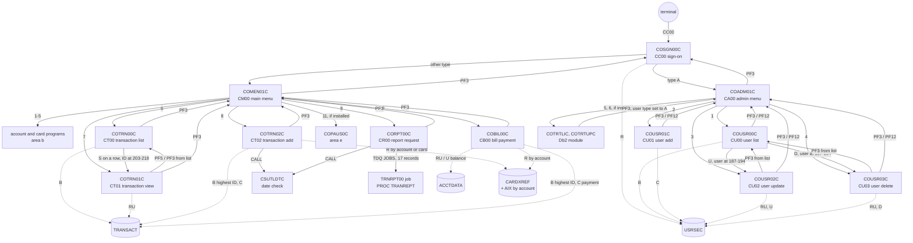
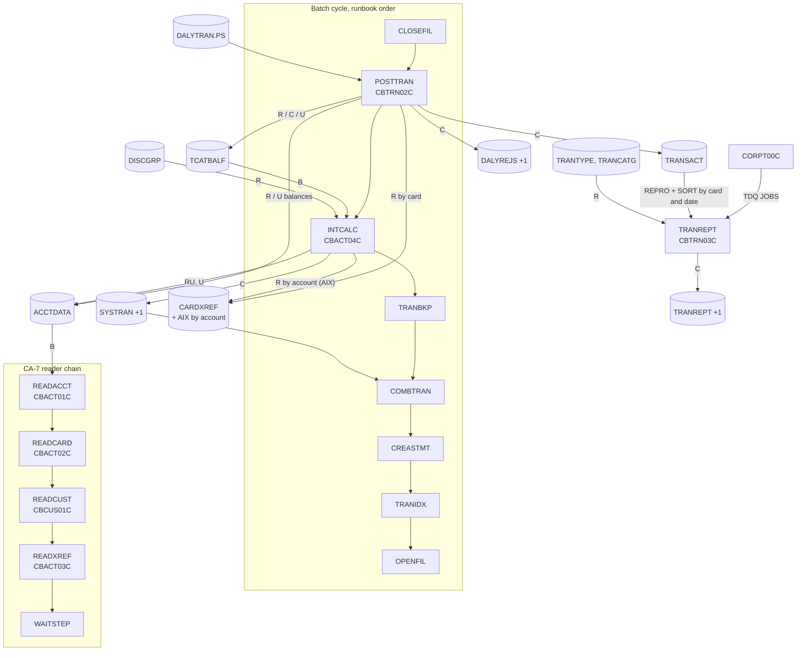
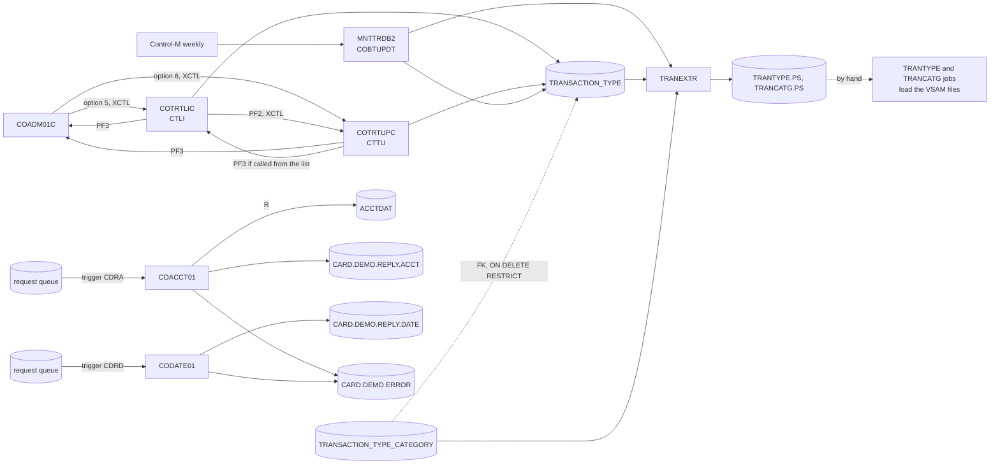

# CardDemo interaction view

Who calls whom: online navigation (XCTL, LINK, CALL), the batch cycle and the data stores each step touches, and the flows of the optional modules. It holds the pilot slice around `COBIL00C` and `CBTRN02C` and the proposals merged from areas a (sign-on and administration), c (transactions), d1 (core batch) and f (transaction type Db2 module and VSAM-MQ module). Components and data stores are described in [components.md](components.md); record layouts in [entities.md](entities.md).

## Online navigation (core)

Every program in the diagram transfers to `COSGN00C` when it starts without a commarea. The account and card programs and the Db2 transaction type programs instead set the user type themselves and carry on, which reaches a menu without a sign-on (INV-006).

## Batch cycle (core)

The diagram follows the runbook (`docs/runbooks/batch-cycle-restart.md:11-21`). The schedulers differ from it:

- **CA-7** chains CLOSEFIL, CBPAUP0J, POSTTRAN, WAITSTEP and OPENFIL (`app/scheduler/CardDemo.ca7:19-127`). It does not list INTCALC, and another CLOSEFIL listing triggers CREASTMT (`app/scheduler/CardDemo.ca7:465-470`), so CA-7 runs the statements right after the files close, not between COMBTRAN and TRANIDX. The reader chain READACCT to WAITSTEP also starts from CLOSEFIL (`app/scheduler/CardDemo.ca7:335-455`).
- **Control-M** runs INTCALC monthly, after CLOSEFIL and before COMBTRAN (`app/scheduler/CardDemo.controlm:64-80`).

Which order the target scheduler (Airflow) follows is an open question in area g's schedule specs; this view does not choose one. TRANVALD (CBTRN01C) has no JCL and no schedule entry (CBTRN01C DEF-TVAL-007).

## Optional modules: transaction type (Db2) and VSAM-MQ

## Edges

Merged from the area proposals. Where two areas proposed the same edge, the table keeps one row: the main menu's transfers to the transaction programs are in A's row for options 1-10, the admin menu's transfers to the transaction type programs are in A's row for options 5 and 6, and the report request's job submission is in C's rows.
### Sign-on and administration (area a)

| From | To | Mechanism | Data passed | Source (file:line) | Spec item |
| :-- | :-- | :-- | :-- | :-- | :-- |
| terminal | COSGN00C | RETURN TRANSID | transaction `CC00` typed on a blank screen; afterwards `CC00` with the 160-byte commarea | `app/csd/CARDDEMO.CSD:378-387`; `app/cbl/COSGN00C.cbl:98-102` | FLOW-SGN-001, FLOW-SGN-005 |
| COSGN00C | COADM01C | XCTL | ENT-COMMAREA: from `CC00`/`COSGN00C`, user ID, type `A`, context 0 | `app/cbl/COSGN00C.cbl:230-234` | BR-SGN-004, BR-SGN-005 |
| COSGN00C | COMEN01C | XCTL | ENT-COMMAREA: as above, type other than `A` | `app/cbl/COSGN00C.cbl:235-239` | BR-SGN-004 |
| COMEN01C | option programs 1-10 (COACTVWC, COACTUPC, COCRDLIC, COCRDSLC, COCRDUPC, COTRN00C, COTRN01C, COTRN02C, CORPT00C, COBIL00C) | XCTL | ENT-COMMAREA, from `CM00`/`COMEN01C`, context 0 | `app/cbl/COMEN01C.cbl:177-187` | BR-MENU-002 |
| COMEN01C | COPAUS0C | XCTL after INQUIRE PROGRAM | as above, only if the program is installed | `app/cbl/COMEN01C.cbl:147-168` | BR-MENU-004 |
| COMEN01C | COSGN00C | XCTL | none (no commarea) | `app/cbl/COMEN01C.cbl:96-98, 196-203` | FLOW-MENU-004 |
| COMEN01C | COMEN01C | RETURN TRANSID | `CM00`, 160 bytes | `app/cbl/COMEN01C.cbl:107-110` | FLOW-MENU-006 |
| COADM01C | COUSR00C, COUSR01C, COUSR02C, COUSR03C | XCTL | ENT-COMMAREA (160), from `CA00`/`COADM01C`, context 0 | `app/cbl/COADM01C.cbl:140-148` | BR-ADMN-002 |
| COADM01C | COTRTLIC, COTRTUPC | XCTL (PGMIDERR handled) | as above; "not installed" message when the module is absent | `app/cbl/COADM01C.cbl:77-79, 140-148, 270-283` | BR-ADMN-002, BR-ADMN-003 |
| COADM01C | COSGN00C | XCTL | none | `app/cbl/COADM01C.cbl:100-102, 163-170` | FLOW-ADMN-004 |
| COADM01C | COADM01C | RETURN TRANSID | `CA00`, 160 bytes | `app/cbl/COADM01C.cbl:111-114` | FLOW-ADMN-006 |
| COUSR00C | COUSR02C | XCTL | 194 bytes, `CDEMO-CU00-USR-SELECTED`, from `CU00`/`COUSR00C` | `app/cbl/COUSR00C.cbl:190-199` | BR-USRL-003 |
| COUSR00C | COUSR03C | XCTL | as above | `app/cbl/COUSR00C.cbl:200-209` | BR-USRL-004 |
| COUSR00C | COADM01C | XCTL | 194 bytes (truncated to 160 by the menu) | `app/cbl/COUSR00C.cbl:125-127, 506-517` | FLOW-USRL-006 |
| COUSR00C | COUSR00C | RETURN TRANSID | `CU00`, 194 bytes with the paging state | `app/cbl/COUSR00C.cbl:141-144` | FLOW-USRL-007 |
| COUSR01C | COADM01C | XCTL | 160 bytes | `app/cbl/COUSR01C.cbl:93-95, 165-178` | FLOW-USRA-005 |
| COUSR01C | COUSR01C | RETURN TRANSID | `CU01`, 160 bytes | `app/cbl/COUSR01C.cbl:107-110` | FLOW-USRA-006 |
| COUSR02C | caller (COUSR00C or COADM01C) | XCTL | 194 bytes, after saving | `app/cbl/COUSR02C.cbl:111-119` | BR-USRU-005 |
| COUSR02C | COADM01C | XCTL | 194 bytes | `app/cbl/COUSR02C.cbl:124-126` | FLOW-USRU-006 |
| COUSR02C | COUSR02C | RETURN TRANSID | `CU02`, 194 bytes | `app/cbl/COUSR02C.cbl:135-138` | FLOW-USRU-007 |
| COUSR03C | caller (COUSR00C or COADM01C) | XCTL | 194 bytes | `app/cbl/COUSR03C.cbl:111-118` | FLOW-USRD-006 |
| COUSR03C | COADM01C | XCTL | 194 bytes | `app/cbl/COUSR03C.cbl:123-125` | FLOW-USRD-007 |
| COUSR03C | COUSR03C | RETURN TRANSID | `CU03`, 194 bytes | `app/cbl/COUSR03C.cbl:134-137` | FLOW-USRD-008 |
| COUSR00C, COUSR01C, COUSR02C, COUSR03C | COSGN00C | XCTL | the program's own (uninitialised) commarea, when started without one | `app/cbl/COUSR00C.cbl:110-112`; `app/cbl/COUSR01C.cbl:78-80`; `app/cbl/COUSR02C.cbl:90-92`; `app/cbl/COUSR03C.cbl:90-92` | FLOW-USRL-002, FLOW-USRA-002, FLOW-USRU-002, FLOW-USRD-002, FLOW-SGN-008 |
| COMEN01C, COADM01C | COSGN00C | XCTL | none, when started without a commarea | `app/cbl/COMEN01C.cbl:82-84`; `app/cbl/COADM01C.cbl:86-88` | FLOW-MENU-001, FLOW-ADMN-001 |
| CLOSEFIL / OPENFIL jobs | USRSEC | file (CEMT close/open) | none; sign-on and user administration fail while closed | `app/jcl/CLOSEFIL.jcl:30`; `app/jcl/OPENFIL.jcl:30` | ERR-SGN-001 |

### Transactions (area c)

| From | To | Mechanism | Data passed | Source (file:line) | Spec item |
| :-- | :-- | :-- | :-- | :-- | :-- |
| COTRN00C | COTRN01C | XCTL | 218-byte commarea, selected transaction ID at 203-218, context 0 | `app/cbl/COTRN00C.cbl:186-195` | FLOW-TRNL-010, BR-TRNV-003 |
| COTRN00C | COMEN01C | XCTL | commarea, context 0 (PF3) | `app/cbl/COTRN00C.cbl:122-124, 510-521` | FLOW-TRNL-004 |
| COTRN00C | COSGN00C | XCTL | commarea area with routing fields and context set, rest not received | `app/cbl/COTRN00C.cbl:107-109` | FLOW-TRNL-001 |
| COTRN00C | COTRN00C | RETURN TRANSID | `CT00`, 218-byte commarea with paging state | `app/cbl/COTRN00C.cbl:138-141` | FLOW-TRNL-008 |
| COTRN01C | COTRN00C | XCTL | 218-byte commarea, context 0 (PF5; also PF3 when opened from the list) | `app/cbl/COTRN01C.cbl:115-127` | FLOW-TRNV-004, FLOW-TRNV-006 |
| COTRN01C | COMEN01C | XCTL | commarea, context 0 (PF3 when opened from the menu) | `app/cbl/COTRN01C.cbl:115-122` | FLOW-TRNV-004 |
| COTRN01C | COSGN00C | XCTL | commarea area with routing fields and context set, rest not received | `app/cbl/COTRN01C.cbl:94-96` | FLOW-TRNV-001 |
| COTRN01C | COTRN01C | RETURN TRANSID | `CT01`, 218-byte commarea | `app/cbl/COTRN01C.cbl:136-139` | FLOW-TRNV-008 |
| COTRN02C | COMEN01C | XCTL | commarea, context 0 (PF3; `CDEMO-FROM-PROGRAM` or `COMEN01C`) | `app/cbl/COTRN02C.cbl:136-143, 500-511` | FLOW-TRNA-004 |
| COTRN02C | COSGN00C | XCTL | commarea area with routing fields and context set, rest not received | `app/cbl/COTRN02C.cbl:115-117` | FLOW-TRNA-001 |
| COTRN02C | COTRN02C | RETURN TRANSID | `CT02`, 218-byte commarea | `app/cbl/COTRN02C.cbl:530-534` | FLOW-TRNA-008 |
| COTRN02C | CSUTLDTC | CALL | date (10), picture `YYYY-MM-DD` (10), result (80) | `app/cbl/COTRN02C.cbl:389-427` | VAL-TRNA-010 |
| CORPT00C | COMEN01C | XCTL | commarea, context 0 (PF3) | `app/cbl/CORPT00C.cbl:187-189, 540-551` | FLOW-RPTS-004 |
| CORPT00C | COSGN00C | XCTL | commarea area with routing fields and context set, rest not received | `app/cbl/CORPT00C.cbl:172-174` | FLOW-RPTS-001 |
| CORPT00C | CORPT00C | RETURN TRANSID | `CR00`, 160-byte commarea | `app/cbl/CORPT00C.cbl:585-591` | FLOW-RPTS-006 |
| CORPT00C | CSUTLDTC | CALL | date (10), picture `YYYY-MM-DD` (10), result (80) | `app/cbl/CORPT00C.cbl:388-426` | VAL-RPTS-004 |
| CORPT00C | JES internal reader | TDQ | 17 records of 80 bytes (ENT-REPORT-JOB) to queue `JOBS` | `app/cbl/CORPT00C.cbl:496-523`; `app/csd/CARDDEMO.CSD:499-505` | SE-RPTS-001 |
| JES (job `TRNRPT00`) | procedure TRANREPT | JCL step | `STEP10 EXEC PROC=TRANREPT` with `SYMNAMES` and `DATEPARM` overrides holding the date range | `app/cbl/CORPT00C.cbl:93-125`; `app/proc/TRANREPT.prc:35-72` | BR-RPTS-006 |
| COACTUPC | CSUTLDTC | CALL | date (8), picture `YYYYMMDD` (8), result (80) | `app/cpy/CSUTLDPY.cpy:284-321` | FLOW-DTCK-002, DEF-DTCK-003 |
| CSUTLDTC | CEEDAYS (LE) | CALL | varying date, varying picture, Lilian day, feedback code | `app/cbl/CSUTLDTC.cbl:116-120` | BR-DTCK-002 |

### Core batch (area d1)

| From | To | Mechanism | Data passed | Source (file:line) | Spec item |
| :-- | :-- | :-- | :-- | :-- | :-- |
| Control-M folder `MONTHLY-InterestCalculation` | INTCALC | scheduler | monthly, after CLOSEFIL, before COMBTRAN (conditions `...-INTCALC`) | `app/scheduler/CardDemo.controlm:64-80` | CBACT04C BR-INTC-008 (§3) |
| INTCALC (CBACT04C) | COMBTRAN | file | interest transactions in `AWS.M2.CARDDEMO.SYSTRAN(+1)` (FB 350, ENT-TRANSACTION layout); COMBTRAN reads `SYSTRAN(0)` and merges it into the transaction master | `app/jcl/INTCALC.jcl:37-41`, `app/jcl/COMBTRAN.jcl:26` | CBACT04C SE-INTC-001 |
| INTCALC (CBACT04C) | ACCTDATA | file | current balance += interest, cycle credit and debit := 0 | `app/cbl/CBACT04C.cbl:351-370` | CBACT04C BR-INTC-006, SE-INTC-002 |
| CBACT04C | CEE3ABD | CALL | abend code 999, timing 0 | `app/cbl/CBACT04C.cbl:630-634` | CBACT04C ERR-INTC-009 |
| TRANREPT STEP05R | TRANREPT STEP10R | JCL step | REPRO of the transaction master to `TRANSACT.BKUP(+1)`, SORT by card with the date INCLUDE to `TRANSACT.DALY(+1)`, read as TRANFILE | `app/jcl/TRANREPT.jcl:23-55, 59-80` | CBTRN03C BR-TRPT-002, DEF-TRPT-002 |
| CBTRN03C | CEE3ABD | CALL | abend code 999, timing 0 | `app/cbl/CBTRN03C.cbl:627-631` | CBTRN03C ERR-TRPT-006 |
| CA-7 `CLOSEFIL` | READACCT | scheduler | trigger (SCHID 030) | `app/scheduler/CardDemo.ca7:335-340` | CBACT01C BR-ACRD-001 (§3) |
| READACCT | READCARD | scheduler | trigger (SCHID 030) | `app/scheduler/CardDemo.ca7:342-367` | CBACT02C BR-CDRD-001 (§3) |
| READCARD | READCUST | scheduler | trigger (SCHID 030) | `app/scheduler/CardDemo.ca7:369-394` | CBCUS01C BR-CURD-001 (§3) |
| READCUST | READXREF | scheduler | trigger (SCHID 030) | `app/scheduler/CardDemo.ca7:396-421` | CBACT03C BR-XRRD-001 (§3) |
| READXREF | WAITSTEP | scheduler | trigger (SCHID 030), then OPENFIL | `app/scheduler/CardDemo.ca7:423-455` | CBACT03C BR-XRRD-001 (§3) |
| READACCT PREDEL | READACCT STEP05 | JCL step | `IEFBR14` deletes the three extract datasets before CBACT01C creates them | `app/jcl/READACCT.jcl:22-50` | CBACT01C SE-ACRD-001 |
| CBACT01C | COBDATFT | CALL | `CODATECN-REC`: type `2`, input `ACCT-REISSUE-DATE` (`YYYY-MM-DD`), output type `2`; returns `YYYYMMDD` in the first 8 output bytes | `app/cbl/CBACT01C.cbl:223-234` | CBACT01C BR-ACRD-004; COBDATFT specified by d2-batch-utilities |
| CBACT01C, CBACT02C, CBACT03C, CBCUS01C, CBTRN01C | CEE3ABD | CALL | abend code 999, timing 0 | `app/cbl/CBACT01C.cbl:409-413`, `app/cbl/CBACT02C.cbl:154-158`, `app/cbl/CBACT03C.cbl:154-158`, `app/cbl/CBCUS01C.cbl:154-158`, `app/cbl/CBTRN01C.cbl:469-473` | ERR-ACRD-006, ERR-CDRD-005, ERR-XRRD-005, ERR-CURD-005, ERR-TVAL-005 |

### Transaction type and VSAM-MQ modules (area f)

| From | To | Mechanism | Data passed | Source (file:line) | Spec item |
| :-- | :-- | :-- | :-- | :-- | :-- |
| COTRTLIC | COTRTUPC | XCTL | ENT-COMMAREA (160 bytes), from-program `COTRTLIC`, user type set to `U`, context 0; PF2 | `app/app-transaction-type-db2/cbl/COTRTLIC.cbl:630-652` | FLOW-TTLS-006, DEF-TTLS-012 |
| COTRTLIC | COADM01C | XCTL | ENT-COMMAREA after SYNCPOINT, user type set to `A`; PF3 (target from-program, in practice always `COADM01C`); after a direct start without sign-on this opens the admin menu | `app/app-transaction-type-db2/cbl/COTRTLIC.cbl:591-623` | FLOW-TTLS-005, SE-TTLS-007, DEF-TTLS-017 |
| COTRTUPC | COADM01C or COTRTLIC | XCTL | ENT-COMMAREA after SYNCPOINT, user type set to `A`; PF3 to the caller (`COTRTLIC` from the list, `COADM01C` from the menu or after a direct start without sign-on) | `app/app-transaction-type-db2/cbl/COTRTUPC.cbl:429-460` | FLOW-TTUP-003, SE-TTUP-005, DEF-TTUP-017 |
| COTRTLIC | COTRTLIC (`CTLI`) | RETURN TRANSID | 2000-byte area: ENT-COMMAREA + 427-byte list state | `app/app-transaction-type-db2/cbl/COTRTLIC.cbl:910-914` | FLOW-TTLS-013 |
| COTRTUPC | COTRTUPC (`CTTU`) | RETURN TRANSID | ENT-COMMAREA + program state (screen state, old and new type) | `app/app-transaction-type-db2/cbl/COTRTUPC.cbl:567-571` | FLOW-TTUP-010 |
| COTRTLIC | DSNTIAC | CALL | EIB, commarea, SQLCA, 10 x 72 message area | `app/app-transaction-type-db2/cpy/CSDB2RPY.cpy:55-62` (included at `app/app-transaction-type-db2/cbl/COTRTLIC.cbl:2055`) | DEF-TTLS-010 |
| COTRTLIC | CARDDEMO.TRANSACTION_TYPE | DB2 | count, forward and backward cursors, UPDATE, DELETE | `app/app-transaction-type-db2/cbl/COTRTLIC.cbl:338-366, 1626-2034` | SE-TTLS-001 .. SE-TTLS-006 |
| COTRTUPC | CARDDEMO.TRANSACTION_TYPE | DB2 | SELECT by code, UPDATE then INSERT, DELETE | `app/app-transaction-type-db2/cbl/COTRTUPC.cbl:1475-1637` | SE-TTUP-001 .. SE-TTUP-004 |
| CARDDEMO.TRANSACTION_TYPE_CATEGORY | COTRTLIC, COTRTUPC, COBTUPDT | DB2 | foreign key `ON DELETE RESTRICT` refuses a type delete (-532) | `app/app-transaction-type-db2/ctl/DB2CREAT.ctl:96-99` | BR-TTLS-009, BR-TTUP-004, BR-TTBU-004 |
| Control-M | MNTTRDB2 | scheduler | folder `WEEKLY-TransactionTypesDBRefresh` | `app/scheduler/CardDemo.controlm:26-31` | FLOW-JMNTT-001 |
| MNTTRDB2 | COBTUPDT | JCL step | `IKJEFT01` / `DSN RUN PROGRAM(COBTUPDT) PLAN(CARDDEMO)`, DD `INPFILE` | `app/app-transaction-type-db2/jcl/MNTTRDB2.jcl:21-30` | BR-JMNTT-001 |
| INPFILE | COBTUPDT | file | ENT-TTYP-MAINT-INPUT, 53-byte records | `app/app-transaction-type-db2/cbl/COBTUPDT.cbl:31-46, 100-107` | FLOW-TTBU-002 |
| COBTUPDT | CARDDEMO.TRANSACTION_TYPE | DB2 | INSERT, UPDATE, DELETE per record | `app/app-transaction-type-db2/cbl/COBTUPDT.cbl:137-148, 171-175, 201-204` | SE-TTBU-001 .. SE-TTBU-004 |
| MNTTRDB2 | TRANEXTR | scheduler | condition `WEEKLY-TransactionTypesDBRefresh-MNTTRDB2` | `app/scheduler/CardDemo.controlm:28, 58-61` | FLOW-JMNTT-001 |
| MNTTRDB2 | CLOSEFIL (disclosure group refresh) | scheduler | same condition | `app/scheduler/CardDemo.controlm:33-37` | DEF-JMNTT-003 |
| CARDDEMO.TRANSACTION_TYPE | TRANEXTR | DB2 | DSNTIAUL unload, 60-byte records | `app/app-transaction-type-db2/jcl/TRANEXTR.jcl:65-91` | BR-JTREX-001 |
| CARDDEMO.TRANSACTION_TYPE_CATEGORY | TRANEXTR | DB2 | DSNTIAUL unload, 60-byte records | `app/app-transaction-type-db2/jcl/TRANEXTR.jcl:95-122` | BR-JTREX-002 |
| TRANEXTR | TRANTYPE job (base) | file | `AWS.M2.CARDDEMO.TRANTYPE.PS` (ENT-TRAN-TYPE layout); not chained by a scheduler | `app/app-transaction-type-db2/jcl/TRANEXTR.jcl:72-74`, `app/jcl/TRANTYPE.jcl:54-61` | DEF-JTREX-001 |
| TRANEXTR | TRANCATG job (base) | file | `AWS.M2.CARDDEMO.TRANCATG.PS` (ENT-TRAN-CATEGORY layout); not chained | `app/app-transaction-type-db2/jcl/TRANEXTR.jcl:102-104`, `app/jcl/TRANCATG.jcl:54-61` | DEF-JTREX-001 |
| CREADB21 | CARDDEMO.TRANSACTION_TYPE, CARDDEMO.TRANSACTION_TYPE_CATEGORY | DB2 | create, grant, seed insert | `app/app-transaction-type-db2/jcl/CREADB21.jcl:52-84` | SE-JCRDB-002 .. SE-JCRDB-004 |
| CTLI, CTTU | DB2ENTRY CARDDEMO | DB2 | plan `CARDDEMO`, `AUTHTYPE(USERID)`, one thread | `app/app-transaction-type-db2/csd/CRDDEMOD.csd:45-60` | FLOW-JCSDD-003 |
| MQ trigger monitor | COACCT01 (`CDRA`) | START | trigger message (MQTM) as start data | `app/app-vsam-mq/cbl/COACCT01.cbl:178-198`, `app/app-vsam-mq/csd/CRDDEMOM.csd:17-26` | FLOW-MQAC-001, FLOW-JCSDM-001 |
| MQ trigger monitor | CODATE01 (`CDRD`) | START | trigger message (MQTM) as start data | `app/app-vsam-mq/cbl/CODATE01.cbl:127-147`, `app/app-vsam-mq/csd/CRDDEMOM.csd:27-36` | FLOW-MQDT-001, FLOW-JCSDM-002 |
| requester | COACCT01 | MQ | ENT-MQ-ACCT-REQUEST on the triggered input queue | `app/app-vsam-mq/cbl/COACCT01.cbl:337-373` | SE-MQAC-001 |
| COACCT01 | ACCTDAT | file | CICS READ by 11-digit account ID (ENT-ACCOUNT) | `app/app-vsam-mq/cbl/COACCT01.cbl:394-404` | SE-MQAC-002 |
| COACCT01 | requester | MQ | ENT-MQ-ACCT-REPLY on `CARD.DEMO.REPLY.ACCT` (fixed queue, ReplyToQ ignored) | `app/app-vsam-mq/cbl/COACCT01.cbl:462-499` | SE-MQAC-003, DEF-MQAC-002 |
| requester | CODATE01 | MQ | any message on the triggered input queue | `app/app-vsam-mq/cbl/CODATE01.cbl:286-322` | SE-MQDT-001 |
| CODATE01 | requester | MQ | ENT-MQ-DATE-REPLY on `CARD.DEMO.REPLY.DATE` | `app/app-vsam-mq/cbl/CODATE01.cbl:366-403` | SE-MQDT-002 |
| COACCT01, CODATE01 | operations | MQ | ENT-MQ-ERROR-MSG on `CARD.DEMO.ERROR` | `app/app-vsam-mq/cbl/COACCT01.cbl:501-523`, `app/app-vsam-mq/cbl/CODATE01.cbl:405-427` | SE-MQAC-004, SE-MQDT-003 |
