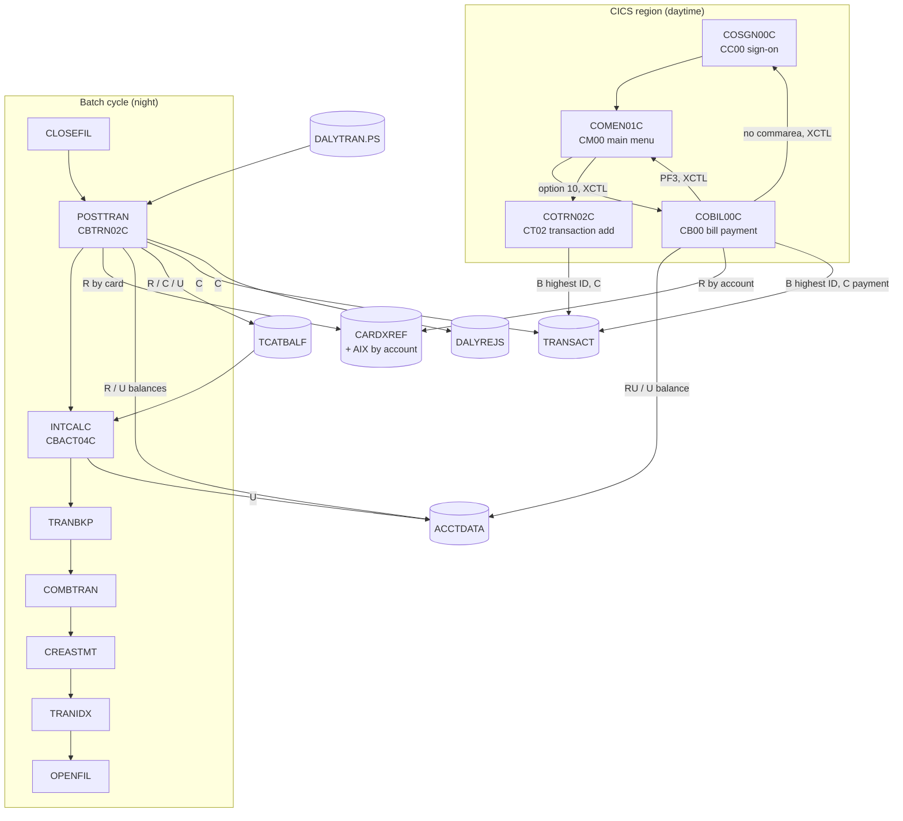

# CardDemo interaction view

Who calls whom: online navigation (XCTL, LINK), the batch cycle and the data stores each step touches, and cross-module flows. It starts with the pilot slice around `COBIL00C` and `CBTRN02C` and grows as the area proposals in `areas/` are merged. Components and data stores are described in [components.md](components.md); record layouts in [entities.md](entities.md).

## Pilot slice: bill payment and daily posting

