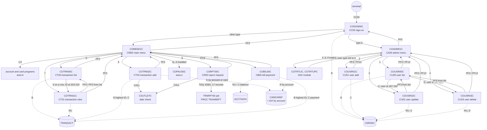
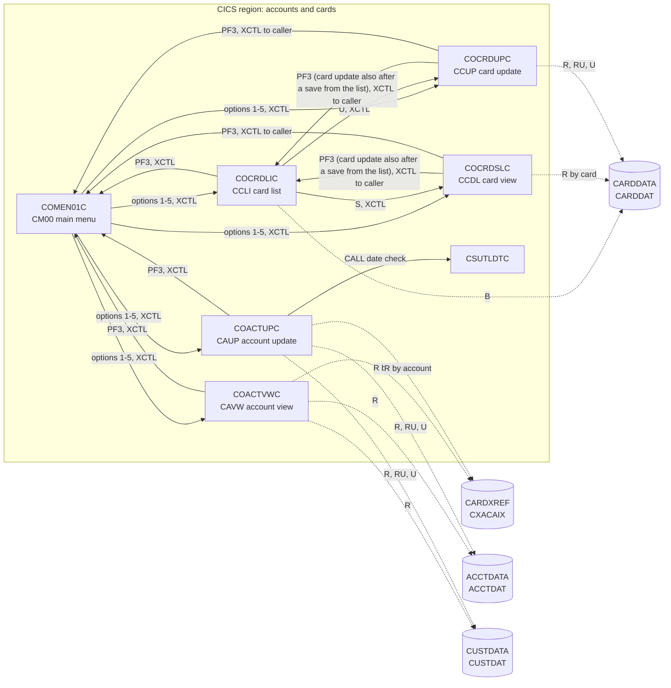
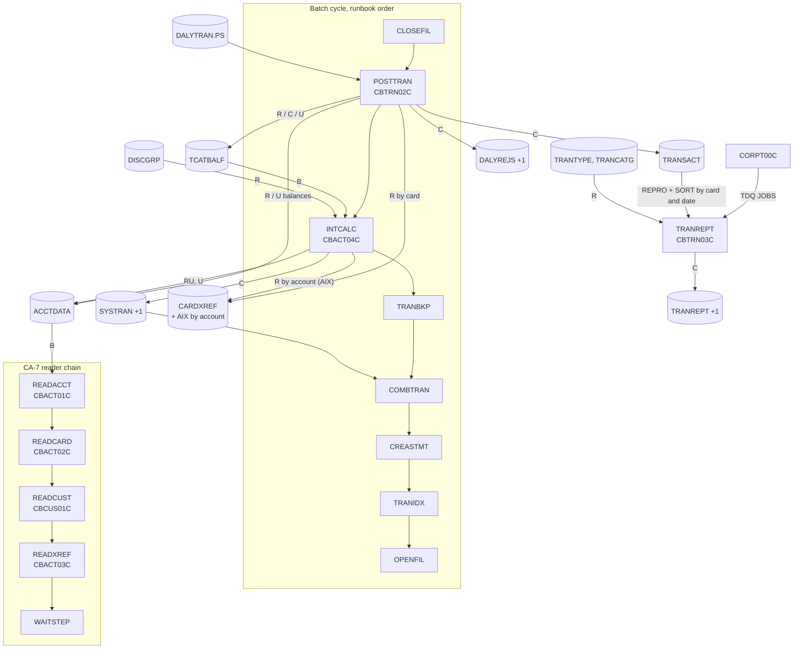
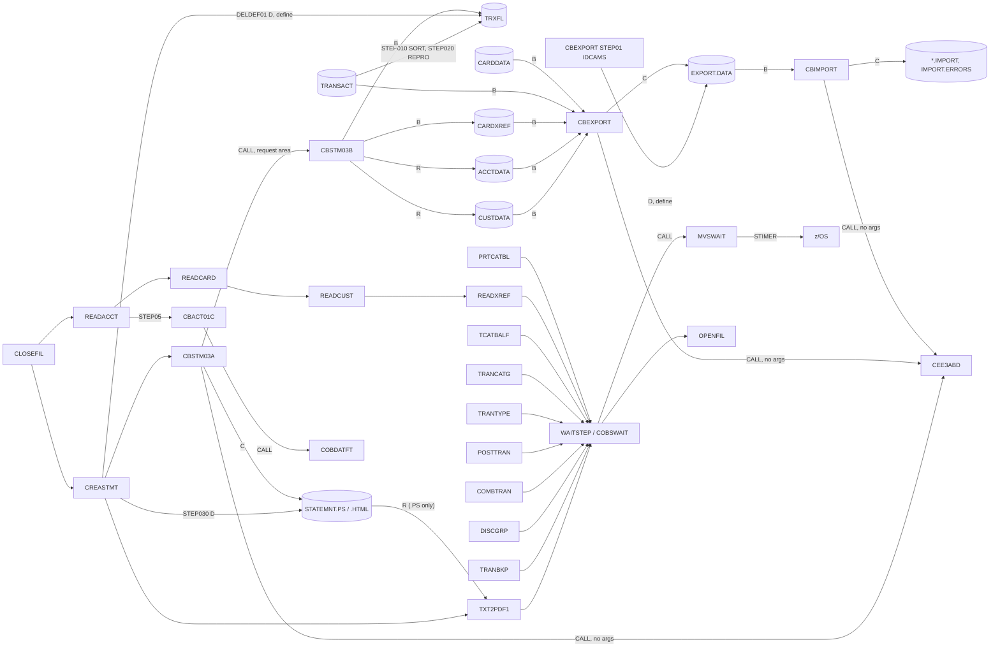
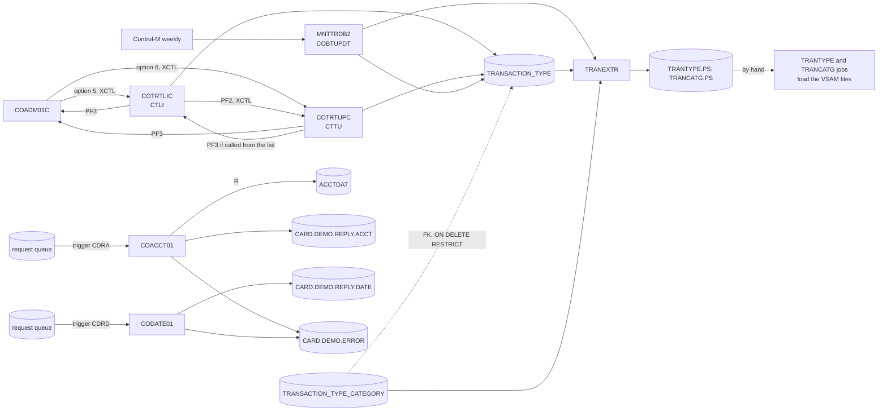
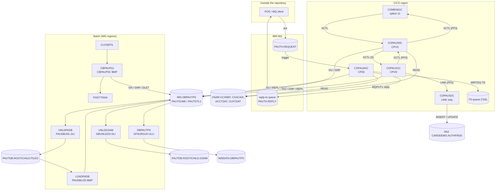

# CardDemo interaction view

Who calls whom: online navigation (XCTL, LINK, CALL), the batch cycle and the data stores each step touches, and the flows of the optional modules. It holds the pilot slice around `COBIL00C` and `CBTRN02C` and the proposals merged from areas a (sign-on and administration), b (accounts and cards), c (transactions), d1 (core batch), d2 (batch utilities), e (authorization module, IMS, Db2 and MQ) and f (transaction type Db2 module and VSAM-MQ module). Components and data stores are described in [components.md](components.md); record layouts in [entities.md](entities.md).

## Online navigation (core)

Every other program in the diagram transfers to `COSGN00C` when it starts without a commarea. The account and card programs instead treat that start as a first run with a blank user ID, and their PF3 then opens the main menu; the Db2 transaction type programs set the user type `A` and carry on, and their PF3 opens the admin menu. Both reach a menu without a sign-on (INV-006).

## Online navigation (accounts and cards, area b)

Each program also returns to itself with RETURN TRANSID and a 2000-byte area; only the 160-byte base commarea crosses an XCTL (INV-026). Each can be started from a terminal without a sign-on (INV-006).

## Batch cycle (core)

The diagram follows the runbook (`docs/runbooks/batch-cycle-restart.md:11-21`). The schedulers differ from it:

- **CA-7** chains CLOSEFIL, CBPAUP0J, POSTTRAN, WAITSTEP and OPENFIL (`app/scheduler/CardDemo.ca7:19-127`); CBPAUP0J is the purge of the authorization module (see "Optional module: authorization"). It does not list INTCALC, and another CLOSEFIL listing triggers CREASTMT (`app/scheduler/CardDemo.ca7:465-470`), so CA-7 runs the statements right after the files close, not between COMBTRAN and TRANIDX; CREASTMT then triggers TXT2PDF1, WAITSTEP and OPENFIL (`app/scheduler/CardDemo.ca7:494-495, 521-527`). The reader chain READACCT to WAITSTEP also starts from CLOSEFIL (`app/scheduler/CardDemo.ca7:335-455`).
- **Control-M** runs INTCALC monthly, after CLOSEFIL and before COMBTRAN (`app/scheduler/CardDemo.controlm:64-80`).

Which order the target scheduler (Airflow) follows is an open question in area g's schedule specs; this view does not choose one. TRANVALD (CBTRN01C) has no JCL and no schedule entry (CBTRN01C DEF-TVAL-007).

## Batch utilities: statements, export and import, wait

WAITSTEP's successor depends on the scheduler entry (OPENFIL, CLOSEFIL, or CLOSEFIL1 and CLOSEFIL2); the diagram shows OPENFIL only, and the edge table has every pair. Nothing in the repository schedules CBEXPORT or CBIMPORT, and nothing reads the `*.IMPORT` or `IMPORT.ERRORS` datasets (CBIMPORT Q-IMPT-004).

## Optional modules: transaction type (Db2) and VSAM-MQ

## Optional module: authorization (IMS, Db2, MQ)

No edge leaves the module towards the base application except the menu return (COMEN01C), which also carries a session that never signed on when COPAUS0C or COPAUS1C was started from a terminal (COPAUS0C DEF-AUSM-012, COPAUS1C DEF-AUDT-009, INV-006), the fallback XCTL to the sign-on program COSGN00C when no return program is set (`app/app-authorization-ims-db2-mq/cbl/COPAUS0C.cbl:668-669`), and the reads of the base VSAM files. Nothing in the base application calls into the module except menu option 11 of COMEN01C and the CA-7 chain CLOSEFIL → CBPAUP0J → POSTTRAN (CBPAUP0J §3).

## Edges

Merged from the area proposals. Where two areas proposed the same edge, the table keeps one row: the main menu's transfers to the transaction programs are in A's row for options 1-10, the admin menu's transfers to the transaction type programs are in A's row for options 5 and 6, the main menu's transfers to the account and card programs are in A's row for options 1-10, the main menu's transfer to the pending authorization summary (option 11) is in A's row, account update's call to the date check is in C's rows, the report request's job submission is in C's rows, and the CA-7 reader chain and the CBACT01C call to COBDATFT are in D1's rows.
### Sign-on and administration (area a)

| From | To | Mechanism | Data passed | Source (file:line) | Spec item |
| :-- | :-- | :-- | :-- | :-- | :-- |
| terminal | COSGN00C | RETURN TRANSID | transaction `CC00` typed on a blank screen; afterwards `CC00` with the 160-byte commarea | `app/csd/CARDDEMO.CSD:378-387`; `app/cbl/COSGN00C.cbl:98-102` | FLOW-SGN-001, FLOW-SGN-005 |
| COSGN00C | COADM01C | XCTL | ENT-COMMAREA: from `CC00`/`COSGN00C`, user ID, type `A`, context 0 | `app/cbl/COSGN00C.cbl:230-234` | BR-SGN-004, BR-SGN-005 |
| COSGN00C | COMEN01C | XCTL | ENT-COMMAREA: as above, type other than `A` | `app/cbl/COSGN00C.cbl:235-239` | BR-SGN-004 |
| COMEN01C | option programs 1-10 (COACTVWC, COACTUPC, COCRDLIC, COCRDSLC, COCRDUPC, COTRN00C, COTRN01C, COTRN02C, CORPT00C, COBIL00C) | XCTL | ENT-COMMAREA, from `CM00`/`COMEN01C`, context 0 | `app/cbl/COMEN01C.cbl:177-187` | BR-MENU-002 |
| COMEN01C | COPAUS0C | XCTL after INQUIRE PROGRAM | as above, only if the program is installed | `app/cbl/COMEN01C.cbl:147-168` | BR-MENU-004 |
| COMEN01C | COSGN00C | XCTL | none (no commarea) | `app/cbl/COMEN01C.cbl:96-98, 196-203` | FLOW-MENU-004 |
| COMEN01C | COMEN01C | RETURN TRANSID | `CM00`, 160 bytes | `app/cbl/COMEN01C.cbl:107-110` | FLOW-MENU-006 |
| COADM01C | COUSR00C, COUSR01C, COUSR02C, COUSR03C | XCTL | ENT-COMMAREA (160), from `CA00`/`COADM01C`, context 0 | `app/cbl/COADM01C.cbl:140-148` | BR-ADMN-002 |
| COADM01C | COTRTLIC, COTRTUPC | XCTL (PGMIDERR handled) | as above; "not installed" message when the module is absent | `app/cbl/COADM01C.cbl:77-79, 140-148, 270-283` | BR-ADMN-002, BR-ADMN-003 |
| COADM01C | COSGN00C | XCTL | none | `app/cbl/COADM01C.cbl:100-102, 163-170` | FLOW-ADMN-004 |
| COADM01C | COADM01C | RETURN TRANSID | `CA00`, 160 bytes | `app/cbl/COADM01C.cbl:111-114` | FLOW-ADMN-006 |
| COUSR00C | COUSR02C | XCTL | 194 bytes, `CDEMO-CU00-USR-SELECTED`, from `CU00`/`COUSR00C` | `app/cbl/COUSR00C.cbl:190-199` | BR-USRL-003 |
| COUSR00C | COUSR03C | XCTL | as above | `app/cbl/COUSR00C.cbl:200-209` | BR-USRL-004 |
| COUSR00C | COADM01C | XCTL | 194 bytes (truncated to 160 by the menu) | `app/cbl/COUSR00C.cbl:125-127, 506-517` | FLOW-USRL-006 |
| COUSR00C | COUSR00C | RETURN TRANSID | `CU00`, 194 bytes with the paging state | `app/cbl/COUSR00C.cbl:141-144` | FLOW-USRL-007 |
| COUSR01C | COADM01C | XCTL | 160 bytes | `app/cbl/COUSR01C.cbl:93-95, 165-178` | FLOW-USRA-005 |
| COUSR01C | COUSR01C | RETURN TRANSID | `CU01`, 160 bytes | `app/cbl/COUSR01C.cbl:107-110` | FLOW-USRA-006 |
| COUSR02C | caller (COUSR00C or COADM01C) | XCTL | 194 bytes, after saving | `app/cbl/COUSR02C.cbl:111-119` | BR-USRU-005 |
| COUSR02C | COADM01C | XCTL | 194 bytes | `app/cbl/COUSR02C.cbl:124-126` | FLOW-USRU-006 |
| COUSR02C | COUSR02C | RETURN TRANSID | `CU02`, 194 bytes | `app/cbl/COUSR02C.cbl:135-138` | FLOW-USRU-007 |
| COUSR03C | caller (COUSR00C or COADM01C) | XCTL | 194 bytes | `app/cbl/COUSR03C.cbl:111-118` | FLOW-USRD-006 |
| COUSR03C | COADM01C | XCTL | 194 bytes | `app/cbl/COUSR03C.cbl:123-125` | FLOW-USRD-007 |
| COUSR03C | COUSR03C | RETURN TRANSID | `CU03`, 194 bytes | `app/cbl/COUSR03C.cbl:134-137` | FLOW-USRD-008 |
| COUSR00C, COUSR01C, COUSR02C, COUSR03C | COSGN00C | XCTL | the program's own (uninitialised) commarea, when started without one | `app/cbl/COUSR00C.cbl:110-112`; `app/cbl/COUSR01C.cbl:78-80`; `app/cbl/COUSR02C.cbl:90-92`; `app/cbl/COUSR03C.cbl:90-92` | FLOW-USRL-002, FLOW-USRA-002, FLOW-USRU-002, FLOW-USRD-002, FLOW-SGN-008 |
| COMEN01C, COADM01C | COSGN00C | XCTL | none, when started without a commarea | `app/cbl/COMEN01C.cbl:82-84`; `app/cbl/COADM01C.cbl:86-88` | FLOW-MENU-001, FLOW-ADMN-001 |
| CLOSEFIL / OPENFIL jobs | USRSEC | file (CEMT close/open) | none; sign-on and user administration fail while closed | `app/jcl/CLOSEFIL.jcl:30`; `app/jcl/OPENFIL.jcl:30` | ERR-SGN-001 |

### Accounts and cards (area b)

"Terminal" means the transaction code typed at a terminal with no commarea; none of these programs checks for a signed-on user in that case (INV-006).

| From | To | Mechanism | Data passed | Source (file:line) | Spec item |
| :-- | :-- | :-- | :-- | :-- | :-- |
| terminal | COACTVWC | START | transaction `CAVW`, no commarea | `app/csd/CARDDEMO.CSD:317-326`, `app/cbl/COACTVWC.cbl:282-286` | FLOW-ACVW-002, DEF-ACVW-009 |
| COACTVWC | COACTVWC | RETURN TRANSID | `CAVW`, 2000-byte area (base, 12-byte extension, spaces), context 1 | `app/cbl/COACTVWC.cbl:394-407` | FLOW-ACVW-008 |
| COACTVWC | `CDEMO-FROM-PROGRAM` (normally COMEN01C; COMEN01C when blank) | XCTL | 160-byte commarea, from `CAVW`/`COACTVWC`, context 0, user type `U`, account, customer and card of the last lookup | `app/cbl/COACTVWC.cbl:324-352` | FLOW-ACVW-005, BR-ACVW-005 |
| COACTVWC | CXACAIX | file | READ by account number (11) | `app/cbl/COACTVWC.cbl:727-735` | SE-ACVW-001 |
| COACTVWC | ACCTDAT | file | READ by account number (11) | `app/cbl/COACTVWC.cbl:776-784` | SE-ACVW-002 |
| COACTVWC | CUSTDAT | file | READ by customer number (9) from the cross-reference record | `app/cbl/COACTVWC.cbl:826-834` | SE-ACVW-003 |
| terminal | COCRDLIC | START | transaction `CCLI`, no commarea | `app/csd/CARDDEMO.CSD:357-366`, `app/cbl/COCRDLIC.cbl:315-325` | FLOW-CRDL-001, DEF-CRDL-003 |
| COCRDLIC | COCRDLIC | RETURN TRANSID | `CCLI`, 2000-byte area (base, 254-byte list extension, spaces) | `app/cbl/COCRDLIC.cbl:604-619` | FLOW-CRDL-012 |
| COCRDLIC | COMEN01C | XCTL | PF3: 160-byte commarea, from `CCLI`/`COCRDLIC`, user type `U`, context 0, last filter values in `CDEMO-ACCT-ID`/`CDEMO-CARD-NUM` | `app/cbl/COCRDLIC.cbl:384-405` | FLOW-CRDL-007 |
| COCRDLIC | COCRDSLC | XCTL | `S` and Enter: 160-byte commarea with account and card of the selected row, from `CCLI`/`COCRDLIC`, last map `CCRDLIA`/`COCRDLI`, user type `U`, context 0 (INV-027) | `app/cbl/COCRDLIC.cbl:517-541` | FLOW-CRDL-009, FLOW-CRDV-005, BR-CRDV-003 |
| COCRDLIC | COCRDUPC | XCTL | `U` and Enter: the same data as for COCRDSLC | `app/cbl/COCRDLIC.cbl:545-569` | FLOW-CRDL-010, FLOW-CRDU-005 |
| COCRDLIC | CARDDAT | file | STARTBR GTEQ, READNEXT and READPREV by card number (16) | `app/cbl/COCRDLIC.cbl:1129-1136` | SE-CRDL-001, SE-CRDL-002 |
| terminal | COCRDSLC | START | transaction `CCDL`, no commarea | `app/csd/CARDDEMO.CSD:347-356`, `app/cbl/COCRDSLC.cbl:268-272` | FLOW-CRDV-006, DEF-CRDV-002 |
| COCRDSLC | COCRDSLC | RETURN TRANSID | `CCDL`, 2000-byte area (base, 12-byte extension, spaces) | `app/cbl/COCRDSLC.cbl:394-406` | FLOW-CRDV-008 |
| COCRDSLC | `CDEMO-FROM-PROGRAM` (COCRDLIC or COMEN01C; COMEN01C when blank) | XCTL | PF3: 160-byte commarea, from `CCDL`/`COCRDSLC`, context 0, user type `U`, last map `CCRDSLA`/`COCRDSL`; the card list, seeing PF3, clears the whole commarea | `app/cbl/COCRDSLC.cbl:305-334`, `app/cbl/COCRDLIC.cbl:458-482` | FLOW-CRDV-004, FLOW-CRDL-008 |
| COCRDSLC | CARDDAT | file | READ by card number (16) | `app/cbl/COCRDSLC.cbl:740-750` | SE-CRDV-001 |
| terminal | COCRDUPC | START | transaction `CCUP`, no commarea | `app/csd/CARDDEMO.CSD:367-376` | FLOW-CRDU-001, DEF-CRDU-006 |
| COCRDUPC | COCRDUPC | RETURN TRANSID | `CCUP`, 2000-byte area (base, 329-byte extension, spaces) | `app/cbl/COCRDUPC.cbl:546-558` | FLOW-CRDU-019 |
| COCRDUPC | `CDEMO-FROM-PROGRAM` (COCRDLIC or COMEN01C; COMEN01C when blank) | XCTL | after SYNCPOINT, on PF3 or at the end of a list-path save: 160-byte commarea, from `CCUP`/`COCRDUPC`, user type `U`, context 0, account and card zeroed when returning to the list | `app/cbl/COCRDUPC.cbl:435-476` | FLOW-CRDU-004, SE-CRDU-004, FLOW-CRDL-008, FLOW-CRDL-011 |
| COCRDUPC | CARDDAT | file | READ by card number (16); READ UPDATE by card number; REWRITE of the whole 150-byte record | `app/cbl/COCRDUPC.cbl:1380-1390`, `app/cbl/COCRDUPC.cbl:1425-1436`, `app/cbl/COCRDUPC.cbl:1477-1480` | SE-CRDU-001, SE-CRDU-002, SE-CRDU-003 |
| terminal | COACTUPC | START | transaction `CAUP`, no commarea | `app/csd/CARDDEMO.CSD:306-316`, `app/cbl/COACTUPC.cbl:880-886` | FLOW-ACUP-006, DEF-ACUP-001 |
| COACTUPC | COACTUPC | RETURN TRANSID | `CAUP`, 2000-byte area (base, 873-byte extension, spaces) | `app/cbl/COACTUPC.cbl:1007-1020` | FLOW-ACUP-011 |
| COACTUPC | `CDEMO-FROM-PROGRAM` (in practice COMEN01C; COMEN01C when blank) | XCTL | PF3, after SYNCPOINT: 160-byte commarea, from `CAUP`/`COACTUPC`, user type `U`, context 0 | `app/cbl/COACTUPC.cbl:927-959` | FLOW-ACUP-005, SE-ACUP-008, DEF-ACUP-009 |
| COACTUPC | CXACAIX | file | READ by account number (11) | `app/cbl/COACTUPC.cbl:3654-3662` | SE-ACUP-001 |
| COACTUPC | ACCTDAT | file | READ by account number; READ UPDATE by account number; REWRITE of the 300-byte record from `ACCT-UPDATE-RECORD` (INV-039) | `app/cbl/COACTUPC.cbl:3703-3711`, `app/cbl/COACTUPC.cbl:3894-3903`, `app/cbl/COACTUPC.cbl:4065-4071` | SE-ACUP-002, SE-ACUP-004, SE-ACUP-006 |
| COACTUPC | CUSTDAT | file | READ by customer number (9) from the cross-reference record; READ UPDATE by `CDEMO-CUST-ID`; REWRITE of the 500-byte record from `CUST-UPDATE-RECORD` | `app/cbl/COACTUPC.cbl:3753-3761`, `app/cbl/COACTUPC.cbl:3921-3930`, `app/cbl/COACTUPC.cbl:4085-4091` | SE-ACUP-003, SE-ACUP-005, SE-ACUP-007 |

### Transactions (area c)

| From | To | Mechanism | Data passed | Source (file:line) | Spec item |
| :-- | :-- | :-- | :-- | :-- | :-- |
| COTRN00C | COTRN01C | XCTL | 218-byte commarea, selected transaction ID at 203-218, context 0 | `app/cbl/COTRN00C.cbl:186-195` | FLOW-TRNL-010, BR-TRNV-003 |
| COTRN00C | COMEN01C | XCTL | commarea, context 0 (PF3) | `app/cbl/COTRN00C.cbl:122-124, 510-521` | FLOW-TRNL-004 |
| COTRN00C | COSGN00C | XCTL | commarea area with routing fields and context set, rest not received | `app/cbl/COTRN00C.cbl:107-109` | FLOW-TRNL-001 |
| COTRN00C | COTRN00C | RETURN TRANSID | `CT00`, 218-byte commarea with paging state | `app/cbl/COTRN00C.cbl:138-141` | FLOW-TRNL-008 |
| COTRN01C | COTRN00C | XCTL | 218-byte commarea, context 0 (PF5; also PF3 when opened from the list) | `app/cbl/COTRN01C.cbl:115-127` | FLOW-TRNV-004, FLOW-TRNV-006 |
| COTRN01C | COMEN01C | XCTL | commarea, context 0 (PF3 when opened from the menu) | `app/cbl/COTRN01C.cbl:115-122` | FLOW-TRNV-004 |
| COTRN01C | COSGN00C | XCTL | commarea area with routing fields and context set, rest not received | `app/cbl/COTRN01C.cbl:94-96` | FLOW-TRNV-001 |
| COTRN01C | COTRN01C | RETURN TRANSID | `CT01`, 218-byte commarea | `app/cbl/COTRN01C.cbl:136-139` | FLOW-TRNV-008 |
| COTRN02C | COMEN01C | XCTL | commarea, context 0 (PF3; `CDEMO-FROM-PROGRAM` or `COMEN01C`) | `app/cbl/COTRN02C.cbl:136-143, 500-511` | FLOW-TRNA-004 |
| COTRN02C | COSGN00C | XCTL | commarea area with routing fields and context set, rest not received | `app/cbl/COTRN02C.cbl:115-117` | FLOW-TRNA-001 |
| COTRN02C | COTRN02C | RETURN TRANSID | `CT02`, 218-byte commarea | `app/cbl/COTRN02C.cbl:530-534` | FLOW-TRNA-008 |
| COTRN02C | CSUTLDTC | CALL | date (10), picture `YYYY-MM-DD` (10), result (80) | `app/cbl/COTRN02C.cbl:389-427` | VAL-TRNA-010 |
| CORPT00C | COMEN01C | XCTL | commarea, context 0 (PF3) | `app/cbl/CORPT00C.cbl:187-189, 540-551` | FLOW-RPTS-004 |
| CORPT00C | COSGN00C | XCTL | commarea area with routing fields and context set, rest not received | `app/cbl/CORPT00C.cbl:172-174` | FLOW-RPTS-001 |
| CORPT00C | CORPT00C | RETURN TRANSID | `CR00`, 160-byte commarea | `app/cbl/CORPT00C.cbl:585-591` | FLOW-RPTS-006 |
| CORPT00C | CSUTLDTC | CALL | date (10), picture `YYYY-MM-DD` (10), result (80) | `app/cbl/CORPT00C.cbl:388-426` | VAL-RPTS-004 |
| CORPT00C | JES internal reader | TDQ | 17 records of 80 bytes (ENT-REPORT-JOB) to queue `JOBS` | `app/cbl/CORPT00C.cbl:496-523`; `app/csd/CARDDEMO.CSD:499-505` | SE-RPTS-001 |
| JES (job `TRNRPT00`) | procedure TRANREPT | JCL step | `STEP10 EXEC PROC=TRANREPT` with `SYMNAMES` and `DATEPARM` overrides holding the date range | `app/cbl/CORPT00C.cbl:93-125`; `app/proc/TRANREPT.prc:35-72` | BR-RPTS-006 |
| COACTUPC | CSUTLDTC | CALL | static call by reference through `CSUTLDPY`: date (8), picture `YYYYMMDD` (8), both declared 10 by CSUTLDTC (INV-040), result (80) of which COACTUPC uses the severity (bytes 1-4) and message number (bytes 16-19) | `app/cpy/CSUTLDPY.cpy:284-321`; `app/cpy/CSUTLDWY.cpy:4-85`; `app/cbl/CSUTLDTC.cbl:83-124` | FLOW-DTCK-002, DEF-DTCK-003, VAL-ACUP-009, DEF-ACUP-105 |
| CSUTLDTC | CEEDAYS (LE) | CALL | varying date, varying picture, Lilian day, feedback code | `app/cbl/CSUTLDTC.cbl:116-120` | BR-DTCK-002 |

### Core batch (area d1)

| From | To | Mechanism | Data passed | Source (file:line) | Spec item |
| :-- | :-- | :-- | :-- | :-- | :-- |
| Control-M folder `MONTHLY-InterestCalculation` | INTCALC | scheduler | monthly, after CLOSEFIL, before COMBTRAN (conditions `...-INTCALC`) | `app/scheduler/CardDemo.controlm:64-80` | CBACT04C BR-INTC-008 (§3) |
| INTCALC (CBACT04C) | COMBTRAN | file | interest transactions in `AWS.M2.CARDDEMO.SYSTRAN(+1)` (FB 350, ENT-TRANSACTION layout); COMBTRAN reads `SYSTRAN(0)` and merges it into the transaction master | `app/jcl/INTCALC.jcl:37-41`, `app/jcl/COMBTRAN.jcl:26` | CBACT04C SE-INTC-001 |
| INTCALC (CBACT04C) | ACCTDATA | file | current balance += interest, cycle credit and debit := 0 | `app/cbl/CBACT04C.cbl:351-370` | CBACT04C BR-INTC-006, SE-INTC-002 |
| CBACT04C | CEE3ABD | CALL | abend code 999, timing 0 | `app/cbl/CBACT04C.cbl:630-634` | CBACT04C ERR-INTC-009 |
| TRANREPT STEP05R | TRANREPT STEP10R | JCL step | REPRO of the transaction master to `TRANSACT.BKUP(+1)`, SORT by card with the date INCLUDE to `TRANSACT.DALY(+1)`, read as TRANFILE | `app/jcl/TRANREPT.jcl:23-55, 59-80` | CBTRN03C BR-TRPT-002, DEF-TRPT-002 |
| CBTRN03C | CEE3ABD | CALL | abend code 999, timing 0 | `app/cbl/CBTRN03C.cbl:627-631` | CBTRN03C ERR-TRPT-006 |
| CA-7 `CLOSEFIL` | READACCT | scheduler | trigger (SCHID 030) | `app/scheduler/CardDemo.ca7:335-340` | CBACT01C BR-ACRD-001 (§3) |
| READACCT | READCARD | scheduler | trigger (SCHID 030) | `app/scheduler/CardDemo.ca7:342-367` | CBACT02C BR-CDRD-001 (§3) |
| READCARD | READCUST | scheduler | trigger (SCHID 030) | `app/scheduler/CardDemo.ca7:369-394` | CBCUS01C BR-CURD-001 (§3) |
| READCUST | READXREF | scheduler | trigger (SCHID 030) | `app/scheduler/CardDemo.ca7:396-421` | CBACT03C BR-XRRD-001 (§3) |
| READXREF | WAITSTEP | scheduler | trigger (SCHID 030), then OPENFIL | `app/scheduler/CardDemo.ca7:423-455` | CBACT03C BR-XRRD-001 (§3) |
| READACCT PREDEL | READACCT STEP05 | JCL step | `IEFBR14` deletes the three extract datasets before CBACT01C creates them | `app/jcl/READACCT.jcl:22-50` | CBACT01C SE-ACRD-001 |
| CBACT01C | COBDATFT | CALL | `CODATECN-REC`: type `2`, input `ACCT-REISSUE-DATE` (`YYYY-MM-DD`), output type `2`; returns `YYYYMMDD` in the first 8 output bytes | `app/cbl/CBACT01C.cbl:223-234` | CBACT01C BR-ACRD-004; COBDATFT specified by d2-batch-utilities |
| CBACT01C, CBACT02C, CBACT03C, CBCUS01C, CBTRN01C | CEE3ABD | CALL | abend code 999, timing 0 | `app/cbl/CBACT01C.cbl:409-413`, `app/cbl/CBACT02C.cbl:154-158`, `app/cbl/CBACT03C.cbl:154-158`, `app/cbl/CBCUS01C.cbl:154-158`, `app/cbl/CBTRN01C.cbl:469-473` | ERR-ACRD-006, ERR-CDRD-005, ERR-XRRD-005, ERR-CURD-005, ERR-TVAL-005 |

### Transaction type and VSAM-MQ modules (area f)

| From | To | Mechanism | Data passed | Source (file:line) | Spec item |
| :-- | :-- | :-- | :-- | :-- | :-- |
| COTRTLIC | COTRTUPC | XCTL | ENT-COMMAREA (160 bytes), from-program `COTRTLIC`, user type set to `U`, context 0; PF2 | `app/app-transaction-type-db2/cbl/COTRTLIC.cbl:630-652` | FLOW-TTLS-006, DEF-TTLS-012 |
| COTRTLIC | COADM01C | XCTL | ENT-COMMAREA after SYNCPOINT, user type set to `A`; PF3 (target from-program, in practice always `COADM01C`); after a direct start without sign-on this opens the admin menu | `app/app-transaction-type-db2/cbl/COTRTLIC.cbl:591-623` | FLOW-TTLS-005, SE-TTLS-007, DEF-TTLS-017 |
| COTRTUPC | COADM01C or COTRTLIC | XCTL | ENT-COMMAREA after SYNCPOINT, user type set to `A`; PF3 to the caller (`COTRTLIC` from the list, `COADM01C` from the menu or after a direct start without sign-on) | `app/app-transaction-type-db2/cbl/COTRTUPC.cbl:429-460` | FLOW-TTUP-003, SE-TTUP-005, DEF-TTUP-017 |
| COTRTLIC | COTRTLIC (`CTLI`) | RETURN TRANSID | 2000-byte area: ENT-COMMAREA + 427-byte list state | `app/app-transaction-type-db2/cbl/COTRTLIC.cbl:910-914` | FLOW-TTLS-013 |
| COTRTUPC | COTRTUPC (`CTTU`) | RETURN TRANSID | ENT-COMMAREA + program state (screen state, old and new type) | `app/app-transaction-type-db2/cbl/COTRTUPC.cbl:567-571` | FLOW-TTUP-010 |
| COTRTLIC | DSNTIAC | CALL | EIB, commarea, SQLCA, 10 x 72 message area | `app/app-transaction-type-db2/cpy/CSDB2RPY.cpy:55-62` (included at `app/app-transaction-type-db2/cbl/COTRTLIC.cbl:2055`) | DEF-TTLS-010 |
| COTRTLIC | CARDDEMO.TRANSACTION_TYPE | DB2 | count, forward and backward cursors, UPDATE, DELETE | `app/app-transaction-type-db2/cbl/COTRTLIC.cbl:338-366, 1626-2034` | SE-TTLS-001 .. SE-TTLS-006 |
| COTRTUPC | CARDDEMO.TRANSACTION_TYPE | DB2 | SELECT by code, UPDATE then INSERT, DELETE | `app/app-transaction-type-db2/cbl/COTRTUPC.cbl:1475-1637` | SE-TTUP-001 .. SE-TTUP-004 |
| CARDDEMO.TRANSACTION_TYPE_CATEGORY | COTRTLIC, COTRTUPC, COBTUPDT | DB2 | foreign key `ON DELETE RESTRICT` refuses a type delete (-532) | `app/app-transaction-type-db2/ctl/DB2CREAT.ctl:96-99` | BR-TTLS-009, BR-TTUP-004, BR-TTBU-004 |
| Control-M | MNTTRDB2 | scheduler | folder `WEEKLY-TransactionTypesDBRefresh` | `app/scheduler/CardDemo.controlm:26-31` | FLOW-JMNTT-001 |
| MNTTRDB2 | COBTUPDT | JCL step | `IKJEFT01` / `DSN RUN PROGRAM(COBTUPDT) PLAN(CARDDEMO)`, DD `INPFILE` | `app/app-transaction-type-db2/jcl/MNTTRDB2.jcl:21-30` | BR-JMNTT-001 |
| INPFILE | COBTUPDT | file | ENT-TTYP-MAINT-INPUT, 53-byte records | `app/app-transaction-type-db2/cbl/COBTUPDT.cbl:31-46, 100-107` | FLOW-TTBU-002 |
| COBTUPDT | CARDDEMO.TRANSACTION_TYPE | DB2 | INSERT, UPDATE, DELETE per record | `app/app-transaction-type-db2/cbl/COBTUPDT.cbl:137-148, 171-175, 201-204` | SE-TTBU-001 .. SE-TTBU-004 |
| MNTTRDB2 | TRANEXTR | scheduler | condition `WEEKLY-TransactionTypesDBRefresh-MNTTRDB2` | `app/scheduler/CardDemo.controlm:28, 58-61` | FLOW-JMNTT-001 |
| MNTTRDB2 | CLOSEFIL (disclosure group refresh) | scheduler | same condition | `app/scheduler/CardDemo.controlm:33-37` | DEF-JMNTT-003 |
| CARDDEMO.TRANSACTION_TYPE | TRANEXTR | DB2 | DSNTIAUL unload, 60-byte records | `app/app-transaction-type-db2/jcl/TRANEXTR.jcl:65-91` | BR-JTREX-001 |
| CARDDEMO.TRANSACTION_TYPE_CATEGORY | TRANEXTR | DB2 | DSNTIAUL unload, 60-byte records | `app/app-transaction-type-db2/jcl/TRANEXTR.jcl:95-122` | BR-JTREX-002 |
| TRANEXTR | TRANTYPE job (base) | file | `AWS.M2.CARDDEMO.TRANTYPE.PS` (ENT-TRAN-TYPE layout); not chained by a scheduler | `app/app-transaction-type-db2/jcl/TRANEXTR.jcl:72-74`, `app/jcl/TRANTYPE.jcl:54-61` | DEF-JTREX-001 |
| TRANEXTR | TRANCATG job (base) | file | `AWS.M2.CARDDEMO.TRANCATG.PS` (ENT-TRAN-CATEGORY layout); not chained | `app/app-transaction-type-db2/jcl/TRANEXTR.jcl:102-104`, `app/jcl/TRANCATG.jcl:54-61` | DEF-JTREX-001 |
| CREADB21 | CARDDEMO.TRANSACTION_TYPE, CARDDEMO.TRANSACTION_TYPE_CATEGORY | DB2 | create, grant, seed insert | `app/app-transaction-type-db2/jcl/CREADB21.jcl:52-84` | SE-JCRDB-002 .. SE-JCRDB-004 |
| CTLI, CTTU | DB2ENTRY CARDDEMO | DB2 | plan `CARDDEMO`, `AUTHTYPE(USERID)`, one thread | `app/app-transaction-type-db2/csd/CRDDEMOD.csd:45-60` | FLOW-JCSDD-003 |
| MQ trigger monitor | COACCT01 (`CDRA`) | START | trigger message (MQTM) as start data | `app/app-vsam-mq/cbl/COACCT01.cbl:178-198`, `app/app-vsam-mq/csd/CRDDEMOM.csd:17-26` | FLOW-MQAC-001, FLOW-JCSDM-001 |
| MQ trigger monitor | CODATE01 (`CDRD`) | START | trigger message (MQTM) as start data | `app/app-vsam-mq/cbl/CODATE01.cbl:127-147`, `app/app-vsam-mq/csd/CRDDEMOM.csd:27-36` | FLOW-MQDT-001, FLOW-JCSDM-002 |
| requester | COACCT01 | MQ | ENT-MQ-ACCT-REQUEST on the triggered input queue | `app/app-vsam-mq/cbl/COACCT01.cbl:337-373` | SE-MQAC-001 |
| COACCT01 | ACCTDAT | file | CICS READ by 11-digit account ID (ENT-ACCOUNT) | `app/app-vsam-mq/cbl/COACCT01.cbl:394-404` | SE-MQAC-002 |
| COACCT01 | requester | MQ | ENT-MQ-ACCT-REPLY on `CARD.DEMO.REPLY.ACCT` (fixed queue, ReplyToQ ignored) | `app/app-vsam-mq/cbl/COACCT01.cbl:462-499` | SE-MQAC-003, DEF-MQAC-002 |
| requester | CODATE01 | MQ | any message on the triggered input queue | `app/app-vsam-mq/cbl/CODATE01.cbl:286-322` | SE-MQDT-001 |
| CODATE01 | requester | MQ | ENT-MQ-DATE-REPLY on `CARD.DEMO.REPLY.DATE` | `app/app-vsam-mq/cbl/CODATE01.cbl:366-403` | SE-MQDT-002 |
| COACCT01, CODATE01 | operations | MQ | ENT-MQ-ERROR-MSG on `CARD.DEMO.ERROR` | `app/app-vsam-mq/cbl/COACCT01.cbl:501-523`, `app/app-vsam-mq/cbl/CODATE01.cbl:405-427` | SE-MQAC-004, SE-MQDT-003 |

### Batch utilities (area d2)

| From | To | Mechanism | Data passed | Source (file:line) | Spec item |
| :-- | :-- | :-- | :-- | :-- | :-- |
| CA-7 `CLOSEFIL` | `CREASTMT` | scheduler | trigger | `app/scheduler/CardDemo.ca7:465-468` | CBSTM03A §3 (Trigger) |
| CA-7 `CREASTMT` | `TXT2PDF1` | scheduler | trigger; TXT2PDF1 reads `STATEMNT.PS` (INDD) and writes `STATEMNT.PS.PDF`; `STATEMNT.HTML` is not read | `app/scheduler/CardDemo.ca7:494-495`, `app/jcl/TXT2PDF1.JCL:24-39` | SE-STMT-001, CBSTM03A §4 (Downstream) |
| CA-7 `TXT2PDF1` | `WAITSTEP`, then `OPENFIL` | scheduler | trigger | `app/scheduler/CardDemo.ca7:521-527` | COBSWAIT §3 (Trigger) |
| `CREASTMT` DELDEF01 (IDCAMS) | TRXFL.SEQ, TRXFL.VSAM.KSDS | JCL step | delete both, define the KSDS again with `KEYS(32 0)` | `app/jcl/CREASTMT.JCL:22-40` | CBSTM03A §3 (Earlier steps of the same job) |
| `CREASTMT` STEP010 (SORT) | TRXFL.SEQ | JCL step | ENT-TRANSACTION from TRANSACT (`SORTIN`) sorted by card + ID, card moved in front (ENT-STMT-TRAN) | `app/jcl/CREASTMT.JCL:44-55` | CBSTM03A §3 (Earlier steps of the same job), ENT-STMT-TRAN |
| `CREASTMT` STEP020 (IDCAMS REPRO) | TRXFL.VSAM.KSDS | JCL step | ENT-STMT-TRAN | `app/jcl/CREASTMT.JCL:56-62` | CBSTM03A §3 (Earlier steps of the same job), ENT-STMT-TRAN |
| `CREASTMT` STEP030 (IEFBR14) | STATEMNT.HTML, STATEMNT.PS | JCL step | delete the previous statements | `app/jcl/CREASTMT.JCL:66-75` | CBSTM03A §3 (Earlier steps of the same job) |
| `CREASTMT` STEP040 | CBSTM03A | JCL step | DDs TRNXFILE, XREFFILE, ACCTFILE, CUSTFILE, STMTFILE, HTMLFILE | `app/jcl/CREASTMT.JCL:79-96` | CBSTM03A §3 (Trigger) |
| CBSTM03A | CBSTM03B | CALL | ENT-STMT-REQUEST (DD name, operation, key, key length in; return code, 1000-byte record out) | `app/cbl/CBSTM03A.CBL:351, 377, 401, 734, 746, 769, 787, 805, 835, 860, 877, 893, 909` | FLOW-STIO-001, BR-STIO-001 |
| CBSTM03A | CEE3ABD | CALL | none (no arguments) | `app/cbl/CBSTM03A.CBL:923` | ERR-STMT-006 |
| `CBEXPORT` job STEP01 (IDCAMS) | EXPORT.DATA | JCL step | delete and define the export KSDS | `app/jcl/CBEXPORT.jcl:24-38` | DEF-EXPT-002 |
| `CBEXPORT` job STEP02 | CBEXPORT | JCL step | DDs CUSTFILE, ACCTFILE, XREFFILE, TRANSACT, CARDFILE, EXPFILE | `app/jcl/CBEXPORT.jcl:43-63` | FLOW-EXPT-001 |
| CBEXPORT | CEE3ABD | CALL | none (no arguments) | `app/cbl/CBEXPORT.cbl:584` | ERR-EXPT-004 |
| CBEXPORT | CBIMPORT | file | ENT-EXPORT-RECORD (`AWS.M2.CARDDEMO.EXPORT.DATA`) | `app/jcl/CBEXPORT.jcl:62-63`, `app/jcl/CBIMPORT.jcl:28-29` | SE-EXPT-001, FLOW-IMPT-003 |
| `CBIMPORT` job STEP01 | CBIMPORT | JCL step | DDs EXPFILE, CUSTOUT, ACCTOUT, XREFOUT, TRNXOUT, CARDOUT, ERROUT | `app/jcl/CBIMPORT.jcl:22-65` | FLOW-IMPT-001 |
| CBIMPORT | CEE3ABD | CALL | none (no arguments) | `app/cbl/CBIMPORT.cbl:494` | DEF-IMPT-003 |
| `WAITSTEP` job | COBSWAIT | JCL step | SYSIN `00003600` (hundredths of a second) | `app/jcl/WAITSTEP.jcl:22-27` | BR-WAIT-001 |
| CA-7 POSTTRAN | `WAITSTEP`, then `OPENFIL` | scheduler | trigger | `app/scheduler/CardDemo.ca7:96-97, 123-124` | COBSWAIT §3 (Trigger) |
| CA-7 TRANTYPE | `WAITSTEP`, then `CLOSEFIL1` and `CLOSEFIL2` | scheduler | trigger | `app/scheduler/CardDemo.ca7:188-189, 215-217` | COBSWAIT §3 (Trigger) |
| CA-7 TRANCATG | `WAITSTEP`, then `CLOSEFIL` | scheduler | trigger | `app/scheduler/CardDemo.ca7:297-298, 302-303` | COBSWAIT §3 (Trigger) |
| CA-7 TCATBALF | `WAITSTEP`, then `CLOSEFIL` | scheduler | trigger | `app/scheduler/CardDemo.ca7:329-330, 334-335` | COBSWAIT §3 (Trigger) |
| CA-7 READXREF | `WAITSTEP`, then `OPENFIL` | scheduler | trigger | `app/scheduler/CardDemo.ca7:447-448, 452-453` | COBSWAIT §3 (Trigger) |
| CA-7 PRTCATBL | `WAITSTEP`, then `OPENFIL` | scheduler | trigger | `app/scheduler/CardDemo.ca7:563-564, 568-569` | COBSWAIT §3 (Trigger) |
| Control-M TRANBKP | `WAITSTEP` | scheduler | condition `DAILY-TransactionBackup-TRANBKP`; WAITSTEP then releases OPENFIL | `app/scheduler/CardDemo.controlm:14-24` | COBSWAIT §3 (Trigger) |
| Control-M DISCGRP, COMBTRAN | `WAITSTEP` | scheduler | weekly and monthly folders, same pattern | `app/scheduler/CardDemo.controlm:44-54, 81-91` | COBSWAIT §3 (Trigger) |
| COBSWAIT | MVSWAIT | CALL | fullword binary interval, hundredths of a second | `app/cbl/COBSWAIT.cbl:38` | BR-WAIT-001, BR-MWAT-001 |
| MVSWAIT | z/OS `STIMER` | SVC (macro `ASMWAIT`) | `WAIT,BINTVL=` the interval | `app/asm/MVSWAIT.asm:23`, `app/maclib/ASMWAIT.mac:17-20` | BR-MWAT-001 |
| `READACCT` job STEP05 | CBACT01C (area d1) | JCL step | DDs ACCTFILE, OUTFILE, ARRYFILE, VBRCFILE | `app/jcl/READACCT.jcl:32-50` | - (area d1) |

### Authorization module (area e)

| From | To | Mechanism | Data passed | Source (file:line) | Spec item |
| :-- | :-- | :-- | :-- | :-- | :-- |
| MQ client (outside) | request queue `AWS.M2.CARDDEMO.PAUTH.REQUEST` | MQ | ENT-AUTH-REQUEST: comma-separated request, reply-to queue and correlation ID in the message descriptor | `app/app-authorization-ims-db2-mq/README.md:276-306` | COPAUA0C BR-AUTH-001 |
| request queue (trigger monitor) | COPAUA0C (`CP00`) | START | trigger message `MQTM` with the queue name | `app/app-authorization-ims-db2-mq/cbl/COPAUA0C.cbl:233-240`, `app/app-authorization-ims-db2-mq/csd/CRDDEMO2.csd:59-68` | FLOW-AUTH-001, FLOW-JCSD2-001 |
| COPAUA0C | request queue | MQ | `MQGET` of up to 501 requests per task, 500-byte buffer | `app/app-authorization-ims-db2-mq/cbl/COPAUA0C.cbl:262, 400-414` | FLOW-AUTH-002, SE-AUTH-001 |
| COPAUA0C | reply-to queue (README: `AWS.M2.CARDDEMO.PAUTH.REPLY`) | MQ | ENT-AUTH-RESPONSE via `MQPUT1`, correlation ID of the request, not persistent, expiry 50 | `app/app-authorization-ims-db2-mq/cbl/COPAUA0C.cbl:741-760` | SE-AUTH-002, NUM-AUTH-003, DEF-AUTH-001, DEF-AUTH-015 |
| COPAUA0C | `CCXREF`, `ACCTDAT`, `CUSTDAT` | file | READ by card number, account ID, customer ID | `app/app-authorization-ims-db2-mq/cbl/COPAUA0C.cbl:477-485, 525-533, 573-581` | BR-AUTH-003, ERR-AUTH-005, ERR-AUTH-006 |
| COPAUA0C | `DBPAUTP0` | IMS | `SCHD PSBPAUTB`; `GU` summary by account; `REPL` or `ISRT` summary; `ISRT` detail; `TERM` | `app/app-authorization-ims-db2-mq/cbl/COPAUA0C.cbl:293-303, 620, 825-830, 913, 943-944` | BR-AUTH-009, BR-AUTH-010, SE-AUTH-003, SE-AUTH-004 |
| COPAUA0C | TD queue `CSSL` | TDQ | ENT-AUTH-ERROR-LOG record | `app/app-authorization-ims-db2-mq/cbl/COPAUA0C.cbl:1001-1002` | SE-AUTH-006 |
| terminal (no commarea, no sign-on) | COPAUS0C (`CPVS`), COPAUS1C (`CPVD`) | transaction start | none; each program initializes ENT-COMMAREA with a blank user ID and user type, and COPAUS1C passes it to COPAUS0C | `app/app-authorization-ims-db2-mq/cbl/COPAUS0C.cbl:190-198`, `app/app-authorization-ims-db2-mq/cbl/COPAUS1C.cbl:165-169, 360-370` | FLOW-AUSM-001, DEF-AUSM-012, FLOW-AUDT-001, DEF-AUDT-009 |
| COPAUS0C | COPAUS0C (`CPVS`) | RETURN TRANSID | ENT-COMMAREA with the `CDEMO-CPVS-*` paging keys | `app/app-authorization-ims-db2-mq/cbl/COPAUS0C.cbl:254-257` | SE-AUSM-002 |
| COPAUS0C | COPAUS1C | XCTL | ENT-COMMAREA: account ID and selected authorization key (`CDEMO-CPVS-PAU-SELECTED`) | `app/app-authorization-ims-db2-mq/cbl/COPAUS0C.cbl:313-325` | BR-AUSM-007 |
| COPAUS0C | COMEN01C (or COSGN00C when no target is set) | XCTL | ENT-COMMAREA | `app/app-authorization-ims-db2-mq/cbl/COPAUS0C.cbl:235-237, 665-677` | BR-AUSM-008 |
| COPAUS0C | `CXACAIX`, `ACCTDAT`, `CUSTDAT` | file | READ by account ID (AIX), account ID, customer ID | `app/app-authorization-ims-db2-mq/cbl/COPAUS0C.cbl:817-826, 869-877, 920-928` | BR-AUSM-001, ERR-AUSM-001..003 |
| COPAUS0C | `DBPAUTP0` | IMS | `SCHD PSBPAUTB`; `GU` summary by account; `GNP` details | `app/app-authorization-ims-db2-mq/cbl/COPAUS0C.cbl:461, 493, 973, 1002-1012` | BR-AUSM-002..006 |
| COPAUS1C | COPAUS1C (`CPVD`) | RETURN TRANSID | ENT-COMMAREA | `app/app-authorization-ims-db2-mq/cbl/COPAUS1C.cbl:202-205` | SE-AUDT-003 |
| COPAUS1C | COPAUS0C | XCTL | ENT-COMMAREA (PF3, or no commarea) | `app/app-authorization-ims-db2-mq/cbl/COPAUS1C.cbl:165-169, 184-186, 360-370` | FLOW-AUDT-001, BR-AUDT-005 |
| COPAUS1C | COPAUS2C | LINK | `WS-FRAUD-DATA`: account ID, customer ID, ENT-AUTH-DETAIL image, action; back: status `S`/`F`, a 50-byte message and the detail image with `PA-FRAUD-RPT-DATE` set, which COPAUS1C writes back with `REPL` | `app/app-authorization-ims-db2-mq/cbl/COPAUS1C.cbl:93-104, 244-252, 522-528` | BR-AUDT-007, SE-AUDT-002 |
| COPAUS1C | `DBPAUTP0` | IMS | `SCHD PSBPAUTB`; `GU` summary; `GNP` details; `REPL` detail (fraud flag) | `app/app-authorization-ims-db2-mq/cbl/COPAUS1C.cbl:439, 465, 495, 525, 575-585` | BR-AUDT-001, BR-AUDT-006, SE-AUDT-001 |
| COPAUS2C | `CARDDEMO.AUTHFRDS` | DB2 | `INSERT`; on duplicate key `UPDATE` of the fraud flag and report date | `app/app-authorization-ims-db2-mq/cbl/COPAUS2C.cbl:141-145, 222-227` | SE-AUFR-001, SE-AUFR-002 |
| CA-7 `CLOSEFIL` | `CBPAUP0J` | scheduler | CA-7 trigger | `app/scheduler/CardDemo.ca7:42-43` | FLOW-JAUPG-002 |
| CA-7 `CBPAUP0J` | `POSTTRAN` | scheduler | CA-7 trigger (also after return code 16) | `app/scheduler/CardDemo.ca7:69-70` | FLOW-JAUPG-002, DEF-JAUPG-003 |
| CBPAUP0J | CBPAUP0C | JCL step | `PARM='BMP,CBPAUP0C,PSBPAUTB'`, SYSIN card `00,00001,00001,Y` | `app/app-authorization-ims-db2-mq/jcl/CBPAUP0J.jcl:24-25, 36-37` | FLOW-JAUPG-001, BR-JAUPG-001 |
| CBPAUP0C | `DBPAUTP0` | IMS | `GN` summaries, `GNP` details, `DLET` details and summaries, `CHKP` | `app/app-authorization-ims-db2-mq/cbl/CBPAUP0C.cbl:223, 255, 310, 335, 355` | FLOW-AUPG-002, SE-AUPG-001..003 |
| UNLDPADB | PAUDBUNL | JCL step | `PARM='DLI,PAUDBUNL,PAUTBUNL,,,,,,,,,,,N'` | `app/app-authorization-ims-db2-mq/jcl/UNLDPADB.JCL:38-39` | FLOW-JULPA-001 |
| PAUDBUNL | `DBPAUTP0` | IMS | `GN` summaries, `GNP` details | `app/app-authorization-ims-db2-mq/cbl/PAUDBUNL.CBL:213, 257` | FLOW-PDUL-001 |
| PAUDBUNL | `PAUTDB.ROOT.FILEO`, `PAUTDB.CHILD.FILEO` | file | 100-byte summary images; 206-byte key + detail images | `app/app-authorization-ims-db2-mq/cbl/PAUDBUNL.CBL:233, 271` | SE-PDUL-001, SE-PDUL-002 |
| `PAUTDB.ROOT.FILEO`, `PAUTDB.CHILD.FILEO` | PAUDBLOD (LOADPADB) | file | the same records | `app/app-authorization-ims-db2-mq/jcl/LOADPADB.JCL:36-38`, `app/app-authorization-ims-db2-mq/cbl/PAUDBLOD.CBL:226, 272` | BR-PDLD-001, BR-PDLD-002 |
| LOADPADB | PAUDBLOD | JCL step | `PARM='BMP,PAUDBLOD,PSBPAUTB'` | `app/app-authorization-ims-db2-mq/jcl/LOADPADB.JCL:26-27` | FLOW-JLDPA-001 |
| PAUDBLOD | `DBPAUTP0` | IMS | `ISRT` summaries; `GU` summary by key and `ISRT` detail | `app/app-authorization-ims-db2-mq/cbl/PAUDBLOD.CBL:244, 296, 321` | SE-PDLD-001, SE-PDLD-002 |
| UNLDGSAM | DBUNLDGS | JCL step | `PARM='DLI,DBUNLDGS,DLIGSAMP,,,,,,,,,,,N'` | `app/app-authorization-ims-db2-mq/jcl/UNLDGSAM.JCL:26-27` | FLOW-JULGS-001 |
| DBUNLDGS | `DBPAUTP0` | IMS | `GN` summaries, `GNP` details | `app/app-authorization-ims-db2-mq/cbl/DBUNLDGS.CBL:222, 267` | FLOW-DBUL-001 |
| DBUNLDGS | `PAUTDB.ROOT.GSAM`, `PAUTDB.CHILD.GSAM` | IMS | GSAM `ISRT` of 100-byte summaries and 200-byte details | `app/app-authorization-ims-db2-mq/cbl/DBUNLDGS.CBL:302, 321` | SE-DBUL-001, SE-DBUL-002 |
| DBPAUTP0 (job) | `DBPAUTP0` (database) | JCL step | HD unload utility `DFSURGU0` in a `ULU` region; output `IMSDATA.DBPAUTP0` | `app/app-authorization-ims-db2-mq/jcl/DBPAUTP0.jcl:15-32` | SE-JDBPA-002 |
