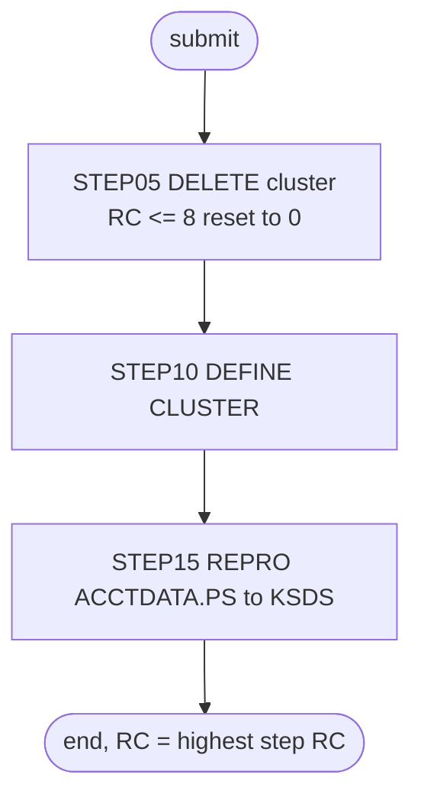

# ACCTFILE: Account master reload

## 1. Summary

ACCTFILE throws away the account master file and rebuilds it from the flat sample file. Step `STEP05` deletes the VSAM cluster `AWS.M2.CARDDEMO.ACCTDATA.VSAM.KSDS`, `STEP10` defines it again empty (key 11 bytes at offset 0, fixed 300-byte records), and `STEP15` copies every record of `AWS.M2.CARDDEMO.ACCTDATA.PS` into it. It is run by hand during installation and as part of the demo "data refresh" before a batch cycle. It contains no business logic; what it must preserve is the file definition and the fact that the result is an exact copy of the flat file.

## 2. Rules at a glance

The job has no business rules. Its items:

| ID | Rule |
| :-- | :-- |
| SE-JACCT-001 | Delete the account cluster; a failure with return code 8 or less is ignored. |
| SE-JACCT-002 | Define the account cluster: key 11 at offset 0, records 300 fixed, `SHAREOPTIONS(2 3)`, `ERASE`, no `REUSE`. |
| SE-JACCT-003 | Load the cluster with every record of `ACCTDATA.PS`, in file order. |
| ERR-JACCT-001 | No step has a `COND`, so `STEP15` runs even when the define failed. |
| VAL-JACCT-001 | The load rejects records out of key order or with duplicate keys (VSAM rule). |
| DEF-JACCT-001 | The return-code reset also hides a delete that failed because the file is in use. |
| DEF-JACCT-002 | The job does not close the file in CICS itself. |

## 3. Actors and triggers

- **Trigger:** submitted by an operator. It is in the README's initialisation sequence (`./README.md:154`) and in the demo full-batch script (`scripts/run_full_batch.sh:16-17`), and the restart runbook uses it to restore demo account data after a failed POSTTRAN (`docs/runbooks/batch-cycle-restart.md:73-75`). Neither the CA-7 nor the Control-M schedule runs it (see `SCHED-CA7.md`, `SCHED-CONTROLM.md`).
- **Preconditions:** CICS has closed file `ACCTDAT` (run CLOSEFIL first; DEF-JACCT-002); `AWS.M2.CARDDEMO.ACCTDATA.PS` exists and is sorted by account ID; volume `AWSHJ1` exists.
- **Job card:** `CLASS=A,MSGCLASS=0,NOTIFY=&SYSUID` (`:1-2`). No parameters, no symbolic overrides.

## 4. Interfaces

| Step | Program | DD | Dataset | Disposition | Use | Source |
| :-- | :-- | :-- | :-- | :-- | :-- | :-- |
| `STEP05` | IDCAMS | `SYSPRINT` | `SYSOUT=*` | - | IDCAMS messages | `:23` |
| `STEP05` | IDCAMS | `SYSIN` | in-stream | - | `DELETE` statement | `:24-28` |
| `STEP10` | IDCAMS | `SYSPRINT` | `SYSOUT=*` | - | IDCAMS messages | `:34` |
| `STEP10` | IDCAMS | `SYSIN` | in-stream | - | `DEFINE CLUSTER` statement | `:35-50` |
| `STEP15` | IDCAMS | `SYSPRINT` | `SYSOUT=*` | - | IDCAMS messages | `:55` |
| `STEP15` | IDCAMS | `ACCTDATA` | `AWS.M2.CARDDEMO.ACCTDATA.PS` | `SHR` | input, sequential | `:56-57` |
| `STEP15` | IDCAMS | `ACCTVSAM` | `AWS.M2.CARDDEMO.ACCTDATA.VSAM.KSDS` | `SHR` | output, KSDS | `:58-59` |
| `STEP15` | IDCAMS | `SYSIN` | in-stream | - | `REPRO` statement | `:60-62` |

Return code of the job: the highest step return code. Console output is IDCAMS `SYSPRINT` only (incidental).

## 5. Data used

- ENT-ACCOUNT, whole 300-byte records, copied unchanged from `ACCTDATA.PS` to the KSDS. No field is interpreted; the key is bytes 1-11 (`ACCT-ID`).
- Catalog state on 09/01/22 (`app/catlg/LISTCAT.txt:22-79`): the cluster has `KEYLEN 11`, `RKP 0`, `MAXLRECL 300`, `SHROPTNS(2,3)`, `ERASE`, `NOREUSE` and `REC-TOTAL 50`, which matches the define in SE-JACCT-002 and the 50 sample accounts.

## 6. Processing flow

All three steps are plumbing; none carries a business decision.

| # | Step | Class | What it does | Runs when |
| --: | :-- | :-- | :-- | :-- |
| 1 | `STEP05` | plumbing | delete the cluster | always |
| 2 | `STEP10` | plumbing | define the cluster | always (no `COND`) |
| 3 | `STEP15` | plumbing | copy `ACCTDATA.PS` into the cluster | always (no `COND`) |

## 7. Business rules

None. The job moves data without interpreting it; see the side effects in section 9.

## 8. Validations and messages

#### VAL-JACCT-001 · The load requires ascending, unique keys
- **When:** `STEP15` copies a record whose key (bytes 1-11) is not higher than the previous record's key.
- **Then:** VSAM rejects that record and IDCAMS prints an error message for it; the step ends with return code 8 or higher. The remaining records are still copied until IDCAMS reaches its error limit (by default it stops after 4 such errors).
- **Source:** `:61`
- **Fidelity:** must-preserve (the target load must also fail visibly on unsorted or duplicate input) · **Confidence:** platform-inferred (IDCAMS `REPRO` into a KSDS; no local run)

No operator-facing message text is produced by the job itself; all messages are IDCAMS `IDCnnnnI` messages in `SYSPRINT`.

## 9. Side effects

In execution order. There is no rollback: each step's change is permanent.

#### SE-JACCT-001 · Delete the account cluster
- **What:** `DELETE AWS.M2.CARDDEMO.ACCTDATA.VSAM.KSDS CLUSTER`, which removes the cluster with its data and index components and all its records.
- **Return code:** `IF MAXCC LE 08 THEN SET MAXCC = 0` turns any result of 8 or less into 0, so a missing cluster (first run) is not an error.
- **Source:** `:25-27`
- **Fidelity:** must-preserve · **Confidence:** reviewed

#### SE-JACCT-002 · Define the account cluster
- **What:** `DEFINE CLUSTER` named `AWS.M2.CARDDEMO.ACCTDATA.VSAM.KSDS` with:

| Attribute | Value |
| :-- | :-- |
| Organisation | `INDEXED` (KSDS) |
| Key | `KEYS(11 0)`: 11 bytes at offset 0 |
| Record size | `RECORDSIZE(300 300)`: average and maximum 300, so fixed 300 |
| Space | `CYLINDERS(1 5)` on `VOLUMES(AWSHJ1)` |
| Sharing | `SHAREOPTIONS(2 3)`: one writer and many readers within a system |
| Other | `ERASE` (data overwritten on delete); no `REUSE`, so the file cannot be reopened for output once loaded |
| Components | data `...ACCTDATA.VSAM.KSDS.DATA`, index `...ACCTDATA.VSAM.KSDS.INDEX` |

- **Source:** `:36-49`
- **Fidelity:** must-preserve (key and record size); incidental (space, volume, `ERASE`) · **Confidence:** reviewed

#### SE-JACCT-003 · Load the cluster from the flat file
- **What:** `REPRO INFILE(ACCTDATA) OUTFILE(ACCTVSAM)` copies every record of `AWS.M2.CARDDEMO.ACCTDATA.PS`, in file order, into the new cluster. Records are copied byte for byte.
- **Source:** `:56-61`
- **Fidelity:** must-preserve · **Confidence:** reviewed

## 10. Error handling

#### ERR-JACCT-001 · Steps run regardless of earlier failures
- **When:** a step ends with a non-zero return code without abending.
- **Then:** the next step still runs, because no `EXEC` has a `COND` parameter. If `STEP10` fails (for example because the delete did not remove the cluster), `STEP15` loads the records into whatever cluster exists (DEF-JACCT-001). An abend in a step skips the remaining steps (JES default).
- **Source:** `:22, 33, 54`
- **Fidelity:** defect-decide · **Confidence:** platform-inferred

## 11. Interactions

- **Upstream:** CLOSEFIL closes `ACCTDAT` in CICS (README order, `./README.md:153-154`).
- **Downstream:** every reader of the account master: POSTTRAN (`CBTRN02C`), INTCALC (`CBACT04C`), CREASTMT (`CBSTM03A`), READACCT (`CBACT01C`), CBEXPORT, and the online programs through CICS file `ACCTDAT` after OPENFIL.
- **Shared data:** `ACCTDATA.PS` is also the restore source in the restart runbook (`docs/runbooks/batch-cycle-restart.md:74-75`).

## 12. Numeric, date and format details

None. The job copies bytes; it does not interpret any field.

## 13. Known defects and oddities

#### DEF-JACCT-001 · The return-code reset hides a failed delete
- `IF MAXCC LE 08 THEN SET MAXCC = 0` is meant for "cluster not found", but it also hides other delete failures with return code 8, for example when the cluster is still allocated to CICS. Then `STEP10` fails because the name already exists, and `STEP15` copies the flat file on top of the old, loaded cluster: records with existing keys are rejected as duplicates and the job ends with a non-zero code, but the old data stays.
- **Source:** `:27, 33, 54`
- **Status:** open · **Fidelity:** defect-decide · **Confidence:** platform-inferred

#### DEF-JACCT-002 · The job does not close the file in CICS
- Unlike CARDFILE, CUSTFILE and TRANFILE, ACCTFILE has no CICS close and open step, so it depends on CLOSEFIL having run first and on OPENFIL afterwards.
- **Source:** `:22-62`
- **Status:** open · **Fidelity:** incidental · **Confidence:** reviewed

## 14. Open questions

| ID | Question | For |
| :-- | :-- | :-- |
| Q-JACCT-001 | Is a full delete-and-reload of the account master needed in the target outside demo set-up, or only a seed load for new environments? | operations |

## 15. Equivalence contract

After a successful run (return code 0), the account store contains exactly the records of `ACCTDATA.PS`: same count (50 for the sample data), same bytes, keyed by `ACCT-ID`, and nothing else. A reimplementation must fail (non-zero result, no silent partial load) when the input has keys out of order or duplicated (VAL-JACCT-001). IDCAMS message text may differ.

## 16. Paragraph coverage

| Step | Lines | Covered by |
| :-- | :-- | :-- |
| (job card) | 1-2 | §3 |
| `STEP05` | 22-28 | SE-JACCT-001, DEF-JACCT-001 |
| `STEP10` | 33-50 | SE-JACCT-002, ERR-JACCT-001 |
| `STEP15` | 54-62 | SE-JACCT-003, VAL-JACCT-001, ERR-JACCT-001 |
