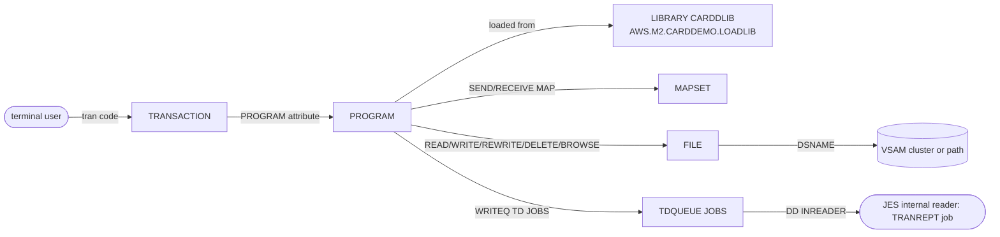

# CARDDEMO-CSD: CICS resource definitions

## 1. Summary

`app/csd/CARDDEMO.CSD` is an export of the CICS system definitions of group `CARDDEMO`: 64 `DEFINE` commands for 8 files, 17 mapsets, 18 programs, 18 transactions, 2 program libraries and 1 transient-data queue. Installed in a CICS region, it gives the online application its entry points (each 4-character transaction code starts one program), its screens, its access to the VSAM masters (each CICS file name points at a dataset), the library its load modules come from, and the queue `JOBS` through which `CORPT00C` submits the transaction report job to the internal reader. It holds no logic. What a target must preserve is the transaction-to-program routing, the file-to-store mapping and the job submission path; the attribute settings (no recovery, no resource security, one string per file) are AS-IS facts that the target has to decide on (DEF-JCSD-003, ERR-JCSD-001). The optional modules have their own CSD files and are not part of this group.

## 2. Rules at a glance

| ID | Rule |
| :-- | :-- |
| FLOW-JCSD-001 | 18 transactions, each starting one program. |
| FLOW-JCSD-002 | 18 program definitions; eleven name `LANGUAGE(COBOL)`, four carry an inert `TRANSID` attribute. |
| FLOW-JCSD-003 | 17 mapsets, one for each BMS member in `app/bms`. |
| SE-JCSD-001 | 8 CICS files, each mapped to one VSAM cluster or path, all allowing read, browse, add, update and delete. |
| SE-JCSD-002 | Queue `JOBS` writes 80-byte records to DD `INREADER` (the internal reader): job submission from CICS. |
| SE-JCSD-003 | Two libraries on the same load library: `CARDDLIB` enabled, `COM2DOLL` disabled. |
| ERR-JCSD-001 | Every file is `RECOVERY(NONE)`: updates are not backed out by a rollback or an abend. |
| ERR-JCSD-002 | A failed write to `JOBS` is reported to the user by `CORPT00C`; `ERROROPTION(IGNORE)` covers I/O errors only. |
| NUM-JCSD-001 | File access settings: one string, one LSR pool, first-reference open, shared disposition, variable record format. |
| DEF-JCSD-001 | Program `COCRDSEC` and its transaction `CDV1` have no source. |
| DEF-JCSD-002 | Program `COCRDLIC` has `TRANSID(CC00)`, the sign-on transaction. |
| DEF-JCSD-003 | [security] No resource or command security on any transaction; EDF allowed on every program. |
| DEF-JCSD-004 | [security] Every file allows add, update and delete, including `USRSEC` and files that are only read. |
| DEF-JCSD-005 | Two library definitions for one load library; the README defines the disabled one. |
| DEF-JCSD-006 | No CICS file for the transaction alternate index. |
| DEF-JCSD-007 | The README's set-up steps do not install the whole group, and its preferred option does not read this file. |
| DEF-JCSD-008 | The date routine `CSUTLDTC` that three online programs call has no program definition. |
| DEF-JCSD-009 | [security] Every transaction has `TRACE(YES)` with `CONFDATA(NO)`: user data is not hidden in CICS traces. |

## 3. Actors and triggers

- **Who uses it:** a CICS system programmer loads the definitions into the CSD, either with DFHCSDUP or by hand with CEDA, then installs the group in the region. The README gives both options: "Option 1 (Preferred): Use the DFHCSDUP JCL with the CSD file in the CSD folder", or CEDA `DEFINE` commands for a few resources (`./README.md:173-183`), followed by `CEDA INSTALL` of single resources, `CECI LOAD` and `NEWCOPY` (`./README.md:185-197`). The only DFHCSDUP job in the repository, CBADMCDJ, does not read this file (see `CBADMCDJ.md`, DEF-JCSDUP-008).
- **At run time:** a terminal user types a transaction code, or a program issues `RETURN TRANSID` or `XCTL`; CICS looks up the transaction, loads the program from the enabled library, and opens a file at its first use.
- **Format:** each definition starts with ` DEFINE <type>(<name>) GROUP(CARDDEMO)` in column 2, followed by attribute lines. Every definition also carries metadata attributes (`DEFINETIME`, `CHANGETIME`, `CHANGEUSRID(AWSUSER)`, `CHANGEAGENT`, `CHANGEAGREL(0730)`); the definition dates run from 22/02/19 to 22/07/13 (`:97, 155`).

## 4. Interfaces

The resources a CICS region gets from this group, by type:

| Type | Count | Lines | Consumers |
| :-- | --: | :-- | :-- |
| `FILE` | 8 | `:1-99` | online programs, `EXEC CICS READ/WRITE/REWRITE/DELETE/STARTBR FILE(...)`; CLOSEFIL, OPENFIL and the reload jobs via `CEMT SET FILE` |
| `MAPSET` | 17 | `:100-172` | online programs, `EXEC CICS SEND/RECEIVE MAP ... MAPSET(...)` |
| `PROGRAM` | 18 | `:173-305` | CICS program control (`XCTL`, transaction start) |
| `TRANSACTION` | 18 | `:306-488` | terminal users, `RETURN TRANSID` |
| `LIBRARY` | 2 | `:489-498` | CICS loader |
| `TDQUEUE` | 1 | `:499-505` | `CORPT00C` (`EXEC CICS WRITEQ TD QUEUE('JOBS')`, `app/cbl/CORPT00C.cbl:517-523`) |

## 5. Data used

No data records. The file definitions map CICS file names to the stores of the entity catalog:

| CICS file | Dataset | Entity | Lines |
| :-- | :-- | :-- | :-- |
| `ACCTDAT` | `AWS.M2.CARDDEMO.ACCTDATA.VSAM.KSDS` | ENT-ACCOUNT | `:1-12` |
| `CARDAIX` | `AWS.M2.CARDDEMO.CARDDATA.VSAM.AIX.PATH` | ENT-CARD (by account) | `:13-24` |
| `CARDDAT` | `AWS.M2.CARDDEMO.CARDDATA.VSAM.KSDS` | ENT-CARD | `:25-36` |
| `CCXREF` | `AWS.M2.CARDDEMO.CARDXREF.VSAM.KSDS` | ENT-CARD-XREF | `:37-49` |
| `CUSTDAT` | `AWS.M2.CARDDEMO.CUSTDATA.VSAM.KSDS` | ENT-CUSTOMER | `:50-62` |
| `CXACAIX` | `AWS.M2.CARDDEMO.CARDXREF.VSAM.AIX.PATH` | ENT-CARD-XREF (by account) | `:63-75` |
| `TRANSACT` | `AWS.M2.CARDDEMO.TRANSACT.VSAM.KSDS` | ENT-TRANSACTION | `:76-87` |
| `USRSEC` | `AWS.M2.CARDDEMO.USRSEC.VSAM.KSDS` | user security records (no catalog entity yet) | `:88-99` |

## 6. Processing flow

There is no processing. At run time the definitions are used as follows:

#### FLOW-JCSD-001 · Transaction to program routing
- **When:** a transaction code is entered at a terminal or named on `RETURN TRANSID`.
- **Then:** CICS starts the program named on the transaction. All 18 transactions have `PROFILE(DFHCICST)`, `TRANCLASS(DFHTCL00)`, `PRIORITY(1)`, `TASKDATALOC(ANY)`, `TASKDATAKEY(USER)`, `ISOLATE(YES)`, `DTIMOUT(NO)`, `RESTART(NO)`, `SPURGE(YES)`, `TPURGE(YES)`, `ACTION(BACKOUT)`, `RESSEC(NO)`, `CMDSEC(NO)`, `STATUS(ENABLED)`.

| Transaction | Program | Description | Lines |
| :-- | :-- | :-- | :-- |
| `CAUP` | `COACTUPC` | CREDIT CARD DEMO ACCOUNT UPDATE | `:306-316` |
| `CAVW` | `COACTVWC` | - | `:317-326` |
| `CA00` | `COADM01C` | - | `:327-336` |
| `CB00` | `COBIL00C` | - | `:337-346` |
| `CCDL` | `COCRDSLC` | - | `:347-356` |
| `CCLI` | `COCRDLIC` | - | `:357-366` |
| `CCUP` | `COCRDUPC` | CREDIT CARD UPDATE TRANSACTION | `:367-377` |
| `CC00` | `COSGN00C` | - | `:378-387` |
| `CDV1` | `COCRDSEC` | DEVELOPER TRANSACTION - 1 | `:388-398` |
| `CM00` | `COMEN01C` | - | `:399-408` |
| `CR00` | `CORPT00C` | - | `:409-418` |
| `CT00` | `COTRN00C` | - | `:419-428` |
| `CT01` | `COTRN01C` | - | `:429-438` |
| `CT02` | `COTRN02C` | - | `:439-448` |
| `CU00` | `COUSR00C` | - | `:449-458` |
| `CU01` | `COUSR01C` | - | `:459-468` |
| `CU02` | `COUSR02C` | - | `:469-478` |
| `CU03` | `COUSR03C` | - | `:479-488` |

  The codes match the `WS-TRANID` or transaction literals in the programs (for example `COSGN00C` `CC00`, `COADM01C` `CA00`, `COUSR03C` `CU03`, `app/cbl/COUSR03C.cbl:37`). `CC00` is the sign-on transaction.
- **Source:** `:306-488`, `app/cbl/COUSR03C.cbl:37`
- **Fidelity:** must-preserve (entry codes and their programs) · **Confidence:** reviewed

#### FLOW-JCSD-002 · Program definitions
- **When:** a transaction starts a program, or a program transfers control with `XCTL`.
- **Then:** CICS loads the program from the enabled library. All 18 programs are `STATUS(ENABLED)`, `DATALOCATION(ANY)`, `EXECKEY(USER)`, `CONCURRENCY(QUASIRENT)`, `API(CICSAPI)`, `RELOAD(NO)`, `RESIDENT(NO)`, `DYNAMIC(NO)`, `CEDF(YES)`. Eleven carry `LANGUAGE(COBOL)` (`COADM01C`, `COBIL00C`, `COMEN01C`, `CORPT00C`, `COTRN00C`-`COTRN02C`, `COUSR00C`-`COUSR03C`; `:190, 197, 236, 243, 258, 265, 272, 279, 286, 293, 300`); the other seven (`COACTUPC`, `COACTVWC`, `COCRDLIC`, `COCRDSEC`, `COCRDSLC`, `COCRDUPC`, `COSGN00C`) have no `LANGUAGE`, which CICS then determines when it loads the module. Four carry a `TRANSID`: `COACTVWC` `CAVW` (`:185`), `COCRDLIC` `CC00` (`:207`), `COCRDSLC` `CCDL` (`:223`) and `COSGN00C` `CC00` (`:253`). On a program definition, `TRANSID` names the mirror transaction that a remote region attaches when this region calls the program by distributed program link; it is used only when the program is also defined with `REMOTESYSTEM`. None of the 18 programs has `REMOTESYSTEM`, so the attribute is inert here and does not change local routing.
- **Source:** `:173-305`
- **Fidelity:** must-preserve (the program set); incidental (load attributes) · **Confidence:** reviewed (attributes); platform-inferred (meaning of `TRANSID`, `LANGUAGE` default)

#### FLOW-JCSD-003 · Mapset definitions
- **When:** a program sends or receives a map.
- **Then:** CICS loads the physical mapset. The 17 mapsets `COACTUP`, `COACTVW`, `COADM01`, `COBIL00`, `COCRDLI`, `COCRDSL`, `COCRDUP`, `COMEN01`, `CORPT00`, `COSGN00`, `COTRN00`, `COTRN01`, `COTRN02`, `COUSR00`, `COUSR01`, `COUSR02`, `COUSR03` are exactly the 17 members of `app/bms`, all `STATUS(ENABLED)`, `RESIDENT(NO)`, `USAGE(NORMAL)`. Programs name them as literals, for example `MAPSET('COADM01')` (`app/cbl/COADM01C.cbl:184`).
- **Source:** `:100-172`, `app/cbl/COADM01C.cbl:184`
- **Fidelity:** must-preserve (one screen set per function) · **Confidence:** reviewed

## 7. Business rules

None. The definitions carry no business logic.

## 8. Validations and messages

None. CICS validates the definitions when they are defined and installed.

## 9. Side effects

Installing the group creates the resources in the region; the side effects below are what those resources do at run time.

#### SE-JCSD-001 · CICS files over the VSAM masters
- **What:** each `FILE` definition gives a CICS file name to one VSAM cluster or path (table in section 5). Every file has `ADD(YES) BROWSE(YES) DELETE(YES) READ(YES) UPDATE(YES)`, `STATUS(ENABLED)`, `OPENTIME(FIRSTREF)`, `DISPOSITION(SHARE)`, `RLSACCESS(NO)`, `READINTEG(UNCOMMITTED)`, `UPDATEMODEL(LOCKING)`, `RECOVERY(NONE)`, `JOURNAL(NO)`. The programs use all eight names: for example `COACTUPC` and `COACTVWC` name `ACCTDAT`, `CUSTDAT`, `CARDDAT`, `CARDAIX` and `CXACAIX` (`app/cbl/COACTUPC.cbl:572-583`), the transaction programs `TRANSACT`, and the sign-on and user programs `USRSEC`. Two files are paths over alternate indexes: `CARDAIX` (cards by account) and `CXACAIX` (cross-reference by account). Only three reload jobs close and reopen CICS files themselves: CARDFILE (`CARDDAT`, `CARDAIX`; `app/jcl/CARDFILE.jcl:26-27, 122-123`), CUSTFILE (`CUSTDAT`; `app/jcl/CUSTFILE.jcl:26, 80`) and TRANFILE (`TRANSACT`, `CXACAIX`; `app/jcl/TRANFILE.jcl:26-27, 120-121`). The others rely on CLOSEFIL and OPENFIL (see `CLOSEFIL.md`, `OPENFIL.md`).
- **Source:** `:1-99`, `app/cbl/COACTUPC.cbl:572-583`, `app/jcl/CARDFILE.jcl:26-27, 122-123`, `app/jcl/CUSTFILE.jcl:26, 80`, `app/jcl/TRANFILE.jcl:26-27, 120-121`
- **Fidelity:** must-preserve (file-to-store mapping) · **Confidence:** reviewed

#### SE-JCSD-002 · Job submission queue `JOBS`
- **What:** `TDQUEUE(JOBS)`, `DESCRIPTION(SUBMIT JOBS FROM CICS)`, `TYPE(EXTRA)`, `TYPEFILE(OUTPUT)`, `DDNAME(INREADER)`, `RECORDSIZE(80)`, `RECORDFORMAT(FIXED)`, `BLOCKFORMAT(UNBLOCKED)`, `DISPOSITION(MOD)`, `OPENTIME(INITIAL)`, `ERROROPTION(IGNORE)`, `DATABUFFERS(1)`. An extrapartition queue writes to the dataset on DD `INREADER` of the CICS region job; for jobs to be submitted, that DD must be allocated to the JES internal reader (`SYSOUT=(A,INTRDR)` or similar), which is region JCL and not in the repository. `CORPT00C` writes its job image, 80 bytes per line, one `WRITEQ TD` per line (`app/cbl/CORPT00C.cbl:79-127, 515-523`). `OPENTIME(INITIAL)` opens the queue when the definition is installed; that happens at CICS start only if group `CARDDEMO` is in the region's startup group list.
- **Source:** `:499-505`, `app/cbl/CORPT00C.cbl:515-523`
- **Fidelity:** must-preserve (online request starts the report job) · **Confidence:** reviewed (definition); platform-inferred (internal reader DD)

#### SE-JCSD-003 · Program libraries
- **What:** `LIBRARY(CARDDLIB)`, `STATUS(ENABLED)`, and `LIBRARY(COM2DOLL)`, `STATUS(DISABLED)`, both `RANKING(50)`, `CRITICAL(NO)`, `DSNAME01(AWS.M2.CARDDEMO.LOADLIB)`. The region loads CardDemo programs and mapsets from `AWS.M2.CARDDEMO.LOADLIB` through `CARDDLIB`.
- **Source:** `:489-498`
- **Fidelity:** incidental · **Confidence:** reviewed

## 10. Error handling

#### ERR-JCSD-001 · File updates are not recoverable
- **When:** a task that has updated a file abends, or issues `SYNCPOINT ROLLBACK`.
- **Then:** every file is `RECOVERY(NONE)` with `JOURNAL(NO)`, so CICS does not log the before-images and cannot back the updates out; the transaction's `ACTION(BACKOUT)` has nothing to undo for these files. Record locks on a non-recoverable file are released when the request completes, not at syncpoint. Example: `COACTUPC` rewrites the account and then the customer; when the customer rewrite fails it issues `SYNCPOINT ROLLBACK` (`app/cbl/COACTUPC.cbl:4085-4104`), which leaves the account update in place.
- **Source:** `:9, 21, 33, 46, 59, 72, 84, 96`, `app/cbl/COACTUPC.cbl:4095-4103`
- **Fidelity:** defect-decide (Q-JCSD-002) · **Confidence:** reviewed (attributes); platform-inferred (CICS recovery behaviour)

#### ERR-JCSD-002 · Errors on the job submission queue
- **When:** a `WRITEQ TD` to `JOBS` fails, for example because DD `INREADER` is not allocated and the queue is closed, or because the queue is disabled.
- **Then:** `CORPT00C` gets a non-normal `RESP`, displays it, and tells the user `Unable to Write TDQ (JOBS)...` (`app/cbl/CORPT00C.cbl:525-535`). `ERROROPTION(IGNORE)` applies to I/O errors on the queue's dataset: CICS then skips the block in error without telling the program, so lines of the submitted job can be lost silently.
- **Source:** `:501`, `app/cbl/CORPT00C.cbl:525-535`
- **Fidelity:** incidental · **Confidence:** reviewed (program); platform-inferred (`ERROROPTION`)

## 11. Interactions

- **Online programs:** the transaction, program and mapset definitions are the entry points and screens of areas a, b and c (sign-on, menus, user administration, account and card functions, transactions, bill payment, reports).
- **Batch:** CLOSEFIL and OPENFIL close and open 5 of the 8 files (`TRANSACT`, `CCXREF`, `ACCTDAT`, `CXACAIX`, `USRSEC`); CARDFILE and CUSTFILE handle `CARDDAT`, `CARDAIX` and `CUSTDAT` themselves; the reload jobs replace the datasets that the files point at (see the job specs). TRANREPT is the job that `CORPT00C` submits through `JOBS` (see `TRANREPT.md`).
- **Set-up:** CBADMCDJ defines a different, outdated resource list (see `CBADMCDJ.md`).
- **Optional modules:** their resources are in their own CSD files under `app/app-*/csd/`, out of scope here.

## 12. Numeric, date and format details

#### NUM-JCSD-001 · File access settings
- Every file: `STRINGS(1)` (one concurrent request per file), `LSRPOOLNUM(1)`, `DATABUFFERS(2)`, `INDEXBUFFERS(1)`, `TABLE(NO)`, `LOAD(NO)`, `MAXNUMRECS(NOLIMIT)`, `RECORDFORMAT(V)`, `DSNSHARING(ALLREQS)`, `BACKUPTYPE(STATIC)`. With one string, a second task that needs the same file while a request or browse holds the string waits. With `LSRPOOLNUM(1)` the files use the shared buffers of LSR pool 1, so their own `DATABUFFERS` and `INDEXBUFFERS` values do not apply; they would only for non-shared resources. `RECORDFORMAT(V)` is used although every CardDemo record is fixed length; for VSAM this does not change the data.
- The queue `JOBS`: 80-byte fixed, unblocked records, appended (`DISPOSITION(MOD)`), matching the 80-byte `JCL-RECORD` of `CORPT00C` (`app/cbl/CORPT00C.cbl:79`).
- **Source:** `:3-6, 501-503`, `app/cbl/CORPT00C.cbl:79`
- **Fidelity:** incidental · **Confidence:** reviewed (values); platform-inferred (string waits)

## 13. Known defects and oddities

#### DEF-JCSD-001 · A program and transaction with no source
- `PROGRAM(COCRDSEC)`, `DESCRIPTION(CREDIT CARD SEARCH)`, and `TRANSACTION(CDV1)`, `DESCRIPTION(DEVELOPER TRANSACTION - 1)`, which starts it. No member `COCRDSEC` exists in the repository and nothing else refers to it or to `CDV1`; starting `CDV1` would fail with program not found.
- **Source:** `:211-218, 388-398`
- **Status:** open · **Fidelity:** incidental · **Confidence:** reviewed

#### DEF-JCSD-002 · The card list program carries the sign-on transaction
- `COCRDLIC` has `TRANSID(CC00)` (`:207`), the code of the sign-on transaction, while its own transaction is `CCLI` (`:357-358`). The attribute is inert here: it names the mirror transaction only for a program defined with `REMOTESYSTEM` and called by an outbound distributed program link, and `COCRDLIC` has no `REMOTESYSTEM` (`:203-210`; FLOW-JCSD-002). If a region linked to a remote `COCRDLIC` with this definition, the remote mirror would run under `CC00`.
- **Source:** `:203-210`
- **Status:** open · **Fidelity:** incidental · **Confidence:** reviewed (attribute); platform-inferred (effect)

#### DEF-JCSD-003 · [security] No transaction-level security
- Every transaction has `RESSEC(NO)` and `CMDSEC(NO)`, and every program `CEDF(YES)`. CICS therefore does not check access to the files and other resources a transaction uses, nor to system commands. Whether a user may start a transaction at all is decided at attach time by transaction security (the SIT parameter `XTRAN` and the RACF transaction profiles), which is not a CSD attribute and not in the repository. If it is off, any user who can start a transaction can start the administrative ones (`CA00`, `CU00` to `CU03`) by typing the code, and the only control is in the programs (sign-on and menu logic, areas a and b). `CEDF(YES)` lets the execution diagnostic facility run against every program.
- **Source:** `:176, 314, 324, 334`
- **Status:** open · **Fidelity:** defect-decide · **Confidence:** reviewed (attributes); platform-inferred (consequence)

#### DEF-JCSD-004 · [security] Every file allows every operation
- All eight files have `ADD(YES) BROWSE(YES) DELETE(YES) READ(YES) UPDATE(YES)`, including the user security file `USRSEC` and the alternate-index paths. Programs that only read (for example the view programs) get the same file as programs that update, so CICS enforces no least privilege at file level.
- **Source:** `:6-7, 93-94`
- **Status:** open · **Fidelity:** defect-decide · **Confidence:** reviewed

#### DEF-JCSD-005 · Two libraries for one load library
- `CARDDLIB` (enabled) and `COM2DOLL` (disabled) both point at `AWS.M2.CARDDEMO.LOADLIB` (`:489-498`). The README's manual alternative defines only `COM2DOLL`, without `STATUS`, so enabled by default (`./README.md:178`), and CBADMCDJ does the same. Which definition serves the modules depends on the set-up path.
- **Source:** `:489-498`
- **Status:** open · **Fidelity:** incidental · **Confidence:** reviewed

#### DEF-JCSD-006 · No CICS file for the transaction alternate index
- TRANIDX builds `TRANSACT.VSAM.AIX` and its path, but the group defines no CICS file over the path; only `TRANSACT` (by transaction ID) is available online. The online programs therefore cannot use the index (see `TRANIDX.md`).
- **Source:** `:76-87`
- **Status:** open · **Fidelity:** incidental · **Confidence:** reviewed

#### DEF-JCSD-007 · Set-up instructions do not match this file
- The README's preferred option uses "the DFHCSDUP JCL with the CSD file in the CSD folder" (`./README.md:174`), but the only DFHCSDUP job (CBADMCDJ) uses in-stream commands. The install step names single resources (`CEDA INSTALL TRANS(CCLI)`, `FILE(CARDDAT)`, `./README.md:189-190`) rather than `CEDA INSTALL GROUP(CARDDEMO)`, so following them literally installs two resources of 64. The file itself carries read-only metadata attributes on every definition (Q-JCSD-003). They also show that the group was built along two paths: 54 definitions were last changed through `CHANGEAGENT(CSDAPI)` (CEDA or the CICS programming interface, for example `:12`) and 10 through `CHANGEAGENT(CSDBATCH)` (DFHCSDUP, for example `:24`).
- **Source:** `:1-505`
- **Status:** open · **Fidelity:** incidental · **Confidence:** reviewed (texts); platform-inferred (DFHCSDUP behaviour)

#### DEF-JCSD-008 · The date routine CSUTLDTC has no program definition
- `CORPT00C` (`app/cbl/CORPT00C.cbl:392, 412`), `COTRN02C` (`app/cbl/COTRN02C.cbl:393, 413`) and `COACTUPC` (through the copybook `CSUTLDPY`, `app/cbl/COACTUPC.cbl:4232`, `app/cpy/CSUTLDPY.cpy:293`) call the date validation routine `CSUTLDTC` by literal name, but the group has no `PROGRAM(CSUTLDTC)`. A `CALL` of a literal is resolved at link-edit time when the caller is compiled with `NODYNAM`, as the sample online build procedure does (`samples/proc/BUILDONL.prc:40`); CSUTLDTC is then part of each caller's load module and needs no CICS definition, so the omission is most likely harmless. A caller compiled with `DYNAM` would need a definition or program autoinstall. See Q-DTCK-004 in `CSUTLDTC.md`.
- **Source:** `app/cbl/CORPT00C.cbl:392, 412`, `app/cbl/COTRN02C.cbl:393, 413`, `app/cbl/COACTUPC.cbl:4232`, `samples/proc/BUILDONL.prc:40`
- **Status:** open · **Fidelity:** incidental (Q-DTCK-004) · **Confidence:** reviewed (calls, compile option); platform-inferred (binding in production)

#### DEF-JCSD-009 · [security] Traced transactions do not hide user data
- All 18 transactions have `TRACE(YES)` and `CONFDATA(NO)` (`:312-313` for `CAUP`, the same two attributes in every other transaction). With `CONFDATA(NO)` CICS does not suppress user data in the trace entries it writes for the transaction, so when tracing is active the terminal input and output of the sign-on screen (`CC00`, user ID and password) and of the account, card and transaction screens (card numbers, SSNs) can appear in CICS internal or auxiliary trace and in dumps taken from it.
- **Source:** `:312-313`
- **Status:** open · **Fidelity:** defect-decide · **Confidence:** reviewed (attributes); platform-inferred (trace content)

## 14. Open questions

| ID | Question | For |
| :-- | :-- | :-- |
| Q-JCSD-001 | Should the target enforce function-level authorisation for the administrative functions, instead of relying on the menus (DEF-JCSD-003)? | security |
| Q-JCSD-002 | Must an online update that touches several stores (account and customer in `COACTUPC`) be atomic in the target, although the AS-IS files are not recoverable (ERR-JCSD-001)? | business, architecture |
| Q-JCSD-003 | Can DFHCSDUP read this export as input as it is, with `DEFINETIME`, `CHANGETIME` and the other metadata attributes, or must they be removed first? | mainframe team |
| Q-JCSD-004 | What was `COCRDSEC` / `CDV1` for, and can it be dropped (DEF-JCSD-001)? | application owner |

## 15. Equivalence contract

A target must provide one entry point per transaction code in FLOW-JCSD-001, starting the function of the named program, and give each function access to the stores of section 5 with the same keys (including the by-account access paths of `CARDAIX` and `CXACAIX`). The report request must still start the transaction report batch job (SE-JCSD-002). CICS-specific attributes (strings, buffers, LSR pools, open time, libraries, profiles, transaction classes) need not be reproduced. Recovery and security settings are decisions (Q-JCSD-001, Q-JCSD-002), not behaviour to copy.

## 16. Paragraph coverage

| Unit | Lines | Covered by |
| :-- | :-- | :-- |
| (`DEFINE FILE(ACCTDAT)`) | 1-12 | SE-JCSD-001, NUM-JCSD-001, ERR-JCSD-001, DEF-JCSD-004 |
| (`DEFINE FILE(CARDAIX)`) | 13-24 | SE-JCSD-001, NUM-JCSD-001, ERR-JCSD-001, DEF-JCSD-004 |
| (`DEFINE FILE(CARDDAT)`) | 25-36 | SE-JCSD-001, NUM-JCSD-001, ERR-JCSD-001, DEF-JCSD-004 |
| (`DEFINE FILE(CCXREF)`) | 37-49 | SE-JCSD-001, NUM-JCSD-001, ERR-JCSD-001, DEF-JCSD-004 |
| (`DEFINE FILE(CUSTDAT)`) | 50-62 | SE-JCSD-001, NUM-JCSD-001, ERR-JCSD-001, DEF-JCSD-004 |
| (`DEFINE FILE(CXACAIX)`) | 63-75 | SE-JCSD-001, NUM-JCSD-001, ERR-JCSD-001, DEF-JCSD-004 |
| (`DEFINE FILE(TRANSACT)`) | 76-87 | SE-JCSD-001, NUM-JCSD-001, ERR-JCSD-001, DEF-JCSD-004, DEF-JCSD-006 |
| (`DEFINE FILE(USRSEC)`) | 88-99 | SE-JCSD-001, NUM-JCSD-001, ERR-JCSD-001, DEF-JCSD-004 |
| (`DEFINE MAPSET(COACTUP)`) | 100-104 | FLOW-JCSD-003 |
| (`DEFINE MAPSET(COACTVW)`) | 105-109 | FLOW-JCSD-003 |
| (`DEFINE MAPSET(COADM01)`) | 110-113 | FLOW-JCSD-003 |
| (`DEFINE MAPSET(COBIL00)`) | 114-117 | FLOW-JCSD-003 |
| (`DEFINE MAPSET(COCRDLI)`) | 118-122 | FLOW-JCSD-003 |
| (`DEFINE MAPSET(COCRDSL)`) | 123-127 | FLOW-JCSD-003 |
| (`DEFINE MAPSET(COCRDUP)`) | 128-132 | FLOW-JCSD-003 |
| (`DEFINE MAPSET(COMEN01)`) | 133-136 | FLOW-JCSD-003 |
| (`DEFINE MAPSET(CORPT00)`) | 137-140 | FLOW-JCSD-003 |
| (`DEFINE MAPSET(COSGN00)`) | 141-144 | FLOW-JCSD-003 |
| (`DEFINE MAPSET(COTRN00)`) | 145-148 | FLOW-JCSD-003 |
| (`DEFINE MAPSET(COTRN01)`) | 149-152 | FLOW-JCSD-003 |
| (`DEFINE MAPSET(COTRN02)`) | 153-156 | FLOW-JCSD-003 |
| (`DEFINE MAPSET(COUSR00)`) | 157-160 | FLOW-JCSD-003 |
| (`DEFINE MAPSET(COUSR01)`) | 161-164 | FLOW-JCSD-003 |
| (`DEFINE MAPSET(COUSR02)`) | 165-168 | FLOW-JCSD-003 |
| (`DEFINE MAPSET(COUSR03)`) | 169-172 | FLOW-JCSD-003 |
| (`DEFINE PROGRAM(COACTUPC)`) | 173-180 | FLOW-JCSD-002, DEF-JCSD-008 |
| (`DEFINE PROGRAM(COACTVWC)`) | 181-188 | FLOW-JCSD-002 |
| (`DEFINE PROGRAM(COADM01C)`) | 189-195 | FLOW-JCSD-002 |
| (`DEFINE PROGRAM(COBIL00C)`) | 196-202 | FLOW-JCSD-002 |
| (`DEFINE PROGRAM(COCRDLIC)`) | 203-210 | FLOW-JCSD-002, DEF-JCSD-002 |
| (`DEFINE PROGRAM(COCRDSEC)`) | 211-218 | FLOW-JCSD-002, DEF-JCSD-001 |
| (`DEFINE PROGRAM(COCRDSLC)`) | 219-226 | FLOW-JCSD-002 |
| (`DEFINE PROGRAM(COCRDUPC)`) | 227-234 | FLOW-JCSD-002 |
| (`DEFINE PROGRAM(COMEN01C)`) | 235-241 | FLOW-JCSD-002 |
| (`DEFINE PROGRAM(CORPT00C)`) | 242-248 | FLOW-JCSD-002, DEF-JCSD-008 |
| (`DEFINE PROGRAM(COSGN00C)`) | 249-256 | FLOW-JCSD-002 |
| (`DEFINE PROGRAM(COTRN00C)`) | 257-263 | FLOW-JCSD-002 |
| (`DEFINE PROGRAM(COTRN01C)`) | 264-270 | FLOW-JCSD-002 |
| (`DEFINE PROGRAM(COTRN02C)`) | 271-277 | FLOW-JCSD-002, DEF-JCSD-008 |
| (`DEFINE PROGRAM(COUSR00C)`) | 278-284 | FLOW-JCSD-002 |
| (`DEFINE PROGRAM(COUSR01C)`) | 285-291 | FLOW-JCSD-002 |
| (`DEFINE PROGRAM(COUSR02C)`) | 292-298 | FLOW-JCSD-002 |
| (`DEFINE PROGRAM(COUSR03C)`) | 299-305 | FLOW-JCSD-002 |
| (`DEFINE TRANSACTION(CAUP)`) | 306-316 | FLOW-JCSD-001, DEF-JCSD-003, DEF-JCSD-009 |
| (`DEFINE TRANSACTION(CAVW)`) | 317-326 | FLOW-JCSD-001, DEF-JCSD-003, DEF-JCSD-009 |
| (`DEFINE TRANSACTION(CA00)`) | 327-336 | FLOW-JCSD-001, DEF-JCSD-003, DEF-JCSD-009 |
| (`DEFINE TRANSACTION(CB00)`) | 337-346 | FLOW-JCSD-001, DEF-JCSD-003, DEF-JCSD-009 |
| (`DEFINE TRANSACTION(CCDL)`) | 347-356 | FLOW-JCSD-001, DEF-JCSD-003, DEF-JCSD-009 |
| (`DEFINE TRANSACTION(CCLI)`) | 357-366 | FLOW-JCSD-001, DEF-JCSD-003, DEF-JCSD-009 |
| (`DEFINE TRANSACTION(CCUP)`) | 367-377 | FLOW-JCSD-001, DEF-JCSD-003, DEF-JCSD-009 |
| (`DEFINE TRANSACTION(CC00)`) | 378-387 | FLOW-JCSD-001, DEF-JCSD-003, DEF-JCSD-009 |
| (`DEFINE TRANSACTION(CDV1)`) | 388-398 | FLOW-JCSD-001, DEF-JCSD-003, DEF-JCSD-009, DEF-JCSD-001 |
| (`DEFINE TRANSACTION(CM00)`) | 399-408 | FLOW-JCSD-001, DEF-JCSD-003, DEF-JCSD-009 |
| (`DEFINE TRANSACTION(CR00)`) | 409-418 | FLOW-JCSD-001, DEF-JCSD-003, DEF-JCSD-009 |
| (`DEFINE TRANSACTION(CT00)`) | 419-428 | FLOW-JCSD-001, DEF-JCSD-003, DEF-JCSD-009 |
| (`DEFINE TRANSACTION(CT01)`) | 429-438 | FLOW-JCSD-001, DEF-JCSD-003, DEF-JCSD-009 |
| (`DEFINE TRANSACTION(CT02)`) | 439-448 | FLOW-JCSD-001, DEF-JCSD-003, DEF-JCSD-009 |
| (`DEFINE TRANSACTION(CU00)`) | 449-458 | FLOW-JCSD-001, DEF-JCSD-003, DEF-JCSD-009 |
| (`DEFINE TRANSACTION(CU01)`) | 459-468 | FLOW-JCSD-001, DEF-JCSD-003, DEF-JCSD-009 |
| (`DEFINE TRANSACTION(CU02)`) | 469-478 | FLOW-JCSD-001, DEF-JCSD-003, DEF-JCSD-009 |
| (`DEFINE TRANSACTION(CU03)`) | 479-488 | FLOW-JCSD-001, DEF-JCSD-003, DEF-JCSD-009 |
| (`DEFINE LIBRARY(CARDDLIB)`) | 489-493 | SE-JCSD-003, DEF-JCSD-005 |
| (`DEFINE LIBRARY(COM2DOLL)`) | 494-498 | SE-JCSD-003, DEF-JCSD-005 |
| (`DEFINE TDQUEUE(JOBS)`) | 499-505 | SE-JCSD-002, ERR-JCSD-002, NUM-JCSD-001 |
