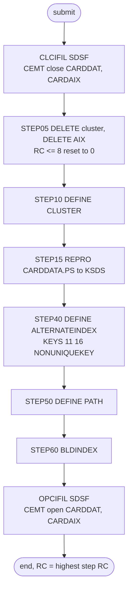

# CARDFILE: Card master reload

## 1. Summary

CARDFILE throws away the card master file and rebuilds it from the flat sample file, together with its alternate index by account. It first asks the CICS region to close the two CICS files over the card data (`CARDDAT`, `CARDAIX`). `STEP05` deletes the cluster `AWS.M2.CARDDEMO.CARDDATA.VSAM.KSDS` and its alternate index, `STEP10` defines the cluster again empty (key 16 bytes at offset 0, fixed 150-byte records), `STEP15` copies every record of `AWS.M2.CARDDEMO.CARDDATA.PS` into it, and `STEP40` to `STEP60` define the non-unique alternate index on the account ID (11 bytes at offset 16), its path, and build it. The last step asks CICS to open the two files again. It is run by hand during installation and in the demo data refresh. It contains no business logic; what it must preserve is the file and index definitions and the fact that the result is an exact copy of the flat file.

## 2. Rules at a glance

The job has no business rules. Its items:

| ID | Rule |
| :-- | :-- |
| SE-JCARD-001 | Ask CICS region `CICSAWSA` to close files `CARDDAT` and `CARDAIX`. |
| SE-JCARD-002 | Delete the card cluster, then its alternate index; any failure with return code 8 or less is ignored. |
| SE-JCARD-003 | Define the card cluster: key 16 at offset 0, records 150 fixed, `SHAREOPTIONS(2 3)`, `ERASE`, no `REUSE`. |
| SE-JCARD-004 | Load the cluster with every record of `CARDDATA.PS`, in file order. |
| SE-JCARD-005 | Define the alternate index: key 11 at offset 16 (`CARD-ACCT-ID`), non-unique, `UPGRADE`, records up to 150. |
| SE-JCARD-006 | Define the path `...CARDDATA.VSAM.AIX.PATH` over the alternate index. |
| SE-JCARD-007 | Build the alternate index from the loaded cluster. |
| SE-JCARD-008 | Ask CICS to open `CARDDAT` and `CARDAIX` again. |
| VAL-JCARD-001 | The load rejects records out of key order or with duplicate card numbers (VSAM rule). |
| ERR-JCARD-001 | No step has a `COND`, so every step runs even when an earlier one failed. |
| ERR-JCARD-002 | The CICS steps end normally whether or not CICS closed or opened the files. |
| ERR-JCARD-003 | While CICS still holds the cluster open, the load and the index build fail as well as the delete and define. |
| NUM-JCARD-001 | Keys, record sizes and the alternate-index capacity of 8 cards per account. |
| DEF-JCARD-001 | The return-code reset also hides a delete that failed because the file is still open. |
| DEF-JCARD-002 | The job does not wait for CICS to finish closing the files before it deletes them. |
| DEF-JCARD-003 | The CICS region name `CICSAWSA` is hard-coded. |
| DEF-JCARD-004 | The alternate index cannot hold more than 8 cards for one account; extra ones are most likely left out with a warning. |
| DEF-JCARD-005 | A null statement (`//`) ends the job before the trailing version comments. |

## 3. Actors and triggers

- **Trigger:** submitted by an operator. It is in the README's initialisation sequence (`./README.md:155`) and its "Running Batch Jobs" sequence (`./README.md:217`), and in the demo scripts `scripts/run_full_batch.sh:19-20` and `scripts/remote_refresh.sh:19-20`, which submit it through an FTP tunnel to JES. Neither the CA-7 nor the Control-M schedule runs it. The local runner (`tools/carddemo.py`) has no CARDFILE job; it loads `app/data/ASCII/carddata.txt` into the `CARDDATA` dataset directly for every run (`tools/batch-programs.toml:193-197`).
- **Preconditions:** the CICS region is called `CICSAWSA` and the submitter may issue MVS `MODIFY` commands through SDSF (`docs/runbooks/cics-vsam-files.md:54-56`); `AWS.M2.CARDDEMO.CARDDATA.PS` exists and is sorted by card number (`./README.md:136`, FB 150); volume `AWSHJ1` exists. CLOSEFIL does not close `CARDDAT` or `CARDAIX` (`docs/runbooks/cics-vsam-files.md:20-21`), so this job's own close step is the only one.
- **Job card:** `CLASS=A,MSGCLASS=0,NOTIFY=&SYSUID` (`:1-2`). No parameters, no symbolic overrides.

## 4. Interfaces

| Step | Program | DD | Dataset | Disposition | Use | Source |
| :-- | :-- | :-- | :-- | :-- | :-- | :-- |
| `CLCIFIL` | SDSF | `ISFOUT` | `SYSOUT=*` | - | SDSF output | `:23` |
| `CLCIFIL` | SDSF | `CMDOUT` | `SYSOUT=*` | - | command responses | `:24` |
| `CLCIFIL` | SDSF | `ISFIN` | in-stream | - | two `MODIFY` commands (SE-JCARD-001) | `:25-28` |
| `STEP05` | IDCAMS | `SYSPRINT` | `SYSOUT=*` | - | IDCAMS messages | `:34` |
| `STEP05` | IDCAMS | `SYSIN` | in-stream | - | two `DELETE` statements | `:35-42` |
| `STEP10` | IDCAMS | `SYSPRINT` | `SYSOUT=*` | - | IDCAMS messages | `:48` |
| `STEP10` | IDCAMS | `SYSIN` | in-stream | - | `DEFINE CLUSTER` statement | `:49-64` |
| `STEP15` | IDCAMS | `SYSPRINT` | `SYSOUT=*` | - | IDCAMS messages | `:69` |
| `STEP15` | IDCAMS | `CARDDATA` | `AWS.M2.CARDDEMO.CARDDATA.PS` | `SHR` | input, sequential, FB 150 | `:70-71` |
| `STEP15` | IDCAMS | `CARDVSAM` | `AWS.M2.CARDDEMO.CARDDATA.VSAM.KSDS` | `SHR` | output, KSDS | `:72-73` |
| `STEP15` | IDCAMS | `SYSIN` | in-stream | - | `REPRO` statement | `:74-76` |
| `STEP40` | IDCAMS | `SYSPRINT` | `SYSOUT=*` | - | IDCAMS messages | `:81` |
| `STEP40` | IDCAMS | `SYSIN` | in-stream | - | `DEFINE ALTERNATEINDEX` statement | `:82-93` |
| `STEP50` | IDCAMS | `SYSPRINT` | `SYSOUT=*` | - | IDCAMS messages | `:98` |
| `STEP50` | IDCAMS | `SYSIN` | in-stream | - | `DEFINE PATH` statement | `:99-103` |
| `STEP60` | IDCAMS | `SYSPRINT` | `SYSOUT=*` | - | IDCAMS messages | `:108` |
| `STEP60` | IDCAMS | `SYSIN` | in-stream | - | `BLDINDEX` statement; the cluster and the AIX are allocated by name, not by DD | `:109-113` |
| `OPCIFIL` | SDSF | `ISFOUT` | `SYSOUT=*` | - | SDSF output | `:119` |
| `OPCIFIL` | SDSF | `CMDOUT` | `SYSOUT=*` | - | command responses | `:120` |
| `OPCIFIL` | SDSF | `ISFIN` | in-stream | - | two `MODIFY` commands (SE-JCARD-008) | `:121-124` |

The CICS commands (exact text, one leading space):

| Step | Command | CICS file | Dataset (CSD) |
| :-- | :-- | :-- | :-- |
| `CLCIFIL` | `/F CICSAWSA,'CEMT SET FIL(CARDDAT ) CLO'` (`:26`) | `CARDDAT` | `AWS.M2.CARDDEMO.CARDDATA.VSAM.KSDS` (`app/csd/CARDDEMO.CSD:25-26`) |
| `CLCIFIL` | `/F CICSAWSA,'CEMT SET FIL(CARDAIX ) CLO'` (`:27`) | `CARDAIX` | `AWS.M2.CARDDEMO.CARDDATA.VSAM.AIX.PATH` (`app/csd/CARDDEMO.CSD:13-14`) |
| `OPCIFIL` | `/F CICSAWSA,'CEMT SET FIL(CARDDAT ) OPE'` (`:122`) | `CARDDAT` | as above |
| `OPCIFIL` | `/F CICSAWSA,'CEMT SET FIL(CARDAIX ) OPE'` (`:123`) | `CARDAIX` | as above |

Return code of the job: the highest step return code. Console output is SDSF `ISFOUT`/`CMDOUT` and IDCAMS `SYSPRINT` only (incidental).

## 5. Data used

- The card record ENT-CARD (`CARD-RECORD`, `app/cpy/CVACT02Y.cpy:4-11`, 150 bytes), whole records copied unchanged from `CARDDATA.PS` to the KSDS. No field is interpreted. The primary key is bytes 1-16 (`CARD-NUM`); the alternate key is bytes 17-27 (`CARD-ACCT-ID`, `9(11)`), the account that owns the card (ENT-ACCOUNT `ACCT-ID`). The record also holds the card verification code `CARD-CVV-CD` (bytes 28-30), which the job copies as is.
- Catalog state on 09/01/22 (`app/catlg/LISTCAT.txt:150-333`, from the path entry to the end of the AIX): the cluster data component has `KEYLEN 16`, `RKP 0`, `MAXLRECL 150`, `SHROPTNS(2,3)`, `ERASE`, `NOREUSE` and `REC-TOTAL 50` (`app/catlg/LISTCAT.txt:202-207`). The AIX data component has `KEYLEN 11`, `AXRKP 16`, `MAXLRECL 150`, `SHROPTNS(1,3)`, `SPANNED`, `NONUNIQKEY` and `REC-TOTAL 50` (`app/catlg/LISTCAT.txt:281-287`), space `CYLINDER` primary 5 secondary 1 (`app/catlg/LISTCAT.txt:295-297`), and the AIX is in the upgrade set (`app/catlg/LISTCAT.txt:265`). The path is `UPDATE` (`app/catlg/LISTCAT.txt:163`). All of this matches the JCL except `SPANNED` on the AIX (`app/catlg/LISTCAT.txt:285`), which `STEP40` does not code (its default is non-spanned), so the catalogued AIX was probably defined by another statement than this job's; low confidence, and it does not change the 150-byte maximum. `SHROPTNS(1,3)` on the AIX is the IDCAMS default, since `STEP40` names no `SHAREOPTIONS`.
- Sample data: `app/data/ASCII/carddata.txt` has 50 records of 150 bytes, card numbers strictly ascending, and 50 distinct account IDs (one card per account). Checked locally with a Python script over the file.

## 6. Processing flow

| # | Step | Program | Class | What it does | Runs when |
| --: | :-- | :-- | :-- | :-- | :-- |
| 1 | `CLCIFIL` | SDSF | plumbing | close `CARDDAT` and `CARDAIX` in CICS | always |
| 2 | `STEP05` | IDCAMS | plumbing | delete the cluster and the AIX | always (no `COND`) |
| 3 | `STEP10` | IDCAMS | plumbing | define the cluster | always |
| 4 | `STEP15` | IDCAMS | plumbing | copy `CARDDATA.PS` into the cluster | always |
| 5 | `STEP40` | IDCAMS | plumbing | define the AIX on the account ID | always |
| 6 | `STEP50` | IDCAMS | plumbing | define the path | always |
| 7 | `STEP60` | IDCAMS | plumbing | build the AIX | always |
| 8 | `OPCIFIL` | SDSF | plumbing | open `CARDDAT` and `CARDAIX` in CICS | always |

The null statement `//` at `:125` ends the job; the three comment lines after it are outside the job (DEF-JCARD-005).



## 7. Business rules

None. The job moves data and builds an index without interpreting any field; see the side effects in section 9.

## 8. Validations and messages

#### VAL-JCARD-001 · The load requires ascending, unique card numbers
- **When:** `STEP15` copies a record whose key (bytes 1-16) is not higher than the previous record's key.
- **Then:** VSAM rejects that record and IDCAMS prints an error message for it; the step ends with return code 8 or higher. The remaining records are still copied until IDCAMS reaches its error limit (by default it stops after 4 such errors).
- **Source:** `:75`
- **Fidelity:** must-preserve (the target load must also fail visibly on unsorted or duplicate input) · **Confidence:** platform-inferred (IDCAMS `REPRO` into a KSDS; no local run)

No operator-facing message text is produced by the job itself; all messages are IDCAMS `IDCnnnnI` messages in `SYSPRINT` and CICS responses in `CMDOUT`.

## 9. Side effects

In execution order. There is no rollback: each step's change is permanent.

#### SE-JCARD-001 · Close the card files in CICS
- **What:** SDSF issues `/F CICSAWSA,'CEMT SET FIL(CARDDAT ) CLO'` and `/F CICSAWSA,'CEMT SET FIL(CARDAIX ) CLO'`, MVS `MODIFY` commands that pass a CEMT request to the CICS region. CICS closes each file when no running task is using it (`docs/runbooks/cics-vsam-files.md:57-58`). While closed, the online card functions fail: card list browses `CARDDAT` (`app/cbl/COCRDLIC.cbl:1129-1376`), card view reads `CARDDAT` by card number and `CARDAIX` by account (`app/cbl/COCRDSLC.cbl:743, 784`), and card update reads and rewrites `CARDDAT` (`app/cbl/COCRDUPC.cbl:1383, 1428, 1478`). The account programs are not affected: account view and update declare the two file names but read the account through `CXACAIX`, `ACCTDAT` and `CUSTDAT` (`app/cbl/COACTVWC.cbl:728, 777, 827`).
- **Source:** `:22-28`, `app/csd/CARDDEMO.CSD:13-14, 25-26`
- **Fidelity:** must-preserve (batch reload and online use must not overlap); incidental (mechanism) · **Confidence:** platform-inferred

#### SE-JCARD-002 · Delete the card cluster and its alternate index
- **What:** two IDCAMS commands, each followed by a return-code reset:

```
DELETE AWS.M2.CARDDEMO.CARDDATA.VSAM.KSDS CLUSTER
IF MAXCC LE 08 THEN SET MAXCC = 0
DELETE AWS.M2.CARDDEMO.CARDDATA.VSAM.AIX ALTERNATEINDEX
IF MAXCC LE 08 THEN SET MAXCC = 0
```

- Deleting a cluster also deletes its alternate indexes and paths, so when the first delete works the second normally finds nothing (return code 8, reset to 0). On a first run neither exists and both are reset.
- **Source:** `:36-41`
- **Fidelity:** must-preserve (the reload starts from nothing) · **Confidence:** reviewed (statements); platform-inferred (cascade delete)

#### SE-JCARD-003 · Define the card cluster
- **What:** `DEFINE CLUSTER` named `AWS.M2.CARDDEMO.CARDDATA.VSAM.KSDS` with:

| Attribute | Value |
| :-- | :-- |
| Organisation | `INDEXED` (KSDS) |
| Key | `KEYS(16 0)`: 16 bytes at offset 0 (`CARD-NUM`) |
| Record size | `RECORDSIZE(150 150)`: average and maximum 150, so fixed 150 |
| Space | `CYLINDERS(1 5)` on `VOLUMES(AWSHJ1)` |
| Sharing | `SHAREOPTIONS(2 3)` |
| Other | `ERASE`; no `REUSE` |
| Components | data `...CARDDATA.VSAM.KSDS.DATA`, index `...CARDDATA.VSAM.KSDS.INDEX` |

- **Source:** `:50-63`
- **Fidelity:** must-preserve (key and record size); incidental (space, volume, `ERASE`) · **Confidence:** reviewed

#### SE-JCARD-004 · Load the cluster from the flat file
- **What:** `REPRO INFILE(CARDDATA) OUTFILE(CARDVSAM)` copies every record of `AWS.M2.CARDDEMO.CARDDATA.PS`, in file order, into the new cluster, byte for byte. No AIX exists yet, so nothing else is updated.
- **Source:** `:70-75`
- **Fidelity:** must-preserve · **Confidence:** reviewed

#### SE-JCARD-005 · Define the alternate index on the account ID
- **What:** `DEFINE ALTERNATEINDEX` named `AWS.M2.CARDDEMO.CARDDATA.VSAM.AIX` with:

| Attribute | Value |
| :-- | :-- |
| Base cluster | `RELATE(AWS.M2.CARDDEMO.CARDDATA.VSAM.KSDS)` |
| Key | `KEYS(11 16)`: 11 bytes at offset 16 (`CARD-ACCT-ID`) |
| Uniqueness | `NONUNIQUEKEY`: one AIX record per account, listing every card of that account |
| Maintenance | `UPGRADE`: VSAM updates the AIX whenever the base cluster changes through an upgrade-set open |
| Record size | `RECORDSIZE(150,150)` (NUM-JCARD-001) |
| Space | `CYLINDERS(5,1)` on `VOLUMES(AWSHJ1)` |
| Sharing | not specified, so the default `SHAREOPTIONS(1 3)` (LISTCAT shows `SHROPTNS(1,3)`) |
| Components | data `...CARDDATA.VSAM.AIX.DATA`, index `...CARDDATA.VSAM.AIX.INDEX` |

- **Source:** `:83-92`
- **Fidelity:** must-preserve (key, non-unique); incidental (space, volume) · **Confidence:** reviewed

#### SE-JCARD-006 · Define the path
- **What:** `DEFINE PATH (NAME(AWS.M2.CARDDEMO.CARDDATA.VSAM.AIX.PATH) PATHENTRY(AWS.M2.CARDDEMO.CARDDATA.VSAM.AIX))`. The path is the name a program opens to read the cards of an account through the AIX; CICS file `CARDAIX` points at it (`app/csd/CARDDEMO.CSD:13-14`). No `UPDATE`/`NOUPDATE` is given, so the default `UPDATE` applies (LISTCAT `app/catlg/LISTCAT.txt:163`).
- **Source:** `:100-102`
- **Fidelity:** must-preserve (access by account) · **Confidence:** reviewed

#### SE-JCARD-007 · Build the alternate index
- **What:** `BLDINDEX INDATASET(AWS.M2.CARDDEMO.CARDDATA.VSAM.KSDS) OUTDATASET(AWS.M2.CARDDEMO.CARDDATA.VSAM.AIX)` reads every card record, takes the account ID from bytes 17-27, sorts the (account, card number) pairs and writes one AIX record per account. The statement codes no `SORTCALL`, so the default `SORTCALL(YES)` applies: BLDINDEX sorts with DFSORT, which allocates its own work data sets when the sort does not fit in storage. The `IDCUT1`/`IDCUT2` work files, which the job does not supply, are needed only with `SORTCALL(NO)`.
- **Source:** `:110-112`
- **Fidelity:** must-preserve (the index must reflect every card) · **Confidence:** platform-inferred (medium for the sort defaults)

#### SE-JCARD-008 · Open the card files in CICS again
- **What:** SDSF issues `/F CICSAWSA,'CEMT SET FIL(CARDDAT ) OPE'` and `/F CICSAWSA,'CEMT SET FIL(CARDAIX ) OPE'`; online card functions work again once CICS has opened the files.
- **Source:** `:118-124`
- **Fidelity:** incidental (mechanism) · **Confidence:** platform-inferred

If a later step fails, everything before it has happened: the card files are closed in CICS, the old cluster is gone, and the new one may be empty, loaded without an index, or loaded with an index but no path. `OPCIFIL` still runs and reopens the files on whatever exists.

## 10. Error handling

#### ERR-JCARD-001 · Steps run regardless of earlier failures
- **When:** a step ends with a non-zero return code without abending.
- **Then:** the next step still runs, because no `EXEC` has a `COND` parameter. If `STEP10` fails (for example because the delete did not remove the cluster), `STEP15` loads the records into whatever cluster exists, unless CICS still holds it open (ERR-JCARD-003), `STEP40` and `STEP50` fail on the existing AIX and path names, and `STEP60` fails on the existing, already built AIX (DEF-JCARD-001). An abend in a step skips the remaining steps, including `OPCIFIL`, so the files stay closed in CICS (JES default).
- **Restart:** rerun the whole job; every step either recreates its object or is reset. There is no partial restart point.
- **Source:** `:22, 33, 47, 68, 80, 97, 107, 118`
- **Fidelity:** defect-decide · **Confidence:** platform-inferred

#### ERR-JCARD-002 · The CICS steps do not report whether the files changed state
- **When:** CICS rejects a CEMT command (region not named `CICSAWSA`, no authority to issue `MODIFY`, unknown file) or closes a file only later.
- **Then:** SDSF still ends normally once it has issued the commands; the CEMT response goes to the console and `CMDOUT`, not to the step's return code. The job continues to `STEP05` either way (DEF-JCARD-002).
- **Source:** `:22-28, 118-124`
- **Fidelity:** defect-decide · **Confidence:** platform-inferred

#### ERR-JCARD-003 · An open file in CICS makes every IDCAMS step fail
- **When:** CICS still has `CARDDAT` or `CARDAIX` open when `STEP05` runs, because the close was refused or is still waiting for tasks (ERR-JCARD-002, DEF-JCARD-002).
- **Then:** not only the delete (`STEP05`, reset to 0, DEF-JCARD-001) and the define (`STEP10`, existing name) fail. `STEP15` cannot open the cluster for output: with `SHAREOPTIONS(2 3)` (`:56`) only one region may have it open for update, and CICS does (card update rewrites through `CARDDAT`). `STEP40` and `STEP50` fail on the existing AIX and path names. `STEP60` cannot write the AIX, which CICS has open through `CARDAIX` or as part of the upgrade set and which already holds the old index. Each of these steps ends with return code 8 or 12, the old cluster, AIX and path stay as they were, and `OPCIFIL` reissues an open for files that are already open. The job's return code shows the failure; the data is unchanged.
- **Source:** `:33, 47, 56, 68, 80, 97, 107`
- **Fidelity:** defect-decide · **Confidence:** platform-inferred (VSAM share options and CICS upgrade-set opens)

## 11. Interactions

- **Upstream:** none required; the job closes its own CICS files. CLOSEFIL does not close `CARDDAT` or `CARDAIX` (`docs/runbooks/cics-vsam-files.md:20-21, 72-73`).
- **Downstream:** every reader of the card master: READCARD (`CBACT02C`), TRANVALD (`CBTRN01C`), CBEXPORT, and the online card programs through CICS files `CARDDAT` (by card number) and `CARDAIX` (by account): `COCRDLIC` (list, `CARDDAT`), `COCRDSLC` (view, `CARDDAT` and the only user of `CARDAIX`) and `COCRDUPC` (update, `CARDDAT`). `COACTVWC`, `COACTUPC` and the optional authorisation programs `COPAUA0C` and `COPAUS0C` only declare the file names; their file requests go to the cross-reference, account and customer files (`app/cbl/COACTVWC.cbl:728, 777, 827`, `app/app-authorization-ims-db2-mq/cbl/COPAUA0C.cbl:478, 526, 574`, `app/app-authorization-ims-db2-mq/cbl/COPAUS0C.cbl:819, 870, 921`).
- **Shared data:** the account ID in the card record must match ENT-ACCOUNT and the cross-reference ENT-CARD-XREF (loaded by XREFFILE); nothing in this job checks it.
- **Operations:** the runbook lists CARDFILE among the jobs that must not run while CICS users are signed on (`docs/runbooks/cics-vsam-files.md:89-90`).

## 12. Numeric, date and format details

#### NUM-JCARD-001 · Keys, record size and alternate-index capacity
- Primary key: 16 bytes at offset 0, text (`CARD-NUM`), unique. Records: fixed 150 bytes.
- Alternate key: 11 bytes at offset 16 (`CARD-ACCT-ID`, digits), non-unique.
- A non-unique AIX record holds a 5-byte header, the 11-byte alternate key and one 16-byte card number per card of that account. With the maximum record size of 150 (`RECORDSIZE(150,150)`), one account can have at most (150 - 5 - 11) / 16 = 8 cards (rounded down) in the index (DEF-JCARD-004).
- Space: cluster `CYLINDERS(1 5)`; AIX `CYLINDERS(5,1)`, so the index gets five times the primary space of the data it indexes.
- **Source:** `:54-55, 85-90`
- **Fidelity:** must-preserve (keys, record size); incidental (space) · **Confidence:** reviewed (values); platform-inferred (AIX record layout)

## 13. Known defects and oddities

#### DEF-JCARD-001 · The return-code reset hides a failed delete
- `IF MAXCC LE 08 THEN SET MAXCC = 0` is meant for "not found", but it also hides other delete failures with return code 8, for example when CICS has not yet closed `CARDDAT` (DEF-JCARD-002). Then `STEP10` fails because the name already exists. If CICS still holds the cluster, `STEP15` cannot open it for output either (`SHAREOPTIONS(2 3)`, `:56`; ERR-JCARD-003). If the delete failed for another reason and the cluster is free, `STEP15` copies the flat file on top of the old, loaded cluster: records with existing keys are rejected as duplicates, and after 4 such errors IDCAMS stops the copy (VAL-JCARD-001), so at most the first few new cards are added. `STEP40` and `STEP50` fail on the existing names, and `STEP60` fails too, because `BLDINDEX` cannot write into the existing AIX, which is already built and was defined without `REUSE`. The job ends with a non-zero code, but the old data stays.
- **Source:** `:38, 41, 47, 56, 68, 75, 80, 97, 110-112`
- **Status:** open · **Fidelity:** defect-decide · **Confidence:** platform-inferred

#### DEF-JCARD-002 · The delete does not wait for the CICS close
- `STEP05` runs as soon as SDSF has issued the close commands. CICS closes a file only when current tasks have finished with it (`docs/runbooks/cics-vsam-files.md:57-58`), and nothing in the job waits or checks (no WAITSTEP, no `CEMT INQUIRE`). A busy region therefore leads to DEF-JCARD-001.
- **Source:** `:22-28, 33`
- **Status:** open · **Fidelity:** defect-decide · **Confidence:** platform-inferred

#### DEF-JCARD-003 · The CICS region name is hard-coded
- Both SDSF steps name region `CICSAWSA` in in-stream data; there is no symbolic parameter. On a system whose region has another job name the commands fail and the files are not closed or reopened.
- **Source:** `:26-27, 122-123`
- **Status:** open · **Fidelity:** incidental · **Confidence:** reviewed

#### DEF-JCARD-004 · At most 8 cards per account in the alternate index
- With `RECORDSIZE(150,150)` a non-unique AIX record has room for 8 card numbers (NUM-JCARD-001). If an account has a ninth card, `BLDINDEX` most likely does not fail the build: IDCAMS reports the alternate key whose record overflows with a warning, leaves the extra card numbers out of the AIX record and goes on, so `STEP60` ends with a warning return code and card view by account (`CARDAIX`) silently misses those cards. No online program adds cards (card update only rewrites, `app/cbl/COCRDUPC.cbl:1478`), so the limit is reached only through this reload. The sample data has one card per account, so this does not show.
- **Source:** `:85-88`
- **Status:** open · **Fidelity:** defect-decide · **Confidence:** platform-inferred (the limit: reviewed arithmetic; the overflow behaviour of `BLDINDEX`: medium to low confidence)

#### DEF-JCARD-005 · Null statement before the trailing comments
- Line 125 is a JCL null statement (`//`), which marks the end of the job; the version comment lines after it (`:126-128`) are not part of the job. DUSRSECJ (`app/jcl/DUSRSECJ.jcl:89`), ESDSRRDS (`app/jcl/ESDSRRDS.jcl:122`), TRANREPT (`app/jcl/TRANREPT.jcl:81`), DEFGDGD (`app/jcl/DEFGDGD.jcl:90-91`) and CBADMCDJ (`app/jcl/CBADMCDJ.jcl:164`) also have one. No effect on processing.
- **Source:** `:125`
- **Status:** open · **Fidelity:** incidental · **Confidence:** reviewed

## 14. Open questions

| ID | Question | For |
| :-- | :-- | :-- |
| Q-JCARD-001 | How many cards may one account have? The index allows 8; the sample has 1. The target's account-to-card lookup must not impose a smaller limit. | business |
| Q-JCARD-002 | Is a full delete-and-reload of the card master needed in the target outside demo set-up, or only a seed load for new environments? | operations |

## 15. Equivalence contract

After a successful run (return code 0), the card store contains exactly the records of `CARDDATA.PS`: same count (50 for the sample data), same bytes, keyed by `CARD-NUM`, and nothing else; and a lookup by account ID returns, for each account, exactly the card numbers whose bytes 17-27 equal it, in ascending card-number order. A reimplementation must fail (non-zero result, no silent partial load) when the input has keys out of order or duplicated (VAL-JCARD-001), and the online system must not use the card data while the reload runs. IDCAMS and CICS message text may differ.

## 16. Paragraph coverage

| Step | Lines | Covered by |
| :-- | :-- | :-- |
| (job card) | 1-2 | §3 |
| `CLCIFIL` | 22-28 | SE-JCARD-001, ERR-JCARD-002, DEF-JCARD-002, DEF-JCARD-003 |
| `STEP05` | 33-42 | SE-JCARD-002, DEF-JCARD-001 |
| `STEP10` | 47-64 | SE-JCARD-003, NUM-JCARD-001, ERR-JCARD-001 |
| `STEP15` | 68-76 | SE-JCARD-004, VAL-JCARD-001, ERR-JCARD-001, ERR-JCARD-003, DEF-JCARD-001 |
| `STEP40` | 80-93 | SE-JCARD-005, NUM-JCARD-001, DEF-JCARD-004 |
| `STEP50` | 97-103 | SE-JCARD-006 |
| `STEP60` | 107-113 | SE-JCARD-007, ERR-JCARD-003, DEF-JCARD-001, DEF-JCARD-004 |
| `OPCIFIL` | 118-124 | SE-JCARD-008, ERR-JCARD-002, DEF-JCARD-003 |
| (null statement) | 125 | DEF-JCARD-005 |
