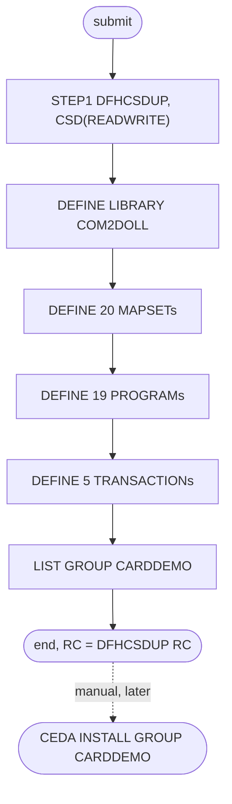

# CBADMCDJ: CICS resource definitions with DFHCSDUP

## 1. Summary

CBADMCDJ runs the CICS batch utility DFHCSDUP (CICS TS 5.6 libraries) once, in step `STEP1`, to add CardDemo resource definitions to group `CARDDEMO` of the CSD `OEM.CICSTS.DFHCSD`, and then lists the group. Its in-stream input holds 45 `DEFINE` commands: one library (`COM2DOLL`, the CardDemo load library), 20 mapsets, 19 programs and 5 transactions. The list is out of date and does not match the application: only 6 of the 36 distinct resources it names are in the CSD export `app/csd/CARDDEMO.CSD`, none of its mapset names matches a mapset in `app/bms`, 10 of its programs and all 5 of its transactions have no source in the repository, and it defines no file, no queue and not even the sign-on transaction `CC00`. Nine commands define a name that an earlier command in the same run already defined; the first of them (`:53`) may stop DFHCSDUP from executing any later `DEFINE` (ERR-JCSDUP-001). The job is set-up plumbing; the definitions that the application actually needs are those in the CSD export.

## 2. Rules at a glance

The job has no business rules. Its items:

| ID | Rule |
| :-- | :-- |
| FLOW-JCSDUP-001 | `&HLQ` in the input is replaced by `AWS.M2.CARDDEMO` (`SYMBOLS=JCLONLY`). |
| FLOW-JCSDUP-002 | The `DELETE GROUP` and two `TDQUEUE` defines are commented out; installing the group is a separate manual step. |
| SE-JCSDUP-001 | Define library `COM2DOLL` on `AWS.M2.CARDDEMO.LOADLIB`. |
| SE-JCSDUP-002 | Define 20 mapsets (15 distinct names). |
| SE-JCSDUP-003 | Define 19 programs (15 distinct names). |
| SE-JCSDUP-004 | Define 5 transactions. |
| SE-JCSDUP-005 | List group `CARDDEMO`. |
| ERR-JCSDUP-001 | A rerun, or a repeated name, makes `DEFINE` commands fail, and the failure may stop DFHCSDUP from executing the later commands; the job has one step and no `COND`. |
| DEF-JCSDUP-001 | No mapset name matches a BMS mapset or a CSD mapset. |
| DEF-JCSDUP-002 | 10 programs and 5 transactions have no source in the repository. |
| DEF-JCSDUP-003 | Nine `DEFINE` commands repeat a name, with a different description. |
| DEF-JCSDUP-004 | The files, 17 mapsets, 13 programs, all 18 transactions, library `CARDDLIB` and queue `JOBS` of the CSD export are missing. |
| DEF-JCSDUP-005 | The job's admin menu is program `COADM00C` with transaction `CCDM` (its `TRANSID(CCAD)` defines no transaction); the application's is `COADM01C` with `CA00`. |
| DEF-JCSDUP-006 | Library `COM2DOLL` is enabled by default here but `DISABLED` in the CSD export. |
| DEF-JCSDUP-007 | `COTSTP3C` has the description `PGM1 TEST`. |
| DEF-JCSDUP-008 | The README's preferred CSD set-up does not match this job. |
| DEF-JCSDUP-009 | Group `CARDDEMO` is not added to a group list, so a cold start does not install it. |

## 3. Actors and triggers

- **Trigger:** submitted by hand by a CICS system programmer when the application is installed. The README's step "Configure CICS Resources" says `Option 1 (Preferred): Use the DFHCSDUP JCL with the CSD file in the CSD folder` (`./README.md:173-174`), and CBADMCDJ is the only DFHCSDUP job in the repository (`docs/inventory.md:182`), but it does not read that file (DEF-JCSDUP-008). The job is in none of the three README job tables (`./README.md:150-167`, `./README.md:213-235`, `./README.md:351-379`), neither the CA-7 nor the Control-M schedule runs it, no script submits it, and the local runner cannot run it (no CICS).
- **Preconditions:** CICS TS 5.6 libraries under `OEM.CICSTS.V05R06M0`; the CSD `OEM.CICSTS.DFHCSD` exists; group `CARDDEMO` does not yet contain the resources (ERR-JCSDUP-001). After the job, the group still has to be installed in the region (`CEDA IN G(CARDDEMO)`, `:37`; `./README.md:185-191`).
- **Job card:** `CBADMCDJ JOB (COBOL),'AWSCODR',CLASS=A,MSGCLASS=H,MSGLEVEL=(1,1),NOTIFY=&SYSUID,TIME=1440` (`:1-2`). `TIME=1440` removes the CPU time limit. `SET HLQ=AWS.M2.CARDDEMO` (`:25`) is the only symbol. A null statement (`//`, `:164`) ends the job after `STEP1`.

## 4. Interfaces

| Step | Program | DD | Dataset | Disposition | Use | Source |
| :-- | :-- | :-- | :-- | :-- | :-- | :-- |
| `STEP1` | DFHCSDUP | `STEPLIB` | `OEM.CICSTS.V05R06M0.CICS.SDFHLOAD` | `SHR` | CICS TS 5.6 load library that holds DFHCSDUP | `:29` |
| `STEP1` | DFHCSDUP | `DFHCSD` | `OEM.CICSTS.DFHCSD`, `UNIT=SYSDA` | `SHR` | the CSD, opened for update | `:30` |
| `STEP1` | DFHCSDUP | `OUTDD` | `SYSOUT=*` | - | output of `EXTRACT` commands; no command in the input uses it | `:31` |
| `STEP1` | DFHCSDUP | `SYSPRINT` | `SYSOUT=*` | - | command echo, messages and the `LIST` output | `:32` |
| `STEP1` | DFHCSDUP | `SYSIN` | in-stream, `SYMBOLS=JCLONLY` | - | DFHCSDUP commands | `:33-163` |

- `EXEC PGM=DFHCSDUP,REGION=0M,PARM='CSD(READWRITE),PAGESIZE(60),NOCOMPAT'` (`:27-28`): the CSD is opened read-write, the listing has 60 lines per page, and compatibility mode (obsolete attributes) is off.
- Return code of the job: the DFHCSDUP return code. Console output is `SYSPRINT` only (incidental).

## 5. Data used

No application data is read or written. The job changes CICS system definitions in the CSD. The resources it names, and how they compare with the CSD export and the source tree, are in section 9.

## 6. Processing flow

The only step is plumbing (platform set-up).

| # | Step | Class | What it does | Runs when |
| --: | :-- | :-- | :-- | :-- |
| 1 | `STEP1` | plumbing | run 45 `DEFINE` commands and one `LIST` against group `CARDDEMO` | always |

#### FLOW-JCSDUP-001 · Symbol substitution in the input
- **When:** JES reads the in-stream `SYSIN`.
- **Then:** `SYMBOLS=JCLONLY` makes the system replace JCL symbols in the in-stream data, so `DSNAME01(&HLQ..LOADLIB)` reaches DFHCSDUP as `DSNAME01(AWS.M2.CARDDEMO.LOADLIB)` (the double dot ends the symbol name and leaves one dot). This is the only symbol in the input. The CSD export has the same data set for `COM2DOLL` (`app/csd/CARDDEMO.CSD:496`).
- **Source:** `:25, 33, 44-45`
- **Fidelity:** incidental · **Confidence:** platform-inferred (JES in-stream symbol substitution)

#### FLOW-JCSDUP-002 · Commented-out commands and the manual install
- **When:** DFHCSDUP reads the input.
- **Then:** lines that start with `*` are comments. Three commands are commented out and do not run: `DELETE GROUP(CARDDEMO)` (`:42`), which the comment says to uncomment when rerunning (`:38`), and `DEFINE TDQUEUE(CSSD)` and `DEFINE TDQUEUE(IRDC)`, both `TYPE(INTRA)` (`:47-48`). The job does not install anything in a running region; the comment says to install the group with `CEDA IN G(CARDDEMO)` (`:37`).
- **Source:** `:37-48`
- **Fidelity:** incidental · **Confidence:** reviewed (comments); platform-inferred (DFHCSDUP comment syntax)

## 7. Business rules

None. The job registers CICS resources; the application's behaviour is in the program specs.

## 8. Validations and messages

None. DFHCSDUP validates the commands and writes its own `DFH5nnn` messages to `SYSPRINT`.

## 9. Side effects

In execution order, all in `STEP1`, all in group `CARDDEMO`. Each `DEFINE` adds one definition to the CSD and creates the group if it does not exist; there is no rollback. Attributes not coded take the DFHCSDUP defaults. `DA(ANY)` is the short form of `DATALOCATION(ANY)` and `TASKDATAL(ANY)` of `TASKDATALOC(ANY)`.

Every `DEFINE` in the job, compared with the CSD export and the source tree ("CSD" = a definition of the same type and name in `app/csd/CARDDEMO.CSD`; "source" = a BMS member in `app/bms` with that mapset name, or a COBOL member in `app/cbl` with that program name; no other file in the repository has any of the unmatched names):

| Lines | Command | CSD | Source | Note |
| :-- | :-- | :-- | :-- | :-- |
| `:44-45` | `LIBRARY(COM2DOLL)`, `DSNAME01(&HLQ..LOADLIB)` | yes, `app/csd/CARDDEMO.CSD:494-498` | - | CSD has `STATUS(DISABLED)` (DEF-JCSDUP-006) |
| `:50-51` | `MAPSET(COSGN00M)`, `LOGIN SCREEN` | no | no | the sign-on mapset is `COSGN00` (`app/csd/CARDDEMO.CSD:141-144`, `app/bms/COSGN00.bms:19`) |
| `:53-54` | `MAPSET(COSGN00M)`, `LOGIN SCREEN` | no | no | repeats `:50` |
| `:56-57` | `MAPSET(COACT00S)`, `ACCOUNT MENU` | no | no | |
| `:58-59` | `MAPSET(COACTVWS)`, `VIEW ACCOUNT` | no | no | the CSD and BMS name is `COACTVW` (`app/csd/CARDDEMO.CSD:105-109`) |
| `:60-61` | `MAPSET(COACTUPS)`, `UPDATE ACCOUNT` | no | no | the CSD and BMS name is `COACTUP` (`app/csd/CARDDEMO.CSD:100-104`) |
| `:62-63` | `MAPSET(COACTDES)`, `DEACTIVATE ACCOUNT` | no | no | |
| `:65-66` | `MAPSET(COACT00S)`, `CARD MENU` | no | no | repeats `:56` |
| `:67-68` | `MAPSET(COACTVWS)`, `VIEW CARD` | no | no | repeats `:58` |
| `:69-70` | `MAPSET(COACTUPS)`, `UPDATE CARD` | no | no | repeats `:60` |
| `:71-72` | `MAPSET(COACTDES)`, `DEACTIVATE CARD` | no | no | repeats `:62` |
| `:74-75` | `MAPSET(COTRN00S)`, `TRANSACTION` | no | no | the CSD and BMS name is `COTRN00` (`app/csd/CARDDEMO.CSD:145-148`) |
| `:76-77` | `MAPSET(COTRNVWS)`, `TRANSACTION REPORT` | no | no | |
| `:78-79` | `MAPSET(COTRNVDS)`, `TRANSACTION DETAILS` | no | no | |
| `:80-81` | `MAPSET(COTRNATS)`, `ADD TRANSACTIONS` | no | no | |
| `:83-84` | `MAPSET(COBIL00S)`, `BILL PAY SETUP` | no | no | the CSD and BMS name is `COBIL00` (`app/csd/CARDDEMO.CSD:114-117`) |
| `:86-87` | `MAPSET(COADM00S)`, `ADMIN MENU` | no | no | the admin mapset is `COADM01` (`app/csd/CARDDEMO.CSD:110-113`) |
| `:89-90` | `MAPSET(COTSTP1S)`, `PGM1 TEST` | no | no | |
| `:91-92` | `MAPSET(COTSTP2S)`, `PGM2 TEST` | no | no | |
| `:93-94` | `MAPSET(COTSTP3S)`, `PGM3 TEST` | no | no | |
| `:95-96` | `MAPSET(COTSTP4S)`, `PGM4 TEST` | no | no | |
| `:98-99` | `PROGRAM(COSGN00C)`, `DA(ANY) TRANSID(CC00)`, `LOGIN` | yes, `app/csd/CARDDEMO.CSD:249-256` | `app/cbl/COSGN00C.cbl` | the CSD also has `TRANSID(CC00)` (`app/csd/CARDDEMO.CSD:253`) |
| `:101-102` | `PROGRAM(COACT00C)`, `ACCOUNT MAIN MENU` | no | no | |
| `:103-104` | `PROGRAM(COACTVWC)`, `VIEW ACCOUNT` | yes, `app/csd/CARDDEMO.CSD:181-188` | `app/cbl/COACTVWC.cbl` | |
| `:105-106` | `PROGRAM(COACTUPC)`, `UPDATE ACCOUNT` | yes, `app/csd/CARDDEMO.CSD:173-180` | `app/cbl/COACTUPC.cbl` | |
| `:107-108` | `PROGRAM(COACTDEC)`, `DEACTIVATE ACCOUNT` | no | no | |
| `:110-111` | `PROGRAM(COACT00C)`, `CARD MENU` | no | no | repeats `:101` |
| `:112-113` | `PROGRAM(COACTVWC)`, `VIEW CARD` | yes | yes | repeats `:103`; the card view program is `COCRDSLC` |
| `:114-115` | `PROGRAM(COACTUPC)`, `UPDATE CARD` | yes | yes | repeats `:105`; the card update program is `COCRDUPC` |
| `:116-117` | `PROGRAM(COACTDEC)`, `DEACTIVATE CARD` | no | no | repeats `:107` |
| `:118-119` | `PROGRAM(COTRN00C)`, `TRANSACTION` | yes, `app/csd/CARDDEMO.CSD:257-263` | `app/cbl/COTRN00C.cbl` | |
| `:120-121` | `PROGRAM(COTRNVWC)`, `TRANSACTION REPORT` | no | no | |
| `:122-123` | `PROGRAM(COTRNVDC)`, `TRANSACTION DETAILS` | no | no | |
| `:124-125` | `PROGRAM(COTRNATC)`, `ADD TRANSACTIONS` | no | no | |
| `:127-128` | `PROGRAM(COBIL00C)`, `BILL PAY` | yes, `app/csd/CARDDEMO.CSD:196-202` | `app/cbl/COBIL00C.cbl` | |
| `:130-132` | `PROGRAM(COADM00C)`, `ADMIN MENU`, `TRANSID(CCAD)` | no | no | the admin program is `COADM01C` (`app/csd/CARDDEMO.CSD:189-195`, `app/cbl/COADM01C.cbl`) |
| `:134-136` | `PROGRAM(COTSTP1C)`, `PGM1 TEST`, `TRANSID(CCT1)` | no | no | |
| `:137-139` | `PROGRAM(COTSTP2C)`, `PGM2 TEST`, `TRANSID(CCT2)` | no | no | |
| `:140-142` | `PROGRAM(COTSTP3C)`, `PGM1 TEST`, `TRANSID(CCT3)` | no | no | description typo (DEF-JCSDUP-007) |
| `:143-145` | `PROGRAM(COTSTP4C)`, `PGM4 TEST`, `TRANSID(CCT4)` | no | no | |
| `:147-148` | `TRANSACTION(CCDM)`, `PROGRAM(COADM00C) TASKDATAL(ANY)` | no | program missing | the admin transaction is `CA00` to `COADM01C` (`app/csd/CARDDEMO.CSD:327-336`) |
| `:150-151` | `TRANSACTION(CCT1)`, `PROGRAM(COTSTP1C) TASKDATAL(ANY)` | no | program missing | |
| `:152-153` | `TRANSACTION(CCT2)`, `PROGRAM(COTSTP2C) TASKDATAL(ANY)` | no | program missing | |
| `:154-155` | `TRANSACTION(CCT3)`, `PROGRAM(COTSTP3C) TASKDATAL(ANY)` | no | program missing | |
| `:156-157` | `TRANSACTION(CCT4)`, `PROGRAM(COTSTP4C) TASKDATAL(ANY)` | no | program missing | |

Totals: 45 commands, 36 distinct resources, 6 of them in the CSD export (library `COM2DOLL`, programs `COSGN00C`, `COACTVWC`, `COACTUPC`, `COTRN00C`, `COBIL00C`), 5 with a source member (those five programs).

#### SE-JCSDUP-001 · Define the CardDemo load library
- **What:** `DEFINE LIBRARY(COM2DOLL) GROUP(CARDDEMO) DSNAME01(AWS.M2.CARDDEMO.LOADLIB)` (after FLOW-JCSDUP-001): a dynamic program library that CICS searches for the CardDemo load modules once the group is installed. No `RANKING`, `CRITICAL` or `STATUS` is coded, so the defaults apply (`STATUS(ENABLED)`; DEF-JCSDUP-006).
- **Source:** `:44-45`
- **Fidelity:** incidental (CICS platform) · **Confidence:** reviewed (command); platform-inferred (defaults)

#### SE-JCSDUP-002 · Define 20 mapsets
- **What:** 20 `DEFINE MAPSET` commands with only a `DESCRIPTION`, for 15 distinct names (table above). Five names are defined twice (DEF-JCSDUP-003), and no name matches a mapset the application has (DEF-JCSDUP-001), so the application's screens are not defined by this job. The counts here and in SE-JCSDUP-003 and SE-JCSDUP-004 are the commands in the input; if the repeat at `:53` stops DFHCSDUP from executing later commands, only `COSGN00M` is defined (ERR-JCSDUP-001).
- **Source:** `:50-96`
- **Fidelity:** incidental · **Confidence:** reviewed

#### SE-JCSDUP-003 · Define 19 programs
- **What:** 19 `DEFINE PROGRAM` commands, each with `DA(ANY)` and a `DESCRIPTION`, for 15 distinct names; `COSGN00C`, `COADM00C` and `COTSTP1C` to `COTSTP4C` also have a `TRANSID`. On a `PROGRAM` definition, `TRANSID` names the transaction under which the program runs when it is called remotely; it does not define a transaction, so `CCAD` (`:132`) is not defined anywhere. Five of the programs exist (table above); four names are defined twice (DEF-JCSDUP-003). None of these commands is executed if DFHCSDUP stopped executing commands after the repeat at `:53` (ERR-JCSDUP-001).
- **Source:** `:98-145`
- **Fidelity:** incidental · **Confidence:** reviewed (commands); platform-inferred (meaning of `TRANSID` on a program)

#### SE-JCSDUP-004 · Define 5 transactions
- **What:** `CCDM` to `COADM00C` and `CCT1` to `CCT4` to `COTSTP1C` to `COTSTP4C`, each with `TASKDATAL(ANY)`. None of the five programs exists, so each transaction would fail when started (program not found). As for SE-JCSDUP-003, the commands are executed only if DFHCSDUP is still executing commands at this point (ERR-JCSDUP-001).
- **Source:** `:147-157`
- **Fidelity:** incidental · **Confidence:** reviewed (commands); platform-inferred (failure at start)

#### SE-JCSDUP-005 · List the group
- **What:** `LIST GROUP(CARDDEMO)` prints every definition of the group, including any that were there before the job, to `SYSPRINT`. It changes nothing. DFHCSDUP still executes `LIST` after an error that suppresses the other commands, so the listing shows what the run actually defined (ERR-JCSDUP-001).
- **Source:** `:159`
- **Fidelity:** incidental · **Confidence:** platform-inferred

## 10. Error handling

#### ERR-JCSDUP-001 · Repeated names and reruns
- **When:** a `DEFINE` names a resource that already exists in group `CARDDEMO`: on every rerun without the commented `DELETE GROUP` (`:38, 42`), and within the first run for the nine repeated names (DEF-JCSDUP-003).
- **Then:** DFHCSDUP does not replace the existing definition; the command fails with an error message and a non-zero return code. What happens to the later commands depends on the severity DFHCSDUP gives that error, which the source does not show (Q-JCSDUP-002). DFHCSDUP's rule is that an error of severity 8 or higher during the execution of a command suppresses the execution of every later command except `LIST`, which are then only checked for syntax:

  | Severity of the duplicate error | First run | Rerun without `DELETE GROUP` |
  | :-- | :-- | :-- |
  | below 8 | every command runs; the repeats fail and the first definition stays, so for the repeated names the "account" descriptions win over the "card" ones | every `DEFINE` fails; the group keeps the definitions of the first run |
  | 8 or higher | only `LIBRARY(COM2DOLL)` (`:44`) and the first `MAPSET(COSGN00M)` (`:50`) are defined; the repeat at `:53` fails and the 42 `DEFINE` commands after it are not executed; `LIST` (`:159`) runs | the first `DEFINE` (`:44`) fails and nothing is defined; `LIST` runs |

  The job ends with the highest return code of the commands. It has one step and no `COND`; there is nothing after it. Restart means uncommenting `DELETE GROUP(CARDDEMO)` and resubmitting, which also removes every definition the group had, including ones not in this job.
- **Source:** `:38, 42, 44, 50, 53, 65-72, 110-117, 159`
- **Fidelity:** incidental · **Confidence:** platform-inferred, medium (DFHCSDUP suppresses the execution of later commands after an error of severity 8 or higher; the severity of a duplicate `DEFINE` is not confirmed); reviewed (the rerun comment)

## 11. Interactions

- **Upstream:** the CardDemo load modules in `AWS.M2.CARDDEMO.LOADLIB` (compile and link, `./README.md:169-171`).
- **Downstream:** a system programmer installs group `CARDDEMO` in the region (`./README.md:185-191`); the online programs then run under the transactions that the group defines.
- **Shared data:** the CSD export `app/csd/CARDDEMO.CSD` describes the same group `CARDDEMO` and is the complete, current set: 8 files (`app/csd/CARDDEMO.CSD:1-99`), 17 mapsets (`app/csd/CARDDEMO.CSD:100-172`), 18 programs (`app/csd/CARDDEMO.CSD:173-305`), 18 transactions (`app/csd/CARDDEMO.CSD:306-488`), 2 libraries (`app/csd/CARDDEMO.CSD:489-498`) and the transient-data queue `JOBS` (`app/csd/CARDDEMO.CSD:499-505`). It is specified separately (`CARDDEMO-CSD.md`).
- **Dependencies not met by this job:** CORPT00C writes job JCL to queue `JOBS` to submit TRANREPT; the job's commented queue defines are `CSSD` and `IRDC`, not `JOBS` (`:47-48`).

## 12. Numeric, date and format details

None. The job holds no data fields; `PAGESIZE(60)` only paginates the listing.

## 13. Known defects and oddities

#### DEF-JCSDUP-001 · No mapset name matches the application
- All 20 mapset names end in `S` or `M` (`COSGN00M`, `COACTVWS`, `COBIL00S` and so on), while the application's mapsets, in `app/bms` and in the CSD export, have 7-character names without a suffix (`COSGN00`, `COACTVW`, `COBIL00`). After this job alone, `EXEC CICS SEND MAP` in any CardDemo program fails because its mapset is not defined (unless program autoinstall or another group defines it).
- **Source:** `:50-96`
- **Status:** open · **Fidelity:** incidental · **Confidence:** reviewed (names); platform-inferred (runtime failure)

#### DEF-JCSDUP-002 · Definitions for programs that do not exist
- Ten programs (`COACT00C`, `COACTDEC`, `COTRNVWC`, `COTRNVDC`, `COTRNATC`, `COADM00C`, `COTSTP1C` to `COTSTP4C`) and all five transactions (`CCDM`, `CCT1` to `CCT4`) refer to modules that have no source anywhere in the repository. They look like an early design (account and card sub-menus, transaction report and details, test programs) that was not built.
- **Source:** `:101-102, 107-108, 120-125, 130-157`
- **Status:** open · **Fidelity:** incidental · **Confidence:** reviewed

#### DEF-JCSDUP-003 · Nine commands repeat a name
- `MAPSET(COSGN00M)` is defined twice with the same description (`:50, 53`). `COACT00S`, `COACTVWS`, `COACTUPS`, `COACTDES` (mapsets) and `COACT00C`, `COACTVWC`, `COACTUPC`, `COACTDEC` (programs) are defined first as the account functions and then again, under the same names, as the card functions (`:65-72`, `:110-117`). The second definitions fail (ERR-JCSDUP-001), so there is no card menu, card view, card update or card deactivate definition (and if the first repeat, at `:53`, stops the execution of later commands, the account definitions are not created either); the application's card programs are `COCRDLIC`, `COCRDSLC` and `COCRDUPC`, which the job does not define.
- **Source:** `:50-72, 101-117`
- **Status:** open · **Fidelity:** incidental · **Confidence:** reviewed (names); platform-inferred (which definition stays)

#### DEF-JCSDUP-004 · Most of the application is missing
- Compared with the CSD export, the job defines none of the 8 files (`ACCTDAT`, `CARDAIX`, `CARDDAT`, `CCXREF`, `CUSTDAT`, `CXACAIX`, `TRANSACT`, `USRSEC`), none of the 17 mapsets, 13 of the 18 programs are missing (`COADM01C`, `COCRDLIC`, `COCRDSEC`, `COCRDSLC`, `COCRDUPC`, `COMEN01C`, `CORPT00C`, `COTRN01C`, `COTRN02C`, `COUSR00C` to `COUSR03C`), none of the 18 transactions is defined (not even sign-on `CC00`, which the README's manual alternative defines, `./README.md:182`), and library `CARDDLIB` and queue `JOBS` are missing. A region set up only with this job cannot start CardDemo.
- **Source:** `:44-157`
- **Status:** open · **Fidelity:** incidental · **Confidence:** reviewed

#### DEF-JCSDUP-005 · Wrong admin menu names
- The job defines program `COADM00C` with `TRANSID(CCAD)` (`:130-132`) and transaction `CCDM` to `COADM00C` (`:147-148`). The application's admin menu is program `COADM01C` with transaction `CA00` (`app/csd/CARDDEMO.CSD:189-195, 327-336`). The two transaction codes in the job also differ from each other, and `CCAD` is never defined as a transaction (SE-JCSDUP-003).
- **Source:** `:130-132, 147-148`
- **Status:** open · **Fidelity:** incidental · **Confidence:** reviewed

#### DEF-JCSDUP-006 · Library status differs from the CSD export
- The job's `COM2DOLL` has no `STATUS`, so it is enabled by default, while the CSD export has `COM2DOLL` with `STATUS(DISABLED)` and a second library, `CARDDLIB`, `STATUS(ENABLED)`, on the same data set (`app/csd/CARDDEMO.CSD:489-498`). Which library serves the load modules therefore depends on how the group was set up.
- **Source:** `:44-45`
- **Status:** open · **Fidelity:** incidental · **Confidence:** reviewed (export); platform-inferred (default status)

#### DEF-JCSDUP-007 · Copied description
- `COTSTP3C` has `DESCRIPTION(PGM1 TEST)` (`:141`), where the pattern of its neighbours gives `PGM3 TEST`.
- **Source:** `:140-142`
- **Status:** open · **Fidelity:** incidental · **Confidence:** reviewed

#### DEF-JCSDUP-008 · The README's preferred CSD set-up is not this job
- The README prefers "the DFHCSDUP JCL with the CSD file in the CSD folder" (`./README.md:174`), but CBADMCDJ reads only its in-stream commands (`:33`), not `app/csd/CARDDEMO.CSD`. Following the README with this job as it is produces the outdated definitions above instead of the CSD export; the export would have to be uploaded and named on `SYSIN` instead.
- **Source:** `:33-163`
- **Status:** open · **Fidelity:** incidental · **Confidence:** reviewed

#### DEF-JCSDUP-009 · The group is not added to a startup group list
- The input has no `ADD GROUP(CARDDEMO) LIST(...)` command (`:44-159`), and the README's set-up installs resources one by one with `CEDA INSTALL` (`./README.md:185-193`); neither puts `CARDDEMO` into a group list. At a cold or initial start, CICS installs only the groups in the lists named by its `GRPLIST` system initialisation parameter, so after such a start the CardDemo definitions are not installed until someone runs `CEDA INSTALL GROUP(CARDDEMO)` again (the job's comment, `:37`). A warm start restores what was installed before.
- **Source:** `:37, 44-159`
- **Status:** open · **Fidelity:** incidental · **Confidence:** reviewed (no list command); platform-inferred, medium (CICS start-up installs groups from `GRPLIST` only)

## 14. Open questions

| ID | Question | For |
| :-- | :-- | :-- |
| Q-JCSDUP-001 | Is CBADMCDJ still used anywhere, or should it be retired (or its `SYSIN` replaced with the CSD export)? | CICS system programmer |
| Q-JCSDUP-002 | On CICS TS 5.6, what does DFHCSDUP do with a `DEFINE` for a name that already exists in the group, within one run and on a rerun: message, severity and return code, and does it go on executing the later commands or only check them for syntax (in which case the first run defines only `COM2DOLL` and `COSGN00M`)? | mainframe team |

## 15. Equivalence contract

Nothing in this job needs reproducing in the target: it registers CICS resources, and the current resource set is the CSD export. A reimplementation of the online application must provide the transaction, program and screen mapping of `app/csd/CARDDEMO.CSD`, not of this job. DFHCSDUP messages and listings may differ.

Review evidence (independent reviewers checked every item against the source, all WRONG and MINOR findings were fixed, and a fresh reviewer re-checked every changed or added item): [evidence/g-jobs-ops-review.md](../evidence/g-jobs-ops-review.md).

## 16. Paragraph coverage

| Step | Lines | Covered by |
| :-- | :-- | :-- |
| (job card) | 1-2 | §3 |
| (SET statement) | 25-25 | FLOW-JCSDUP-001 |
| `STEP1` | 27-163 | FLOW-JCSDUP-001, FLOW-JCSDUP-002, SE-JCSDUP-001..005, ERR-JCSDUP-001, DEF-JCSDUP-001..009 |
