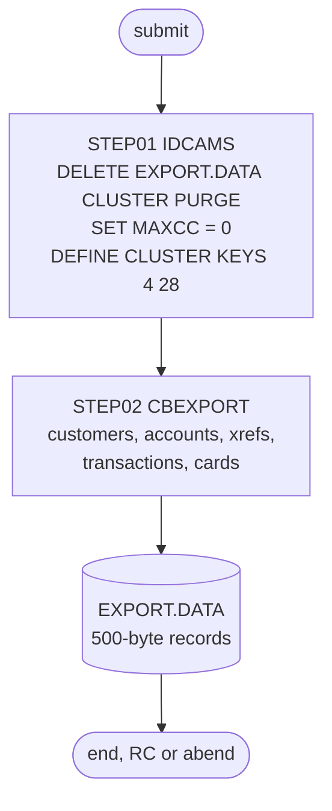

# CBEXPORT: Export the masters to a migration file

## 1. Summary

CBEXPORT (the job) produces one file that carries all of CardDemo's master data, for moving a branch to another system. `STEP01` deletes and redefines the VSAM cluster `AWS.M2.CARDDEMO.EXPORT.DATA` (500-byte records keyed by a 4-byte sequence number), and `STEP02` runs the program CBEXPORT, which reads the customer, account, card cross-reference, transaction and card masters in turn and writes each record, wrapped in an export header, to that cluster. CBIMPORT reads the file back. It runs only by hand. The job itself has no business rules (the record mapping belongs to the CBEXPORT program spec), but its cluster definition places the key one byte away from where the program puts it (DEF-JEXPT-001), and the file holds every customer's personal data and every card's CVV (DEF-JEXPT-002).

## 2. Rules at a glance

The job has no business rules. Its items:

| ID | Rule |
| :-- | :-- |
| SE-JEXPT-001 | Delete the export cluster; any failure is reset to return code 0. |
| SE-JEXPT-002 | Define the export cluster: KSDS, key 4 bytes at offset 28, records 500 fixed, no `REUSE`. |
| FLOW-JEXPT-001 | Run the program CBEXPORT over the five masters, reading only. |
| SE-JEXPT-003 | The program writes one export record per master record into the new cluster. |
| ERR-JEXPT-001 | `STEP02` runs even if the define failed; a program error ends in an abend with no defined code. |
| NUM-JEXPT-001 | The export key is a 4-byte binary sequence number. |
| DEF-JEXPT-001 | The cluster key offset (28) does not match the program's key offset (27). |
| DEF-JEXPT-002 | [security] The export file holds full customer PII and card CVVs and is never deleted. |
| DEF-JEXPT-003 | `SET MAXCC = 0` hides a failed delete, and the program then cannot open the old cluster for output. |
| DEF-JEXPT-004 | The abend call passes no abend code. |

## 3. Actors and triggers

- **Trigger:** submitted by hand. Neither the CA-7 nor the Control-M schedule runs it, no script submits it, and the README's job tables do not list it.
- **Preconditions:** the five masters are loaded. The job reads them with `DISP=SHR`, so CICS can keep them open, but online updates during the run can make the export inconsistent across files. Nothing else may have `EXPORT.DATA` allocated, or the delete fails (DEF-JEXPT-003).
- **Job card:** `CLASS=A,MSGCLASS=0,NOTIFY=&SYSUID` (`:1-2`). No parameters, no symbolic overrides.

## 4. Interfaces

| Step | Program | DD | Dataset | Disposition | Use | Source |
| :-- | :-- | :-- | :-- | :-- | :-- | :-- |
| `STEP01` | IDCAMS | `SYSPRINT` | `SYSOUT=*` | - | IDCAMS messages | `:25` |
| `STEP01` | IDCAMS | `SYSIN` | in-stream | - | `DELETE`, `SET MAXCC`, `DEFINE CLUSTER` | `:26-39` |
| `STEP02` | CBEXPORT | `STEPLIB` | `AWS.M2.CARDDEMO.LOADLIB` | `SHR` | program library | `:44-45` |
| `STEP02` | CBEXPORT | `CUSTFILE` | `AWS.M2.CARDDEMO.CUSTDATA.VSAM.KSDS` | `SHR` | input, KSDS sequential | `:49-50` |
| `STEP02` | CBEXPORT | `ACCTFILE` | `AWS.M2.CARDDEMO.ACCTDATA.VSAM.KSDS` | `SHR` | input, KSDS sequential | `:51-52` |
| `STEP02` | CBEXPORT | `XREFFILE` | `AWS.M2.CARDDEMO.CARDXREF.VSAM.KSDS` | `SHR` | input, KSDS sequential | `:53-54` |
| `STEP02` | CBEXPORT | `TRANSACT` | `AWS.M2.CARDDEMO.TRANSACT.VSAM.KSDS` | `SHR` | input, KSDS sequential | `:55-56` |
| `STEP02` | CBEXPORT | `CARDFILE` | `AWS.M2.CARDDEMO.CARDDATA.VSAM.KSDS` | `SHR` | input, KSDS sequential | `:57-58` |
| `STEP02` | CBEXPORT | `EXPFILE` | `AWS.M2.CARDDEMO.EXPORT.DATA` | `SHR` | output, KSDS opened for output | `:62-63` |
| `STEP02` | CBEXPORT | `SYSOUT` | `SYSOUT=*` | - | program `DISPLAY` output: progress and counts | `:67` |
| `STEP02` | CBEXPORT | `SYSPRINT` | `SYSOUT=*` | - | not written by the program | `:68` |

The DD names match the program's `SELECT ... ASSIGN TO` clauses (`app/cbl/CBEXPORT.cbl:35-68`). Return code of the job: the highest step return code, or an abend in `STEP02`.

## 5. Data used

- **Inputs, read in full in key order:** the customer master (no entity; `app/cpy/CVCUS01Y.cpy`), ENT-ACCOUNT, ENT-CARD-XREF, ENT-TRANSACTION and the card master (no entity; `app/cpy/CVACT02Y.cpy`). Nothing is updated.
- **Output:** the export record (no entity; `EXPORT-RECORD` in `app/cpy/CVEXPORT.cpy:9-19`), 500 bytes: record type X(1), timestamp X(26), `EXPORT-SEQUENCE-NUM` binary 9(9) (4 bytes, bytes 28-31), branch ID X(4), region code X(5) and 460 bytes of record data in one of five layouts. `docs/security/data-handling.md:52` lists its sensitive fields.
- The export cluster does not appear in the catalog listing `app/catlg/LISTCAT.txt`.

## 6. Processing flow

| # | Step | Class | What it does | Runs when |
| --: | :-- | :-- | :-- | :-- |
| 1 | `STEP01` | plumbing | delete and define the export cluster | always |
| 2 | `STEP02` | business | run CBEXPORT: write every master record to the export file | always (no `COND`) |

#### FLOW-JEXPT-001 · Run the export program
- **What:** `EXEC PGM=CBEXPORT` from `AWS.M2.CARDDEMO.LOADLIB`, with no `PARM` and no `COND`. The program opens the five masters for input and the export cluster for output (`app/cbl/CBEXPORT.cbl:240-245`), copies the masters in the order customers, accounts, cross-references, transactions, cards, and displays a count per master and a total.
- **Source:** `:43-63`
- **Fidelity:** must-preserve (which masters are exported, and that all their records are) · **Confidence:** runtime-verified (`python3 tools/carddemo.py run CBEXPORT`, which runs POSTTRAN first: RETURN-CODE 0, `Customers Exported: 000000050`, `Accounts Exported: 000000050`, `XRefs Exported: 000000050`, `Transactions Exported: 000000262`, `Cards Exported: 000000050`, `Total Records Exported: 000000462`)

## 7. Business rules

None in the job. How each master record is mapped into an export record, and the header values, belong to the CBEXPORT program spec.

## 8. Validations and messages

None in the job. The program's progress messages (for example `CBEXPORT: Starting Customer Data Export`, `CBEXPORT: Export completed`) and error messages (for example `ERROR: Cannot open EXPORT-OUTPUT, Status: ` followed by the file status) go to `SYSOUT`.

## 9. Side effects

In execution order. There is no rollback.

#### SE-JEXPT-001 · Delete the export cluster
- **What:** `DELETE AWS.M2.CARDDEMO.EXPORT.DATA CLUSTER PURGE` removes the cluster with its data and index and every record; `PURGE` deletes it even if a retention period has not expired.
- **Return code:** `SET MAXCC = 0` follows unconditionally, so every delete result, including a failure, becomes 0 (DEF-JEXPT-003). A missing cluster on a first run is not an error.
- **Source:** `:27-28`
- **Fidelity:** must-preserve (each run starts from an empty export file) · **Confidence:** reviewed

#### SE-JEXPT-002 · Define the export cluster
- **What:** `DEFINE CLUSTER (NAME(AWS.M2.CARDDEMO.EXPORT.DATA)` with:

| Attribute | Value |
| :-- | :-- |
| Organisation | `INDEXED` (KSDS) |
| Key | `KEYS(4 28)`: 4 bytes at offset 28, that is bytes 29-32 (see DEF-JEXPT-001) |
| Record size | `RECORDSIZE(500 500)`: fixed 500 |
| Space | `CYLINDERS(10 5)`, no volume (SMS or default placement) |
| Free space | `FREESPACE(10 10)` |
| Sharing | `SHAREOPTIONS(2 3)`: one writer and many readers within a system |
| Other | no `REUSE`, so the cluster can be opened for output only while it is empty |
| Components | data `...EXPORT.DATA.DATA`, index `...EXPORT.DATA.INDEX` |

- **Source:** `:30-38`
- **Fidelity:** must-preserve (record size, that the file is keyed by the export sequence number); incidental (space, free space, share options) · **Confidence:** reviewed

#### SE-JEXPT-003 · Write the export file
- **What:** the program writes one 500-byte export record per record read, in the order of FLOW-JEXPT-001, with ascending sequence numbers, into the empty cluster. For the sample data after a POSTTRAN run that is 462 records: 50 customers, 50 accounts, 50 cross-references, 262 transactions and 50 cards. The file stays until the next run of this job deletes it; no job archives or removes it.
- **Source:** `:62-63`
- **Fidelity:** must-preserve · **Confidence:** runtime-verified (`python3 tools/carddemo.py run CBEXPORT`: `EXPFILE` 462 records)

## 10. Error handling

#### ERR-JEXPT-001 · `STEP02` runs regardless; program errors abend
- **When:** `STEP01` fails (the return code is reset only for the delete; a failed define gives return code 12), or the program meets an I/O error.
- **Then:** `STEP02` has no `COND`, so it runs even after a failed define. If the cluster does not exist, the `EXPFILE` allocation fails with a JCL error. If the program cannot open or write a file, it displays the error and file status and calls `CEE3ABD` without arguments (`app/cbl/CBEXPORT.cbl:581-584`; DEF-JEXPT-004). The partly written export file stays in place; CBIMPORT would read it as if complete.
- **Source:** `:24, 43, 62-63`
- **Fidelity:** defect-decide · **Confidence:** platform-inferred

## 11. Interactions

- **Upstream:** the jobs that load the five masters (CUSTFILE, ACCTFILE, XREFFILE, CARDFILE) and POSTTRAN, which adds posted transactions to the transaction master.
- **Downstream:** CBIMPORT reads `EXPORT.DATA` through its `EXPFILE` DD (`app/jcl/CBIMPORT.jcl:28-29`). No schedule links the two jobs.
- **Local runner:** `tools/carddemo.py:672-679` emulates the job; it creates the export file with key offset 27 (`tools/batch-programs.toml:255-258`), which matches the program but not this JCL.

## 12. Numeric, date and format details

#### NUM-JEXPT-001 · The export key is a 4-byte binary sequence number
- `EXPORT-SEQUENCE-NUM` is `PIC 9(9) COMP`, a 4-byte big-endian binary integer on z/OS, at offset 27 of the record (`app/cpy/CVEXPORT.cpy:16`); the program's file key `EXPORT-OUT-SEQUENCE-KEY` is the same 4 bytes as `PIC X(04)` (`app/cbl/CBEXPORT.cbl:94-97`). Because the values are positive and big-endian, the byte order of the key is the numeric order, so records are stored in the order they were written. A target that reads the file on a little-endian platform must convert the field.
- **Fidelity:** must-preserve (if the file format is kept) · **Confidence:** reviewed

## 13. Known defects and oddities

#### DEF-JEXPT-001 · The cluster key is one byte off the program's key
- The define says `KEYS(4 28)`, a key at offset 28 (bytes 29-32). The program's record puts the key, `EXPORT-OUT-SEQUENCE-KEY`, after a 27-byte filler, at offset 27 (bytes 28-31), which is where `EXPORT-SEQUENCE-NUM` sits in `app/cpy/CVEXPORT.cpy:9-16` (1-byte type plus 26-byte timestamp). On z/OS, COBOL checks the key position of an indexed file against the catalog when it opens it, so the program's `OPEN OUTPUT` would most likely fail with a file-status error and the program would abend before writing anything. Even if it opened, the cluster would be keyed on the last three bytes of the sequence number and the first byte of the branch ID. The local runner defines the key at offset 27 (`tools/batch-programs.toml:255-258`), so local runs succeed and do not show the problem. CBIMPORT has the same key offset as CBEXPORT (`app/cbl/CBIMPORT.cbl:81-84`).
- **Source:** `:32`
- **Status:** open · **Fidelity:** defect-fix (key at offset 27, as in the program and the copybook) · **Confidence:** platform-inferred (no z/OS run; the mismatch itself is reviewed)

#### DEF-JEXPT-002 · [security] The export file holds full PII and CVVs and is kept indefinitely
- Every customer's name, address, phone numbers, Social Security number, government ID and date of birth, and every card's number and CVV, are copied into `EXPORT.DATA` (`docs/security/data-handling.md:102-103`). The file is not encrypted or masked by the job and is kept until deleted by hand (`docs/security/data-handling.md:175`); it is meant to leave the system.
- **Status:** open · **Fidelity:** defect-decide · **Confidence:** reviewed

#### DEF-JEXPT-003 · A hidden delete failure makes the export fail
- Because `SET MAXCC = 0` (`:28`) is unconditional, a delete that fails (for example because CBIMPORT or a user has the file allocated) goes unnoticed; the define then fails on the existing name, and the program tries to open the old, loaded cluster for output. Without `REUSE` that open fails and the program abends, leaving the previous export in place.
- **Status:** open · **Fidelity:** defect-decide · **Confidence:** platform-inferred

#### DEF-JEXPT-004 · The abend call passes no abend code
- The program's abend paragraph calls `CEE3ABD` without the abend-code and timing arguments that the other batch programs pass (`app/cbl/CBEXPORT.cbl:581-584`), so the abend code an operator sees is not defined by the program.
- **Status:** open · **Fidelity:** incidental · **Confidence:** reviewed

## 14. Open questions

| ID | Question | For |
| :-- | :-- | :-- |
| Q-JEXPT-001 | Is the export file format a contract with an external receiving system, or only between CBEXPORT and CBIMPORT? The answer decides whether the target must reproduce the binary key and the 500-byte layout. | product owner |
| Q-JEXPT-002 | Should the export mask or encrypt the SSN, government ID and CVV, and who may receive the file? | security |

## 15. Equivalence contract

After a successful run (return code 0, no abend), the export file contains exactly one record per customer, account, cross-reference, transaction and card record, in that order and in key order within each master, with ascending sequence numbers starting from the program's first value (462 records for the sample data after POSTTRAN), and nothing from earlier runs. The masters are unchanged. The key position must be the one the program uses (DEF-JEXPT-001). Message text may differ.

## 16. Paragraph coverage

| Step | Lines | Covered by |
| :-- | :-- | :-- |
| (job card) | 1-2 | §3 |
| `STEP01` | 24-39 | SE-JEXPT-001, SE-JEXPT-002, DEF-JEXPT-001, DEF-JEXPT-003 |
| `STEP02` | 43-68 | FLOW-JEXPT-001, SE-JEXPT-003, ERR-JEXPT-001, NUM-JEXPT-001, DEF-JEXPT-002, DEF-JEXPT-004 |
