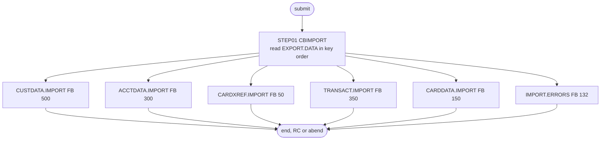

# CBIMPORT: Import the migration file

## 1. Summary

CBIMPORT (the job) is the receiving half of the branch migration that CBEXPORT starts. Its single step runs the program CBIMPORT, which reads the multi-record export file `AWS.M2.CARDDEMO.EXPORT.DATA` and writes each record, without its export header, to one of five new flat files (customers, accounts, card cross-references, transactions, cards), plus a new error file that receives one line for each record whose record type is not one of the five (`app/cbl/CBIMPORT.cbl:277-290`). The five files have the record layouts of the corresponding masters. Nothing in the repository loads them further. It runs only by hand. The job has no business rules of its own; the validation and record mapping belong to the CBIMPORT program spec. The job cannot be rerun without deleting its outputs by hand (DEF-JIMPT-001).

## 2. Rules at a glance

The job has no business rules. Its items:

| ID | Rule |
| :-- | :-- |
| FLOW-JIMPT-001 | Run the program CBIMPORT once over the whole export file. |
| SE-JIMPT-001 | Create and catalogue five flat files, one per master type, with the master record lengths. |
| SE-JIMPT-002 | Create and catalogue the error file, 132-byte records. |
| ERR-JIMPT-001 | A program error abends the step with no defined code; all six new files are then deleted. A failed write to the error file is the exception. |
| ERR-JIMPT-002 | A failed write to the error file is only displayed; the step continues and ends normally. |
| NUM-JIMPT-001 | Output record lengths equal the master copybooks; the error file is 132-byte text. |
| DEF-JIMPT-001 | No pre-delete step: a second run fails because the output names exist. |
| DEF-JIMPT-002 | [security] Five more files hold full customer PII, card numbers and CVVs, and no job deletes them. |
| DEF-JIMPT-003 | The input file is defined by CBEXPORT's JCL with a key offset the program does not use. |
| DEF-JIMPT-004 | Nothing loads the imported files. |

## 3. Actors and triggers

- **Trigger:** submitted by hand, after CBEXPORT (or after an export file from another system has been placed in `EXPORT.DATA`). Neither the CA-7 nor the Control-M schedule runs it, no script submits it, and the README's job tables do not list it.
- **Preconditions:** `AWS.M2.CARDDEMO.EXPORT.DATA` exists and is loaded; none of the six output datasets exists (DEF-JIMPT-001).
- **Job card:** `CLASS=A,MSGCLASS=0,NOTIFY=&SYSUID` (`:1-2`). No parameters, no symbolic overrides.

## 4. Interfaces

| Step | Program | DD | Dataset | Disposition | Use | Source |
| :-- | :-- | :-- | :-- | :-- | :-- | :-- |
| `STEP01` | CBIMPORT | `STEPLIB` | `AWS.M2.CARDDEMO.LOADLIB` | `SHR` | program library | `:23-24` |
| `STEP01` | CBIMPORT | `EXPFILE` | `AWS.M2.CARDDEMO.EXPORT.DATA` | `SHR` | input, KSDS read sequentially in key order | `:28-29` |
| `STEP01` | CBIMPORT | `CUSTOUT` | `AWS.M2.CARDDEMO.CUSTDATA.IMPORT` | `(NEW,CATLG,DELETE)` | output, `RECFM=FB,LRECL=500`, `UNIT=SYSDA`, `SPACE=(TRK,(50,25),RLSE)` | `:33-37` |
| `STEP01` | CBIMPORT | `ACCTOUT` | `AWS.M2.CARDDEMO.ACCTDATA.IMPORT` | `(NEW,CATLG,DELETE)` | output, `RECFM=FB,LRECL=300`, `UNIT=SYSDA`, `SPACE=(TRK,(50,25),RLSE)` | `:38-42` |
| `STEP01` | CBIMPORT | `XREFOUT` | `AWS.M2.CARDDEMO.CARDXREF.IMPORT` | `(NEW,CATLG,DELETE)` | output, `RECFM=FB,LRECL=50`, `UNIT=SYSDA`, `SPACE=(TRK,(25,10),RLSE)` | `:43-47` |
| `STEP01` | CBIMPORT | `TRNXOUT` | `AWS.M2.CARDDEMO.TRANSACT.IMPORT` | `(NEW,CATLG,DELETE)` | output, `RECFM=FB,LRECL=350`, `UNIT=SYSDA`, `SPACE=(TRK,(100,50),RLSE)` | `:48-52` |
| `STEP01` | CBIMPORT | `CARDOUT` | `AWS.M2.CARDDEMO.CARDDATA.IMPORT` | `(NEW,CATLG,DELETE)` | output, `RECFM=FB,LRECL=150`, `UNIT=SYSDA`, `SPACE=(TRK,(25,10),RLSE)` | `:53-57` |
| `STEP01` | CBIMPORT | `ERROUT` | `AWS.M2.CARDDEMO.IMPORT.ERRORS` | `(NEW,CATLG,DELETE)` | output, `RECFM=FB,LRECL=132`, `UNIT=SYSDA`, `SPACE=(TRK,(10,5),RLSE)` | `:61-65` |
| `STEP01` | CBIMPORT | `SYSOUT` | `SYSOUT=*` | - | program `DISPLAY` output: progress and counts | `:69` |
| `STEP01` | CBIMPORT | `SYSPRINT` | `SYSOUT=*` | - | not written by the program | `:70` |

All outputs use a system-determined block size (`BLKSIZE=0`). The DD names match the program's `SELECT ... ASSIGN TO` clauses (`app/cbl/CBIMPORT.cbl:37-70`). Return code of the job: the step's return code, or an abend.

## 5. Data used

- **Input:** the export record ENT-EXPORT-RECORD (`EXPORT-RECORD` in `app/cpy/CVEXPORT.cpy:9-19`), 500 bytes, read in key order, which is the order CBEXPORT wrote it in.
- **Outputs:** ENT-CUSTOMER records (`app/cpy/CVCUS01Y.cpy`), ENT-ACCOUNT records, ENT-CARD-XREF records, ENT-TRANSACTION records, ENT-CARD records (`app/cpy/CVACT02Y.cpy`), and 132-byte error lines, ENT-IMPORT-ERROR (`app/cbl/CBIMPORT.cbl:111-114`). The program's FDs give the record lengths (`app/cbl/CBIMPORT.cbl:86-114`).

## 6. Processing flow

| # | Step | Class | What it does | Runs when |
| --: | :-- | :-- | :-- | :-- |
| 1 | `STEP01` | business | run CBIMPORT: split the export file into one file per master type, and an error file | always |

#### FLOW-JIMPT-001 · Run the import program
- **What:** `EXEC PGM=CBIMPORT` from `AWS.M2.CARDDEMO.LOADLIB`, with no `PARM`. The program opens `EXPFILE` for input and the six outputs for output (`app/cbl/CBIMPORT.cbl:203-245`), reads every export record, writes it to the file for its record type, and displays counts at the end.
- **Source:** `:22-29`
- **Fidelity:** must-preserve (every export record ends up in exactly one output) · **Confidence:** runtime-verified (`python3 tools/carddemo.py run CBIMPORT`, which runs POSTTRAN and CBEXPORT first: RETURN-CODE 0, `Total Records Read: 000000462`, `Customers Imported: 000000050`, `Accounts Imported: 000000050`, `XRefs Imported: 000000050`, `Transactions Imported: 000000262`, `Cards Imported: 000000050`, `Errors Written: 000000000`, `Unknown Record Types: 000000000`)

## 7. Business rules

None in the job. Which records the program accepts, how it unpacks each record type and what it writes to the error file belong to the CBIMPORT program spec.

## 8. Validations and messages

None in the job. The program's progress messages (for example `CBIMPORT: Starting Customer Data Import`, `CBIMPORT: Import completed`) and counts go to `SYSOUT`; records of unknown type go to `IMPORT.ERRORS`.

## 9. Side effects

#### SE-JIMPT-001 · Create the five master-type files
- **What:** `CUSTOUT`, `ACCTOUT`, `XREFOUT`, `TRNXOUT` and `CARDOUT` are new catalogued sequential datasets on `SYSDA`, fixed-length with the lengths of the corresponding master records (500, 300, 50, 350, 150). Each receives the records of its type in the order they appear in the export file. If the step abends, `DISP=(NEW,CATLG,DELETE)` deletes them.
- **Source:** `:33-57`
- **Fidelity:** must-preserve · **Confidence:** runtime-verified (`python3 tools/carddemo.py run CBIMPORT`: `CUSTOUT` 50, `ACCTOUT` 50, `XREFOUT` 50, `TRNXOUT` 262, `CARDOUT` 50 records)

#### SE-JIMPT-002 · Create the error file
- **What:** `ERROUT` is a new catalogued dataset `AWS.M2.CARDDEMO.IMPORT.ERRORS`, `RECFM=FB,LRECL=132`. It is created even when there are no errors, so an empty file means a clean import.
- **Source:** `:61-65`
- **Fidelity:** must-preserve · **Confidence:** runtime-verified (`python3 tools/carddemo.py run CBIMPORT`: `ERROUT` 0 records)

## 10. Error handling

#### ERR-JIMPT-001 · Program errors abend the step
- **When:** the program cannot open or read a file, or cannot write one of the five data files. A failed write to `ERROUT` does not abend (ERR-JIMPT-002).
- **Then:** it displays the error and calls `CEE3ABD` without arguments (`app/cbl/CBIMPORT.cbl:491-494`), so the step abends with a code the program does not define. Because every output has `DISP=(NEW,CATLG,DELETE)`, all six new files are deleted, and the export file is unchanged, so after fixing the cause the job can be resubmitted. A JCL error at allocation (for example DEF-JIMPT-001) stops the job before the program runs.
- **Source:** `:22, 33-65`
- **Fidelity:** must-preserve (no partial import is left behind) · **Confidence:** platform-inferred

#### ERR-JIMPT-002 · A failed error-file write does not stop the step
- **When:** the write of an error line to `ERROUT` returns a status other than `00`.
- **Then:** the program displays `ERROR: Writing error record, Status: ` and the status, still counts the line as written, and carries on (ERR-IMPT-004, DEF-IMPT-002). The step can therefore end with return code 0 while `IMPORT.ERRORS` lacks lines for some unknown-type records; the job's return code alone does not prove that the error file is complete. The program also always displays `CBIMPORT: No validation errors detected`, whatever the error file holds (`app/cbl/CBIMPORT.cbl:459-462`; DEF-IMPT-001).
- **Source:** `app/cbl/CBIMPORT.cbl:449-456`, `:61-65`
- **Fidelity:** defect-decide · **Confidence:** reviewed

## 11. Interactions

- **Upstream:** CBEXPORT creates and loads `EXPORT.DATA` (`app/jcl/CBEXPORT.jcl:30-38`). No schedule links the two jobs.
- **Downstream:** none in the repository. The comment in the JCL describes the outputs as normalized files "FOR TARGET SYSTEM"; no CardDemo job reads `*.IMPORT` or `IMPORT.ERRORS` (DEF-JIMPT-004).
- **Local runner:** `tools/carddemo.py:680-688` emulates the job with the same DD names and runs CBEXPORT first.

## 12. Numeric, date and format details

#### NUM-JIMPT-001 · Output record formats
- The five data files have exactly the record lengths of the master copybooks: 500 (`app/cpy/CVCUS01Y.cpy`), 300 (`app/cpy/CVACT01Y.cpy`), 50 (`app/cpy/CVACT03Y.cpy`), 350 (`app/cpy/CVTRA05Y.cpy`) and 150 (`app/cpy/CVACT02Y.cpy`), matching the program's FDs (`app/cbl/CBIMPORT.cbl:86-109`). Numeric fields that the export record stores in binary or packed form are converted back by the program; that conversion belongs to the program spec. The error file holds 132-byte lines.
- **Source:** `app/cbl/CBIMPORT.cbl:86-114`, `:33-65`
- **Fidelity:** must-preserve (if the target keeps flat-file outputs) · **Confidence:** reviewed

## 13. Known defects and oddities

#### DEF-JIMPT-001 · No pre-delete: a rerun fails
- Every output is `DISP=(NEW,CATLG,DELETE)` and the job has no step that deletes them first, unlike READACCT or DUSRSECJ. After one successful run, a second submission fails at allocation because the datasets are already catalogued (or, without SMS, may be created but not catalogued). The operator has to delete the six files by hand first.
- **Source:** `:33-65`
- **Status:** open · **Fidelity:** defect-decide · **Confidence:** platform-inferred

#### DEF-JIMPT-002 · [security] Five more files with full PII, card numbers and CVVs
- Of the six outputs, the five data files hold sensitive data: the customer file carries names, addresses, phone numbers, SSN, government ID and date of birth; the card file carries card numbers and CVVs; the cross-reference and transaction files carry card numbers (`app/cpy/CVACT03Y.cpy:5`, `app/cpy/CVTRA05Y.cpy:15`). The error file holds only a timestamp, the record type, the sequence number and a fixed message (`app/cbl/CBIMPORT.cbl:439-442`). The five files are plain sequential datasets, not encrypted or masked, that no job deletes; the retention table in `docs/security/data-handling.md:173-175` covers the masters and the export file but has no entry for the import files, and the extract rule in `docs/security/data-handling.md:147-150` asks that CVV and SSN be dropped from extracts that leave the system.
- **Source:** `:33-57`, `app/cbl/CBIMPORT.cbl:86-109`
- **Status:** open · **Fidelity:** defect-decide · **Confidence:** reviewed

#### DEF-JIMPT-003 · The input's catalogued key offset differs from the program's
- The program reads `EXPORT.DATA` as an indexed file keyed at offset 27 (`app/cbl/CBIMPORT.cbl:81-84`), but CBEXPORT's JCL defines the cluster with `KEYS(4 28)` (`app/jcl/CBEXPORT.jcl:32`; DEF-JEXPT-001). On z/OS the program's open would most likely fail with a file-status error and the program would abend. Locally the runner uses offset 27 for both programs, so the problem does not show.
- **Source:** `:28-29`, `app/cbl/CBIMPORT.cbl:81-84`, `app/jcl/CBEXPORT.jcl:32`
- **Status:** open · **Fidelity:** defect-decide (Q-JEXPT-001) · **Confidence:** platform-inferred

#### DEF-JIMPT-004 · Nothing loads the imported files
- The outputs are not loaded into VSAM or read by any CardDemo job; the master reload jobs (for example CUSTFILE) read the `*.PS` sample files, not `*.IMPORT`. The import ends with flat files for a system outside the repository.
- **Source:** `:33-57`
- **Status:** open · **Fidelity:** incidental · **Confidence:** reviewed (repository-wide search for the dataset names)

## 14. Open questions

| ID | Question | For |
| :-- | :-- | :-- |
| Q-JIMPT-001 | Which system consumes the `*.IMPORT` files, and in what format does it expect them? The answer decides whether the target writes these flat files or loads the data directly. | product owner |

## 15. Equivalence contract

After a successful run (return code 0), every export record appears in exactly one of the six outputs: each data file holds the records of its type, in export-file order, with the master record layout, and the error file holds one line per record of unknown type (none for a CBEXPORT file; 50, 50, 50, 262 and 50 records for the sample data after POSTTRAN). The export file is unchanged. A failed run leaves no output files behind. Message text may differ.

## 16. Paragraph coverage

| Step | Lines | Covered by |
| :-- | :-- | :-- |
| (job card) | 1-2 | §3 |
| `STEP01` | 22-70 | FLOW-JIMPT-001, SE-JIMPT-001, SE-JIMPT-002, ERR-JIMPT-001, ERR-JIMPT-002, NUM-JIMPT-001, DEF-JIMPT-001, DEF-JIMPT-002, DEF-JIMPT-003, DEF-JIMPT-004 |
