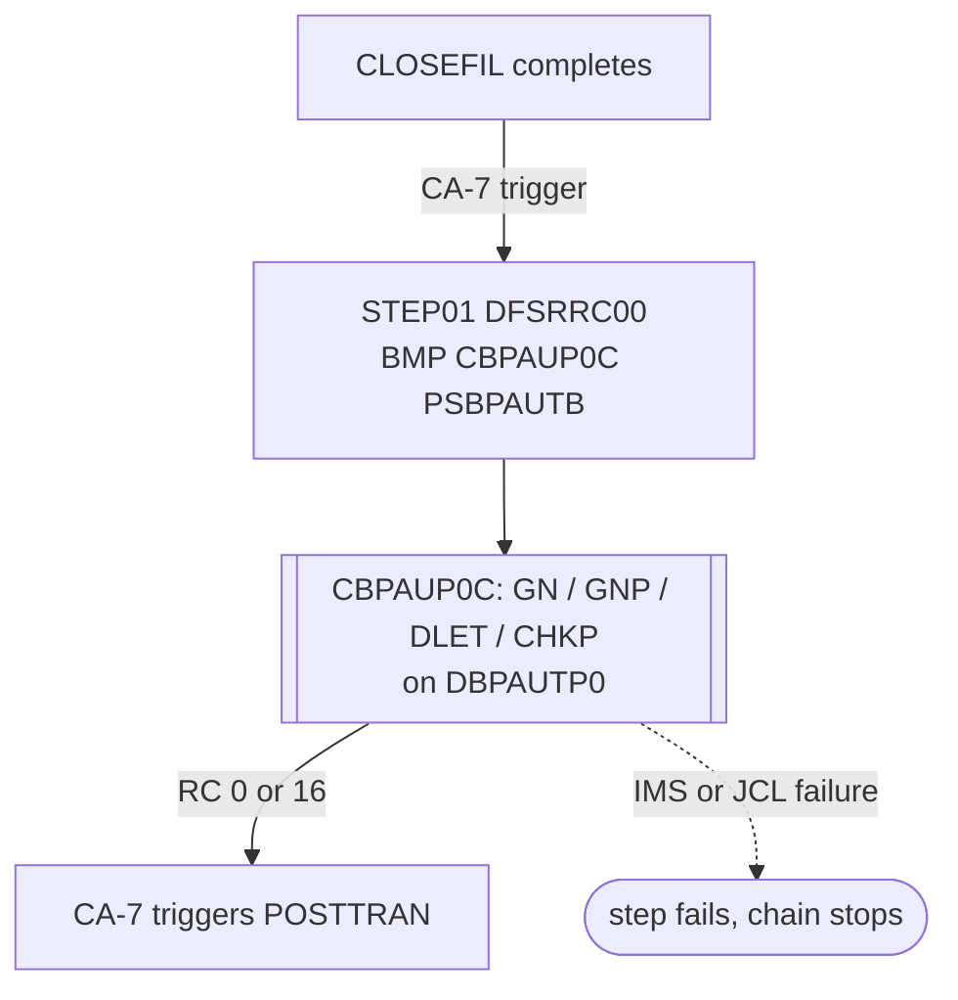

# CBPAUP0J: Expired pending authorization purge job

## 1. Summary

CBPAUP0J is the one-step job that runs the purge program CBPAUP0C as an IMS batch message program (BMP) against the pending-authorization database `DBPAUTP0`. The program deletes the authorization details older than the expiry days on its parameter card and the summaries left with no approved authorizations; those rules belong to the CBPAUP0C spec. This spec covers what the JCL adds: the BMP region and PSB, the in-stream parameter card `00,00001,00001,Y` (which makes the program delete every authorization, DEF-JAUPG-001), the placeholder load library, and the job's place in the CA-7 chain between CLOSEFIL and POSTTRAN.

## 2. Rules at a glance

| ID | Rule |
| :-- | :-- |
| FLOW-JAUPG-001 | One step: `DFSRRC00` starts CBPAUP0C in a BMP region with PSB `PSBPAUTB`. |
| FLOW-JAUPG-002 | CA-7 runs the job when CLOSEFIL completes and runs POSTTRAN when it completes. |
| BR-JAUPG-001 | The parameter card sets expiry 0 days, checkpoint and display frequency `00001`, debug on. |
| SE-JAUPG-001 | Expired details and emptied summaries are deleted from `DBPAUTP0` (program side effects). |
| ERR-JAUPG-001 | A program error ends the step with return code 16, not an abend; the deletes made so far stay. |
| ERR-JAUPG-002 | IMS environment errors stop the step before the program runs. |
| NUM-JAUPG-001 | Parameter card columns and the values they produce. |
| DEF-JAUPG-001 | The shipped card purges every authorization and prints account numbers. |
| DEF-JAUPG-002 | The second load library is the placeholder `XXXXXXXX.PROD.LOADLIB`. |
| DEF-JAUPG-003 | Return code 16 does not stop CA-7 from starting POSTTRAN unless the job definition tests it. |

## 3. Actors and triggers

- **Scheduler:** in the CA-7 listing, CLOSEFIL (`app/scheduler/CardDemo.ca7:18-19`) lists `CBPAUP0J` as a triggered job (`app/scheduler/CardDemo.ca7:42-43`, `SCHID=030`, `QTM=0100`), and CBPAUP0J lists POSTTRAN (`app/scheduler/CardDemo.ca7:69-70`). The job record shows JCL member `CBPAUP0J`, system `CARDDEMO` (`app/scheduler/CardDemo.ca7:51`). The batch-cycle runbook places it after CLOSEFIL when the module is installed (`docs/runbooks/batch-cycle-restart.md:24`).
- **Operator:** can submit it on demand (`docs/runbooks/authorization-purge.md:89-97`).
- **Job card:** `'CARDDEMO',CLASS=A,MSGCLASS=H,MSGLEVEL=(1,1),REGION=0M,NOTIFY=&SYSUID` (`:1-2`).
- **Preconditions:** the IMS control region is up and `DBPAUTP0` is available for update to BMPs (`docs/runbooks/authorization-purge.md:16-17`); `PSBPAUTB` is generated (`PSBPAUTB.psb:17-20`); CBPAUP0C is in the second `STEPLIB` library (DEF-JAUPG-002). CICS need not be down: CLOSEFIL closes five VSAM files in CICS (`app/jcl/CLOSEFIL.jcl:26-30`), not the IMS database, and the online authorization programs use the same database through the same control region while the purge runs.

## 4. Interfaces

### Step `STEP01` (DFSRRC00, BMP CBPAUP0C)

| DD | Dataset | DISP | DCB | Use | Source |
| :-- | :-- | :-- | :-- | :-- | :-- |
| `STEPLIB` | `IMS.SDFSRESL`, then `XXXXXXXX.PROD.LOADLIB` | `SHR` | - | IMS region modules, then the program load library | `:26-27` |
| `DFSRESLB` | `IMS.SDFSRESL` | `SHR` | - | IMS resident library for the region | `:28` |
| `PROCLIB` | `IMS.PROCLIB` | `SHR` | - | IMS procedure library | `:29` |
| `DFSSEL` | `IMS.SDFSRESL` | `SHR` | - | IMS library | `:31` |
| `IMS` | `IMS.PSBLIB`, then `IMS.DBDLIB` | `SHR` | - | PSB and DBD libraries | `:33-34` |
| `SYSIN` | in-stream | - | 80-byte card | parameter card `00,00001,00001,Y`, read by `ACCEPT PRM-INFO FROM SYSIN` (`CBPAUP0C.cbl:189`) | `:36-37` |
| `SYSOUX` | `SYSOUT=*` | - | - | not used by the program | `:39` |
| `SYSOUT` | `SYSOUT=*` | - | - | the program's `DISPLAY` output (CBPAUP0C section 4.3) | `:40` |
| `SYSABOUT`, `ABENDAID` | `SYSOUT=*` | - | - | abend diagnostics | `:41-42` |
| `IEFRDER`, `IMSLOGR` | `DUMMY` | - | - | log data sets of a DL/I batch region; a BMP logs through the control region | `:43-44` |
| `SYSPRINT`, `SYSUDUMP`, `IMSERR` | `SYSOUT=*` | - | - | utility messages, dump, IMS errors | `:45-47` |

There is no database DD: a BMP accesses `DBPAUTP0` through the control region. **Confidence:** platform-inferred.

Return code of the job: the return code CBPAUP0C sets (0, or 16 after an IMS error, CBPAUP0C ERR-AUPG-006), or the code of an IMS failure before the program runs (ERR-JAUPG-002).

## 5. Data used

ENT-AUTH-SUMMARY and ENT-AUTH-DETAIL in `DBPAUTP0` (HIDAM, root `PAUTSUM0` keyed by `ACCNTID`, child `PAUTDTL1`; `DBPAUTP0.dbd:18-37`), through PCB `PAUTBPCB` with `PROCOPT=AP` (`PSBPAUTB.psb:17-19`). The fields the program reads and deletes by are in CBPAUP0C section 5.

## 6. Processing flow

| # | Step | Program or utility | Purpose | Class |
| --: | :-- | :-- | :-- | :-- |
| 1 | `STEP01` | `DFSRRC00` → CBPAUP0C (BMP, PSB `PSBPAUTB`) | delete expired authorizations and emptied summaries | business |

#### FLOW-JAUPG-001 · Start the purge program as a BMP
- **What:** `STEP01` executes the IMS region controller `DFSRRC00` with `PARM='BMP,CBPAUP0C,PSBPAUTB'`: region type BMP, application program CBPAUP0C, PSB `PSBPAUTB`. No IMS subsystem ID is given in the parameter, so the region connects to the default IMS system of the installation. The program finds its PCB by number (CBPAUP0C section 4.2).
- **Source:** `:24-25`
- **Fidelity:** must-preserve · **Confidence:** platform-inferred

#### FLOW-JAUPG-002 · Place in the CA-7 chain
- **What:** CA-7 submits CBPAUP0J when CLOSEFIL completes, and POSTTRAN when CBPAUP0J completes, both with schedule ID 030 and a queue time of 0100. So in the CA-7 cycle the purge runs after the CICS files are closed and before the daily posting. Control-M has no such job.
- **Source:** `app/scheduler/CardDemo.ca7:42-43, 51, 69-70`
- **Fidelity:** must-preserve (order) · **Confidence:** reviewed

## 7. Business rules

#### BR-JAUPG-001 · Purge parameters on the card
- **When:** the step starts.
- **Then:** the in-stream card `00,00001,00001,Y` is the program's parameter record. CBPAUP0C reads it as expiry days `00`, checkpoint frequency `00001`, checkpoint display frequency `00001` and debug flag `Y` (CBPAUP0C FLOW-AUPG-001). Expiry `00` is numeric, so the default of 5 days does not apply, and every detail is deleted (CBPAUP0C BR-AUPG-002, DEF-AUPG-001). The frequencies are compared as text, so a checkpoint is taken every 1,000 summaries (CBPAUP0C NUM-AUPG-002).
- **Source:** `:36-37`, `CBPAUP0C.cbl:189, 196-209`
- **Fidelity:** must-preserve (card format); defect-decide (values, DEF-JAUPG-001) · **Confidence:** reviewed

The purge rules themselves (age, expiry test, summary delete, checkpoints, totals) are CBPAUP0C BR-AUPG-001..006.

## 8. Validations and messages

None at job level. The program does not reject any parameter value (CBPAUP0C FLOW-AUPG-001); its messages go to `SYSOUT` (`:40`) and are listed in CBPAUP0C section 4.3 and in `docs/runbooks/authorization-purge.md:81-87`.

## 9. Side effects

#### SE-JAUPG-001 · Deletes in the authorization database
- **What:** the program deletes expired `PAUTDTL1` segments and every `PAUTSUM0` segment whose approved count falls to zero or less, together with its remaining details (CBPAUP0C SE-AUPG-001, SE-AUPG-002). IMS commits the deletes at each checkpoint, at the normal end and at the end with return code 16 (CBPAUP0C SE-AUPG-003, ERR-AUPG-006). The job allocates, creates and deletes no data set.
- **Source:** `:24-25`
- **Fidelity:** must-preserve · **Confidence:** platform-inferred

## 10. Error handling

#### ERR-JAUPG-001 · Program error ends with return code 16
- **When:** any IMS call of CBPAUP0C fails (CBPAUP0C ERR-AUPG-001..005).
- **Then:** the program prints the failing call, sets return code 16 and ends normally (CBPAUP0C ERR-AUPG-006). The step ends with condition code 16, not an abend, so IMS does not back out: every delete made before the failure stays. There is no `COND` parameter and no other step.
- **Restart:** fix the cause and resubmit with the same card; the next run reads the remaining segments and applies the same test (`docs/runbooks/authorization-purge.md:89-94`).
- **Source:** `:24-25`, `CBPAUP0C.cbl:377-383`
- **Fidelity:** defect-decide (CBPAUP0C Q-AUPG-008) · **Confidence:** platform-inferred

#### ERR-JAUPG-002 · IMS environment failure
- **When:** the IMS control region is down, `PSBPAUTB` is not generated or not available to BMPs, or CBPAUP0C is not in `STEPLIB` (DEF-JAUPG-002).
- **Then:** `DFSRRC00` fails before the program runs, with an IMS message and a non-zero code or abend of the region; nothing is deleted (`docs/runbooks/authorization-purge.md:87`).
- **Source:** `:24-29`
- **Confidence:** platform-inferred

## 11. Interactions

- **Program:** CBPAUP0C (FLOW-AUPG-001, FLOW-AUPG-002).
- **Upstream:** CLOSEFIL (CA-7 trigger). The authorizations come from the online program COPAUA0C (CBPAUP0C section 11).
- **Downstream:** POSTTRAN (CA-7 trigger). POSTTRAN does not use `DBPAUTP0`; the order only places the purge inside the batch window.
- **Shared data:** the online programs COPAUA0C, COPAUS0C and COPAUS1C use `DBPAUTP0` at the same time through the same control region; IMS serializes the calls (PINV-e-authorization-04 in `areas/e-authorization-interactions.md`).

## 12. Numeric, date and format details

#### NUM-JAUPG-001 · Parameter card layout
- Columns 1-2 expiry days (`00`), 3 comma, 4-8 checkpoint frequency (`00001`), 9 comma, 10-14 checkpoint display frequency (`00001`), 15 comma, 16 debug flag (`Y`); the program reads the first 17 bytes into `PRM-INFO` (CBPAUP0C section 4.1). The run date is the system date of the run (`ACCEPT ... FROM DAY`, CBPAUP0C NUM-AUPG-001); the JCL passes none.
- **Source:** `:37`, `CBPAUP0C.cbl:98-108`
- **Fidelity:** must-preserve · **Confidence:** reviewed

## 13. Known defects and oddities

#### DEF-JAUPG-001 · The shipped card purges everything and prints account numbers
- Expiry `00` deletes every authorization dated on or before the run date, and with it every summary (CBPAUP0C DEF-AUPG-001); debug `Y` prints a line per read and the account number per delete (CBPAUP0C DEF-AUPG-008). In the CA-7 chain this runs every cycle, so pending authorizations never survive a batch window. The runbook warns about it (`docs/runbooks/authorization-purge.md:34-37`).
- **Source:** `:37` · **Status:** open · **Fidelity:** defect-decide (CBPAUP0C Q-AUPG-001, Q-AUPG-009) · **Confidence:** reviewed

#### DEF-JAUPG-002 · Placeholder load library
- The second `STEPLIB` library is `XXXXXXXX.PROD.LOADLIB`, which does not exist as shipped, so the step cannot find CBPAUP0C until it is edited (`docs/runbooks/authorization-purge.md:18-19`). The other jobs of the module use `AWS.M2.CARDDEMO.LOADLIB` and `OEMA.IMS.IMSP.*` IMS libraries; this one uses `IMS.*`.
- **Source:** `:26-34` · **Status:** open · **Fidelity:** incidental · **Confidence:** reviewed

#### DEF-JAUPG-003 · Return code 16 may not stop the chain
- The program reports errors with return code 16 instead of an abend (ERR-JAUPG-001). The CA-7 listing shows no condition-code test for the job, so unless one is defined CA-7 treats the run as complete and triggers POSTTRAN after a failed purge (`docs/runbooks/authorization-purge.md:96-97`).
- **Source:** `app/scheduler/CardDemo.ca7:51-70` · **Status:** open · **Fidelity:** defect-decide · **Confidence:** platform-inferred

## 14. Open questions

| ID | Question | For |
| :-- | :-- | :-- |
| Q-JAUPG-001 | Does the production CA-7 definition of CBPAUP0J treat return code 16 as a failure, so POSTTRAN waits (DEF-JAUPG-003)? | operations |
| Q-JAUPG-002 | Which IMS system and load library does the production job use (DEF-JAUPG-002), and must the purge stay inside the batch window when the online programs can run beside it? | mainframe team, operations |

## 15. Equivalence contract

For the same database content, parameter card and run date, the deletes and totals must match CBPAUP0C's equivalence contract. At job level: the target runs the purge once per cycle after the online files are closed and before posting, with the expiry, checkpoint and debug values taken from the same card format (or their decided replacements, Q-AUPG-001), and stops the chain when the purge fails. Library names, region type and console text may differ. Not runnable locally (IMS). Review record: `docs/modernization/spec/evidence/e-review.md`.

## 16. Step coverage

| Step | Lines | Covered by |
| :-- | :-- | :-- |
| (job card) | 1-2 | FLOW-JAUPG-001 |
| `STEP01` | 24-47 | FLOW-JAUPG-001, FLOW-JAUPG-002, BR-JAUPG-001, SE-JAUPG-001, ERR-JAUPG-001, ERR-JAUPG-002, NUM-JAUPG-001, DEF-JAUPG-001, DEF-JAUPG-002, DEF-JAUPG-003 |
