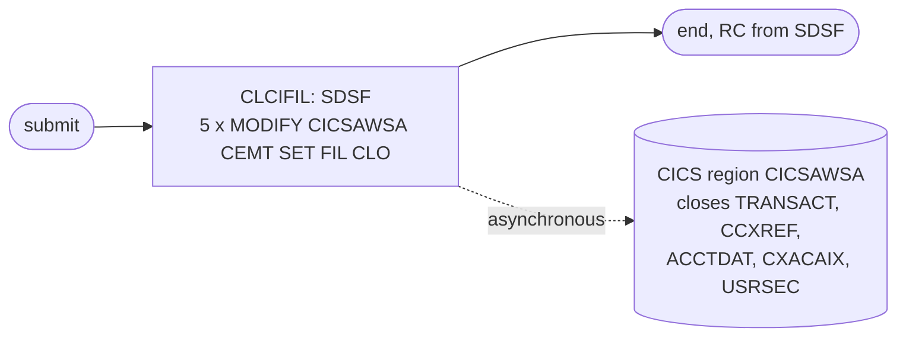

# CLOSEFIL: Close the CardDemo files in CICS

## 1. Summary

CLOSEFIL hands five VSAM files over from the online system to batch. Its only step runs the SDSF batch interface, which issues five MVS `MODIFY` commands to the CICS region `CICSAWSA`; each command asks CICS to close one file (`CEMT SET FIL(...) CLO`). After CICS has closed them, batch jobs can delete, redefine, load or update the files without a sharing conflict. It opens most chains in both schedules and the README and demo-script sequences, but not all of them: in CA-7 it is also triggered in the middle of chains, by WAITSTEP and by OPENFIL (section 3), and the Control-M smart folder that runs TRANEXTR has no CLOSEFIL (`app/scheduler/CardDemo.controlm:57-63`). It contains no business logic.

## 2. Rules at a glance

| ID | Rule |
| :-- | :-- |
| FLOW-JCLOSE-001 | One SDSF step sends five `MODIFY` commands to region `CICSAWSA`, in a fixed order. |
| SE-JCLOSE-001 | CICS closes files `TRANSACT`, `CCXREF`, `ACCTDAT`, `CXACAIX` and `USRSEC`. |
| ERR-JCLOSE-001 | The job's return code does not tell whether CICS actually closed the files. |
| DEF-JCLOSE-001 | The CICS region name is hard-coded. |
| DEF-JCLOSE-002 | The README lists the program as IEFBR14; the JCL runs SDSF. |
| DEF-JCLOSE-003 | Files `CARDDAT`, `CARDAIX` and `CUSTDAT` are not closed. |

## 3. Actors and triggers

- **Triggers:**
  - CA-7: job `CLOSEFIL` (`app/scheduler/CardDemo.ca7:18-43`) and two more CA-7 jobs, `CLOSEFIL1` and `CLOSEFIL2`, that run the same member (`app/scheduler/CardDemo.ca7:219-225, 246-252`). CLOSEFIL is also the target of WAITSTEP triggers with SCHID 030 (`app/scheduler/CardDemo.ca7:302-303, 334-335`) and of an OPENFIL trigger with SCHID 031 (`app/scheduler/CardDemo.ca7:531-532`). A trigger fires only when its job runs under that schedule ID, and CLOSEFIL then runs under the same ID: under 030 it triggers CBPAUP0J, TRANTYPE, READACCT and CREASTMT, under 031 PRTCATBL (`app/scheduler/CardDemo.ca7:43, 159-162, 337-340, 465-468, 534-537`). `CLOSEFIL1` is triggered only under 031 and `CLOSEFIL2` only under 032 (`app/scheduler/CardDemo.ca7:216-217`). See `SCHED-CA7.md` (FLOW-JCA7-006).
  - Control-M: first job of the folders `DAILY-TransactionBackup`, `WEEKLY-DisclosureGroupsRefresh` and `MONTHLY-InterestCalculation` (`app/scheduler/CardDemo.controlm:4-7, 33-37, 65-68`); the MNTTRDB2 folder and the TRANEXTR smart folder have none (`app/scheduler/CardDemo.controlm:26-31, 57-63`). See `SCHED-CONTROLM.md`.
  - By hand: README initialisation step 2 (`./README.md:153`), demo script job 1 (`scripts/run_full_batch.sh:12-14`), batch cycle step 1 (`docs/runbooks/batch-cycle-restart.md:13`).
- **Preconditions:** the CICS region is called `CICSAWSA` and is up; the submitting user may issue MVS `MODIFY` commands through SDSF (`docs/runbooks/cics-vsam-files.md:54-56`).
- **Job card:** `CLASS=A,MSGCLASS=0,NOTIFY=&SYSUID` (`:1-2`). No parameters.

## 4. Interfaces

| Step | Program | DD | Dataset | Disposition | Use | Source |
| :-- | :-- | :-- | :-- | :-- | :-- | :-- |
| `CLCIFIL` | SDSF | `ISFOUT` | `SYSOUT=*` | - | SDSF panel output | `:23` |
| `CLCIFIL` | SDSF | `CMDOUT` | `SYSOUT=*` | - | command responses | `:24` |
| `CLCIFIL` | SDSF | `ISFIN` | in-stream | - | the five commands of FLOW-JCLOSE-001 | `:25-31` |

The commands (exact text, one leading space, `:26-30`):

| # | Command | CICS file | Dataset (CSD) |
| --: | :-- | :-- | :-- |
| 1 | `/F CICSAWSA,'CEMT SET FIL(TRANSACT ) CLO'` | `TRANSACT` | `AWS.M2.CARDDEMO.TRANSACT.VSAM.KSDS` (`app/csd/CARDDEMO.CSD:76-77`) |
| 2 | `/F CICSAWSA,'CEMT SET FIL(CCXREF ) CLO'` | `CCXREF` | `AWS.M2.CARDDEMO.CARDXREF.VSAM.KSDS` (`app/csd/CARDDEMO.CSD:37-39`) |
| 3 | `/F CICSAWSA,'CEMT SET FIL(ACCTDAT ) CLO'` | `ACCTDAT` | `AWS.M2.CARDDEMO.ACCTDATA.VSAM.KSDS` (`app/csd/CARDDEMO.CSD:1-2`) |
| 4 | `/F CICSAWSA,'CEMT SET FIL(CXACAIX ) CLO'` | `CXACAIX` | `AWS.M2.CARDDEMO.CARDXREF.VSAM.AIX.PATH` (`app/csd/CARDDEMO.CSD:63-65`) |
| 5 | `/F CICSAWSA,'CEMT SET FIL(USRSEC ) CLO'` | `USRSEC` | `AWS.M2.CARDDEMO.USRSEC.VSAM.KSDS` (`app/csd/CARDDEMO.CSD:88-89`) |

## 5. Data used

No record is read or written. The job changes the open state of five CICS file resources: ENT-TRANSACTION (`TRANSACT`), ENT-CARD-XREF (`CCXREF` by card, `CXACAIX` by account), ENT-ACCOUNT (`ACCTDAT`) and the user security file (`USRSEC`, `AWS.M2.CARDDEMO.USRSEC.VSAM.KSDS`).

## 6. Processing flow

| # | Step | Program | Purpose | Class |
| --: | :-- | :-- | :-- | :-- |
| 1 | `CLCIFIL` | SDSF | send the five close commands to CICS | plumbing |

## 7. Business rules

None. The job controls file availability; it does not decide anything about business data.

## 8. Validations and messages

None. The job checks nothing itself; CICS writes its responses to the console and SDSF copies what it receives to `CMDOUT` (incidental).

## 9. Side effects

#### FLOW-JCLOSE-001 · Five MODIFY commands in a fixed order
- **What:** SDSF reads `ISFIN` and issues each line as an MVS system command. `/F CICSAWSA,'...'` is the `MODIFY` command, which passes the quoted text to the CICS region as a CEMT transaction. The order is `TRANSACT`, `CCXREF`, `ACCTDAT`, `CXACAIX`, `USRSEC` (table in section 4).
- **Source:** `:22-31`
- **Fidelity:** incidental (mechanism) · **Confidence:** reviewed

#### SE-JCLOSE-001 · CICS closes the five files
- **What:** for each command, CICS closes the named file. A file that a running task is using is closed when that task has finished with it (`docs/runbooks/cics-vsam-files.md:57-58`). A file closed by command is also left UNENABLED, and CICS does not reopen an UNENABLED file at its first use despite `OPENTIME(FIRSTREF)`. Online transactions that use the file then fail with a "not open" condition (`docs/runbooks/cics-vsam-files.md:39-40`), so sign-on (`USRSEC`), account, card cross-reference and transaction screens are unavailable until OPENFIL runs (SE-JOPEN-001).
- **Effect on batch:** with the files closed in CICS, batch jobs can open them for update, or delete and redefine them, under `SHAREOPTIONS(2 3)` (`docs/runbooks/cics-vsam-files.md:3-6`).
- **Source:** `:26-30`, `app/csd/CARDDEMO.CSD:1-12, 37-49, 63-99`
- **Fidelity:** must-preserve (the target must keep batch updates and online access from overlapping) · **Confidence:** platform-inferred

## 10. Error handling

#### ERR-JCLOSE-001 · The return code does not confirm the close
- **When:** CICS rejects a command (unknown file, region not named `CICSAWSA`, no authority) or closes a file only later.
- **Then:** SDSF still ends normally once it has issued the commands; the `MODIFY` command is asynchronous and the CEMT response goes to the console, not to the job's return code. The schedules therefore cannot tell from CLOSEFIL's completion that the files are closed; both put a WAITSTEP between the processing job and OPENFIL, but none between CLOSEFIL and the first processing job. A batch job that then finds a file still open in CICS fails at open time (for example `ERROR OPENING ACCOUNT MASTER FILE`, U0999, `docs/runbooks/cics-vsam-files.md:34-38`).
- **Source:** `:22-31`
- **Fidelity:** defect-decide · **Confidence:** platform-inferred

## 11. Interactions

- **Downstream:** every batch job that updates or redefines `TRANSACT`, `CARDXREF`, `ACCTDATA` or `USRSEC`: POSTTRAN, INTCALC, TRANBKP, COMBTRAN, TRANIDX, ACCTFILE, XREFFILE, TRANFILE, DUSRSECJ.
- **Counterpart:** OPENFIL issues the same five commands with `OPE`.
- **CICS resources:** the five `DEFINE FILE` entries of `CARDDEMO-CSD.md`.
- **Online impact:** sign-on (`COSGN00C` reads `USRSEC`) and every screen that reads these files.

## 12. Numeric, date and format details

None. The job has no data fields.

## 13. Known defects and oddities

#### DEF-JCLOSE-001 · The CICS region name is hard-coded
- Every command names region `CICSAWSA` in the in-stream data, so the job only works on a system whose CICS region has exactly that job name; there is no symbolic parameter. OPENFIL, CARDFILE, CUSTFILE and TRANFILE hard-code the same name.
- **Source:** `:26-30`
- **Status:** open · **Fidelity:** incidental · **Confidence:** reviewed

#### DEF-JCLOSE-002 · README names the wrong program
- The README batch table lists CLOSEFIL with program `IEFBR14` (`./README.md:366`); the JCL runs `PGM=SDSF`. The runbook notes the same discrepancy (`docs/runbooks/cics-vsam-files.md:10-11`).
- **Source:** `:22`
- **Status:** open (documentation) · **Fidelity:** incidental · **Confidence:** reviewed

#### DEF-JCLOSE-003 · Card and customer files stay open
- The CSD defines eight files (`app/csd/CARDDEMO.CSD:1-99`); CLOSEFIL closes five. `CARDDAT`, `CARDAIX` and `CUSTDAT` stay open, so the reload jobs CARDFILE and CUSTFILE close and reopen them themselves (`docs/runbooks/cics-vsam-files.md:13-22, 72-73`). CREASTMT reads `CUSTDATA` while CICS may still hold `CUSTDAT` open (the cross-reference file it also reads is closed, as `CCXREF`, `:27`). Under `SHAREOPTIONS(2 3)` (`docs/runbooks/cics-vsam-files.md:3-6`) a batch reader may open a cluster that CICS has open for update, but VSAM does not guarantee read integrity to it: CREASTMT can read a customer record while an online update is changing it.
- **Source:** `:26-30`
- **Status:** open · **Fidelity:** defect-decide · **Confidence:** reviewed (files closed); platform-inferred (read integrity)

## 14. Open questions

| ID | Question | For |
| :-- | :-- | :-- |
| Q-JCLOSE-001 | In the target, how do batch runs and online users avoid updating the same data at the same time: a maintenance window that blocks online writes, row locking only, or no restriction? This replaces the close and open hand-over. | architecture, business |
| Q-JCLOSE-002 | Should the batch chain wait until CICS confirms the close (for example a CEMT inquiry), rather than relying on timing? | mainframe team |

## 15. Equivalence contract

A target is equivalent when, after this step reports success, the five data sets it names are no longer updated by online transactions and the online functions that depend on them report the files as unavailable, until the OPENFIL equivalent runs. The command text, the SDSF output and the region name are not part of the contract.

## 16. Paragraph coverage

| Step | Lines | Covered by |
| :-- | :-- | :-- |
| (job card) | 1-2 | §3 |
| `CLCIFIL` | 22-31 | FLOW-JCLOSE-001, SE-JCLOSE-001, ERR-JCLOSE-001, DEF-JCLOSE-001, DEF-JCLOSE-002, DEF-JCLOSE-003 |
