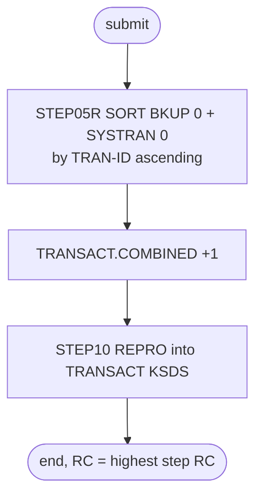

# COMBTRAN: Combine posted and interest transactions

## 1. Summary

COMBTRAN rebuilds the transaction master for the cycle. `STEP05R` sorts two inputs together by transaction ID: the latest transaction backup `AWS.M2.CARDDEMO.TRANSACT.BKUP(0)` (the posted transactions that TRANBKP saved) and the latest interest transaction generation `AWS.M2.CARDDEMO.SYSTRAN(0)` (written by INTCALC). The result goes to a new generation `AWS.M2.CARDDEMO.TRANSACT.COMBINED(+1)`. `STEP10` copies that generation into the (empty) KSDS `AWS.M2.CARDDEMO.TRANSACT.VSAM.KSDS`. The job interprets only the 16-byte transaction ID, as the sort key; it depends on the order of the cycle (TRANBKP right before it) to pick the right inputs.

## 2. Rules at a glance

| ID | Rule |
| :-- | :-- |
| SE-JCOMB-001 | Sort `TRANSACT.BKUP(0)` and `SYSTRAN(0)` together by bytes 1-16 ascending into `TRANSACT.COMBINED(+1)`. |
| SE-JCOMB-002 | Load `TRANSACT.COMBINED(+1)` into the transaction master KSDS. |
| VAL-JCOMB-001 | The load rejects a transaction ID that already exists in the KSDS or appears twice in the input (VSAM rule). |
| ERR-JCOMB-001 | No step has a `COND`: the load runs even when the sort failed. |
| DEF-JCOMB-001 | The inputs are chosen by relative generation, so any extra backup between TRANBKP and COMBTRAN changes what is combined. |
| DEF-JCOMB-002 | The Control-M monthly folder runs COMBTRAN without a TRANBKP before it. |

## 3. Actors and triggers

- **Trigger:** submitted by an operator after INTCALC and TRANBKP in the README "Running Batch Jobs" sequence (`./README.md:228-230`) and by the demo full-batch script (`scripts/run_full_batch.sh:57-58`). Control-M runs it in folder `MONTHLY-InterestCalculation` right after INTCALC (`app/scheduler/CardDemo.controlm:75-80`). CA-7 does not run it.
- **Preconditions:** TRANBKP has just backed up and emptied `TRANSACT` (so `TRANSACT.BKUP(0)` holds the cycle's posted transactions and the KSDS is empty); INTCALC has written `SYSTRAN(0)`; the GDG bases `TRANSACT.BKUP`, `SYSTRAN` and `TRANSACT.COMBINED` exist (DEFGDGB, `app/jcl/DEFGDGB.jcl:24-29, 48-59`); CICS has closed `TRANSACT`.
- **Job card:** `CLASS=A,MSGCLASS=0,NOTIFY=&SYSUID` (`:1-2`). No parameters.

## 4. Interfaces

| Step | Program | DD | Dataset | Disposition | Use | Source |
| :-- | :-- | :-- | :-- | :-- | :-- | :-- |
| `STEP05R` | SORT | `SORTIN` | `AWS.M2.CARDDEMO.TRANSACT.BKUP(0)` | `SHR` | input 1 of a concatenation (FB 350) | `:23-24` |
| `STEP05R` | SORT | `SORTIN` (2nd) | `AWS.M2.CARDDEMO.SYSTRAN(0)` | `SHR` | input 2 of the concatenation (F 350) | `:25-26` |
| `STEP05R` | SORT | `SYMNAMES` | in-stream | - | symbol `TRAN-ID,1,16,CH` | `:27-28` |
| `STEP05R` | SORT | `SYSIN` | in-stream | - | `SORT FIELDS=(TRAN-ID,A)` | `:29-31` |
| `STEP05R` | SORT | `SYSOUT` | `SYSOUT=*` | - | sort messages | `:32` |
| `STEP05R` | SORT | `SORTOUT` | `AWS.M2.CARDDEMO.TRANSACT.COMBINED(+1)` | `(NEW,CATLG,DELETE)` | output; `UNIT=SYSDA`, `DCB=(*.SORTIN)`, `SPACE=(CYL,(1,1),RLSE)` | `:33-37` |
| `STEP10` | IDCAMS | `SYSPRINT` | `SYSOUT=*` | - | IDCAMS messages | `:42` |
| `STEP10` | IDCAMS | `TRANSACT` | `AWS.M2.CARDDEMO.TRANSACT.COMBINED(+1)` | `SHR` | input, sequential | `:43-44` |
| `STEP10` | IDCAMS | `TRANVSAM` | `AWS.M2.CARDDEMO.TRANSACT.VSAM.KSDS` | `SHR` | output, KSDS | `:45-46` |
| `STEP10` | IDCAMS | `SYSIN` | in-stream | - | `REPRO INFILE(TRANSACT) OUTFILE(TRANVSAM)` | `:47-49` |

Return code of the job: the highest step return code.

## 5. Data used

ENT-TRANSACTION, whole 350-byte records from both inputs. Only `TRAN-ID` (bytes 1-16, character) is interpreted, as the sort key. Catalog on 09/01/22: `SYSTRAN` and `TRANSACT.COMBINED` are `LIMIT 5`, `SCRATCH` (`app/catlg/LISTCAT.txt:1098-1106, 2919-2925`); `TRANSACT.BKUP` is `LIMIT 5`, `NOSCRATCH` (`app/catlg/LISTCAT.txt:1631-1637`).

## 6. Processing flow

| # | Step | Class | What it does | Runs when |
| --: | :-- | :-- | :-- | :-- |
| 1 | `STEP05R` | business | merge posted and interest transactions in ID order | always |
| 2 | `STEP10` | plumbing | load the combined file into the transaction master | always (no `COND`) |

## 7. Business rules

None beyond the merge order. The job decides nothing per record; it unites the cycle's posted and interest transactions (SE-JCOMB-001), so that the transaction master holds both.

## 8. Validations and messages

#### VAL-JCOMB-001 · The load requires unique transaction IDs
- **When:** `STEP10` copies a record whose `TRAN-ID` already exists in the KSDS, either because the KSDS was not empty or because the two inputs share an ID.
- **Then:** VSAM rejects the record as a duplicate and IDCAMS reports it in `SYSPRINT`; the step ends with return code 8 or higher, and IDCAMS stops after its error limit (4 by default). Records already loaded stay. The sort keeps duplicates (no `SUM` or `EQUALS` statement), so duplicates reach the load.
- **Source:** `:30, 48`
- **Fidelity:** must-preserve (no silent overwrite of a transaction) · **Confidence:** platform-inferred

## 9. Side effects

#### SE-JCOMB-001 · Merge the two transaction sets into a new generation
- **What:** the sort reads the concatenation `TRANSACT.BKUP(0)` then `SYSTRAN(0)`, sorts all records by `TRAN-ID` ascending (`SYMNAMES` `TRAN-ID,1,16,CH`; `SORT FIELDS=(TRAN-ID,A)`), and writes them unchanged to the new dataset `TRANSACT.COMBINED(+1)`, which takes its DCB from the first `SORTIN` dataset (`DCB=(*.SORTIN)`, FB 350). `DISP=(NEW,CATLG,DELETE)` catalogs it on a normal end and deletes it on an abend.
- **Source:** `:22-37`
- **Fidelity:** must-preserve (content: union of both sets, ordered by ID) · **Confidence:** reviewed (statements); platform-inferred (DCB referback on a concatenation)

#### SE-JCOMB-002 · Reload the transaction master
- **What:** `REPRO INFILE(TRANSACT) OUTFILE(TRANVSAM)` copies every record of `TRANSACT.COMBINED(+1)`, in order, into `AWS.M2.CARDDEMO.TRANSACT.VSAM.KSDS`. In `STEP10`, `(+1)` refers to the generation created by `STEP05R` of the same job. The job does not empty the KSDS first; it relies on TRANBKP.
- **Source:** `:41-48`
- **Fidelity:** must-preserve · **Confidence:** reviewed

## 10. Error handling

#### ERR-JCOMB-001 · The load runs even when the sort failed
- **When:** `STEP05R` ends with a non-zero return code without abending.
- **Then:** `STEP10` has no `COND` and still runs. The generation `COMBINED(+1)` was cataloged by the normal end of `STEP05R` and may be empty or incomplete; `STEP10` loads whatever it holds into `TRANSACT`. An abend in `STEP05R` deletes the generation and skips `STEP10` (JES default). The runbook says a failed sort "changes nothing" (`docs/runbooks/batch-cycle-restart.md:145`), which holds only for an abend.
- **Restart:** after a failed load, delete and define `TRANSACT` with the TRANBKP statements, then resubmit COMBTRAN; do not rerun TRANBKP (`docs/runbooks/batch-cycle-restart.md:146-150`).
- **Source:** `:22, 41`
- **Fidelity:** defect-decide · **Confidence:** platform-inferred

## 11. Interactions

- **Upstream:** TRANBKP (`TRANSACT.BKUP(0)`, empty KSDS), INTCALC (`SYSTRAN(0)`), CLOSEFIL.
- **Downstream:** CREASTMT (reads `TRANSACT`), TRANIDX (rebuilds the alternate index), TRANREPT and the online transaction programs after OPENFIL. README order: COMBTRAN, CREASTMT, TRANIDX, OPENFIL (`./README.md:230-233`).

## 12. Numeric, date and format details

#### NUM-JCOMB-001 · Record format of the combined file
- Both inputs are 350-byte records, but `TRANSACT.BKUP` is FB and `SYSTRAN` is F (unblocked). `DCB=(*.SORTIN)` copies the first dataset's attributes, so `TRANSACT.COMBINED` is FB 350. `TRAN-ID` is compared as characters (`CH`), so the order is the EBCDIC collating order on the mainframe (digits sort after letters), and ASCII order on a workstation.
- **Source:** `:28, 35`
- **Fidelity:** must-preserve (key order of the load) · **Confidence:** platform-inferred

## 13. Known defects and oddities

#### DEF-JCOMB-001 · The inputs are chosen by relative generation
- `TRANSACT.BKUP(0)` and `SYSTRAN(0)` mean "the newest generation at the time the job starts". Any job that adds a `TRANSACT.BKUP` generation between TRANBKP and COMBTRAN changes the input: TRANREPT does (its `STEP05R` writes `TRANSACT.BKUP(+1)` from the then empty `TRANSACT`), and it can be submitted from CICS at any time through CORPT00C. COMBTRAN would then combine an empty backup with the interest and lose the cycle's posted transactions. Likewise a rerun of INTCALC adds a `SYSTRAN` generation.
- **Source:** `:24, 26`
- **Status:** open · **Fidelity:** defect-decide · **Confidence:** platform-inferred

#### DEF-JCOMB-002 · The Control-M monthly folder has no TRANBKP before COMBTRAN
- Folder `MONTHLY-InterestCalculation` runs CLOSEFIL, INTCALC, COMBTRAN, WAITSTEP, OPENFIL (`app/scheduler/CardDemo.controlm:64-92`). Without a TRANBKP in between, `TRANSACT.BKUP(0)` is whatever the last daily backup saved, and `TRANSACT` may not be empty, so the load meets duplicate IDs (VAL-JCOMB-001). See `SCHED-CONTROLM.md`.
- **Source:** `:24, 46`, `app/scheduler/CardDemo.controlm:69-80`
- **Status:** open · **Fidelity:** defect-decide · **Confidence:** reviewed

## 14. Open questions

| ID | Question | For |
| :-- | :-- | :-- |
| Q-JCOMB-001 | Should the target select the posted and interest sets of a cycle by cycle identifier instead of "newest generation" (DEF-JCOMB-001)? | architecture |

## 15. Equivalence contract

After a successful run (return code 0), the transaction store holds exactly the union of the posted transactions saved by the preceding TRANBKP and the interest transactions of the preceding INTCALC, byte for byte, keyed by `TRAN-ID`; the combined set is also kept as a separate, ordered dataset. Duplicate IDs must fail visibly (VAL-JCOMB-001). Sort and IDCAMS message text may differ.

## 16. Paragraph coverage

| Step | Lines | Covered by |
| :-- | :-- | :-- |
| (job card) | 1-2 | §3 |
| `STEP05R` | 22-37 | SE-JCOMB-001, NUM-JCOMB-001, ERR-JCOMB-001, DEF-JCOMB-001 |
| `STEP10` | 41-49 | SE-JCOMB-002, VAL-JCOMB-001, ERR-JCOMB-001, DEF-JCOMB-002 |
