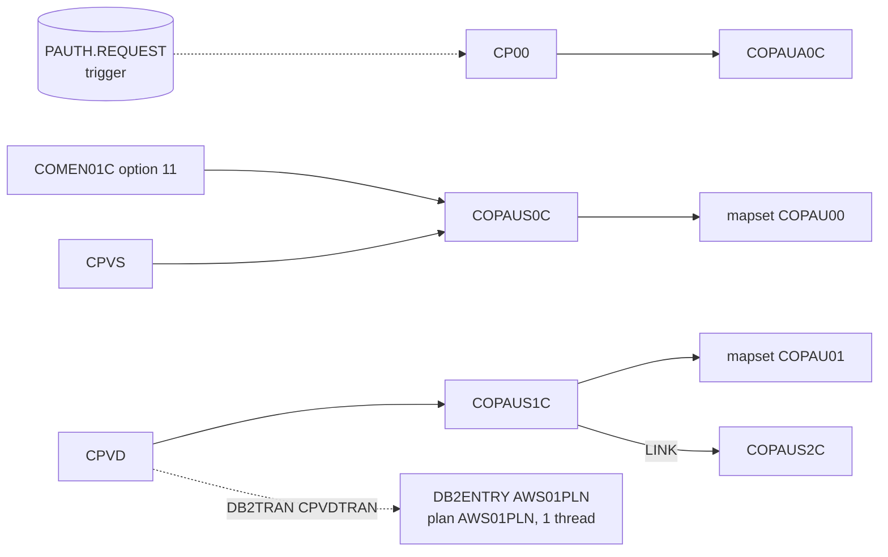

# CRDDEMO2-CSD: CICS resource definitions of the authorization module

## 1. Summary

Eleven CICS resource definitions, all in group `CARDDEMO` (the group of the base application): the two mapsets of the pending-authorization screens, the four programs of the module, the three transactions `CP00` (authorization processor, started by MQ triggering), `CPVS` (summary screen) and `CPVD` (detail screen), and the Db2 attachment that connects `CPVD` to plan `AWS01PLN` through one DB2ENTRY and one DB2TRAN. Resource and command security are off on the transactions (DEF-JCSD2-001); the Db2 entry allows one thread (DEF-JCSD2-002) and its name differs from the one in the module README (DEF-JCSD2-003). The MQ and IMS connections the programs need are not in the file (Q-JCSD2-001).

## 2. Rules at a glance

| ID | Rule |
| :-- | :-- |
| FLOW-JCSD2-001 | Transaction `CP00` runs COPAUA0C. |
| FLOW-JCSD2-002 | Transaction `CPVS` runs COPAUS0C, which uses mapset `COPAU00`. |
| FLOW-JCSD2-003 | Transaction `CPVD` runs COPAUS1C, which uses mapset `COPAU01` and links to COPAUS2C in the same task. |
| FLOW-JCSD2-004 | Only `CPVD` is attached to Db2: entry `AWS01PLN`, plan `AWS01PLN`, authorization by CICS user ID, one thread. |
| ERR-JCSD2-001 | Abend handling: dump, no restart, backout of the task's IMS and Db2 changes. |
| NUM-JCSD2-001 | The three transactions have identical attributes. |
| NUM-JCSD2-002 | The four programs have identical attributes. |

## 3. Actors and triggers

- **Installer:** adds the definitions to the CSD (DFHCSDUP or CEDA) and installs them; the module README shows a shorter set of DEFINE and INSTALL commands (`app/app-authorization-ims-db2-mq/README.md:161-195`, DEF-JCSD2-004).
- **Users:** reach `CPVS` from the main menu option 11 `Pending Authorization View`, program COPAUS0C (`app/cpy/COMEN02Y.cpy:86-90`), and `CPVD` by selecting an authorization on that screen; or type the transaction IDs.
- **MQ:** `CP00` is meant to be started by the CICS MQ trigger monitor when a request arrives (COPAUA0C section 3); the trigger set-up is outside this file.

## 4. Interfaces

| Resource | Type | Key attributes | Lines |
| :-- | :-- | :-- | :-- |
| `COPAU00` | MAPSET | `DESCRIPTION(CREDIT CARD AUTHORIZATION SUMMARY MAP)`, `RESIDENT(NO)`, `USAGE(NORMAL)`, `USELPACOPY(NO)`, `STATUS(ENABLED)` | `:1-5` |
| `COPAU01` | MAPSET | `DESCRIPTION(CREDIT CARD AUTHORIZATION DETAILS MAP)`, same attributes | `:6-10` |
| `COPAUA0C` | PROGRAM | NUM-JCSD2-002 attributes, `TRANSID(CP00)` | `:11-17` |
| `COPAUS0C` | PROGRAM | NUM-JCSD2-002 attributes, `TRANSID(CPVS)` | `:18-24` |
| `COPAUS1C` | PROGRAM | NUM-JCSD2-002 attributes, `TRANSID(CPVD)` | `:25-31` |
| `COPAUS2C` | PROGRAM | NUM-JCSD2-002 attributes, `TRANSID(CPVD)` | `:32-38` |
| `CPVD` | TRANSACTION | `PROGRAM(COPAUS1C)`, NUM-JCSD2-001 attributes | `:39-48` |
| `CPVS` | TRANSACTION | `PROGRAM(COPAUS0C)`, NUM-JCSD2-001 attributes | `:49-58` |
| `CP00` | TRANSACTION | `PROGRAM(COPAUA0C)`, NUM-JCSD2-001 attributes | `:59-68` |
| `AWS01PLN` | DB2ENTRY | `DESCRIPTION(DB2 RETRY FOR AWS01PLN PLAN)`, `ACCOUNTREC(TXID)`, `AUTHTYPE(USERID)`, `DROLLBACK(YES)`, `PLAN(AWS01PLN)`, `PRIORITY(HIGH)`, `PROTECTNUM(0)`, `THREADLIMIT(1)`, `THREADWAIT(YES)` | `:69-74` |
| `CPVDTRAN` | DB2TRAN | `DESCRIPTION(DB2TRAN FOR SDB2 TRANSACTION)`, `ENTRY(AWS01PLN)`, `TRANSID(CPVD)` | `:75-79` |

Each DEFINE also carries the CSD audit fields `DEFINETIME`, `CHANGETIME`, `CHANGEUSRID(AWSUSER)`, `CHANGEAGENT(CSDAPI)`, `CHANGEAGREL(0730)`; they have no run-time effect.

## 5. Data used

None directly. Through these transactions the programs use the IMS database `DBPAUTP0` (ENT-AUTH-SUMMARY, ENT-AUTH-DETAIL), the Db2 table ENT-AUTH-FRAUD (through plan `AWS01PLN`), the base files `ACCTDAT`, `CUSTDAT`, `CCXREF`, `CXACAIX` (defined in the base CSD), the MQ queues of ENT-AUTH-REQUEST and ENT-AUTH-RESPONSE, and the TD queue `CSSL` (ENT-AUTH-ERROR-LOG).

## 6. Processing flow

#### FLOW-JCSD2-001 · CP00 starts COPAUA0C
- **When:** the MQ trigger monitor starts `CP00` for a request queue, or a user types `CP00`.
- **Then:** CICS runs COPAUA0C (see the COPAUA0C spec, FLOW-AUTH-001), which reads the trigger message with `RETRIEVE`. The transaction has no DB2TRAN: COPAUA0C issues no SQL.
- **Source:** `:11-17, 59-68`
- **Fidelity:** must-preserve · **Confidence:** reviewed

#### FLOW-JCSD2-002 · CPVS starts COPAUS0C
- **When:** a user enters `CPVS`, COPAUS0C returns with next transaction `CPVS`, or the menu or COPAUS1C transfers to COPAUS0C.
- **Then:** CICS runs COPAUS0C (COPAUS0C FLOW-AUSM-001..003), which sends map `COPAU0A` of mapset `COPAU00`. No DB2TRAN: COPAUS0C issues no SQL.
- **Source:** `:1-5, 18-24, 49-58`
- **Fidelity:** must-preserve · **Confidence:** reviewed

#### FLOW-JCSD2-003 · CPVD starts COPAUS1C; COPAUS2C runs under it
- **When:** a user enters `CPVD`, COPAUS1C returns with next transaction `CPVD`, or COPAUS0C transfers to COPAUS1C.
- **Then:** CICS runs COPAUS1C (COPAUS1C FLOW-AUDT-001..003) with map `COPAU1A` of mapset `COPAU01`. On PF5, COPAUS1C links to COPAUS2C (COPAUS1C SE-AUDT-002), which runs in the same task, under transaction `CPVD`, and issues the SQL. The `TRANSID(CPVD)` attribute on the PROGRAM definition of COPAUS2C (and the `TRANSID` on the other three programs) names the transaction a remote region would attach for a distributed program link; with no `REMOTESYSTEM` it has no effect on a local link.
- **Source:** `:6-10, 25-38, 39-48`
- **Fidelity:** must-preserve · **Confidence:** platform-inferred

#### FLOW-JCSD2-004 · Db2 attachment of CPVD
- **When:** a `CPVD` task issues its first SQL statement (in COPAUS2C).
- **Then:** DB2TRAN `CPVDTRAN` routes transaction `CPVD` to DB2ENTRY `AWS01PLN`, which uses plan `AWS01PLN` and signs on to Db2 with the CICS user ID of the task (`AUTHTYPE(USERID)`); COPAUS2C uses only static SQL, so Db2 checks the table privileges on `CARDDEMO.AUTHFRDS` against the plan owner at bind time and each user needs `EXECUTE` authority on plan `AWS01PLN`. `THREADLIMIT(1)` with `THREADWAIT(YES)`: one thread; a second task waits until it is free. `PROTECTNUM(0)`: no thread is kept for reuse. `DROLLBACK(YES)`: when Db2 chooses the task as a deadlock victim, CICS rolls back the task's unit of work (IMS and Db2 changes) and the SQL returns -911. `ACCOUNTREC(TXID)`: one Db2 accounting record per transaction ID. `PRIORITY(HIGH)`: the thread runs at a higher dispatching priority than the CICS main task. No DB2CONN is defined here.
- **Source:** `:69-79`
- **Fidelity:** must-preserve (plan and authorization) · **Confidence:** platform-inferred

## 7. Business rules

None. The definitions carry no business logic.

## 8. Validations and messages

None.

## 9. Side effects

None at run time. Installing the definitions adds or replaces these eleven resources in the region.

## 10. Error handling

#### ERR-JCSD2-001 · Abend and purge behaviour
- All three transactions: `DUMP(YES)` (a transaction dump on abend), `RESTART(NO)` (no automatic restart), `SPURGE(YES)` and `TPURGE(YES)` (can be purged), `DTIMOUT(NO)` (no deadlock timeout), `RUNAWAY(SYSTEM)` (the region's runaway limit). On an abend CICS backs out the task's uncommitted changes: IMS updates by COPAUA0C and COPAUS1C and the Db2 change by COPAUS2C. MQ messages that COPAUA0C got or put outside syncpoint are not backed out (COPAUA0C DEF-AUTH-008). `ACTION(BACKOUT)`, `WAIT(YES)`, `WAITTIME(0,0,0)` govern units of work left in doubt.
- **Source:** `:39-68`
- **Confidence:** platform-inferred

## 11. Interactions

- **Programs:** COPAUA0C, COPAUS0C, COPAUS1C, COPAUS2C; their transfers and links are in their specs and in `areas/e-authorization-interactions.md`.
- **Base CSD:** the base group `CARDDEMO` (`app/csd/CARDDEMO.CSD`, owned by the base jobs area) defines the menu COMEN01C and the files the programs read; this file adds the module's resources to the same group.
- **Outside the file:** the MQ connection and the trigger set-up (initiation queue, process definition naming `CP00`), the IMS database control connection used by `EXEC DLI SCHD`, and the DB2CONN.

## 12. Numeric, date and format details

#### NUM-JCSD2-001 · Transaction attributes
- `CPVD`, `CPVS` and `CP00` have the same attributes: `TWASIZE(0)`, `PROFILE(DFHCICST)`, `STATUS(ENABLED)`, `TASKDATALOC(ANY)`, `TASKDATAKEY(USER)`, `STORAGECLEAR(NO)`, `RUNAWAY(SYSTEM)`, `SHUTDOWN(DISABLED)`, `ISOLATE(YES)`, `DYNAMIC(NO)`, `ROUTABLE(NO)`, `PRIORITY(1)`, `TRANCLASS(DFHTCL00)`, `DTIMOUT(NO)`, `RESTART(NO)`, `SPURGE(YES)`, `TPURGE(YES)`, `DUMP(YES)`, `TRACE(YES)`, `CONFDATA(NO)`, `OTSTIMEOUT(NO)`, `ACTION(BACKOUT)`, `WAIT(YES)`, `WAITTIME(0,0,0)`, `RESSEC(NO)`, `CMDSEC(NO)`.
- **Source:** `:39-68`

#### NUM-JCSD2-002 · Program attributes
- COPAUA0C, COPAUS0C, COPAUS1C and COPAUS2C have the same attributes apart from `TRANSID`: `LANGUAGE(COBOL)`, `RELOAD(YES)`, `RESIDENT(NO)`, `USAGE(NORMAL)`, `USELPACOPY(NO)`, `STATUS(ENABLED)`, `CEDF(YES)`, `DATALOCATION(ANY)`, `EXECKEY(USER)`, `CONCURRENCY(QUASIRENT)`, `API(CICSAPI)`, `DYNAMIC(NO)`, `EXECUTIONSET(FULLAPI)`, `JVM(NO)`. `RELOAD(YES)` loads a fresh copy of the program for every use.
- **Source:** `:11-38`

## 13. Known defects and oddities

#### DEF-JCSD2-001 · [security] No resource or command security
- `RESSEC(NO)` and `CMDSEC(NO)` on all three transactions turn off resource-level and command-level security, and the programs check no user type (COPAUS0C DEF-AUSM-007, COPAUS1C DEF-AUDT-006). Transaction-attach security is not a TRANSACTION attribute; it depends on the SIT (`SEC`, `XTRAN`) and the security manager profiles, outside this file. Unless attach security restricts them, any signed-on user can view any account's authorizations and mark fraud, and anyone who can start `CP00` can run the authorization processor.
- **Source:** `:46, 56, 66` · **Status:** open (security) · **Fidelity:** defect-decide

#### DEF-JCSD2-002 · One Db2 thread
- `THREADLIMIT(1)` with `THREADWAIT(YES)` serializes the Db2 work of all `CPVD` tasks: with several users marking fraud, tasks queue behind each other while holding their IMS PSB.
- **Source:** `:72` · **Status:** open · **Confidence:** platform-inferred

#### DEF-JCSD2-003 · Db2 entry name differs from the README
- The CSD defines DB2ENTRY `AWS01PLN` and points `CPVDTRAN` at it; the README defines and installs `DB201PLN` (`app/app-authorization-ims-db2-mq/README.md:177-178, 187`). An installer who follows the README gets a DB2TRAN pointing at an entry that this file does not define (COPAUS1C Q-AUDT-004).
- **Source:** `:69-77` · **Status:** open · **Fidelity:** incidental

#### DEF-JCSD2-004 · README install steps are incomplete
- The README defines program COPAUA0C twice, mapset `COPAU00` and transaction `CP00` only, and installs the three transactions and the two Db2 resources (`app/app-authorization-ims-db2-mq/README.md:165-189`); transactions `CPVS` and `CPVD`, mapset `COPAU01` and programs COPAUS0C, COPAUS1C, COPAUS2C are defined only in this file. The README's `CEDA INSTALL TRANS(CPVS)` and `TRANS(CPVD)` (`app/app-authorization-ims-db2-mq/README.md:185-186`) fail without this file's definitions, and the missing programs and mapset need either this file or program and mapset autoinstall.
- **Source:** `:1-58` · **Status:** open · **Fidelity:** incidental · **Confidence:** reviewed

#### DEF-JCSD2-005 · Misleading descriptions
- The DB2ENTRY description `DB2 RETRY FOR AWS01PLN PLAN` (`:70`) describes no retry; the DB2TRAN description `DB2TRAN FOR SDB2 TRANSACTION` (`:76`) names a transaction `SDB2` that does not exist.
- **Source:** `:70, 76` · **Status:** open · **Fidelity:** incidental

## 14. Open questions

| ID | Question | For |
| :-- | :-- | :-- |
| Q-JCSD2-001 | Where are the MQ connection, the request queue's initiation queue and process definition (naming `CP00`), the IMS database control connection and the DB2CONN defined, and which group installs them? | mainframe team |
| Q-JCSD2-002 | Is `THREADLIMIT(1)` intended for production (DEF-JCSD2-002)? | mainframe team |

## 15. Equivalence contract

The target is equivalent when the summary and detail functions are reachable from the menu option and under the same (or mapped) identifiers, the authorization processor is started per request message, the fraud update uses a Db2 identity that follows the decision on DEF-JCSD2-001, and an abend backs out the task's database changes together. Thread limits, dump options and program reload settings are platform choices. Review record: `docs/modernization/spec/evidence/e-review.md`.

## 16. Step coverage

| Step | Lines | Covered by |
| :-- | :-- | :-- |
| (MAPSET COPAU00) | 1-5 | FLOW-JCSD2-002 |
| (MAPSET COPAU01) | 6-10 | FLOW-JCSD2-003 |
| (PROGRAM COPAUA0C) | 11-17 | FLOW-JCSD2-001, NUM-JCSD2-002 |
| (PROGRAM COPAUS0C) | 18-24 | FLOW-JCSD2-002, NUM-JCSD2-002 |
| (PROGRAM COPAUS1C) | 25-31 | FLOW-JCSD2-003, NUM-JCSD2-002 |
| (PROGRAM COPAUS2C) | 32-38 | FLOW-JCSD2-003, NUM-JCSD2-002 |
| (TRANSACTION CPVD) | 39-48 | FLOW-JCSD2-003, NUM-JCSD2-001, ERR-JCSD2-001, DEF-JCSD2-001 |
| (TRANSACTION CPVS) | 49-58 | FLOW-JCSD2-002, NUM-JCSD2-001, ERR-JCSD2-001, DEF-JCSD2-001 |
| (TRANSACTION CP00) | 59-68 | FLOW-JCSD2-001, NUM-JCSD2-001, ERR-JCSD2-001, DEF-JCSD2-001 |
| (DB2ENTRY AWS01PLN) | 69-74 | FLOW-JCSD2-004, DEF-JCSD2-002, DEF-JCSD2-003, DEF-JCSD2-005 |
| (DB2TRAN CPVDTRAN) | 75-79 | FLOW-JCSD2-004, DEF-JCSD2-003, DEF-JCSD2-005 |

11 of 11 definitions covered.
