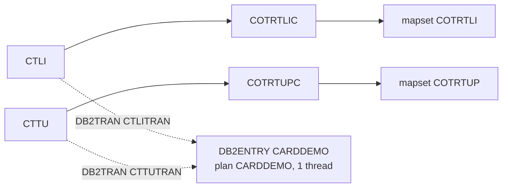

# CRDDEMOD-CSD: CICS resource definitions of the transaction type (Db2) module

## 1. Summary

Nine CICS resource definitions, all in group `CARDDEMO` (the group of the base application): the two mapsets, the two programs and the two transactions of the transaction type screens (`CTLI` list, `CTTU` add/update), and the Db2 attachment that connects both transactions to plan `CARDDEMO`: one DB2ENTRY and two DB2TRANs. No security is set on the transactions (DEF-JCSDD-001), and the Db2 entry allows a single thread (DEF-JCSDD-002).

## 2. Rules at a glance

| ID | Rule |
| :-- | :-- |
| FLOW-JCSDD-001 | Transaction `CTLI` runs program COTRTLIC. |
| FLOW-JCSDD-002 | Transaction `CTTU` runs program COTRTUPC. |
| FLOW-JCSDD-003 | Both transactions use Db2 entry `CARDDEMO`: plan `CARDDEMO`, Db2 authorisation by the CICS user ID, one thread, wait when busy. |
| NUM-JCSDD-001 | The two transactions have identical attributes (profile, class, purge, dump, restart). |

## 3. Actors and triggers

- **Installer:** adds the definitions to the CSD (DFHCSDUP or CEDA) and installs group `CARDDEMO`; the module README shows the two transaction DEFINEs as the step "Define CICS Resources".
- **Users:** reach the transactions from the admin menu options 5 and 6 (`app/cpy/COADM02Y.cpy:46-53`, menu program COADM01C), by PF2 from the list to the update screen, or by typing the transaction ID.

## 4. Interfaces

| Resource | Type | Key attributes | Lines |
| :-- | :-- | :-- | :-- |
| `COTRTLI` | MAPSET | `DESCRIPTION(CREDIT CARD TRAN TYPE INQ MAP)`, `RESIDENT(NO)`, `STATUS(ENABLED)` | `:1-5` |
| `COTRTUP` | MAPSET | `DESCRIPTION(CREDIT CARD TRAN TYPE MAINT MAP)`, `RESIDENT(NO)`, `STATUS(ENABLED)` | `:6-10` |
| `COTRTLIC` | PROGRAM | `LANGUAGE(COBOL)`, `RELOAD(YES)`, `RESIDENT(NO)`, `CEDF(YES)`, `DATALOCATION(ANY)`, `EXECKEY(USER)`, `CONCURRENCY(QUASIRENT)`, `API(CICSAPI)`, `DYNAMIC(NO)`, `TRANSID(CTLI)` | `:11-17` |
| `COTRTUPC` | PROGRAM | same attributes, `TRANSID(CTTU)` | `:18-24` |
| `CTLI` | TRANSACTION | `PROGRAM(COTRTLIC)`, see NUM-JCSDD-001 | `:25-34` |
| `CTTU` | TRANSACTION | `PROGRAM(COTRTUPC)`, see NUM-JCSDD-001 | `:35-44` |
| `CARDDEMO` | DB2ENTRY | `PLAN(CARDDEMO)`, `AUTHTYPE(USERID)`, `ACCOUNTREC(TXID)`, `DROLLBACK(YES)`, `PRIORITY(HIGH)`, `PROTECTNUM(0)`, `THREADLIMIT(1)`, `THREADWAIT(YES)` | `:45-50` |
| `CTLITRAN` | DB2TRAN | `ENTRY(CARDDEMO)`, `TRANSID(CTLI)` | `:51-55` |
| `CTTUTRAN` | DB2TRAN | `ENTRY(CARDDEMO)`, `TRANSID(CTTU)` | `:56-60` |

## 5. Data used

None directly. The programs use the Db2 tables ENT-DB2-TRAN-TYPE and ENT-DB2-TRAN-TYPE-CAT through plan `CARDDEMO`.

## 6. Processing flow

#### FLOW-JCSDD-001 · CTLI starts COTRTLIC
- **When:** a terminal user enters `CTLI`, or COTRTLIC returns with next transaction `CTLI`.
- **Then:** CICS runs COTRTLIC (see the COTRTLIC spec), which uses mapset `COTRTLI`.
- **Source:** `:1-5, 11-17, 25-34`
- **Fidelity:** must-preserve · **Confidence:** reviewed

#### FLOW-JCSDD-002 · CTTU starts COTRTUPC
- **When:** a user enters `CTTU`, or COTRTUPC returns with next transaction `CTTU`.
- **Then:** CICS runs COTRTUPC (see the COTRTUPC spec), which uses mapset `COTRTUP`.
- **Source:** `:6-10, 18-24, 35-44`
- **Fidelity:** must-preserve · **Confidence:** reviewed

#### FLOW-JCSDD-003 · Db2 attachment
- **When:** a CTLI or CTTU task issues its first SQL statement.
- **Then:** the DB2TRAN for its transaction ID routes it to DB2ENTRY `CARDDEMO`, which uses plan `CARDDEMO` and signs on to Db2 with the CICS user ID of the task (`AUTHTYPE(USERID)`), so Db2 privileges are checked per user. `THREADLIMIT(1)` with `THREADWAIT(YES)`: one thread for both transactions; a second task waits until it is free. `PROTECTNUM(0)`: no thread is kept between tasks. `DROLLBACK(YES)`: when Db2 chooses the task as a deadlock victim, CICS rolls back its unit of work and returns SQLCODE -911.
- The packages in plan `CARDDEMO` are bound in collection `CARDDEMO` (`samples/proc/BLDCIDB2.prc:144, 168-169`). A Db2 connection definition (DB2CONN) is not in this file (Q-JCSDD-001).
- **Source:** `:45-60`
- **Fidelity:** must-preserve (plan and authorisation) · **Confidence:** platform-inferred

## 7. Business rules

None. The definitions carry no business logic.

## 8. Validations

None.

## 9. Side effects

None at run time. Installing the group adds or replaces these nine resources in the region.

## 10. Error handling

#### ERR-JCSDD-001 · Abend and purge behaviour
- Both transactions: `DUMP(YES)` (a transaction dump on abend), `RESTART(NO)` (no automatic restart), `SPURGE(YES)` and `TPURGE(YES)` (can be purged), `DTIMOUT(NO)` (no deadlock timeout), `RUNAWAY(SYSTEM)`. On an abend CICS backs out the task's uncommitted Db2 changes. `ACTION(BACKOUT)`, `WAIT(YES)`, `WAITTIME(0,0,0)` govern in-doubt units of work.
- **Source:** `:25-44`
- **Confidence:** platform-inferred

## 11. Interactions

- **Programs:** COTRTLIC and COTRTUPC; their transfers to and from COADM01C are in their specs.
- **Base CSD:** the base group `CARDDEMO` (`app/csd/CARDDEMO.CSD`, owned by the base jobs area) does not define these resources; this file adds them to the same group.

## 12. Numeric, date and format details

#### NUM-JCSDD-001 · Transaction attributes
- `CTLI` and `CTTU` have the same attributes: `TWASIZE(0)`, `PROFILE(DFHCICST)`, `STATUS(ENABLED)`, `TASKDATALOC(ANY)`, `TASKDATAKEY(USER)`, `STORAGECLEAR(NO)`, `RUNAWAY(SYSTEM)`, `SHUTDOWN(DISABLED)`, `ISOLATE(YES)`, `DYNAMIC(NO)`, `ROUTABLE(NO)`, `PRIORITY(1)`, `TRANCLASS(DFHTCL00)`, `DTIMOUT(NO)`, `RESTART(NO)`, `SPURGE(YES)`, `TPURGE(YES)`, `DUMP(YES)`, `TRACE(YES)`, `CONFDATA(NO)`, `OTSTIMEOUT(NO)`, `ACTION(BACKOUT)`, `WAIT(YES)`, `WAITTIME(0,0,0)`, `RESSEC(NO)`, `CMDSEC(NO)`.
- **Source:** `:25-44`

## 13. Known defects and oddities

#### DEF-JCSDD-001 · [security] No transaction security
- `RESSEC(NO)` and `CMDSEC(NO)` on both transactions, and the programs check no user type (DEF-TTLS-009, DEF-TTUP-010). Any signed-on terminal user can run `CTLI` and `CTTU`; only Db2 privileges (granted to `PUBLIC` by CREADB21) could stop them.
- **Source:** `:32, 42` · **Status:** open (security)

#### DEF-JCSDD-002 · One Db2 thread for the module
- `THREADLIMIT(1)` with `THREADWAIT(YES)` serialises all Db2 work of both transactions; with several administrators, tasks queue behind each other, and a task waiting on a table lock held by MNTTRDB2 (DEF-TTBU-006) holds the only thread.
- **Source:** `:47-48` · **Status:** open · **Confidence:** platform-inferred

#### DEF-JCSDD-003 · Misleading description
- The DB2ENTRY description is `DB2 RETRY FOR CARDDEMO PLAN` (`:46`); it does not retry anything.
- **Source:** `:46` · **Status:** open · **Fidelity:** incidental

## 14. Open questions

| ID | Question | For |
| :-- | :-- | :-- |
| Q-JCSDD-001 | Where is the DB2CONN for subsystem `DAZ1` defined, and which group installs it? | mainframe team |
| Q-JCSDD-002 | Is `THREADLIMIT(1)` intended for production use? | mainframe team |

## 15. Equivalence contract

The target is equivalent when the list and update functions are reachable under the same identifiers (or mapped ones) from the admin menu, both use the same Db2 identity rules (user-based authorisation, or the replacement chosen by the security decision on DEF-JCSDD-001), and an abend backs out the unit of work. Thread limits and dump options are platform choices. The review is in `docs/modernization/spec/evidence/f-trantype-vsam-mq-review.md`.

## 16. Step coverage

| Step | Lines | Covered by |
| :-- | :-- | :-- |
| (MAPSET COTRTLI) | 1-5 | FLOW-JCSDD-001 |
| (MAPSET COTRTUP) | 6-10 | FLOW-JCSDD-002 |
| (PROGRAM COTRTLIC) | 11-17 | FLOW-JCSDD-001 |
| (PROGRAM COTRTUPC) | 18-24 | FLOW-JCSDD-002 |
| (TRANSACTION CTLI) | 25-34 | FLOW-JCSDD-001, NUM-JCSDD-001, ERR-JCSDD-001, DEF-JCSDD-001 |
| (TRANSACTION CTTU) | 35-44 | FLOW-JCSDD-002, NUM-JCSDD-001, ERR-JCSDD-001, DEF-JCSDD-001 |
| (DB2ENTRY CARDDEMO) | 45-50 | FLOW-JCSDD-003, DEF-JCSDD-002, DEF-JCSDD-003 |
| (DB2TRAN CTLITRAN) | 51-55 | FLOW-JCSDD-003 |
| (DB2TRAN CTTUTRAN) | 56-60 | FLOW-JCSDD-003 |

9 of 9 definitions covered.
