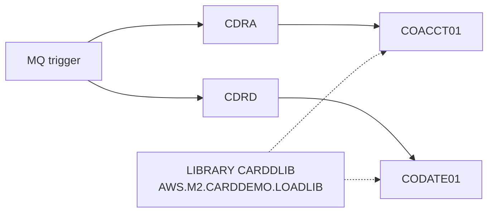

# CRDDEMOM-CSD: CICS resource definitions of the VSAM-MQ module

## 1. Summary

Five definitions in group `CARDDEMO`: programs COACCT01 and CODATE01, the transactions `CDRA` and `CDRD` that run them, and the program library `CARDDLIB`. The transactions are meant to be started by an MQ trigger (see the COACCT01 and CODATE01 specs), but the file defines nothing for MQ: no queues, process or trigger setup (Q-JCSDM-001). The library definition repeats one in the base CSD (DEF-JCSDM-002).

## 2. Rules at a glance

| ID | Rule |
| :-- | :-- |
| FLOW-JCSDM-001 | Transaction `CDRA` runs program COACCT01 (account inquiry over MQ). |
| FLOW-JCSDM-002 | Transaction `CDRD` runs program CODATE01 (date inquiry over MQ). |
| FLOW-JCSDM-003 | Programs are loaded from library `CARDDLIB` = `AWS.M2.CARDDEMO.LOADLIB`. |

## 3. Actors and triggers

- **Installer:** adds the definitions with DFHCSDUP (`CHANGEAGENT(CSDBATCH)`) and installs group `CARDDEMO`.
- **Run time:** the CICS MQ trigger monitor starts `CDRA`/`CDRD` when a message arrives on a triggered queue (COACCT01 and CODATE01 specs, FLOW items); no terminal is involved.

## 4. Interfaces

| Resource | Type | Key attributes | Lines |
| :-- | :-- | :-- | :-- |
| `COACCT01` | PROGRAM | `DESCRIPTION(LIST CARDS)`, `RELOAD(NO)`, `RESIDENT(NO)`, `CEDF(YES)`, `DATALOCATION(ANY)`, `EXECKEY(USER)`, `CONCURRENCY(QUASIRENT)`, `API(CICSAPI)`, `TRANSID(CDRA)`; no `LANGUAGE` (CICS detects it at load) | `:1-8` |
| `CODATE01` | PROGRAM | same, `DESCRIPTION(LIST CARDS)`, `TRANSID(CDRD)` | `:9-16` |
| `CDRA` | TRANSACTION | `PROGRAM(COACCT01)`, see NUM-JCSDM-001 | `:17-26` |
| `CDRD` | TRANSACTION | `PROGRAM(CODATE01)`, see NUM-JCSDM-001 | `:27-36` |
| `CARDDLIB` | LIBRARY | `RANKING(50)`, `CRITICAL(NO)`, `STATUS(ENABLED)`, `DSNAME01(AWS.M2.CARDDEMO.LOADLIB)` | `:37-41` |

## 5. Data used

None directly. COACCT01 reads the account file `ACCTDAT` (ENT-ACCOUNT), which is defined in the base CSD (`app/csd/CARDDEMO.CSD:1-12`), not here.

## 6. Processing flow

#### FLOW-JCSDM-001 · CDRA starts COACCT01
- **When:** transaction `CDRA` is started (by the trigger monitor, or by a user typing it).
- **Then:** CICS runs COACCT01 (see the COACCT01 spec).
- **Source:** `:1-8, 17-26`
- **Fidelity:** must-preserve · **Confidence:** reviewed

#### FLOW-JCSDM-002 · CDRD starts CODATE01
- **When:** transaction `CDRD` is started.
- **Then:** CICS runs CODATE01 (see the CODATE01 spec).
- **Source:** `:9-16, 27-36`
- **Fidelity:** must-preserve · **Confidence:** reviewed

#### FLOW-JCSDM-003 · Program library
- **When:** CICS loads COACCT01 or CODATE01.
- **Then:** the program is found in the dynamic library `CARDDLIB` (`AWS.M2.CARDDEMO.LOADLIB`) unless a library with a lower ranking has a module of the same name. `RANKING(50)` places it after the static `DFHRPL` concatenation, which has ranking 10.
- `RELOAD(NO)` here, while the transaction type programs have `RELOAD(YES)`; it only affects how CICS manages the loaded copy.
- **Source:** `:37-41`
- **Fidelity:** incidental · **Confidence:** platform-inferred

## 7. Business rules

None.

## 8. Validations

None.

## 9. Side effects

None at run time.

## 10. Error handling

#### ERR-JCSDM-001 · Abend behaviour
- Both transactions: `DUMP(YES)`, `RESTART(NO)`, `SPURGE(YES)`, `TPURGE(YES)`, `DTIMOUT(NO)`. On an abend CICS backs out the task's unit of work, which includes the MQ get of the request message when it was done under syncpoint (see the COACCT01 and CODATE01 specs).
- **Source:** `:17-36`
- **Confidence:** platform-inferred

## 11. Interactions

- **Programs:** COACCT01 and CODATE01.
- **Base CSD:** file `ACCTDAT` and the library `CARDDLIB` are in `app/csd/CARDDEMO.CSD` (owned by the base jobs area).
- **MQ:** queue manager connection, trigger monitor, initiation queue and process definitions are outside the repository (Q-MQAC-001, Q-MQDT-001).

## 12. Numeric, date and format details

#### NUM-JCSDM-001 · Transaction attributes
- `CDRA` and `CDRD` have the same attributes as the transaction type module's transactions: `TWASIZE(0)`, `PROFILE(DFHCICST)`, `STATUS(ENABLED)`, `TASKDATALOC(ANY)`, `TASKDATAKEY(USER)`, `STORAGECLEAR(NO)`, `RUNAWAY(SYSTEM)`, `SHUTDOWN(DISABLED)`, `ISOLATE(YES)`, `DYNAMIC(NO)`, `ROUTABLE(NO)`, `PRIORITY(1)`, `TRANCLASS(DFHTCL00)`, `DTIMOUT(NO)`, `RESTART(NO)`, `SPURGE(YES)`, `TPURGE(YES)`, `DUMP(YES)`, `TRACE(YES)`, `CONFDATA(NO)`, `OTSTIMEOUT(NO)`, `ACTION(BACKOUT)`, `WAIT(YES)`, `WAITTIME(0,0,0)`, `RESSEC(NO)`, `CMDSEC(NO)`.
- **Source:** `:17-36`

## 13. Known defects and oddities

#### DEF-JCSDM-001 · Copied descriptions
- Both programs have `DESCRIPTION(LIST CARDS)` (DEF-MQAC-013, DEF-MQDT-010).
- **Source:** `:2, 10` · **Status:** open · **Fidelity:** incidental

#### DEF-JCSDM-002 · Duplicate library definition
- `LIBRARY(CARDDLIB)` in group `CARDDEMO` is also defined in the base CSD with the same dataset (`app/csd/CARDDEMO.CSD:489-493`). Running both DEFINE sets against one CSD makes the second DEFINE fail as a duplicate unless it is changed to ALTER or the group is different.
- **Source:** `:37-41` · **Status:** open · **Confidence:** platform-inferred

#### DEF-JCSDM-003 · [security] No transaction security
- `RESSEC(NO)`, `CMDSEC(NO)`: any user or any message that triggers the transaction runs it; COACCT01 returns account data with no authentication (DEF-MQAC-004).
- **Source:** `:24, 34` · **Status:** open (security)

#### DEF-JCSDM-004 · No MQ definitions
- The module's MQ objects (queues `CARD.DEMO.REPLY.ACCT`, `CARD.DEMO.REPLY.DATE`, `CARD.DEMO.ERROR`, the triggered request queues, process definitions) are not defined anywhere in the repository.
- **Status:** open (Q-JCSDM-001)

## 14. Open questions

| ID | Question | For |
| :-- | :-- | :-- |
| Q-JCSDM-001 | Which MQ objects (queues, process, initiation queue, trigger type) start CDRA and CDRD? | mainframe team |

## 15. Equivalence contract

The target is equivalent when a request message on the account or date request channel starts the account or date inquiry logic of the COACCT01 and CODATE01 specs, with the same backout on failure. Library, dump and purge options are platform choices. The review is in `docs/modernization/spec/evidence/f-trantype-vsam-mq-review.md`.

## 16. Step coverage

| Step | Lines | Covered by |
| :-- | :-- | :-- |
| (PROGRAM COACCT01) | 1-8 | FLOW-JCSDM-001, DEF-JCSDM-001 |
| (PROGRAM CODATE01) | 9-16 | FLOW-JCSDM-002, DEF-JCSDM-001 |
| (TRANSACTION CDRA) | 17-26 | FLOW-JCSDM-001, NUM-JCSDM-001, ERR-JCSDM-001, DEF-JCSDM-003 |
| (TRANSACTION CDRD) | 27-36 | FLOW-JCSDM-002, NUM-JCSDM-001, ERR-JCSDM-001, DEF-JCSDM-003 |
| (LIBRARY CARDDLIB) | 37-41 | FLOW-JCSDM-003, DEF-JCSDM-002 |

5 of 5 definitions covered.
