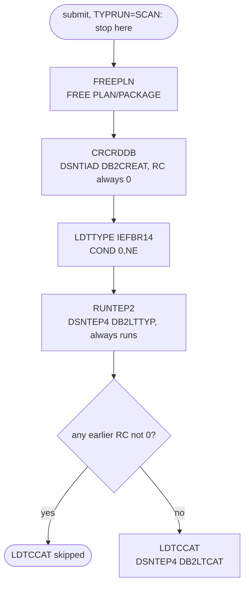

# CREADB21: Create the transaction type Db2 database and load the seed data

## 1. Summary

A one-time installation job for the transaction type module. It frees old Db2 plans, creates the Db2 database `CARDDEMO` with two table spaces, the tables `CARDDEMO.TRANSACTION_TYPE` and `CARDDEMO.TRANSACTION_TYPE_CATEGORY`, their unique indexes, the foreign key and the grants, then inserts 7 transaction types and 18 categories. As delivered the job card has `TYPRUN=SCAN`, so submitting it only checks the JCL and runs no step (DEF-JCRDB-001). The job comments say the same SQL can be run through SPUFI instead (`:21-24`). Its step conditions are such that on a new installation the categories are never loaded (ERR-JCRDB-002).

## 2. Rules at a glance

| ID | Rule |
| :-- | :-- |
| SE-JCRDB-001 | Free plans `CARDDEMO` and `COTRTLIC` and the packages of collection `COTRTLIC`. |
| SE-JCRDB-002 | Create the database, table spaces, tables, indexes, foreign key and grants of DB2CREAT. |
| SE-JCRDB-003 | Insert the 7 seed transaction types. |
| SE-JCRDB-004 | Insert the 18 seed categories. |
| ERR-JCRDB-001 | `TYPRUN=SCAN`: no step runs. |
| ERR-JCRDB-002 | The category load is skipped whenever an earlier step ended with a non-zero return code, which includes the expected RC 8 of the free step on a new installation. |
| ERR-JCRDB-003 | The create step always ends with return code 0, even when SQL statements fail. |

## 3. Actors and triggers

- **Actor:** the installer (a Db2 administrator), once, when the module is installed (`app/app-transaction-type-db2/README.md` step 1). Not scheduled.
- **Preconditions:** Db2 subsystem `DAZ1`; storage group `AWST1STG` (`:48-50`); the control members copied to `AWS.M2.CARDDEMO.CNTL` (`&LBNM..CNTL`, `:28-29`); DSNTIAD and DSNTEP4 bound (`:23-24`); the submitter can set `CURRENT SQLID` to `SYSADM` (`app/app-transaction-type-db2/ctl/DB2CREAT.ctl:15`).
- **After it:** bind the module's programs (packages in collection `CARDDEMO` and plan `CARDDEMO`, as in `samples/proc/BLDCIDB2.prc:135-176` with the plan name from `samples/jcl/CICDBCMP.jcl:42`), define the CICS resources (CRDDEMOD-CSD job spec), run TRANEXTR.

## 4. Interfaces

Symbols: `CODER=AWS`, `LBNM=AWS.M2.CARDDEMO`, `DB2S=DAZ1` (`:28-30`). JOBLIB: `OEM.DB2.DAZ1.SDSNLOAD` (twice) and `CEE.SCEERUN` (`:32-34`).

| Step | DD | Dataset | Use |
| :-- | :-- | :-- | :-- |
| FREEPLN | `STEPLIB` | `OEM.DB2.DAZ1.SDSNEXIT`, `OEMA.DB2.VERSIONA.SDSNLOAD` | Db2 load modules |
| FREEPLN | `SYSTSIN` | `AWS.M2.CARDDEMO.CNTL(DB2FREE)` | TSO commands (SE-JCRDB-001) |
| FREEPLN | `SYSPRINT`, `SYSTSPRT`, `SYSUDUMP` | SYSOUT | listings |
| CRCRDDB | `STEPLIB` | `OEM.DB2.DAZ1.RUNLIB.LOAD`, `OEMA.DB2.VERSIONA.SDSNLOAD` | DSNTIAD |
| CRCRDDB | `SYSTSIN` | `AWS.M2.CARDDEMO.CNTL(DB2TIAD1)` | `DSN SYSTEM(DAZ1)` / `RUN PROGRAM(DSNTIAD) PARMS('RC0')` |
| CRCRDDB | `SYSIN` | `AWS.M2.CARDDEMO.CNTL(DB2CREAT)` | SQL (SE-JCRDB-002) |
| LDTTYPE | - | - | IEFBR14, no DD |
| RUNTEP2 | `STEPLIB` | as CRCRDDB | DSNTEP4 |
| RUNTEP2 | `SYSTSIN` | `AWS.M2.CARDDEMO.CNTL(DB2TEP41)` | `RUN PROGRAM(DSNTEP4) PLAN(DSNTEP4) PARMS('/ALIGN(LHS) MIXED')` |
| RUNTEP2 | `SYSIN` | `AWS.M2.CARDDEMO.CNTL(DB2LTTYP)` | SQL (SE-JCRDB-003) |
| LDTCCAT | `SYSTSIN` | `AWS.M2.CARDDEMO.CNTL(DB2TEP41)` | as RUNTEP2 |
| LDTCCAT | `SYSIN` | `AWS.M2.CARDDEMO.CNTL(DB2LTCAT)` | SQL (SE-JCRDB-004) |

No datasets are created or deleted; every effect is inside Db2.

## 5. Data used

Creates ENT-DB2-TRAN-TYPE and ENT-DB2-TRAN-TYPE-CAT (layouts in the area entity proposals) and inserts their seed rows. Reads nothing else.

## 6. Processing flow

| Step | Program | Purpose | Class | COND |
| :-- | :-- | :-- | :-- | :-- |
| FREEPLN | IKJEFT01 (DSN) | free old plans and packages | plumbing | none |
| CRCRDDB | IKJEFT01 (DSNTIAD) | create the Db2 objects | business (schema) | none |
| LDTTYPE | IEFBR14 | does nothing | plumbing | `(0,NE)` |
| RUNTEP2 | IKJEFT01 (DSNTEP4) | insert the seed types | business (data) | none |
| LDTCCAT | IKJEFT01 (DSNTEP4) | insert the seed categories | business (data) | `(0,NE)` |

## 7. Business rules

#### BR-JCRDB-001 · Seed reference data
- **When:** RUNTEP2 and LDTCCAT both run and succeed.
- **Then:** the type table holds `01` `PURCHASE`, `02` `PAYMENT`, `03` `CREDIT`, `04` `AUTHORIZATION`, `05` `REFUND`, `06` `REVERAL` (sic), `07` `ADJUSTMENT`; the category table holds 18 rows for types `01` (0001-0005), `02` (0001-0003), `03` (0001-0003), `04` (0001-0003), `05` (0001), `06` (0001-0002), `07` (0001). Every type has at least one category, so none of the seeded types can be deleted (the foreign key is RESTRICT; see DEF-TTLS-002). The descriptions are upper case, while the VSAM sample data has mixed case (`app/data/ASCII/trantype.txt`), DEF-JCRDB-005.
- **Source:** `:65-72, 77-84`, `app/app-transaction-type-db2/ctl/DB2LTTYP.ctl:15-24`, `app/app-transaction-type-db2/ctl/DB2LTCAT.ctl:15-39`
- **Fidelity:** must-preserve (the seed content) · **Confidence:** reviewed

## 8. Validations

None. The job checks nothing; the step conditions are in section 10.

## 9. Side effects

In step order.

#### SE-JCRDB-001 · Free plans and packages (FREEPLN)
- TSO commands: `DSN SYSTEM(DAZ1)`, `FREE PLAN(CARDDEMO)`, `FREE PLAN(COTRTLIC)`, `FREE PACKAGE(COTRTLIC.*)`, `END`.
- Plan `CARDDEMO` is the plan of the CICS Db2 entry and of MNTTRDB2; freeing it disables the online and batch programs until it is bound again, and this job does not bind it. Packages are bound into collection `CARDDEMO` (`samples/proc/BLDCIDB2.prc:144`), so `COTRTLIC.*` names a collection that the build does not use (DEF-JCRDB-006).
- The job comment says the step ends with RC 8 when the plans do not exist and should not be run for a new database (`:36-38`).
- **Source:** `:40-46`, `app/app-transaction-type-db2/ctl/DB2FREE.ctl:15-19`

#### SE-JCRDB-002 · Create the Db2 objects (CRCRDDB)
- DSNTIAD executes `DB2CREAT`, in this order (`app/app-transaction-type-db2/ctl/DB2CREAT.ctl`):

| Statement | Lines |
| :-- | :-- |
| `SET CURRENT SQLID = 'SYSADM'` | 15 |
| `CREATE DATABASE CARDDEMO STOGROUP AWST1STG BUFFERPOOL BP0 CCSID EBCDIC`, COMMIT | 17-22 |
| `CREATE TABLESPACE CARDSPC1 IN CARDDEMO ... SEGSIZE 4 LOCKSIZE TABLE BUFFERPOOL BP0 CLOSE NO CCSID EBCDIC`, COMMIT | 24-33 |
| `CREATE TABLE CARDDEMO.TRANSACTION_TYPE (TR_TYPE CHAR(2) NOT NULL, TR_DESCRIPTION VARCHAR(50) NOT NULL, PRIMARY KEY(TR_TYPE)) IN CARDDEMO.CARDSPC1`, COMMIT | 35-42 |
| `CREATE UNIQUE INDEX CARDDEMO.XTRAN_TYPE ON CARDDEMO.TRANSACTION_TYPE (TR_TYPE ASC)` | 44-50 |
| `GRANT DBADM ON DATABASE CARDDEMO TO PUBLIC`; `GRANT USE OF TABLESPACE CARDDEMO.CARDSPC1 TO PUBLIC`; `GRANT DELETE, INSERT, SELECT, UPDATE ON TABLE CARDDEMO.TRANSACTION_TYPE TO PUBLIC` | 52-59 |
| `CREATE TABLESPACE CARDSTTC` (same options), COMMIT; `GRANT USE OF TABLESPACE CARDDEMO.CARDSTTC TO PUBLIC` | 61-73 |
| `CREATE TABLE CARDDEMO.TRANSACTION_TYPE_CATEGORY (TRC_TYPE_CODE CHAR(2) NOT NULL, TRC_TYPE_CATEGORY CHAR(4) NOT NULL, TRC_CAT_DATA VARCHAR(50) NOT NULL, PRIMARY KEY(TRC_TYPE_CODE, TRC_TYPE_CATEGORY)) IN CARDDEMO.CARDSTTC`, COMMIT | 75-83 |
| `CREATE UNIQUE INDEX CARDDEMO.X_TRAN_TYPE_CATG (TRC_TYPE_CODE ASC, TRC_TYPE_CATEGORY ASC)`, COMMIT | 85-94 |
| `ALTER TABLE CARDDEMO.TRANSACTION_TYPE_CATEGORY FOREIGN KEY (TRC_TYPE_CODE) REFERENCES CARDDEMO.TRANSACTION_TYPE (TR_TYPE) ON DELETE RESTRICT`, COMMIT | 96-101 |
| `GRANT DELETE, INSERT, SELECT, UPDATE ON TABLE CARDDEMO.TRANSACTION_TYPE_CATEGORY TO PUBLIC` | 103-105 |

- The standalone DDL members `app/app-transaction-type-db2/ddl/TRNTYPE.ddl` and `TRNTYCAT.ddl` define the same columns (the category DDL declares the foreign key inline); the job does not use them.
- **Source:** `:52-59`, `app/app-transaction-type-db2/ctl/DB2TIAD1.ctl:15-17`, `app/app-transaction-type-db2/ctl/DB2CREAT.ctl:15-105`

#### SE-JCRDB-003 · Insert the seed types (RUNTEP2)
- DSNTEP4 executes one `INSERT INTO CARDDEMO.TRANSACTION_TYPE (TR_TYPE, TR_DESCRIPTION) SELECT ... FROM SYSIBM.SYSDUMMY1 UNION ALL ...` with the 7 rows of BR-JCRDB-001, then `COMMIT`. The INSERT has no `;` before `COMMIT` (DEF-JCRDB-004).
- **Source:** `:65-72`, `app/app-transaction-type-db2/ctl/DB2TEP41.ctl:15-18`, `app/app-transaction-type-db2/ctl/DB2LTTYP.ctl:15-24`

#### SE-JCRDB-004 · Insert the seed categories (LDTCCAT)
- DSNTEP4 executes one `INSERT INTO CARDDEMO.TRANSACTION_TYPE_CATEGORY (TRC_TYPE_CODE, TRC_TYPE_CATEGORY, TRC_CAT_DATA) WITH DMY AS (SELECT * FROM SYSIBM.SYSDUMMY1) SELECT ... UNION ALL ...` with 18 rows, then `COMMIT` (again no `;` before it). Runs only under ERR-JCRDB-002.
- **Source:** `:77-84`, `app/app-transaction-type-db2/ctl/DB2LTCAT.ctl:15-39`

## 10. Error handling

#### ERR-JCRDB-001 · TYPRUN=SCAN
- The job card has `TYPRUN=SCAN` (`:2`): the system checks the JCL syntax and runs no step. The installer must remove it.
- **Source:** `:1-2`
- **Confidence:** platform-inferred

#### ERR-JCRDB-002 · Step conditions
- LDTTYPE and LDTCCAT have `COND=(0,NE)`: each is skipped when 0 is not equal to the return code of any earlier step, that is when any earlier step ended with a non-zero code. RUNTEP2 has no COND and always runs (unless the job abends).
- Consequences: FREEPLN also frees plan `COTRTLIC` and collection `COTRTLIC`, which no build creates (DEF-JCRDB-006), so it is expected to end with RC 8 on every run, not only on a new installation as the comment says (`:36-38`); then the categories are not loaded although the types are; on a rerun the type insert fails on duplicate keys (DSNTEP4 non-zero), so the categories are not loaded either. The categories are loaded only when FREEPLN and RUNTEP2 both end with 0, which in practice requires removing FREEPLN or the `COTRTLIC` lines. CRCRDDB and RUNTEP2 have no COND and run even when FREEPLN fails.
- **Source:** `:64-65, 77`, `app/app-transaction-type-db2/ctl/DB2FREE.ctl:16-18`
- **Confidence:** platform-inferred (z/OS COND semantics; the RC 8 is the job comment's statement)

#### ERR-JCRDB-003 · Create errors do not stop the job
- `PARMS('RC0')` makes DSNTIAD end with return code 0 even when SQL statements fail, so a failed CREATE (for example on a rerun, when the objects exist) neither stops nor flags the later steps. Errors are visible only in `SYSPRINT`.
- **Source:** `app/app-transaction-type-db2/ctl/DB2TIAD1.ctl:16-17`
- **Confidence:** platform-inferred

#### ERR-JCRDB-004 · Not rerunnable
- Nothing drops the objects first: a rerun fails on every CREATE (hidden by ERR-JCRDB-003) and on the seed inserts (duplicate keys), and leaves the existing data as it was. Re-creating needs a manual DROP DATABASE.
- **Source:** `app/app-transaction-type-db2/ctl/DB2CREAT.ctl:17-105`
- **Confidence:** platform-inferred

## 11. Interactions

- **Downstream:** COTRTLIC, COTRTUPC (CICS, plan `CARDDEMO`), COBTUPDT (MNTTRDB2) and TRANEXTR use the tables. The VSAM reference files ENT-TRAN-TYPE and ENT-TRAN-CATEGORY are separate and are not loaded from these tables by this job.
- **Bind:** not in this job; `samples/proc/BLDCIDB2.prc:135-176` (plan name `samples/jcl/CICDBCMP.jcl:42`) binds each program's package into collection `CARDDEMO` and plan `CARDDEMO` with `PKLIST(CARDDEMO.*)`.

## 12. Numeric, date and format details

#### NUM-JCRDB-001 · Object attributes
- Both table spaces `SEGSIZE 4`, `LOCKSIZE TABLE`, `BUFFERPOOL BP0`, `CLOSE NO`, `CCSID EBCDIC`; indexes `ERASE NO`, `BUFFERPOOL BP0`, `CLOSE NO`. `LOCKSIZE TABLE` means any change locks the whole table until commit (see SE-TTBU-004).
- **Source:** `app/app-transaction-type-db2/ctl/DB2CREAT.ctl:24-31, 44-50, 61-68, 85-92`

## 13. Known defects and oddities

#### DEF-JCRDB-001 · The job runs nothing as delivered
- `TYPRUN=SCAN` (ERR-JCRDB-001). The README tells the installer to "Execute the CREADB21 job" without mentioning it.
- **Source:** `:2` · **Status:** open · **Fidelity:** incidental

#### DEF-JCRDB-002 · Categories are skipped on a new installation
- See ERR-JCRDB-002. The free step's expected RC 8 (on every run, because of the `COTRTLIC` names) suppresses LDTCCAT; LDTTYPE (an empty IEFBR14 step under the "STEP 20" comment) shows that RUNTEP2 was probably meant to carry the condition, and RUNTEP2 has none.
- **Source:** `:60-84` · **Status:** open · **Fidelity:** defect-decide

#### DEF-JCRDB-003 · [security] Broad privileges
- `SET CURRENT SQLID = 'SYSADM'`; `GRANT DBADM ON DATABASE CARDDEMO TO PUBLIC`; table privileges and table space use to `PUBLIC`. Any Db2 user can change or drop the module's data.
- **Source:** `app/app-transaction-type-db2/ctl/DB2CREAT.ctl:15, 52-59, 72-73, 103-105` · **Status:** open (security)

#### DEF-JCRDB-004 · Seed SQL without a terminator before COMMIT
- In both seed members the INSERT has no `;` and is followed by `COMMIT;`, so DSNTEP4 reads `... FROM SYSIBM.SYSDUMMY1 COMMIT` (types) or `... FROM DMY COMMIT` (categories) as one statement. Whether Db2 rejects this (COMMIT as a reserved word) or treats `COMMIT` as a correlation name and inserts the rows is not known (Q-JCRDB-002). If it is rejected, nothing is seeded and RUNTEP2 ends with a non-zero code.
- **Source:** `app/app-transaction-type-db2/ctl/DB2LTTYP.ctl:23-24`, `app/app-transaction-type-db2/ctl/DB2LTCAT.ctl:37-39` · **Status:** open · **Confidence:** platform-inferred

#### DEF-JCRDB-005 · Seed text differs from the VSAM reference data
- Db2 descriptions are upper case and type `06` is `REVERAL`; the VSAM sample data has mixed case and `Reversal` (`app/data/ASCII/trantype.txt`). After TRANEXTR and the base reload jobs, the transaction report shows the Db2 text.
- **Source:** `app/app-transaction-type-db2/ctl/DB2LTTYP.ctl:22` · **Status:** open · **Fidelity:** defect-decide

#### DEF-JCRDB-006 · The free step targets the wrong names
- It frees plan `COTRTLIC`, which nothing uses (the CICS entry and MNTTRDB2 use `CARDDEMO`), and collection `COTRTLIC`, while the packages are in collection `CARDDEMO`. It also frees plan `CARDDEMO`, which this job does not re-create.
- **Source:** `app/app-transaction-type-db2/ctl/DB2FREE.ctl:16-18`, `samples/proc/BLDCIDB2.prc:144, 168-169` (plan name from `samples/jcl/CICDBCMP.jcl:42`, `SET PLAN=CARDDEMO`) · **Status:** open · **Confidence:** platform-inferred

#### DEF-JCRDB-007 · Naming and hard-coding
- The job name on the card is `CREADB2`, the member is `CREADB21` (`:1`). `JOBLIB` lists `OEM.DB2.DAZ1.SDSNLOAD` twice (`:32-33`). FREEPLN hard-codes `DAZ1` in `STEPLIB` instead of `&DB2S` (`:41`), and the control members hard-code `DSN SYSTEM(DAZ1)`. The step that runs DSNTEP4 is called `RUNTEP2` and its control member `DB2TEP41`.
- **Source:** `:1, 32-33, 41, 65` · **Status:** open · **Fidelity:** incidental

## 14. Open questions

| ID | Question | For |
| :-- | :-- | :-- |
| Q-JCRDB-001 | Should the categories be loaded on a new installation (fix ERR-JCRDB-002), and should the job be made rerunnable? | operations |
| Q-JCRDB-002 | Does DSNTEP4 accept the seed INSERT followed by `COMMIT` without `;` (DEF-JCRDB-004)? | mainframe team |
| Q-JCRDB-003 | Are the `PUBLIC` grants and `DBADM` intended for the target, or should access be limited to the application identities? | security |
| Q-JCRDB-004 | Which reference text is authoritative, the Db2 seed (upper case, `REVERAL`) or the VSAM sample (mixed case)? | business |

## 15. Equivalence contract

A target installation is equivalent when it creates the two tables with the same columns, keys, unique indexes and the RESTRICT foreign key, and loads the 7 types and 18 categories of BR-JCRDB-001 (when the seed is wanted). Lock size, buffer pools, storage group and grants are platform choices (DEF-JCRDB-003 is a security decision). Nothing here runs locally; the review is in `docs/modernization/spec/evidence/f-trantype-vsam-mq-review.md`.

## 16. Step coverage

| Step | Lines | Covered by |
| :-- | :-- | :-- |
| (job statement, symbols and JOBLIB) | 1-34 | ERR-JCRDB-001, DEF-JCRDB-001, DEF-JCRDB-007, §4 |
| `FREEPLN` | 40-46 | SE-JCRDB-001, DEF-JCRDB-006 |
| `CRCRDDB` | 52-59 | SE-JCRDB-002, ERR-JCRDB-003, ERR-JCRDB-004, DEF-JCRDB-003, NUM-JCRDB-001 |
| `LDTTYPE` | 64-64 | ERR-JCRDB-002, DEF-JCRDB-002 |
| `RUNTEP2` | 65-72 | SE-JCRDB-003, BR-JCRDB-001, DEF-JCRDB-004, DEF-JCRDB-005 |
| `LDTCCAT` | 77-84 | SE-JCRDB-004, BR-JCRDB-001, ERR-JCRDB-002, DEF-JCRDB-002 |

5 of 5 steps covered.
