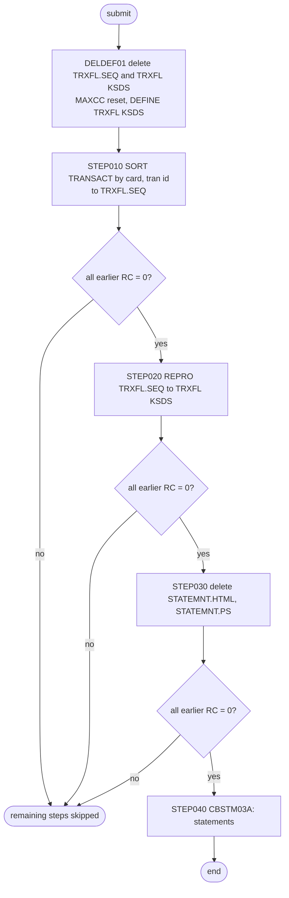

# CREASTMT: Account statements

## 1. Summary

CREASTMT produces one statement per card in the card cross-reference, in two formats: plain text (`STATEMNT.PS`, 80-byte lines) and HTML (`STATEMNT.HTML`, 100-byte lines). The job first builds a work copy of the transaction master re-keyed by card number: `DELDEF01` deletes and redefines the work KSDS `TRXFL.VSAM.KSDS`, `STEP010` sorts `TRANSACT` by card number and transaction ID and moves the card number to the front of each record, and `STEP020` loads the sorted file into the work KSDS. `STEP030` deletes the previous statements, and `STEP040` runs `CBSTM03A`, which reads the cross-reference, customer, account and work files through its subroutine `CBSTM03B` and writes the statements. `STEP010` has no `COND` and always runs; `STEP020`, `STEP030` and `STEP040` run only when all earlier steps ended with return code 0. The statement content and layout belong to the `CBSTM03A` program spec (area d2); this spec covers the job: data preparation, order, conditions, datasets and scheduling.

## 2. Rules at a glance

| ID | Rule |
| :-- | :-- |
| BR-JSTMT-001 | One statement per cross-reference record, listing every transaction of that card in `TRANSACT`, with no date or period filter. |
| SE-JSTMT-001 | Delete the work files `TRXFL.SEQ` and `TRXFL.VSAM.KSDS`; any delete failure is reset to return code 0. |
| SE-JSTMT-002 | Define the work KSDS `TRXFL.VSAM.KSDS`: key 32 at offset 0, fixed 350-byte records. |
| SE-JSTMT-003 | Sort `TRANSACT` by card number, then transaction ID, and move the card number in front of the record. |
| SE-JSTMT-004 | Load the sorted file into `TRXFL.VSAM.KSDS`. |
| SE-JSTMT-005 | Delete the previous `STATEMNT.HTML` and `STATEMNT.PS`. |
| SE-JSTMT-006 | Run `CBSTM03A` to write the new `STATEMNT.PS` and `STATEMNT.HTML`. |
| ERR-JSTMT-001 | Any non-zero return code, including 4, skips every later step from `STEP020` on; `STEP010` always runs. |
| ERR-JSTMT-002 | `CBSTM03A` abends on any checked open, read or close error, including an empty work file, with no defined abend code; its outputs are then deleted. |
| ERR-JSTMT-003 | The work KSDS define fails when the old cluster could not be deleted, and nothing else runs. |
| NUM-JSTMT-001 | Work record layout: card number at 1-16, then the transaction record, the last 2 bytes of the processed timestamp lost. |
| DEF-JSTMT-001 | A failed run leaves the previous run's statements in place. |
| DEF-JSTMT-002 | The work KSDS is on volume `TSU023`; every other job uses `AWSHJ1`. |
| DEF-JSTMT-003 | Stray text on a DD continuation line. |
| DEF-JSTMT-004 | `STEP030` DCB attributes differ from the ones `STEP040` creates. |
| DEF-JSTMT-005 | The statement program holds at most 51 cards and 10 transactions per card in memory. |
| DEF-JSTMT-006 | The schedulers and the README disagree on where the job runs in the cycle. |

## 3. Actors and triggers

- **Trigger:** submitted by an operator, or by CA-7, where the completion of CLOSEFIL triggers CREASTMT (`app/scheduler/CardDemo.ca7:465-468`) and CREASTMT triggers TXT2PDF1 (`app/scheduler/CardDemo.ca7:494-495`). The README batch sequence places it after COMBTRAN and before TRANIDX ("Produce transaction statement", `./README.md:231`), as does the restart runbook cycle table (`docs/runbooks/batch-cycle-restart.md:19`). The demo full-batch script does not run it, and Control-M does not define it (see DEF-JSTMT-006).
- **Preconditions:** `TRANSACT`, `CARDXREF`, `ACCTDATA` and `CUSTDATA` exist and are consistent (every cross-reference record has its customer and account, ERR-JSTMT-002); `TRANSACT` holds at least one record; load library `AWS.M2.CARDDEMO.LOADLIB` holds `CBSTM03A` and `CBSTM03B`; volume `TSU023` exists (`docs/runbooks/batch-cycle-restart.md:40-41`). The job reads the VSAM files with `DISP=SHR`, so CICS may still have them open; CLOSEFIL closes `TRANSACT`, `CCXREF` and `ACCTDAT` but not `CUSTDAT` (see `CLOSEFIL.md`).
- **Job card:** `CLASS=A,MSGCLASS=H,MSGLEVEL=(1,1),NOTIFY=&SYSUID,TIME=1440` (`:1-2`); `TIME=1440` removes the CPU time limit. There is no `JOBLIB` or `JCLLIB`; `STEP040` has its own `STEPLIB` (`:80`).
- **Local run:** `CBSTM03A` compiles but is not run locally, because it reads z/OS control blocks; `CBSTM03B` is tested directly (`./README.md:262`). The unit test models `STEP010` independently (`tests/unit/test_cbstm03b.py:13-17`).

## 4. Interfaces

| Step | Program | DD | Dataset | Disposition | Use | Source |
| :-- | :-- | :-- | :-- | :-- | :-- | :-- |
| `DELDEF01` | IDCAMS | `SYSPRINT` | `SYSOUT=*` | - | IDCAMS messages | `:23` |
| `DELDEF01` | IDCAMS | `SYSIN` | in-stream | - | two `DELETE`, `SET MAXCC`, `DEFINE CLUSTER` | `:24-40` |
| `STEP010` | SORT | `SORTIN` | `AWS.M2.CARDDEMO.TRANSACT.VSAM.KSDS` | `SHR` | input, KSDS | `:45` |
| `STEP010` | SORT | `SYSPRINT`, `SYSOUT` | `SYSOUT=*` | - | sort messages | `:46-47` |
| `STEP010` | SORT | `SORTOUT` | `AWS.M2.CARDDEMO.TRXFL.SEQ` | `(NEW,CATLG,DELETE)` | output, `UNIT=SYSDA`, `DCB=(LRECL=350,BLKSIZE=3500,RECFM=FB)`, `SPACE=(CYL,(1,1),RLSE)` | `:48-51` |
| `STEP010` | SORT | `SYSIN` | in-stream | - | `SORT` and `OUTREC` statements | `:52-55` |
| `STEP020` | IDCAMS | `INFILE` | `AWS.M2.CARDDEMO.TRXFL.SEQ` | `SHR` | input | `:58` |
| `STEP020` | IDCAMS | `OUTFILE` | `AWS.M2.CARDDEMO.TRXFL.VSAM.KSDS` | `SHR` | output, KSDS | `:59` |
| `STEP020` | IDCAMS | `SYSPRINT`, `SYSIN` | `SYSOUT=*`, in-stream | - | `REPRO INFILE(INFILE) OUTFILE(OUTFILE)` | `:57, 60-62` |
| `STEP030` | IEFBR14 | `HTMLFILE` | `AWS.M2.CARDDEMO.STATEMNT.HTML` | `(MOD,DELETE,DELETE)` | delete; `UNIT=SYSDA`, `LRECL=80,BLKSIZE=3200` | `:67-71` |
| `STEP030` | IEFBR14 | `STMTFILE` | `AWS.M2.CARDDEMO.STATEMNT.PS` | `(MOD,DELETE,DELETE)` | delete; no `UNIT`, `LRECL=80,BLKSIZE=8000` | `:72-75` |
| `STEP040` | CBSTM03A | `STEPLIB` | `AWS.M2.CARDDEMO.LOADLIB` | `SHR` | program library | `:80` |
| `STEP040` | CBSTM03A | `SYSPRINT`, `SYSOUT` | `SYSOUT=*` | - | `DISPLAY` output (job and DD names, errors) | `:81-82` |
| `STEP040` | CBSTM03A | `TRNXFILE` | `AWS.M2.CARDDEMO.TRXFL.VSAM.KSDS` | `SHR` | input, read sequentially through `CBSTM03B` | `:83` |
| `STEP040` | CBSTM03A | `XREFFILE` | `AWS.M2.CARDDEMO.CARDXREF.VSAM.KSDS` | `SHR` | input, read sequentially through `CBSTM03B` | `:84` |
| `STEP040` | CBSTM03A | `ACCTFILE` | `AWS.M2.CARDDEMO.ACCTDATA.VSAM.KSDS` | `SHR` | input, read by key through `CBSTM03B` | `:85` |
| `STEP040` | CBSTM03A | `CUSTFILE` | `AWS.M2.CARDDEMO.CUSTDATA.VSAM.KSDS` | `SHR` | input, read by key through `CBSTM03B` | `:86` |
| `STEP040` | CBSTM03A | `STMTFILE` | `AWS.M2.CARDDEMO.STATEMNT.PS` | `(NEW,CATLG,DELETE)` | output, text statements, `LRECL=80,BLKSIZE=8000,RECFM=FB` | `:87-91` |
| `STEP040` | CBSTM03A | `HTMLFILE` | `AWS.M2.CARDDEMO.STATEMNT.HTML` | `(NEW,CATLG,DELETE)` | output, HTML statements, `LRECL=100,BLKSIZE=800,RECFM=FB` | `:92-96` |

The program's own files are only `STMT-FILE` (DD `STMTFILE`, 80 bytes) and `HTML-FILE` (DD `HTMLFILE`, 100 bytes) (`app/cbl/CBSTM03A.CBL:38-47`); `CBSTM03B` owns the four input DDs. Return code of the job: the highest step return code, or the abend of `STEP040`.

## 5. Data used

- ENT-TRANSACTION, whole records of `TRANSACT` (layout `app/cpy/CVTRA05Y.cpy:4-18`), re-keyed into the work layout `TRNX-RECORD` (`app/cpy/COSTM01.CPY:20-36`, NUM-JSTMT-001). The statement uses the transaction ID, description and amount of each record (`app/cbl/CBSTM03A.CBL:675-679`).
- ENT-CARD-XREF, read in key order (card number); ENT-CUSTOMER, read by `XREF-CUST-ID`; ENT-ACCOUNT, read by `XREF-ACCT-ID` (`app/cbl/CBSTM03A.CBL:345-414`).
- `STATEMNT.PS` and `STATEMNT.HTML` hold customer name and full address (`docs/security/data-handling.md:98-99`); they are replaced on every run (`docs/security/data-handling.md:171`). Neither the statements nor `TRXFL` appear in the 09/01/22 catalog listing `app/catlg/LISTCAT.txt`.

## 6. Processing flow

| # | Step | Class | What it does | Runs when |
| --: | :-- | :-- | :-- | :-- |
| 1 | `DELDEF01` | plumbing | delete and define the work files | always |
| 2 | `STEP010` | plumbing | sort and re-key `TRANSACT` | always (no `COND`) |
| 3 | `STEP020` | plumbing | load the work KSDS | every earlier step ended with 0 (`COND=(0,NE)`) |
| 4 | `STEP030` | plumbing | delete the previous statements | every earlier step ended with 0 |
| 5 | `STEP040` | business | write the statements | every earlier step ended with 0 |

## 7. Business rules

#### BR-JSTMT-001 · One statement per card, with every transaction of the card
- **Rule:** `CBSTM03A` reads the cross-reference sequentially and, for each record, reads the customer and the account, writes the statement header, then lists every work-file transaction whose card number equals the cross-reference card number, adds up their amounts and writes the total (`app/cbl/CBSTM03A.CBL:316-329, 416-437`). Because the work file is a copy of the whole of `TRANSACT`, a statement contains every transaction of the card that is in the transaction master, whatever its date; the job has no statement period. A card with no transactions still gets a statement with a zero total. Transactions whose card number is not in the cross-reference appear on no statement.
- **Source:** `:45, 53-54, 79-86`, `app/cbl/CBSTM03A.CBL:316-329, 416-437`
- **Fidelity:** must-preserve (one statement per card; the period question is Q-JSTMT-002) · **Confidence:** reviewed

## 8. Validations and messages

None at job level. `CBSTM03A` writes `DISPLAY` lines to `SYSOUT`: the job and step name and every DD name in the TIOT (`app/cbl/CBSTM03A.CBL:270-291`), and `ERROR OPENING|READING|CLOSING <DD>` with the return code before it abends (ERR-JSTMT-002). The other steps write IDCAMS and sort messages to `SYSPRINT`.

## 9. Side effects

In execution order. The job has no rollback; the work files are rebuilt on every run.

#### SE-JSTMT-001 · Delete the work files
- **What:** `DELETE AWS.M2.CARDDEMO.TRXFL.SEQ` and `DELETE AWS.M2.CARDDEMO.TRXFL.VSAM.KSDS CLUSTER` remove the previous run's work files, followed by `SET MAXCC = 0`, which resets whatever the deletes returned (8 when a file does not exist, also any other failure).
- **Source:** `:25-28`
- **Fidelity:** incidental · **Confidence:** reviewed (statements); platform-inferred (return codes)

#### SE-JSTMT-002 · Define the work KSDS
- **What:** `DEFINE CLUSTER` named `AWS.M2.CARDDEMO.TRXFL.VSAM.KSDS`: `KEYS(32 0)` (card number and transaction ID), `RECORDSIZE(350 350)`, `INDEXED`, `CYL(1 5)` on `VOLUMES(TSU023)`, `SHAREOPTIONS(2 3)`, `ERASE`; data component `TRXFL.DATA` with `CISZ(4096)`, index `TRXFL.INDEX`. The return code of the define is the step's return code, because it comes after the reset.
- **Source:** `:29-39`
- **Fidelity:** must-preserve (key card number + transaction ID); incidental (space, volume, CI size) · **Confidence:** reviewed

#### SE-JSTMT-003 · Sort and re-key the transactions
- **What:** `SORT FIELDS=(263,16,CH,A,1,16,CH,A)` orders all `TRANSACT` records by `TRAN-CARD-NUM` (positions 263-278), then `TRAN-ID` (1-16), ascending, as characters. `OUTREC FIELDS=(1:263,16,17:1,262,279:279,50)` builds each output record as card number (1-16), then input positions 1-262 (`TRAN-ID` to `TRAN-MERCHANT-ZIP`) at 17-278, then input positions 279-328 at 279-328. The result is written to the new sequential dataset `TRXFL.SEQ` (FB 350). See NUM-JSTMT-001 for the bytes that are lost.
- **Source:** `:44-55`, `app/cpy/CVTRA05Y.cpy:4-18`
- **Fidelity:** must-preserve (order card number, transaction ID) · **Confidence:** reviewed (statements); platform-inferred (padding of bytes 329-350)

#### SE-JSTMT-004 · Load the work KSDS
- **What:** `REPRO INFILE(INFILE) OUTFILE(OUTFILE)` copies `TRXFL.SEQ` into the empty `TRXFL.VSAM.KSDS`. The input is already in key order (SE-JSTMT-003), and the key (card number + transaction ID) is unique because `TRAN-ID` is unique in `TRANSACT`.
- **Source:** `:56-61`
- **Fidelity:** incidental (a keyed work store) · **Confidence:** reviewed

#### SE-JSTMT-005 · Delete the previous statements
- **What:** `IEFBR14` with `DISP=(MOD,DELETE,DELETE)` on `STATEMNT.HTML` and `STATEMNT.PS`: an existing dataset is deleted at the end of the step; a missing one is allocated new (`MOD` acts as `NEW`) and deleted at once, so the step works in both cases.
- **Source:** `:66-75`
- **Fidelity:** must-preserve (a run never appends to old statements) · **Confidence:** platform-inferred

#### SE-JSTMT-006 · Write the statements
- **What:** `CBSTM03A` opens `STMTFILE` and `HTMLFILE` for output (`app/cbl/CBSTM03A.CBL:293`), loads the whole work file into a table of cards and transactions (`app/cbl/CBSTM03A.CBL:730-761, 818-853`), opens the cross-reference, customer and account files, and writes one statement per cross-reference record (BR-JSTMT-001). Both outputs are new datasets with `DISP=(NEW,CATLG,DELETE)`: they are cataloged when the step ends normally and deleted when it abends.
- **Source:** `:79-96`, `app/cbl/CBSTM03A.CBL:293-342`
- **Fidelity:** must-preserve · **Confidence:** reviewed (job); content and layout per the `CBSTM03A` program spec

## 10. Error handling

#### ERR-JSTMT-001 · Any non-zero return code stops the job
- **When:** any step ends with a return code other than 0, including a warning 4.
- **Then:** `COND=(0,NE)` on `STEP020`, `STEP030` and `STEP040` bypasses the step when 0 is not equal to the return code of any earlier step, so all later steps are skipped. `STEP010` has no `COND` and runs even when `DELDEF01` failed. An abend skips the remaining steps (JES default). The runbook relies on this: a failure stops the job before the statements are written, and the job can be rerun from the top (`docs/runbooks/batch-cycle-restart.md:152-157`).
- **Source:** `:44, 56, 66, 79`
- **Fidelity:** must-preserve (no statements from incomplete work data) · **Confidence:** reviewed

#### ERR-JSTMT-002 · The statement program abends on any file error
- **When:** `CBSTM03B` returns anything but `00` or `04` when a file is opened, anything but `00` or `04` on the first work-file read, anything but `00` or `10` on later work-file and cross-reference reads, anything but `00` on a keyed customer or account read (`app/cbl/CBSTM03A.CBL:345-414, 730-853`), or anything but `00` or `04` when one of the four input files is closed (`app/cbl/CBSTM03A.CBL:856-919`, ERR-STMT-005).
- **Then:** the program displays `ERROR ... <DD>` and the return code, then `ABENDING PROGRAM`, and calls `CEE3ABD` (`app/cbl/CBSTM03A.CBL:921-923`). Unlike `CBTRN02C` and `CBACT04C`, which pass abend code 999 and get U0999, the call has no arguments (`app/cbl/CBSTM03A.CBL:923`), so the abend code and timing come from whatever the parameter registers hold: the code is undefined and operators cannot rely on U0999 (DEF-STMT-009, ERR-STMT-006). The step abends and `STMTFILE` and `HTMLFILE` are deleted by their abnormal disposition. Cases this covers: a cross-reference record whose customer or account is missing, a failed close, and an empty work file (the first work-file read returns end of file `10`, which the open paragraph does not accept, `app/cbl/CBSTM03A.CBL:744-754`, DEF-STMT-010).
- **Empty `TRANSACT`:** whether the job reaches that abend is platform-dependent. DFSORT normally treats an empty VSAM input as zero records and ends `STEP010` with 0, but the `REPRO` of an empty `TRXFL.SEQ` in `STEP020` can end with a non-zero return code, which skips `STEP040` (ERR-JSTMT-001), and if `STEP040` runs, `CBSTM03B` may already fail to open the never-loaded `TRXFL` KSDS. In each case no new statements are written.
- **Source:** `:56, 79, 87, 92`, `app/cbl/CBSTM03A.CBL:744-754, 379-386, 403-410, 856-919, 921-923`
- **Fidelity:** defect-decide (empty input aborts instead of producing statements with no transactions; undefined abend code) · **Confidence:** reviewed (program); platform-inferred (dispositions, high; abend code, high; where an empty `TRANSACT` stops the job, medium)

#### ERR-JSTMT-003 · The work KSDS cannot be redefined
- **When:** the delete of `TRXFL.VSAM.KSDS` failed (for example the cluster is allocated to another job) and the cluster still exists.
- **Then:** `SET MAXCC = 0` hides the delete failure, but the `DEFINE` fails because the name exists (return code 12), `DELDEF01` ends with 12, `STEP010` still runs and writes `TRXFL.SEQ`, and every later step is skipped (ERR-JSTMT-001). The next run deletes `TRXFL.SEQ` again in `DELDEF01`.
- **Source:** `:26-29, 44, 56`
- **Fidelity:** incidental · **Confidence:** platform-inferred

## 11. Interactions

- **Upstream:** the transaction master as left by POSTTRAN or COMBTRAN; README order COMBTRAN, CREASTMT, TRANIDX (`./README.md:230-232`). INTCALC updates the account balances printed on the statement. In CA-7, only CLOSEFIL precedes it (DEF-JSTMT-006).
- **Downstream:** TXT2PDF1 converts `STATEMNT.PS` (DD `INDD`, `app/jcl/TXT2PDF1.JCL:33`) to PDF; CA-7 triggers it after CREASTMT (`app/scheduler/CardDemo.ca7:494-495`).
- **Shared data:** CREASTMT does not need the transaction alternate index, so it can run before TRANIDX. A TRANBKP run without the following COMBTRAN leaves `TRANSACT` empty, and CREASTMT then writes no new statements; whether it stops in `STEP020` or abends in `STEP040` depends on the platform (ERR-JSTMT-002).
- **Program spec:** statement content, totals, HTML layout and the subroutine interface of `CBSTM03A` and `CBSTM03B` are specified by area d2.

## 12. Numeric, date and format details

#### NUM-JSTMT-001 · Work record layout and the lost bytes
- The input record is 350 bytes (`app/cpy/CVTRA05Y.cpy:4-18`): `TRAN-ID` 1-16, `TRAN-TYPE-CD` 17-18, `TRAN-CAT-CD` 19-22, `TRAN-SOURCE` 23-32, `TRAN-DESC` 33-132, `TRAN-AMT` 133-143, `TRAN-MERCHANT-ID` 144-152, `TRAN-MERCHANT-NAME` 153-202, `TRAN-MERCHANT-CITY` 203-252, `TRAN-MERCHANT-ZIP` 253-262, `TRAN-CARD-NUM` 263-278, `TRAN-ORIG-TS` 279-304, `TRAN-PROC-TS` 305-330, filler 331-350.
- The `OUTREC` result is 328 bytes. Mapped onto `TRNX-RECORD` (`app/cpy/COSTM01.CPY:20-36`): `TRNX-CARD-NUM` 1-16, `TRNX-ID` 17-32, the fields from type code to merchant ZIP at 33-278, `TRNX-ORIG-TS` 279-304, and `TRNX-PROC-TS` 305-330, of which only 305-328 come from the input. The last two characters of the processed timestamp are not copied, and bytes 329-350 are filled up to the 350-byte `SORTOUT` record. The statement does not print either timestamp (`app/cbl/CBSTM03A.CBL:675-679`), so the loss has no visible effect. The local test model pads with spaces (`tests/unit/test_cbstm03b.py:13-17`).
- **Source:** `:50, 53-54`
- **Fidelity:** incidental · **Confidence:** reviewed (positions); platform-inferred (pad character)

## 13. Known defects and oddities

#### DEF-JSTMT-001 · A failed run leaves the old statements in place
- `STEP030`, which deletes the previous statements, is skipped whenever an earlier step returned non-zero (ERR-JSTMT-001). The previous run's `STATEMNT.PS` and `STATEMNT.HTML` then stay cataloged, and TXT2PDF1, which CA-7 triggers on CREASTMT completion, can convert the old file. Only an abend in `STEP040` itself leaves no statements.
- **Source:** `:66, 79`
- **Status:** open · **Fidelity:** defect-decide · **Confidence:** platform-inferred

#### DEF-JSTMT-002 · Different volume from every other job
- The work KSDS is defined on `VOLUMES(TSU023)`, while the other cluster definitions use `AWSHJ1`; the runbook tells sites to change both (`docs/runbooks/batch-cycle-restart.md:40-41`).
- **Source:** `:31`
- **Status:** open · **Fidelity:** incidental · **Confidence:** reviewed

#### DEF-JSTMT-003 · Stray text on a DD continuation line
- Line 90 reads `SPACE=(CYL,(1,1),RLSE), 00,RECFM=FB), ATA.VSAM.KSDS`, editing debris. The operand field ends at the first blank after the comma, so the debris is a JCL comment and the `DSN` on the next line is still part of the statement.
- **Source:** `:90`
- **Status:** open · **Fidelity:** incidental · **Confidence:** platform-inferred

#### DEF-JSTMT-004 · Delete step attributes differ from the created datasets
- `STEP030` gives `HTMLFILE` `LRECL=80,BLKSIZE=3200`, while `STEP040` creates it with `LRECL=100,BLKSIZE=800`; `STEP030 STMTFILE` has no `UNIT`. For an existing dataset the attributes are ignored; when the dataset is missing, the step allocates a temporary one with these attributes and the installation default unit.
- **Source:** `:67-75, 94`
- **Status:** open · **Fidelity:** incidental · **Confidence:** platform-inferred

#### DEF-JSTMT-005 · In-memory capacity of 51 cards and 10 transactions per card
- `CBSTM03A` loads the whole work file into `WS-CARD-TBL OCCURS 51` with `WS-TRAN-TBL OCCURS 10` per card (`app/cbl/CBSTM03A.CBL:225-233`) and does not check the counters when it fills the table (`app/cbl/CBSTM03A.CBL:818-830`). A `TRANSACT` with more than 51 distinct card numbers or more than 10 transactions on one card writes beyond the table. Because the job copies the whole transaction master and has no period (BR-JSTMT-001), the limit is reached as history accumulates. Details belong to the `CBSTM03A` program spec.
- **Source:** `:45, 83`, `app/cbl/CBSTM03A.CBL:225-233, 818-830`
- **Status:** open · **Fidelity:** defect-decide · **Confidence:** reviewed (table sizes); platform-inferred (effect of the overflow)

#### DEF-JSTMT-006 · Schedulers and README disagree on the job's place
- README and runbook: after COMBTRAN, before TRANIDX (`./README.md:230-232`, `docs/runbooks/batch-cycle-restart.md:18-20`). CA-7: triggered directly by a CLOSEFIL completion, with no dependency on POSTTRAN, INTCALC or COMBTRAN, then TXT2PDF1, WAITSTEP, OPENFIL (`app/scheduler/CardDemo.ca7:465-527`; WAITSTEP and OPENFIL at `app/scheduler/CardDemo.ca7:522, 527`). Control-M and the demo full-batch script do not run it. See `SCHED-CA7.md` and `README.md` in this folder.
- **Source:** `:1`, `app/scheduler/CardDemo.ca7:465-527`
- **Status:** open · **Fidelity:** defect-decide · **Confidence:** reviewed

## 14. Open questions

| ID | Question | For |
| :-- | :-- | :-- |
| Q-JSTMT-001 | Where in the cycle should statements be produced: after COMBTRAN (README) or directly after CLOSEFIL (CA-7)? | operations |
| Q-JSTMT-002 | Should a statement cover a period (for example the month or the cycle) instead of every transaction in the master (BR-JSTMT-001)? | business |
| Q-JSTMT-003 | Should a failed run remove or flag the previous statements so that they are not converted or sent again (DEF-JSTMT-001)? | operations |

## 15. Equivalence contract

After a successful run: `STATEMNT.PS` and `STATEMNT.HTML` hold one statement per cross-reference record, in card-number order, each listing that card's transactions from the transaction master in transaction-ID order with their total, as specified by the `CBSTM03A` program spec; previous statements are gone. The work KSDS is an implementation detail: a reimplementation may read the transactions grouped by card in any way that gives the same order. On any failure before the statement step, no new statements are written; the AS-IS job also leaves the old ones in place (DEF-JSTMT-001, Q-JSTMT-003). IDCAMS and sort messages may differ.

## 16. Paragraph coverage

| Step | Lines | Covered by |
| :-- | :-- | :-- |
| (job card and comments) | 1-21 | §3 |
| `DELDEF01` | 22-40 | SE-JSTMT-001, SE-JSTMT-002, ERR-JSTMT-003, DEF-JSTMT-002 |
| `STEP010` | 44-55 | SE-JSTMT-003, NUM-JSTMT-001, BR-JSTMT-001, ERR-JSTMT-001 |
| `STEP020` | 56-62 | SE-JSTMT-004, ERR-JSTMT-001, ERR-JSTMT-002 |
| `STEP030` | 66-75 | SE-JSTMT-005, DEF-JSTMT-001, DEF-JSTMT-004 |
| `STEP040` | 79-96 | SE-JSTMT-006, BR-JSTMT-001, ERR-JSTMT-002, DEF-JSTMT-003, DEF-JSTMT-005 |
