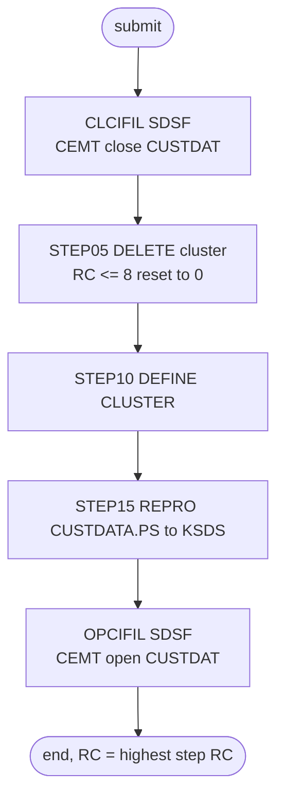

# CUSTFILE: Customer master reload

## 1. Summary

CUSTFILE throws away the customer master file and rebuilds it from the flat sample file. It first asks the CICS region to close CICS file `CUSTDAT`. `STEP05` deletes the VSAM cluster `AWS.M2.CARDDEMO.CUSTDATA.VSAM.KSDS`, `STEP10` defines it again empty (key 9 bytes at offset 0, fixed 500-byte records), and `STEP15` copies every record of `AWS.M2.CARDDEMO.CUSTDATA.PS` into it. The last step asks CICS to open `CUSTDAT` again. It is run by hand during installation and in the demo data refresh. It contains no business logic; what it must preserve is the file definition and the fact that the result is an exact copy of the flat file.

## 2. Rules at a glance

The job has no business rules. Its items:

| ID | Rule |
| :-- | :-- |
| SE-JCUST-001 | Ask CICS region `CICSAWSA` to close file `CUSTDAT`. |
| SE-JCUST-002 | Delete the customer cluster; a failure with return code 8 or less is ignored. |
| SE-JCUST-003 | Define the customer cluster: key 9 at offset 0, records 500 fixed, `SHAREOPTIONS(2 3)`, `ERASE`, no `REUSE`. |
| SE-JCUST-004 | Load the cluster with every record of `CUSTDATA.PS`, in file order. |
| SE-JCUST-005 | Ask CICS to open `CUSTDAT` again. |
| VAL-JCUST-001 | The load rejects records out of key order or with duplicate customer IDs (VSAM rule). |
| ERR-JCUST-001 | No step has a `COND`, so every step runs even when an earlier one failed. |
| ERR-JCUST-002 | The CICS steps end normally whether or not CICS closed or opened the file. |
| ERR-JCUST-003 | A severe IDCAMS error (condition code 16) in the delete skips the return-code reset and ends `STEP05` with 16. |
| ERR-JCUST-004 | While CICS still has `CUSTDAT` open, the delete, the define and the load all fail and the old file stays. |
| NUM-JCUST-001 | Key and record size. |
| DEF-JCUST-001 | The return-code reset also hides a delete that failed because the file is still open. |
| DEF-JCUST-002 | The job does not wait for CICS to finish closing the file before it deletes it. |
| DEF-JCUST-003 | The CICS region name `CICSAWSA` is hard-coded. |

## 3. Actors and triggers

- **Trigger:** submitted by an operator. It is in the README's initialisation sequence (`./README.md:156`) and its "Running Batch Jobs" sequence (`./README.md:219`), and in the demo scripts `scripts/run_full_batch.sh:25-26` and `scripts/remote_refresh.sh:25-26`. Neither the CA-7 nor the Control-M schedule runs it. The local runner has no CUSTFILE job; it loads `app/data/ASCII/custdata.txt` into the `CUSTDATA` dataset directly for every run (`tools/batch-programs.toml:199-203`).
- **Preconditions:** the CICS region is called `CICSAWSA` and the submitter may issue MVS `MODIFY` commands through SDSF (`docs/runbooks/cics-vsam-files.md:54-56`); `AWS.M2.CARDDEMO.CUSTDATA.PS` exists and is sorted by customer ID (`./README.md:137`, FB 500). The define names volume `AWSHJ1`, but the cluster is SMS-managed (storage class `SCTECH`, `app/catlg/LISTCAT.txt:601`) and the catalog shows its data component on volume `YYYYO7` (`app/catlg/LISTCAT.txt:647`), so on the reference system SMS chose the volume; `AWSHJ1` matters only where SMS does not manage these names (platform-inferred, medium). CLOSEFIL does not close `CUSTDAT` (`docs/runbooks/cics-vsam-files.md:22`), so this job's own close step is the only one.
- **Job card:** `CLASS=A,MSGCLASS=0,NOTIFY=&SYSUID` (`:1-2`). No parameters, no symbolic overrides.

## 4. Interfaces

| Step | Program | DD | Dataset | Disposition | Use | Source |
| :-- | :-- | :-- | :-- | :-- | :-- | :-- |
| `CLCIFIL` | SDSF | `ISFOUT` | `SYSOUT=*` | - | SDSF output | `:23` |
| `CLCIFIL` | SDSF | `CMDOUT` | `SYSOUT=*` | - | not a DD that SDSF batch uses (ERR-JCUST-002) | `:24` |
| `CLCIFIL` | SDSF | `ISFIN` | in-stream | - | `/F CICSAWSA,'CEMT SET FIL(CUSTDAT ) CLO'` | `:25-27` |
| `STEP05` | IDCAMS | `SYSPRINT` | `SYSOUT=*` | - | IDCAMS messages | `:33` |
| `STEP05` | IDCAMS | `SYSIN` | in-stream | - | `DELETE` statement | `:34-38` |
| `STEP10` | IDCAMS | `SYSPRINT` | `SYSOUT=*` | - | IDCAMS messages | `:44` |
| `STEP10` | IDCAMS | `SYSIN` | in-stream | - | `DEFINE CLUSTER` statement | `:45-60` |
| `STEP15` | IDCAMS | `SYSPRINT` | `SYSOUT=*` | - | IDCAMS messages | `:65` |
| `STEP15` | IDCAMS | `CUSTDATA` | `AWS.M2.CARDDEMO.CUSTDATA.PS` | `SHR` | input, sequential, FB 500 | `:66-67` |
| `STEP15` | IDCAMS | `CUSTVSAM` | `AWS.M2.CARDDEMO.CUSTDATA.VSAM.KSDS` | `SHR` | output, KSDS | `:68-69` |
| `STEP15` | IDCAMS | `SYSIN` | in-stream | - | `REPRO` statement | `:70-72` |
| `OPCIFIL` | SDSF | `ISFOUT` | `SYSOUT=*` | - | SDSF output | `:77` |
| `OPCIFIL` | SDSF | `CMDOUT` | `SYSOUT=*` | - | not a DD that SDSF batch uses (ERR-JCUST-002) | `:78` |
| `OPCIFIL` | SDSF | `ISFIN` | in-stream | - | `/F CICSAWSA,'CEMT SET FIL(CUSTDAT ) OPE'` | `:79-81` |

CICS file `CUSTDAT` is defined on `AWS.M2.CARDDEMO.CUSTDATA.VSAM.KSDS` (`app/csd/CARDDEMO.CSD:50-52`). Return code of the job: the highest step return code. Console output is SDSF `ISFOUT` and IDCAMS `SYSPRINT` only (incidental).

## 5. Data used

- The customer record, ENT-CUSTOMER (`CUSTOMER-RECORD`, `app/cpy/CVCUS01Y.cpy:4-23`, 500 bytes), whole records copied unchanged from `CUSTDATA.PS` to the KSDS. No field is interpreted; the key is bytes 1-9 (`CUST-ID`, `9(09)`). The record holds personal data (name, address, phone numbers, `CUST-SSN` at bytes 280-288, `CUST-GOVT-ISSUED-ID`, date of birth), which the job copies as is and does not print.
- Catalog state on 09/01/22 (`app/catlg/LISTCAT.txt:595-676`): the data component has `KEYLEN 9`, `RKP 0`, `MAXLRECL 500`, `SHROPTNS(2,3)`, `ERASE`, `NOREUSE` and `REC-TOTAL 50` (`app/catlg/LISTCAT.txt:632-637`), space `CYLINDER` primary 1 secondary 5 (`app/catlg/LISTCAT.txt:643-645`). This matches the define in SE-JCUST-003.
- Sample data: `app/data/ASCII/custdata.txt` has 50 records of 500 bytes, customer IDs `000000001` to `000000050`, strictly ascending. Checked locally with a Python script over the file.

## 6. Processing flow

| # | Step | Program | Class | What it does | Runs when |
| --: | :-- | :-- | :-- | :-- | :-- |
| 1 | `CLCIFIL` | SDSF | plumbing | close `CUSTDAT` in CICS | always |
| 2 | `STEP05` | IDCAMS | plumbing | delete the cluster | always (no `COND`) |
| 3 | `STEP10` | IDCAMS | plumbing | define the cluster | always |
| 4 | `STEP15` | IDCAMS | plumbing | copy `CUSTDATA.PS` into the cluster | always |
| 5 | `OPCIFIL` | SDSF | plumbing | open `CUSTDAT` in CICS | always |

## 7. Business rules

None. The job moves data without interpreting it; see the side effects in section 9.

## 8. Validations and messages

#### VAL-JCUST-001 · The load requires ascending, unique customer IDs
- **When:** `STEP15` copies a record whose key (bytes 1-9) is not higher than the previous record's key.
- **Then:** VSAM rejects that record and IDCAMS prints an error message for it; the step ends with return code 8 or higher. The remaining records are still copied until IDCAMS reaches its error limit (by default it stops after 4 such errors).
- **Source:** `:71`
- **Fidelity:** must-preserve (the target load must also fail visibly on unsorted or duplicate input) · **Confidence:** platform-inferred (IDCAMS `REPRO` into a KSDS; no local run)

No operator-facing message text is produced by the job itself; all messages are IDCAMS `IDCnnnnI` messages in `SYSPRINT`, SDSF output in `ISFOUT` and CEMT responses on the system console.

## 9. Side effects

In execution order. There is no rollback: each step's change is permanent.

#### SE-JCUST-001 · Close the customer file in CICS
- **What:** SDSF issues `/F CICSAWSA,'CEMT SET FIL(CUSTDAT ) CLO'`, an MVS `MODIFY` command that passes a CEMT request to the CICS region. CICS closes the file when no running task is using it (`docs/runbooks/cics-vsam-files.md:57-58`). While closed, online functions that read customers (account view and update) fail.
- **Source:** `:22-27`, `app/csd/CARDDEMO.CSD:50-52`
- **Fidelity:** must-preserve (batch reload and online use must not overlap); incidental (mechanism) · **Confidence:** platform-inferred

#### SE-JCUST-002 · Delete the customer cluster
- **What:** `DELETE AWS.M2.CARDDEMO.CUSTDATA.VSAM.KSDS CLUSTER`, which removes the cluster with its data and index components and all its records.
- **Return code:** `IF MAXCC LE 08 THEN SET MAXCC = 0` turns any result of 8 or less into 0, so a missing cluster (first run) is not an error.
- **Source:** `:35-37`
- **Fidelity:** must-preserve · **Confidence:** reviewed

#### SE-JCUST-003 · Define the customer cluster
- **What:** `DEFINE CLUSTER` named `AWS.M2.CARDDEMO.CUSTDATA.VSAM.KSDS` with:

| Attribute | Value |
| :-- | :-- |
| Organisation | `INDEXED` (KSDS) |
| Key | `KEYS(9 0)`: 9 bytes at offset 0 (`CUST-ID`) |
| Record size | `RECORDSIZE(500 500)`: average and maximum 500, so fixed 500 |
| Space | `CYLINDERS(1 5)` on `VOLUMES(AWSHJ1)` |
| Sharing | `SHAREOPTIONS(2 3)` |
| Other | `ERASE`; no `REUSE` |
| Components | data `...CUSTDATA.VSAM.KSDS.DATA`, index `...CUSTDATA.VSAM.KSDS.INDEX` |

- **Source:** `:46-59`
- **Fidelity:** must-preserve (key and record size); incidental (space, volume, `ERASE`) · **Confidence:** reviewed

#### SE-JCUST-004 · Load the cluster from the flat file
- **What:** `REPRO INFILE(CUSTDATA) OUTFILE(CUSTVSAM)` copies every record of `AWS.M2.CARDDEMO.CUSTDATA.PS`, in file order, into the new cluster, byte for byte.
- **Source:** `:66-71`
- **Fidelity:** must-preserve · **Confidence:** reviewed

#### SE-JCUST-005 · Open the customer file in CICS again
- **What:** SDSF issues `/F CICSAWSA,'CEMT SET FIL(CUSTDAT ) OPE'`; online customer functions work again once CICS has opened the file.
- **Source:** `:76-81`
- **Fidelity:** incidental (mechanism) · **Confidence:** platform-inferred

If a later step fails, everything before it has happened: the file is closed in CICS, the old cluster is gone, and the new one may be empty or partly loaded. `OPCIFIL` still runs and reopens the file on whatever exists.

## 10. Error handling

#### ERR-JCUST-001 · Steps run regardless of earlier failures
- **When:** a step ends with a non-zero return code without abending.
- **Then:** the next step still runs, because no `EXEC` has a `COND` parameter. If `STEP10` fails (for example because the delete did not remove the cluster), `STEP15` loads the records into whatever cluster exists (DEF-JCUST-001), or cannot open it while CICS has it open (ERR-JCUST-004). An abend in a step skips the remaining steps, including `OPCIFIL`, so the file stays closed in CICS (JES default).
- **Restart:** rerun the whole job.
- **Source:** `:22, 32, 43, 64, 76`
- **Fidelity:** defect-decide · **Confidence:** platform-inferred

#### ERR-JCUST-002 · The CICS steps do not report whether the file changed state
- **When:** CICS rejects the CEMT command (region not named `CICSAWSA`, no authority to issue `MODIFY`) or closes the file only later.
- **Then:** SDSF still ends normally once it has issued the command; the CEMT response goes to the console, not to the step's return code. SDSF in batch reads its commands from `ISFIN` and writes its output to `ISFOUT`; `CMDOUT` is not a DD that SDSF documents, so it is expected to stay empty. The job continues to `STEP05` either way (DEF-JCUST-002).
- **Source:** `:22-27, 76-81`
- **Fidelity:** defect-decide · **Confidence:** platform-inferred (medium for the `CMDOUT` statement)

#### ERR-JCUST-003 · A severe IDCAMS error skips the return-code reset
- **When:** the `DELETE` in `STEP05` ends with condition code 16, a severe error such as a catalog that cannot be accessed.
- **Then:** IDCAMS does not process the remaining commands of the step, so `IF MAXCC LE 08 THEN SET MAXCC = 0` never runs and `STEP05` ends with return code 16. The job still goes on to `STEP10` (ERR-JCUST-001). The reset therefore turns only results of 8 or less into 0. `STEP10` and `STEP15` hold one command each, so for them a severe error simply ends the step with 16.
- **Source:** `:35-37`
- **Fidelity:** incidental · **Confidence:** platform-inferred (high; IDCAMS condition-code rules, no local run)

#### ERR-JCUST-004 · Nothing is reloaded while CICS still has the file open
- **When:** CICS file `CUSTDAT` is still open when `STEP05` runs, because CICS rejected the close or has not finished it (DEF-JCUST-002). CICS opens the file for update, since its definition allows add, update and delete (`app/csd/CARDDEMO.CSD:50-57`).
- **Then:** `STEP05` cannot delete the cluster (return code 8, reset to 0; DEF-JCUST-001), and `STEP10` fails because the name exists. With `SHAREOPTIONS(2 3)` only one region at a time may have the cluster open for output, and CICS already has it, so `REPRO` in `STEP15` cannot open `CUSTVSAM`, copies nothing and ends with return code 12. The old cluster keeps its data; `OPCIFIL` then asks CICS to open a file that is still open.
- **Source:** `:35-37, 52, 68-71`, `app/csd/CARDDEMO.CSD:50-57`
- **Fidelity:** must-preserve (no reload while the online system uses the file) · **Confidence:** platform-inferred (high; VSAM share options and the CICS open mode, no local run)

## 11. Interactions

- **Upstream:** none required; the job closes `CUSTDAT` itself. CLOSEFIL does not close it (`docs/runbooks/cics-vsam-files.md:22, 72-73`).
- **Downstream:** every reader of the customer master: READCUST (`CBCUS01C`), TRANVALD (`CBTRN01C`), CREASTMT (`CBSTM03A` through `CBSTM03B`, DD `CUSTFILE`, `app/jcl/CREASTMT.JCL:86`), CBEXPORT, and the online programs through CICS file `CUSTDAT`, for example `COACTVWC` and `COACTUPC`, and the optional authorisation programs `COPAUA0C` and `COPAUS0C`.
- **Shared data:** the customer ID must match `XREF-CUST-ID` in ENT-CARD-XREF (loaded by XREFFILE); nothing in this job checks it.
- **Related job:** DEFCUST defines a different, unrelated customer cluster (`AWS.CUSTDATA.CLUSTER`, key 10); it is not an alternative to this job (see `DEFCUST.md`).
- **Operations:** the runbook lists CUSTFILE among the jobs that must not run while CICS users are signed on (`docs/runbooks/cics-vsam-files.md:89-90`).

## 12. Numeric, date and format details

#### NUM-JCUST-001 · Key and record size
- Primary key: 9 bytes at offset 0 (`CUST-ID`, digits), unique. Records: fixed 500 bytes. Space: `CYLINDERS(1 5)`.
- **Source:** `:47, 50-51`
- **Fidelity:** must-preserve (key, record size); incidental (space) · **Confidence:** reviewed

## 13. Known defects and oddities

#### DEF-JCUST-001 · The return-code reset hides a failed delete
- `IF MAXCC LE 08 THEN SET MAXCC = 0` is meant for "cluster not found", but it also hides other delete failures with return code 8, for example when CICS has not yet closed `CUSTDAT` (DEF-JCUST-002) or another job has the cluster allocated. Then `STEP10` fails because the name already exists. While CICS has the file open, `STEP15` cannot open it either and nothing is copied (ERR-JCUST-004). Only when the delete failed for another reason, or another job has the cluster open for input only (which `SHAREOPTIONS(2 3)` allows next to one writer), does `STEP15` copy the flat file on top of the old, loaded cluster: records with existing keys are rejected as duplicates and records with new keys are added. In both cases the job ends with a non-zero code, and the old data stays.
- **Source:** `:37, 43, 64`
- **Status:** open · **Fidelity:** defect-decide · **Confidence:** platform-inferred

#### DEF-JCUST-002 · The delete does not wait for the CICS close
- `STEP05` runs as soon as SDSF has issued the close command. CICS closes a file only when current tasks have finished with it (`docs/runbooks/cics-vsam-files.md:57-58`), and nothing in the job waits or checks. A busy region therefore leads to DEF-JCUST-001.
- **Source:** `:22-27, 32`
- **Status:** open · **Fidelity:** defect-decide · **Confidence:** platform-inferred

#### DEF-JCUST-003 · The CICS region name is hard-coded
- Both SDSF steps name region `CICSAWSA` in in-stream data; there is no symbolic parameter. On a system whose region has another job name the commands fail and the file is not closed or reopened.
- **Source:** `:26, 80`
- **Status:** open · **Fidelity:** incidental · **Confidence:** reviewed

## 14. Open questions

| ID | Question | For |
| :-- | :-- | :-- |
| Q-JCUST-001 | Is a full delete-and-reload of the customer master needed in the target outside demo set-up, or only a seed load for new environments? | operations |

## 15. Equivalence contract

After a successful run (return code 0), the customer store contains exactly the records of `CUSTDATA.PS`: same count (50 for the sample data), same bytes, keyed by `CUST-ID`, and nothing else. A reimplementation must fail (non-zero result, no silent partial load) when the input has keys out of order or duplicated (VAL-JCUST-001), and the online system must not use the customer data while the reload runs. IDCAMS and CICS message text may differ.

## 16. Paragraph coverage

| Step | Lines | Covered by |
| :-- | :-- | :-- |
| (job card) | 1-2 | §3 |
| `CLCIFIL` | 22-27 | SE-JCUST-001, ERR-JCUST-002, DEF-JCUST-002, DEF-JCUST-003 |
| `STEP05` | 32-38 | SE-JCUST-002, ERR-JCUST-003, DEF-JCUST-001 |
| `STEP10` | 43-60 | SE-JCUST-003, NUM-JCUST-001, ERR-JCUST-001 |
| `STEP15` | 64-72 | SE-JCUST-004, VAL-JCUST-001, ERR-JCUST-001, ERR-JCUST-004 |
| `OPCIFIL` | 76-81 | SE-JCUST-005, ERR-JCUST-002, DEF-JCUST-003 |
