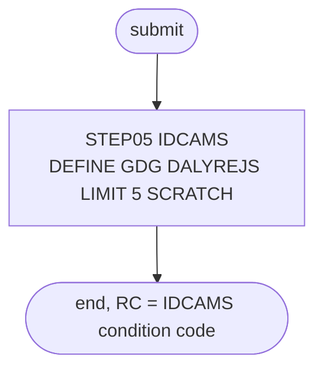

# DALYREJS: GDG base for the daily rejects

## 1. Summary

DALYREJS is a one-time set-up job. Its only step, `STEP05`, runs IDCAMS to define the generation data group (GDG) base `AWS.M2.CARDDEMO.DALYREJS` with `LIMIT(5)` and `SCRATCH`. POSTTRAN writes one new generation of that GDG per run with the transactions it rejects (ENT-DAILY-REJECT), so POSTTRAN cannot run until this job has run once. The job creates no data and carries no business logic. It is not in the README's initialisation or batch tables, although the restart runbook names it as a prerequisite.

## 2. Rules at a glance

The job has no business rules. Its items:

| ID | Rule |
| :-- | :-- |
| SE-JREJS-001 | Define the GDG base `AWS.M2.CARDDEMO.DALYREJS`, `LIMIT(5) SCRATCH`. |
| ERR-JREJS-001 | No return-code reset: a second run ends with condition code 12 and changes nothing. |
| NUM-JREJS-001 | Five generations are kept, one per POSTTRAN run, each fixed 430-byte records. |
| DEF-JREJS-001 | The README does not list the job, although POSTTRAN needs the base. |
| DEF-JREJS-002 | The step comment describes a delete of the transaction master, which the job does not do. |
| DEF-JREJS-003 | [security] The five kept generations hold full card numbers. |

## 3. Actors and triggers

- **Trigger:** submitted once by an operator during installation. The README lists this job in neither its initialisation table (`./README.md:150-167`) nor its batch table (`./README.md:351-379`); the restart runbook lists it as a one-time prerequisite of POSTTRAN (`docs/runbooks/batch-cycle-restart.md:32-33`) and as the fix for a JCL error on `DALYREJS` (`docs/runbooks/batch-cycle-restart.md:57`). Neither the CA-7 nor the Control-M schedule runs it, and `scripts/run_full_batch.sh` does not submit it. The local runner (`tools/carddemo.py`) does not emulate it: POSTTRAN's `DALYREJS` DD is a plain new file there (`tools/carddemo.py:645`).
- **Preconditions:** the user can define entries in the catalog that holds `AWS.M2.CARDDEMO`.
- **Job card:** `'DEF GDG FOR REJS',CLASS=A,MSGCLASS=0,NOTIFY=&SYSUID` (`:1`). No parameters, no symbolic overrides.

## 4. Interfaces

| Step | Program | DD | Dataset | Disposition | Use | Source |
| :-- | :-- | :-- | :-- | :-- | :-- | :-- |
| `STEP05` | IDCAMS | `SYSPRINT` | `SYSOUT=*` | - | IDCAMS messages | `:22` |
| `STEP05` | IDCAMS | `SYSIN` | in-stream | - | `DEFINE GENERATIONDATAGROUP` statement | `:23-29` |

The job allocates no data set; the GDG base is a catalog entry. Return code of the job: the IDCAMS condition code. Console output is IDCAMS `SYSPRINT` only (incidental).

## 5. Data used

- No records are read or written. The GDG base names the future generations `AWS.M2.CARDDEMO.DALYREJS.GnnnnV00`, which hold ENT-DAILY-REJECT records written by POSTTRAN.
- Catalog state on 09/01/22 (`app/catlg/LISTCAT.txt:684-696`): GDG base `AWS.M2.CARDDEMO.DALYREJS`, `LIMIT 5`, `SCRATCH`, `NOEMPTY`, `LIFO`, `NOPURGE`, `NOEXTENDED`, created 2022.160, with five generations `G0022V00` to `G0026V00`. This matches the define in SE-JREJS-001.

## 6. Processing flow

The only step is plumbing.

| # | Step | Class | What it does | Runs when |
| --: | :-- | :-- | :-- | :-- |
| 1 | `STEP05` | plumbing | define the GDG base `DALYREJS` | always |



## 7. Business rules

None. The job defines a catalog entry; the rules for what goes into the rejects are POSTTRAN's (`programs/CBTRN02C.md`, SE-POST-004).

## 8. Validations and messages

None. The job checks no input; IDCAMS writes its own `IDCnnnnI` messages to `SYSPRINT`.

## 9. Side effects

#### SE-JREJS-001 · Define the daily-rejects GDG base
- **What:** IDCAMS runs this statement:

```text
DEFINE GENERATIONDATAGROUP -
(NAME(AWS.M2.CARDDEMO.DALYREJS) -
 LIMIT(5) -
 SCRATCH -
)
```

  It creates the GDG base `AWS.M2.CARDDEMO.DALYREJS`: at most five generations stay cataloged, and when a sixth is cataloged the oldest is uncataloged and, because of `SCRATCH`, deleted from its volume. The other attributes take the IDCAMS defaults, which the 09/01/22 catalog shows as `NOEMPTY`, `LIFO`, `NOPURGE` and `NOEXTENDED` (`app/catlg/LISTCAT.txt:690`).
- **Source:** `:24-28`
- **Fidelity:** must-preserve (retention of five generations); incidental (GDG mechanics) · **Confidence:** reviewed (statement); platform-inferred (roll-off behaviour)

## 10. Error handling

#### ERR-JREJS-001 · A second run fails with condition code 12
- **When:** the GDG base already exists.
- **Then:** the define fails as a duplicate name, IDCAMS ends with condition code 12 and the job with return code 12. The existing base and its generations are not changed. Unlike DEFGDGB, the job has no `IF LASTCC=12 THEN SET MAXCC=0`, so the failure is visible. There is nothing to restart: the job has one statement.
- **Source:** `:21-28`
- **Fidelity:** incidental · **Confidence:** platform-inferred (IDCAMS duplicate-name condition code)

## 11. Interactions

- **Downstream:** POSTTRAN step `STEP15` allocates `AWS.M2.CARDDEMO.DALYREJS(+1)` with `DISP=(NEW,CATLG,DELETE)`, `RECFM=F`, `LRECL=430` (`app/jcl/POSTTRAN.jcl:34-38`); it fails with a JCL error when the base is missing (`docs/runbooks/batch-cycle-restart.md:57`). The record is described in `programs/CBTRN02C.md` (SE-POST-004, DEF-POST-013).
- **Readers:** the daily-rejects runbook reads `DALYREJS(0)` to review and resubmit rejects (`docs/runbooks/daily-rejects.md:62, 74`). No job in `app/jcl` reads the GDG.
- **Related:** DEFGDGB defines the other six core GDG bases with the same `LIMIT(5) SCRATCH`, but not this one.

## 12. Numeric, date and format details

#### NUM-JREJS-001 · Five generations, one per POSTTRAN run
- `LIMIT(5)` keeps the five newest generations. A generation is added by every POSTTRAN run that ends without an abend, so the GDG holds the rejects of the last five runs, which is five days only when POSTTRAN runs exactly once a day (the runbook says "the last five days", `docs/runbooks/daily-rejects.md:22-24`). Each generation is fixed-length 430-byte records (`app/jcl/POSTTRAN.jcl:36`).
- **Source:** `:26`, `app/jcl/POSTTRAN.jcl:36`
- **Fidelity:** must-preserve (retention) · **Confidence:** reviewed (limit, record size); platform-inferred (roll-off)

## 13. Known defects and oddities

#### DEF-JREJS-001 · The README does not list the job
- POSTTRAN needs the base, but neither the README's initialisation sequence (`./README.md:150-167`) nor its batch table (`./README.md:351-379`) names DALYREJS. Someone who follows the README gets a JCL error on the first POSTTRAN run; only the runbooks mention the job: the restart runbook (`docs/runbooks/batch-cycle-restart.md:32-33`), the runbook index (`docs/runbooks/README.md:24`) and the daily rejects runbook (`docs/runbooks/daily-rejects.md:22-23`), none of them as an installation step.
- **Source:** `./README.md:150-167`
- **Status:** open · **Fidelity:** incidental · **Confidence:** reviewed

#### DEF-JREJS-002 · Misleading step comment
- The comment before `STEP05` reads `DELETE TRANSACATION MASTER VSAM FILE IF ONE ALREADY EXISTS` (`:19`), copied from another job. The step deletes nothing; it only defines the GDG base.
- **Source:** `:19, 24-28`
- **Status:** open · **Fidelity:** incidental · **Confidence:** reviewed

#### DEF-JREJS-003 · [security] Five generations of full card numbers
- Each reject record starts with the 350-byte daily transaction, card number included (DEF-POST-011). With `LIMIT(5)` the last five runs' rejects stay on disk; nothing in the job protects or masks them.
- **Source:** `:26-27`
- **Status:** open · **Fidelity:** defect-decide · **Confidence:** reviewed

## 14. Open questions

| ID | Question | For |
| :-- | :-- | :-- |
| Q-JREJS-001 | How long must rejected transactions be kept in the target: a number of runs, a number of days, or until they are resubmitted? | operations, business owner |

## 15. Equivalence contract

A reimplementation must provide a store for rejected daily transactions that exists before the first posting run and keeps the rejects of the last five posting runs, deleting older ones (or the retention the business sets for Q-JREJS-001). Defining it twice must not change existing data. IDCAMS messages and condition codes may differ.

Review evidence (independent reviewers checked every item against the source, all WRONG and MINOR findings were fixed, and a fresh reviewer re-checked every changed or added item): [evidence/g-jobs-ops-review.md](../evidence/g-jobs-ops-review.md).

## 16. Paragraph coverage

| Step | Lines | Covered by |
| :-- | :-- | :-- |
| (job card) | 1-1 | §3 |
| `STEP05` | 21-29 | SE-JREJS-001, ERR-JREJS-001, NUM-JREJS-001, DEF-JREJS-002, DEF-JREJS-003 |
