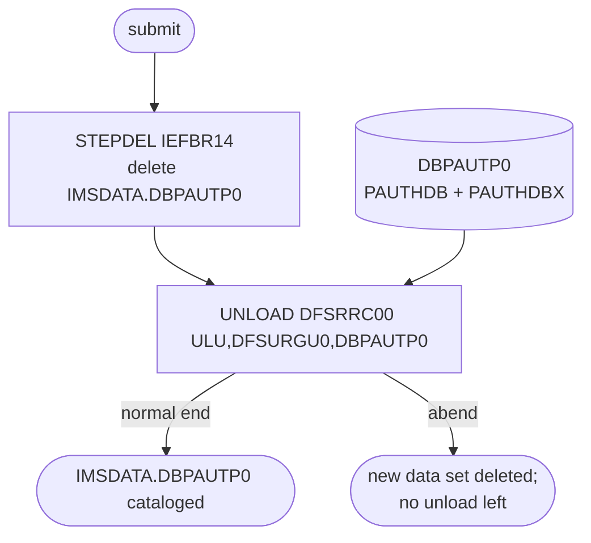

# DBPAUTP0: Pending authorization database unload (HD unload utility)

## 1. Summary

DBPAUTP0 (named after the database it unloads) deletes the previous unload data set and then runs the IMS HD Reorganization Unload utility `DFSURGU0` on the pending-authorization database `DBPAUTP0`, writing every summary and detail segment, in hierarchic order, to the variable-length data set `AWS.M2.CARDDEMO.IMSDATA.DBPAUTP0`. No application program runs. The sample data file of the module has the same name and the same record structure (22 summary and 202 detail records between a header and a trailer), so this is the job that produced it. Nothing in the repository reloads the unload (Q-JDBPA-001). It is run on demand, as a backup, before a reorganization or to move the database.

## 2. Rules at a glance

| ID | Rule |
| :-- | :-- |
| FLOW-JDBPA-001 | Two steps, always both: delete the old unload, then unload the database. |
| SE-JDBPA-001 | `STEPDEL` deletes `AWS.M2.CARDDEMO.IMSDATA.DBPAUTP0` whether or not it exists. |
| SE-JDBPA-002 | `UNLOAD` reads `DBPAUTP0` with the HD unload utility and catalogs a new unload data set. |
| ERR-JDBPA-001 | A failed unload deletes the new data set; the previous one is already gone. |
| ERR-JDBPA-002 | The unload needs DBRC authorization for the database (RECON data sets). |
| NUM-JDBPA-001 | Unload data set: `RECFM=VB`, `LRECL=27990`, space in 32,274-byte blocks. |
| NUM-JDBPA-002 | Region, buffers and control statement. |
| DEF-JDBPA-001 | The only copy of the previous unload is deleted before the new one is written. |
| DEF-JDBPA-002 | Misleading comment and a stray `//*` past column 72. |
| DEF-JDBPA-003 | Site-specific library names. |

## 3. Actors and triggers

- **Trigger:** submitted by an operator or database administrator; no scheduler runs it (it is not in `app/scheduler/CardDemo.ca7`).
- **Job card:** `'DBPAUTP0 DB UNLOAD',CLASS=A,MSGCLASS=X,REGION=0K,TIME=30,NOTIFY=&SYSUID` (`:1-2`): at most 30 minutes of CPU time.
- **Preconditions:** the database data sets `OEM.IMS.IMSP.PAUTHDB` and `OEM.IMS.IMSP.PAUTHDBX` exist, and DBRC allows a batch read of `DBPAUTP0` (ERR-JDBPA-002). The DBDs are `DBPAUTP0` (HIDAM, data set group `DDPAUTP0`, `DBPAUTP0.dbd:18-24`) and its primary index `DBPAUTX0` (`DDPAUTX0`, `DBPAUTX0.dbd:18-23`).

## 4. Interfaces

### Step `STEPDEL` (IEFBR14)

| DD | Dataset | DISP | DCB | Use | Source |
| :-- | :-- | :-- | :-- | :-- | :-- |
| `SYSPRINT` | `SYSOUT=*` | - | - | not written | `:8` |
| `SYSUT1` | `AWS.M2.CARDDEMO.IMSDATA.DBPAUTP0` | `(MOD,DELETE)`, `UNIT=SYSDA`, `SPACE=(TRK,0)` | - | deleted at step end (SE-JDBPA-001) | `:9-10` |

### Step `UNLOAD` (DFSRRC00, utility DFSURGU0)

| DD | Dataset | DISP | DCB | Use | Source |
| :-- | :-- | :-- | :-- | :-- | :-- |
| `STEPLIB` | `OEMA.IMS.IMSP.SDFSRESL`, then `AWS.M2.CARDDEMO.LOADLIB` | `SHR` | - | IMS modules, then the CardDemo load library | `:18-19` |
| `DFSRESLB` | `OEMA.IMS.IMSP.SDFSRESL` | `SHR` | - | IMS resident library | `:20` |
| `IMS` | `OEM.IMS.IMSP.PSBLIB`, then `OEM.IMS.IMSP.DBDLIB` | `SHR` | - | DBD `DBPAUTP0` is read from here | `:21-22` |
| `SYSPRINT` | `SYSOUT=*` | - | - | utility statistics and messages | `:23` |
| `DFSURGU1` | `AWS.M2.CARDDEMO.IMSDATA.DBPAUTP0` | `(,CATLG,DELETE)` (new), `UNIT=SYSDA`, `SPACE=(32274,(600,100),RLSE)` | `LRECL=27990,RECFM=VB,BLKSIZE=0` | unload output (SE-JDBPA-002) | `:25-29` |
| `DDPAUTP0` | `OEM.IMS.IMSP.PAUTHDB` | `SHR` | - | database data set of `DBPAUTP0` (segments) | `:31` |
| `DDPAUTX0` | `OEM.IMS.IMSP.PAUTHDBX` | `SHR` | - | primary index `DBPAUTX0` | `:32` |
| `DFSVSAMP` | `OEMPP.IMS.V15R01MB.PROCLIB(DFSVSMDB)` | `SHR` | - | VSAM buffer pool definitions | `:33` |
| `DFSCTL` | in-stream | - | - | `SBPARM ACTIV=COND` (NUM-JDBPA-002) | `:34-35` |
| `SYSUDUMP` | `SYSOUT=*` | - | `RECFM=FBA,LRECL=133`, `SPACE=(605,(500,500),RLSE,,ROUND)` | dump on abend | `:36-38` |
| `RECON1`, `RECON2`, `RECON3` | `OEM.IMS.IMSP.RECON1` to `RECON3` | `SHR` | - | DBRC recovery control data sets | `:40-42` |
| `DFSWRK01`, `DFSSRT01` | `DUMMY` | - | - | work and sort files, dummied out; the database has no secondary index or logical relationship that would need them (platform-inferred) | `:44-45` |

Return code of the job: the highest step code; the utility ends with 0 when the unload completes.

## 5. Data used

All segments of `DBPAUTP0`: ENT-AUTH-SUMMARY (`PAUTSUM0`, 100 bytes) and ENT-AUTH-DETAIL (`PAUTDTL1`, 200 bytes), reached through the primary index ENT-AUTH-INDEX (`DBPAUTP0.dbd:28-37`, `DBPAUTX0.dbd:27-31`). The unload record format belongs to IMS, not to CardDemo: each segment record has an IMS prefix in front of the segment data.

## 6. Processing flow

| # | Step | Program or utility | Purpose | Class |
| --: | :-- | :-- | :-- | :-- |
| 1 | `STEPDEL` | `IEFBR14` | delete the previous unload data set | plumbing |
| 2 | `UNLOAD` | `DFSRRC00` → `DFSURGU0` (region type `ULU`) | unload `DBPAUTP0` to a sequential data set | plumbing |

#### FLOW-JDBPA-001 · Two steps without conditions
- **What:** `STEPDEL` runs first, then `UNLOAD`. Neither step has a `COND` parameter, so `UNLOAD` runs even if `STEPDEL` ends with a non-zero code.
- **Source:** `:7-16`
- **Fidelity:** incidental · **Confidence:** reviewed

## 7. Business rules

None. Both steps are plumbing; no application program and no business rule runs.

## 8. Validations and messages

None at job level. The utility writes its statistics (segment counts per segment type) and error messages to `SYSPRINT` (`:23`). **Confidence:** platform-inferred.

## 9. Side effects

#### SE-JDBPA-001 · Delete the previous unload
- **What:** `SYSUT1` names `AWS.M2.CARDDEMO.IMSDATA.DBPAUTP0` with `DISP=(MOD,DELETE)`. When the data set is cataloged, `MOD` allocates it and `DELETE` deletes it at step end. When it is not, `MOD` behaves as `NEW` and allocates an empty data set with `SPACE=(TRK,0)` on `SYSDA`, which is deleted at step end. Either way the step succeeds and the name is free for `UNLOAD`.
- **Source:** `:7-10`
- **Fidelity:** incidental · **Confidence:** platform-inferred

#### SE-JDBPA-002 · Unload the database
- **What:** `DFSRRC00` with `PARM=(ULU,DFSURGU0,DBPAUTP0)` starts a DL/I utility region (`ULU`) running the HD Reorganization Unload utility `DFSURGU0` for DBD `DBPAUTP0`. It opens the database data sets `DDPAUTP0` and `DDPAUTX0` itself (shared, `DISP=SHR`), reads every segment in hierarchic order (each summary followed by its details in key order) and writes them to a new data set `AWS.M2.CARDDEMO.IMSDATA.DBPAUTP0` (`DFSURGU1`), which is cataloged on a normal end. The database is not changed.
- **Sample:** `app/app-authorization-ims-db2-mq/data/EBCDIC/AWS.M2.CARDDEMO.IMSDATA.DBPAUTP0.dat` (51,736 bytes) parses as 226 variable-length records, each starting with a 4-byte record descriptor: an 88-byte first and last record that carry the name `PAUTSUM0` at offset 8 (header and trailer), 22 records of 140 bytes (`PAUTSUM0` data of 100 bytes plus prefix) and 202 records of 240 bytes (`PAUTDTL1`, 200 bytes plus prefix), in the order header, then each summary followed by its details, then trailer. So the sample database holds 22 summaries and 202 details.
- **Source:** `:15-32`
- **Fidelity:** must-preserve (content: every segment, hierarchic order); incidental (IMS record format) · **Confidence:** platform-inferred (utility behaviour); the sample record counts were observed by reading the record lengths of the file

## 10. Error handling

#### ERR-JDBPA-001 · Unload failure
- **When:** the utility abends or fails, for example on an I/O error, a missing database data set, a DBRC refusal (ERR-JDBPA-002) or a full output volume.
- **Then:** `DFSURGU1` is deleted (`DISP=(,CATLG,DELETE)`), and the previous unload was already deleted by `STEPDEL` (DEF-JDBPA-001), so no unload exists. The database is unchanged. Rerun after fixing the cause.
- **Source:** `:25-26`
- **Confidence:** platform-inferred

#### ERR-JDBPA-002 · DBRC authorization
- **When:** the job starts; the `RECON1`-`RECON3` DDs make DBRC active for the region.
- **Then:** DBRC must authorize the batch read of `DBPAUTP0`. If the online IMS system has the database open for update, the authorization can be refused and the utility ends without unloading, unless the database is stopped (`/DBR`) or shared at a level that allows it. The JCL does not stop the database (Q-JDBPA-002).
- **Source:** `:40-42`
- **Confidence:** platform-inferred

## 11. Interactions

- **Upstream:** the database as written by COPAUA0C, COPAUS1C, CBPAUP0C and PAUDBLOD.
- **Downstream:** none in the repository. The program-level unload and reload pair is PAUDBUNL (job UNLDPADB) and PAUDBLOD (job LOADPADB), which use their own record formats; the HD unload is only readable by the IMS HD Reorganization Reload utility (`DFSURGL0`), for which there is no job.

## 12. Numeric, date and format details

#### NUM-JDBPA-001 · Unload data set attributes
- `RECFM=VB`, `LRECL=27990`, `BLKSIZE=0` (block size chosen by the system). Space: primary 600 and secondary 100 blocks of 32,274 bytes (about 19 MB primary), unused space released. The records in the sample are 88, 140 and 240 bytes long (SE-JDBPA-002).
- **Source:** `:25-29`
- **Confidence:** reviewed (JCL); platform-inferred (allocation)

#### NUM-JDBPA-002 · Region, buffers and control statement
- Step `REGION=4M` (`:15`). `DFSVSAMP` points to member `DFSVSMDB` with the VSAM buffer pools. The `DFSCTL` statement `SBPARM ACTIV=COND` lets IMS turn on sequential buffering for the database data sets when it sees a sequential access pattern, which an unload is.
- **Source:** `:15, 33-35`
- **Fidelity:** incidental · **Confidence:** platform-inferred

## 13. Known defects and oddities

#### DEF-JDBPA-001 · Old unload deleted first
- `STEPDEL` deletes the previous unload before the new one is written, and the output is a single cataloged data set, not a generation data group. If `UNLOAD` fails, there is no unload at all until a rerun succeeds.
- **Source:** `:7-10, 25-26` · **Status:** open · **Fidelity:** defect-decide · **Confidence:** reviewed

#### DEF-JDBPA-002 · Misleading comment and stray characters
- The step comment says `DOWNLOAD DBD DBPAUTP0` (`:13`), but the step unloads the database, not the DBD. Line 45 has `//*` in columns 76-78, past column 72; the JCL reader ignores columns 73-80, so it has no effect (lint finding `text-past-column-72` in the baseline, `cobol-lint-baseline.json:99-102`). Several lines carry trailing spaces.
- **Source:** `:13, 45` · **Status:** open · **Fidelity:** incidental · **Confidence:** reviewed

#### DEF-JDBPA-003 · Site-specific library names
- The IMS libraries come from three different prefixes (`OEMA.IMS.IMSP.SDFSRESL`, `OEM.IMS.IMSP.PSBLIB`, `OEMPP.IMS.V15R01MB.PROCLIB`), and the database data sets are `OEM.IMS.IMSP.PAUTHDB` and `PAUTHDBX`. They must be adapted to the target installation; CBPAUP0J uses yet other names (CBPAUP0J DEF-JAUPG-002).
- **Source:** `:18-22, 31-33, 40-42` · **Status:** open · **Fidelity:** incidental · **Confidence:** reviewed

## 14. Open questions

| ID | Question | For |
| :-- | :-- | :-- |
| Q-JDBPA-001 | What is the HD unload for: backup, reorganization or loading the sample data (`AWS.M2.CARDDEMO.IMSDATA.DBPAUTP0.dat`) into a new system? Where is the matching reload job (`DFSURGL0`)? | mainframe team |
| Q-JDBPA-002 | Must `DBPAUTP0` be stopped in the online IMS system (`/DBR`) while this job runs, or is the batch read authorized while CICS updates the database (ERR-JDBPA-002)? | mainframe team |

## 15. Equivalence contract

The target needs an equivalent export of the authorization data: every summary and every detail, each detail after its summary in key order, taken from a consistent state of the database, and an import that restores it. The IMS record format, the data set name and the delete-then-write order (DEF-JDBPA-001) need not be kept. The record counts of the sample file (22 summaries, 202 details) are a check for the target's import of that file. Not runnable locally (IMS). Review record: `docs/modernization/spec/evidence/e-review.md`.

## 16. Step coverage

| Step | Lines | Covered by |
| :-- | :-- | :-- |
| (job card) | 1-2 | NUM-JDBPA-002 |
| `STEPDEL` | 7-10 | FLOW-JDBPA-001, SE-JDBPA-001, DEF-JDBPA-001 |
| `UNLOAD` | 15-45 | FLOW-JDBPA-001, SE-JDBPA-002, ERR-JDBPA-001, ERR-JDBPA-002, NUM-JDBPA-001, NUM-JDBPA-002, DEF-JDBPA-001, DEF-JDBPA-002, DEF-JDBPA-003 |
