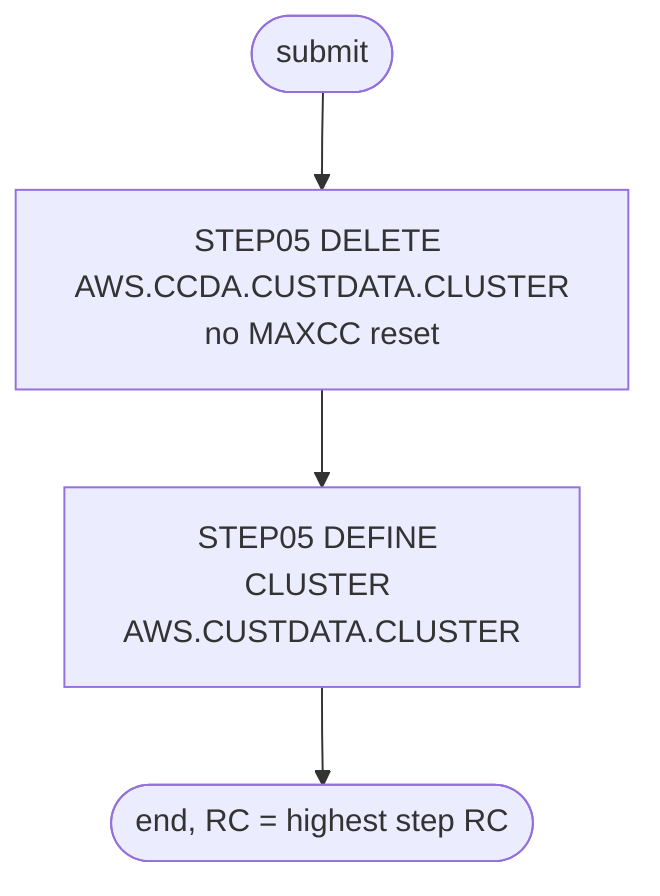

# DEFCUST: Obsolete customer cluster definition

## 1. Summary

DEFCUST is a two-step IDCAMS job that looks like an early version of the customer file set-up. Its first step deletes a cluster named `AWS.CCDA.CUSTDATA.CLUSTER`; its second defines an empty cluster with a different name, `AWS.CUSTDATA.CLUSTER` (key 10 bytes at offset 0, fixed 500-byte records). It loads no data. Neither name is the customer master that the application uses (`AWS.M2.CARDDEMO.CUSTDATA.VSAM.KSDS`, created by CUSTFILE), the key length does not match the customer ID, and no README sequence, script, schedule or program refers to either cluster. The job has no business logic and nothing in the target depends on it; this spec records what it does so that it can be retired (DEF-JDCUST-004).

## 2. Rules at a glance

The job has no business rules. Its items:

| ID | Rule |
| :-- | :-- |
| SE-JDCUST-001 | Delete cluster `AWS.CCDA.CUSTDATA.CLUSTER`; a failure is not reset. |
| SE-JDCUST-002 | Define cluster `AWS.CUSTDATA.CLUSTER`: key 10 at offset 0, records 500 fixed, `SHAREOPTIONS(1 4)`, `ERASE`, no `REUSE`, no load. |
| ERR-JDCUST-001 | The delete fails with return code 8 when its cluster does not exist, which is the normal case. |
| ERR-JDCUST-002 | The define fails with return code 12 on every run after the first. |
| NUM-JDCUST-001 | Key and record size. |
| DEF-JDCUST-001 | The delete and the define name different clusters. |
| DEF-JDCUST-002 | The cluster matches neither the customer master's name nor its key. |
| DEF-JDCUST-003 | Both steps are named `STEP05`, and the define step's comment says delete. |
| DEF-JDCUST-004 | The job is unused and incomplete. |

## 3. Actors and triggers

- **Trigger:** none found. Only an operator could submit it. It is not in the README's sequences or job list, the demo scripts, the CA-7 or Control-M schedules, or the local runner (checked with a search over the repository); `docs/inventory.md:190` lists it only as a JCL member with two IDCAMS steps.
- **Preconditions:** none beyond IDCAMS and catalog access for the high-level qualifiers `AWS.CCDA` and `AWS`. The define gives no `VOLUMES`, so it needs a system that chooses the volume itself (SMS or a default unit).
- **Job card:** `CLASS=A,MSGCLASS=0,NOTIFY=&SYSUID` (`:1-2`). No parameters, no symbolic overrides.

## 4. Interfaces

| Step | Program | DD | Dataset | Disposition | Use | Source |
| :-- | :-- | :-- | :-- | :-- | :-- | :-- |
| `STEP05` (first) | IDCAMS | `SYSPRINT` | `SYSOUT=*` | - | IDCAMS messages | `:23` |
| `STEP05` (first) | IDCAMS | `SYSIN` | in-stream | - | `DELETE` statement | `:24-27` |
| `STEP05` (second) | IDCAMS | `SYSPRINT` | `SYSOUT=*` | - | IDCAMS messages | `:33` |
| `STEP05` (second) | IDCAMS | `SYSIN` | in-stream | - | `DEFINE CLUSTER` statement | `:34-47` |

Return code of the job: the highest step return code. Console output is IDCAMS `SYSPRINT` only (incidental).

## 5. Data used

- No records are read or written. The record size of 500 matches the customer record ENT-CUSTOMER (`CUSTOMER-RECORD`, `app/cpy/CVCUS01Y.cpy:4-23`, 500 bytes), but its key is `CUST-ID` `9(09)`, 9 bytes, not 10 (DEF-JDCUST-002).
- Catalog: the listing `app/catlg/LISTCAT.txt` has no entry for `AWS.CCDA.CUSTDATA.CLUSTER` or `AWS.CUSTDATA.CLUSTER` (checked with a search over the file).

## 6. Processing flow

| # | Step | Program | Class | What it does | Runs when |
| --: | :-- | :-- | :-- | :-- | :-- |
| 1 | `STEP05` (first) | IDCAMS | plumbing | delete `AWS.CCDA.CUSTDATA.CLUSTER` | always |
| 2 | `STEP05` (second) | IDCAMS | plumbing | define `AWS.CUSTDATA.CLUSTER` | always (no `COND`) |

## 7. Business rules

None. The job only creates catalog entries; see the side effects in section 9.

## 8. Validations and messages

None. The job checks no input. All messages are IDCAMS `IDCnnnnI` messages in `SYSPRINT`.

## 9. Side effects

In execution order. There is no rollback: each step's change is permanent.

#### SE-JDCUST-001 · Delete the `AWS.CCDA` customer cluster
- **What:** `DELETE AWS.CCDA.CUSTDATA.CLUSTER CLUSTER`, which removes that cluster with its components and records if it exists. There is no `SET MAXCC` after it, so a missing cluster leaves return code 8 (ERR-JDCUST-001).
- **Source:** `:25-26`
- **Fidelity:** incidental · **Confidence:** reviewed

#### SE-JDCUST-002 · Define the `AWS.CUSTDATA` customer cluster
- **What:** `DEFINE CLUSTER` named `AWS.CUSTDATA.CLUSTER` with:

| Attribute | Value |
| :-- | :-- |
| Organisation | `INDEXED` (KSDS) |
| Key | `KEYS(10 0)`: 10 bytes at offset 0 |
| Record size | `RECORDSIZE(500 500)`: average and maximum 500, so fixed 500 |
| Space | `CYLINDERS(1 5)`; no `VOLUMES` |
| Sharing | `SHAREOPTIONS(1 4)` |
| Other | `ERASE`; no `REUSE` |
| Components | data `AWS.CUSTDATA.CLUSTER.DATA`, index `AWS.CUSTDATA.CLUSTER.INDEX` |

- The cluster is left empty: the job has no load step.
- **Source:** `:35-46`
- **Fidelity:** incidental · **Confidence:** reviewed

If the define fails, the delete has already happened.

## 10. Error handling

#### ERR-JDCUST-001 · The delete normally fails with return code 8
- **When:** `AWS.CCDA.CUSTDATA.CLUSTER` does not exist, which is the case in the catalog listing and on any system that never ran an older version of this job.
- **Then:** IDCAMS reports the entry as not found and ends the step with return code 8; nothing resets it. The second step still runs, because it has no `COND`, but the job ends with at least return code 8 even when the define works.
- **Source:** `:22-27`
- **Fidelity:** defect-decide · **Confidence:** platform-inferred

#### ERR-JDCUST-002 · The define fails on every rerun
- **When:** the job runs again after a successful define.
- **Then:** `AWS.CUSTDATA.CLUSTER` already exists, because the first step deletes a different name (DEF-JDCUST-001), so the define fails as a duplicate and the job ends with return code 12. The existing cluster is not changed.
- **Restart:** delete `AWS.CUSTDATA.CLUSTER` by hand first.
- **Source:** `:32-47`
- **Fidelity:** defect-decide · **Confidence:** platform-inferred

## 11. Interactions

- **Upstream:** none.
- **Downstream:** none. No program, CICS file, JCL DD or local runner dataset names `AWS.CUSTDATA.CLUSTER` or `AWS.CCDA.CUSTDATA.CLUSTER` (checked with a search over the repository).
- **Related job:** CUSTFILE deletes, defines and loads the real customer master `AWS.M2.CARDDEMO.CUSTDATA.VSAM.KSDS` with `KEYS(9 0)` and `SHAREOPTIONS(2 3)` (SE-JCUST-003); DEFCUST is not an alternative to it.

## 12. Numeric, date and format details

#### NUM-JDCUST-001 · Key and record size
- Key: 10 bytes at offset 0, unique. Records: fixed 500 bytes. Space: `CYLINDERS(1 5)`.
- **Source:** `:36-38`
- **Fidelity:** incidental · **Confidence:** reviewed

## 13. Known defects and oddities

#### DEF-JDCUST-001 · The delete and the define name different clusters
- The first step deletes `AWS.CCDA.CUSTDATA.CLUSTER`, the second defines `AWS.CUSTDATA.CLUSTER`. The delete therefore never removes what the define creates, and the job cannot be rerun (ERR-JDCUST-002).
- **Source:** `:25, 35`
- **Status:** open · **Fidelity:** defect-decide · **Confidence:** reviewed

#### DEF-JDCUST-002 · Neither the name nor the key matches the customer master
- The application's customer master is `AWS.M2.CARDDEMO.CUSTDATA.VSAM.KSDS` with a 9-byte key (`CUST-ID`, `app/cpy/CVCUS01Y.cpy:5`). This cluster has another high-level qualifier and a 10-byte key, so the customer file could not be loaded into it with keys that match, and no program would find it.
- **Source:** `:35, 37`
- **Status:** open · **Fidelity:** defect-decide · **Confidence:** reviewed

#### DEF-JDCUST-003 · Duplicate step names and a wrong comment
- Both `EXEC` statements are named `STEP05`, so job messages, restart and `COND` references cannot tell them apart. The comment before the second step says "DELETE CUSTOMER VSAM FILE IF ONE ALREADY EXISTS", but the step defines the cluster.
- **Source:** `:22, 30, 32`
- **Status:** open · **Fidelity:** incidental · **Confidence:** reviewed

#### DEF-JDCUST-004 · Unused and incomplete
- The job has no load step, no `VOLUMES` (the reload jobs such as CUSTFILE use `AWSHJ1`), and no version comment at the end, unlike CUSTFILE (`app/jcl/CUSTFILE.jcl:83`); nothing triggers it and nothing uses its result. It reads as a leftover from before CUSTFILE.
- **Source:** `:1-47`
- **Status:** open · **Fidelity:** incidental · **Confidence:** reviewed

## 14. Open questions

| ID | Question | For |
| :-- | :-- | :-- |
| Q-JDCUST-001 | Can DEFCUST be removed from the repository, or does any site still use the `AWS.CUSTDATA` or `AWS.CCDA` names? The target needs no equivalent. | operations |

## 15. Equivalence contract

None required. The job creates an empty cluster that nothing uses; a reimplementation needs no equivalent. If it is kept for any reason, the only observable results are the catalog entries in section 9 and the return codes in section 10.

## 16. Paragraph coverage

| Step | Lines | Covered by |
| :-- | :-- | :-- |
| (job card) | 1-2 | §3, DEF-JDCUST-004 |
| `STEP05` | 22-27 | SE-JDCUST-001, ERR-JDCUST-001, DEF-JDCUST-001, DEF-JDCUST-003 |
| `STEP05` | 32-47 | SE-JDCUST-002, NUM-JDCUST-001, ERR-JDCUST-002, DEF-JDCUST-001, DEF-JDCUST-002, DEF-JDCUST-003 |
