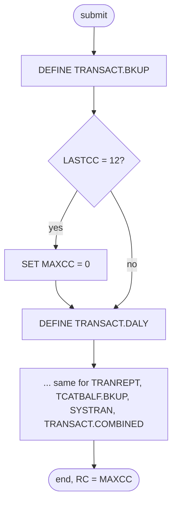

# DEFGDGB: Define the core GDG bases

## 1. Summary

DEFGDGB is a one-time set-up job. Its only step, `STEP05`, runs six IDCAMS `DEFINE GENERATIONDATAGROUP` statements, one per generation data group (GDG) base that the core batch jobs write: transaction backups (`TRANSACT.BKUP`), the daily report extract (`TRANSACT.DALY`), the transaction report (`TRANREPT`), category balance backups (`TCATBALF.BKUP`), interest transactions (`SYSTRAN`) and combined transactions (`TRANSACT.COMBINED`). Each base keeps five generations and deletes the ones that roll off (`LIMIT(5) SCRATCH`). After each define, `IF LASTCC=12 THEN SET MAXCC=0` turns a "base already exists" failure into success, so the job can be rerun. The job carries no business logic. The 09/01/22 catalog does not match it for two of the six bases, which are `NOSCRATCH` there and keep dozens of rolled-off generations.

## 2. Rules at a glance

The job has no business rules. Its items:

| ID | Rule |
| :-- | :-- |
| SE-JGDGB-001 | Define `TRANSACT.BKUP`, `LIMIT(5) SCRATCH`. |
| SE-JGDGB-002 | Define `TRANSACT.DALY`, `LIMIT(5) SCRATCH`. |
| SE-JGDGB-003 | Define `TRANREPT`, `LIMIT(5) SCRATCH`. |
| SE-JGDGB-004 | Define `TCATBALF.BKUP`, `LIMIT(5) SCRATCH`. |
| SE-JGDGB-005 | Define `SYSTRAN`, `LIMIT(5) SCRATCH`. |
| SE-JGDGB-006 | Define `TRANSACT.COMBINED`, `LIMIT(5) SCRATCH`. |
| ERR-JGDGB-001 | A define that fails with condition code 12 resets the step's highest code to 0, hiding earlier failures too; IDCAMS goes on with the next define unless a code reaches 16. |
| NUM-JGDGB-001 | Five generations per base; the IDCAMS defaults give `NOEMPTY`, `LIFO`, `NOPURGE`, `NOEXTENDED`. |
| DEF-JGDGB-001 | The reset hides every condition-code-12 failure, and any earlier failure, and leaves an existing base's attributes unchanged. |
| DEF-JGDGB-002 | [security] The catalog has `TRANSACT.BKUP` and `TRANSACT.DALY` as `NOSCRATCH`, with 71 and 25 rolled-off generations still cataloged. |
| DEF-JGDGB-003 | REPTFILE defines `TRANREPT` again with other attributes. |
| DEF-JGDGB-004 | The daily-rejects base `DALYREJS` is not in this job. |

## 3. Actors and triggers

- **Trigger:** submitted once by an operator during installation. It is the last-but-one job of the README's initialisation sequence (`./README.md:166`) and is in the batch table as "Setup GDG Bases" (`./README.md:354`); the restart runbook lists it as a one-time prerequisite of the batch cycle (`docs/runbooks/batch-cycle-restart.md:30-31`). Neither the CA-7 nor the Control-M schedule runs it, and `scripts/run_full_batch.sh` does not submit it. The local runner (`tools/carddemo.py`) does not emulate GDGs: the jobs that write these GDGs write plain files there.
- **Preconditions:** the user can define entries in the catalog that holds `AWS.M2.CARDDEMO`. Nothing else; the job can run before or after the data loads.
- **Job card:** `'DEF GDG BASES',CLASS=A,MSGCLASS=0,NOTIFY=&SYSUID` (`:1`). No parameters, no symbolic overrides.

## 4. Interfaces

| Step | Program | DD | Dataset | Disposition | Use | Source |
| :-- | :-- | :-- | :-- | :-- | :-- | :-- |
| `STEP05` | IDCAMS | `SYSPRINT` | `SYSOUT=*` | - | IDCAMS messages | `:22` |
| `STEP05` | IDCAMS | `SYSIN` | in-stream | - | six `DEFINE GENERATIONDATAGROUP` statements, each followed by `IF LASTCC=12 THEN SET MAXCC=0` | `:23-60` |

The job allocates no data set; GDG bases are catalog entries. Return code of the job: the IDCAMS `MAXCC` at the end (ERR-JGDGB-001). Console output is IDCAMS `SYSPRINT` only (incidental).

## 5. Data used

No records are read or written. The bases name future generations `<base>.GnnnnV00`. The catalog listing of 09/01/22 (`app/catlg/LISTCAT.txt:3937-3944`, 7 GDG entries in total) shows these six bases plus `DALYREJS`:

| Base | JCL | Catalog 09/01/22 | Created | Active generations | Rolled-off generations still cataloged | Catalog source |
| :-- | :-- | :-- | :-- | :-- | :-- | :-- |
| `TRANSACT.BKUP` | `LIMIT(5) SCRATCH` | `LIMIT 5`, `NOSCRATCH` | 2022.155 | `G0072V00`-`G0076V00` | 71 (`G0001V00`-`G0071V00`) | `app/catlg/LISTCAT.txt:1631-1643, 2903-2918` |
| `TRANSACT.DALY` | `LIMIT(5) SCRATCH` | `LIMIT 5`, `NOSCRATCH` | 2022.155 | `G0026V00`-`G0030V00` | 25 (`G0001V00`-`G0025V00`) | `app/catlg/LISTCAT.txt:3021-3033, 3525-3540` |
| `TRANREPT` | `LIMIT(5) SCRATCH` | `LIMIT 5`, `SCRATCH` | 2022.156 | `G0010V00`-`G0014V00` | 0 | `app/catlg/LISTCAT.txt:1527-1541` |
| `TCATBALF.BKUP` | `LIMIT(5) SCRATCH` | `LIMIT 5`, `SCRATCH` | 2022.189 | `G0005V00`-`G0009V00` | 0 | `app/catlg/LISTCAT.txt:1202-1214` |
| `SYSTRAN` | `LIMIT(5) SCRATCH` | `LIMIT 5`, `SCRATCH` | 2022.192 | `G0018V00`-`G0022V00` | 0 | `app/catlg/LISTCAT.txt:1098-1112` |
| `TRANSACT.COMBINED` | `LIMIT(5) SCRATCH` | `LIMIT 5`, `SCRATCH` | 2022.192 | `G0015V00`-`G0019V00` | 0 | `app/catlg/LISTCAT.txt:2919-2931` |

All six show `NOEMPTY LIFO NOPURGE NOEXTENDED`. The rolled-off counts are the generation entries listed with `STATUS--------ROLLED-OFF` under each base (for example `app/catlg/LISTCAT.txt:2909` and `app/catlg/LISTCAT.txt:3531`). The different creation dates show that the bases in that catalog were not all created by one run of this job.

## 6. Processing flow

The only step is plumbing. Inside it, IDCAMS runs the statements in order and continues after a failed one.

| # | Step | Class | What it does | Runs when |
| --: | :-- | :-- | :-- | :-- |
| 1 | `STEP05` | plumbing | define six GDG bases, resetting condition code 12 after each | always |



## 7. Business rules

None. The job defines catalog entries. What goes into each GDG is decided by the jobs that write it (section 11).

## 8. Validations and messages

None. The job checks no input; IDCAMS writes its own `IDCnnnnI` messages to `SYSPRINT`.

## 9. Side effects

In execution order, all in `STEP05`. Each define is independent: a failed one does not undo the earlier ones, and the later ones still run. Every statement has the same form; the first is:

```text
DEFINE GENERATIONDATAGROUP -
(NAME(AWS.M2.CARDDEMO.TRANSACT.BKUP) -
 LIMIT(5) -
 SCRATCH -
)
IF LASTCC=12 THEN SET MAXCC=0
```

With `LIMIT(5) SCRATCH`, at most five generations stay cataloged, and when a sixth is cataloged the oldest is uncataloged and deleted from its volume (NUM-JGDGB-001).

#### SE-JGDGB-001 · Define the transaction backup GDG
- **What:** base `AWS.M2.CARDDEMO.TRANSACT.BKUP`, `LIMIT(5)`, `SCRATCH`. Generations are 350-byte copies of the transaction master (ENT-TRANSACTION) written by TRANBKP and TRANREPT and read by COMBTRAN (section 11).
- **Source:** `:24-29`
- **Fidelity:** must-preserve (retention); incidental (GDG mechanics) · **Confidence:** reviewed (statement); platform-inferred (roll-off)

#### SE-JGDGB-002 · Define the daily report extract GDG
- **What:** base `AWS.M2.CARDDEMO.TRANSACT.DALY`, `LIMIT(5)`, `SCRATCH`. Generations are the transactions TRANREPT selects and sorts for the report (ENT-TRANSACTION layout).
- **Source:** `:30-35`
- **Fidelity:** must-preserve (retention); incidental (GDG mechanics) · **Confidence:** reviewed (statement); platform-inferred (roll-off)

#### SE-JGDGB-003 · Define the transaction report GDG
- **What:** base `AWS.M2.CARDDEMO.TRANREPT`, `LIMIT(5)`, `SCRATCH`. Generations are the 133-byte report written by CBTRN03C in TRANREPT. REPTFILE defines the same base differently (DEF-JGDGB-003).
- **Source:** `:36-41`
- **Fidelity:** must-preserve (retention); incidental (GDG mechanics) · **Confidence:** reviewed (statement); platform-inferred (roll-off)

#### SE-JGDGB-004 · Define the category balance backup GDG
- **What:** base `AWS.M2.CARDDEMO.TCATBALF.BKUP`, `LIMIT(5)`, `SCRATCH`. Generations are 50-byte copies of the category balance file (ENT-TCAT-BAL) written by PRTCATBL.
- **Source:** `:42-47`
- **Fidelity:** must-preserve (retention); incidental (GDG mechanics) · **Confidence:** reviewed (statement); platform-inferred (roll-off)

#### SE-JGDGB-005 · Define the interest transactions GDG
- **What:** base `AWS.M2.CARDDEMO.SYSTRAN`, `LIMIT(5)`, `SCRATCH`. Generations are the 350-byte interest transactions (ENT-TRANSACTION layout) written by INTCALC and read by COMBTRAN.
- **Source:** `:48-53`
- **Fidelity:** must-preserve (retention); incidental (GDG mechanics) · **Confidence:** reviewed (statement); platform-inferred (roll-off)

#### SE-JGDGB-006 · Define the combined transactions GDG
- **What:** base `AWS.M2.CARDDEMO.TRANSACT.COMBINED`, `LIMIT(5)`, `SCRATCH`. Generations are the sorted union of the day's posted transactions and the interest transactions (ENT-TRANSACTION layout), written and reloaded into the transaction master by COMBTRAN.
- **Source:** `:54-59`
- **Fidelity:** must-preserve (retention); incidental (GDG mechanics) · **Confidence:** reviewed (statement); platform-inferred (roll-off)

## 10. Error handling

#### ERR-JGDGB-001 · Condition code 12 is reset after each define
- **When:** a define fails. IDCAMS returns condition code 12 when the name already exists in the catalog, which is the normal case on a rerun.
- **Then:** `IF LASTCC=12 THEN SET MAXCC=0` checks the condition code of the define just before it and, if it is 12, sets the step's highest condition code (`MAXCC`) back to 0. Because it resets the maximum, not only the last code, it also erases any earlier failure: a define that failed with another code (for example 8) raises `MAXCC` only until a later define returns 12, which is what every define of an existing base returns on a rerun. Only a non-12 failure with no later code-12 define leaves the step's return code non-zero. IDCAMS goes on to the next define after a failed one, unless the condition code reaches 16 (a severe error), after which IDCAMS does not process the remaining commands. The job has one step and no `COND` logic; restart means resubmitting it, which is safe because existing bases are left unchanged (DEF-JGDGB-001).
- **Source:** `:29, 35, 41, 47, 53, 59`
- **Fidelity:** incidental · **Confidence:** platform-inferred (IDCAMS condition codes, `MAXCC` reset and continuation after a failed command; high)

## 11. Interactions

Who writes and reads each GDG (`(+1)` is the new generation of the running job, `(0)` the newest one cataloged before it):

| Base | Written by | Read by |
| :-- | :-- | :-- |
| `TRANSACT.BKUP` | TRANBKP `STEP05R` (`app/jcl/TRANBKP.jcl:33`); TRANREPT `STEP05R` (`app/jcl/TRANREPT.jcl:33`) and its procedure (`app/proc/TRANREPT.prc:31`) | TRANREPT's sort step, same `(+1)` (`app/jcl/TRANREPT.jcl:39`, `app/proc/TRANREPT.prc:37`); COMBTRAN `(0)` (`app/jcl/COMBTRAN.jcl:24`) |
| `TRANSACT.DALY` | TRANREPT sort `SORTOUT` (`app/jcl/TRANREPT.jcl:55`, `app/proc/TRANREPT.prc:53`) | TRANREPT `STEP10R` `TRANFILE` (`app/jcl/TRANREPT.jcl:66`, `app/proc/TRANREPT.prc:64`) |
| `TRANREPT` | TRANREPT `STEP10R` (`app/jcl/TRANREPT.jcl:76-80`, `app/proc/TRANREPT.prc:74-78`) | no job; operators |
| `TCATBALF.BKUP` | PRTCATBL `STEP05R` (`app/jcl/PRTCATBL.jcl:39`) | PRTCATBL `STEP10R` (`app/jcl/PRTCATBL.jcl:45`) |
| `SYSTRAN` | INTCALC `STEP15` `TRANSACT` DD (`app/jcl/INTCALC.jcl:37-41`) | COMBTRAN `(0)` (`app/jcl/COMBTRAN.jcl:26`) |
| `TRANSACT.COMBINED` | COMBTRAN `STEP05R` (`app/jcl/COMBTRAN.jcl:37`) | COMBTRAN `STEP10`, same `(+1)` (`app/jcl/COMBTRAN.jcl:44`) |

- **Downstream:** every job in the table fails with a JCL error when its base is missing (`docs/runbooks/batch-cycle-restart.md:28-31`).
- **Related:** DALYREJS defines the seventh core GDG base, `DALYREJS`, which POSTTRAN writes; REPTFILE defines `TRANREPT` a second time (DEF-JGDGB-003).
- **Documentation:** the runbooks and the data-handling policy state the `LIMIT(5) SCRATCH` retention for these six bases (`docs/runbooks/README.md:24-26`, `docs/security/data-handling.md:169`).

## 12. Numeric, date and format details

#### NUM-JGDGB-001 · Five generations per base, default options
- `LIMIT(5)`: at most five active generations per base. Generations are numbered `GnnnnV00` with `nnnn` rising by one per new generation (the catalog shows numbers up to `G0076V00` for `TRANSACT.BKUP`). No other option is coded, so `NOEMPTY` (only the oldest generation rolls off), `LIFO`, `NOPURGE` and `NOEXTENDED` apply, as the catalog confirms (`app/catlg/LISTCAT.txt:1106`). The retention is a number of runs of the writing job, not a number of days.
- **Fidelity:** must-preserve (retention count) · **Confidence:** reviewed (statements, catalog); platform-inferred (roll-off rules)

## 13. Known defects and oddities

#### DEF-JGDGB-001 · The reset hides more than "already exists"
- `IF LASTCC=12 THEN SET MAXCC=0` resets any define failure with condition code 12, not only a duplicate name, so a define that failed for another reason with the same code also ends the job with return code 0. Since `SET MAXCC=0` resets the highest code of the step, a later code-12 define also hides an earlier failure with any other code (ERR-JGDGB-001); on a rerun, where the existing bases return 12, the job ends with 0 whenever the last define is one of them, whatever failed before it. And because a duplicate define changes nothing, a rerun does not correct an existing base whose attributes differ from the JCL (DEF-JGDGB-002, DEF-JGDGB-003); that needs an `ALTER`, which the job does not have.
- **Source:** `:29, 35, 41, 47, 53, 59`
- **Status:** open · **Fidelity:** defect-decide · **Confidence:** platform-inferred

#### DEF-JGDGB-002 · [security] Two bases are NOSCRATCH in the catalog and keep rolled-off generations
- The JCL defines `TRANSACT.BKUP` and `TRANSACT.DALY` with `SCRATCH`, but the 09/01/22 catalog lists both as `NOSCRATCH` (`app/catlg/LISTCAT.txt:1637`, `app/catlg/LISTCAT.txt:3027`), with 71 and 25 rolled-off generations still cataloged next to the five active ones. Those generations hold full transaction records, card numbers included, so far more transaction history stays on disk than the five generations that the data-handling policy promises (`docs/security/data-handling.md:169`). The other four bases match the JCL.
- **Source:** `:24-35`
- **Status:** open · **Fidelity:** defect-decide · **Confidence:** reviewed (catalog listing); platform-inferred (how the bases got `NOSCRATCH`)

#### DEF-JGDGB-003 · TRANREPT is defined by two jobs
- REPTFILE defines `AWS.M2.CARDDEMO.TRANREPT` with `LIMIT(10)` and no `SCRATCH` (`app/jcl/REPTFILE.jcl:25-28`). The job that runs first decides the attributes; this job's reset hides its own failure when REPTFILE ran first. The catalog shows `LIMIT 5 SCRATCH`, this job's attributes (`app/catlg/LISTCAT.txt:1535`). See DEF-JREPT-001.
- **Source:** `:36-41`
- **Status:** open · **Fidelity:** defect-decide · **Confidence:** reviewed

#### DEF-JGDGB-004 · The daily-rejects base is missing from this job
- The job is named "DEF GDG BASES" and its comment says `DEFINE GDG BASES NEEDED BY CARDDEMO PROJECT` (`:19`), but it does not define `AWS.M2.CARDDEMO.DALYREJS`, which POSTTRAN needs; that base is in the separate DALYREJS job, which the README does not list (DEF-JREJS-001).
- **Source:** `:19-60`
- **Status:** open · **Fidelity:** incidental · **Confidence:** reviewed

## 14. Open questions

| ID | Question | For |
| :-- | :-- | :-- |
| Q-JGDGB-001 | Were `TRANSACT.BKUP` and `TRANSACT.DALY` altered to `NOSCRATCH` on purpose (for example to keep transaction history), and how much history must the target keep for each of the six data sets? | operations, business owner |

## 15. Equivalence contract

A reimplementation must provide the six stores before the first batch cycle, each keeping the output of the last five runs of its writer and deleting older output (or the retention decided for Q-JGDGB-001). Running the set-up twice must leave existing stores and their data unchanged and must not report a failure. IDCAMS messages, condition codes and generation numbering may differ.

## 16. Paragraph coverage

| Step | Lines | Covered by |
| :-- | :-- | :-- |
| (job card) | 1-1 | §3 |
| `STEP05` | 21-60 | SE-JGDGB-001..006, ERR-JGDGB-001, NUM-JGDGB-001, DEF-JGDGB-001, DEF-JGDGB-002, DEF-JGDGB-003, DEF-JGDGB-004 |
