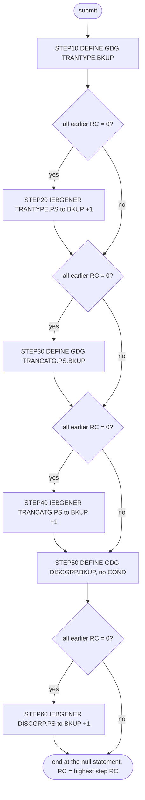

# DEFGDGD: Reference-data backup GDGs

## 1. Summary

DEFGDGD is a one-time set-up job for three backup generation data groups (GDGs) of reference data: transaction types (`TRANTYPE.BKUP`), transaction categories (`TRANCATG.PS.BKUP`) and disclosure groups (`DISCGRP.BKUP`). For each, an IDCAMS step defines the GDG base with `LIMIT(5) SCRATCH` and an IEBGENER step copies the current flat file (`TRANTYPE.PS`, `TRANCATG.PS`, `DISCGRP.PS`) into the first generation. Every copy step and the second define are skipped as soon as any earlier step ends with a non-zero code, except the third define (`STEP50`), which has no `COND`. The job's name and the README tie it to the Db2 module, but the job itself uses no Db2; the Db2 extract job TRANEXTR writes later generations of two of the GDGs. It carries no business logic.

## 2. Rules at a glance

The job has no business rules. Its items:

| ID | Rule |
| :-- | :-- |
| SE-JGDGD-001 | Define `TRANTYPE.BKUP`, `LIMIT(5) SCRATCH`. |
| SE-JGDGD-002 | Copy `TRANTYPE.PS` to the new generation `TRANTYPE.BKUP(+1)`, 60-byte records. |
| SE-JGDGD-003 | Define `TRANCATG.PS.BKUP`, `LIMIT(5) SCRATCH`. |
| SE-JGDGD-004 | Copy `TRANCATG.PS` to `TRANCATG.PS.BKUP(+1)`, 60-byte records. |
| SE-JGDGD-005 | Define `DISCGRP.BKUP`, `LIMIT(5) SCRATCH`. |
| SE-JGDGD-006 | Copy `DISCGRP.PS` to `DISCGRP.BKUP(+1)`, 50-byte records. |
| ERR-JGDGD-001 | `COND=(0,NE)` on every step but `STEP10` and `STEP50`: one non-zero step skips all later copies. |
| ERR-JGDGD-002 | No return-code reset: a rerun fails at `STEP10` with condition code 12 and creates nothing. |
| FLOW-JGDGD-001 | The job ends at the null statement on line 90; the `RESTART=STEP30` line is a comment. |
| NUM-JGDGD-001 | Record and block sizes, space and limit of the three generations. |
| DEF-JGDGD-001 | `STEP50` has no `COND`, unlike the other steps. |
| DEF-JGDGD-002 | The job cannot be rerun. |
| DEF-JGDGD-003 | Called "Db2" but uses no Db2; `DISCGRP.BKUP` has no other user. |
| DEF-JGDGD-004 | The 09/01/22 catalog has none of the three GDG bases. |

## 3. Actors and triggers

- **Trigger:** submitted once by an operator during installation. It is the last job of the README's initialisation sequence, "Defines GDG Bases added for Db2" (`./README.md:167`), and is in the batch table as "Setup more GDG Bases for Db2" (`./README.md:355`). Neither the CA-7 nor the Control-M schedule runs it, `scripts/run_full_batch.sh` does not submit it, and the local runner does not emulate it.
- **Preconditions:** the flat files `AWS.M2.CARDDEMO.TRANTYPE.PS`, `AWS.M2.CARDDEMO.TRANCATG.PS` and `AWS.M2.CARDDEMO.DISCGRP.PS` exist (uploaded sample data, `./README.md:142-144`; all three are in the 09/01/22 catalog, `app/catlg/LISTCAT.txt:844, 1423, 3727`); none of the three GDG bases exists yet (ERR-JGDGD-002).
- **Job card:** `'DEF DB2 GDG',CLASS=A,MSGCLASS=0,NOTIFY=&SYSUID` (`:1`). Line 2 is the comment `//*  RESTART=STEP30` (FLOW-JGDGD-001). Columns 73-80 of both lines hold `JOB05067`, a leftover JES job number that the system ignores.

## 4. Interfaces

| Step | Program | DD | Dataset | Disposition | Use | Source |
| :-- | :-- | :-- | :-- | :-- | :-- | :-- |
| `STEP10` | IDCAMS | `SYSPRINT` | `SYSOUT=*` | - | IDCAMS messages | `:25` |
| `STEP10` | IDCAMS | `SYSIN` | in-stream | - | `DEFINE GENERATIONDATAGROUP` | `:26-32` |
| `STEP20` | IEBGENER | `SYSPRINT` | `SYSOUT=*` | - | IEBGENER messages | `:37` |
| `STEP20` | IEBGENER | `SYSIN` | `DUMMY` | - | no control statements: straight copy | `:38` |
| `STEP20` | IEBGENER | `SYSUT1` | `AWS.M2.CARDDEMO.TRANTYPE.PS` | `SHR` | input | `:39` |
| `STEP20` | IEBGENER | `SYSUT2` | `AWS.M2.CARDDEMO.TRANTYPE.BKUP(+1)` | `(NEW,CATLG)` | output, `RECFM=FB`, `LRECL=60`, `BLKSIZE=600`, `SPACE=(TRK,(1,1),RLSE)` | `:40-43` |
| `STEP30` | IDCAMS | `SYSPRINT` | `SYSOUT=*` | - | IDCAMS messages | `:48` |
| `STEP30` | IDCAMS | `SYSIN` | in-stream | - | `DEFINE GENERATIONDATAGROUP` | `:49-55` |
| `STEP40` | IEBGENER | `SYSPRINT` | `SYSOUT=*` | - | IEBGENER messages | `:60` |
| `STEP40` | IEBGENER | `SYSIN` | `DUMMY` | - | straight copy | `:61` |
| `STEP40` | IEBGENER | `SYSUT1` | `AWS.M2.CARDDEMO.TRANCATG.PS` | `SHR` | input | `:62` |
| `STEP40` | IEBGENER | `SYSUT2` | `AWS.M2.CARDDEMO.TRANCATG.PS.BKUP(+1)` | `(NEW,CATLG)` | output, `RECFM=FB`, `LRECL=60`, `BLKSIZE=600`, `SPACE=(TRK,(1,1),RLSE)` | `:63-66` |
| `STEP50` | IDCAMS | `SYSPRINT` | `SYSOUT=*` | - | IDCAMS messages | `:71` |
| `STEP50` | IDCAMS | `SYSIN` | in-stream | - | `DEFINE GENERATIONDATAGROUP` | `:72-78` |
| `STEP60` | IEBGENER | `SYSPRINT` | `SYSOUT=*` | - | IEBGENER messages | `:83` |
| `STEP60` | IEBGENER | `SYSIN` | `DUMMY` | - | straight copy | `:84` |
| `STEP60` | IEBGENER | `SYSUT1` | `AWS.M2.CARDDEMO.DISCGRP.PS` | `SHR` | input | `:85` |
| `STEP60` | IEBGENER | `SYSUT2` | `AWS.M2.CARDDEMO.DISCGRP.BKUP(+1)` | `(NEW,CATLG)` | output, `RECFM=FB`, `LRECL=50`, `BLKSIZE=500`, `SPACE=(TRK,(1,1),RLSE)` | `:86-89` |

No `SYSUT2` has a `UNIT`; the system or SMS chooses the device. Return code of the job: the highest return code of the steps that ran.

## 5. Data used

- ENT-TRAN-TYPE: whole 60-byte records (copybook `app/cpy/CVTRA03Y.cpy`), copied unchanged from `TRANTYPE.PS`.
- ENT-TRAN-CATEGORY: whole 60-byte records (copybook `app/cpy/CVTRA04Y.cpy`), copied unchanged from `TRANCATG.PS`.
- Disclosure groups, `AWS.M2.CARDDEMO.DISCGRP.PS`: whole 50-byte records, layout `DIS-GROUP-RECORD` in `app/cpy/CVTRA02Y.cpy:4-10` (ENT-DISC-GROUP), copied unchanged.
- No field is interpreted. The record sizes agree with the README's data set table (`./README.md:142-144`).

## 6. Processing flow

All six steps are plumbing.

| # | Step | Class | What it does | Runs when |
| --: | :-- | :-- | :-- | :-- |
| 1 | `STEP10` | plumbing | define `TRANTYPE.BKUP` | always |
| 2 | `STEP20` | plumbing | copy `TRANTYPE.PS` to `TRANTYPE.BKUP(+1)` | every earlier step ended with 0 |
| 3 | `STEP30` | plumbing | define `TRANCATG.PS.BKUP` | every earlier step ended with 0 |
| 4 | `STEP40` | plumbing | copy `TRANCATG.PS` to `TRANCATG.PS.BKUP(+1)` | every earlier step ended with 0 |
| 5 | `STEP50` | plumbing | define `DISCGRP.BKUP` | always (no `COND`) |
| 6 | `STEP60` | plumbing | copy `DISCGRP.PS` to `DISCGRP.BKUP(+1)` | every earlier step ended with 0 |



#### FLOW-JGDGD-001 · Where the job ends, and the restart comment
- **When:** the reader reaches line 90.
- **Then:** line 90 is a null statement (`//`), which marks the end of the job; `STEP60` (lines 82-89) is before it and runs only if every earlier step returned 0 (`COND=(0,NE)`, line 82). Line 91 is a second null statement and lines 92-94 are comments, so nothing after line 89 is executed. Line 2, `//*  RESTART=STEP30`, is a comment: it has no effect. It suggests that someone restarted, or meant to restart, the job at `STEP30`; to use it, `RESTART=STEP30` would have to be a parameter of the JOB statement.
- **Source:** `:2, 82-91`
- **Fidelity:** incidental · **Confidence:** reviewed (statements); platform-inferred (null-statement semantics)

## 7. Business rules

None. The job defines catalog entries and copies files without interpreting them.

## 8. Validations and messages

None. The job checks no input; IDCAMS and IEBGENER write their own messages to `SYSPRINT`.

## 9. Side effects

In execution order. There is no rollback: a base or generation created by an earlier step stays when a later step fails. The three defines have the same form; the first is:

```text
DEFINE GENERATIONDATAGROUP -
(NAME(AWS.M2.CARDDEMO.TRANTYPE.BKUP) -
 LIMIT(5) -
 SCRATCH -
)
```

#### SE-JGDGD-001 · Define the transaction-type backup GDG
- **What:** base `AWS.M2.CARDDEMO.TRANTYPE.BKUP`, `LIMIT(5)`, `SCRATCH`: five generations are kept; the oldest is uncataloged and deleted when a sixth is cataloged.
- **Source:** `:27-31`
- **Fidelity:** incidental (backup retention) · **Confidence:** reviewed (statement); platform-inferred (roll-off)

#### SE-JGDGD-002 · First generation of the transaction-type backup
- **What:** IEBGENER copies every record of `AWS.M2.CARDDEMO.TRANTYPE.PS` (ENT-TRAN-TYPE) to a new data set, generation `(+1)` of `TRANTYPE.BKUP` (the first one, `G0001V00`, on a new base), and catalogs it.
- **Source:** `:36-43`
- **Fidelity:** incidental · **Confidence:** reviewed (JCL); platform-inferred (generation numbering)

#### SE-JGDGD-003 · Define the transaction-category backup GDG
- **What:** base `AWS.M2.CARDDEMO.TRANCATG.PS.BKUP`, `LIMIT(5)`, `SCRATCH`. The name keeps the `.PS` qualifier of the source file, unlike the other two bases.
- **Source:** `:50-54`
- **Fidelity:** incidental · **Confidence:** reviewed (statement); platform-inferred (roll-off)

#### SE-JGDGD-004 · First generation of the transaction-category backup
- **What:** IEBGENER copies every record of `AWS.M2.CARDDEMO.TRANCATG.PS` (ENT-TRAN-CATEGORY) to generation `(+1)` of `TRANCATG.PS.BKUP` and catalogs it.
- **Source:** `:59-66`
- **Fidelity:** incidental · **Confidence:** reviewed (JCL)

#### SE-JGDGD-005 · Define the disclosure-group backup GDG
- **What:** base `AWS.M2.CARDDEMO.DISCGRP.BKUP`, `LIMIT(5)`, `SCRATCH`.
- **Source:** `:73-77`
- **Fidelity:** incidental · **Confidence:** reviewed (statement); platform-inferred (roll-off)

#### SE-JGDGD-006 · First generation of the disclosure-group backup
- **What:** IEBGENER copies every record of `AWS.M2.CARDDEMO.DISCGRP.PS` (layout `app/cpy/CVTRA02Y.cpy`) to generation `(+1)` of `DISCGRP.BKUP` and catalogs it.
- **Source:** `:82-89`
- **Fidelity:** incidental · **Confidence:** reviewed (JCL)

## 10. Error handling

#### ERR-JGDGD-001 · One non-zero step skips every later copy
- **When:** any step ends with a return code other than 0.
- **Then:** `COND=(0,NE)` on `STEP20`, `STEP30`, `STEP40` and `STEP60` means "skip this step if 0 is not equal to the return code of any earlier step", so each of them runs only if every earlier step that ran ended with 0. `STEP10` and `STEP50` have no `COND` and always run. An abend skips the remaining steps. The copy steps use `DISP=(NEW,CATLG)` without an abnormal disposition, so the abnormal disposition is also `CATLG`: a copy that abends leaves a cataloged, partial generation.

| Situation | `STEP10` | `STEP20` | `STEP30` | `STEP40` | `STEP50` | `STEP60` | Job RC |
| :-- | :-- | :-- | :-- | :-- | :-- | :-- | :-- |
| First run, all succeed | 0 | 0 | 0 | 0 | 0 | 0 | 0 |
| Rerun (all bases exist) | 12 | skipped | skipped | skipped | 12 | skipped | 12 |
| First run, `STEP20` ends with a non-zero code | 0 | non-zero | skipped | skipped | 0, base defined | skipped | highest |
| Only `TRANTYPE.BKUP` exists | 12 | skipped | skipped | skipped | 0 | skipped | 12 |

- **Source:** `:24, 36, 47, 59, 70, 82`
- **Fidelity:** incidental · **Confidence:** reviewed (COND parameters); platform-inferred (JES COND evaluation, abnormal disposition default, IDCAMS condition code 12)

#### ERR-JGDGD-002 · No reset for an existing base
- **When:** a GDG base already exists.
- **Then:** its define fails with condition code 12. Unlike DEFGDGB, the job has no `IF LASTCC=12 THEN SET MAXCC=0`, so the failure becomes the step's return code and, through `COND=(0,NE)`, skips every later copy (DEF-JGDGD-002). To restart after a partial run, an operator has to submit the job from the first step that did not complete (with `RESTART=` on the JOB statement, as the comment on line 2 suggests) or delete the bases first.
- **Source:** `:24-31`
- **Fidelity:** incidental · **Confidence:** platform-inferred

## 11. Interactions

- **Upstream:** the sample data upload that creates the three `.PS` files (`./README.md:142-144`). In the Db2 module, TRANEXTR deletes `TRANTYPE.PS` and `TRANCATG.PS` (`app/app-transaction-type-db2/jcl/TRANEXTR.jcl:53-61`) and unloads them again from the Db2 tables as 60-byte records (`app/app-transaction-type-db2/jcl/TRANEXTR.jcl:65-84, 95-115`).
- **Other writers:** TRANEXTR, in the optional Db2 module, writes later generations: `STEP10` copies `TRANTYPE.PS` to `&HLQ..TRANTYPE.BKUP(+1)` and `STEP20` copies `TRANCATG.PS` to `&HLQ..TRANCATG.PS.BKUP(+1)`, with the same DCB and space (`app/app-transaction-type-db2/jcl/TRANEXTR.jcl:31-49`, `HLQ=AWS.M2.CARDDEMO` at `app/app-transaction-type-db2/jcl/TRANEXTR.jcl:25`). TRANEXTR fails with a JCL error if DEFGDGD has not defined the bases.
- **Readers:** no job in the repository reads any of the three GDGs. Nothing else references `DISCGRP.BKUP`.

## 12. Numeric, date and format details

#### NUM-JGDGD-001 · Record sizes, blocks, space and limit
| GDG | `LRECL` | `RECFM` | `BLKSIZE` | Records per block | Space | Limit |
| :-- | --: | :-- | --: | --: | :-- | :-- |
| `TRANTYPE.BKUP` | 60 | `FB` | 600 | 10 | `TRK,(1,1),RLSE` | 5, `SCRATCH` |
| `TRANCATG.PS.BKUP` | 60 | `FB` | 600 | 10 | `TRK,(1,1),RLSE` | 5, `SCRATCH` |
| `DISCGRP.BKUP` | 50 | `FB` | 500 | 10 | `TRK,(1,1),RLSE` | 5, `SCRATCH` |

- The record lengths equal the copybook record sizes: `CVTRA03Y` 2 + 50 + 8 = 60, `CVTRA04Y` 2 + 4 + 50 + 4 = 60, `CVTRA02Y` 10 + 2 + 4 + 6 + 28 = 50 (`app/cpy/CVTRA02Y.cpy:6-10`). One primary and one secondary track, released when the step ends; the small sample files fit easily.
- **Fidelity:** must-preserve (record lengths); incidental (blocking, space) · **Confidence:** reviewed

## 13. Known defects and oddities

#### DEF-JGDGD-001 · STEP50 has no COND
- Every step after `STEP10` has `COND=(0,NE)` except `STEP50` (`:70`). After an earlier failure `STEP50` still defines `DISCGRP.BKUP`, but `STEP60` is skipped, so the base exists without a first generation; and on any rerun `STEP50` fails with condition code 12.
- **Source:** `:70, 82`
- **Status:** open · **Fidelity:** incidental · **Confidence:** reviewed

#### DEF-JGDGD-002 · The job cannot simply be rerun
- With no condition-code reset after the defines (ERR-JGDGD-002), a second run fails at `STEP10` and creates no generation at all, while DEFGDGB is written to be rerun safely. A partial first run needs a manual restart or cleanup.
- **Source:** `:24-32`
- **Status:** open · **Fidelity:** incidental · **Confidence:** reviewed

#### DEF-JGDGD-003 · "Db2" job without Db2, and an unused GDG
- The job name says `DEF DB2 GDG` (`:1`) and the README "GDG Bases added for Db2" (`./README.md:167, 355`), but the job runs only IDCAMS and IEBGENER. Its tie to Db2 is that TRANEXTR, in the Db2 module, writes later generations of `TRANTYPE.BKUP` and `TRANCATG.PS.BKUP`. `DISCGRP.BKUP` has no other writer or reader in the repository. The job also sits in the core initialisation sequence, although only the optional module needs two of its bases.
- **Source:** `:1, 73-77`
- **Status:** open · **Fidelity:** incidental · **Confidence:** reviewed

#### DEF-JGDGD-004 · The catalog has none of the three bases
- The 09/01/22 catalog listing of `AWS.M2.CARDDEMO` has seven GDG bases (`app/catlg/LISTCAT.txt:3942`), all from DEFGDGB and DALYREJS; `TRANTYPE.BKUP`, `TRANCATG.PS.BKUP` and `DISCGRP.BKUP` are not among them, although the three `.PS` source files are. On that system the job had not run (or its bases had been deleted), so the catalog cannot confirm its attributes.
- **Source:** `:27-31, 50-54, 73-77`
- **Status:** open · **Fidelity:** incidental · **Confidence:** reviewed

## 14. Open questions

| ID | Question | For |
| :-- | :-- | :-- |
| Q-JGDGD-001 | Does the target need versioned backups of the transaction types, categories and disclosure groups (and the disclosure-group backup that nothing uses), or only when the Db2 module is installed? | operations, business owner |

## 15. Equivalence contract

After a successful first run (return code 0), each of the three backup stores holds exactly one version, a byte-for-byte copy of its source file (same record count and record length: 60, 60, 50), and keeps at most five versions afterwards. A reimplementation should be safe to run twice (DEF-JGDGD-002 is a defect to decide). IDCAMS and IEBGENER messages and generation names may differ.

## 16. Paragraph coverage

| Step | Lines | Covered by |
| :-- | :-- | :-- |
| (job card) | 1-2 | §3, FLOW-JGDGD-001 |
| `STEP10` | 24-32 | SE-JGDGD-001, ERR-JGDGD-001, ERR-JGDGD-002, DEF-JGDGD-002 |
| `STEP20` | 36-43 | SE-JGDGD-002, ERR-JGDGD-001, NUM-JGDGD-001 |
| `STEP30` | 47-55 | SE-JGDGD-003, ERR-JGDGD-001 |
| `STEP40` | 59-66 | SE-JGDGD-004, ERR-JGDGD-001, NUM-JGDGD-001 |
| `STEP50` | 70-78 | SE-JGDGD-005, DEF-JGDGD-001, DEF-JGDGD-003 |
| `STEP60` | 82-89 | SE-JGDGD-006, ERR-JGDGD-001, NUM-JGDGD-001, FLOW-JGDGD-001 |
