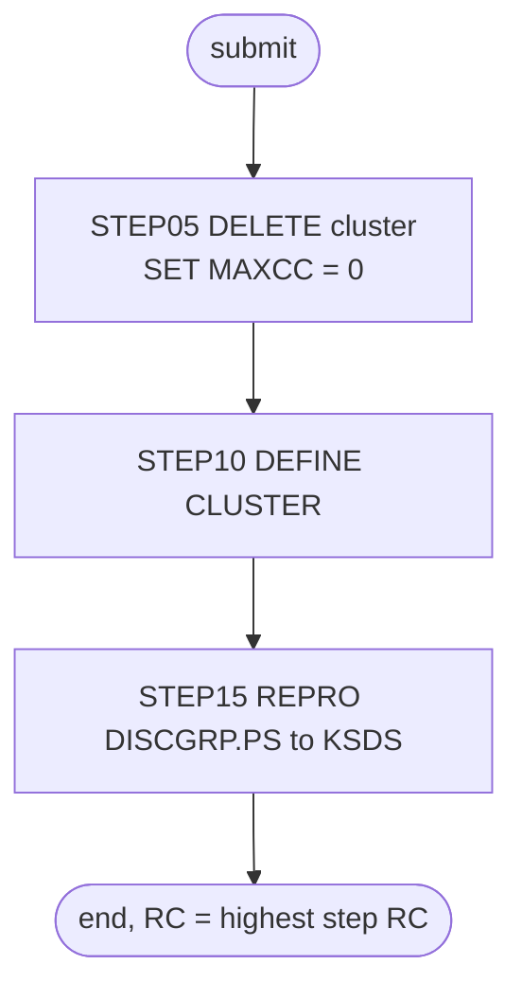

# DISCGRP: Disclosure group reload

## 1. Summary

DISCGRP throws away the disclosure group file (the interest rate for each account group, transaction type and category) and rebuilds it from the flat file. `STEP05` deletes the VSAM cluster `AWS.M2.CARDDEMO.DISCGRP.VSAM.KSDS`, `STEP10` defines it again empty (key 16 bytes at offset 0, fixed 50-byte records), and `STEP15` copies every record of `AWS.M2.CARDDEMO.DISCGRP.PS` into it. It is run by hand during installation and in the demo data refresh, and Control-M runs it every Saturday. The job contains no business logic; what it must preserve is the file definition and the fact that the result is an exact copy of the flat file.

## 2. Rules at a glance

The job has no business rules. Its items:

| ID | Rule |
| :-- | :-- |
| SE-JDISC-001 | Delete the disclosure group cluster; the return code is then set to 0 unless the delete ended with a severe error (ERR-JDISC-003). |
| SE-JDISC-002 | Define the cluster: key 16 at offset 0, records 50 fixed, `SHAREOPTIONS(2 3)`, `ERASE`, no `REUSE`. |
| SE-JDISC-003 | Load the cluster with every record of `DISCGRP.PS`, in file order, with exclusive use of the cluster (`DISP=OLD`). |
| VAL-JDISC-001 | The load rejects records out of key order or with duplicate keys (VSAM rule). |
| ERR-JDISC-001 | No step has a `COND`, so every step runs even when an earlier one failed. |
| ERR-JDISC-002 | The job waits to start while another job has the cluster allocated. |
| ERR-JDISC-003 | A severe IDCAMS error (condition code 16) in the delete skips the return-code reset. |
| NUM-JDISC-001 | Key and record size. |
| DEF-JDISC-001 | The unconditional return-code reset hides every delete failure. |

## 3. Actors and triggers

- **Trigger:** submitted by an operator. It is in the README's initialisation sequence (`./README.md:161`) and its "Running Batch Jobs" sequence (`./README.md:224`), and in the demo scripts `scripts/run_full_batch.sh:31-32` and `scripts/remote_refresh.sh:31-32`. Control-M runs it in the smart folder `WEEKLY-DisclosureGroupsRefresh` on Saturdays (`DAYS="SA"`), after CLOSEFIL and before WAITSTEP and OPENFIL (`app/scheduler/CardDemo.controlm:32-56`). The folder's CLOSEFIL waits for condition `WEEKLY-TransactionTypesDBRefresh-MNTTRDB2` (`app/scheduler/CardDemo.controlm:34`), which job MNTTRDB2 in folder `WEEKLY-TransactionTypesDBRefresh` sets (`app/scheduler/CardDemo.controlm:28`), and the smart folder deletes the condition when it ends (`app/scheduler/CardDemo.controlm:55`). The condition does not come from TRANEXTR: TRANEXTR, in smart folder `WEEKLY-TransactionTypesDBRefresh`, waits on the same MNTTRDB2 condition (`app/scheduler/CardDemo.controlm:59`) and that folder deletes it too (`app/scheduler/CardDemo.controlm:62`), so DISCGRP and TRANEXTR start from the same event and do not wait on each other. CA-7 does not run it. The local runner has no DISCGRP job; it loads `app/data/ASCII/discgrp.txt` into the `DISCGRP` dataset directly (`tools/batch-programs.toml:219-223`).
- **Preconditions:** no other job has `AWS.M2.CARDDEMO.DISCGRP.VSAM.KSDS` allocated (ERR-JDISC-002); `AWS.M2.CARDDEMO.DISCGRP.PS` exists and is sorted by key (`./README.md:142`, FB 50). The define names volume `AWSHJ1`, but the cluster is SMS-managed (storage class `SCTECH`, `app/catlg/LISTCAT.txt:867`) and the catalog shows its data component on volume `YYYYTI` (`app/catlg/LISTCAT.txt:913`), so on the reference system SMS chose the volume; `AWSHJ1` matters only where SMS does not manage these names (platform-inferred, medium). The CSD defines no CICS file on this cluster (checked with a search over `app/csd/CARDDEMO.CSD`), so no CICS close is needed for it.
- **Job card:** `CLASS=A,MSGCLASS=0,NOTIFY=&SYSUID` (`:1-2`). No parameters, no symbolic overrides.

## 4. Interfaces

| Step | Program | DD | Dataset | Disposition | Use | Source |
| :-- | :-- | :-- | :-- | :-- | :-- | :-- |
| `STEP05` | IDCAMS | `SYSPRINT` | `SYSOUT=*` | - | IDCAMS messages | `:23` |
| `STEP05` | IDCAMS | `SYSIN` | in-stream | - | `DELETE` and `SET` statements | `:24-28` |
| `STEP10` | IDCAMS | `SYSPRINT` | `SYSOUT=*` | - | IDCAMS messages | `:34` |
| `STEP10` | IDCAMS | `SYSIN` | in-stream | - | `DEFINE CLUSTER` statement | `:35-50` |
| `STEP15` | IDCAMS | `SYSPRINT` | `SYSOUT=*` | - | IDCAMS messages | `:55` |
| `STEP15` | IDCAMS | `DISCGRP` | `AWS.M2.CARDDEMO.DISCGRP.PS` | `SHR` | input, sequential, FB 50 | `:56-57` |
| `STEP15` | IDCAMS | `DISCVSAM` | `AWS.M2.CARDDEMO.DISCGRP.VSAM.KSDS` | `OLD` | output, KSDS | `:58-59` |
| `STEP15` | IDCAMS | `SYSIN` | in-stream | - | `REPRO` statement | `:60-62` |

Return code of the job: the highest step return code. Console output is IDCAMS `SYSPRINT` only (incidental).

## 5. Data used

- The disclosure group record, ENT-DISC-GROUP (`DIS-GROUP-RECORD`, `app/cpy/CVTRA02Y.cpy:4-10`, 50 bytes), whole records copied unchanged from `DISCGRP.PS` to the KSDS. No field is interpreted. The key is bytes 1-16 (`DIS-GROUP-KEY`: `DIS-ACCT-GROUP-ID` `X(10)`, `DIS-TRAN-TYPE-CD` `X(02)`, `DIS-TRAN-CAT-CD` `9(04)`); the rate `DIS-INT-RATE` (`S9(04)V99`, zoned decimal with the sign in the last digit, bytes 17-22, an annual percentage that INTCALC divides by 1200, `docs/runbooks/batch-cycle-restart.md:89-90`) and a 28-byte filler are carried along.
- Catalog state on 09/01/22 (`app/catlg/LISTCAT.txt:859-945`): the data component has `KEYLEN 16`, `RKP 0`, `MAXLRECL 50`, `SHROPTNS(2,3)`, `ERASE`, `NOREUSE` (`app/catlg/LISTCAT.txt:896-898`), `REC-TOTAL 51` with no inserts or updates (`app/catlg/LISTCAT.txt:901-904`), space `CYLINDER` primary 1 secondary 5 (`app/catlg/LISTCAT.txt:908-909`). This matches SE-JDISC-002.
- Sample data: `app/data/ASCII/discgrp.txt` has 51 records of 50 bytes, keys strictly ascending, 17 for each of the groups `A000000000`, `DEFAULT` and `ZEROAPR`. `DEFAULT` has rates from 0.00 to 25.00 (for example 15.00 for type `01`, category `0001`) and `ZEROAPR` has 0.00 throughout. Checked locally with a Python script over the file.

## 6. Processing flow

| # | Step | Program | Class | What it does | Runs when |
| --: | :-- | :-- | :-- | :-- | :-- |
| 1 | `STEP05` | IDCAMS | plumbing | delete the cluster | always |
| 2 | `STEP10` | IDCAMS | plumbing | define the cluster | always (no `COND`) |
| 3 | `STEP15` | IDCAMS | plumbing | copy `DISCGRP.PS` into the cluster | always |

## 7. Business rules

None. The job moves data without interpreting it; see the side effects in section 9.

## 8. Validations and messages

#### VAL-JDISC-001 · The load requires ascending, unique keys
- **When:** `STEP15` copies a record whose key (bytes 1-16) is not higher than the previous record's key.
- **Then:** VSAM rejects that record and IDCAMS prints an error message for it; the step ends with return code 8 or higher. The remaining records are still copied until IDCAMS reaches its error limit (by default it stops after 4 such errors).
- **Source:** `:61`
- **Fidelity:** must-preserve (the target load must also fail visibly on unsorted or duplicate input) · **Confidence:** platform-inferred (IDCAMS `REPRO` into a KSDS; no local run)

No operator-facing message text is produced by the job itself; all messages are IDCAMS `IDCnnnnI` messages in `SYSPRINT`.

## 9. Side effects

In execution order. There is no rollback: each step's change is permanent.

#### SE-JDISC-001 · Delete the disclosure group cluster
- **What:** `DELETE AWS.M2.CARDDEMO.DISCGRP.VSAM.KSDS CLUSTER`, which removes the cluster with its data and index components and all its records.
- **Return code:** `SET MAXCC = 0` follows without a condition, so the step ends with return code 0 whatever the delete did, unless the delete ends with condition code 16 and IDCAMS skips the `SET` (ERR-JDISC-003). A missing cluster (first run) is therefore not an error, but neither is any other failure (DEF-JDISC-001).
- **Source:** `:25-27`
- **Fidelity:** must-preserve (the reload starts from nothing) · **Confidence:** reviewed

#### SE-JDISC-002 · Define the disclosure group cluster
- **What:** `DEFINE CLUSTER` named `AWS.M2.CARDDEMO.DISCGRP.VSAM.KSDS` with:

| Attribute | Value |
| :-- | :-- |
| Organisation | `INDEXED` (KSDS) |
| Key | `KEYS(16 0)`: 16 bytes at offset 0 (`DIS-GROUP-KEY`: account group, transaction type, category) |
| Record size | `RECORDSIZE(50 50)`: average and maximum 50, so fixed 50 |
| Space | `CYLINDERS(1 5)` on `VOLUMES(AWSHJ1)` |
| Sharing | `SHAREOPTIONS(2 3)` |
| Other | `ERASE`; no `REUSE` |
| Components | data `...DISCGRP.VSAM.KSDS.DATA`, index `...DISCGRP.VSAM.KSDS.INDEX` |

- **Source:** `:36-49`
- **Fidelity:** must-preserve (key and record size); incidental (space, volume, sharing, `ERASE`) · **Confidence:** reviewed

#### SE-JDISC-003 · Load the cluster from the flat file
- **What:** `REPRO INFILE(DISCGRP) OUTFILE(DISCVSAM)` copies every record of `AWS.M2.CARDDEMO.DISCGRP.PS`, in file order, into the new cluster, byte for byte. The output DD has `DISP=OLD`, which asks for exclusive use of the cluster name (ERR-JDISC-002); the reload jobs for the card, customer and cross-reference files use `DISP=SHR` instead.
- **Source:** `:56-61`
- **Fidelity:** must-preserve (exact copy); incidental (disposition) · **Confidence:** reviewed

If a later step fails, everything before it has happened: the old cluster is gone, and the new one may be empty or partly loaded. INTCALC then fails to open the file, or, when the `DEFAULT` group is missing, abends with `ERROR READING DEFAULT DISCLOSURE GROUP` (`docs/runbooks/batch-cycle-restart.md:97-98`).

## 10. Error handling

#### ERR-JDISC-001 · Steps run regardless of earlier failures
- **When:** a step ends with a non-zero return code without abending.
- **Then:** the next step still runs, because no `EXEC` has a `COND` parameter. If `STEP10` fails (for example because the delete did not remove the cluster), `STEP15` loads the records into whatever cluster exists (DEF-JDISC-001). An abend in a step skips the remaining steps (JES default).
- **Restart:** rerun the whole job; every step either recreates its object or is reset. There is no partial restart point.
- **Source:** `:22, 33, 54`
- **Fidelity:** defect-decide · **Confidence:** platform-inferred

#### ERR-JDISC-002 · The job waits for exclusive use of the cluster
- **When:** another job (for example INTCALC) has `AWS.M2.CARDDEMO.DISCGRP.VSAM.KSDS` allocated when this job is selected to run.
- **Then:** because of `DISP=OLD` the system requests an exclusive data set enqueue on the cluster name when the job starts, before `STEP05` runs. The job waits until the other job ends, and while it runs no other job can allocate the cluster. This protects the delete and the load against concurrent batch use within one system. No error is reported; the operator sees the job waiting for the data set.
- **Source:** `:58-59`
- **Fidelity:** must-preserve (no reader or updater may use the file during the reload); incidental (mechanism) · **Confidence:** platform-inferred

#### ERR-JDISC-003 · A severe IDCAMS error skips the return-code reset
- **When:** the `DELETE` in `STEP05` ends with condition code 16, a severe error such as a catalog that cannot be accessed.
- **Then:** IDCAMS does not process the remaining commands of the step, so `SET MAXCC = 0` never runs and `STEP05` ends with return code 16. The job still goes on to `STEP10` (ERR-JDISC-001). The unconditional reset therefore turns every delete result except 16 into 0. `STEP10` and `STEP15` hold one command each, so for them a severe error simply ends the step with 16.
- **Source:** `:25-27`
- **Fidelity:** incidental · **Confidence:** platform-inferred (high; IDCAMS condition-code rules, no local run)

## 11. Interactions

- **Upstream:** none. In the Control-M folder a CLOSEFIL run precedes it and an OPENFIL run follows, although the CSD defines no CICS file on this cluster.
- **Downstream:** INTCALC (`CBACT04C`) reads the rate for each account group, type and category (DD `DISCGRP`, `app/jcl/INTCALC.jcl:35-36`) and falls back to group `DEFAULT` when the combination is missing (`docs/runbooks/batch-cycle-restart.md:97-98`).
- **Shared data:** the group IDs must match the account group in ENT-ACCOUNT, and the type and category codes ENT-TRAN-TYPE and ENT-TRAN-CATEGORY; nothing in this job checks it, and nothing checks that a `DEFAULT` group exists.
- **Maintenance:** no program in the base application writes the disclosure groups (`CBACT04C` opens the file for input only, `app/cbl/CBACT04C.cbl:273`); a rate change means editing `DISCGRP.PS` and rerunning this job.

## 12. Numeric, date and format details

#### NUM-JDISC-001 · Key and record size
- Primary key: 16 bytes at offset 0 (`DIS-GROUP-KEY`: account group, transaction type, category), unique, compared as bytes. Records: fixed 50 bytes. Space: `CYLINDERS(1 5)`.
- **Source:** `:37, 40-42`
- **Fidelity:** must-preserve (key, record size); incidental (space) · **Confidence:** reviewed

## 13. Known defects and oddities

#### DEF-JDISC-001 · The unconditional return-code reset hides every delete failure
- `SET MAXCC = 0` is meant for "cluster not found" on a first run, but it has no `IF`, so it also hides a delete that failed for any other reason (cluster in use from another system, no authority, catalog error); only a severe error with condition code 16 escapes it (ERR-JDISC-003). The card, customer and cross-reference reload jobs at least limit their reset to `IF MAXCC LE 08`. After a hidden failure `STEP10` fails because the name already exists, and `STEP15` copies the flat file on top of the old, loaded cluster: records with existing keys are rejected as duplicates, new keys are added, and the job ends with a non-zero code from `STEP10` and `STEP15`, but old and new data stay mixed.
- **Source:** `:27, 33, 54`
- **Status:** open · **Fidelity:** defect-decide · **Confidence:** platform-inferred

## 14. Open questions

| ID | Question | For |
| :-- | :-- | :-- |
| Q-JDISC-001 | Who maintains interest rates, and how? The base application has no maintenance function, only this reload. Should the target reject a load that has no `DEFAULT` group, which INTCALC requires? | business |

## 15. Equivalence contract

After a successful run (return code 0), the disclosure group store contains exactly the records of `DISCGRP.PS`: same count (51 for the sample data), same bytes, keyed by `DIS-GROUP-KEY`, and nothing else. A reimplementation must fail (non-zero result, no silent partial load) when the input has keys out of order or duplicated (VAL-JDISC-001), and nothing may read or update the file while the reload runs (ERR-JDISC-002). For the sample data the store must contain the `DEFAULT` group, which INTCALC requires. IDCAMS message text may differ.

## 16. Paragraph coverage

| Step | Lines | Covered by |
| :-- | :-- | :-- |
| (job card) | 1-2 | §3 |
| `STEP05` | 22-28 | SE-JDISC-001, ERR-JDISC-003, DEF-JDISC-001 |
| `STEP10` | 33-50 | SE-JDISC-002, NUM-JDISC-001, ERR-JDISC-001 |
| `STEP15` | 54-62 | SE-JDISC-003, VAL-JDISC-001, ERR-JDISC-001, ERR-JDISC-002 |
