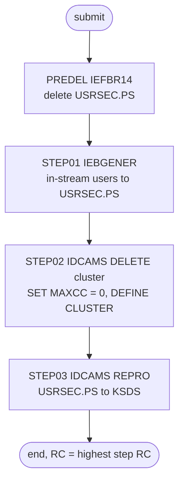

# DUSRSECJ: User security file reload

## 1. Summary

DUSRSECJ rebuilds the sign-on user file from ten user records that are written into the JCL itself. `PREDEL` deletes the flat file `AWS.M2.CARDDEMO.USRSEC.PS`, `STEP01` writes the ten in-stream records into a new copy of it, `STEP02` deletes and defines the VSAM cluster `AWS.M2.CARDDEMO.USRSEC.VSAM.KSDS` (key 8 bytes at offset 0, fixed 80-byte records, `REUSE`), and `STEP03` copies the flat file into the cluster. The online sign-on and user administration programs read that cluster through CICS file `USRSEC`. It runs by hand during installation and as the last job of the demo data refresh. The job has no business logic, but it is security relevant: the user IDs, names, user types and passwords are in clear text in the JCL and in both files (DEF-JUSEC-001).

## 2. Rules at a glance

The job has no business rules. Its items:

| ID | Rule |
| :-- | :-- |
| SE-JUSEC-001 | Delete the flat file `USRSEC.PS` if it exists. |
| SE-JUSEC-002 | Write the ten in-stream user records (five admins, five regular users) to a new `USRSEC.PS`, fixed 80 bytes. |
| SE-JUSEC-003 | Delete the user security cluster; any failure is reset to return code 0. |
| SE-JUSEC-004 | Define the cluster: key 8 at offset 0, records 80 fixed, `REUSE`, default share options. |
| SE-JUSEC-005 | Load the cluster with every record of `USRSEC.PS`, in file order. |
| VAL-JUSEC-001 | The load rejects records out of key order or with duplicate user IDs (VSAM rule). |
| ERR-JUSEC-001 | No step has a `COND`, so every step runs even when an earlier one failed. |
| DEF-JUSEC-001 | [security] Passwords are stored and shipped in clear text. |
| DEF-JUSEC-002 | `UNIT=SYSAD` is a typo for `SYSDA` that was fixed once and came back. |
| DEF-JUSEC-003 | `SET MAXCC = 0` hides every delete failure, including "file in use". |
| DEF-JUSEC-004 | The job does not close `USRSEC` in CICS itself. |

## 3. Actors and triggers

- **Trigger:** submitted by an operator. It is in the README's initialisation sequence (`./README.md:152`) and batch job list (`./README.md:226`), in the demo full-batch script as "Job 11: Refresh User Security  File" (`scripts/run_full_batch.sh:40-41`) and in `scripts/remote_refresh.sh:44`. The restart runbook lists it in the data refresh (`docs/runbooks/batch-cycle-restart.md:14`). Neither the CA-7 nor the Control-M schedule runs it.
- **Preconditions:** CICS has closed file `USRSEC` (CLOSEFIL; DEF-JUSEC-004). The unit name in `STEP01` must exist on the system (DEF-JUSEC-002).
- **Job card:** `REGION=8M,CLASS=A,MSGCLASS=H,NOTIFY=&SYSUID` (`:1-2`). No parameters, no symbolic overrides.
- The README's batch table names the job's program as IEBGENER (`./README.md:353`); IEBGENER only runs in `STEP01`, and IDCAMS does the define and load.

## 4. Interfaces

| Step | Program | DD | Dataset | Disposition | Use | Source |
| :-- | :-- | :-- | :-- | :-- | :-- | :-- |
| `PREDEL` | IEFBR14 | `DD01` | `AWS.M2.CARDDEMO.USRSEC.PS` | `(MOD,DELETE,DELETE)` | delete if present (no `UNIT`, no `SPACE`) | `:25-26` |
| `STEP01` | IEBGENER | `SYSUT1` | in-stream, 10 records | - | input | `:34-45` |
| `STEP01` | IEBGENER | `SYSUT2` | `AWS.M2.CARDDEMO.USRSEC.PS` | `(NEW,CATLG,DELETE)` | output, `LRECL=80,RECFM=FB,DSORG=PS,BLKSIZE=0`, `UNIT=SYSAD`, `SPACE=(TRK,(10,5),RLSE)` | `:46-49` |
| `STEP01` | IEBGENER | `SYSPRINT` | `SYSOUT=*` | - | utility messages | `:51` |
| `STEP01` | IEBGENER | `SYSIN` | `DUMMY` | - | no control statements: plain copy | `:52` |
| `STEP02` | IDCAMS | `SYSPRINT` | `SYSOUT=*` | - | IDCAMS messages | `:60` |
| `STEP02` | IDCAMS | `SYSIN` | in-stream | - | `DELETE`, `SET MAXCC`, `DEFINE CLUSTER` | `:61-74` |
| `STEP03` | IDCAMS | `IN` | `AWS.M2.CARDDEMO.USRSEC.PS` | `SHR` | input, sequential | `:82` |
| `STEP03` | IDCAMS | `OUT` | `AWS.M2.CARDDEMO.USRSEC.VSAM.KSDS` | `SHR` | output, KSDS | `:83` |
| `STEP03` | IDCAMS | `SYSOUT` | `SYSOUT=*` | - | not used by IDCAMS | `:84` |
| `STEP03` | IDCAMS | `SYSPRINT` | `SYSOUT=*` | - | IDCAMS messages | `:85` |
| `STEP03` | IDCAMS | `SYSIN` | in-stream | - | `REPRO` statement | `:86-88` |

Return code of the job: the highest step return code. Console output is utility messages only (incidental).

## 5. Data used

- **User security record** (no entity in `entities.md`; layout `SEC-USER-DATA` in `app/cpy/CSUSR01Y.cpy:17-23`), 80 bytes: `SEC-USR-ID` X(8) bytes 1-8 (the key), `SEC-USR-FNAME` X(20), `SEC-USR-LNAME` X(20), `SEC-USR-PWD` X(8) in clear text, `SEC-USR-TYPE` X(1) (`A` admin, `U` regular user), `SEC-USR-FILLER` X(23).
- **In-stream content** (`:35-44`): user IDs `ADMIN001` to `ADMIN005` with type `A` and `USER0001` to `USER0005` with type `U`, each with a first and last name. Every record carries the same password, the public demo password that the README and `docs/security/secrets.md:18-19` publish for `ADMIN001` and `USER0001`. Each card image holds 57 significant characters; the rest of the 80-byte record (the filler) is blanks. The records are already in ascending user-ID order.
- The EBCDIC sample file `app/data/EBCDIC/AWS.M2.CARDDEMO.USRSEC.PS` holds the same ten records.
- **Catalog state on 09/01/22:** `USRSEC.PS` is catalogued (`app/catlg/LISTCAT.txt:3831`). The cluster (`app/catlg/LISTCAT.txt:3846-3872`) has data component `...KSDS.DAT` with `KEYLEN 8`, `RKP 0`, `AVGLRECL 80`, `MAXLRECL 80`, `CISIZE 8192`, `SHROPTNS(1,3)`, `NOERASE`, `INDEXED`, `REUSE` and `REC-TOTAL 10` (`app/catlg/LISTCAT.txt:3883-3888`), and index `...KSDS.IDX` (`app/catlg/LISTCAT.txt:3906`). That matches SE-JUSEC-004 and the ten seed users. The catalog reports 3 primary cylinders, which is the 45 tracks of the define on a 3390 device (15 tracks per cylinder).

## 6. Processing flow

All four steps are plumbing; none carries a business decision.

| # | Step | Class | What it does | Runs when |
| --: | :-- | :-- | :-- | :-- |
| 1 | `PREDEL` | plumbing | delete `USRSEC.PS` | always |
| 2 | `STEP01` | plumbing | write the in-stream users to a new `USRSEC.PS` | always (no `COND`) |
| 3 | `STEP02` | plumbing | delete and define the cluster | always (no `COND`) |
| 4 | `STEP03` | plumbing | copy `USRSEC.PS` into the cluster | always (no `COND`) |

## 7. Business rules

None. The job copies seed data without interpreting it; see the side effects in section 9. The meaning of the user type and the password check belong to the online sign-on and user administration programs.

## 8. Validations and messages

#### VAL-JUSEC-001 · The load requires ascending, unique user IDs
- **When:** `STEP03` copies a record whose key (bytes 1-8, `SEC-USR-ID`) is not higher than the key of the record before it, or the cluster already holds a record with that key.
- **Then:** VSAM rejects that record and IDCAMS prints an error message for it; the step ends with return code 8 or higher. The remaining records are still copied until IDCAMS reaches its error limit. The shipped in-stream data is in ascending order, so a clean run loads all ten records.
- **Source:** `:87`
- **Fidelity:** must-preserve (a target load must also fail visibly on unsorted or duplicate user IDs) · **Confidence:** platform-inferred (IDCAMS `REPRO` into a KSDS; no local run)

No operator-facing message text is produced by the job itself; all messages are IEBGENER and IDCAMS messages in `SYSPRINT`.

## 9. Side effects

In execution order. There is no rollback: each step's change is permanent.

#### SE-JUSEC-001 · Delete the flat user file
- **What:** IEFBR14 does nothing itself; the disposition `DISP=(MOD,DELETE,DELETE)` on `DD01` makes the system delete `AWS.M2.CARDDEMO.USRSEC.PS` at the end of the step. If the file does not exist, `MOD` allocates it as new and then deletes it, so the step works on a first run as well. The DD gives no `UNIT` or `SPACE`, so that new allocation relies on the system's defaults.
- **Source:** `:23-26`
- **Fidelity:** incidental · **Confidence:** platform-inferred

#### SE-JUSEC-002 · Write the in-stream users to the flat file
- **What:** IEBGENER with `SYSIN DD DUMMY` copies the ten in-stream card images (`:35-44`) unchanged, in order, into a new catalogued dataset `AWS.M2.CARDDEMO.USRSEC.PS` with `LRECL=80,RECFM=FB` (system-determined block size). If the step fails, `DISP=(NEW,CATLG,DELETE)` deletes the new file.
- **Source:** `:32-52`
- **Fidelity:** must-preserve (record content and order) · **Confidence:** reviewed

#### SE-JUSEC-003 · Delete the user security cluster
- **What:** `DELETE                  AWS.M2.CARDDEMO.USRSEC.VSAM.KSDS` removes the cluster with its data and index components and every record. The statement has no entry type, so IDCAMS deletes whatever object has that name.
- **Return code:** `SET       MAXCC = 0` follows unconditionally, so every delete result, including a failure, becomes 0 (DEF-JUSEC-003). A missing cluster on a first run is therefore not an error.
- **Source:** `:62-63`
- **Fidelity:** must-preserve (delete before define) · **Confidence:** reviewed

#### SE-JUSEC-004 · Define the user security cluster
- **What:** `DEFINE    CLUSTER (NAME(AWS.M2.CARDDEMO.USRSEC.VSAM.KSDS)` with:

| Attribute | Value |
| :-- | :-- |
| Organisation | `INDEXED` (KSDS) |
| Key | `KEYS(8,0)`: 8 bytes at offset 0 (`SEC-USR-ID`) |
| Record size | `RECORDSIZE(80,80)`: fixed 80 |
| Space | `TRACKS(45,15)`, no volume (SMS or default placement) |
| Free space | `FREESPACE(10,15)`: 10% of each CI and 15% of each CA left free |
| CI size | `CISZ(8192)` |
| Sharing | none coded, so the default `SHAREOPTIONS(1,3)`: one writer or many readers, never both (the catalog confirms `SHROPTNS(1,3)`) |
| Other | `REUSE`: the cluster can be reset to empty by opening it for output |
| Components | data `...USRSEC.VSAM.KSDS.DAT`, index `...USRSEC.VSAM.KSDS.IDX` |

- **Source:** `:64-73`
- **Fidelity:** must-preserve (key and record size); incidental (space, CI size, free space, share options) · **Confidence:** reviewed

#### SE-JUSEC-005 · Load the cluster from the flat file
- **What:** `REPRO INFILE(IN) OUTFILE(OUT)` copies every record of `AWS.M2.CARDDEMO.USRSEC.PS`, in file order and byte for byte, into the cluster. The statement does not use the `REUSE` keyword, so if the cluster still holds records (because the delete and define failed), the new records are merged into it rather than replacing it.
- **Before a failure:** if `STEP02` failed, `STEP03` still runs against whatever cluster exists (ERR-JUSEC-001).
- **Source:** `:82-87`
- **Fidelity:** must-preserve · **Confidence:** reviewed

## 10. Error handling

#### ERR-JUSEC-001 · Steps run regardless of earlier failures
- **When:** a step ends with a non-zero return code without abending.
- **Then:** the next step still runs, because no `EXEC` has a `COND` parameter. If `STEP01` fails, its new `USRSEC.PS` is deleted, `STEP02` still deletes the cluster and defines it empty, and `STEP03` fails on the missing input, which leaves the online system with an empty user file and no one able to sign on. If `STEP02` fails, `STEP03` loads into whatever cluster exists. An abend skips the remaining steps (JES default).
- **Source:** `:23, 32, 58, 80`
- **Fidelity:** defect-decide · **Confidence:** platform-inferred

## 11. Interactions

- **Upstream:** CLOSEFIL closes `USRSEC` in CICS (`app/jcl/CLOSEFIL.jcl:30`); the restart runbook's step 1 (`docs/runbooks/batch-cycle-restart.md:13`).
- **Downstream:** CICS file `USRSEC` (`app/csd/CARDDEMO.CSD:88-89`) points at the cluster. It is read by the sign-on program COSGN00C and maintained by the user administration programs COUSR00C, COUSR01C, COUSR02C and COUSR03C, reached from the admin menu COADM01C. OPENFIL reopens it (`app/jcl/OPENFIL.jcl:30`).
- **Shared data:** ESDSRRDS writes the same ten records into other datasets (`app/jcl/ESDSRRDS.jcl:36-45`); changing the seed users in one job does not change the other.

## 12. Numeric, date and format details

None. The job copies bytes; it does not interpret any field.

## 13. Known defects and oddities

#### DEF-JUSEC-001 · [security] Passwords in clear text in the JCL and in the files
- The in-stream data (`:35-44`) holds a password for each of the ten users in clear text, and the job stores it unchanged in `SEC-USR-PWD` in both `USRSEC.PS` and the cluster. Anyone who can read the JCL library, the job output or either dataset can read every password, and every user has the same one. `docs/security/secrets.md:38` records that the field is stored in clear text and that the values are public demo data.
- **Status:** open · **Fidelity:** defect-decide (the target must not store clear-text passwords; see Q-JUSEC-001) · **Confidence:** reviewed

#### DEF-JUSEC-002 · `UNIT=SYSAD` instead of `SYSDA`
- `STEP01` asks for unit `SYSAD` (`:49`), which is not the standard esoteric name `SYSDA`. On a system without a `SYSAD` unit, allocation of `STEP01` fails with a JCL error and the job ends there: `PREDEL` has already deleted `USRSEC.PS`, and the cluster is left as it was. Where SMS manages the new dataset, its storage class can override the unit and the typo has no effect. The git history shows this typo was fixed in 2022 ("Issue #2 Typo in DUSRSECJ.jcl") and reintroduced in a later commit; READACCT and ESDSRRDS have the same value.
- **Status:** open · **Fidelity:** defect-fix · **Confidence:** platform-inferred (no unit table in the repository)

#### DEF-JUSEC-003 · `SET MAXCC = 0` hides every delete failure
- Unlike ACCTFILE, which resets only results of 8 or less, this job resets the return code unconditionally after the delete (`:63`). When the cluster cannot be deleted because CICS still has it open (`docs/runbooks/cics-vsam-files.md:37`), the define then fails because the name exists, and `STEP03` merges the ten records into the existing loaded cluster: records whose user IDs already exist are rejected as duplicates, records for new IDs are added, and users added online stay.
- **Status:** open · **Fidelity:** defect-decide · **Confidence:** platform-inferred

#### DEF-JUSEC-004 · The job does not close the file in CICS
- The job has no CICS close and open step, so it depends on CLOSEFIL having closed `USRSEC` first and on OPENFIL afterwards. While the cluster is being rebuilt, no one can sign on.
- **Source:** `:23-88`
- **Status:** open · **Fidelity:** incidental · **Confidence:** reviewed

## 14. Open questions

| ID | Question | For |
| :-- | :-- | :-- |
| Q-JUSEC-001 | How should the target seed its first administrator and users: hashed credentials loaded by a provisioning step, an external identity provider, or no seed users at all outside demo environments? | security |
| Q-JUSEC-002 | Should a reload replace all users (current behaviour after a clean delete) or keep users added online since the last reload? | operations |

## 15. Equivalence contract

After a successful run (return code 0 in every step), the user store contains exactly the ten in-stream user records: same user IDs, names and types, keyed by user ID, and nothing else; `USRSEC.PS` holds the same ten records in the same order. A reimplementation must fail visibly when the seed data has duplicate or unordered user IDs (VAL-JUSEC-001). Password storage is not part of the equivalence: the target is expected to replace it (DEF-JUSEC-001). Utility message text may differ.

## 16. Paragraph coverage

| Step | Lines | Covered by |
| :-- | :-- | :-- |
| (job card) | 1-2 | §3 |
| `PREDEL` | 23-26 | SE-JUSEC-001 |
| `STEP01` | 32-52 | SE-JUSEC-002, DEF-JUSEC-001, DEF-JUSEC-002, ERR-JUSEC-001 |
| `STEP02` | 58-74 | SE-JUSEC-003, SE-JUSEC-004, DEF-JUSEC-003 |
| `STEP03` | 80-88 | SE-JUSEC-005, VAL-JUSEC-001, ERR-JUSEC-001 |
