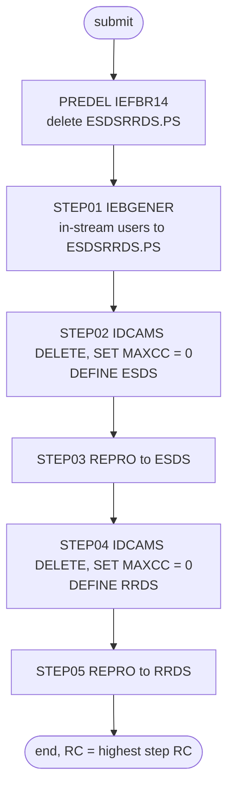

# ESDSRRDS: Sample ESDS and RRDS user files

## 1. Summary

ESDSRRDS shows how the same flat data can be loaded into the two VSAM organisations that the rest of CardDemo does not use. It writes the ten seed users of DUSRSECJ from in-stream data into the flat file `AWS.M2.CARDDEMO.ESDSRRDS.PS`, then deletes, defines and loads an entry-sequenced cluster `AWS.M2.CARDDEMO.USRSEC.VSAM.ESDS` and a relative-record cluster `AWS.M2.CARDDEMO.USRSEC.VSAM.RRDS` from it. No program, CICS definition, schedule or script in the repository reads these files; the README lists the job only as "Create ESDS and RRDS VSAM files" (`./README.md:376`). It has no business logic. It repeats the clear-text passwords of the seed users (DEF-JESRR-001).

## 2. Rules at a glance

The job has no business rules. Its items:

| ID | Rule |
| :-- | :-- |
| SE-JESRR-001 | Delete the flat file `ESDSRRDS.PS` if it exists. |
| SE-JESRR-002 | Write the ten in-stream user records to a new `ESDSRRDS.PS`, fixed 80 bytes. |
| SE-JESRR-003 | Delete and define the ESDS cluster (fixed 80, `REUSE`, `NONINDEXED`); any delete failure is reset to 0. |
| SE-JESRR-004 | Load the ESDS with every record of `ESDSRRDS.PS`, in file order. |
| SE-JESRR-005 | Delete and define the RRDS cluster (fixed 80, `REUSE`, `NUMBERED`); any delete failure is reset to 0. |
| SE-JESRR-006 | Load the RRDS with every record of `ESDSRRDS.PS`, as relative records 1 to 10. |
| ERR-JESRR-001 | No step has a `COND`, so every step runs after an earlier non-zero return code; an abend or JCL error ends the job. |
| DEF-JESRR-001 | [security] Three more datasets with the seed passwords in clear text. |
| DEF-JESRR-002 | `UNIT=SYSAD` is a typo for `SYSDA`. |
| DEF-JESRR-003 | Two step comments describe the wrong file. |
| DEF-JESRR-004 | `SET MAXCC = 0` hides every delete failure. |
| DEF-JESRR-005 | Nothing reads the two clusters. |
| DEF-JESRR-006 | A null statement (`//`) ends the job before the trailing version comment. |

## 3. Actors and triggers

- **Trigger:** submitted by hand. The README's batch table lists it (`./README.md:376`), but not its initialisation sequence or batch run list. Neither the CA-7 nor the Control-M schedule runs it, and no script submits it.
- **Preconditions:** none beyond a valid unit name for `STEP01` (DEF-JESRR-002). No CICS file refers to the clusters, so no close is needed.
- **Job card:** `REGION=8M,CLASS=A,MSGCLASS=H,NOTIFY=&SYSUID` (`:1-2`). No parameters, no symbolic overrides.

## 4. Interfaces

| Step | Program | DD | Dataset | Disposition | Use | Source |
| :-- | :-- | :-- | :-- | :-- | :-- | :-- |
| `PREDEL` | IEFBR14 | `DD01` | `AWS.M2.CARDDEMO.ESDSRRDS.PS` | `(MOD,DELETE,DELETE)` | delete if present (no `UNIT`, no `SPACE`) | `:26-27` |
| `STEP01` | IEBGENER | `SYSUT1` | in-stream, 10 records | - | input | `:35-46` |
| `STEP01` | IEBGENER | `SYSUT2` | `AWS.M2.CARDDEMO.ESDSRRDS.PS` | `(NEW,CATLG,DELETE)` | output, `LRECL=80,RECFM=FB,DSORG=PS,BLKSIZE=0`, `UNIT=SYSAD`, `SPACE=(TRK,(10,5),RLSE)` | `:47-50` |
| `STEP01` | IEBGENER | `SYSPRINT` | `SYSOUT=*` | - | utility messages | `:52` |
| `STEP01` | IEBGENER | `SYSIN` | `DUMMY` | - | no control statements: plain copy | `:53` |
| `STEP02` | IDCAMS | `SYSPRINT` | `SYSOUT=*` | - | IDCAMS messages | `:61` |
| `STEP02` | IDCAMS | `SYSIN` | in-stream | - | `DELETE`, `SET MAXCC`, `DEFINE CLUSTER` (ESDS) | `:62-73` |
| `STEP03` | IDCAMS | `IN` | `AWS.M2.CARDDEMO.ESDSRRDS.PS` | `SHR` | input, sequential | `:81` |
| `STEP03` | IDCAMS | `OUT` | `AWS.M2.CARDDEMO.USRSEC.VSAM.ESDS` | `SHR` | output, ESDS | `:82` |
| `STEP03` | IDCAMS | `SYSOUT`, `SYSPRINT` | `SYSOUT=*` | - | IDCAMS messages (`SYSOUT` unused) | `:83-84` |
| `STEP03` | IDCAMS | `SYSIN` | in-stream | - | `REPRO` statement | `:85-87` |
| `STEP04` | IDCAMS | `SYSPRINT` | `SYSOUT=*` | - | IDCAMS messages | `:95` |
| `STEP04` | IDCAMS | `SYSIN` | in-stream | - | `DELETE`, `SET MAXCC`, `DEFINE CLUSTER` (RRDS) | `:96-107` |
| `STEP05` | IDCAMS | `IN` | `AWS.M2.CARDDEMO.ESDSRRDS.PS` | `SHR` | input, sequential | `:115` |
| `STEP05` | IDCAMS | `OUT` | `AWS.M2.CARDDEMO.USRSEC.VSAM.RRDS` | `SHR` | output, RRDS | `:116` |
| `STEP05` | IDCAMS | `SYSOUT`, `SYSPRINT` | `SYSOUT=*` | - | IDCAMS messages (`SYSOUT` unused) | `:117-118` |
| `STEP05` | IDCAMS | `SYSIN` | in-stream | - | `REPRO` statement | `:119-121` |

Return code of the job: the highest step return code. Console output is utility messages only (incidental).

## 5. Data used

- **User security record** (no entity in `entities.md`; layout `SEC-USER-DATA` in `app/cpy/CSUSR01Y.cpy:17-23`), 80 bytes: user ID X(8), first name X(20), last name X(20), password X(8) in clear text, user type X(1), filler X(23).
- **In-stream content** (`:36-45`): the same ten records as DUSRSECJ (`app/jcl/DUSRSECJ.jcl:35-44`), byte for byte: `ADMIN001` to `ADMIN005` with type `A`, `USER0001` to `USER0005` with type `U`, all with the public demo password.
- None of the four datasets appears in the catalog listing `app/catlg/LISTCAT.txt`, so there is no recorded catalog state to compare with.

## 6. Processing flow

All six steps are plumbing; none carries a business decision.

| # | Step | Class | What it does | Runs when |
| --: | :-- | :-- | :-- | :-- |
| 1 | `PREDEL` | plumbing | delete `ESDSRRDS.PS` | always |
| 2 | `STEP01` | plumbing | write the in-stream users to a new `ESDSRRDS.PS` | always (no `COND`) |
| 3 | `STEP02` | plumbing | delete and define the ESDS | always (no `COND`) |
| 4 | `STEP03` | plumbing | copy `ESDSRRDS.PS` into the ESDS | always (no `COND`) |
| 5 | `STEP04` | plumbing | delete and define the RRDS | always (no `COND`) |
| 6 | `STEP05` | plumbing | copy `ESDSRRDS.PS` into the RRDS | always (no `COND`) |

## 7. Business rules

None. The job copies sample data without interpreting it; see the side effects in section 9.

## 8. Validations and messages

None. Neither an ESDS nor an RRDS has a key, so the loads do not check order or uniqueness. No operator-facing message text is produced by the job itself; all messages are IEBGENER and IDCAMS messages in `SYSPRINT`.

## 9. Side effects

In execution order. There is no rollback: each step's change is permanent.

#### SE-JESRR-001 · Delete the flat file
- **What:** `DISP=(MOD,DELETE,DELETE)` on `DD01` of the IEFBR14 step deletes `AWS.M2.CARDDEMO.ESDSRRDS.PS`; if it does not exist, it is allocated with system defaults (no `UNIT` or `SPACE` given) and deleted, so a first run works.
- **Source:** `:24-27`
- **Fidelity:** incidental · **Confidence:** platform-inferred

#### SE-JESRR-002 · Write the in-stream users to the flat file
- **What:** IEBGENER with `SYSIN DD DUMMY` copies the ten in-stream card images unchanged, in order, into a new catalogued dataset `AWS.M2.CARDDEMO.ESDSRRDS.PS`, `LRECL=80,RECFM=FB`. With `DISP=(NEW,CATLG,DELETE)` only an abend deletes the new file; if IEBGENER ends normally with a non-zero return code, the file stays catalogued with whatever was written (`:48`).
- **Source:** `:33-53`
- **Fidelity:** must-preserve (record content and order) · **Confidence:** reviewed

#### SE-JESRR-003 · Delete and define the ESDS
- **What:** `DELETE                  AWS.M2.CARDDEMO.USRSEC.VSAM.ESDS`, then `SET       MAXCC = 0` unconditionally (DEF-JESRR-004), then `DEFINE    CLUSTER (NAME(AWS.M2.CARDDEMO.USRSEC.VSAM.ESDS)` with `RECORDSIZE(80,80)`, `REUSE`, `NONINDEXED` (entry-sequenced: records stay in the order written and are addressed by byte offset), `TRACKS(45,15)`, `FREESPACE(10,15)`, `CISZ(8192)` and data component `...USRSEC.VSAM.ESDS.DAT`. No share options are coded, so the default (1,3) applies. Free space has no use in an ESDS, which only ever appends.
- **Source:** `:62-72`
- **Fidelity:** incidental (sample file) · **Confidence:** reviewed

#### SE-JESRR-004 · Load the ESDS
- **What:** `REPRO INFILE(IN) OUTFILE(OUT)` appends every record of `ESDSRRDS.PS`, in file order, to the ESDS. If the delete and define failed and the old ESDS still holds records, the ten records are appended after them, so the file grows on every such run.
- **Source:** `:81-86`
- **Fidelity:** incidental · **Confidence:** platform-inferred (append behaviour of `REPRO` into a non-empty ESDS)

#### SE-JESRR-005 · Delete and define the RRDS
- **What:** `DELETE                  AWS.M2.CARDDEMO.USRSEC.VSAM.RRDS`, `SET       MAXCC = 0`, then `DEFINE    CLUSTER (NAME(AWS.M2.CARDDEMO.USRSEC.VSAM.RRDS)` with the same attributes as the ESDS except `NUMBERED` (relative-record: fixed slots addressed by record number) and data component `...USRSEC.VSAM.RRDS.DAT`.
- **Source:** `:97-106`
- **Fidelity:** incidental (sample file) · **Confidence:** reviewed

#### SE-JESRR-006 · Load the RRDS
- **What:** `REPRO INFILE(IN) OUTFILE(OUT)` writes the records of `ESDSRRDS.PS` into the RRDS as relative records 1 to 10, in file order. If the old RRDS still holds records in those slots, IDCAMS rejects each one as a duplicate and the step ends with return code 8 or higher.
- **Source:** `:115-120`
- **Fidelity:** incidental · **Confidence:** platform-inferred (record numbering of `REPRO` into an RRDS)

## 10. Error handling

#### ERR-JESRR-001 · Steps run regardless of earlier failures
- **When:** a step ends with a non-zero return code without abending.
- **Then:** the next step still runs, because no `EXEC` has a `COND` parameter. If `STEP01` ends with a non-zero return code, `ESDSRRDS.PS` stays catalogued (SE-JESRR-002), so both clusters are still deleted and defined, and both loads copy whatever the flat file holds, possibly nothing. If `STEP01` abends (the flat file is then deleted) or fails allocation with a JCL error such as the unit in DEF-JESRR-002, no later step runs, because without `COND=EVEN` or `COND=ONLY` the system bypasses every step after an abend, and a JCL error ends the job.
- **Source:** `:24, 33, 48, 59, 79, 93, 113`
- **Fidelity:** incidental · **Confidence:** platform-inferred

## 11. Interactions

- **Upstream:** none. The job builds its own input.
- **Downstream:** none found. No COBOL program, CICS file definition in `app/csd/CARDDEMO.CSD`, schedule or script refers to `ESDSRRDS.PS`, `USRSEC.VSAM.ESDS` or `USRSEC.VSAM.RRDS` (DEF-JESRR-005).
- **Shared data:** the in-stream data duplicates DUSRSECJ's; the names of the clusters start with `AWS.M2.CARDDEMO.USRSEC.VSAM`, like the real user file, but are separate datasets.

## 12. Numeric, date and format details

None. The job copies bytes; it does not interpret any field.

## 13. Known defects and oddities

#### DEF-JESRR-001 · [security] Another clear-text copy of the seed passwords
- The in-stream data (`:36-45`) carries the ten users' passwords in clear text, and the job writes them into three more datasets. They are the public demo values (`docs/security/secrets.md:27`), but a reader of any of these files learns every seed user's password.
- **Source:** `:36-45`, `:47-50`, `:82`, `:116`
- **Status:** open · **Fidelity:** defect-decide · **Confidence:** reviewed

#### DEF-JESRR-002 · `UNIT=SYSAD` instead of `SYSDA`
- `STEP01` asks for unit `SYSAD` (`:50`). Without such a unit, allocation fails with a JCL error and the job ends after `PREDEL`; with SMS-managed storage the unit may be ignored. DUSRSECJ and READACCT have the same value.
- **Source:** `:50`
- **Status:** open · **Fidelity:** defect-decide (`SYSDA` is the obvious intent; whether the target needs a unit at all is an operations decision) · **Confidence:** platform-inferred

#### DEF-JESRR-003 · Step comments describe the wrong file
- The comment before `STEP01` (`:30`) says it creates the user security file, but the step writes `ESDSRRDS.PS`, not `USRSEC.PS`. The comment before `STEP05` (`:110`) says it copies to the ESDS, but the step loads the RRDS (`:116`).
- **Source:** `:30, 110, 116`
- **Status:** open · **Fidelity:** incidental · **Confidence:** reviewed

#### DEF-JESRR-004 · `SET MAXCC = 0` hides every delete failure
- Both delete statements are followed by an unconditional reset (`:64`, `:98`), so a delete that fails for any reason is invisible; the define then fails on the existing name and the load appends to or collides with the old contents (SE-JESRR-004, SE-JESRR-006).
- **Source:** `:64, 98`
- **Status:** open · **Fidelity:** defect-decide · **Confidence:** platform-inferred

#### DEF-JESRR-005 · Nothing reads the two clusters
- The job creates two clusters that no program, CICS file or job uses. It is a demonstration of `NONINDEXED` and `NUMBERED` definitions, not part of the application's data flow.
- **Source:** `:63-120`
- **Status:** open · **Fidelity:** incidental · **Confidence:** reviewed (repository-wide search for the dataset names)

#### DEF-JESRR-006 · A null statement ends the job before the version comment
- Line 122 is a JCL null statement (`//`), which marks the end of the job; the version comment lines after it (`:123-124`) are not part of the job. CARDFILE, DUSRSECJ, TRANREPT, DEFGDGD and CBADMCDJ also end with one. No effect on processing.
- **Source:** `:122`
- **Status:** open · **Fidelity:** incidental · **Confidence:** reviewed

## 14. Open questions

| ID | Question | For |
| :-- | :-- | :-- |
| Q-JESRR-001 | Is there any consumer of `USRSEC.VSAM.ESDS` or `USRSEC.VSAM.RRDS` outside this repository, or can the target drop this job? | operations |

## 15. Equivalence contract

After a successful run (return code 0 in every step), `ESDSRRDS.PS` holds the ten in-stream records in order, the entry-sequenced store holds the same ten records in the same order and nothing else, and the relative-record store holds them as records 1 to 10 and nothing else. If the target keeps the job at all (Q-JESRR-001), these are the observable results; password storage is not part of the equivalence (DEF-JESRR-001).

## 16. Paragraph coverage

| Step | Lines | Covered by |
| :-- | :-- | :-- |
| (job card) | 1-2 | §3 |
| `PREDEL` | 24-27 | SE-JESRR-001 |
| `STEP01` | 33-53 | SE-JESRR-002, DEF-JESRR-001, DEF-JESRR-002, DEF-JESRR-003 |
| `STEP02` | 59-73 | SE-JESRR-003, DEF-JESRR-004 |
| `STEP03` | 79-87 | SE-JESRR-004, ERR-JESRR-001 |
| `STEP04` | 93-107 | SE-JESRR-005, DEF-JESRR-004 |
| `STEP05` | 113-121 | SE-JESRR-006, DEF-JESRR-003, ERR-JESRR-001 |
| (null statement) | 122 | DEF-JESRR-006 |
