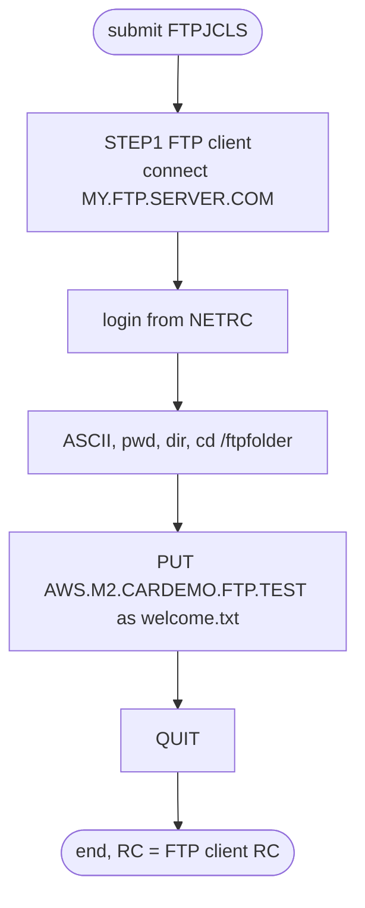

# FTPJCL: Send a test data set over FTP

## 1. Summary

FTPJCL (job name `FTPJCLS`) is a sample of the z/OS FTP client run in batch. Its only step, `STEP1`, connects to the placeholder host `MY.FTP.SERVER.COM`, logs in with the user ID and password from the submitter's `NETRC` data set, switches to ASCII mode, lists the remote directory, changes to `/ftpfolder` and sends the data set `AWS.M2.CARDEMO.FTP.TEST` as `welcome.txt`. It demonstrates the "FTP" JCL utility that the README lists (`./README.md:57`); it is not part of the CardDemo batch cycle and carries no business logic. As shipped it cannot run unchanged: the host and folder are placeholders, and nothing in the repository creates the data set it sends.

## 2. Rules at a glance

The job has no business rules. Its items:

| ID | Rule |
| :-- | :-- |
| FLOW-JFTP-001 | Host from the first `SYSIN` line, login from the `NETRC` data set; the `PARM` alternative is commented out. |
| SE-JFTP-001 | Send `AWS.M2.CARDEMO.FTP.TEST` to `/ftpfolder/welcome.txt` in ASCII mode. |
| ERR-JFTP-001 | Without the `EXIT` option a failed login or transfer does not make the step fail. |
| NUM-JFTP-001 | ASCII mode translates every byte from EBCDIC, which corrupts packed and binary fields. |
| DEF-JFTP-001 | The job name `FTPJCLS` differs from the member name. |
| DEF-JFTP-002 | The data set name has the misspelled qualifier `CARDEMO`, and nothing creates it. |
| DEF-JFTP-003 | The header comment says the job receives a file; it sends one. |
| DEF-JFTP-004 | [security] Plain FTP: login and data cross the network unencrypted unless the site enforces TLS. |
| DEF-JFTP-005 | Host and remote folder are placeholders. |
| DEF-JFTP-006 | The step's `REGION=2048K` has no effect: the JOB statement's `REGION=0M` applies to every step. |

## 3. Actors and triggers

- **Trigger:** submitted by hand as a sample. It is in neither README table (`./README.md:150-167`, `./README.md:351-379`), neither the CA-7 nor the Control-M schedule runs it, no script in `scripts/` submits it, and the local runner does not emulate it.
- **Preconditions:** the submitting user ID (TSO user or scheduler ID) has a data set `<userid>.NETRC` with a `machine` line for the host; the host on the first `SYSIN` line is replaced with a real server; `AWS.M2.CARDEMO.FTP.TEST` exists; the remote folder `/ftpfolder` exists. The set-up steps are in the job's comments (`:30-38`) and in `docs/security/secrets.md:77-98`.
- **Job card:** `FTPJCLS JOB 'FTP JCL',CLASS=A,MSGCLASS=H,MSGLEVEL=(1,1),REGION=0M,NOTIFY=&SYSUID,TIME=1440` (`:1-2`). `TIME=1440` removes the CPU time limit. Columns 73-80 of line 1 hold `JOB01598`, a leftover JES job number that the system ignores.

## 4. Interfaces

| Step | Program | DD | Dataset | Disposition | Use | Source |
| :-- | :-- | :-- | :-- | :-- | :-- | :-- |
| `STEP1` | FTP | `NETRC` | `&SYSUID..NETRC` | `SHR` | user ID and password for the host, read by the FTP client | `:45` |
| `STEP1` | FTP | `SYSIN` | in-stream | - | host, then FTP subcommands | `:46-53` |

- `EXEC PGM=FTP,REGION=2048K` (`:43`); because the JOB statement codes `REGION=0M` (`:2`), the step's value is ignored (DEF-JFTP-006). The commented line `PARM='MY.FTP.SERVER.COM (EXIT TIMEOUT 20'` (`:44`) is not part of the statement.
- The step has no `OUTPUT` or `SYSPRINT` DD, so the JCL does not say where the client's transfer log goes (Q-JFTP-002).
- The data set sent is named in the `PUT` subcommand, not on a DD (`:52`), so the FTP client allocates it itself.
- Return code of the job: the FTP client's return code (ERR-JFTP-001).

## 5. Data used

- `AWS.M2.CARDEMO.FTP.TEST`: read whole and sent as text. Its layout is not defined anywhere in the repository; INTRDRJ1 and INTRDRJ2 copy it to `.BKUP` and `.BKUP.INTRDR` data sets.
- `&SYSUID..NETRC`: one line per server, `machine <host> login <userid> password <pw>` in lower-case keywords, no comments (`:33-36`, `docs/security/secrets.md:84-94`). `&SYSUID` resolves to the submitting user ID, so each user reads their own data set.

## 6. Processing flow

The only step is plumbing (a file transfer).

| # | Step | Class | What it does | Runs when |
| --: | :-- | :-- | :-- | :-- |
| 1 | `STEP1` | plumbing | log in to the FTP server and `PUT` the test data set | always |

#### FLOW-JFTP-001 · Where the host and the login come from
- **When:** the FTP client starts.
- **Then:** it takes the host from the first `SYSIN` line, `MY.FTP.SERVER.COM`, and the user ID and password from the `NETRC` data set entry whose `machine` value equals that host. The JCL holds no credentials. To pass the host as a parameter instead, the comment says to uncomment the `PARM` line, add a comma after `REGION=2048K` and delete the host line from `SYSIN` (`:40-41`); that `PARM` would also add `EXIT` and `TIMEOUT 20`.
- **Otherwise:** without a matching `NETRC` entry the client has no login for the host (ERR-JFTP-001).
- **Source:** `:43-47`
- **Fidelity:** must-preserve (no credentials in the job) · **Confidence:** reviewed (JCL); platform-inferred (NETRC lookup by the z/OS FTP client)

## 7. Business rules

None. The job transfers a file without interpreting it.

## 8. Validations and messages

None. The job checks nothing itself; every message comes from the FTP client and the server.

## 9. Side effects

#### SE-JFTP-001 · Send the test data set to the server
- **What:** after the login the client runs these subcommands in order:

| # | Subcommand | Effect |
| --: | :-- | :-- |
| 1 | `ASCII` | text transfer mode: records are translated from EBCDIC and sent as lines (NUM-JFTP-001) |
| 2 | `pwd` | prints the remote working directory (diagnostic only) |
| 3 | `dir` | lists the remote directory (diagnostic only) |
| 4 | `cd /ftpfolder` | changes the remote directory |
| 5 | `PUT 'AWS.M2.CARDEMO.FTP.TEST' welcome.txt` | sends the whole data set; the server stores it as `welcome.txt` in `/ftpfolder`, replacing a file of that name if the server allows it |
| 6 | `QUIT` | ends the session |

  The mainframe data set is only read. Nothing on the mainframe is changed.
- **Source:** `:48-53`
- **Fidelity:** incidental (sample transfer) · **Confidence:** reviewed (subcommands); platform-inferred (server-side replace)

## 10. Error handling

#### ERR-JFTP-001 · Errors do not fail the step
- **When:** the connection, the login, the `cd` or the `PUT` fails.
- **Then:** the client reports the error in its output and goes on with the next subcommand. Without the `EXIT` start-up option, which is only in the commented `PARM` (`:44`), the z/OS FTP client does not end with a non-zero return code for a failed subcommand, so the job can end with return code 0 although nothing was sent. The job has one step, so there is no `COND` logic; restart means resubmitting the job.
- **Source:** `:43-44`
- **Fidelity:** defect-decide · **Confidence:** platform-inferred (z/OS FTP client return codes; also depends on the site's `FTP.DATA`)

## 11. Interactions

- **Upstream:** none in the repository creates `AWS.M2.CARDEMO.FTP.TEST` (DEF-JFTP-002).
- **Related:** INTRDRJ1 copies the same data set to `AWS.M2.CARDEMO.FTP.TEST.BKUP` and submits INTRDRJ2 (`app/jcl/INTRDRJ1.JCL:8-11`). The two jobs are not chained to FTPJCL.
- **Policy:** extracts that leave the system must carry only the fields the receiver needs and travel over encrypted transport (`docs/security/data-handling.md:150-154`).

## 12. Numeric, date and format details

#### NUM-JFTP-001 · ASCII mode translates every byte
- In `ASCII` mode each record is translated from EBCDIC to ASCII and ends with a line break. Text fields survive; packed-decimal (`COMP-3`) and binary fields are translated byte by byte as if they were characters and are corrupted, and zoned-decimal signs become overpunch letters. The test data set's content is unknown, so whether this matters cannot be decided from the repository.
- **Source:** `:48, 52`
- **Fidelity:** incidental · **Confidence:** platform-inferred

## 13. Known defects and oddities

#### DEF-JFTP-001 · Job name differs from the member name
- The member is `FTPJCL` but the JOB statement names the job `FTPJCLS` (`:1`). Job logs, `NOTIFY` messages and any schedule entry show `FTPJCLS`, so a search for `FTPJCL` in JES output finds nothing.
- **Source:** `:1`
- **Status:** open · **Fidelity:** incidental · **Confidence:** reviewed

#### DEF-JFTP-002 · Misspelled high-level qualifier and no creator
- The data set sent is `AWS.M2.CARDEMO.FTP.TEST`, with `CARDEMO` instead of the application's `CARDDEMO` (`:52`). INTRDRJ1 and INTRDRJ2 use the same spelling, so the three jobs agree with each other, but the data set is outside the `AWS.M2.CARDDEMO` level: the catalog listing of that level (`app/catlg/LISTCAT.txt:3`) cannot show it, and data set profiles on `AWS.M2.CARDDEMO.**` (`docs/security/data-handling.md:153-154`) do not cover it. No job in the repository creates it.
- **Source:** `:52`
- **Status:** open · **Fidelity:** defect-decide · **Confidence:** reviewed

#### DEF-JFTP-003 · The header comment says "receive"
- The comment reads `FTP JOB TO RECEIVE A FILE` (`:22`), but the job sends a file with `PUT`. The comment at `:28` says to change `PUT` to `GET` to receive.
- **Source:** `:22, 52`
- **Status:** open · **Fidelity:** incidental · **Confidence:** reviewed

#### DEF-JFTP-004 · [security] Plain FTP without TLS
- Nothing in the job requests TLS (no secure-FTP option in `SYSIN` or `PARM`), so unless the site's FTP client configuration enforces it, the user ID and password from `NETRC` and the data set travel over the network unencrypted. The data-handling policy requires encrypted transport for files that leave the system (`docs/security/data-handling.md:153-154`). The `NETRC` data set also holds the password in clear text; the job comment asks for a profile with `UACC(NONE)` (`:37-38`). Earlier revisions of the member held an in-stream server address, user ID and password (`docs/security/secrets.md:73-75`).
- **Source:** `:43-52`
- **Status:** open · **Fidelity:** defect-decide · **Confidence:** platform-inferred

#### DEF-JFTP-005 · Placeholders for host and folder
- `MY.FTP.SERVER.COM` (`:47`) and `/ftpfolder` (`:51`) are placeholders; the job fails to connect or to change directory until a site edits them (`docs/security/secrets.md:67`). Because of ERR-JFTP-001 that failure may still end with return code 0.
- **Source:** `:47, 51`
- **Status:** open · **Fidelity:** incidental · **Confidence:** reviewed

#### DEF-JFTP-006 · The step region is overridden by the job region
- The JOB statement codes `REGION=0M` (`:2`) and `STEP1` codes `REGION=2048K` (`:43`). On z/OS a `REGION` on the JOB statement applies to every step and overrides any `REGION` on an `EXEC` statement, so the FTP client runs with `REGION=0M`, which requests all the private storage available (subject to site exits such as IEFUSI), not 2 MB. The `REGION=2048K` that the comment at `:40-41` refers to is therefore inert. No effect on the transfer itself.
- **Source:** `:2, 43`
- **Status:** open · **Fidelity:** incidental · **Confidence:** platform-inferred (JCL precedence of JOB over EXEC `REGION`; high confidence)

## 14. Open questions

| ID | Question | For |
| :-- | :-- | :-- |
| Q-JFTP-001 | Which file is FTPJCL meant to send in a real installation, and to which partner? Is a file transfer part of the target at all? | business owner, operations |
| Q-JFTP-002 | Where does the batch FTP client write its log without an `OUTPUT` or `SYSPRINT` DD, and does the site's `FTP.DATA` set error return codes or TLS for this client? | mainframe team |

## 15. Equivalence contract

There is no data result to reproduce on the mainframe side: the job only reads one data set. If the target keeps an outbound transfer, it must take credentials from a protected store, never from the job definition (FLOW-JFTP-001), use encrypted transport (DEF-JFTP-004), and report a failed transfer as a failure (ERR-JFTP-001 is a defect to decide). FTP client messages may differ.

## 16. Paragraph coverage

| Step | Lines | Covered by |
| :-- | :-- | :-- |
| (job card) | 1-2 | §3, DEF-JFTP-001, DEF-JFTP-006 |
| `STEP1` | 43-53 | FLOW-JFTP-001, SE-JFTP-001, ERR-JFTP-001, NUM-JFTP-001, DEF-JFTP-002, DEF-JFTP-003, DEF-JFTP-004, DEF-JFTP-005, DEF-JFTP-006 |
