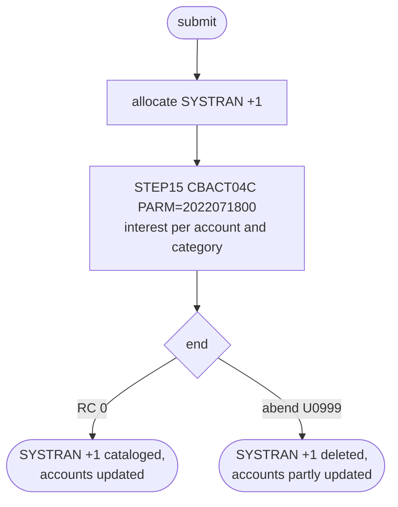

# INTCALC: Interest calculation job

## 1. Summary

INTCALC is the one-step job that runs the interest program `CBACT04C`. The program reads the category balance file in key order, looks up each account, its card and its disclosure group rate, writes one interest transaction per category with a non-zero rate to a new generation of the GDG `AWS.M2.CARDDEMO.SYSTRAN`, and rewrites each account with the interest added to its balance. The interest rules belong to `CBACT04C` and its program spec; this spec covers what the JCL adds: the hard-coded `PARM` that becomes the prefix of every interest transaction ID, the dataset bindings (including the alternate-index path), the new `SYSTRAN` generation and the job's place in the cycle.

## 2. Rules at a glance

| ID | Rule |
| :-- | :-- |
| FLOW-JINTC-001 | One step: run `CBACT04C` with `PARM='2022071800'` and the six files bound to the cycle datasets. |
| SE-JINTC-001 | Allocate and catalog a new interest transaction generation `SYSTRAN(+1)`, RECFM F, LRECL 350. |
| SE-JINTC-002 | Rewrite the account master in place (program side effect). |
| ERR-JINTC-001 | Any file error abends; account updates made before stay, the interest transactions are lost. |
| NUM-JINTC-001 | Interest transaction ID = the 10-character `PARM` + a 6-digit counter starting at 000001. |
| DEF-JINTC-001 | The `PARM` date is hard-coded, so every run produces the same transaction IDs. |
| DEF-JINTC-002 | The DD named `TRANSACT` is the interest output `SYSTRAN`, not the transaction master. |
| DEF-JINTC-003 | The restart runbook described the "last account not updated" defect, which the program no longer has; corrected in commit 4a03121. |
| DEF-JINTC-004 | The `XREFFIL1` path is non-unique while the program declares a unique alternate key, so the job may abend on z/OS. |

## 3. Actors and triggers

- **Trigger:** submitted by an operator after POSTTRAN in the README "Running Batch Jobs" sequence (`./README.md:228`) and by the demo full-batch script (`scripts/run_full_batch.sh:50-51`). Control-M runs it in folder `MONTHLY-InterestCalculation` after CLOSEFIL and before COMBTRAN (`app/scheduler/CardDemo.controlm:69-80`); that folder has no monthly scheduling rule (see `SCHED-CONTROLM.md`). CA-7 does not run it. The local runner passes the same `PARM` (`tools/carddemo.py:657`). It differs from the JCL in two bindings (`tools/carddemo.py:657-663`): it has no `XREFFIL1` DD, because GnuCOBOL keeps the alternate key inside the indexed file, and it creates the `TRANSACT` output as `FB` where the JCL says `RECFM=F`; neither changes the records.
- **Preconditions:** POSTTRAN has posted the cycle's transactions; CICS has closed `ACCTDAT`, `CCXREF` and `CXACAIX` (CLOSEFIL); the alternate index path `CARDXREF.VSAM.AIX.PATH` exists (built by XREFFILE); `DISCGRP` holds a `DEFAULT` group (`docs/runbooks/batch-cycle-restart.md:98`); the GDG base `SYSTRAN` exists (DEFGDGB, `app/jcl/DEFGDGB.jcl:48-53`).
- **Job card:** `CLASS=A,MSGCLASS=0,NOTIFY=&SYSUID` (`:1-2`). Parameter: `PARM='2022071800'` on `STEP15` (`:22`).

## 4. Interfaces

| Step | Program | DD | Dataset | Disposition | Use | Source |
| :-- | :-- | :-- | :-- | :-- | :-- | :-- |
| `STEP15` | CBACT04C | `STEPLIB` | `AWS.M2.CARDDEMO.LOADLIB` | `SHR` | load library | `:23-24` |
| `STEP15` | CBACT04C | `SYSPRINT` | `SYSOUT=*` | - | not written by the program | `:25` |
| `STEP15` | CBACT04C | `SYSOUT` | `SYSOUT=*` | - | program `DISPLAY` output | `:26` |
| `STEP15` | CBACT04C | `TCATBALF` | `AWS.M2.CARDDEMO.TCATBALF.VSAM.KSDS` | `SHR` | input, KSDS sequential | `:27-28` |
| `STEP15` | CBACT04C | `XREFFILE` | `AWS.M2.CARDDEMO.CARDXREF.VSAM.KSDS` | `SHR` | input, KSDS random | `:29-30` |
| `STEP15` | CBACT04C | `XREFFIL1` | `AWS.M2.CARDDEMO.CARDXREF.VSAM.AIX.PATH` | `SHR` | alternate-key path of `XREFFILE` (by account ID) | `:31-32` |
| `STEP15` | CBACT04C | `ACCTFILE` | `AWS.M2.CARDDEMO.ACCTDATA.VSAM.KSDS` | `SHR` | input-output, KSDS random | `:33-34` |
| `STEP15` | CBACT04C | `DISCGRP` | `AWS.M2.CARDDEMO.DISCGRP.VSAM.KSDS` | `SHR` | input, KSDS random | `:35-36` |
| `STEP15` | CBACT04C | `TRANSACT` | `AWS.M2.CARDDEMO.SYSTRAN(+1)` | `(NEW,CATLG,DELETE)` | output, sequential; `UNIT=SYSDA`, `DCB=(RECFM=F,LRECL=350,BLKSIZE=0)`, `SPACE=(CYL,(1,1),RLSE)` | `:37-41` |

`XREFFIL1` has no `SELECT` of its own: the program declares `ALTERNATE RECORD KEY IS FD-XREF-ACCT-ID` on `XREFFILE` (`app/cbl/CBACT04C.cbl:34-38`) and reads by that key (`app/cbl/CBACT04C.cbl:395-396`). On z/OS the path for the first alternate key is found under the base DD name shortened to 7 characters plus `1`, which is `XREFFIL1`.

Return code of the job: the return code of `CBACT04C` (0), or abend U0999 through `CEE3ABD`.

## 5. Data used

ENT-TCAT-BAL (input), ENT-CARD-XREF (lookup by account ID through the path), ENT-ACCOUNT (updated), ENT-DISC-GROUP, the disclosure group file `AWS.M2.CARDDEMO.DISCGRP.VSAM.KSDS` (layout `app/cpy/CVTRA02Y.cpy`, lookup), ENT-TRANSACTION (written, as interest transactions of type `01`, category `05`, source `System`; `app/cbl/CBACT04C.cbl:484-486`). The GDG base `SYSTRAN` has `LIMIT 5`, `SCRATCH` (`app/catlg/LISTCAT.txt:1098-1106`), as DEFGDGB defines it.

## 6. Processing flow

| # | Step | Class | What it does | Runs when |
| --: | :-- | :-- | :-- | :-- |
| 1 | `STEP15` | business | run `CBACT04C`: compute interest per category, write interest transactions, update accounts | always |

#### FLOW-JINTC-001 · Run the interest program with the cycle date
- **What:** `STEP15` executes `PGM=CBACT04C` from `AWS.M2.CARDDEMO.LOADLIB` with `PARM='2022071800'`. The system passes the parameter as a halfword length (10) followed by the text, which the program receives in `PARM-LENGTH` and `PARM-DATE PIC X(10)` (`app/cbl/CBACT04C.cbl:175-180`). Every program DD name has a DD statement.
- **Rules:** the interest computation `(TRAN-CAT-BAL * DIS-INT-RATE) / 1200` per category, the `DEFAULT` disclosure group fallback and the account update are program rules; the runbook summarises them (`docs/runbooks/batch-cycle-restart.md:89-100`).
- **Source:** `:22-41`
- **Fidelity:** must-preserve · **Confidence:** reviewed

## 7. Business rules

The job adds no rule of its own beyond the `PARM` value (NUM-JINTC-001). The interest rules are `CBACT04C`'s.

## 8. Validations and messages

None at job level. The program's messages (`DISCLOSURE GROUP RECORD MISSING`, `ACCOUNT NOT FOUND:`, error lines) go to `SYSOUT` (`:26`); the runbook lists them (`docs/runbooks/batch-cycle-restart.md:95-100`).

## 9. Side effects

#### SE-JINTC-001 · Create the interest transaction generation
- **What:** the system allocates `AWS.M2.CARDDEMO.SYSTRAN(+1)` (RECFM F, LRECL 350, 1 cylinder primary and 1 secondary, released) before the program starts; the program opens it `OUTPUT` and writes one 350-byte transaction record per interest amount. `DISP=(NEW,CATLG,DELETE)` catalogs it on a normal end, where it becomes `SYSTRAN(0)` for COMBTRAN, and deletes it on an abend. The oldest of 5 generations is scratched.
- **Source:** `:37-41`
- **Fidelity:** must-preserve · **Confidence:** reviewed (JCL); platform-inferred (GDG roll-off)

#### SE-JINTC-002 · Update the account master in place
- **What:** `ACCTFILE` is allocated `DISP=SHR` to the live cluster and opened `I-O`; each account rewrite is applied at once, with no backup taken by this job (`docs/runbooks/batch-cycle-restart.md:108-112`).
- **Source:** `:33-34`
- **Fidelity:** must-preserve · **Confidence:** reviewed

## 10. Error handling

#### ERR-JINTC-001 · Abend leaves the accounts partly updated
- **When:** any open, read, write, rewrite or close error in the program, or a missing `DEFAULT` disclosure group.
- **Then:** the program abends through `CEE3ABD` (U0999). Accounts rewritten before the abend keep the interest and the reset cycle totals, while `SYSTRAN(+1)` is deleted with the interest transactions written so far, so balances and transactions disagree. There is no `COND`, no checkpoint and no restart step.
- **Restart:** restore `ACCTDATA` to its state after POSTTRAN, then resubmit with the same `PARM` (`docs/runbooks/batch-cycle-restart.md:102-113`).
- **Source:** `:22, 37`
- **Fidelity:** defect-decide · **Confidence:** platform-inferred

## 11. Interactions

- **Upstream:** POSTTRAN (category balances and account cycle totals), CLOSEFIL, XREFFILE (AIX path), DISCGRP (rates). In Control-M, CLOSEFIL (`app/scheduler/CardDemo.controlm:65-74`).
- **Downstream:** COMBTRAN reads `SYSTRAN(0)` and merges it with `TRANSACT.BKUP(0)` (`app/scheduler/CardDemo.controlm:75-80`; `./README.md:229-230`); CREASTMT and the online programs see the updated balances.

## 12. Numeric, date and format details

#### NUM-JINTC-001 · Interest transaction IDs
- `TRAN-ID` (16 characters) is the 10-character `PARM-DATE` followed by `WS-TRANID-SUFFIX` `PIC 9(06)`, which starts at 0 and is incremented before each write, so the IDs of one run are `2022071800000001`, `2022071800000002`, ... in write order (`app/cbl/CBACT04C.cbl:474-482`). The runbook calls the `PARM` the date prefix of every interest transaction ID (`docs/runbooks/batch-cycle-restart.md:37-39`).
- **Source:** `:22`, `app/cbl/CBACT04C.cbl:476-481`
- **Fidelity:** must-preserve (ID format); defect-decide (fixed value, DEF-JINTC-001) · **Confidence:** reviewed

## 13. Known defects and oddities

#### DEF-JINTC-001 · The date PARM is hard-coded
- `PARM='2022071800'` is a literal in the JCL. Every run writes the same IDs `2022071800000001`, ..., so interest transactions from different runs collide as soon as they meet in one keyed file. In the AS-IS cycle this stays hidden because `TRANSACT` holds only one cycle's records (TRANBKP empties it before each POSTTRAN), but a target that keeps transaction history would get duplicate keys. The runbook asks operators to change the value each run (`docs/runbooks/batch-cycle-restart.md:37-39`); no scheduler variable does it.
- **Source:** `:22`
- **Status:** open · **Fidelity:** defect-decide · **Confidence:** reviewed

#### DEF-JINTC-002 · The output DD is named `TRANSACT`
- The program's output DD is `TRANSACT`, but it is bound to `SYSTRAN(+1)`, not to the transaction master `TRANSACT.VSAM.KSDS`. Readers of the JCL (and tools that map DD names to datasets by name) can confuse the two.
- **Source:** `:37-41`
- **Status:** open · **Fidelity:** incidental · **Confidence:** reviewed

#### DEF-JINTC-003 · The runbook described a defect the program no longer has
- The runbook said, as a known defect (open issue #64), that the last account in `TCATBALF` is never rewritten. The program performs `1050-UPDATE-ACCOUNT` once more after the loop when at least one record was read (`app/cbl/CBACT04C.cbl:221-223`), so the last account is updated. Commit 4a03121 turned the section into "Fixed defect: last account", which says so and asks sites running a load module built from older source to check that account by hand (`docs/runbooks/batch-cycle-restart.md:115-121`).
- **Source:** `app/cbl/CBACT04C.cbl:221-223`
- **Status:** fixed in branch, commit 4a03121 (documentation) · **Fidelity:** incidental · **Confidence:** reviewed

#### DEF-JINTC-004 · Non-unique alternate index behind a unique alternate key
- `XREFFIL1` is bound to the path over `CARDXREF.VSAM.AIX`, which XREFFILE defines with `NONUNIQUEKEY` (`app/jcl/XREFFILE.jcl:72-76`). The program declares `ALTERNATE RECORD KEY IS FD-XREF-ACCT-ID` without `WITH DUPLICATES` (`app/cbl/CBACT04C.cbl:38`) and abends on any status other than `00` after the read by account ID (`app/cbl/CBACT04C.cbl:401-412`). On z/OS the mismatch can surface as open status `39` (alternate key attributes differ from the file) or, once an account has a second card, as read status `02`; either stops the job through ERR-JINTC-001. The sample data has one card per account, so the AS-IS cycle has not shown it. Program side: DEF-INTC-007, Q-INTC-002.
- **Source:** `:29-32`, `app/jcl/XREFFILE.jcl:72-76`, `app/cbl/CBACT04C.cbl:34-39, 394-414`
- **Status:** open · **Fidelity:** defect-decide · **Confidence:** platform-inferred (medium, about 60%: the open status depends on how the COBOL runtime checks alternate key attributes)

## 14. Open questions

| ID | Question | For |
| :-- | :-- | :-- |
| Q-JINTC-001 | Where should the target take the interest transaction ID prefix from: the cycle's business date, the run date, or a sequence (DEF-JINTC-001)? | business, operations |
| Q-JINTC-002 | Is interest calculated monthly (Control-M folder name) or every cycle (README sequence and full-batch script)? | business |

## 15. Equivalence contract

For the same input files and `PARM`, the program-level results of `CBACT04C` (interest transactions, account updates) must be identical. At job level: one new interest transaction set per successful run, whose IDs start with the 10-character prefix and continue with a 6-digit counter from 000001 in write order; no set at all after an abend.

Review evidence (independent reviewers checked every item against the source, all WRONG and MINOR findings were fixed, and a fresh reviewer re-checked every changed or added item): [evidence/g-jobs-ops-review.md](../evidence/g-jobs-ops-review.md).

## 16. Paragraph coverage

| Step | Lines | Covered by |
| :-- | :-- | :-- |
| (job card) | 1-2 | §3 |
| `STEP15` | 22-41 | FLOW-JINTC-001, SE-JINTC-001, SE-JINTC-002, ERR-JINTC-001, NUM-JINTC-001, DEF-JINTC-001, DEF-JINTC-002, DEF-JINTC-004 |
