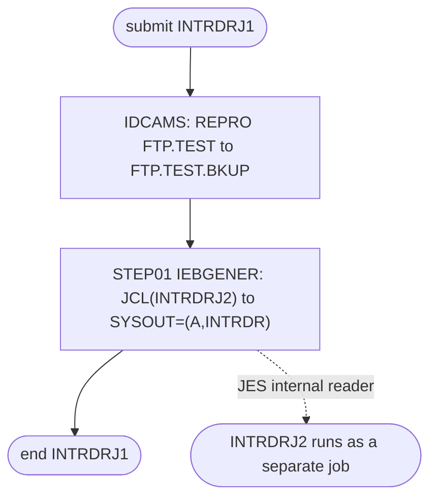

# INTRDRJ1: Back up a data set and submit the next job

## 1. Summary

INTRDRJ1 is a sample of job chaining through the JES internal reader, the "Internal Reader" JCL utility in the README (`./README.md:57`). Step `IDCAMS` copies `AWS.M2.CARDEMO.FTP.TEST` into the existing data set `AWS.M2.CARDEMO.FTP.TEST.BKUP`. Step `STEP01` then copies member `INTRDRJ2` of the JCL library `AWS.M2.CARDDEMO.JCL` to the internal reader, which submits it as a new job; INTRDRJ2 copies the backup once more. The job is not part of the CardDemo batch cycle and has no business logic.

## 2. Rules at a glance

The job has no business rules. Its items:

| ID | Rule |
| :-- | :-- |
| SE-JIRD1-001 | Copy `FTP.TEST` into the existing `FTP.TEST.BKUP`, replacing its content. |
| SE-JIRD1-002 | Submit library member `INTRDRJ2` as a new job through `SYSOUT=(A,INTRDR)`. |
| FLOW-JIRD1-001 | INTRDRJ2 runs on its own, after INTRDRJ1 has submitted it; nothing waits for it. |
| ERR-JIRD1-001 | `STEP01` has no `COND`: INTRDRJ2 is submitted even when the backup failed. |
| NUM-JIRD1-001 | The internal reader gets 80-byte card images. |
| DEF-JIRD1-001 | Misspelled `CARDEMO` qualifier; nothing creates the input or the pre-allocated output. |
| DEF-JIRD1-002 | INTRDRJ2 is submitted regardless of the backup's result. |
| DEF-JIRD1-003 | The submitted JCL is the library copy, not the repository file. |

## 3. Actors and triggers

- **Trigger:** submitted by hand as a sample. It is in neither README table (`./README.md:150-167`, `./README.md:351-379`), neither the CA-7 nor the Control-M schedule runs it, no script in `scripts/` submits it, and the local runner does not emulate it.
- **Preconditions:** `AWS.M2.CARDEMO.FTP.TEST` and `AWS.M2.CARDEMO.FTP.TEST.BKUP` are cataloged (both are `DISP=SHR`); `AWS.M2.CARDDEMO.JCL` contains member `INTRDRJ2` (the library exists in the 09/01/22 catalog, `app/catlg/LISTCAT.txt:948`); the user may submit jobs through the internal reader.
- **Job card:** `INTRDRJ1 JOB (COBOL),'KSSOMAS',CLASS=A,MSGCLASS=H,MSGLEVEL=(1,1),REGION=5M,NOTIFY=&SYSUID` (`:1-2`). No parameters, no symbolic overrides.

## 4. Interfaces

| Step | Program | DD | Dataset | Disposition | Use | Source |
| :-- | :-- | :-- | :-- | :-- | :-- | :-- |
| `IDCAMS` | IDCAMS | `SYSPRINT` | `SYSOUT=*` | - | IDCAMS messages | `:7` |
| `IDCAMS` | IDCAMS | `IN` | `AWS.M2.CARDEMO.FTP.TEST` | `SHR` | input, sequential | `:8` |
| `IDCAMS` | IDCAMS | `OUT` | `AWS.M2.CARDEMO.FTP.TEST.BKUP` | `SHR` | output, sequential, must exist | `:9` |
| `IDCAMS` | IDCAMS | `SYSIN` | in-stream | - | `REPRO` statement | `:10-12` |
| `STEP01` | IEBGENER | `SYSPRINT` | `SYSOUT=*` | - | IEBGENER messages | `:15` |
| `STEP01` | IEBGENER | `SYSIN` | `DUMMY` | - | no control statements: straight copy | `:16` |
| `STEP01` | IEBGENER | `SYSUT1` | `AWS.M2.CARDDEMO.JCL(INTRDRJ2)` | `SHR` | input, the JCL to submit | `:17` |
| `STEP01` | IEBGENER | `SYSUT2` | `SYSOUT=(A,INTRDR)` | - | output to the JES internal reader, `DCB=(LRECL=80,BLKSIZE=80)` | `:18` |

The `IDCAMS` step also has `DYNAMNBR=200` (`:6`), which allows up to 200 dynamic allocations; the `REPRO` needs none. Return code of the job: the highest step return code.

## 5. Data used

- `AWS.M2.CARDEMO.FTP.TEST`: copied record for record, not interpreted. Its layout is not defined in the repository.
- `AWS.M2.CARDDEMO.JCL(INTRDRJ2)`: 80-byte JCL card images.

## 6. Processing flow

Both steps are plumbing.

| # | Step | Class | What it does | Runs when |
| --: | :-- | :-- | :-- | :-- |
| 1 | `IDCAMS` | plumbing | copy `FTP.TEST` to `FTP.TEST.BKUP` | always |
| 2 | `STEP01` | plumbing | submit `INTRDRJ2` through the internal reader | always (no `COND`) |

#### FLOW-JIRD1-001 · The submitted job runs on its own
- **When:** `STEP01` ends.
- **Then:** INTRDRJ2 is queued as an independent job. INTRDRJ1 does not wait for it and its return code does not include INTRDRJ2's. INTRDRJ2 starts when an initiator for its class is free, normally after INTRDRJ1 has ended, because INTRDRJ1 has no steps left; JES does not guarantee that order.
- **Source:** `:18`
- **Fidelity:** incidental · **Confidence:** platform-inferred

## 7. Business rules

None. The job copies a data set and submits another job.

## 8. Validations and messages

None. No input is checked; IDCAMS and IEBGENER write their own messages to `SYSPRINT`.

## 9. Side effects

In execution order. There is no rollback.

#### SE-JIRD1-001 · Back up the FTP test data set
- **What:** `REPRO IFILE(IN) OFILE(OUT)` (`IFILE` and `OFILE` are the short forms of `INFILE` and `OUTFILE`) copies every record of `AWS.M2.CARDEMO.FTP.TEST` into `AWS.M2.CARDEMO.FTP.TEST.BKUP`. The output is opened for output, so its old content is replaced from the first record; it is not extended.
- **Source:** `:8-11`
- **Fidelity:** incidental (sample) · **Confidence:** reviewed (statement); platform-inferred (overwrite of a sequential `DISP=SHR` target)

#### SE-JIRD1-002 · Submit INTRDRJ2 through the internal reader
- **What:** IEBGENER copies member `INTRDRJ2` of `AWS.M2.CARDDEMO.JCL` to a `SYSOUT` data set whose writer is `INTRDR`, the JES internal reader. JES reads the copied records as a new job stream and queues job `INTRDRJ2` for execution; its job class and other attributes come from its own JOB statement (`app/jcl/INTRDRJ2.JCL:1-2`). `A` is the output class of the internal-reader data set only.
- **Source:** `:14-18`
- **Fidelity:** incidental (the target may chain jobs by a scheduler instead) · **Confidence:** platform-inferred (JES internal reader)

## 10. Error handling

#### ERR-JIRD1-001 · The submit step runs even after a failed backup
- **When:** the `IDCAMS` step ends with a non-zero condition code (for example the output is too small for the input).
- **Then:** `STEP01` still runs, because its `EXEC` has no `COND` parameter, and INTRDRJ2 is submitted (DEF-JIRD1-002). If `IN`, `OUT` or the JCL library member cannot be allocated (not cataloged, member missing), the job ends with a JCL or allocation error and the later step does not run. An abend skips the remaining step (JES default). Restart means resubmitting the whole job; the copy is repeatable.
- **Source:** `:6, 14`
- **Fidelity:** defect-decide · **Confidence:** platform-inferred

## 11. Interactions

- **Downstream:** INTRDRJ2, submitted by `STEP01`, copies `AWS.M2.CARDEMO.FTP.TEST.BKUP` to `AWS.M2.CARDEMO.FTP.TEST.BKUP.INTRDR` (`app/jcl/INTRDRJ2.JCL:9-12`).
- **Related:** FTPJCL sends the same input data set to an FTP server (`app/jcl/FTPJCL.JCL:52`); the jobs are not chained to it.
- **Other internal-reader users:** the online report request CORPT00C submits TRANREPT by writing JCL to the CICS transient-data queue `JOBS`, an extrapartition queue with `DDNAME(INREADER)` (`app/csd/CARDDEMO.CSD:499-505`), not through this job.

## 12. Numeric, date and format details

#### NUM-JIRD1-001 · 80-byte card images to the internal reader
- `SYSUT2` has `DCB=(LRECL=80,BLKSIZE=80)`: one 80-byte JCL statement per record, unblocked, which is the format JES expects from an internal reader. The member must have 80-byte records.
- **Fidelity:** incidental · **Confidence:** reviewed (DCB); platform-inferred (JES requirement)

## 13. Known defects and oddities

#### DEF-JIRD1-001 · Misspelled qualifier and no creator for the data sets
- Both data sets use `CARDEMO` instead of `CARDDEMO` (`:8-9`), as in FTPJCL and INTRDRJ2, so they are outside the application's `AWS.M2.CARDDEMO` level. No job in the repository creates `AWS.M2.CARDEMO.FTP.TEST` or the pre-allocated `AWS.M2.CARDEMO.FTP.TEST.BKUP` that `DISP=SHR` requires; the job fails with a JCL error until someone allocates them by hand.
- **Source:** `:8-9`
- **Status:** open · **Fidelity:** incidental · **Confidence:** reviewed

#### DEF-JIRD1-002 · INTRDRJ2 is submitted whatever the backup did
- Because `STEP01` has no `COND`, a failed `REPRO` still submits INTRDRJ2, which then copies a stale or partly written backup without any sign that the backup failed.
- **Source:** `:14`
- **Status:** open · **Fidelity:** defect-decide · **Confidence:** reviewed

#### DEF-JIRD1-003 · The submitted JCL is the library copy
- `STEP01` submits whatever member `INTRDRJ2` holds in `AWS.M2.CARDDEMO.JCL` on the mainframe (`:17`), not `app/jcl/INTRDRJ2.JCL`. If the library was not refreshed after a change in the repository, an older INTRDRJ2 runs.
- **Source:** `:17`
- **Status:** open · **Fidelity:** incidental · **Confidence:** reviewed

## 14. Open questions

| ID | Question | For |
| :-- | :-- | :-- |
| Q-JIRD1-001 | Is the INTRDRJ1 to INTRDRJ2 chain only a demonstration of the internal reader, or does a real process depend on it? If it is a demonstration, can the target drop it? | operations |

## 15. Equivalence contract

If the chain is kept, a reimplementation must, after a run, leave `FTP.TEST.BKUP` with exactly the records of `FTP.TEST` and then start the follow-on copy (INTRDRJ2). Whether the follow-on job should still start after a failed backup is DEF-JIRD1-002, a decision for the target. IDCAMS, IEBGENER and JES messages may differ.

## 16. Paragraph coverage

| Step | Lines | Covered by |
| :-- | :-- | :-- |
| (job card) | 1-2 | §3 |
| `IDCAMS` | 6-12 | SE-JIRD1-001, ERR-JIRD1-001, DEF-JIRD1-001 |
| `STEP01` | 14-18 | SE-JIRD1-002, FLOW-JIRD1-001, NUM-JIRD1-001, ERR-JIRD1-001, DEF-JIRD1-002, DEF-JIRD1-003 |
