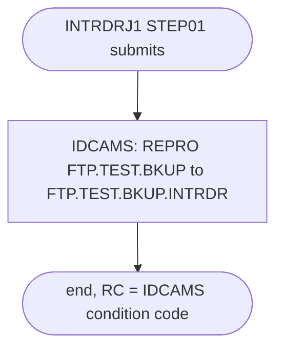

# INTRDRJ2: Copy the FTP test backup

## 1. Summary

INTRDRJ2 is the second half of the internal-reader sample. INTRDRJ1 submits it through the JES internal reader after backing up `AWS.M2.CARDEMO.FTP.TEST`. Its only step, `IDCAMS`, copies that backup, `AWS.M2.CARDEMO.FTP.TEST.BKUP`, into the existing data set `AWS.M2.CARDEMO.FTP.TEST.BKUP.INTRDR`, which shows that the submitted job ran. Its header comment wrongly describes an IMS database set-up. The job is not part of the CardDemo batch cycle and has no business logic.

## 2. Rules at a glance

The job has no business rules. Its items:

| ID | Rule |
| :-- | :-- |
| SE-JIRD2-001 | Copy `FTP.TEST.BKUP` into the existing `FTP.TEST.BKUP.INTRDR`, replacing its content. |
| ERR-JIRD2-001 | One step, no `COND`; the job's return code is the IDCAMS condition code, which nothing checks. |
| DEF-JIRD2-001 | The header comment describes creating IMS VSAM files `DEMODB` and `DEMODX`. |
| DEF-JIRD2-002 | Misspelled `CARDEMO` qualifier; nothing creates the pre-allocated output. |

## 3. Actors and triggers

- **Trigger:** submitted by INTRDRJ1 step `STEP01`, which copies member `INTRDRJ2` of `AWS.M2.CARDDEMO.JCL` to the internal reader (`app/jcl/INTRDRJ1.JCL:14-18`). It can also be submitted by hand. It is in neither README table (`./README.md:150-167`, `./README.md:351-379`), neither the CA-7 nor the Control-M schedule runs it, and the local runner does not emulate it.
- **Preconditions:** `AWS.M2.CARDEMO.FTP.TEST.BKUP` and `AWS.M2.CARDEMO.FTP.TEST.BKUP.INTRDR` are cataloged (both `DISP=SHR`).
- **Job card:** `INTRDRJ2 JOB (COBOL),'KSSOMAS',CLASS=A,MSGCLASS=H,MSGLEVEL=(1,1),REGION=5M,NOTIFY=&SYSUID` (`:1-2`), the same accounting and class as INTRDRJ1. No parameters.

## 4. Interfaces

| Step | Program | DD | Dataset | Disposition | Use | Source |
| :-- | :-- | :-- | :-- | :-- | :-- | :-- |
| `IDCAMS` | IDCAMS | `SYSPRINT` | `SYSOUT=*` | - | IDCAMS messages | `:8` |
| `IDCAMS` | IDCAMS | `IN` | `AWS.M2.CARDEMO.FTP.TEST.BKUP` | `SHR` | input, sequential | `:9` |
| `IDCAMS` | IDCAMS | `OUT` | `AWS.M2.CARDEMO.FTP.TEST.BKUP.INTRDR` | `SHR` | output, sequential, must exist | `:10` |
| `IDCAMS` | IDCAMS | `SYSIN` | in-stream | - | `REPRO` statement | `:11-13` |

The step has `DYNAMNBR=200` (`:7`), which the `REPRO` does not need. Return code of the job: the IDCAMS condition code.

## 5. Data used

- `AWS.M2.CARDEMO.FTP.TEST.BKUP`: copied record for record, not interpreted; it is the copy of `AWS.M2.CARDEMO.FTP.TEST` that INTRDRJ1 made (`app/jcl/INTRDRJ1.JCL:8-11`).

## 6. Processing flow

The only step is plumbing.

| # | Step | Class | What it does | Runs when |
| --: | :-- | :-- | :-- | :-- |
| 1 | `IDCAMS` | plumbing | copy `FTP.TEST.BKUP` to `FTP.TEST.BKUP.INTRDR` | always |

## 7. Business rules

None. The job copies a data set without interpreting it.

## 8. Validations and messages

None. No input is checked; IDCAMS writes its own messages to `SYSPRINT`.

## 9. Side effects

#### SE-JIRD2-001 · Copy the backup
- **What:** `REPRO IFILE(IN) OFILE(OUT)` copies every record of `AWS.M2.CARDEMO.FTP.TEST.BKUP` into `AWS.M2.CARDEMO.FTP.TEST.BKUP.INTRDR`. The output is opened for output, so its old content is replaced from the first record.
- **Source:** `:9-12`
- **Fidelity:** incidental (sample) · **Confidence:** reviewed (statement); platform-inferred (overwrite of a sequential `DISP=SHR` target)

## 10. Error handling

#### ERR-JIRD2-001 · Failures end the job, nothing reacts
- **When:** the `REPRO` fails, or `IN` or `OUT` cannot be allocated.
- **Then:** the job ends with the IDCAMS condition code (for example 12) or a JCL error. No later step or job checks it: INTRDRJ1 has normally ended when INTRDRJ2 runs (JES does not guarantee that order, FLOW-JIRD1-001), it does not wait for INTRDRJ2 in any case, and no schedule follows it. Restart means resubmitting the job; the copy is repeatable.
- **Source:** `:7, 12`
- **Fidelity:** incidental · **Confidence:** platform-inferred

## 11. Interactions

- **Upstream:** INTRDRJ1 writes the input (SE-JIRD1-001) and submits this job (SE-JIRD1-002). Because INTRDRJ1 submits the job even when its backup failed, this job may copy a stale backup (DEF-JIRD1-002).
- **Downstream:** none; no job reads `AWS.M2.CARDEMO.FTP.TEST.BKUP.INTRDR`.

## 12. Numeric, date and format details

None. The job copies records without interpreting any field.

## 13. Known defects and oddities

#### DEF-JIRD2-001 · The header comment describes another job
- The comment reads `THIS JOB IS TO CREATE PHYSICAL VSAM FILE FOR IMS DEMODB` and `AND INDEX DEMODX` (`:4-5`). The job defines no VSAM file and has nothing to do with IMS; it copies one sequential data set to another.
- **Source:** `:4-5, 12`
- **Status:** open · **Fidelity:** incidental · **Confidence:** reviewed

#### DEF-JIRD2-002 · Misspelled qualifier and a pre-allocated output
- Both data sets use `CARDEMO` instead of `CARDDEMO` (`:9-10`), like INTRDRJ1 and FTPJCL. The output `AWS.M2.CARDEMO.FTP.TEST.BKUP.INTRDR` is `DISP=SHR`, so it must exist before the job runs, and no job in the repository creates it.
- **Source:** `:9-10`
- **Status:** open · **Fidelity:** incidental · **Confidence:** reviewed

## 14. Open questions

None specific to this job; see Q-JIRD1-001 for whether the chain is needed at all.

## 15. Equivalence contract

If the chain is kept, a reimplementation must leave `FTP.TEST.BKUP.INTRDR` with exactly the records of `FTP.TEST.BKUP` after a run started by the INTRDRJ1 equivalent. IDCAMS messages may differ.

Review evidence (independent reviewers checked every item against the source, all WRONG and MINOR findings were fixed, and a fresh reviewer re-checked every changed or added item): [evidence/g-jobs-ops-review.md](../evidence/g-jobs-ops-review.md).

## 16. Paragraph coverage

| Step | Lines | Covered by |
| :-- | :-- | :-- |
| (job card) | 1-2 | §3 |
| `IDCAMS` | 7-13 | SE-JIRD2-001, ERR-JIRD2-001, DEF-JIRD2-001, DEF-JIRD2-002 |
