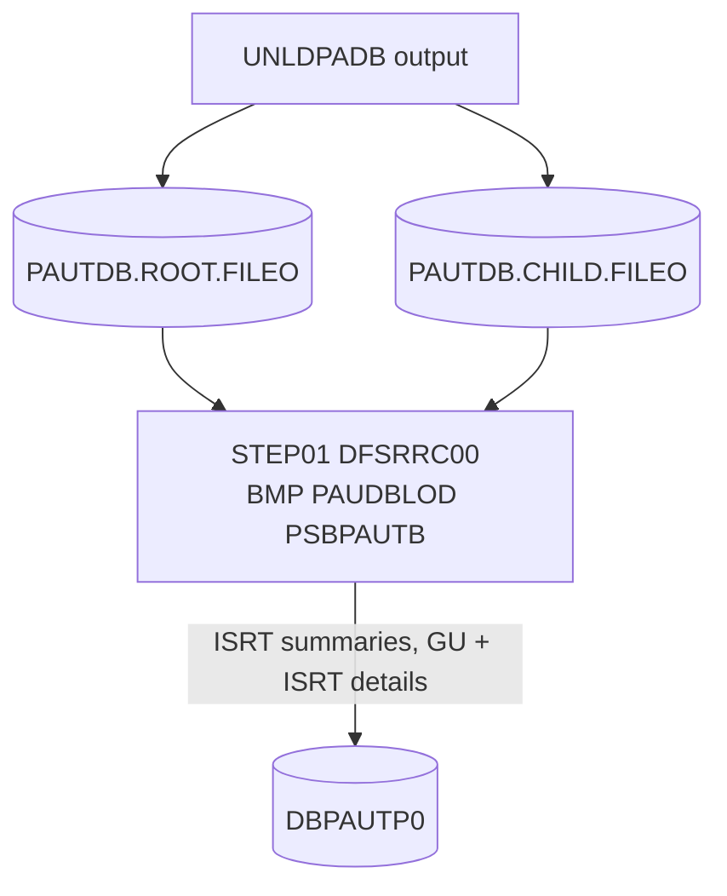

# LOADPADB: Pending authorization database reload

## 1. Summary

LOADPADB is the one-step job that runs PAUDBLOD as an IMS BMP to insert the summaries and details of the two sequential files written by UNLDPADB (PAUDBUNL) into the pending-authorization database `DBPAUTP0`. The load rules (summaries first, then each detail under the summary named by its parent key, existing segments skipped) belong to the PAUDBLOD spec. This spec covers the JCL: the BMP region and PSB, the input data sets, and what a load into a database that is not empty means (DEF-JLDPA-002). It is run on demand.

## 2. Rules at a glance

| ID | Rule |
| :-- | :-- |
| FLOW-JLDPA-001 | One step: `DFSRRC00` starts PAUDBLOD in a BMP region with PSB `PSBPAUTB`. |
| SE-JLDPA-001 | The input files are read, not changed. |
| SE-JLDPA-002 | Summaries and details are inserted into `DBPAUTP0` (program side effects), committed at the end. |
| ERR-JLDPA-001 | A program error ends with return code 16; the inserts made so far stay. |
| ERR-JLDPA-002 | A missing input data set or IMS environment error stops the step before the program runs. |
| NUM-JLDPA-001 | Input records are 100 and 206 bytes; the JCL gives no DCB. |
| DEF-JLDPA-001 | DL/I batch DDs left in a BMP step. |
| DEF-JLDPA-002 | The load merges into whatever the database holds; it does not restore an image. |
| DEF-JLDPA-003 | The README names a "Load PSB" that this job does not use. |

## 3. Actors and triggers

- **Trigger:** submitted by an operator after UNLDPADB, for example to rebuild or copy the database; no scheduler runs it.
- **Job card:** `'M2APP',CLASS=A,MSGCLASS=H,MSGLEVEL=(1,1),REGION=0M,NOTIFY=&SYSUID,TIME=1440` (`:1-2`): `TIME=1440` removes the CPU time limit. A `JCLLIB` statement is commented out (`:20`).
- **Preconditions:** the IMS control region is up with `DBPAUTP0` available for update to BMPs; `PSBPAUTB` is generated (`PSBPAUTB.psb:17-20`); the two input data sets exist and are cataloged (UNLDPADB).

## 4. Interfaces

### Step `STEP01` (DFSRRC00, BMP PAUDBLOD)

| DD | Dataset | DISP | DCB | Use | Source |
| :-- | :-- | :-- | :-- | :-- | :-- |
| `STEPLIB` | `OEMA.IMS.IMSP.SDFSRESL`, `OEMA.IMS.IMSP.SDFSRESL.V151`, `AWS.M2.CARDDEMO.LOADLIB` | `SHR` | - | IMS modules, then the program | `:28-30` |
| `DFSRESLB` | `OEMA.IMS.IMSP.SDFSRESL` | `SHR` | - | IMS resident library | `:31` |
| `IMS` | `OEM.IMS.IMSP.PSBLIB`, then `OEM.IMS.IMSP.DBDLIB` | `SHR` | - | PSB and DBD libraries | `:33-34` |
| `INFILE1` | `AWS.M2.CARDDEMO.PAUTDB.ROOT.FILEO` | `SHR` | from the data set label (100-byte records) | summary records, read sequentially (PAUDBLOD BR-PDLD-001) | `:36` |
| `INFILE2` | `AWS.M2.CARDDEMO.PAUTDB.CHILD.FILEO` | `SHR` | from the data set label (206-byte records) | detail records with parent key (PAUDBLOD BR-PDLD-002) | `:38` |
| `DDPAUTP0`, `DDPAUTX0` | commented out | - | - | not allocated: a BMP uses the control region's database | `:40-41` |
| `DFSVSAMP` | `OEMPP.IMS.V15R01MB.PROCLIB(DFSVSMDB)` | `SHR` | - | VSAM buffer definitions of a DL/I batch region (DEF-JLDPA-001) | `:44-45` |
| `IMSLOGR`, `IEFRDER` | `DUMMY` | - | - | batch log data sets (DEF-JLDPA-001) | `:46-47` |
| `SYSPRINT`, `SYSUDUMP`, `IMSERR` | `SYSOUT=*` | - | - | messages, dump, IMS errors | `:48-50` |

There is no `SYSOUT` DD for the program's `DISPLAY` output (PAUDBLOD section 4.3); where it appears depends on the installation's COBOL run-time defaults. **Confidence:** platform-inferred.

Return code of the job: the return code PAUDBLOD sets (0, or 16 after an open or insert error, PAUDBLOD ERR-PDLD-005).

## 5. Data used

ENT-AUTH-ROOT-FILE and ENT-AUTH-CHILD-FILE (input); ENT-AUTH-SUMMARY and ENT-AUTH-DETAIL in `DBPAUTP0` (output), through `PAUTBPCB` with `PROCOPT=AP`.

## 6. Processing flow

| # | Step | Program or utility | Purpose | Class |
| --: | :-- | :-- | :-- | :-- |
| 1 | `STEP01` | `DFSRRC00` → PAUDBLOD (BMP, PSB `PSBPAUTB`) | insert the unloaded summaries and details into `DBPAUTP0` | plumbing |

#### FLOW-JLDPA-001 · Start the load program as a BMP
- **What:** `STEP01` executes `DFSRRC00` with `PARM='BMP,PAUDBLOD,PSBPAUTB'`: region type BMP, program PAUDBLOD, PSB `PSBPAUTB` (the same PSB as the purge and the online programs). No IMS subsystem ID is given, so the default IMS system is used. PAUDBLOD then reads `INFILE1` to the end, then `INFILE2` (PAUDBLOD FLOW-PDLD-001).
- **Source:** `:26-27`
- **Fidelity:** must-preserve · **Confidence:** platform-inferred

## 7. Business rules

None. The step reloads data; the load rules are PAUDBLOD BR-PDLD-001..003.

## 8. Validations and messages

None at job level. PAUDBLOD's messages are listed in its section 4.3.

## 9. Side effects

#### SE-JLDPA-001 · Input files read only
- **What:** `INFILE1` and `INFILE2` are allocated `DISP=SHR` and opened for input; they are neither changed nor deleted, so the same files can be loaded again.
- **Source:** `:36-38`
- **Fidelity:** incidental · **Confidence:** reviewed

#### SE-JLDPA-002 · Inserts into the authorization database
- **What:** PAUDBLOD inserts every summary not yet in the database and every detail whose summary is found (PAUDBLOD SE-PDLD-001, SE-PDLD-002); segments that already exist are reported and kept. The program takes no checkpoints, so IMS commits all inserts at the end of the step, including the end with return code 16 (PAUDBLOD DEF-PDLD-004).
- **Source:** `:26-27`
- **Fidelity:** must-preserve · **Confidence:** platform-inferred

## 10. Error handling

#### ERR-JLDPA-001 · Program error ends with return code 16
- **When:** an open or insert error in PAUDBLOD (PAUDBLOD ERR-PDLD-001, ERR-PDLD-003).
- **Then:** the program ends with return code 16 without an abend (PAUDBLOD ERR-PDLD-005); the inserts made so far are committed. A read error that repeats loops forever (PAUDBLOD DEF-PDLD-003) until the operator cancels the job, which backs out the uncommitted inserts.
- **Restart:** a rerun with the same files reports the segments already loaded as already in the database and inserts the rest (PAUDBLOD BR-PDLD-001, BR-PDLD-002).
- **Source:** `:26-27`
- **Confidence:** platform-inferred

#### ERR-JLDPA-002 · Missing input or IMS environment
- **When:** an input data set is not cataloged, the control region is down, or `PSBPAUTB` is not available.
- **Then:** the job fails at allocation (JCL error) or `DFSRRC00` fails before the program runs; nothing is inserted.
- **Source:** `:26-38`
- **Confidence:** platform-inferred

## 11. Interactions

- **Program:** PAUDBLOD.
- **Upstream:** UNLDPADB (PAUDBUNL) writes both input files. The GSAM files of UNLDGSAM have another detail layout and cannot be loaded (DBUNLDGS DEF-DBUL-001).
- **Shared data:** as a BMP the load runs while CICS can use the database; COPAUA0C can create a summary or detail between the unload and the load, which the load then reports as already present (DEF-JLDPA-002).

## 12. Numeric, date and format details

#### NUM-JLDPA-001 · Input record sizes
- The JCL gives no DCB for the inputs; the record lengths come from the data set labels written by UNLDPADB: 100 bytes `FB` for `INFILE1`, 206 bytes `FB` for `INFILE2` (`UNLDPADB.JCL:48-56`), matching the program's records (`PAUDBLOD.CBL:26-48`).
- **Source:** `:36-38`
- **Fidelity:** must-preserve · **Confidence:** reviewed

## 13. Known defects and oddities

#### DEF-JLDPA-001 · DL/I batch DDs in a BMP step
- `DFSVSAMP`, `IMSLOGR` and `IEFRDER` belong to a DL/I batch region that opens the database itself; in a BMP they are not used. The database DDs are commented out (`:40-41`), so the step cannot simply be switched to `DLI`. The leftovers suggest the job was converted from a batch load.
- **Source:** `:40-47` · **Status:** open · **Fidelity:** incidental · **Confidence:** platform-inferred

#### DEF-JLDPA-002 · Merge, not restore
- Nothing empties or reinitializes `DBPAUTP0` before the load. Loaded into a database that is not empty, the job keeps every existing segment unchanged (a summary changed online after the unload keeps its new totals, because the insert of the unloaded copy returns `II`) and re-inserts the segments deleted since the unload (details purged since the unload come back). The result is a restore only when the database is empty.
- **Source:** `:26-38` · **Status:** open · **Fidelity:** defect-decide · **Confidence:** reviewed

#### DEF-JLDPA-003 · README names another PSB for loading
- The module README lists `PSBPAUTL` as the "Load PSB" (`app/app-authorization-ims-db2-mq/README.md:102-104`) and, in its table, as "For online processing" (`app/app-authorization-ims-db2-mq/README.md:262-265`). `PSBPAUTL` has `PROCOPT=L` (initial load, `PSBPAUTL.psb:17`), which allows inserts only, while PAUDBLOD also issues `GU`; the job uses `PSBPAUTB` (`PROCOPT=AP`). The README is inconsistent; the job is consistent with the program.
- **Source:** `:27` · **Status:** open · **Fidelity:** incidental · **Confidence:** platform-inferred

## 14. Open questions

| ID | Question | For |
| :-- | :-- | :-- |
| Q-JLDPA-001 | Should the reload start from an empty database (restore) or merge into the current one (DEF-JLDPA-002)? Who empties the database before a restore? | operations, mainframe team |

## 15. Equivalence contract

For the same input files and database content, the inserted, skipped and reported segments must match PAUDBLOD's equivalence contract. At job level: the inputs are left unchanged and the result is committed at the end; region type, libraries and console text may differ. Not runnable locally (IMS). Review record: `docs/modernization/spec/evidence/e-review.md`.

## 16. Step coverage

| Step | Lines | Covered by |
| :-- | :-- | :-- |
| (job card) | 1-2 | FLOW-JLDPA-001 |
| `STEP01` | 26-50 | FLOW-JLDPA-001, SE-JLDPA-001, SE-JLDPA-002, ERR-JLDPA-001, ERR-JLDPA-002, NUM-JLDPA-001, DEF-JLDPA-001, DEF-JLDPA-002, DEF-JLDPA-003 |
