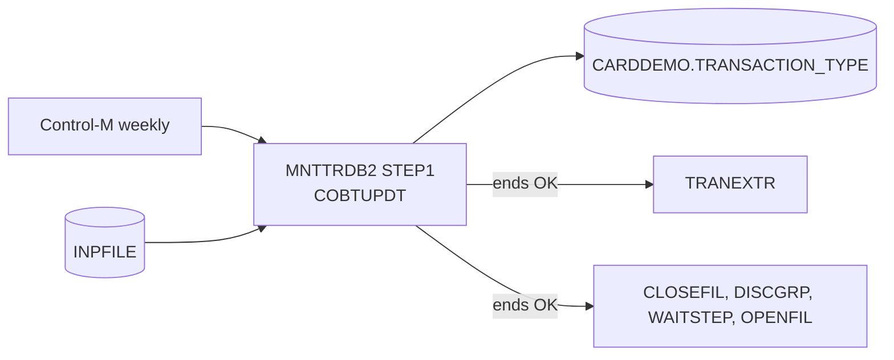

# MNTTRDB2: Weekly batch maintenance of the transaction type table

## 1. Summary

One step: the TSO terminal monitor `IKJEFT01` starts the Db2 DSN command processor, which runs program COBTUPDT under plan `CARDDEMO` against Db2 subsystem `DAZ1`. COBTUPDT reads the change file `INPFILE` and adds, updates or deletes rows of `CARDDEMO.TRANSACTION_TYPE` (see the COBTUPDT spec). Control-M schedules the job in the weekly transaction type refresh; when it ends OK, TRANEXTR and the disclosure group refresh chain may start.

## 2. Rules at a glance

| ID | Rule |
| :-- | :-- |
| BR-JMNTT-001 | The step runs COBTUPDT with plan `CARDDEMO` on Db2 `DAZ1`; the business rules are those of COBTUPDT. |
| FLOW-JMNTT-001 | Control-M: MNTTRDB2 ending OK releases TRANEXTR and CLOSEFIL of the disclosure group refresh. |
| ERR-JMNTT-001 | The step's result is COBTUPDT's return code (0 or 4); an unreadable input file never ends. |

## 3. Actors and triggers

- **Scheduler:** Control-M job `MNTTRDB2`, folder `WEEKLY-TransactionTypesDBRefresh`, description `WEEKLY MNTTRDB2`, submit window until `TIMETO="23:00"`, `MAXRERUN="5"` (`app/scheduler/CardDemo.controlm:26-31`). The job entry has no `DAYS` attribute while the smart folders that wait for it run on Saturdays (`DAYS="SA"`, `app/scheduler/CardDemo.controlm:32, 57`) (Q-JMNTT-002).
- **Manual:** an operator may submit it after preparing the input file.
- **Preconditions:** the input dataset exists with 53-byte fixed records; plan `CARDDEMO` includes the COBTUPDT package; the Db2 objects of CREADB21 exist.

## 4. Interfaces

Job card: `CLASS=A`, `MSGCLASS=H`, `MSGLEVEL=(1,1)`, `NOTIFY=&SYSUID`, `TIME=1440` (no CPU time limit) (`:1-2`).

| DD | Dataset | DISP | Use |
| :-- | :-- | :-- | :-- |
| `STEPLIB` | `OEM.DB2.DAZ1.SDSNEXIT`, `OEMA.DB2.VERSIONA.SDSNLOAD`, `AWS.M2.CARDDEMO.LOADLIB` | SHR | Db2 modules and the COBTUPDT load module |
| `DBRMLIB` | `AWS.M2.CARDDEMO.DBRMLIB` | SHR | not used by `RUN` (needed only to bind) |
| `SYSTSPRT` | SYSOUT | - | TSO and DSN messages; also COBTUPDT's DISPLAY lines, because there is no `SYSOUT` DD (platform-inferred) |
| `INPFILE` | `INPFILE` | SHR | ENT-TTYP-MAINT-INPUT, read by COBTUPDT. The dataset name is a one-level placeholder. |
| `SYSTSIN` | in-stream | - | `DSN SYSTEM(DAZ1)` and `RUN PROGRAM(COBTUPDT) PLAN(CARDDEMO)` |

The header comment documents the input layout: column 1 `A`/`D`/`U`/`*`, columns 2-3 the type ("numeric value"), columns 4-53 the description (`:8-18`).

## 5. Data used

ENT-TTYP-MAINT-INPUT (read), ENT-DB2-TRAN-TYPE (insert, update, delete). Field use is in the COBTUPDT spec, section 5.

## 6. Processing flow

| Step | Program | Purpose | Class |
| :-- | :-- | :-- | :-- |
| STEP1 | IKJEFT01 → DSN → COBTUPDT | apply the change file to the type table | business |

## 7. Business rules

#### BR-JMNTT-001 · Run COBTUPDT
- **When:** STEP1 runs.
- **Then:** COBTUPDT applies each input record in file order (BR-TTBU-001 .. BR-TTBU-006); the DSN processor connects to `DAZ1` with plan `CARDDEMO`, and on a normal end the changes are committed (SE-TTBU-004).
- **Source:** `:21-30`
- **Fidelity:** must-preserve · **Confidence:** reviewed

## 8. Validations

None in the job. COBTUPDT's validations are VAL-TTBU-001 and VAL-TTBU-002.

## 9. Side effects

#### SE-JMNTT-001 · Type table changes
- Inserts, updates and deletes in `CARDDEMO.TRANSACTION_TYPE` (SE-TTBU-001 .. SE-TTBU-004). No dataset is created, deleted or written; `INPFILE` is only read.
- **Source:** `:27-30`

## 10. Error handling

#### ERR-JMNTT-001 · Step result
- The step ends with COBTUPDT's return code: 0, or 4 when a record failed (BR-TTBU-005), assuming the DSN processor passes it on (Q-TTBU-001). There is no COND or IF logic; it is the only step.
- If `INPFILE` names no existing dataset, allocation fails and the job ends with a JCL error before the program starts. If the dataset exists but cannot be opened as 53-byte records, COBTUPDT loops for ever (DEF-TTBU-001); with `TIME=1440` only an operator cancel or an output limit stops it, and the cancel backs out every change of the run (SE-TTBU-004).
- **Restart:** rerunning after a partial failure repeats every record (DEF-TTBU-005).
- **Source:** `:1-2, 21-30`
- **Confidence:** platform-inferred

#### FLOW-JMNTT-001 · Control-M successors
- **When:** MNTTRDB2 ends OK.
- **Then:** Control-M adds condition `WEEKLY-TransactionTypesDBRefresh-MNTTRDB2` (`app/scheduler/CardDemo.controlm:28`). TRANEXTR (`app/scheduler/CardDemo.controlm:58-61`) and CLOSEFIL of the disclosure group refresh (`app/scheduler/CardDemo.controlm:33-37`) both wait for it; both smart folders remove it at their end (`app/scheduler/CardDemo.controlm:55, 62`). Whether an end with return code 4 counts as OK depends on the Control-M definitions, which set no explicit return-code rule (Q-TTBU-001).
- **Source:** `app/scheduler/CardDemo.controlm:26-37, 55-62`
- **Confidence:** platform-inferred

## 11. Interactions

- **Program:** COBTUPDT (all its rules).
- **Before:** an operator or upstream process provides the input file (not in the repository).
- **After:** TRANEXTR unloads the table into the `TRANTYPE.PS` and `TRANCATG.PS` files; the disclosure group refresh chain (CLOSEFIL, DISCGRP, WAITSTEP, OPENFIL) also depends on this job (owned by the base jobs area).

## 12. Numeric, date and format details

#### NUM-JMNTT-001 · Input file
- Fixed 53-byte records (NUM-TTBU-001). The JCL does not give DCB attributes; they come from the existing dataset's label.
- **Source:** `:27`

## 13. Known defects and oddities

#### DEF-JMNTT-001 · Placeholder input dataset
- `DSN=INPFILE` is a one-level name that will not exist on a real system; every run needs the JCL edited, and a weekly schedule with a fixed name implies someone replaces the file each week (Q-TTBU-005).
- **Source:** `:27` · **Status:** open · **Fidelity:** incidental

#### DEF-JMNTT-002 · No CPU limit around a program that can loop
- `TIME=1440` disables the CPU time limit, so DEF-TTBU-001 runs until cancelled.
- **Source:** `:1-2` · **Status:** open

#### DEF-JMNTT-003 · Disclosure group refresh waits for the type maintenance
- CLOSEFIL of the `WEEKLY-DisclosureGroupsRefresh` folder waits for the MNTTRDB2 condition, so the disclosure group refresh does not run in a week when MNTTRDB2 did not end OK. Nothing in the data links the two.
- **Source:** `app/scheduler/CardDemo.controlm:33-37` · **Status:** open (operations, Q-JMNTT-001)

#### DEF-JMNTT-004 · Hard-coded environment
- Db2 subsystem `DAZ1` and the load libraries are coded in the JCL, and `DBRMLIB` is allocated without being used.
- **Source:** `:22-25, 29` · **Status:** open · **Fidelity:** incidental

## 14. Open questions

| ID | Question | For |
| :-- | :-- | :-- |
| Q-JMNTT-001 | Is the dependency of the disclosure group refresh on MNTTRDB2 intended? | operations |
| Q-JMNTT-002 | On which day does Control-M order MNTTRDB2 (its job entry has no `DAYS`)? | mainframe team |

## 15. Equivalence contract

The job is equivalent when the target runs the COBTUPDT equivalent on the week's change file, under the same commit scope, and signals success or failure to the scheduler so that TRANEXTR starts only after it. The COBTUPDT equivalence contract applies to the data. The review is in `docs/modernization/spec/evidence/f-trantype-vsam-mq-review.md`.

## 16. Step coverage

| Step | Lines | Covered by |
| :-- | :-- | :-- |
| (job statement and comments) | 1-20 | §4, DEF-JMNTT-002, NUM-JMNTT-001 |
| `STEP1` | 21-30 | BR-JMNTT-001, SE-JMNTT-001, ERR-JMNTT-001, FLOW-JMNTT-001, DEF-JMNTT-001, DEF-JMNTT-004 |

1 of 1 step covered.
