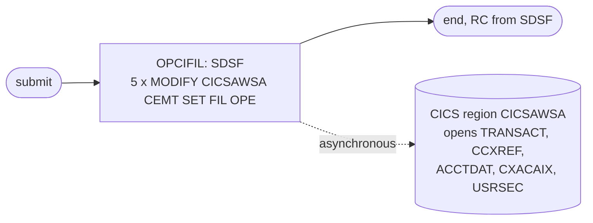

# OPENFIL: Open the CardDemo files in CICS

## 1. Summary

OPENFIL hands the five files that CLOSEFIL closed back to the online system. Its only step runs the SDSF batch interface, which issues five MVS `MODIFY` commands to the CICS region `CICSAWSA`, each asking CICS to open one file (`CEMT SET FIL(...) OPE`). It ends most chains in both schedules and the README and demo-script sequences, but not all of them: the Control-M MNTTRDB2 folder and TRANEXTR smart folder have no OPENFIL (`app/scheduler/CardDemo.controlm:26-31, 57-63`), and in CA-7 an OPENFIL that runs under schedule ID 031 triggers CLOSEFIL again (section 3). It contains no business logic.

## 2. Rules at a glance

| ID | Rule |
| :-- | :-- |
| FLOW-JOPEN-001 | One SDSF step sends five `MODIFY` commands to region `CICSAWSA`, in the same order as CLOSEFIL. |
| SE-JOPEN-001 | CICS opens files `TRANSACT`, `CCXREF`, `ACCTDAT`, `CXACAIX` and `USRSEC`. |
| ERR-JOPEN-001 | The job's return code does not tell whether CICS opened the files. |
| DEF-JOPEN-001 | The CICS region name is hard-coded. |
| DEF-JOPEN-002 | The README listed the program as IEFBR14; the JCL runs SDSF. Corrected in commit 4a03121. |

## 3. Actors and triggers

- **Triggers:**
  - CA-7: job `OPENFIL` (`app/scheduler/CardDemo.ca7:126-148`), triggered by WAITSTEP with SCHID 030 (`app/scheduler/CardDemo.ca7:123-124, 452-453, 526-527`) and SCHID 031 (`app/scheduler/CardDemo.ca7:568-569`). Its full listing has no triggered-jobs section and its "COMP TRIGGERS OTHER JOBS" flag is `N` (`app/scheduler/CardDemo.ca7:126-148`), but a later short listing gives it one trigger, CLOSEFIL with SCHID 031 (`app/scheduler/CardDemo.ca7:529-532`). A trigger fires only when its job runs under that schedule ID, and the triggered job inherits the ID: an OPENFIL triggered under 030 ends its chain, and an OPENFIL triggered under 031 (`app/scheduler/CardDemo.ca7:568-569`) closes the files again (FLOW-JCA7-004, DEF-JCA7-008). See `SCHED-CA7.md`.
  - Control-M: last job of `DAILY-TransactionBackup`, `WEEKLY-DisclosureGroupsRefresh` and `MONTHLY-InterestCalculation` (`app/scheduler/CardDemo.controlm:20-24, 50-54, 87-91`), each time after WAITSTEP. See `SCHED-CONTROLM.md`.
  - By hand: README initialisation (`./README.md:165`), demo script job 16 (`scripts/run_full_batch.sh:65-66`), batch cycle step 9 (`docs/runbooks/batch-cycle-restart.md:21`).
- **Preconditions:** the batch jobs that use the five files have ended; region `CICSAWSA` is up; the user may issue `MODIFY` through SDSF.
- **Job card:** `CLASS=A,MSGCLASS=0,NOTIFY=&SYSUID` (`:1-2`). No parameters.

## 4. Interfaces

| Step | Program | DD | Dataset | Disposition | Use | Source |
| :-- | :-- | :-- | :-- | :-- | :-- | :-- |
| `OPCIFIL` | SDSF | `ISFOUT` | `SYSOUT=*` | - | SDSF panel output | `:23` |
| `OPCIFIL` | SDSF | `CMDOUT` | `SYSOUT=*` | - | command responses | `:24` |
| `OPCIFIL` | SDSF | `ISFIN` | in-stream | - | the five commands | `:25-31` |

The commands (exact text, one leading space, `:26-30`): `/F CICSAWSA,'CEMT SET FIL(TRANSACT ) OPE'`, `/F CICSAWSA,'CEMT SET FIL(CCXREF ) OPE'`, `/F CICSAWSA,'CEMT SET FIL(ACCTDAT ) OPE'`, `/F CICSAWSA,'CEMT SET FIL(CXACAIX ) OPE'`, `/F CICSAWSA,'CEMT SET FIL(USRSEC ) OPE'`. The file to dataset mapping is the one in `CLOSEFIL.md` section 4 (`app/csd/CARDDEMO.CSD:1-12, 37-49, 63-99`).

## 5. Data used

No record is read or written. The job changes the open state of the CICS file resources for ENT-TRANSACTION, ENT-CARD-XREF (two files), ENT-ACCOUNT and the user security file.

## 6. Processing flow

| # | Step | Program | Purpose | Class |
| --: | :-- | :-- | :-- | :-- |
| 1 | `OPCIFIL` | SDSF | send the five open commands to CICS | plumbing |

## 7. Business rules

None. The job controls file availability only.

## 8. Validations and messages

None. CICS responses go to the console and to `CMDOUT` (incidental).

## 9. Side effects

#### FLOW-JOPEN-001 · Five MODIFY commands in a fixed order
- **What:** SDSF issues each `ISFIN` line as an MVS `MODIFY` command to region `CICSAWSA`, in the order `TRANSACT`, `CCXREF`, `ACCTDAT`, `CXACAIX`, `USRSEC`.
- **Source:** `:22-31`
- **Fidelity:** incidental · **Confidence:** reviewed

#### SE-JOPEN-001 · CICS opens the five files
- **What:** CICS opens each named file, so online transactions can read and update it again. Without this job the files stay unavailable: CLOSEFIL's close leaves each file closed and UNENABLED (SE-JCLOSE-001), and CICS does not open an UNENABLED file at its first use, so requests get "not open" although the files are defined `OPENTIME(FIRSTREF)` (`app/csd/CARDDEMO.CSD:4`). `FIRSTREF` only opens a file that is closed but enabled, for example after a CICS restart. Opening an UNENABLED file by command also enables it; the runbook gives `OPEN ENABLED` for the manual fix (`docs/runbooks/cics-vsam-files.md:76-83`).
- **Source:** `:26-30`
- **Fidelity:** must-preserve (online access resumes only after batch has finished) · **Confidence:** platform-inferred

## 10. Error handling

#### ERR-JOPEN-001 · The return code does not confirm the open
- **When:** CICS cannot open a file, for example because a file was deleted by TRANBKP and not yet redefined, or a batch job still has it allocated.
- **Then:** SDSF still ends normally; the failure is only visible on the console and in CICS (`CEMT INQUIRE FILE(*)`, `docs/runbooks/cics-vsam-files.md:44-50`). Users then get "not open" conditions online.
- **Source:** `:22-31`
- **Fidelity:** defect-decide · **Confidence:** platform-inferred

## 11. Interactions

- **Upstream:** the last processing job of the chain, through WAITSTEP in both schedules.
- **Counterpart:** CLOSEFIL (same files, `CLO`).
- **Not opened:** `CARDDAT`, `CARDAIX`, `CUSTDAT` are not touched (they are not closed by CLOSEFIL either; DEF-JCLOSE-003).

## 12. Numeric, date and format details

None. The job has no data fields.

## 13. Known defects and oddities

#### DEF-JOPEN-001 · The CICS region name is hard-coded
- Every command names region `CICSAWSA`; there is no symbolic parameter (same as DEF-JCLOSE-001).
- **Source:** `:26-30`
- **Status:** open · **Fidelity:** incidental · **Confidence:** reviewed

#### DEF-JOPEN-002 · README named the wrong program
- The README batch table listed OPENFIL with program `IEFBR14`, while the JCL runs `PGM=SDSF`. Commit 4a03121 changed the row to `SDSF` (`./README.md:371`).
- **Source:** `:22`
- **Status:** fixed in branch, commit 4a03121 (documentation) · **Fidelity:** incidental · **Confidence:** reviewed

## 14. Open questions

| ID | Question | For |
| :-- | :-- | :-- |
| Q-JOPEN-001 | Should the end of the batch window be confirmed (all files open and enabled) before online users are let back in, rather than assumed from the job's completion? | mainframe team, operations |

## 15. Equivalence contract

A target is equivalent when, after this step, online functions can read and update the five data sets again, and not before the batch steps that precede it in the chain have ended. Command text, SDSF output and the region name are not part of the contract.

Review evidence (independent reviewers checked every item against the source, all WRONG and MINOR findings were fixed, and a fresh reviewer re-checked every changed or added item): [evidence/g-jobs-ops-review.md](../evidence/g-jobs-ops-review.md).

## 16. Paragraph coverage

| Step | Lines | Covered by |
| :-- | :-- | :-- |
| (job card) | 1-2 | §3 |
| `OPCIFIL` | 22-31 | FLOW-JOPEN-001, SE-JOPEN-001, ERR-JOPEN-001, DEF-JOPEN-001, DEF-JOPEN-002 |
